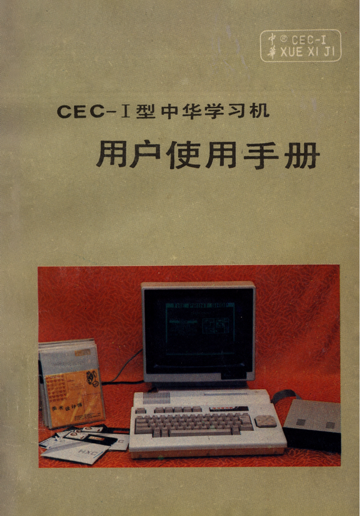

# CEC-I 型中华学习机用户使用手册

## 出版信息

- **书名**：CEC-I 型中华学习机用户使用手册
- **出版**：电子工业出版社（北京海淀区万寿路）
- **印装**：房山区龙门口印刷厂
- **开本**：787 × 1092 毫米 1/32
- **字数**：260 千字
- **版次**：1988 年 9 月第二版，1988 年 9 月第二次印刷

---

## 目录

- **[第一章 CEC-I 中华学习机简介](ch01-introduction.md)** (p. 1)
  - [1.1 基本系统的组成](ch01-introduction.md#11-基本系统的组成) (p. 1)
  - [1.2 CEC-I 的内部结构](ch01-introduction.md#12-cec-i-的内部结构) (p. 3)
  - [1.3 键盘和屏幕显示](ch01-introduction.md#13-键盘和屏幕显示) (p. 4)
  - [1.4 盒式磁带录音机](ch01-introduction.md#14-盒式磁带录音机) (p. 5)
  - [1.5 软盘驱动器](ch01-introduction.md#15-软盘驱动器) (p. 5)
  - [1.6 打印机](ch01-introduction.md#16-打印机) (p. 6)
  - [1.7 系统软件](ch01-introduction.md#17-系统软件) (p. 6)
  - [1.8 应用软件](ch01-introduction.md#18-应用软件) (p. 6)
- **[第二章 CEC-I 中华学习机的操作使用](ch02-operation.md)** (p. 7)
  - [2.1 CEC-I 系统的安装](ch02-operation.md#21-cec-i-系统的安装) (p. 7)
    - [2.1.1 开箱](ch02-operation.md#211-开箱) (p. 7)
    - [2.1.2 显示器的连接](ch02-operation.md#212-显示器的连接) (p. 7)
    - [2.1.3 录音机连接](ch02-operation.md#213-录音机连接参阅图-24) (p. 9)
    - [2.1.4 游戏杆连接](ch02-operation.md#214-游戏杆连接) (p. 10)
    - [2.1.5 磁盘驱动器连接](ch02-operation.md#215-磁盘驱动器连接参阅图-26) (p. 10)
    - [2.1.6 扩充卡的连接](ch02-operation.md#216-扩充卡的连接参阅图-27) (p. 11)
  - [2.2 CEC-I 中华学习机的启动](ch02-operation.md#22-cec-i-中华学习机的启动) (p. 12)
    - [2.2.1 基本系统的启动](ch02-operation.md#221-基本系统的启动) (p. 12)
    - [2.2.2 连接驱动器系统的启动](ch02-operation.md#222-连接驱动器系统的启动) (p. 12)
  - [2.3 键盘操作](ch02-operation.md#23-键盘操作) (p. 13)
    - [2.3.1 SHIFT 键](ch02-operation.md#231-shift-键) (p. 14)
    - [2.3.2 CAPS LOCK 键](ch02-operation.md#232-caps-lock-键) (p. 14)
    - [2.3.3 Ctrl 键](ch02-operation.md#233-ctrl-键) (p. 15)
    - [2.3.4 `◁` 键 `▷` 键](ch02-operation.md#234--键--键) (p. 15)
    - [2.3.5 `△` 键 `▽` 键](ch02-operation.md#235--键--键) (p. 15)
    - [2.3.6 Esc 键](ch02-operation.md#236-esc-键) (p. 16)
    - [2.3.7 Return 键](ch02-operation.md#237-return-键) (p. 17)
    - [2.3.8 Reset 键](ch02-operation.md#238-reset-键) (p. 17)
    - [2.3.9 其它一些功能键](ch02-operation.md#239-其它一些功能键) (p. 17)
  - [2.4 CEC-I 主机的自检测](ch02-operation.md#24-cec-i-主机的自检测) (p. 18)
  - [2.5 汉字输入方法](ch02-operation.md#25-汉字输入方法) (p. 19)
    - [2.5.1 拼音输入方式](ch02-operation.md#251-拼音输入方式) (p. 20)
    - [2.5.2 区位码输入方式](ch02-operation.md#252-区位码输入方式) (p. 21)
    - [2.5.3 特殊符号的输入](ch02-operation.md#253-特殊符号的输入) (p. 21)
  - [2.6 磁带录音机的使用](ch02-operation.md#26-磁带录音机的使用) (p. 21)
    - [2.6.1 盒式磁带的处理](ch02-operation.md#261-盒式磁带的处理) (p. 22)
    - [2.6.2 音量的调节](ch02-operation.md#262-音量的调节) (p. 22)
    - [2.6.3 游戏磁带软件的使用方法](ch02-operation.md#263-游戏磁带软件的使用方法) (p. 22)
    - [2.6.4 BASIC 程序的存取方法](ch02-operation.md#264-basic-程序的存取方法) (p. 23)
  - [2.7 软盘驱动器的使用](ch02-operation.md#27-软盘驱动器的使用) (p. 24)
    - [2.7.1 软磁盘的使用](ch02-operation.md#271-软磁盘的使用) (p. 25)
    - [2.7.2 DOS 3.3 磁盘操作系统简介](ch02-operation.md#272-dos-33-磁盘操作系统简介) (p. 26)
    - [2.7.3 软盘的初始化处理](ch02-operation.md#273-软盘的初始化处理) (p. 28)
    - [2.7.4 查看软盘上的文件目录](ch02-operation.md#274-查看软盘上的文件目录) (p. 29)
    - [2.7.5 保存 BASIC 程序到软盘上](ch02-operation.md#275-保存-basic-程序到软盘上) (p. 31)
    - [2.7.6 从软盘上读 BASIC 程序](ch02-operation.md#276-从软盘上读-basic-程序) (p. 32)
    - [2.7.7 清除软盘上的文件](ch02-operation.md#277-清除软盘上的文件) (p. 33)
    - [2.7.8 更换软盘上的文件名](ch02-operation.md#278-更换软盘上的文件名) (p. 34)
    - [2.7.9 磁盘文件的加锁与解锁](ch02-operation.md#279-磁盘文件的加锁与解锁) (p. 34)
- **第三章 CEC-BASIC 语言程序设计** (p. 35)
  - **[Part 1: 3.1 – 3.5](ch03a-basic-part1.md)**
    - [3.1 CEC-BASIC 简介](ch03a-basic-part1.md#31-cec-basic-简介) (p. 35)
    - [3.2 输入与输出语句 (`LET`, `DATA`, `READ`, `RESTORE`, `INPUT`, `GET`, `PRINT`, `IN#`, `PR#`)](ch03a-basic-part1.md#32-输入与输出语句) (p. 40)
    - [3.3 和顺序有关的语句 (`GOTO`, `IF...THEN`, `FOR NEXT`, `GOSUB RETURN`, `POP`, 多向转移, `ONERR GOTO`, `RESUME`)](ch03a-basic-part1.md#33-和顺序有关的语句) (p. 46)
    - [3.4 和系统有关的语句 (`LOAD`/`SAVE`, `NEW`, `RUN`, `STOP`, `END`, `CTRL-C`, `CONT`, `CTRL-RESET`, `TRACE`/`NOTRACE`, `POKE`, `WAIT`, `CALL`, `HIMEM`, `LOMEM`, `PLAY`)](ch03a-basic-part1.md#34-和系统有关的语句) (p. 55)
    - [3.5 编辑与显示格式语句 (`LIST`, `DEL`, `REM`, `VTAB`, `HTAB`, `HOME`, `CLEAR`, `FLASH`, `INVERSE`, `NORMAL`, `SPEED`)](ch03a-basic-part1.md#35-编辑与显示格式语句) (p. 62)
  - **[Part 2: 3.6 – 3.8](ch03b-basic-part2.md)**
    - [3.6 定义语句 (`DIM`, `DEF FN`)](ch03b-basic-part2.md#36-定义语句) (p. 66)
    - [3.7 文本、图形与音响语句 (`TEXT`, `GR`, `COLOR`, `PLOT`, `HLIN`, `VLIN`, `HGR`, `HGR2`, `HCOLOR`, `HPLOT`, `MUSIC`)](ch03b-basic-part2.md#37-文本图形与音响语句) (p. 69)
    - [3.8 高分辨率图形的向量作图法 (`DRAW`, `XDRAW`, `SCALE`, `ROT`, `SHLOAD`)](ch03b-basic-part2.md#38-高分辨率图形的向量作图法) (p. 75)
  - **[Part 3: 3.9 函数](ch03c-basic-part3.md)**
    - [3.9 函数（三角函数、算术函数、衍生函数、字符串处理函数、其它函数）](ch03c-basic-part3.md#39-函数) (p. 81)
- **第四章 CEC-LOGO 语言程序设计** (p. 94)
  - **[Part 1: 4.1 – 4.5](ch04a-logo-part1.md)**
    - [4.1 进入 CEC-LOGO 语言](ch04a-logo-part1.md#41-进入-cec-logo-语言) (p. 95)
    - [4.2 CEC-LOGO 的变量与语句规则](ch04a-logo-part1.md#42-cec-logo-的变量与语句规则) (p. 95)
    - [4.3 LOGO 画图命令](ch04a-logo-part1.md#43-logo-画图命令) (p. 99)
    - [4.4 过程及其编辑命令](ch04a-logo-part1.md#44-过程及其编辑命令) (p. 111)
    - [4.5 控制过程的执行及流程命令](ch04a-logo-part1.md#45-控制过程的执行及流程命令) (p. 118)
  - **[Part 2: 4.6 – 4.10](ch04b-logo-part2.md)**
    - [4.6 变量赋值与输入输出命令](ch04b-logo-part2.md#46-变量赋值与输入-输出命令) (p. 128)
    - [4.7 LOGO 表词的处理命令](ch04b-logo-part2.md#47-logo-表词的处理命令) (p. 136)
    - [4.8 工作区管理及文件管理命令](ch04b-logo-part2.md#48-工作区管理及文件管理命令) (p. 142)
    - [4.9 LOGO 函数命令](ch04b-logo-part2.md#49-logo-函数命令) (p. 148)
    - [4.10 直接执行模式的编辑命令](ch04b-logo-part2.md#410-直接执行模式的编辑命令) (p. 152)
- **[第五章 监控系统和小汇编系统的使用](ch05-monitor-assembler.md)** (p. 154)
  - [5.1 监控程序的主要功能](ch05-monitor-assembler.md#51-监控程序的主要功能) (p. 154)
  - [5.2 进入监控程序](ch05-monitor-assembler.md#52-进入监控程序) (p. 155)
  - [5.3 退出监控系统](ch05-monitor-assembler.md#53-退出监控系统) (p. 155)
  - [5.4 监控程序命令](ch05-monitor-assembler.md#54-监控程序命令) (p. 156)
  - [5.5 监控命令的灵活使用](ch05-monitor-assembler.md#55-监控命令的灵活使用) (p. 165)
  - [5.6 在程序中使用监控子程序](ch05-monitor-assembler.md#56-在程序中使用监控子程序) (p. 167)
  - [5.7 CEC-I 小汇编系统](ch05-monitor-assembler.md#57-cec-i-小汇编系统) (p. 167)
- **[第六章 程序中磁盘文件的使用](ch06-disk-files.md)** (p. 170)
  - [6.1 在程序中使用 DOS 命令](ch06-disk-files.md#61-在程序中使用-dos-命令) (p. 170)
  - [6.2 顺序文本文件的管理](ch06-disk-files.md#62-顺序文本文件的管理) (p. 171)
  - [6.3 随机文本文件的管理](ch06-disk-files.md#63-随机文本文件的管理) (p. 177)
  - [6.4 EXEC 执行文件](ch06-disk-files.md#64-exec-执行文件) (p. 181)
  - [6.5 机器语言磁盘文件](ch06-disk-files.md#65-机器语言磁盘文件) (p. 184)
  - [6.6 DOS 的辅助命令](ch06-disk-files.md#66-dos-的辅助命令) (p. 186)
- **[第七章 打印机输出控制](ch07-printer.md)** (p. 189)
  - [7.1 打印机上的控制键](ch07-printer.md#71-打印机上的控制键) (p. 189)
  - [7.2 打印机的连通与使用](ch07-printer.md#72-打印机的连通与使用) (p. 190)
  - [7.3 在程序中使用打印机](ch07-printer.md#73-在程序中使用打印机) (p. 192)
  - [7.4 打印机的控制命令](ch07-printer.md#74-打印机的控制命令) (p. 193)
  - [7.5 汉字状态下使用打印机](ch07-printer.md#75-汉字状态下使用打印机) (p. 200)
  - [7.6 高分辨率图象的打印](ch07-printer.md#76-高分辨率图象的打印) (p. 202)
- **附录**
  - **[附录 1 – 6](appendices-1-6.md)**
    - [附录 1 编辑命令](appendices-1-6.md#附录-1-编辑命令) (p. 205)
    - [附录 2 CEC-BASIC 命令参考](appendices-1-6.md#附录-2-cec-basic-命令参考) (p. 207)
    - [附录 3 CEC-BASIC 零页的使用](appendices-1-6.md#附录-3-cec-basic-零页的使用) (p. 215)
    - [附录 4 汉字系统的实现方法及内部子程序调用](appendices-1-6.md#附录-4-汉字系统的实现方法及内部子程序调用) (p. 217)
    - [附录 5 区位、国标和汉字内码对照表](appendices-1-6.md#附录-5-区位国标和汉字内码对照表) (p. 219)
    - [附录 6 DOS 3.3 命令参考](appendices-1-6.md#附录-6-dos-33-命令参考) (p. 222)
  - **[附录 7 – 11](appendices-7-11.md)**
    - [附录 7 `PEEK`、`POKE` 和 `CALL` 的用法](appendices-7-11.md#附录-7-peekpoke-和-call-的用法) (p. 225)
    - [附录 8 出错信息](appendices-7-11.md#附录-8-出错信息) (p. 232)
    - [附录 9 字母、字符显示码表](appendices-7-11.md#附录-9-字母字符显示码表) (p. 235)
    - [附录 10 按入口地址排列的机内子程序](appendices-7-11.md#附录-10-按入口地址排列的机内子程序) (p. 237)
    - [附录 11 CEC-LOGO 命令参考表](appendices-7-11.md#附录-11-cec-logo-命令参考表) (p. 243)
