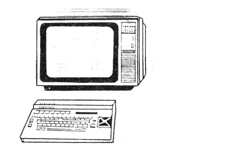
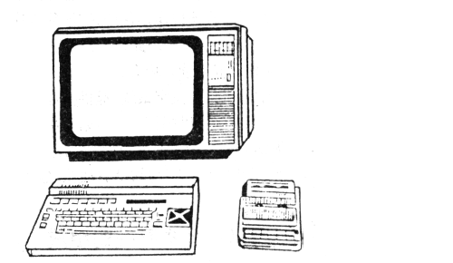
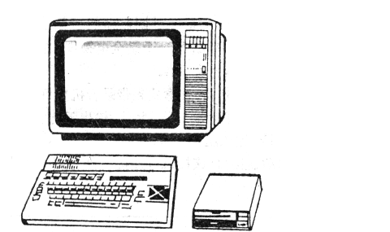
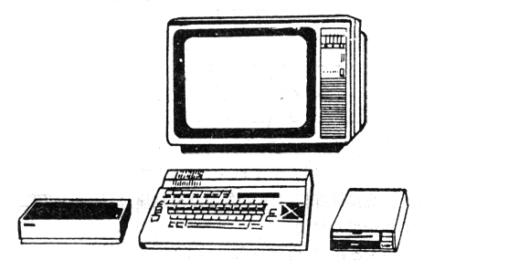
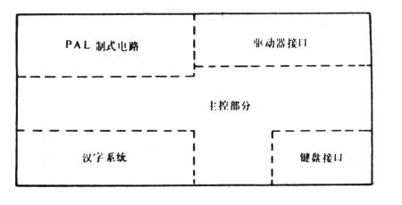

# 第一章 CEC-I 中华学习机简介

CEC-I (China Educational Computer) 中华学习机是由我国自己开发的，适合于中小学、家庭及个人学习的计算机。CEC-I 中华学习机的结构灵活，可以根据不同需要扩充功能，如果配上彩色电视机或监视器，再接上软盘驱动器或盒式录音机，就可以构成一台功能较强，具有汉字支持的微机系统。

CEC-I 中华学习机与 APPLE-IIe 微机兼容，其功能与 APPLE IIe 相当，并有所增强，它可以运行 APPLE II 上运行的各种软件，包括数值计算与非数值计算软件，中小学辅助教学软件，以及游戏软件等。主机上有固化的监控程序、BASIC 解释程序、LOGO 子集、汉字管理程序及一、二级汉字库。因此，一开机用户就可以使用这些语言，而不需要从软盘或磁带上读入内存。

CEC-I 中华学习机具有汉字系统，提供拼音和区位输入方式，主机内配有全点阵汉字字库，提供国标一、二级汉字点阵库。

CEC-I 中华学习机主板上具有软盘驱动器、盒式录音机及游戏操纵杆的接口电路，因此可以直接与软盘驱动器、盒式录音机及游戏操纵杆连接使用。

---

## 1.1 基本系统的组成

一套完整的微型计算机系统是由几个独立的设备组成的，一般应包括主机、输入设备及输出设备。在中华学习机系统中至少应包括主机与显示器（或电视机）这两种设备，其它设备如盒式录音机、软盘驱动器、打印机、游戏操纵杆等可根据用户的需要进行选配。以下是几种常用的系统配置。

图 1.1 是最基本的系统配置，这种配置由于没有外存储设备，因此只能用于学习或编制一些简单的程序。


*图 1.1 最基本的系统配置*

图 1.2 为带盒式录音机的系统配置。在该系统中程序是通过键盘或盒式磁带输入到计算机。程序可以永久地保存在磁带上，因此是一个比较完整的系统配置。其优点是价格比较便宜，但是程序的输入速度较慢，另外程序文件的管理比较麻烦。


*图 1.2 带盒式录音机的系统配置*

图 1.3 为带软盘驱动器的系统配置。通过软盘驱动器将程序写入到磁盘上，或从磁盘上读出，其优点是中华学习机通过磁盘操作系统对磁盘上的程序文件进行自动管理，速度较快，但该系统的价格较贵。


*图 1.3 带磁盘驱动器的系统配置*

图 1.4 是带打印机和驱动器的系统配置。该系统的配置比较完整，通常被程序设计人员所使用。


*图 1.4 带打印机、磁盘驱动器组成的系统*

---

## 1.2 CEC-I 的内部结构

CEC-I 主机的内部结构如图 1.5 所示，它主要包括下面一些部件：

1. **中央处理器**：6502 CPU 八位微处理器。
2. **随机存储器 (RAM)**：内存容量为 64K 字节。
3. **只读存储器 (ROM)**：共 32K 字节，固化有系统监控程序，BASIC 解释程序，LOGO 子集，汉字管理程序及码表。
4. **汉字点阵库**：固化有全点阵的国标一、二级汉字字库，包括 6763 个汉字及外文字母等。
5. **显示器接口**：一个是经过调制器的射频信号输出，可连接 PAL 制式彩色或黑白电视机；另一个是全电视视频信号输出，可接标准的 PAL 制式彩色或单色监视器。
6. **盒式磁带录音机接口**：盒式磁带录音机接口可与一般家用录音机相连接。提供输出信号电压是 25 mV，输出阻抗 100 Ω，要求输入信号峰值电压为 1 V，输入阻抗 12 kΩ。
7. **软盘驱动器接口**：该接口可连接一台 5.25 英寸软盘驱动器。


*图 1.5 CEC-I 主机内部结构*

```text
+-----------------------------------+-----------------------------------+
|                                   |            驱动器接口             |
|           PAL 制式电路            +-----------------------------------+
|                                   |                                   |
+-----------------------------------+                                   |
|                                   |                                   |
|                              主 控 部 分                              |
|                                   |                                   |
+-----------------------------------+                   +---------------+
|                                   |                   |               |
|             汉字系统              |                   |   键盘接口    |
|                                   |                   |               |
+-----------------------------------+-------------------+---------------+
```

8. **游戏操纵杆接口**：9 针的游戏杆插座，提供 3 个 TTL 电平开关量输入，4 个模拟量输入。
9. **扬声器接口**：内接 0.25 W、8 Ω 扬声器。
10. **键盘与键盘接口**：键盘是标准的打字机键盘，具有 69 个键，采用弹簧键体。
11. **扩充槽口**：在主机板上留有一个与 APPLE II 机兼容的 50 线输入/输出插座。此插座可插打印机接口电路或其它扩充电路板。
12. **电源**：采用开关电源，最大交流功耗为 25 W。

---

## 1.3 键盘和屏幕显示

人与计算机的信息交换是通过键盘和屏幕来完成的。利用键盘可向计算机输入命令和程序，而计算机则通过屏幕显示命令或程序执行的结果，并且还会显示主机对用户所提出的要求和命令等。因此这两部分是人机对话最重要的工具之一。

中华学习机的键盘安装在主机外壳上，具备标准打字机键盘的各种键，并按照标准打字机的键位排列。另外中华学习机键盘还增加了一些功能键、中西文转换键、光标键、中断键等。

中华学习机屏幕显示可以用一般的家用彩色电视机或黑白电视机，也可采用彩色监视器或单色监视器，并且电视机和监视器可以同时使用。但监视器产生的图像比电视机图像要清晰些，并且稳定不闪烁，操作时不会引起人眼的疲劳。

标准的显示屏幕有三种不同的显示模式：一种是显示文字字符的文本模式，另外两种是低分辨率图形和高分辨率图形模式。

在**文本模式**中，屏幕的显示功能为：
1. **西文方式**：字符构成为 $5 \times 7$ 点阵，每帧字符为 $40 \times 24$。
2. **中文方式**：字符构成为 $16 \times 16$ 点阵（汉字），$8 \times 16$ 点阵（ASCII），每帧字符 $17 \times 10$（汉字），$34 \times 10$（ASCII 码），另外加一个状态行。

**图形模式**的屏幕显示功能为：
1. **低分辨率彩色图形显示**：分辨率为 $40\text{H} \times 48\text{V}$，16 种颜色。
2. **高分辨率彩色图形显示**：分辨率为 $280\text{H} \times 192\text{V}$，6 种颜色。

| 显示模式 | 子方式 | 字符点阵 | 屏幕容量 / 分辨率 | 备注 |
| :--- | :--- | :--- | :--- | :--- |
| **文本模式** | 西文方式 | $5 \times 7$ | $40 \times 24$ 字符 | 标准西文屏幕 |
| **文本模式** | 中文方式 | $16 \times 16$ (汉字) / $8 \times 16$ (ASCII) | $17 \times 10$ (汉字) / $34 \times 10$ (ASCII) | 另加一个底部状态行 |
| **图形模式** | 低分辨率彩色图形 | — | $40\text{H} \times 48\text{V}$ | 16 种颜色 |
| **图形模式** | 高分辨率彩色图形 | — | $280\text{H} \times 192\text{V}$ | 6 种颜色 |

---

## 1.4 盒式磁带录音机

由于 CEC-I 中华学习机的内存容量不是很大，只有 64K 字节，而且一旦关掉电源，内存 RAM 的内容就会消失，所以常常用盒式磁带录音机来延伸 RAM 的容量。也就是说，我们可以把程序存放到录音机的磁带上，以备日后再拿出来使用（将磁带上的程序调入到内存）。

录音机可选择专用的磁带机也可以选择家用录音机，但要求录音机的质量上能够保证走带平稳，频率响应好，不失真。录音机的磁带也可选用普通录音磁带。

---

## 1.5 软盘驱动器

作为外存储器，软盘驱动器的功能远远胜过盒式磁带录音机。这是因为磁盘存放程序比磁带更可靠，存储量更大，而且软盘驱动器的启动速度快，可随机存取文件。

中华学习机使用的是 5.25 英寸软盘驱动器，采用单面单密度记录方式，格式化以后的容量为 143K 字节。与此相对应，软磁盘也应选用 5.25 英寸单面单密度磁盘，或双面双密度磁盘。

---

## 1.6 打印机

利用打印机可以把我们所需要的文件、程序、报表，甚至图形打印出来。使用打印机必须要由打印机接口电路板与中华学习机相连才能使用。打印机接口电路板是通过插在中华学习机上的扩充槽口与系统相连。

中华学习机可配置多种类型的点阵式 Centronic 标准接口打印机，如 CP-80、RX-80、MX-80、FX-80 等。随机软件已提供打印 4 种汉字字形。

---

## 1.7 系统软件

CEC-I 中华学习机的主机上已固化有系统监控程序、CEC-BASIC 语言、LOGO 语言、汉字管理程序以及小汇编程序。这些软件开机后就可以直接使用。另外由于 CEC-I 与 APPLE II 系列微机兼容，因此 APPLE II 系列的各种语言软件及软件包均可使用。如 DOS 3.3、LISA 2.5 等。

---

## 1.8 应用软件

CEC-I 是家庭教育和中小学计算机辅助教育的有力工具。目前已为 CEC-I 开发出了一系列的教育软件，其中的辅助教学软件包括从学龄前至大学的数学、物理、化学、语文、英语、生物、地理、历史等科目。

CEC-I 还配有适用于幼儿教育、青少年科技启蒙和智力开发，以及成年人尤其是老年人娱乐用的棋牌类等各方面的智力游戏软件。这些软件知识性强，趣味性强，富有想象力，启发创造性，特别适合青少年课外活动和家庭娱乐活动使用。此外，还有家庭管理软件，如家庭财务、备忘录、通讯录、保健指南、家庭医生、心理卫生咨询、旅游指南、菜食制作、电脑秘书等。
