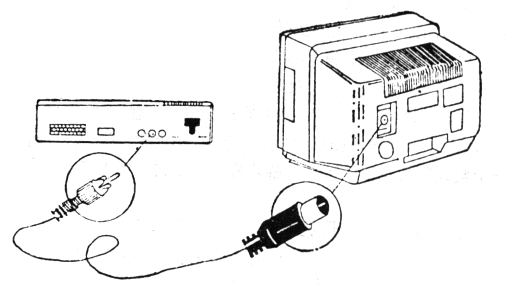
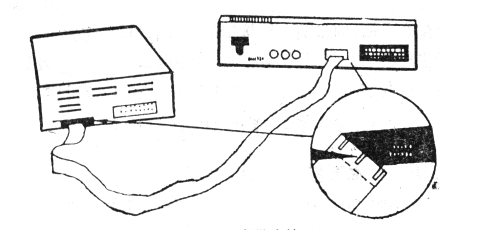
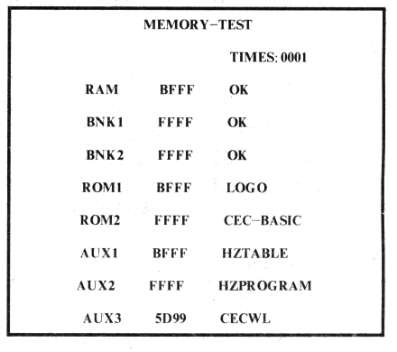
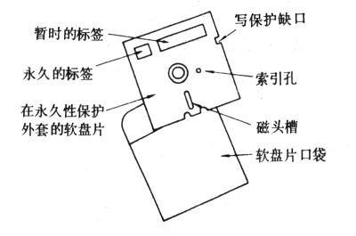

# 第二章 CEC-I 中华学习机的操作使用

对于任何一个电子计算机系统，当你第一次使用它时，尽管它的电路连线已经全部接好，但往往会有一种畏惧心理。在使用 CEC-I 系统时，同样也会有这种感觉。在这一章里，我们将讲述如何顺利地使用 CEC-I 中华学习机，相信你在学完这一章之后，一定会对 CEC-I 系统的使用与操作有充分的了解，为以后的学习建立起信心，使 CEC-I 中华学习机成为你真正的朋友。

---

## 2.1 CEC-I 系统的安装

### 2.1.1 开箱

将装有中华学习机的纸箱放在桌面上，正面朝上打开纸箱的箱盖，你会发现主机装在塑料袋中，两头各有一块泡沫衬垫。

小心取出主机，并清点随机带的视频电缆、录音机电缆、使用手册等附件。要妥善保存好纸箱及其它物品，以备将来搬运时使用。

主机箱是一个紧凑的塑料机盒，它的右上角有一个电源指示灯（小孔内），电源一接通，此灯便亮了。主机的正面是键盘，左侧面是一个电源开关，后侧面有电视机接口、显示器接口及软盘驱动器接口，而右侧面有一个盒式磁带录音机接口及游戏操纵杆接口（原文作“左侧面”，实为右侧面，参看图 2.1 与 2.1.3/2.1.4 节）。如图 2.1 所示。


*图 2.1 主机接口*
*1. 电源开关，2. 扩充槽口，3. 电源线，4. 电视机接口，5. 监视器接口，6. 磁盘驱动器接口，7. 录音机接口，8. 游戏杆接口，9. 键盘*

### 2.1.2 显示器的连接

CEC-I 的显示器可以是电视机（彩色或黑白）也可以是监视器（彩色或黑白），但连接的方法不同。

#### ① 电视机连接（参看图 2.2）

- 把电视机的天线插头拔下。
- 将视频电缆线的一头插入主机上的电视机接口，另一头插入电视机的天线插座上，电视机天线插座的输入阻抗为 75 Ω。
- 确认主机电源开关处于“OFF”位置。


*图 2.2 电视的连接*

- 将电视机电源插头和主机电源插头分别插入 220V 电源插座上。
- 把电视机音量开关调到最小位置。
- 先打开电视机电源开关，然后再打开主机的电源开关。
- 当使用黑白电视机时，首先调准电视机频道（生产厂家要求的频道为准，一般为 3 频道）。开机后，调节频道微调及对比度、亮度旋钮，直到电视屏幕上出现下面几行清晰字样为止：

```text
ZHONG HUA XUE XI JI
   VERSION 1.1
```

当使用彩色电视机时，同样首先选好频道（3 频道），并通过自检方式进入显示彩条图象（参考 2.4 节机器的自检），然后调节频道微调及色饱和度、亮度、对比度，直到屏幕上的彩条满意为止。以后可把这一频道作为计算机专用频道，再开机就可以不用调机了。

#### ② 监视器的连接（参阅图 2.3）


*图 2.3 监视器的连接*

- 将视频电缆线的一头插入主机监视器接口，另一头插入监视器的“IN”插座。
- 确认主机电源为“OFF”位置。
- 将主机电源及监视器电源插头分别插入电源。先打开监视器电源开关，然后再打开主机电源开关，屏幕上将出现清晰的 `ZHONG HUA XUE XI JI` 字样。

### 2.1.3 录音机连接（参阅图 2.4）

- 确认主机电源为“OFF”位置。
- 把录音机电缆线的一端（五芯插头）插入主机右侧面的录音机接口。


*图 2.4 录音机连接*

- 将录音机电缆线的另一端的两个 3.5 mm 插头分别插入录音机 `EAR` 插孔（连接主机 IN）和 `MIC` 插孔（连接主机 OUT）。
- 把录音机电源线插入电源。

### 2.1.4 游戏杆连接

九芯游戏杆插座位于主机右侧（如图 2.5 所示），把连接游戏杆的插头直接对准游戏杆接口插入，必须注意：两者的信号一定要一一对应（游戏杆接口信号如图 2.5）。


*图 2.5 游戏杆的连接*

| 引脚 (左列) | 信号名称 | 说明 | 引脚 (右列) | 信号名称 | 说明 |
| :---: | :--- | :--- | :---: | :--- | :--- |
| **1** | `SW1` | 开关量输入 1 | **6** | `SW2` | 开关量输入 2 |
| **2** | `+5V` | +5V 电源 | **7** | `SW0` | 开关量输入 0 |
| **3** | `GND` | 地线 | **8** | `PDL1` | 模拟量输入 1 |
| **4** | `PDL2` | 模拟量输入 2 | **9** | `PDL3` | 模拟量输入 3 |
| **5** | `PDL0` | 模拟量输入 0 | — | — | — |

### 2.1.5 磁盘驱动器连接（参阅图 2.6）

- 确认主机电源开关处于“OFF”位置。
- 将驱动器扁平电缆插头插入主机后侧面的驱动器接口上。必须注意的是插针与插孔要一一对应，电缆线插头的凸出部分朝上，否则将会损坏软盘驱动器。


*图 2.6 驱动器连接*

### 2.1.6 扩充卡的连接（参阅图 2.7）

CEC-I 主机板的右上侧有一个 50 线的扩充槽，可插入多种外设卡及扩充卡（如打印机卡、音乐卡、A/D 卡等）。扩充卡如果尺寸太大插不进去，可采用 50 线转接板把槽口抬高，再插外设卡或扩充卡。具体步骤如下：

1. 确认主机电源开关在“OFF”位置。
2. 用手轻轻压下主机右上方的扩充槽盖，可看到印刷板上安装了一个 50 线插槽。
3. 把扩充卡按元器件朝前、焊接面朝后的方向对准槽口往下插。必须注意，一定要平插插平，以免错位。

**扩充槽号的选定**：
用户可以根据需要用短接帽来选择槽号，槽号可以为 1, 2, 3, 4, 5, 7 中的任一个。由于 CEC-I 在设计上已将 3 号槽定于汉字系统，6 号槽定于磁盘驱动器接口，所以用户不可选用。CEC-I 在出厂时一般都将槽号设在第 1 槽，即将两个短接帽插在标有“1”的位置上。选择槽号插头位于主机板的右侧，并标有槽号，如需改槽号，需要打开主机机壳，把原在第 1 槽位置的两个短接帽取下并插入你所需要的槽号位置上。


*图 2.7 扩充卡的连接（50 线扩充槽引脚图）*

#### 表：CEC-I 50 线扩充槽引脚定义（对应图 2.7）

| 左侧信号 | 左侧引脚 | 右侧引脚 | 右侧信号 |
| :---: | :---: | :---: | :---: |
| $\overline{\text{IOSEL}}$ | **1** | **50** | $+12\text{V}$ |
| $A_0$ | **2** | **49** | $D_0$ |
| $A_1$ | **3** | **48** | $D_1$ |
| $A_2$ | **4** | **47** | $D_2$ |
| $A_3$ | **5** | **46** | $D_3$ |
| $A_4$ | **6** | **45** | $D_4$ |
| $A_5$ | **7** | **44** | $D_5$ |
| $A_6$ | **8** | **43** | $D_6$ |
| $A_7$ | **9** | **42** | $D_7$ |
| $A_8$ | **10** | **41** | $\overline{\text{DEVN}}$ |
| $A_9$ | **11** | **40** | $\phi_0$ |
| $A_{10}$ | **12** | **39** | $\mu\text{PSYNC}$ |
| $A_{11}$ | **13** | **38** | $\phi_1$ |
| $A_{12}$ | **14** | **37** | $Q_3$ |
| $A_{13}$ | **15** | **36** | $7\text{M}$ |
| $A_{14}$ | **16** | **35** | $3.58\text{M}$ |
| $A_{15}$ | **17** | **34** | $-5\text{V}$ |
| $\text{R}/\overline{\text{W}}$ | **18** | **33** | $-12\text{V}$ |
| $\overline{\text{SYNC}}$ | **19** | **32** | $\overline{\text{INH}}$ |
| $\overline{\text{IOSTROB}}$ | **20** | **31** | $\overline{\text{RESET}}$ |
| $\text{RDY}$ | **21** | **30** | $\overline{\text{IRQ}}$ |
| $\overline{\text{DMA}}$ | **22** | **29** | $\overline{\text{NMI}}$ |
| *(空)* | **23** | **28** | *(空)* |
| *(空)* | **24** | **27** | *(空)* |
| $+5\text{V}$ | **25** | **26** | $\text{GND}$ |

---

## 2.2 CEC-I 中华学习机的启动

### 2.2.1 基本系统的启动

首先按正确的方法连接好 CEC-I 系统，并检查连接是否都正确无误。然后，将显示器的电源打开，调好对比度，如果是电视机还应把频道调整好（一般用 3 频道）。接下来就可以打开主机电源了。

当开机之后，立刻就能听到机器发出“嘟”的一声。这声音告诉你：主机已准备就绪，同时主机右上方的电源指示灯应该发亮。如果一切都正常，CEC-I 将自动进入西文 BASIC 状态，在屏幕上将会显示如图 2.8 所示的文字，此时你就可以输入命令或 BASIC 程序了。

当机器启动以后，在屏幕上可以看见一个十分明显的、有规则的、忽亮忽暗的闪烁小方块，这个闪烁的白色小方块叫做**光标**，它的位置表示了你从键盘上打入的字符在屏幕上出现的位置。

在光标的左边一个 `]` 符号，称之为**提示符**。符号 `]` 是 CEC-BASIC 语言系统提示符。另外 CEC-I 中当进入监控程序后的提示符为 `*`，当进入小汇编程序后的提示符为 `!`。

```text
+--------------------------------------------------+
|             ZHON HUA XUE XI JI                   |
|                                                  |
|                VERSION 1.1                       |
|                                                  |
|                   ]█                             |
+--------------------------------------------------+
```
*图 2.8 机器启动后的屏幕显示（注：原书图 2.8 中 `ZHON` 漏印了 `G`，实际机器显示为 `ZHONG HUA XUE XI JI`）*

### 2.2.2 连接驱动器系统的启动

首先按正确的方法连接好系统。在启动前打开磁盘驱动正面中央的盖子，把含有 DOS 3.3 磁盘操作系统的磁盘印字面朝上，水平而轻轻地沿着驱动器的细缝插入驱动器内。当磁盘完全插入以后，再关上驱动器的盖子。然后就可按照基本系统的启动方法进行启动。当主机电源打开后，屏幕上首先显示如图 2.8 的文字幕，然后磁盘驱动器上的指示灯发亮，并且可以听到驱动器马达的转动声音，这时机器正在把 DOS 3.3 磁盘操作系统载入内存。当磁盘操作系统载入内存以后，驱动器指示灯熄灭，屏幕上将会出现 DOS 3.3 磁盘操作系统的题头版面，如图 2.9 所示。

```text
+------------------------------------------------------------+
|         DOS VERSION   3.3 08/25/80                         |
|     APPLE IIPLUS OR ROMCARD SYSTEM MASTER                  |
|      (LOADING INTEGER INTO LANGUAGE CARD)                  |
|            ]█                                              |
+------------------------------------------------------------+
```
*图 2.9 DOS 3.3 题头版面*

此时 CEC-I 就已在 DOS 3.3 的控制之下接受用户的命令和 BASIC 程序。

如果开机前没有将驱动器盖合上或没有将含 DOS 3.3 的磁盘插入驱动器，CEC-I 就会直接进入 CEC-BASIC 语言系统，而不受 DOS 3.3 的控制。以后如果需要装入 DOS 3.3 系统，可以将 DOS 3.3 磁盘插入驱动器合上盖，并键入：

```basic
PR#6 (回车)
```

于是 DOS 3.3 将被载入机器内存。

---

## 2.3 键盘操作

CEC-I 的键盘与主机之间通过一条 26 线扁平电缆线连接，直接装入主机机壳内。此键盘具有**重复功能**和 **N 键滚动功能**。

所谓**重复功能**是指当某键按下时间大于一定值时，连续不断地重复发送这个键值，即自动重复此键。所谓 **N 键滚动**则是指在有多个键按下时，将根据按下键的先后次序分别检测并输入主机，同时也显示在屏幕上。

图 2.10 是 CEC-I 键盘的排列图。在这个键盘上，有些键上标有 `0, 1, 2, 3 ... 9` 以及 `A, B, C, D ... X, Y, Z` 等字符，这是我们大家十分熟悉的数学和英文字母，使用也很方便。例如，当你按下 `4` 这个键，屏幕上就会出现一个 `4`。


*图 2.10 键盘排列图*

除了上述的 36 个数字键和字母键之外，还有 `.`、`:`、`-`、`,`、`;`、`/` 这 6 个键的用法也与上面的 36 个键用法相同。另外最下面的那个长键，称为**空格键**。按一下空格键，显示屏幕的光标就向右移一格，字符显示出现一个空格，即这个位置什么也不显示。

还有一些键具有特殊的作用，称为**功能键**。下面我们分别给以说明。

### 2.3.1 SHIFT 键

这个键共有两个，分别安排在键盘的左侧与右侧，这是为了操作起来方便。这个键的功能是当按此键和另一键时，产生上档键码。例如，在标有数字 `5` 的这个键，其 `5` 的上方还标有 `%`。如果要把 `%` 这个字符显示到屏幕上，就必须将 `SHIFT` 与 `5` 这两个键同时按下，或者先按着 `SHIFT` 不动，然后再按一下 `5`。同样，凡是键上有上下两个字符的，要想使用上面的那个符号的话，必须借助于 `SHIFT` 键。

### 2.3.2 CAPS LOCK 键

`CAPS LOCK` 是英文 `CAPITALS LOCK` 的缩写，意思是英文“大写字母锁定”。当按下此键后，从键盘上输入的 26 个英文字母将是大写字母；当抬起此锁定键以后，从键盘上再输入的 26 个英文字母为小写字母。

### 2.3.3 Ctrl 键

`Ctrl` 是英文 `Control` 的缩写，是“控制”的意思。`Ctrl` 键总是与另外一个键同时使用，即按住 `Ctrl` 键不放，再按另一键，使得同一键具有另外的功能。例如，当 `G` 键与 `Ctrl` 键同时使用时，`G` 键就显示出它们合用的特有功能：发出高频笛声“嘟”的一声。`Ctrl` 键还有其它不同的组合，可引起 CEC-I 机不同的反应，目前我们暂时不去详细讲述，以后会逐步提到。

### 2.3.4 ◁ 和 ▷ 键

这两个箭头键叫做左箭号键和右箭号键。利用这两个键可以修改输入过程中的各种错误。`◁` 键象打字机上的空格退位键一样，每按一次，光标退回一格，退回光标下的字符就从 CEC-I 的内存中抹去。现在，不妨在键盘上试一试，首先，打入一串任意字符（例如 `PRINT`），然后，连续几次按下 `◁` 键，在屏幕上就会看到光标沿着刚打入的字符退位返回，但原来字符在屏幕上并不消失，然而，这些字符实际上已从 CEC-I 的存储器中抹去了。当光标退位返回到达屏幕左边沿时，若再继续按下 `◁` 键，则光标就跳到下一行，于是，产生一个新的提示符。

`▷` 键是使光标沿显示行向右移动（前进方向），当按下此键时，光标沿着显示行向前移动，它所经过的每一个字符，又重新复制到存储器里，就象重新按下了某个键来得到一个新的字符一样。为了更清楚地了解 `▷` 键的作用，不妨在键盘上连续地打入一串字符，并用 `◁` 键将光标返回几格，让它从存储器中抹去，然后再按几次 `▷` 键，每按一次这个键，光标经过的字符就重新准确地又送入了存储器，如同重新打入了一样。

### 2.3.5 △ 和 ▽ 键

这两个键叫做上箭号键和下箭号键。利用这两键与 `◁` 和 `▷` 键配合就可以很方便地修改编辑屏幕上任意位置上的字符，以及重复执行一条已经执行过的命令。按 `△` 键将使光标上移一行，按 `▽` 键使光标下移一行。例如，我们原先从键盘打入了下面一条命令：

```basic
]PRINT "ABCDEFG"
```

当执行完这条命令以后，如果我们还想执行 `PRINT "ABCD"` 命令。那么，只要利用 `△` 键，把光标上移到上面执行过的命令行，再利用 `▷` 键扫描这一行的命令字符到 `E`，在此处打入一个双引号，回车以后就可以执行这条命令了。

### 2.3.6 Esc 键

`Esc` 是英文 `ESCAPE` 的缩写，意思是“脱离”。这个键的用法比较特殊，值得注意的是这个键只要按一下，放掉后仍会起作用，而不象 `Ctrl` 和 `Shift` 键那样要一直按着，直到另一个键按下后才会起作用。按一下 `Esc` 键，就是通知 CEC-I 进入“脱离”状态。什么叫“脱离”状态呢？让我们来试一下，先按一下 `Esc` 键，然后再按几次 `K` 键，这时屏幕上并不会显示 `K` 字符，而是使光标向右移动几次，然后再按几次 `M` 键，这时光标向下移动，再按 `I` 键，则光标向上移动，最后再按 `J` 键，会看到光标向左移动。按了这 4 个键以后，会发现这 4 个键 `K`、`M`、`I`、`J` 在键盘上正好形成十字，分别代表 4 个方向，即：

```text
          I
          ▲
          │
          │
  J ◄─────┼─────► K
          │
          │
          ▼
          M
```
*(注：原书配图中左方向字母 `J` 残缺印作 `f`，实为 `J`)*

只有 CEC-I 在“脱离”状态时，这 4 个键可以反复地用来改变屏幕上光标的位置。若要使 CEC-I 从“脱离”状态回到原来状态，只要按一下空格键或其它任何一个键即可。这就是 `Esc` 键的功能，它可以任意地将光标移到屏幕上的各种位置上。

`Esc` 键在调试程序时非常有用。比如，在调试列出程序时，当发现前面程序有错，而光标此时已在下面时，只要按一下 `Esc` 键，然后利用 `I`、`K`、`J` 键，可把光标移到需要修改语句编号（称行号）的第一个字上。此时先按一下空格键或任何一个键，把程序回到原来状态。接着，按 `▷` 键（原文此处漏印键符），把光标移到需修改的字符上即可，键入需要的字符之后，按 `▷` 键（原文此处漏印键符）向后移，一直移到需要修改的这一条语句末尾的后一个位置，然后按“回车”键即可。

### 2.3.7 Return 键

这个键称为“回车”键，它是一条命令的执行键。从键盘上打入一串字符后，按下 `Return` 键，表示输入的内容已完，请机器执行。机器就马上对刚才送给它的一串字符进行阅读分析并执行之。实际上，当你用按键的方法，将要告诉机器的语句或命令逐个送到屏幕上之后，如果不按 `Return` 键，这些字符只能停留在屏幕上，而不会到达机器的内存中去，机器等于没有看到你输入的内容。而按下 `Return` 键后，屏幕上的内容马上就被搬入内存，机器就可立即执行。因而，在输入一串字符到显示屏幕上时，如果发现内容或按键有错误的地方，只要不按 `Return` 键，就可以从容不迫地修改，直到全部正确后，再按 `Return` 键。在按下该键之后，再想修改就得采用前面提到的 `Esc` 键与修改方法。

### 2.3.8 Reset 键

这个键称为“复位”键或“中断”键。当你的程序在执行过程中，机器失去控制，或者程序在执行了一半不希望它继续执行下去了。此时一种办法就是关掉机器电源，不过这样就会失去内存中的程序和数据，另一种办法就是利用 `Reset` 键。当需要进行系统复位时，必须在按下 `Ctrl` 键的同时再按下 `Reset` 键，这样释放以后就会中断 CEC-I 的任何工作，系统便重新启动进入 BASIC。并把控制权交还给键盘。

### 2.3.9 其它一些功能键

- **Test 键**：当同时按下 `Ctrl-Reset-Test` 这三个键时，CEC-I 主机进行自检测。
- **Quit 键**：从监控返回 BASIC 状态，它不破坏内存里原有的 BASIC 程序。它相当于按 `Ctrl-C` 键。
- **Tab 键**：象是打印机上的定位键，好比说屏幕定了 1, 11, 21, 31 四个位置，光标在 13 那儿，按 `Tab` 键就会移到下一个定位 21。
- **F1 键**：进入 ASCII 方式（中文状态的字母方式）。
- **F2 键**：进入中文状态的拼音方式。
- **F3 键**：进入中文状态的区位方式。
- **F4 键**：供用户自定义使用（键码为 14）。
- **F5 键**：供用户自定义使用（键码为 06）。
- **中文键**：进入中文状态。
- **西文键**：进入西文状态。

以上这些键的用法我们将在后面的有关章节详细说明。

---

## 2.4 CEC-I 主机的自检测

当机器启动后，同时按下 `Ctrl-Reset-Test` 这三个键，释放以后，就可以对主机的内存单元（RAM, ROM）以及彩色显示进行自检。在自检时，屏幕上将显示相应内存单元的检测内容和检测结果。如果机器工作正常，应显示如图 2.11 的结果。


*图 2.11 自检内容和结果*

```text
+------------------------------------------+
|               MEMORY-TEST                |
|                                          |
|                          TIMES: 0001     |
|                                          |
|        RAM       BFFF      OK            |
|                                          |
|        BNK1      FFFF      OK            |
|                                          |
|        BNK2      FFFF      OK            |
|                                          |
|        ROM1      BFFF      LOGO          |
|                                          |
|        ROM2      FFFF      CEC-BASIC     |
|                                          |
|        AUX1      BFFF      HZTABLE       |
|                                          |
|        AUX2      FFFF      HZPROGRAM     |
|                                          |
|        AUX3      5D99      CECWL         |
+------------------------------------------+
```

其中 `RAM` 部分是检测地址 `$0000` ～ `$BFFF` 共 48K RAM。

`BNK1` 和 `BNK2` 部分是用两个软开关测试地址 `$D000` ～ `$FFFF` RAM。

以上三个内存单元当测试正确时，屏幕相应处示“OK”；如有出错，屏幕相应处将显示“ERR”。

- `ROM1` 是测试 LOGO 语言的。
- `ROM2` 是测试中华学习机 CEC-BASIC 解释程序和系统监控程序的内容。
- `AUX1` 测试汉字码表内容。
- `AUX2` 测试汉字管理系统内容。
- `AUX3` 测试 1 兆位的汉字点阵库内容。

以上五个单元当测试正确，屏幕将显示相应的测试内容名称；如果测试出不为所知的内容，屏幕将相应地显示“UNKNOWN”，当没有加汉字库时，屏幕将在相应位置显示“NULL”。

当 RAM, ROM 测试完后，将进行彩色显示测试，屏幕将显示 16 种不同颜色的彩条。

自检程序可以连续循环地测试，并在 `TIMES` 一栏显示测试的次数。如需调试彩色，可在屏幕显示彩条时按任意键使屏幕一直显示彩条，直到你调试完彩色电视机，再按任一键又进入自检程序循环测试。

如果要中断自检测试，可同时按下 `Ctrl-Reset` 键，机器便进入 CEC-BASIC 状态。

---

## 2.5 汉字输入方法

当机器启动以后，屏幕显示方式为西文文本方式，此时若敲入中文键，系统将进入中文显示方式，屏幕显示为高分辨率图形方式。进入中文方式以后，屏幕可以显示 10 行汉字，每行 17 个汉字。屏幕底部的第 11 行为状态行，状态行最左端显示“字母”两字，表示系统处于中文方式的字符（ASCII）输入状态。此时若按下 `F2` 键或 `F3` 键，状态行左端将显示“拼音”或“区位”两字，表示系统进入了中文方式的拼音输入状态或区位码输入状态，在这两种状态返回到字符输入状态，可按 `F1` 键。另外，在进入中文方式以后，如果同时按下 `Ctrl-O` 这两个键，可以控制状态行的显示与不显示，但不改变输入方式。

除了键盘方式进入汉字显示方式之外，程序方式也可以进入汉字显示方式。在 BASIC 程序中，使用 `PR#3`，也可以进入汉字显示方式。

在中文方式下，若按下西文键，将退出中文显示方式，屏幕显示将返回到西文文本方式（低分辨字符方式）。在 BASIC 程序中使用 `TEXT` 或 `PRINT CHR$(17)`，也可以退出汉字显示方式。

### 2.5.1 拼音输入方式

在进入汉字显示方式后，按下 `F2` 键或 `Ctrl-L` 键，屏幕底部状态行将显示“拼音”两字，此时即进入拼音输入方式。

CEC-I 中华学习机的拼音输入为全拼音输入方式，即输入汉字时将该汉字的音节的声母和韵母全部敲入。计算机根据输入的音节在状态行提出该音节的所有字，其中包括了该音节所有不同声调的字。操作者可以根据状态行上提示的汉字序号用数字键选择所需要的汉字。因此，只要学过汉语拼音的人就很容易学会全拼音输入方法。下面是全拼音输入汉字的方法。

① **第一键提示常用字**：当你第一键敲入了汉字的声母以后，屏幕状态行上将显示出该声母开头（原文作“开关”）音节中的最常用的 6 个汉字。此时若有需要的汉字，只要敲入相应汉字的序号即可；若没有，则要继续敲入该汉字的韵母。

② **向后或向前寻找同音节字**：当敲完汉字的韵母后，状态行提示出 6 个同音节字。若出现所需要的汉字，即可敲入相应的汉字序号；若这个 6 个同音节字中没有要输入的汉字，则可按 `>.`（即 `.` / `>`）键继续向后寻找。每按一次 `>.` 键，屏幕状态行就显示出下一幕 6 个同音节字，直到机器发出“嘟”的一声，表示该音节的汉字已全部显示完。当要寻找前一幕汉字时，可按下 `<,`（即 `,` / `<`）键，此时，前一幕的 6 个汉字以显示在状态行上。

③ **敲入所选汉字的序号**：当屏幕状态行出现要输入的汉字时，只要敲入该汉字前面的序号，该汉字就会显示在屏幕当前光标的位置上，且该汉字的内码被输入到键盘输入缓冲区。连续敲入序号，可连续输入汉字。

④ **删除拼音提示**：若输入汉字时，有拼音敲错，可直接按 `◁` 键，使状态行上最后一个拼音字母被删除，或者按空格键，使所有提示字符都删除。当状态行上的拼音字母都删掉以后，再按 `◁` 键，则删除光标上的信息。

### 2.5.2 区位码输入方式

当进入汉字显示方式后，按下 `F3` 键，屏幕底部状态行将显示出“区位”两字，此时即进入区位码输入方式。

进入区位输入方式以后，将使用国家 GB-80 的区位方法输入汉字。在输入汉字时，仅使用 10 个数字键即 `0` ～ `9`，每 4 位数字对应一个汉字。例如，国标中标定 16 区 01 位置的汉字是“啊”，键入 `1601` 后，“啊”字就显示在当前光标的位置上。其中前两位数字表示区号，后两位数字表示位号，国标中一级汉字库都在 55 区以前，二级汉字库是从 56 区到 87 区。因此我们可以通过查阅区位码表寻找出汉字的区位码，来输入汉字。利用区位码输入汉字的优点是输入速度快，没有重码，即每输入 4 个数字就可以输入一个汉字。另外利用区位码输入还可以输入一些特殊的字母和符号。

当敲错区位码后，可按 `◁` 键（原文印作 `△` 键），使区位码提示的最后一个数字被删除，当区位码都删掉后，再按 `◁` 键（原文印作 `△` 键），则删除光标位置上的信息。

### 2.5.3 特殊符号的输入

在拼音方式下，当按下 `-`、`+=` 或 `!` 键以后，可以选择输入标点符号，算术运算符号和制表符号。但这些符号在程序中，只能作为字符处理，不能参加运算。例如，在拼音方式下按 `+=` 键（原文此处漏印键符），将可以选择输入下面一些符号：`$`、`%`、`+`、`−`、`×`、`÷`、`±`、`=`、`≈`、`>`、`<`、`≥`、`≤`、`/`、`(`、`[`、`)`、`]`、`∑`、`~`、`①`、`②`、`③`、`④`、`⑤`、`⑥`、`⑦`、`⑧`、`⑨`、`⑩`。

---

## 2.6 磁带录音机的使用

人们把一个程序从键盘上打入计算机，待运行和工作完成后，通常随手就把电源关掉了。在关掉电源的同时，键入计算机内存中的程序也随即消失。再想运行这段程序，又得一句一句地从键盘打入，这是十分麻烦的事。为了解决这个问题，就必须采用录音磁带（或软磁盘）。在还没有关机之前，先把程序存储到磁带（或磁盘）上，然后就可以放心地把计算机的电源关掉。下次要用这段程序的话，只要发一个装载命令，再从磁带（或磁盘）上取回来就可以了，既方便又可靠。CEC-I 在设计时已经备有专门的录音机接口，供存放和读取磁带程序使用。

### 2.6.1 盒式磁带的处理

使用盒式磁带时应十分小心，它容易损坏，而且一经损坏就不易还原。使用时，注意不要触摸盒式磁带内的磁带表面，要保持清洁，不要让油污浸渍磁带。为了确保磁带不受损坏，不用时，应将它放回磁带盒内保存，切勿把它放在灼热的地方，或者让阳光直接照射，也不能放在磁场附近，如不能放在电机附近。

### 2.6.2 音量的调节

在 CEC-I 装入程序的过程中，须将录音机的音量调节到正确的电平。如果音量太高或太低，读入信息会发生畸变，CEC-I 便无法正确识别。

对于所用的某一录音机，只能用累试法来确定一个正确的放音音量。一般的过程是：在试装一个程序时，先将音量置于较低的位置，如果不能工作，将音量稍调大一点再试，反复几次，直至成功地装入程序为止。另外有些录音机音调控制也对信息的正确读入有影响。

### 2.6.3 游戏磁带软件的使用方法

① 将录音机音量调到适当位置（一般在中间到最大位置之间），打开主机电源使机器进入 BASIC 状态。

② 把游戏磁带软件装入录音机，并倒带到头。

③ 从主机键盘上键入 `PLAY` 命令（先不要按回车）。

④ 按下录音机 `PLAY` 键，等到磁带走稳后（大约为 3 秒钟），再按主机上的“回车”键。

⑤ 这时屏幕上应显示

```text
WAITING......
```

再等待十秒钟左右机器将发出“嘟”的一声，并且屏幕上将显示游戏软件的中文标题。

接下来机器将把游戏程序读入内存。在读带过程中，屏幕的下方将不断显示一个个彩色小点，表示当前读入的数据正确。当全部程序读入内存以后 CEC-I 会自动执行游戏程序，于是你就可以按照游戏的操作方法玩了。

下面是一些在读带过程中常出现的错误。

① 在读带过程中不出现中文标题，机器好象“死”在那里。这可能是录音机音量太小或太大，应适当调节音量。或者是磁带开始没有倒带到头，或者是按“回车”键太早或太晚。

② 在读带过程中，若读入的数据不正确，CEC-I 将用中文提示“读带出错”，这时应适当调节录音机音量或者是音调旋钮，并重新读带。

### 2.6.4 BASIC 程序的存取方法

#### (1) 将 BASIC 程序存储到磁带上

① 首先把要保存的程序从键盘上输入到内存。

② 将一盒空白磁带放入录音机。一般录音机上均有计数器，应记下每次写带前计数器的读数。

③ 从键盘上打入 `SAVE` 命令（先不要按回车键）。

④ 将录音机置于“录音”状态，即同时按下录音机的 `PLAY` 和 `REC` 两个键。

⑤ 按下回车键，屏幕上的光标马上消失，大约过 10 秒至 15 秒后，CEC-I 会发出“嘟”的一声，即通知你“录音”已正式开始。前十几秒钟的空转是引导信号。录完后，CEC-I 再次发生“嘟”的一声屏幕上的光标又重新出现。

⑥ 按下录音机的 `STOP` 键，并记下计数器的读数。

⑦ 从录音机内取出磁带，在磁带盒标签上写上这一段程序的文件名以及计数器起始和结束位置，以备查用。

**注**：CEC-I 中华学习机存储 BASIC 磁带程序时，为程序定义一个文件名，这样就为磁带程序的管理带来很大的方便。带文件名的写带命令格式如下：

```basic
SAVE "文件名"
```

其中程序的文件名必须用双引号括起来，否则 CEC-I 将认为是错误的命令（不含 DOS 3.3 时）。

#### (2) 把磁带上的 BASIC 程序取到内存中

这个过程正好与上面讲的相反，它会将原先存放在磁带上的程序一字不漏地送回到内存中去。

① 将磁带放到录音机中去，并倒带到程序录制时的起始位置（可由计数器上获知）。

② 从键盘上打入 `LOAD` 命令（先不要按回车键）。

③ 录音机音量与音调调到适当位置，按下 `PLAY` 键。

④ 按下主机回车键，这时屏幕上光标消失，CEC-I 先接受程序的引导信号，当磁带进入数据区时，机器发生“嘟”的一声，表明开始正式将入程序。在程序读取完后，机器又会发出“嘟”的一声，屏幕上出现光标，表示完成了整个程序的装入。

⑤ 按下录音机 `STOP` 键，关掉录音机。

**注**：如果程序在存带时定义了文件名，则装载程序的命令应改为：

```basic
LOAD "文件名"
```

其中文件名要用双引号括起来，这样在装载程序的过程中，屏幕上会显示被装入程序的文件名。当装入的不是所要的程序时，屏幕会提示已装入的文件名和一个反相显示的字符 `N`，并继续装入后面的程序，直到装入 `LOAD` 命令中所给出文件名的程序为止。如果 `LOAD` 命令不给出文件名，那么 CEC-I 只将所遇到的第一个程序装入内存。

在读带的过程中，如果没有听到“嘟”的一声，或者得到一个错误信息，那么应该重新检查录音机的音量控制。

当把欲装入的程序装入内存以后，用命令

```basic
RUN
```

便可以启动程序运行。

---

## 2.7 软盘驱动器的使用

磁盘驱动器是利用磁性材料的磁化特性来存储信息的，这一点与磁带录音机相同。二者的最大差别是：磁盘是圆形的，外形象唱片，也象唱片一样地转动。磁盘驱动器里面有个磁头，用来读出和写入信息。计算机可以把磁头移到磁盘表面的任何地方这种能力称为随机存取。因此，磁盘驱动器是一种随机存取的存储装置。它比磁带机的顺序存取方式速度要快得多，也准确的多。

CEC-I 中华学习机所具有的磁盘驱动器接口控制电路只支持 5.25 英寸单面单密度软盘驱动器，并且其接口控制信号与 APPLE DISK II 接口控制信号相兼容。

### 2.7.1 软磁盘的使用

软磁盘也称软盘或盘片。有多种型号和规格，它适用于不同类型的软盘驱动器。按照尺寸的大小分为：8 英寸、5.25 英寸及 3.25 英寸；按驱动器磁头工作方式可以单面和双面读写，按照数据的记录方式又有单密度和双密度两种。对于 CEC-I 来说，由于选用的是 5.25 英寸单面单密度软盘驱动器，因此，它对软盘的选择要求比较低。一般来说，单面单密度（SS/SD），单面双密度（SS/DD），双面单密度（DS/SD）以及双面双密度（DS/DD）的 5.25 英寸软磁盘均适合其使用。


*图 2.12 软磁盘的包装与外形*

软盘密封于永久性保护套内（参见图 2.12），盘片由圆形脂塑料做成，其表面涂有磁性材料。使用时，软盘在保护套内（原文作“保护套面”）旋转，磁头通过保护套中的长孔（又称磁头读/写窗口）和软磁盘表面接触，读写数据。

- **永久性保护套**：由防静电皮革做成，内壁夹有防静电防潮材料，其作用是防止灰尘和保护盘面磁层不受损坏，同时也防止盘片旋转时所产生的静电而使信息丢失。
- **索引孔**：用来进行盘片划分扇区的物理定位标志。由于大部分软盘驱动器上没有装上索引孔识别装置，故索引孔不起作用。
- **磁头读写窗口**：这是在永久性保护套上开辟的一个长孔，是磁头与软盘接触，读写信息的。因此，在软盘使用过程上，绝对禁止用手指或异物接触这个长孔中所暴露出的磁盘部分。
- **写保护切口**：控制着软盘驱动器写电路开关，当用写保护封条贴在该切口上时，可以防止磁盘被写入任何信息。
- **永久性标签**：出厂时贴上的磁盘说明。用以指明磁盘的牌号和型号等。在使用磁盘时，最好用手指捏着这部分取盘和插盘。
- **临时标签**：在使用软盘，我们希望能够通过简单的方法注明该盘片的名称、作用等。此时我们可以用不干胶标签贴上，用软笔写上名称、标记等。不需要时，可以撕下该标签，换贴新的标签。
- **盘纸套**：用来保护盘片，防止灰尘的侵蚀。我们要养成把不同的盘片及时插入纸套中的习惯。

使用软盘时要小心地取放，手指头千万不要直接接触软盘上的薄膜，严禁脏物灰尘进入，也不能用重物压它，更不能把它放在发热体的附近以及磁性物体的旁边。不用时要用纸袋套好，放入软盘匣内。

把软盘插入软盘驱动器应将磁盘夹在拇指和食指之间，打开驱动器的机箱门，轻轻地几乎不受阻碍地将磁盘送入盒内。如果磁盘不是很顺利地滑进去，就把它取出来，再试着放进去。磁盘插入驱动器后，把门轻轻地关上，关门时也应感到轻松；如果门与磁盘有一点抵触，就要把门打开，把磁盘全部推进去后，再把门关上。使劲硬关，会损坏磁盘或驱动器。有时，也可等待驱动器转动后，再把门关上，因为驱动器转动后，会将磁盘自动地置于驱动器的中央位置。

CEC-I 为你提供了 DOS 3.3 磁盘操作系统软件，用来对软盘上的文件进行管理。因此，在使用软盘来存取程序之前，必须先要把 DOS 3.3 磁盘操作系统装入到内存中去，以后凡是要与软盘交换信息的动作和控制，都由 DOS 来管理。关于 DOS 3.3 的引导方法请参考 2.2.2 一节中的介绍。

### 2.7.2 DOS 3.3 磁盘操作系统简介

CEC-I 中华学习机具有丰富的系统软件和应用软件支持，在这众多的系统软件和应用软件中，用户接触最多，使用最广泛的是美国 APPLE 计算机公司为 APPLE II 微机系统设计开发的一种磁盘操作系统：“DOS 3.3 磁盘操作系统”。

磁盘操作系统是一组程序，它能自动地管理储存文件的磁道，能够完成许多内务任务，使磁盘驱动器能够顺利地运行。DOS 3.3 磁盘操作系统除包括了一般磁盘操作系统所具有的基本功能（即磁盘数据的读/写，磁盘文件的建立和管理，输入/输出接口命令等）外，还专门为 BASIC 程序的使用提供了更多的操作命令。它与系统软件，用户程序的接口界面非常清晰，用户可以通过它所提供的一些命令很容易实现主机内存与磁盘之间的信息交换。

DOS 3.3 磁盘操作系统是用 6502 机器指令编写的，它由三大部分组成：主体程序，文件管理程序以及磁盘驱动程序。当系统引导后，将被装入主机内存，并且以后一直常驻内存。DOS 3.3 操作系统程序占内存约 10K 左右（从 `$9600` ～ `$BFFF`）。

经过 DOS 3.3 初始化操作后的软盘，被划分为 35 个磁道，每道划分为 16 个扇区，每个扇区可记录 256 个字节的信息，所以整张软盘可以储存 143K 信息。但是由于第 0, 1, 2，这三个磁道上存放的是 DOS 操作系统的副本程序，第 17 道存放的是磁盘管理信息，而其它磁道才可用来存放用户程序，所以用户实际可用的盘区为 496 个扇区，共 124K 字节的存储空间。

在没有引导 DOS 操作系统的情况下，用户只能使用 ROM 中的 CEC-BASIC 解释程序，而在引导 DOS 操作系统后，便可在 BASIC 方式下调用 DOS 命令。DOS 操作系统命令由命令保留字和命令参数两部分组成。其命令格式如下：

```text
COMMAND NAME [, Ss][, Dd][, Vv]
```
*(注：原书此处印作 `COMMAND ANME`，实为 `NAME`)*

在上述 DOS 命令语法描述中，方括号之中的项为可选择命令参数，大写字母的参数标记，小写字母为参数。可选择命令参数的顺序是任意的。命令参数说明如下：

① `NAME`：文件名，它由字母打头的字符串组成（其中不能含有逗号），文件名的有效长度最多可达 30 个 ASCII 字符。

② `Ss`：设定软盘驱动器所在的槽口号，`s` 值可以是 1 ～ 7 之间的整数（但不允许为 3）。

③ `Dd`：设定软盘驱动器在接口卡上的设备号。

④ `Vv`：软盘的卷号，一张软盘只能有一个卷号，卷号的值 `v` 可以是 1 ～ 254 之间的整数。

DOS 在启动引导之后的默认参数值为 `s=6`，`d=1`。

### 2.7.3 软盘的初始化处理

新买来的空白软盘片，上面没有记录任何信息，在使用 DOS 命令对空白软盘记录信息之前，必须对它进行格式化处理。格式化的目的是在磁盘上按磁道和扇区来划分地址，并把地址以数据的形式记录在软盘上，便于读/写软盘数据时，按地址进行查找。

DOS 3.3 提供了一条初始化软盘的命令（`INIT`），利用初始化操作命令，可以完成对软盘进行格式化的操作。

DOS 初始化命令的格式为：

```basic
INIT 文件名
```

其中文件名是由一个英文字母开头的一串字符组成，最多不能超过 30 个字符。一般我们把这个文件名所代表的程序称为“欢迎”程序。

使用 `INIT` 命令，可把现已在内存中的程序存到软盘中去，这个存入的程序就变成了“欢迎”程序。以后每次用这张软盘启动机器时，该程序都会自动运行。一个好的欢迎程序将会指明软盘的内容。典型的欢迎程序如下：

```basic
100 TEXT
200 CALL -936
300 PRINT "THIS IS MY FIRST DISKETTE"
400 PRINT
500 PRINT "INITIALIZED 3/16/88"
600 PRINT
700 PRINT "BY GU XI-XIONG"
800 END
```

使用软盘时，若把盘中的欢迎程序删除掉，那么，每当由软盘启动时，就会看到出错信息 `FILE NOT FOUND`（文件找不到）。为了防止删除掉欢迎程序，最好是在初始化软盘时，总指定同一个欢迎程序名，这样便于记忆。标准的欢迎程序文件名是 `HELLO`。

下面我们介绍一下初始化软盘的操作方法。

① 先用 `NEW` 命令，清除内存中的程序，并把准备初始化的软盘插入到驱动器中，把门关好。

② 将你编写的欢迎程序从键盘上输入到机器内。

③ 为这个程序取一个名字，比如叫 `HELLO`，从键盘上打入命令：

```basic
INIT HELLO
```

当你按下回车键以后，会发现软盘驱动器上的红灯马上就亮起来了，随后就听到一阵软盘转动发出的声音，持续几分钟左右的时间，当红灯熄灭，屏幕上再度出现光标时，就完成了初始化工作。

④ 给初始化的软盘准备一张标签，并把盘号及与该盘有关的信息写在标签上。取出软盘，贴上标签，再把软盘放到驱动器中去。

特别要注意不要随便使用 `INIT` 命令。如果有一张软盘已经初始化，并已存放了重要信息，对这张软盘再进行初始化，将会把原来盘上的所有信息全部清除掉。

所有经过初始化操作的空白软盘都存有 DOS 磁盘操作系统程序，也都可以作为操作系统的引导盘进行启动。现在，我们不要移去新初始化后的软盘，关掉主机电源开关后数秒钟，再重打开主机电源开关，屏幕上将出现如下信息：

```text
THIS IS MY FIRST DISKETTE

INITIALIZED 3/16/88

BY GU XI-XIONG
```

这表明，我们用初始化后的软盘引导 DOS 3.3 操作系统成功。

### 2.7.4 查看软盘上的文件目录

我们在使用软盘的过程中，往往很希望知道当前驱动器中软盘存放着哪些文件，DOS 的列（原文印作“到”）磁盘文件目录命令可以帮助我们完成这一工作。`CATALOG` 命令就是用来把软盘上所有文件名的目录送到正在运转的输出设备上，通常是送到屏幕上显示。对于软盘上的每一个文件，`CATALOG` 命令除列出其文件名外，还列出文件的数据类型，说明文件是否被锁住及文件占用了软盘上的多少扇区等。

现在我们打入命令：

```basic
CATALOG
```

屏幕上将出现如下信息：

```text
DISK VOLUME 254

 A 002 HELLO
```

如果我们换上 DOS 3.3 系统主盘，再打入 `CATALOG` 命令，屏幕上将出现如下信息：

```text
DISK VOLUME 254 <────────── ①
 *A 008 HELLO
 *I 018 ANIMALS
  T 003 APPLE PROMS
 *I 006 APPLESOFT
 *I 026 APPLEVISION
 *I 017 BIORHYTHM
 *B 010 BOOT13
 *A 006 BRIAN'S THEME
 *B 003 CHAIN
 *I 009 COLOR DEMO
 *A 009 COLOR DEMOSOFT
 *I 009 COPY
 *B 003 COPY.OBJO
 *A 009 COPYA
 *A 010 EXEC DEMO
 *B 020 FID
 *B 050 FPBASIC
 *B 050 INTBASIC
  ▲ ▲  ▲     ▲
  ⑤ ④  ③     ②
```

通过屏幕上所列出的这些信息，我们可以知道以下几件事情：

① **该软盘所占有的卷号**：一张软盘只能有一个卷号，它是在初始化命令执行过程中所确定的。

② **文件名**：每个文件名使用的字符数应在 1 ～ 30 之间，并且第一个字符必须是英文字母。

③ **文件在软盘上所占用的扇区数**：文件占用的扇区数，可用三位数表示。最小的文件（空文件）占用一个扇区，若文件占用的扇区数超过 255，那么，表示的数目将再次由 0 开始计算，但这并不影响此文件占用扇区的实际位置。软盘上每个扇区可存储多达 256 个字节。

④ **文件类型**：文件类型用一个称为类型码的字母来表示。其中：

- `A` —— CEC-BASIC 程序文件
- `I` —— 整数 BASIC 程序文件
- `B` —— 二进制代码文件
- `T` —— 文本文件
- `R` —— 由 EDASM 汇编程序所产生的可浮动目标文件
- `L` —— 由 LISA 汇编程序所生成的源程序文件

⑤ **文件保护标志**：它是操作系统所提供的对文件进行写保护的一项措施。如果该文件有星号标志（`*`），则表示 DOS 对该文件进行了封锁保护，它只允许用户对该文件执行读操作，而不能对其执行改名，删除或写操作。否则，系统会给出：`FILE LOCKED` 信息。

在列目录过程中，可以用 `Ctrl-S` 键暂停列目录，再按任意键使其继续列目录。另外软盘上的程序常常多于屏幕一次能显示的数量，`CATALOG` 命令会先列出前 18 个文件的目录，要看后面其它文件目录时，再按任一键，屏幕将接着显示后面文件的目录。

### 2.7.5 保存 BASIC 程序到软盘上

当我们在 CEC-I 上编制了一个 BASIC 程序，很希望把它保存到软盘上去，在下次开机时，随后把它调入到主机的内存中来。这时，我们就可以使用 DOS 所提供给我们的 `SAVE` 命令。其格式为：

```basic
SAVE 文件名
```

该命令将把当前已建立在主机内存中的 BASIC 程序用该文件名所代表的文件保存在软盘上，这个文件名是以字母打头的字符串（但不能含逗号），文件名的最大长度为 30 个字符。

**例**：我们在主机上打入下面的 BASIC 程序

```basic
10 INPUT "GUESS A NUMBER:";G
20 READ D
30 IF D=-99999 THEN 80
40 IF G<>D THEN 20
50 PRINT "YOU ARE CORRECT!"
60 END
80 PRINT "BAD GUESS, TRY AGAIN!": RESTORE: GOTO 10
100 DATA 1,393,-39,28,391,0,3.14,90,15,10,5,-34,-99999
```
*(注：原书第 32 页顶部在行号 `80` 之前误植了第 29 页的两行文字“② 将你编写的欢迎程序从键盘上输入到机器内。③ 为这个程序取一个名字，比如叫“HE”，此处已按实际程序衔接整理)*

打入 `RUN` 命令检查程序执行正确后，可以把该程序保存在工作盘上，我们把该程序取名为：`GUESS A NUMBER`。可以键入如下命令：

```basic
SAVE GUESS A NUMBER
```

按下回车键以后，驱动器的红灯亮，屏幕上光标消失，几秒钟后，存盘工作完成，光标重新出现，红灯熄灭。

此时，若再键入 `CATALOG`（列目录）命令，我们将会看到工作盘上已含有两个文件：

```text
DISK VOLUME 254

 A 002 HELLO
 A 002 GUESS A NUMBER
```

利用 `SAVE` 命令，我们可以在工作盘上保存多个程序文件。换上其它软盘，还可以把这个程序保存到其它软盘上。另外，若所用的文件名在软盘上早已有了，那么，现在存入的程序就会取代原来存入软盘中的同一文件名的程序，老的程序就自动消除。

在使用 `SAVE` 命令时，我们要注意：保存程序的软盘不能贴有写保护，也不能是没有经过初始化的空白盘片。否则，我们会得到信息：`I/O ERROR`。

### 2.7.6 从软盘上读 BASIC 程序

启动 DOS 操作系统后，我们就可以利用 DOS 命令把软盘上的程序装入到主机内存中来。其命令格式为：

```basic
LOAD 文件名
```

例如，我们希望把在工作盘上的 `GUESS A NUMBER` 这个程序装入到主机内存中，则可以键入如下命令：

```basic
LOAD GUESS A NUMBER
```

按回车键以后，CEC-I 就从驱动器中将软盘上的 `GUESS A NUMBER` 程序载入到主机内存。要证实程序是否已在内存中，可以在光标重新于屏幕上出现时用 `LIST`（列程序清单）命令将内存中的程序显示在屏幕上，或者 `RUN`（运行程序）命令，将读入的程序运行。

在用 `LOAD` 命令装入程序时，主机内存原有的 BASIC 程序将被清除掉，由新装入的程序替换原有的 BASIC 程序，而软盘上的程序文件不会受任何影响。

在使用 `LOAD` 命令时，如果软盘目录上没有所指定的文件名，就会得到出错信息，屏幕上显示 `FILE NOT FOUND`（文件未找到）。如果磁盘上有这个文件名，DOS 就检查该文件的数据形式，如果它不是 CEC-BASIC 文件，则屏幕上将显示出错信息 `FILE TYPE MISMATCH`（文件类型失配）。

### 2.7.7 清除软盘上的文件

我们使用软盘来存储信息时，往往希望在盘上保留对我们有用的信息，对于调试程序中留下的不用的旧程序或旧数据文件，我们都可以用 DOS 的删除命令把它们删除，以使软盘上可以留出更多的空间来存放对我们有用的程序或文件。DOS 删除命令的格式为：

```basic
DELETE 文件名
```

例如，我们希望把工作盘上的 `GUESS A NUMBER` 删除掉，可以键入如下命令：

```basic
DELETE GUESS A NUMBER
```

要注意：执行 `DELETE` 命令后，软盘上所指定的文件名将被从文件目录中删除掉，并且不可重新恢复的，所以操作时要十分小心，只有当我们证实了该文件确实对我们无用时，才可将该文件删除掉。在一般情况下为了防止因我们错误的操作而将盘上重要的文件删除掉，应对这些文件用 `LOCK` 命令加写封锁标志。

为了确认文件是否真的已被删除，可以用 `CATALOG` 命令检查，如果在目录上再也看不到这些文件。就表明这些文件已被清除掉了。

如果在 `DELETE` 命令中所指定的文件名不在软盘上，屏幕上将显示：`FILE NOT FOUND`（文件未找到）；如果软盘上贴有写保护，将显示：`WRITE PROTECTED`（写保护）；如果 `DELETE`（原文印作 `DELELE`）命令中所指定的文件名是加了写封锁标志的，将显示：`FILE LOCKED`（文件被锁住了）。

### 2.7.8 更换软盘上的文件名

软盘上的任何文件的文件名都是可以改变的。如果我们在存盘时，把文件名写错了，那么就可以用 DOS 的 `RENAME` 命令把文件名改正过来。DOS 的更换文件名命令格式为：

```basic
RENAME 旧文件名, 新文件名
```

DOS 在执行该命令时不会检查软盘中是否已经有了这个新的文件名。如果盘上已有了这个文件名，那么在命令执行后，就会看到盘上有两个相同的文件名，这就可能产生混乱，而且要想弥补也很困难。

在使用 `RENAME` 命令时，旧的文件名一定要保证在盘上存在，否则屏幕上会显示出错信息：`FILE NOT FOUND`。

### 2.7.9 磁盘文件的加锁与解锁

有时，某个软盘中的程序或资料文件需要永久保存。为此，DOS 提供了一种保护技术，称为文件“加锁”。加锁的文件可以避免删除或者在该文件上又写入新东西等偶然事故的发生。为一个文件的命令格式为：

```basic
LOCK 文件名
```

此后，若对被锁住的文件删除或写入信息，将会得到出错显示 `FILE LOCKED`（文件被锁住）。

在软盘的目录中，对加锁的文件，在文件类型的前面记有星号（`*`）的标记。

当需要重写或者删除一个被加锁的文件时可使用 DOS 的解锁命令，把锁消去。解锁命令的格式为：

```basic
UNLOCK 文件名
```
