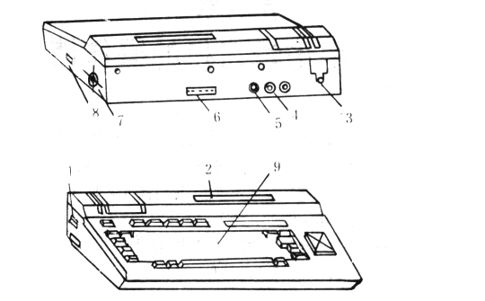
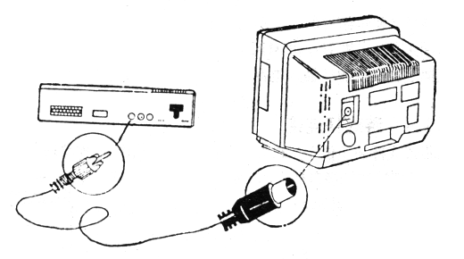
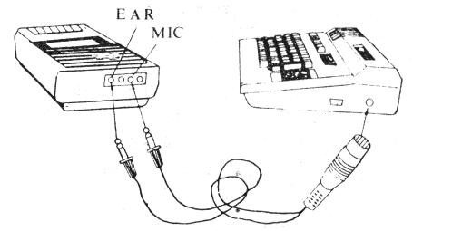
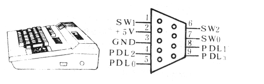
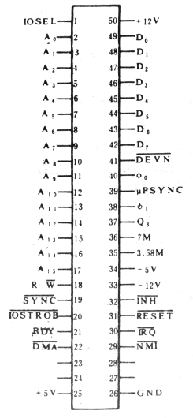
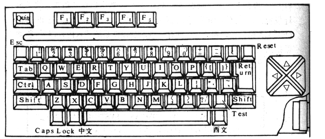

# 第二章 CEC-I 中华学习机的操作使用

对于任何一个电子计算机系统，当你第一次使用它时，尽管它的电路连线已经全部接好，但往往会有一种畏惧心理。在使用 CEC-I 系统时，同样也会有这种感觉。在这一章里，我们将讲述如何顺利地使用 CEC-I 中华学习机，相信你在学完这一章之后，一定会对 CEC-I 系统的使用与操作有充分的了解，为以后的学习建立起信心，使 CEC-I 中华学习机成为你真正的朋友。

---

## 2.1 CEC-I 系统的安装

### 2.1.1 开箱

将装有中华学习机的纸箱放在桌面上，正面朝上打开纸箱的箱盖，你会发现主机装在塑料袋中，两头各有一块泡沫衬垫。

小心取出主机，并清点随机带的视频电缆、录音机电缆、使用手册等附件。要妥善保存好纸箱及其它物品，以备将来搬运时使用。

主机箱是一个紧凑的塑料机盒，它的右上角有一个电源指示灯（小孔内），电源一接通，此灯便亮了。主机的正面是键盘，左侧面是一个电源开关，后侧面有电视机接口、显示器接口及软盘驱动器接口，而右侧面有一个盒式磁带录音机接口及游戏操纵杆接口（原文作“左侧面”，实为右侧面，参看图 2.1 与 2.1.3/2.1.4 节）。如图 2.1 所示。


*图 2.1 主机接口*
*1. 电源开关，2. 扩充槽口，3. 电源线，4. 电视机接口，5. 监视器接口，6. 磁盘驱动器接口，7. 录音机接口，8. 游戏杆接口，9. 键盘*

### 2.1.2 显示器的连接

CEC-I 的显示器可以是电视机（彩色或黑白）也可以是监视器（彩色或黑白），但连接的方法不同。

#### ① 电视机连接（参看图 2.2）

- 把电视机的天线插头拔下。
- 将视频电缆线的一头插入主机上的电视机接口，另一头插入电视机的天线插座上，电视机天线插座的输入阻抗为 75 Ω。
- 确认主机电源开关处于“OFF”位置。


*图 2.2 电视的连接*

- 将电视机电源插头和主机电源插头分别插入 220V 电源插座上。
- 把电视机音量开关调到最小位置。
- 先打开电视机电源开关，然后再打开主机的电源开关。
- 当使用黑白电视机时，首先调准电视机频道（生产厂家要求的频道为准，一般为 3 频道）。开机后，调节频道微调及对比度、亮度旋钮，直到电视屏幕上出现下面几行清晰字样为止：

```text
ZHONG HUA XUE XI JI
   VERSION 1.1
```

当使用彩色电视机时，同样首先选好频道（3 频道），并通过自检方式进入显示彩条图象（参考 2.4 节机器的自检），然后调节频道微调及色饱和度、亮度、对比度，直到屏幕上的彩条满意为止。以后可把这一频道作为计算机专用频道，再开机就可以不用调机了。

#### ② 监视器的连接（参阅图 2.3）


*图 2.3 监视器的连接*

- 将视频电缆线的一头插入主机监视器接口，另一头插入监视器的“IN”插座。
- 确认主机电源为“OFF”位置。
- 将主机电源及监视器电源插头分别插入电源。先打开监视器电源开关，然后再打开主机电源开关，屏幕上将出现清晰的 `ZHONG HUA XUE XI JI` 字样。

### 2.1.3 录音机连接（参阅图 2.4）

- 确认主机电源为“OFF”位置。
- 把录音机电缆线的一端（五芯插头）插入主机右侧面的录音机接口。


*图 2.4 录音机连接*

- 将录音机电缆线的另一端的两个 3.5 mm 插头分别插入录音机 `EAR` 插孔（连接主机 IN）和 `MIC` 插孔（连接主机 OUT）。
- 把录音机电源线插入电源。

### 2.1.4 游戏杆连接

九芯游戏杆插座位于主机右侧（如图 2.5 所示），把连接游戏杆的插头直接对准游戏杆接口插入，必须注意：两者的信号一定要一一对应（游戏杆接口信号如图 2.5）。


*图 2.5 游戏杆的连接*

| 引脚 (左列) | 信号名称 | 说明 | 引脚 (右列) | 信号名称 | 说明 |
| :---: | :--- | :--- | :---: | :--- | :--- |
| **1** | `SW1` | 开关量输入 1 | **6** | `SW2` | 开关量输入 2 |
| **2** | `+5V` | +5V 电源 | **7** | `SW0` | 开关量输入 0 |
| **3** | `GND` | 地线 | **8** | `PDL1` | 模拟量输入 1 |
| **4** | `PDL2` | 模拟量输入 2 | **9** | `PDL3` | 模拟量输入 3 |
| **5** | `PDL0` | 模拟量输入 0 | — | — | — |

### 2.1.5 磁盘驱动器连接（参阅图 2.6）

- 确认主机电源开关处于“OFF”位置。
- 将驱动器扁平电缆插头插入主机后侧面的驱动器接口上。必须注意的是插针与插孔要一一对应，电缆线插头的凸出部分朝上，否则将会损坏软盘驱动器。


*图 2.6 驱动器连接*

### 2.1.6 扩充卡的连接（参阅图 2.7）

CEC-I 主机板的右上侧有一个 50 线的扩充槽，可插入多种外设卡及扩充卡（如打印机卡、音乐卡、A/D 卡等）。扩充卡如果尺寸太大插不进去，可采用 50 线转接板把槽口抬高，再插外设卡或扩充卡。具体步骤如下：

1. 确认主机电源开关在“OFF”位置。
2. 用手轻轻压下主机右上方的扩充槽盖，可看到印刷板上安装了一个 50 线插槽。
3. 把扩充卡按元器件朝前、焊接面朝后的方向对准槽口往下插。必须注意，一定要平插插平，以免错位。

**扩充槽号的选定**：
用户可以根据需要用短接帽来选择槽号，槽号可以为 1, 2, 3, 4, 5, 7 中的任一个。由于 CEC-I 在设计上已将 3 号槽定于汉字系统，6 号槽定于磁盘驱动器接口，所以用户不可选用。CEC-I 在出厂时一般都将槽号设在第 1 槽，即将两个短接帽插在标有“1”的位置上。选择槽号插头位于主机板的右侧，并标有槽号，如需改槽号，需要打开主机机壳，把原在第 1 槽位置的两个短接帽取下并插入你所需要的槽号位置上。


*图 2.7 扩充卡的连接（50 线扩充槽引脚图）*

#### 表：CEC-I 50 线扩充槽引脚定义（对应图 2.7）

| 左侧信号 | 左侧引脚 | 右侧引脚 | 右侧信号 |
| :---: | :---: | :---: | :---: |
| $\overline{\text{IOSEL}}$ | **1** | **50** | $+12\text{V}$ |
| $A_0$ | **2** | **49** | $D_0$ |
| $A_1$ | **3** | **48** | $D_1$ |
| $A_2$ | **4** | **47** | $D_2$ |
| $A_3$ | **5** | **46** | $D_3$ |
| $A_4$ | **6** | **45** | $D_4$ |
| $A_5$ | **7** | **44** | $D_5$ |
| $A_6$ | **8** | **43** | $D_6$ |
| $A_7$ | **9** | **42** | $D_7$ |
| $A_8$ | **10** | **41** | $\overline{\text{DEVN}}$ |
| $A_9$ | **11** | **40** | $\phi_0$ |
| $A_{10}$ | **12** | **39** | $\mu\text{PSYNC}$ |
| $A_{11}$ | **13** | **38** | $\phi_1$ |
| $A_{12}$ | **14** | **37** | $Q_3$ |
| $A_{13}$ | **15** | **36** | $7\text{M}$ |
| $A_{14}$ | **16** | **35** | $3.58\text{M}$ |
| $A_{15}$ | **17** | **34** | $-5\text{V}$ |
| $\text{R}/\overline{\text{W}}$ | **18** | **33** | $-12\text{V}$ |
| $\overline{\text{SYNC}}$ | **19** | **32** | $\overline{\text{INH}}$ |
| $\overline{\text{IOSTROB}}$ | **20** | **31** | $\overline{\text{RESET}}$ |
| $\text{RDY}$ | **21** | **30** | $\overline{\text{IRQ}}$ |
| $\overline{\text{DMA}}$ | **22** | **29** | $\overline{\text{NMI}}$ |
| *(空)* | **23** | **28** | *(空)* |
| *(空)* | **24** | **27** | *(空)* |
| $+5\text{V}$ | **25** | **26** | $\text{GND}$ |

---

## 2.2 CEC-I 中华学习机的启动

### 2.2.1 基本系统的启动

首先按正确的方法连接好 CEC-I 系统，并检查连接是否都正确无误。然后，将显示器的电源打开，调好对比度，如果是电视机还应把频道调整好（一般用 3 频道）。接下来就可以打开主机电源了。

当开机之后，立刻就能听到机器发出“嘟”的一声。这声音告诉你：主机已准备就绪，同时主机右上方的电源指示灯应该发亮。如果一切都正常，CEC-I 将自动进入西文 BASIC 状态，在屏幕上将会显示如图 2.8 所示的文字，此时你就可以输入命令或 BASIC 程序了。

当机器启动以后，在屏幕上可以看见一个十分明显的、有规则的、忽亮忽暗的闪烁小方块，这个闪烁的白色小方块叫做**光标**，它的位置表示了你从键盘上打入的字符在屏幕上出现的位置。

在光标的左边一个 `]` 符号，称之为**提示符**。符号 `]` 是 CEC-BASIC 语言系统提示符。另外 CEC-I 中当进入监控程序后的提示符为 `*`，当进入小汇编程序后的提示符为 `!`。

```text
+--------------------------------------------------+
|             ZHON HUA XUE XI JI                   |
|                                                  |
|                VERSION 1.1                       |
|                                                  |
|                   ]█                             |
+--------------------------------------------------+
```
*图 2.8 机器启动后的屏幕显示（注：原书图 2.8 中 `ZHON` 漏印了 `G`，实际机器显示为 `ZHONG HUA XUE XI JI`）*

### 2.2.2 连接驱动器系统的启动

首先按正确的方法连接好系统。在启动前打开磁盘驱动正面中央的盖子，把含有 DOS 3.3 磁盘操作系统的磁盘印字面朝上，水平而轻轻地沿着驱动器的细缝插入驱动器内。当磁盘完全插入以后，再关上驱动器的盖子。然后就可按照基本系统的启动方法进行启动。当主机电源打开后，屏幕上首先显示如图 2.8 的文字幕，然后磁盘驱动器上的指示灯发亮，并且可以听到驱动器马达的转动声音，这时机器正在把 DOS 3.3 磁盘操作系统载入内存。当磁盘操作系统载入内存以后，驱动器指示灯熄灭，屏幕上将会出现 DOS 3.3 磁盘操作系统的题头版面，如图 2.9 所示。

```text
+------------------------------------------------------------+
|         DOS VERSION   3.3 08/25/80                         |
|     APPLE IIPLUS OR ROMCARD SYSTEM MASTER                  |
|      (LOADING INTEGER INTO LANGUAGE CARD)                  |
|            ]█                                              |
+------------------------------------------------------------+
```
*图 2.9 DOS 3.3 题头版面*

此时 CEC-I 就已在 DOS 3.3 的控制之下接受用户的命令和 BASIC 程序。

如果开机前没有将驱动器盖合上或没有将含 DOS 3.3 的磁盘插入驱动器，CEC-I 就会直接进入 CEC-BASIC 语言系统，而不受 DOS 3.3 的控制。以后如果需要装入 DOS 3.3 系统，可以将 DOS 3.3 磁盘插入驱动器合上盖，并键入：

```basic
PR#6 (回车)
```

于是 DOS 3.3 将被载入机器内存。

---

## 2.3 键盘操作

CEC-I 的键盘与主机之间通过一条 26 线扁平电缆线连接，直接装入主机机壳内。此键盘具有**重复功能**和 **N 键滚动功能**。

所谓**重复功能**是指当某键按下时间大于一定值时，连续不断地重复发送这个键值，即自动重复此键。所谓 **N 键滚动**则是指在有多个键按下时，将根据按下键的先后次序分别检测并输入主机，同时也显示在屏幕上。

图 2.10 是 CEC-I 键盘的排列图。在这个键盘上，有些键上标有 `0, 1, 2, 3 ... 9` 以及 `A, B, C, D ... X, Y, Z` 等字符，这是我们大家十分熟悉的数学和英文字母，使用也很方便。例如，当你按下 `4` 这个键，屏幕上就会出现一个 `4`。


*图 2.10 键盘排列图*

除了上述的 36 个数字键和字母键之外，还有 `.`、`:`、`-`、`,`、`;`、`/` 这 6 个键的用法也与上面的 36 个键用法相同。另外最下面的那个长键，称为**空格键**。按一下空格键，显示屏幕的光标就向右移一格，字符显示出现一个空格，即这个位置什么也不显示。

还有一些键具有特殊的作用，称为**功能键**。下面我们分别给以说明。

### 2.3.1 SHIFT 键

这个键共有两个，分别安排在键盘的左侧与右侧，这是为了操作起来方便。这个键的功能是当按此键和另一键时，产生上档键码。例如，在标有数字 `5` 的这个键，其 `5` 的上方还标有 `%`。如果要把 `%` 这个字符显示到屏幕上，就必须将 `SHIFT` 与 `5` 这两个键同时按下，或者先按着 `SHIFT` 不动，然后再按一下 `5`。同样，凡是键上有上下两个字符的，要想使用上面的那个符号的话，必须借助于 `SHIFT` 键。

*(后续章节 2.3.2 CAPS LOCK 键 等内容接下页...)*
