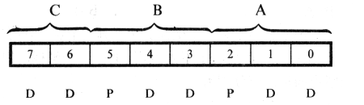
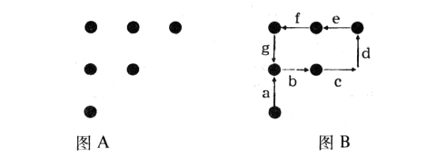
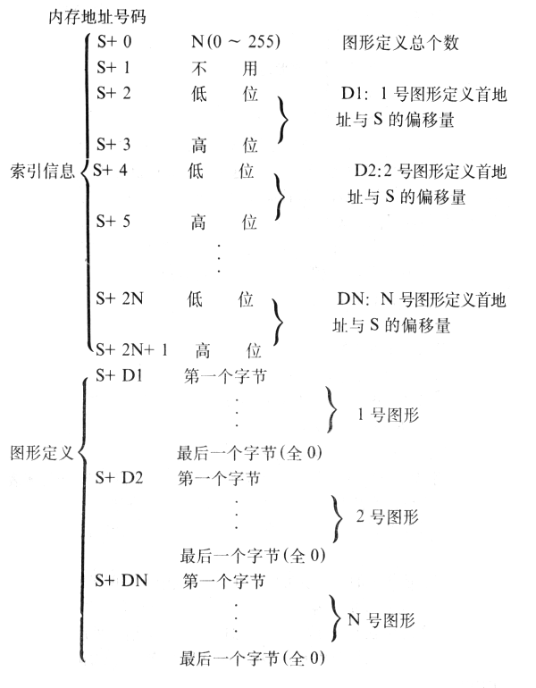
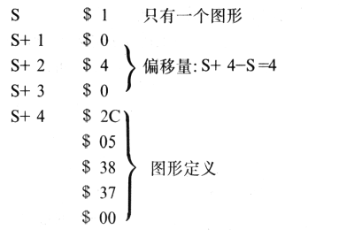

## 3.6 定义语句

### 3.6.1 DIM

- **执行型**：立即与暂缓型
- **格式**：`DIM 变量名(下标)〔{, 变量名(下标)}〕`
- **功能**：定义一个数组，并给数组在内存中开辟一个数据区。数组中的每个元素作为变量使用。
- **说明**：数组中的元素也称为下标变量，因此下标变量也是变量的一种表示形式。如 `A(7)` 就是一个下标变量。对下标变量有如下规定：
  - 在括号左边的称为下标变量名，下标变量名必须是由英文大写字母开头，后边可跟字母或数字，与简单变量名的规定相同。
  - 在括号内称为下标，下标只能放在括号内。如：
    `A(I), B(7), C(I, J), D1(3, 7)`
  - 下标可以是数值，变量或表达式。如：
    `A(8), M(I), B(I * J, J)`
  - 下标还可以是下标变量。如：
    `A(B(1), B(2)), C(D(1) * D(2))`
  - 下标只能是正实数或零，不能是负数。若下标中带有小数，机器具有自动取整功能（原文印作“动能”）。如：`A(1.5)` 实质为 `A(1)`。

下标变量在使用之前，必须用 `DIM` 语句对所使用的数组进行定义。数组可以是一维，也可以是多维，视用户的需要而定，但数组维数最多不能超过 88 维，即 `DIM A(n1, n2......n88)`，在数组中可使用元素的多少是由可用内存单元来决定的，它取决于 `HIMEM`（原文印作 `LIMEM`）、`LOMEM` 及程序中使用简单变量的多少。数组中每一维最小下标是零。例如 `DIM A(2)` 实际有 3 个元素，即 `A(0), A(1), A(2)`。每一维的下标值最大可达 `32767`，即可定义 `DIM A(32767)`。数组与简单变量一样也有三种类型：整型、实型与字符串型。

例：`DIM A%(S), B$(5), C(S)`。

在使用数组元素之前应先定义数组名称，但如果使用的元素下标值均在 `0` ～ `10` 之间，则可不定义数组，直接使用。一个数组只能定义一次，否则将出现 `REDIM'D ARRAY`（原文印作 `REDIM ARRAY`）错误。

数组最适用于数据的处理。

例：随机产生 `N` 个随机数，然后按这些数的大小顺序排列打印出来

```basic
]LIST

10 INPUT N
20 DIM A(N)
30 FOR I = 1 TO N
40 A(I) = RND (1)
50 NEXT I
60 FOR I = 1 TO N - 1
70 FOR J = I + 1 TO N
80 IF A(I) > A(J) THEN 100
90 C = A(I) : A(I) = A(J) : A(J) = C
100 NEXT J, I
110 FOR I = 1 TO N
120 PRINT A(I)
130 NEXT I
140 END

]RUN
?10
.936183085
.908250485
.791714648
.779829242
.673272226
.413178555
.405076424
.354899917
.293299792
.0768111052
```

### 3.6.2 DEF FN

- **执行型**：暂缓型
- **格式**：`DEF FN 变量名(实型算术变量) = 算术表达式`
- **功能**：用户可自定义一个函数，以后在程序中可直接使用（原文印作“使作”）这个函数。
- **说明**：先用 `DEF`（原文印作 `DFE`）定义函数 `FN` 的名称，格式中的实型变量代表自变量，`FN 变量名` 表示自变量的函数，它们的函数关系由等号右边表达式给出。一旦函数定义后，`FN 变量名(自变量)` 的函数即可使用，取不同自变量的值就可得到一一对应的函数值。

例：

```basic
10 DEF FNP (X) = 1 / SIN(X)
20 FOR I = 1 TO 2
30 INPUT X
40 PRINT X, FN P(X)
50 NEXT I
]RUN
?1.507
1.507           1.00203844
?3.14
3.14            627.883015
```

使用自定义函数应注意：

- 只能定义算术函数，不能定义字符串函数。
- 使用自定义函数之前必须先定义函数。
- 自定义函数是一个一元函数，即只有一个自变量，但在函数的表达式中自变量出现的次数无限制。例 `DEF FNY(X) = X ^ 3 + 3 * X ^ 2 + 3 * X + 1`。
- `DEF` 语句中的自变量是一个虚变量，在调用函数时用实变量或其他参数值代替。但自变量一定为实型数。
- 对同一个自定义函数可多次重新定义。

---

## 3.7 文本、图形与音响语句

### 3.7.1 TEXT

- **执行型**：立即与暂缓型
- **格式**：`TEXT`
- **功能**：学习机中有三种不同的显示方式：文本显示方式、低分辨率图形显示方式及高分辨率图形显示方式。执行该语句使低分辨率图形方式或高分辨率图形方式转换到文本显示方式（每行 40 列，共 24 行）。
- **说明**：在西文文本方式中，执行 `TEXT` 和 `VTAB 24` 命令的效果相同。西文文本显示区的内存地址为 `$400` ～ `$7FF`；中文文本显示区的内存地址为 `$4000` ～ `$5FFF`。

### 3.7.2 GR

- **执行型**：立即与暂缓型
- **格式**：`GR`
- **功能**：把屏幕设置为低分辨率图形方式（$40 \times 40$）并在屏幕下方留 4 行作为文本窗口。
- **说明**：执行此命令后，屏幕清除为黑色，原低分辨率图形区的图形被破坏，光标移至文本窗口内。此时 `COLOR` 被设置为 `0`（黑色），因此图形颜色只能在 `GR` 语句之后设置。

要使图形、文本混合方式转到纯低分辨率图形方式，可用 `POKE` 或 `PEEK` 命令访问地址（`-16302`）或等效地址（`49234`，原文印作 `49324`），如：`POKE -16302, 0`。再返回混合方式可访问地址（`-16301`，原文印作 `-16302`）或等效地址（`49235`，原文印作 `49325`）。

在程序中要由高分辨率第二页 `HGR2` 转到 `GR` 时，应先使用 `TEXT` 命令。

低分辨率图形显示区的内存地址为 `$400` ～ `$7FF`，从这里可看出文本与低分辨率图形区是在同一区域。

### 3.7.3 COLOR

- **执行型**：立即与暂缓型
- **格式**：`COLOR = 算术表达式`
- **功能**：在低分辨率图形方式中，用 `COLOR` 来设置颜色进行绘图。
- **说明**：机器对算术表达式的值自动取整，其值应在 `0` ～ `255` 之间，并看成是 16 模数，即除以 16 后取其余数。例：若算术表达式的值为 `52`。则其实际值为 `52 - INT(52 / 16) * 16`（原文印作 `53 / 16`）得 `4`。

颜色名称及其代号如下：

| 代号 | 颜色 | 代号 | 颜色 | 代号 | 颜色 | 代号 | 颜色 |
| :---: | :--- | :---: | :--- | :---: | :--- | :---: | :--- |
| `0` | 黑色 | `4` | 深绿色 | `8` | 棕色 | `12` | 绿色 |
| `1` | 红色 | `5` | 灰色 | `9` | 橙色 | `13` | 黄色 |
| `2` | 深蓝色 | `6` | 中蓝色 | `10` | 灰色 | `14` | 绿蓝色 |
| `3` | 紫红色 | `7` | 浅蓝色 | `11` | 粉红色 | `15` | 白色 |

上例中 `COLOR = 52` 实际表示设置深绿色。

### 3.7.4 PLOT

- **执行型**：立即与暂缓型
- **格式**：`PLOT 算术表达式1, 算术表达式2`
- **功能**：在低分辨率图形方式下画一个色点。
- **说明**：算术表达式 1 为 X 坐标点，其值范围在 `0` ～ `39` 之间；算术表达式 2 为 Y 坐标点，其值范围在 `0` ～ `39` 之间；（纯图形方式下）算术表达式 2 为 Y 坐标点，其值范围在 `0` ～ `47` 之间。图形原点 `(0, 0)` 在屏幕的左上角上。

### 3.7.5 HLIN

- **执行型**：立即与暂缓型
- **格式**：`HLIN 算术表达式1, 算术表达式2 AT 算术表达式3`
- **功能**：在低分辨率图形方式下，画出一条水平色线。
- **说明**：从坐标点（算术表达式 1 的值，算术表达式 3 的值）到另一坐标点（算术表达式 2 的值，算术表达式 3 的值）画一条直线。坐标点的范围与 `PLOT` 语句相同。

### 3.7.6 VLIN

- **执行型**：立即与暂缓型
- **格式**：`VLIN 算术表达式1, 算术表达式2 AT 算术表达式3`
- **功能**：在低分辨率图形方式下，画出一条垂直色线。
- **说明**：从坐标点（算术表达式 3 的值，算术表达式 1 的值）到另一坐标点（算术表达式 3 的值，算术表达式 2 的值）画出一条直线。坐标点的范围与 `PLOT` 相同。

### 3.7.7 HGR

- **执行型**：立即与暂缓型
- **格式**：`HGR`
- **功能**：把屏幕设置为高分辨率第一页图形方式，并在屏幕下面留 4 行作为文本窗口。
- **说明**：学习机具有高分辨率图形方式，在此方式下，一幅画面是由 $280 \times 192$ 个色点组成。高分辨率图形有两页，第一页的内存地址在 `$2000` ～ `$3FFF`，第二页的内存地址在 `$4000` ～ `$5FFF`。

执行 `HGR` 后，将屏幕清为黑色，并将原先在第一页图形区的图形清除。但该语句不影响 `HCOLOR` 的值。由于这个语句把屏幕下方 4 行设置为文本窗口，故一页画面由 $280 \times 160$ 个色点组成。要使屏幕设置为全屏幕图形方式，应在执行 `HGR` 之后加上 `POKE -16302, 0` 或 `POKE 49234, 0`，若需再返回混合方式则用 `POKE -16301, 0` 或 `POKE 49235, 0`。屏幕原点在屏幕的左上角上。

### 3.7.8 HGR2

- **执行型**：立即与暂缓型
- **格式**：`HGR2`
- **功能**：把屏幕设置为全屏幕高分辨率第二页图形方式。
- **说明**：执行此语句后，屏幕清为黑色，并将原第二页图形区的图形清除。但不影响 `HCOLOR`（原文印作 `CHOLOR`）的值。这是全屏幕图形方式，故有 $280 \times 192$ 个色点。要使屏幕设置为混合方式可用 `POKE -16301, 0`，但留出的 4 行文本窗口不能立刻作为程序文本使用，必须通过某种技术才能使用这个窗口。

### 3.7.9 HCOLOR

- **执行型**：立即与暂缓型
- **格式**：`HCOLOR = 算术表达式`
- **功能**：在高分辨率图形方式下，用 `HCOLOR` 来设置颜色进行绘图。
- **说明**：算术表达式的值范围在 `0` ～ `7` 之间。颜色名称及其代号如下：

| 代号 | 颜色 | 代号 | 颜色 |
| :---: | :--- | :---: | :--- |
| `0` | 黑 1 | `4` | 黑 2 |
| `1` | 绿 | `5` | 橙 |
| `2` | 紫 | `6` | 蓝 |
| `3` | 白 1 | `7` | 白 2 |

`HCOLOR` 的颜色与 X 轴坐标的奇、偶数有关，另外还与显示器有关。

以 `HCOLOR = 3`（白色）来说，如果 X 轴坐标为偶数，则可能显示出紫色；如果 X 轴坐标为奇数，则可能显示出绿色。只有当 X 轴紧邻的奇、偶点都显示时，才呈现白色。

`HCOLOR` 只能用在高分辨率图形方式下，不影响低分辨率图形的颜色。同理 `COLOR` 不影响高分辨率图形的颜色。

### 3.7.10 HPLOT

- **执行型**：立即与暂缓型
- **格式**：
  ```text
  HPLOT 算术表达式1, 算术表达式2
  HPLOT TO 算术表达式3, 算术表达式4
  HPLOT 算术表达式1, 算术表达式2 TO 算术表达式3, 算术表达式4 〔{TO 算术表达式, 算术表达式}〕
  ```
- **功能**：在高分辨率图形方式下绘图。
- **说明**：在第一种形式中（原文印作“第一页形式中”）坐标点（表达式 1 的值，表达式 2 的值）画出一个色点，颜色由 `HCOLOR` 表设置。

第二种形式是由当前坐标点到表达式 3，表达式 4 所指出的坐标点画出一条直线。如果执行这个语句之前没有画过点，则这条命令不会画出线来。

如果采用第三种形式，可根据各坐标点的前后次序依次画出一系列直线，而这些线条是连续的。使用这条命令最多只能有 239 个字符。X 坐标值（即奇数表达式）在 `0` ～ `279` 之间，Y 坐标值（即偶数表达式）在 `0` ～ `191` 之间，若所画点超出这个范围，则会造成错误 `?ILLEGAL QUANTITY ERROR`。

例：下面这个程序将在高分辨率第一页图形区，分别以六种颜色（黑色除外）随机画出 30 条色线。

```basic
5  HOME
10 FOR HC = 1 TO 7
20 HGR
25 HCOLOR= HC
30 IF HC = 4 THEN 100
40 HPLOT 3, 6
45 VTAB 21 : PRINT "HCOLOR="; HC
50 FOR I = 1 TO 30
60 X = RND (1) * 280
70 Y = RND (1) * 192
80 HPLOT TO X, Y
90 NEXT I
95 FOR J = 1 TO 500 : NEXT
100 NEXT HC
```

如果要在高分辨率第二页图形区画出这些色线，则只需将 20 程序行改为 `HGR2` 即可。

### 3.7.11 MUSIC

- **执行型**：立即与暂缓型
- **格式**：`MUSIC 算术表达式1, 算术表达式2`
- **功能**：定义一个音阶和音长，并使机内扬声器发音。
- **说明**：算术表达式 1 的值为发声的频率（即音高），算术表达式 2 的值为发声的时间，它们的取值范围均在 `0` ～ `255` 之间。音阶与音长对应取值参考表如下，另外用户还可根据这个表及音响自行定出所需的音高。

| X 值 | 255 | 288（实为 228） | 205 | 192 | 171 | 152 | 140 | 128 | 114 | 102 |
| :---: | :---: | :---: | :---: | :---: | :---: | :---: | :---: | :---: | :---: | :---: |
| **音阶** | $\underset{\cdot}{5}$ | $\underset{\cdot}{6}$ | $\underset{\cdot}{7}$ | $1$ | $2$ | $3$ | $4$ | $5$ | $6$ | $7$ |

| X 值 | 95 | 84 | 75 | 68 | 62 |
| :---: | :---: | :---: | :---: | :---: | :---: |
| **音阶** | $\dot{1}$ | $\dot{2}$ | $\dot{3}$ | $\dot{4}$ | $\dot{5}$ |

| Y 值 | 30 | 70 | 110 | 160 | 255 |
| :---: | :---: | :---: | :---: | :---: | :---: |
| **音阶（音长）** | 1/4 拍 | 1/2 拍 | 1 拍 | 2 拍 | 4 拍 |

例：一个发出音阶旋律的程序可按如下方法来设计。

```basic
10 FOR I = 1 TO 15
20 READ X, Y
30 MUSIC X, Y
40 NEXT I
50 DATA 255, 160, 228, 160, 205, 160, 192, 160, 171,
        160, 152, 160, 140, 160, 128, 160, 114, 160, 102,
        160, 95, 160, 84, 160, 75, 160, 68, 160, 62, 160
```

---

## 3.8 高分辨率图形的向量作图法

CEC-BASIC 在高分辨图形区里有 5 个处理向量图形的语句：`DRAW`、`XDRAW`、`ROT`、`SCALE` 及 `SHLOAD`。在使用这些语句之前，应先用“图形向量”把图形定义出来，每一个图形都可以看成是一系列绘画向量的集合，这些集合放入内存中，一组图形中可以有一个或多个图形，这样一组向量图形与它们的索引构成“向量图形表”，这些表可由键盘来建立，并存放于磁盘或磁带内以供使用。

由于定义的向量图形存放在内存中，每个字节（内存单元）由八位二进制数组成，因此每个字节分为三段，每段指定一个绘图向量：要不要画点，以及向哪个方向移动（上、下、左、右）。每个字节分配如下：


*图 3.1 图形向量字节分配格式*

```text
  |---- C ----|------- B -------|------- A -------|
  +-----+-----+-----+-----+-----+-----+-----+-----+
  |  7  |  6  |  5  |  4  |  3  |  2  |  1  |  0  |
  +-----+-----+-----+-----+-----+-----+-----+-----+
     D     D     P     D     D     P     D     D
```

其中 0 ～ 2 位为 A 段，3 ～ 5 位为 B 段，6 ～ 7 位为 C 段。每段中有两位 `DD`，它指定一个移动的方向；在 A、B 段各有一位 `P`，它表示在移动之前要不要画一个点。对 `D` 与 `P` 的规定为下。

$$
\text{DD} = \begin{cases}
00 & \text{向上移} \\
01 & \text{向右移} \\
10 & \text{向下移} \\
11 & \text{向左移}
\end{cases}
$$

$$
\text{P} = \begin{cases}
0 & \text{不画点} \\
1 & \text{画点}
\end{cases}
$$

在 C 段中没有 `P` 栏，其自然值 `P = 0`，所以 C 段只能移动不能画点。在把各段组成“图形向量”时应遵守下面的规定：

① 绘图时，先将图形绘成一个个向量点。这些图形向量存入内存时，先填 A 段，然后 B 段，最后 C 段。一个字节填完后，再填下一个字节。

② 对每一个“图形向量”来说，如果 `C = 00`，则表示 C 段不起作用，不向任何方向移动。如果 `C = 00, B = 000` 则表示 C、B 两段都不起作用，只有 A 段起作用。

③ 如果 A、B、C 三段全为 `0`，则表示一个图形的结束（原文印作“结来”）。

例：要画出下图（A）中 6 个点组成的图形，可以用下图（B）中表示的 `a` ～ `g` 七个步骤来完成：


*图 3.2 向量图形点阵与步骤示例（图 A 与图 B）*

其中 `a` 表示画一个点，然后上移一个坐标；`b` 表示画一个点，然后右移一个坐标；`c` 与 `b` 相同。但 `d` 则表示不画点，仅上移一个坐标。因此，`a` ～ `g` 对应的图形向量段应分别为：

- `a`: `100`
- `b`: `101`
- `c`: `101`
- `d`: `000`（或 `00`）
- `e`: `111`
- `f`: `111`
- `g`: `110`

| 向量 | C 段 | B 段 | A 段 | 十六进制数 |
| :--- | :---: | :---: | :---: | :---: |
| 向量 1 | `00` | `101` | `100` | `$2C` |
| 向量 2 | `00` | `000` | `101` | `$05` |
| 向量 3 | `00` | `111` | `000` | `$38` |
| 向量 4 | `00` | `110` | `111` | `$37` |
| 向量 5 | `00` | `000` | `000` | `$00` |

根据上述图形向量段组成“图形向量”，并在最后一个图形向量后面加一个全 `0` 向量作为图形结束，如上图所示。

如果有若干个图形，则先将图形按上述方法定义好，然后再加一个索引表，构成一个完整的图形表，一个图形表（原文印作“图表形表”）最多可定义 256 个图形。一个完整的图形表的结构如下：


*图 3.3 完整图形表的内存结构*

| 区域 | 内存地址号码 | 内容 | 说明 |
| :--- | :--- | :--- | :--- |
| **索引信息** | `S + 0` | `N (0 ～ 255)` | 图形定义总个数 |
| | `S + 1` | 不用 | |
| | `S + 2`<br>`S + 3` | 低位<br>高位 | `D1`：1 号图形定义首地址与 `S` 的偏移量 |
| | `S + 4`<br>`S + 5` | 低位<br>高位 | `D2`：2 号图形定义首地址与 `S` 的偏移量 |
| | $\vdots$ | $\vdots$ | $\vdots$ |
| | `S + 2N`<br>`S + 2N + 1` | 低位<br>高位 | `DN`：`N` 号图形定义首地址与 `S` 的偏移量 |
| **图形定义** | `S + D1` | 第一个字节<br>$\vdots$<br>最后一个字节（全 `0`） | 1 号图形 |
| | `S + D2` | 第一个字节<br>$\vdots$<br>最后一个字节（全 `0`） | 2 号图形 |
| | `S + DN` | 第一个字节<br>$\vdots$<br>最后一个字节（全 `0`） | `N` 号图形 |

若将前面那个图形定义构造一个图形表，它应为下图：


*图 3.4 单个图形表的构造示例*

```text
S       $ 1    只有一个图形
S + 1   $ 0  \
S + 2   $ 4   } 偏移量：S + 4 - S = 4
S + 3   $ 0  /
S + 4   $ 2C \
        $ 05  |
        $ 38  } 图形定义
        $ 37  |
        $ 00 /
```

有了图形表后，下一步应把图形表送入机器中，在把表数据送入机器时，应确定表的首地址（`S`）的值。这个地址要选得合适，否则有可能破坏其它程序或表自身，一般首地址取 `$6000` 比较安全。以后将着重介绍如何将向量图形表存入内存的方法。

当使用这些向量图形时，应先把图形表的首址（`S`）存放到 `$E8` 和 `$E9` 单元中（`$E8` 存放低位，`$E9` 存放高位），然后采用下面的语句把定义的图形显示出来。

### 3.8.1 DRAW

- **执行型**：立即与暂缓型
- **格式**：
  ```text
  DRAW 算术表达式1 AT 算术表达式2, 算术表达式3
  DRAW 算术表达式1
  ```
- **功能**：根据某个图形表在屏幕上进行作图。
- **说明**：如果 `DRAW` 语句采用第一种形式，以某点（该点由算术表达式 2 的值与算术表达式 3 的值确定）为起始位置，画出一个图形。而所画的图形根据算术表达式 1 的值确定，该值表示画出图形表中的第几个图形。

算术表达式 1 的值必须在 `0` 到 `n` 之间，其中 `n` 是图形定义的个数（即图形表中首址 `S` 的内容）。算术表达式 2 的值在 `0` ～ `279` 之间，算术表达式 3 的值在 `0` ～ `191` 之间。如果 `DRAW` 语句采用第二种形式，则表示在最近执行 `HPLOT`、`DRAW`、`XDRAW` 的位置画出一个指定图形。

如果执行 `DRAW` 语句时，在内存中没有图形表，将会使系统僵死。

### 3.8.2 XDRAW

- **执行型**：立即与暂缓型
- **格式**：`XDRAW 算术表达式1 〔AT 算术表达式2, 算术表达式3〕`
- **功能**：用 `DRAW` 画图形颜色的补色画一图形。
- **说明**：这个语句与 `DRAW` 一样可以画出一个图形，所不同的是用补色画图。如黑色与白色、蓝色与绿色、紫色与橙色是互为补色，因此使用 `XDRAW` 可擦掉屏幕上原有的图形。

### 3.8.3 SCALE

- **执行型**：立即与暂缓型
- **格式**：`SCALE = 算术表达式`
- **功能**：决定 `DRAW` 与 `XDRAW` 所画图形的比例尺寸。
- **说明**：算术表达式的值在 `0` ～ `255` 之间，`SCALE = 1` 图形尺寸最小，数值越大比例尺越大，但 `SCALE = 0` 表示最大的图形尺寸。

### 3.8.4 ROT

- **执行型**：立即与暂缓型
- **格式**：`ROT = 算术表达式`
- **功能**：设置新画图形的旋转角度。
- **说明**：旋转角度由算术表达式确定，其值在 `0` ～ `255` 之间。

`ROT = 0` 不旋转。`ROT = 16` 顺时针方向旋转 90 度。`ROT = 32` 转 180 度，以此类推。`ROT = 64` 与 `ROT = 0` 相同，不旋转。这个语句与 `SCALE` 的值有关。当 `SCALE = 1` 时，只有 4 个旋转值（即 `0`、`16`、`32`、`48`）。当 `SCALE = 2` 时，有 8 个旋转值（即 `0`、`8`、`16`、`24`、`32`、`40`、`48`、`56`），以此类推。计算机对不认识的旋转值，通常以较小而认识的旋转值计算。

如何将图形表送入内存，及图形的移动、旋转，下面结合前面所举的那个图形表为例：

把图形表送入内存一般有两种方法：

① 利用 `POKE` 语句把图形表数据送入内存。如果图形表的首地址为 `$6000`（十进制 `24576`），则可把下面的程序输入计算机。

```basic
100 S = 24576
200 FOR I = 0 TO 8
300 READ A
400 POKE S + I, A
500 NEXT I
600 DATA 1, 0, 4, 0, 44, 5, 56, 55, 0
```

（注：原文第 200 行印作 `FOR I=0 TO 9`，但 `DATA` 共 9 个数据，对应下标 `0` 到 `8`。）

此外，还需把这个首地址的十六进制数送入 `232` 和 `233` 单元中，可以由下面两条命令实现：

```basic
POKE 232, 0
POKE 233, 96
```

首地址 `24576` 的十六进制数可以这样求得：`Y1 = INT(X / 256)`，`Y2 = X - Y1 * 256` 其中：`X` 为十进制首地址，`Y1` 是十六进制高位数的十进制表示法，`Y2` 是十六进制低位数的十进制表示法，根据上述公式可求得高位数 `96`，低位数 `0`，然后把低位数存放在 `232` 单元，高位数存放 `233` 单元。

② 利用监控状态将图形表存入内存：

首先键入 `CALL -151` 进入监控状态，然后按下面的格式把数据输入到计算机里。

```text
6000: 01 00 04 00 2C 05 38 37 00
```

（注：原文印作 `6000: D1 00 04 00 2C 05 38 37 00`，其中 `D1` 为 `01` 之误。）

最后把首地址存入 `$E8` 和 `$E9` 单元。`$E8` 放低位，`$E9` 放高位。即：`E8: 00 60`。利用上述方法就将图形表数据放入计算机内存里了，接下去就可使用 `DRAW`、`XDRAW`、`SCALE`、`ROT` 等语句显示出图形，并可使图形动来。

例：

```basic
10 POKE 232, 0 : POKE 233, 96
20 HGR2 : ROT = 0 : SCALE = 1
30 FOR I = 10 TO 200 : HCOLOR = 3 :
       DRAW 1 AT I, 100 : HCOLOR = 0 :
       DRAW 1 AT I, 100 : NEXT I
```

### 3.8.5 SHLOAD

- **执行型**：立即与暂缓型
- **格式**：`SHLOAD`
- **功能**：把磁带中的图形表数据存入计算机内存。
- **说明**：向量图形表存在 `HIMEM:` 的正下方，然后自动将 `HIMEM:` 设置在图形表的下方，可以保护图形表。同时图形表的起始地址会自动地给 CEC-BASIC 的图形绘制程序。如果有第二个图形表要进入内存，并代替第一个图形表，则在存入之前应先把 `HIMEM:` 重新设置为原先的值，以免浪费内存空间。

把向量图形表存入磁带的方法：

① 记下图形表的起始地址。

② 记下图形表的尾地址。

③ 算出图形表所占内存的长度。② 减 ① 加 1（原文印作“加上”）的值为长度。

然后在监控状态下键入

```text
0: xx        xx
   ↓         ↓
长度高位   长度低位
```

回车后，就可把图形表的长度，图形表的起始地址与终止地址键入（原文印作“起始地址 x 终止地址键入”）：

```text
0.1W xxxx . xxxx W
      ↓      ↓
   起始地址 终止地址
```

当把磁带机调整好，按下磁带机的 `RECORD` 与 `PLAY` 键后，再按计算机的回车键，就可把数据存入磁带机。

若要以磁带机中的图形表数据存入内存，应先把磁带回到开始地方。键入 `SHLOAD`，按下磁带机 `PLAY` 键的同时按计算机的回车键。在听到两次“嘟”声后就表示图形表已装入内存。
