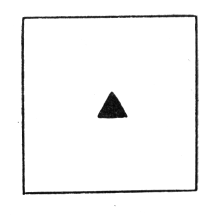
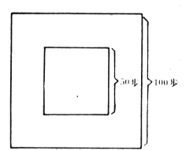
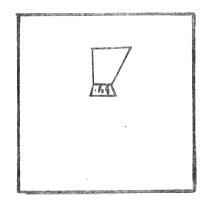
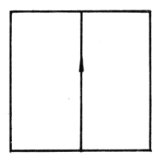
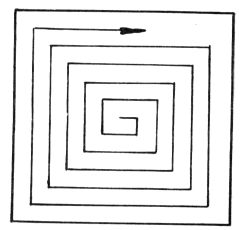

# 第四章 CEC-LOGO 语言程序设计

LOGO 语言是美国麻省理工学院的西摩·佩帕特教授领导下的 LOGO 小组研制成功的一种高级计算机语言。它以认识心理学和人工智能原理为根据，目的是给少年儿童提供一种较好的智力开发环境，使儿童们不仅学会使用计算机，同时还学习如何象数学家、语言学家一样进行思考与解决问题。

LOGO 语言是一种过程性语言，即程序是由过程（procedure）组成的。所谓过程是为达到某种目的而按一定的规则组织起来的 LOGO 语言的语句集合，这些过程又可作为其它过程的子过程，组成更复杂的过程，以此来解决复杂的问题。因此 LOGO 语言具有模块化结构，每个程序可由许多相对独立的过程组成，使设计方便、灵活。过程一经定义便成为一个新的命令，以后可用来作为基本命令来调用，扩充性强。程序具有递归功能，给编制高级水平的程序带来方便。

LOGO 语言是一种接近自然语言的高级语言，只要认识一些英文单词的人就能方便地进行人机对话，非常简单易学。

LOGO 语言数据结构丰富，它不仅包含数和字符串，还包括表（LIST）的混合结构，能进行字表处理，模拟人工智能等。

LOGO 语言具有较强的绘图功能，非常形象直观，这也是 BASIC 语言所不及的。

LOGO 语言在 APPLE 计算机上也有多种版本，但这些版本的 LOGO 都要通过磁盘驱动器才能实现。因此对 LOGO 的推广普及是一大障碍。今天，CEC-I 型中华学习机将 LOGO 语言（CEC-LOGO）固化于主机电路板上的只读式存储器内，使用户直接享受 LOGO 的无穷乐趣。

CEC-LOGO 基本上具有 Terrapin LOGO 的功能。当系统已装有 DOS 操作系统的情况下，CEC-LOGO 的命令系统与 Terrapin LOGO 完全相同，而系统没有 DOS 时 CEC-LOGO 不能进行程序存取盘操作。

---

## 4.1 进入 CEC-LOGO 语言

CEC-I 型中华学习机虽固化有 LOGO 语言，但开机后系统首先进入 BASIC 语言状态，因此必须在 BASIC 状态下进入 LOGO 语言。

① 在系统未装有 DOS 的 BASIC 状态下，键入：

```basic
]LG
```

即可进入 LOGO 语言。

② 在系统已装有 DOS 的 BASIC 状态下，键入：

```basic
]MAXFILES1
]LOGO
```

即可进入 LOGO 语言。

系统进入 LOGO 语言后，屏幕马上出现下图，并出现 LOGO 语言提示符“`?`”

```text
          CHINESE  EDUCATION  COMPUTER

                      LOGO

                   VERSION  1.1

                     1987.6

?
```

下面对 CEC-LOGO 的语句规则作一一介绍。

---

## 4.2 CEC-LOGO 的变量与语句规则

### 4.2.1 变量名

在 CEC-LOGO 中，变量可以表示数、词汇及表。变量用英文字母或数字来表示，用这些字符作为变量的名字，称为变量名。例：`AB`、`A1`、`FD` 等都可作变量名。注意：一个变量名中不能有空格，例：`A, B` 就不能作为一个变量名。在使用变量时，一般在变量名的前面都有一个符号作为前导，以后将作详细介绍。

### 4.2.2 LOGO 数、表、词汇的表示法

CEC-LOGO 使用的均为十进制数。对纯整数运算 LOGO 能表示出 10 位有效数字，其数的范围在 $|X| \le 2147483647$。

例：求 $12345678 + 8765432$ 的值，可键入：

```logo
PRINT 12345678 + 8765432
100000000
```

若进行实数运算 LOGO 只能表示出 6 位有效数字，如果一个数小于等于 6 位有效数字时，可用常规表示法。

例：

```logo
?PRINT 65.786 + 123
188.786
```

如果一个数超过 6 位有效数字，而且绝对值大于零时，则用 `S X.XXXXX ETT` 表示。其中 `S` 为数的符号，正数无表示，负数用“`-`”表示，`X` 为 0～9 之间的 10 进制数字。`E` 表示 10 的幂，且指数的符号为正，`TT` 为指数值。

例：

```logo
?PRINT 88888 * 88888
7.90121E11
```

其表示为 `88888 * 88888` 的值为 $7.90121 \times 10^{11}$。

如果一个数超过 6 位有效数字，且此数的绝对值小于零时（注：指小于 1 的小数，指数为负），则用 `S X.XXXXX ETT`（实际显示为 `N`）表示。其中 `N` 表示为 10 的幂，且指数的符号为负，其他字母的表示与上相同。

例：

```logo
?PRINT 0.0000130021
1.30021N05
```

即表示为 $1.30021 \times 10^{-5}$。

LOGO 除可表示数外，还可处理字句，字是一串字符，字符串中没有空格，LOGO 把这样的字称为“词”，例：`TEACHER`、`STUDENT` 等都为词。要在计算机上输出词，可用 `PRINT` 命令。

例：

```logo
PRINT "STUDENT
STUDENT
```

注意在词的前面用双引号作为前导。

对数字词来说可以加双引号，也可以不加双引号，这也就是说数字词它具有双重身分，它即可代表一个词，也可代表一个数参加数学运算。

例：

```logo
?PRINT 10 + "10
20
```

LOGO 把由一系列空格隔开的字组成的句子称为“表”（LIST）。通常用一对方括号把表括起来。表中的字不能带双引号，字与字之间的空格起分隔作用。表中用空格分开的字或数都称为表的元素。要在屏幕上把一个表打印出来，也可用 `PRINT` 命令。

例：

```logo
PRINT [ZHONG HUA XUE XI JI]
ZHONG HUA XUE XI JI
```

有关词表的处理方法将在以后详细介绍。

### 4.2.3 LOGO 运算符与表达式规则

在 LOGO 中运算符可分为两类：

① 算术运算符：
`+`（加）、`-`（减）、`*`（乘）、`/`（除）

② 逻辑运算符：
`<`（小于）、`>`（大于）、`=`（等于）、`ALLOF`（与）、`ANYOF`（或）、`NOT`（非）

LOGO 完全可以当作一个非常高级的计算器来使用。数学表达式的规则与数学及 BASIC 语言相同，而且数学运算优先等级与教学中的规定一致。括号全部使用圆括号，并可以多层嵌套。

例：计算 $5 + 3 * 4 = ?$，可键入：

```logo
?PRINT 5 + 3 * 4
17
```

再计算 $((5 + 3) * 4 - 2) * 2 = ?$，可键入：

```logo
?PRINT ((5 + 3) * 4 - 2) * 2
60
```

LOGO 在运算时，也可不用 `PRINT` 命令，直接键入表达式，也能得到运算结果。

例：

```logo
? (6 + 3) / 3
RESULT: 3
```

另外 LOGO 中还有一些标准函数，用户也可在算术表达式中直接引用，这些函数将在以后介绍。

LOGO 中的逻辑运算符可对表达式进行运算如 `=`、`<`、`>` 三种符号可对两个算术表达式的值进行比较，凡经比较后的结果不再是数值，不能再参加数学运算。

例：

```logo
? 1 / 2 = 0.5
RESULT: TRUE      （表示结果为真）
?4 + 4 = 9
RESULT: FALSE     （表示结果为假）
```

而 `ALLOF`、`ANYOF`、`NOT` 三种运算符可对所有的表达式进行运算。

例：

```logo
?NOT 4 < 5
RESULT: FALSE
```

其它词、表的逻辑运算将在以后介绍。

最后说明一点：由于 LOGO 在进行数学运算时是将十进制数转换成二进制数，然后运算，最后再将二进制结果转换成十进制数。经这样转换后，有可能所得结果不十分准确。

### 4.2.4 命令行

一个命令行中可以是一个命令，也可以同时设置若干个命令，机器从左到右依次执行这些命令。每个命令之间一定要用空格分开，一个命令行最多输入 255 个字符，其中包括空格。例如：`? DRAW FD 50 RT 120 FD 50 RT 120 FD 50` 就可在屏幕上画出一个三角形，在这条命令行中包括了 6 条命令。

### 4.2.5 执行模式

直接模式：在屏幕上出现提示符“`?`”时，系统处于直接执行模式状态下，此时键入命令后，计算机马上执行，上例所画的三角形就是以直接执行模式键入的。

定义模式：若在直接模式状态下键入 `TO ×××` 后按回车键，计算机立即执行 `TO` 命令，使系统离开直接执行模式，进入定义模式。进入定义模式后，提示符“`?`”消失，用户键入其它命令，计算机并不立即执行。当把程序中所有命令都键入后，可按 `CTRL-C` 脱离定义模式，完成定义，回到直接模式。经过定义的这些命令集合称为过程，过程一经定义，便被存放在计算机内存的工作区内，工作区内的过程可反复被调用。因此凡经过定义的过程，它就象命令一样，可以立即执行，也可以是其它过程中的一条命令。

在定义模式下，键入一个画圆的程序：

```logo
TO DRAW
REPEAT 360 [FD 1 RT 1]
END
CTRL-C            （表示 CTRL 与 C 键同时按下）
```

此时可发现，所键入的程序，机器不马上执行，而必须键入使程序运行的命令：

```logo
?DRAW
```

才可使机器执行键入的程序，画出一个圆。

若在定义模式状态下按 `CTRL-G` 也可返回直接模式，但此时是强迫中断定义过程。

编辑模式：一个定义好的过程，在使用 `EDIT` 命令后，就可使系统进入编辑模式，机器把一个过程显示在屏幕上，在屏幕的紧下方出现一行白底黑字：`EDIT: CTRL-C TO DEFINE, CTRL-G TO ABORT`（原文印作 `EDIT: CTRL0-C TO DEFING, CTRL-G TO ABORT`）。此时可使用编辑命令对过程体进行修改编辑，退出编辑模式可按 `CTRL-C` 或 `CTRL-G`，随之系统回到直接执行模式。

---

## 4.3 LOGO 画图命令

CEC-LOGO 具有很强的作图功能，这也是广大青少年喜欢使用 LOGO 的原因之一。下面对作图方面的命令作一一介绍。

### 4.3.1 DRAW

执行型：立即与暂缓型
格式：`DRAW`
功能：使 LOGO 进入绘图模式然后清屏，使图标置于原点。
说明：在画一个新图形之前，首先要清屏，并将图标回到原点。此时图标头朝上。

在绘图模式下整个屏幕以图标起始位置作为原点 `(0,0)`，如下图，第一个数表示横坐标，


*图 4.1 DRAW 初始原点图标*

其范围在 `-140`～`139` 之间。第二各数字表示纵坐标，其范围在 `-119`～`120`（原文印作 `-199`～`120`，参看 4.3.14 节实为 `-119`～`120`）之间。在执行 `DRAW` 命令后使屏幕设置为图形与文本混合模式，此时在屏幕下方有四行作为打入命令及显示文字数据的窗口，因此图标所作图形到此被遮掉了。

### 4.3.2 FORWARD

执行模式：直接与定义模式
格式：`FORWARD <算术表达式>`
缩写形式：`FD <算术表达式>`
功能：使图标向前移算术表达式的值个图步。
说明：算术表达式的值可正可负，若为正值，图标向前移动；若为负值，实际是向后移。该命令自动对算术表达式的值取整。

例：

```logo
?FD 50            （向前移 50 步）
?FD -50           （向后移 50 步）
?MAKE "A 50       （给变量 A 赋值 50）
?FD :A + 50       （向前移 100 步，其中 :A + 50 为算术表达式，其值为 100）
```

### 4.3.3 BACK

执行模式：直接与定义模式
格式：`BACK <算术表达式>`
缩写形式：`BK <算术表达式>`
功能：使图标向后移算术表达式的值个图龟步。
说明：算术表达式的值为正，表示向后移若干步；若该值为负时，实际是向前移若干步。该命令自动对算术表达式的值取整。

例：

```logo
?BK 50            （向后移 50 步）
```

### 4.3.4 LEFT

执行模式：直接与定义模式
格式：`LEFT <算术表达式>`
缩写形式：`LT <算术表达式>`
功能：使图标向左移算术表达式的值所指的度数。
说明：算术表达式的值为正时，图标向左转；若该值为负数时，则向右转；此命令自动对算术表达式的值取整。

例：

```logo
LEFT 90           （向左转 90 度）
```

### 4.3.5 RIGHT

执行模式：直接与定义模式
格式：`RIGHT <算术表达式>`
缩写形式：`RT <算术表达式>`
功能：使图标向右移算术表达式的值所指的度数。
说明：算术表达式的值为正时，表示图标向右转；若为负值时，则向左转。机器自动对算术表达式的值取整。

例：

```logo
RT 90             （向右转 90 度）
```

### 4.3.6 PENCOLOR

执行模式：直接与定义模式
格式：`PENCOLOR <算术表达式>`
缩写形式：`PC <算术表达式>`
功能：根据算术表达式的值，设置笔的颜色。各种颜色及其相对应的代码如下表：

| 代码 | 颜色 | 代码 | 颜色 |
| :---: | :--- | :---: | :--- |
| 0 | 黑色 | 1 | 白色 |
| 2 | 绿色 | 3 | 紫色 |
| 4 | 桔红色 | 5 | 蓝色 |
| 6 | 逆转 | | |

说明：设置笔色的值一定要在 0～6 范围内，否则将出现 `PC DOESN'T LIKE ×× AS INPUT`。`PENCOLOR 6` 表示图标所绘的线条与底色互为补色，即白黑互为补色。当时同一线条在 `PENCOLOR 6` 状态下连画两次，会使线条恢复成底色。对不同的彩色监视器或电视机可能色彩有所不同。LOGO 在初始情况下，机器自动设置 `PENCOLOR 1`。

将下程序键入计算机，然后执行就可看到用不同颜色的笔所画的各种线条。

```logo
TO PIC :COLOR
IF :COLOR = 6 THEN STOP
PENCOLOR :COLOR
REPEAT 10 [FD 100 RT 90 FD 1 RT 90
           FD 100 LT 90 FD 1 LT 90]
PIC :COLOR + 1
END
CTRL C            （CTRL 与 C 键同时按下）
PIC 1
```

### 4.3.7 BACKGROUND

执行模式：直接与定义模式
格式：`BACKGROUND <算术表达式>`
缩写格式：`BG <算术表达式>`
功能：设置屏幕背景颜色，即底色。其颜色范围的值为 0～5，所对应的颜色如下表：

| 代码 | 颜色 | 代码 | 颜色 |
| :---: | :--- | :---: | :--- |
| 0 | 黑色 | 1 | 白色 |
| 2 | 绿色 | 3 | 紫色 |
| 4 | 桔红色 | 5 | 蓝色 |

说明：若所设屏幕背景色的值不在 0～5 范围内，则显示出 `BG DOESN'T LIKE ×× AS INPUT`。LOGO 在初始情况下，机器自动设置 `BACKGROUND` 的值为 0，即背景为黑色。

例：

```logo
?DRAW
?BG 1             （设置背景为白色）
?BG 5             （设置背景为蓝色）
```

另外当先在屏幕上画好图形，再设置底色时，将影响所画图形的颜色。反之则不影响。

### 4.3.8 PENDOWN

执行模式：直接与定义模式
格式：`PENDOWN`
缩写格式：`PD`
功能：落笔，使图标在移动过程中绘图。
说明：计算机在进入 LOGO 后，自动设置成落笔状态，即在这之后图标移动时，都留下痕迹。

### 4.3.9 PENUP

执行模式：直接与定义模式
格式：`PENUP`
缩写格式：`PU`
功能：提笔，使图标在移动过程中不留下痕迹，即不作图。
说明：执行该命令后，所画的线条都不会在屏幕上出现，只有用 `PENDOWN` 命令才可屏幕上画出线条，所画线条取决于 `PENCOLOR` 的值。

例：要画下图的两个正方形，可用这些命令。


*图 4.2 PENUP 与 PENDOWN 绘制两个嵌套正方形*

```logo
?PENUP
?FD 25
?PENDOWN
?RT 90 FD 25 RT 90 FD 50 RT 90
 FD 50 RT 90 FD 50 RT 90 FD 25
?PENUP
?LT 90 FD 25
?PENDOWN
?RT 90 FD 50 RT 90 FD 100 RT 90
 FD 100 RT 90 FD 100 RT 90 FD 50
```

### 4.3.10 HIDETURTLE

执行模式：直接与定义模式
格式：`HIDETURTLE`
缩写格式：`HT`
功能：使图标隐没
说明：若图形画好后，不再需要屏幕出现图标，此时可使用该命令，例如上例中当执行 `HT` 后，屏幕上只留下两个正方形，图标隐去。但应注意：图标虽然隐没，并不意味着不能画图，只是图标的朝向及当前点看不到。

### 4.3.11 SHOWTURTLE

执行模式：直接与定义模式
格式：`SHOWTURTLE`
缩写格式：`ST`
功能：显示出图标的形状。
说明：当图标隐没后，若再想把图标显示出来，可使用 `ST` 命令，执行该命令后，屏幕上立刻显示出当前图标的形状，以便于继续画图。

### 4.3.12 CLEARSCREEN

执行模式：直接与定义模式
格式：`CLEARSCREEN`
缩写格式：`CS`
功能：清屏，不改变图标的状态。
说明：这个命令不同于 `DRAW` 命令，图标并不回到原点 `(0,0)`。

例：

```logo
?DRAW
?FD 50 RT 120 FD 50 RT 120 FD 50
?CS
```

可看到图标并不回到原点。

### 4.3.13 HOME

执行模式：直接与定义模式
格式：`HOME`
功能：移动图标于屏幕中心，标头指向上方。
说明：这个命令也不同于 `DRAW` 命令，该命令虽使图标回到原点，但没有清屏的作用。另外当执行 `HOME` 使图标从当前点回到原点这段直线轨迹根据提落笔、及笔色的状态来决定是否画出。

例：执行下述命令：

```logo
?PD PC 1
?FD 100 RT 90 FD 100
?HOME
```

可看到下图形：


*图 4.3 HOME 命令作图效果*

### 4.3.14 NOWRAP

执行模式：直接与定义模式。
格式：`NOWRAP`
功能：防止图标围绕屏幕作图。
说明：由于屏幕坐标：X 是从 `-140`～`139` 之间，Y 是从 `-119`～`120` 之间。当图标移动的距离过大时，就有可能把线条画出屏幕的一端，而又从屏幕的另一端画出来，这样可能造成破坏画面的后果。为了防止这种错误发生，可使用 `NOWRAP` 命令，防止上述情况发生。

例：

```logo
?NOWRAP
?FD 300
TURTLE OUT OF BOUNDS
```

由于图标前进的步数太大而出错，防止线条从屏幕上沿重新进入屏幕。

### 4.3.15 WRAP

执行模式：直接与定义模式
格式：`WRAP`
功能：使图标围绕屏幕作图。
说明：系统进入 LOGO 后，自动设置为 `WRAP`。

例：

```logo
?WRAP
?FD 300
```

执行这两个命令后，可在屏幕上看到图标。


*图 4.4 WRAP 命令围绕屏幕作图效果*

从屏幕上沿穿出，又从下沿进入进行作图。

### 4.3.16 SETHEADING

执行模式：直接与定义模式
格式：`SETHEADING <算术表达式>`
功能：根据算术表达式的值设置图标的朝向。
说明：有时希望将图标指向某一角度，与原有的指向无关，就可用该命令。使用时朝向为 0 或 360 度是指图标朝上，而朝向为 180 度是指向下，以此类推。

例：

```logo
?DRAW
?SETHEADING 180   （图标指向朝下）
?SETHEADING 180   （图标指向仍朝下）
```

### 4.3.17 SETX

执行模式：直接与定义模式
格式：`SETX <算术表达式>`
功能：水平移动图标到算术表达式的值所指的 X 坐标。
说明：该命令可将图标移到 X 轴向的某个坐标点上，而 Y 坐标点不变。图标所经过的直线轨迹是否画出，视提落笔及笔色的状态。

`HOME` 位置的 X 坐标为 0，屏幕的右半部分 X 坐标为正，而左半部分为负。因此 `SETX 100 SETX -100` 与 `FD 100 FD -100`（假设此时图标朝向 90 度）的结果是不一样的。

### 4.3.18 SETY

执行模式：直接与定义模式
格式：`SETY <算术表达式>`
功能：垂直移动图标到算术表达式的值所指的 Y 坐标。
说明：该命令可将图标移到 Y 轴向的某个坐标点上，而 X 坐标点的位置不变。图标所经过的直线轨迹是否画出，视提落笔及笔色的状态而定。

在原点的上半部分 Y 的值为正，而下半部分则为负。

### 4.3.19 SETXY

执行模式：直接与定义模式
格式：`SETXY <算术表达式1> <算术表达式2>`
功能：移动图标到算术表达式 1、算术表达式 2 的值所指定的 X、Y 坐标位置上。
说明：当算术表达式 2 为负常数时，一定要在负数两边加圆括号。

例：`SETXY 50 (-50)`，此例与 `SETX 50 SETY -50` 是等效的。

### 4.3.20 TOWARDS

执行模式：直接与定义模式
格式：`TOWARDS <算术表达式1> <算术表达式2>`
功能：输出图标当前位置到算术表达式 1 的值，算术表达式 2 的值所指定的 X，Y 坐标点的方向角。
说明：当算术表达式 2 为负常数时，一定要在负数两边加圆括号。
输出方法有两种：

· 直接用 `TOWARDS` 命令。

例：

```logo
?HOME
?TOWARDS 100 100
RESULT: 45
```

表示 `(100,100)` 到 `(0,0)` 点的方向角。

· 用 `PRINT`（输出命令）输出。

例：

```logo
?HOME
?PRINT TOWARDS 100 100
45
```

### 4.3.21 TURTLESTATE

执行模式：直接与定义模式
格式：`TURTLESTATE`
缩写形式：`TS`
功能：输出图标笔和颜色的状态表。
说明：执行该命令将输出四项内容。第一项为笔状态，落笔状态输出为真（`TRUE`），提笔状态输出为假（`FALSE`）；第二项为图标是否显示，若显示图标状态为真（`TRUE`），隐没图标为假（`FALSE`）；第三项为屏幕背景颜色，其输出值为 0～5；第四项为笔的颜色，其值为 0～6。该语句的输出方法也有两种：

· 直接使用 `TURTLESTATE` 命令。

```logo
?TS
RESULT: [TRUE TRUE 0 1]
```

表示落笔、显标、背景为黑色及笔色为白色。

· 使用 `PRINT` 命令输出

```logo
?PRINT TS
[TRUE TRUE 0 1]
```

### 4.3.22 XCOR、YCOR

执行模式：直接与定义模式
格式：
```logo
XCOR
YCOR
```
功能：输出当前图标 X 坐标或 Y 坐标值。

例：

```logo
?HOME
?XCOR
RESULT: 0.
?YCOR
RESULT: 0.
```

或

```logo
?HOME
?PRINT XCOR
0.
?PRINT YCOR
0.
```

### 4.3.23 .ASPECT

执行模式：直接与定义模式
格式：`.ASPECT <算术表达式>`
功能：设置屏幕垂直标尺因子，以补偿显示器或电视机屏幕上圆形、正方形等被压扁的现象。
说明：系统进入 LOGO 时，机器自动设置 `.ASPECT 0.8`。

例：

```logo
?.ASPECT 1.0
```

可发现此后所画图形的纵向步长比横向步长一点，从而使图形的纵向拉长。

因此用户在选定显示设备后，选择一个合适的 `.ASPECT` 数值。另外该补偿命令必须用在画图形之前，而不能在画图之后。

### 4.3.24 FULLSCREEN

执行格式：直接与定义模式
格式：`FULLSCREEN`
功能：执行该命令后，使屏幕设置为全屏幕作图模式，即整个屏幕上图标绘的图形都能显示出来。

### 4.3.25 SPLITSCREEN

执行模式：直接与定义模式
格式：`SPLITSCREEN`
功能：执行该命令后，使屏幕设置为文本图形混合模式。屏幕上半部分为图形区，下方有四行为文本显示区。
说明：系统进入 LOGO 作图时，机器自动设置为 `SPLITSCREEN` 状态。

### 4.3.26 TEXTSCREEN

执行模式：直接与定义模式
格式：`TEXTSCREEN`
功能：使屏幕设置为文本显示模式。

### 4.3.27 NODRAW

执行模式：直接与定义模式
格式：`NODRAW`
缩写形式：`ND`
功能：退出图标作图，清屏；进入文本模式，光标移到屏幕的左上角。

---

## 4.4 过程及其编辑命令

LOGO 语言可以定义过程，所谓过程就是程序。前面介绍的这些命令，所例举的基本上都是直接执行模式，即一个命令行输入完后，按一下回车键，计算机立即执行该命令行，随之命令也即消失。如果将这些命令行定义成一个过程，并给这个过程取一个“过程名”，这样被定义后的“过程名”就可作为新的 LOGO 命令，以后可以多次被引用，而不须重键入命令行。

下面对如何定义过程及过程的编辑方法介绍如下。

### 4.4.1 TO

执行模式：直接与定义模式
格式：
```logo
TO <过程名>
TO <过程名> <参数表>
```
功能：定义一个过程。
说明：过程名是由英文字母或数字组成，中间不能断开，即过程名中不能有空格；原语命令不能作为过程名。

例：

```logo
?TO FD
FD IS A LOGO PRIMITIVE
```

机器指出 `FD` 是 LOGO 的原语命令，不能作为过程名。

当键入 `TO <过程名>` 并回车后，计算机立即执行 `TO` 命令，使计算机进入定义模式。进入定义模式后，提示符“`?`”消失。接着可键入其它命令，但不立即执行。一个过程的形式为：

```logo
TO <过程名>
  .
  .
  .
<过程体>
  .
  .
  .
END               （END 作为过程的结束符）
```

当把过程键入后，按 `CTRL-C` 键在屏幕上将显示出：

```logo
<过程名> DEFINED
?
```

表示系统完成了一个过程的定义，并离开定义模式返回到直接执行模式。此时“`?`”重新出现。如果键入 `<过程名>` 后回车，计算机就立即执行 `<过程名>` 指出的过程内的命令，这就叫过程的调用。

例：

```logo
TO BOX            （BOX 为过程名）
FD 50 RT 90 FD 50 RT 90
FD 50 RT 90 FD 50
END
CTRL-C            （完成定义）
?BOX
```

立即执行这个新的 LOGO 命令，画出一个正方形。

过程定义的第一种形式中没有 `<参数表>` 这一项，称为无参数过程。而第二种形式有一个 `<参数表>`，在 `<参数表>` 中是一系列用空格隔开的参数名，这些参数名实际为变量名，在这些变量名前通常都有一个“`:`”作为引导。在定义好一个过程后，只要用 `<过程名> <参数值表>`，即可用 `<参数值表>` 内的数据一一代换掉 `<参数表>` 中所用到的相应位置的参数。

例：

```logo
TO ZFX :CH
FD :CH LT 90
FD :CH LT 90
FD :CH LT 90
FD :CH
END
CTRL-C
?ZFX 50
```

此后计算机调用 `ZFX` 这个过程，并将 `50` 代替过程体中的 `:CH`，从而画出一个边长为 50 的正方形。而

```logo
?ZFX 100
```

则画出一个边长为 100 的正方形。

过程体中的语句可以是任何命令行，也可以是过程调用。在过程体内也可调用同名过程，即过程调用它自身，这称为递归调用，这种过程称为递归过程。

例：递归螺旋形过程

```logo
TO SPI :LENGTH
FD :LENGTH RT 90
FD :LENGTH RT 90
SPI :LENGTH + 5
END
CTRL-C
?SPI 5
```

可画出下图形，它将一直画下去，如果要停止这样一个无终止的程序执行过程，可使用 `CTRL-G`，强迫中断。


*图 4.5 递归螺旋形过程作图效果*

`<参数表>` 中的参数也可以不止一个，但必须两个参数中间用空格隔开，而且对负参数两边一定要用圆括号括起来。把上例中递归增加的步长也设为参数，则过程体变为：

```logo
TO SPI :LENGTH :INC
FD :LENGTH RT 90
FD :LENGTH RT 90
SPI :LENGTH + :INC :INC
END
```

在调用此过程时也必须输入两个参数值。

```logo
?SPI 5 10
     .
     .
     .
```

### 4.4.2 END

执行模式：定义模式
格式：`END`
功能：结束过程定义。
说明：此命令只能用在定义模式中，若在直接执行模式中使用，则会出现 `END SHOULD BE USED ONLY IN THE EDITOR`。

### 4.4.3 EDIT

执行模式：直接执行模式
格式：
```logo
EDIT <过程名>
EDIT
```
缩写格式：
```logo
ED <过程名>
ED
```
功能：使系统进入编辑模式（与定义模式相类似），过程的内容在屏幕上列出来，光标移到首行内容的最左端，此时可用其它编辑键对过程行进行修改和编辑。
说明：第一种形式将对所指定的过程进行编辑；第二种形式将对最新键入的过程进行编辑。

以下命令均在编辑模式上使用，供修改过程及改正错误用。

### 4.4.4 `←` 与 `→` 键

这两个键分别能使光标所在的当前行的光标向左移或向右移，而不改变任何字符。在行的端点如继续按这两个键会使光标移向另一行，当光标移到首行第一个字符，再继续按 `←` 键，则光标不动，并响警铃；同样当光标移到过程体最后一行末尾，再继续按 `→` 键，则光标也不动，并响警铃。

### 4.4.5 CTRL-D

删除光标下的一个字符。

例：

```text
BK 50
   ↑
  光标
```

按 `CTRL-D`，会出现

```text
BK 0
   ↑
  光标
```

再键入 `3`，则变为：

```text
BK 30
    ↑
   光标
```

因此若需在一行内插入一些命令，可先用光标移动键移至插入处，然后键入所插入的命令即可。

### 4.4.6 CTRL-C

退出编辑模式，定义被编辑的过程，系统回到直接执行模式。切切注意：凡新输入的过程或对过程进行编辑后一定要按 `CTRL-C`。

### 4.4.7 CTRL-G

退出编辑模式，对原过程不作任何修改（不论在编辑模式下，对此过程作过何种修改都作废），回到直接执行模式。

### 4.4.8 Esc 键

删除光标左边一个字符，同时光标向左移一格。

例：

```text
FD 100■
      ↑
     光标
```

按一次 `Esc` 键后会出现：

```text
FD 10■
     ↑
    光标
```

### 4.4.9 CTRL-P

光标上移一行。当光标移到首行后，再按 `CTRL-P` 则响警铃。

例：

```text
FD 50
LT 90
   ↑
  光标
```

按一次 `CTRL-P` 则会出现：

```text
FD 50
   ↑
  光标
LT 90
```

### 4.4.10 CTRL-N

使光标下移一行。当光标移到过程体末尾行，再按 `CTRL-N`（原文误作 `CTRL-P`），则光标不动，同时响警铃。

上例中再按一次 `CTRL-N`，则可出现：

```text
FD 50
LT 90
   ↑
  光标
```

### 4.4.11 CTRL-O

执行这个命令可在两行中间出现一空行，供插入新行之用。

若想在

```logo
FD 100
LT 45
```

这两个过程行中插入一新行，其方法为先将光标移到 `LT 45` 的第一个字符位置，即

```text
LT 45
↑
光标
```

然后按 `CTRL-O` 后出现：

```text
FD 100
■
↑
光标
LT 45
```

此后可在新打开的这一行键入命令，然后回车，这样完成插入一新行。

使用此命令应特别注意光标一定要移到过程行的最左端，否则不会打开一新行。

例：

```text
FD 100
LT 45
   ↑
  光标
```

按 `CTRL-O` 后则出现

```text
FD 100
LT   ■
45   ↑
    光标
```

### 4.4.12 CTRL-A

使光标移到当前行行首。

例：

```text
   .
   .
   .
FD 50
   ↑
  光标
   .
   .
   .
```

按 `CTRL-A` 后则出现

```text
   .
   .
   .
FD 50
↑
光标
   .
   .
   .
```

### 4.4.13 CTRL-E

使光标移到当前行行尾。

上例中按 `CTRL-E` 后则出现：

```text
   .
   .
   .
FD 50
     ↑
    光标
   .
   .
   .
```

### 4.4.14 CTRL-K

删除当前行中光标以右的全部字符。

例：

```text
FD 55000
    ↑
   光标
```

按 `CTRL-K` 后则出现：

```text
FD 5■
    ↑
   光标
```

### 4.4.15 CTRL-B

使光标向前（即向过程开始方向）移一页，若过程不足一页则移到开始处。

### 4.4.16 CTRL-F

使光标向后（即向过程尾方向）移动一页，若不足一页则把光标移到过程最后一个命令行上。

### 4.4.17 CTRL-L

使光标移到屏幕的中央。

---

## 4.5 控制过程的执行及流程命令

这部分命令可改变程序的方向及控制过程的执行，从而使程序设计更灵活，变化更多样化。

### 4.5.1 IF

执行模式：直接与定义模式
格式：
```logo
IF <条件表达式> THEN <活动1>
IF <条件表达式> THEN <活动1> ELSE <活动2>
```
功能：第一种形式是根据条件表达式的值是否为真（`TRUE`），若为真则执行 `<活动1>`，否则为假（`FALSE`）就什么也不做，接下去执行下一命令行。此命令 `THEN` 可省略。

第二种形式是根据条件表达式的值是否为真，若为真则做 `<活动1>` 内容，否则做 `<活动2>` 内容。

说明：`<活动1>`、`<活动2>` 为一系列命令。`<条件表达式>` 可以是由符号 `>`、`<`、`=` 联结的两个算术表达式的值而表示其间的大于、小于、等于、小于等于、大于等于或不等于的关系。例如 `:X > 10`，`:X + :Y <= :Z`，`:N <> 100` 等。

下面举两个例子说明 `IF` 命令的用法。

例 1.

```logo
TO BACKWARDS :NUMBER
IF :NUMBER = 0 STOP
PRINT :NUMBER
BACKWARDS :NUMBER - 1
END
CTRL-C
?BACKWARDS 10
10
9
8
7
6
5
4
3
2
1
```

过程中第 2 行对 `:NUMBER` 的值进行测试，若等于 0 则停止过程执行，否则继续执行下一命令行。

例 2. 上例也可改为：

```logo
TO BACKWARDS :NUMBER
IF :NUMBER = 0 THEN STOP ELSE PRINT :NUMBER
BACKWARDS :NUMBER - 1
END
```

### 4.5.2 TEST

执行模式：直接与定义模式
格式：`TEST <条件表达式>`
功能：对 `<条件表达式>` 进行测试，若测试为真，即条件成立，则结果为（`TRUE`），否则为假（`FALSE`）。

### 4.5.3 IFTRUE

执行格式：直接与定义模式
格式：`IFTRUE <活动>`
缩写形式：`IFT <活动>`
功能：根据最近一次 `TEST` 命令的测试结果，若结果为真（`TRUE`），则执行 `IFTRUE` 命令中的 `<活动>`。

### 4.5.4 IFFALSE

执行格式：直接与定义模式
格式：`IFFALSE <活动>`
缩写形式：`IFF <活动>`
功能：根据最近一次 `TEST` 命令的测试结果，若结果为假（`FALSE`），则执行 `IFFALSE` 命令中的 `<活动>`。

例：对上例也可改为：

```logo
TO BACKWARDS :NUMBER
TEST :NUMBER = 0
IFTRUE STOP
IFFALSE PRINT :NUMBER BACKWARDS :NUMBER - 1
END
```

### 4.5.5 ALLOF

执行模式：直接与定义模式
格式：`ALLOF <条件表达式1> <条件表达式2> …… <条件表达式N>`
功能：如果 N 个条件表达式均为真（`TRUE`），则输出为真（`TRUE`），如果 N 个中有一个以上的条件表达式为假（`FALSE`），则输出为假（`FALSE`）。

例：判断输入的三条边长能不构成一个三角形。

```logo
TO TRIANGLE :A :B :C
MAKE "D :A + :B > :C
MAKE "E :A + :C > :B
MAKE "F :B + :C > :A
TEST (ALLOF :D :E :F)
IFTRUE PRINT [YES]
IFFALSE PRINT [NO]
END
```

若执行键入边长为 3、4、5 则输出 `YES`；若键入 3、4、10 则输出 `NO`。

### 4.5.6 ANYOF

执行模式：直接与定义模式
格式：`ANYOF <条件表达式1> <条件表达式2> …… <条件表达式N>`
功能：如果 N 个条件表达式中有一个以上为真（`TRUE`），则输出为真（`TRUE`），如果 N 个条件表达式都为假（`FALSE`），则输出为假（`FALSE`）。

例：判断一个三角形是否等腰三角形（原文印作“等边三角形”，但代码用 `ANYOF` 测试任意两边相等，实为等腰三角形）。

```logo
TO TRIANGLE :A :B :C
MAKE "D :A = :B
MAKE "E :B = :C
MAKE "F :C = :A
TEST (ANYOF :D :E :F)
IFTRUE PRINT [YES]
IFFALSE PRINT [NO]
END
?TRIANGLE 5 5 7
YES
?TRIANGLE 3 4 5
NO
```

### 4.5.7 NOT

执行模式：直接与定义模式
格式：`NOT <表达式>`
功能：输出为 `<表达式>` 的反，即 `<表达式>` 为真，输出则为假；`<表达式>` 为假，输出则为真。

例：

```logo
?PRINT NOT 5 > 4
FALSE
?PRINT NOT 4 > 5
TRUE
```

### 4.5.8 REPEAT

执行模式：直接与定义模式
格式：`REPEAT <算术表达式> [<命令表>]`
功能：使 `<命令表>` 代表的程序段重复执行，重复执行的次数为 `<算术表达式>` 的值决定。
说明：算术表达式的值必须大于等于零，否则将出现 `THERE IS NO PROCEDURE NAMED EPREAT`（原文印作 `EPREAT`）。

例 1.

```logo
?REPEAT 4 [FORWARD 50 RIGHT 90]
```

使图标重复 4 次，每次图标前进 50 步，向右转 90 度，画出一个边长为 50 的正方形。

例 2.

```logo
?REPEAT 4 [REPEAT 4 [FD 50 RT 90] RT 90]
```

画出一个由四个边长为 50 的正方形组成的一个方字。

### 4.5.9 STOP

执行模式：直接与定义模式
格式：`STOP`
功能：停止当前过程的执行，返回到调用当前过程的过程。
说明：`STOP` 不是终止计算机运行，而是使正在被执行的过程终止执行，使计算机返回到刚被终止的调用过程的相继一行。

例：

```logo
TO AB
ABC
PRINT 123
END
TO ABC
STOP
END
```

这是有两个过程的程序，`AB` 过程中将调用 `ABC` 过程。执行过程后，可看到

```logo
?AB
123
```

### 4.5.10 GO

执行模式：定义模式
格式：`GO <标号>`
功能：无条件转移到 `<标号>` 所指出的命令行上去执行。
说明：这个命令只能用在定义模式中，若用在直接执行模式则会出现：`GO SHOULD BE USED ONLY INSIDE A PROCEDURE`。所转移到的命令行的标号，必须在过程中存在，否则将出现 `THERE IS NO LABEL ×× IN LINE GO ××`。此外在 `GO` 命令之后不能再有其它命令。

例：设计一个符号函数

$$f(X) = \begin{cases} 1 & X > 0 \\ 0 & X = 0 \\ -1 & X < 0 \end{cases}$$

```logo
TO SGN :X
IF :X > 0 THEN MAKE "Y 1 GO 10
IF :X = 0 THEN MAKE "Y 0 GO 10
MAKE "Y -1
10: (PRINT [Y =] :Y)
END
?SGN 100
Y = 1
?SGN 0
Y = 0
```

`GO` 命令的 `<标号>` 可以是一个具体的数字，也可以是一个算术表达式。上例中的第二、三命令行也可以改为：

```logo
IF :X > 0 THEN MAKE "Y 1 GO 2 * 5
IF :X = 0 THEN MAKE "Y 0 GO 5 * 2
```

最后应注意在所转移到的标号后面一定要用“`:`”作为后缀。

### 4.5.11 OUTPUT

执行模式：定义模式
格式：`OUTPUT <表达式>`
缩写形式：`OP <表达式>`
功能：从当前过程中向调用它的过程传送此命令，表达式的结果作为当前过程的结果信息。并把控制权交还给调用它的过程。

例：已知一个圆的面积，求出它的半径。

```logo
TO GETRADIUS :AREA
OUTPUT SQRT :AREA / 3.14159
END
?PRINT GETRADIUS 10
1.78412
```

在程序中先用 `PRINT` 命令调用过程 `GETRADIUS`，在过程执行到 `OUTPUT` 时，使 `SQRT` 的结果送回 `PRINT` 命令，最后打印出结果。

### 4.5.12 PAUSE

执行模式：定义模式
格式：`PAUSE`
功能：暂停过程的执行，这时可检查局部的各种状况，以了解错误发生的原因，这在调试程序时是很有用的。执行 `PAUSE` 后，机器把控制权交给用户。

例：

```logo
TO INC :A
IF :A = 10 PAUSE
PRINT :A
INC :A + 1
END
```

（注：原文首行印作 `TO INC :A5`，实为 `TO INC :A`。）

执行后可得到：

```logo
?INC 1
1
2
3
4
5
6
7
8
9
10
PAUSE, IN LINE
IF :A = 10 PAUSE
AT LEVEL 10 OF INC
L10?
```

（注：原文末行印作 `LT 10?`，参照 4.5.13 节实为 `L10?`。）

### 4.5.13 CONTINUE

执行模式：直接执行模式
格式：`CONTINUE`
缩写格式：`CO`
功能：过程在执行 `PAUSE` 暂停后，执行 `CONTINUE` 可使该过程继续执行。

上例 `PAUSE` 后再键入 `CONTINUE` 可使过程继续执行。

```logo
     .
     .
     .
L10? CONTINUE
10
11
12
13
     .
     .
     .
```

### 4.5.14 TOPLEVEL

执行模式：定义模式
格式：`TOPLEVEL`
功能：从当前过程中立即返回到直接执行模式。
说明：这个命令与 `STOP` 不同，它不能返回到调用它的过程上去；另外与 `PAUSE` 也不同，不能用 `CONTINUE` 来恢复过程执行。

例：

```logo
TO INC :A
IF :A = 10 TOPLEVEL
PRINT :A
INC :A + 1
END
? INC 6
6
7
8
9
?■
 ↑
光标
```

### 4.5.15 TRACE

执行模式：定义模式与直接模式
格式：`TRACE`
功能：这是一个跟踪执行命令。使 LOGO 在每执行一个过程行前暂停，打印出将执行的过程行，按任意键后，机器执行该行内容，直到过程结束。该语句在调试程序时是非常有效的。

例：使用跟踪命令执行一个平方表过程。

```logo
TO SQUARE :A :B
IF :A = :B STOP
(PRINT :A :A * :A)
SQUARE :A + 1 :B
END
```

（注：原文递归调用行印作 `A :A + 1 :B`，省去了过程名前缀。）

```logo
?TRACE
TRACING ON        （执行 TRACE 后的反应）
?SQUARE 1 10
EXECUTING 1 10
IF :A = :B STOP ■
(PRINT :A :A * :A) ■
1  1
A :A + 1 :B ■
EXECUTING SQUARE 2 10
IF :A = :B STOP ■
(PRINT :A :A * :A) ■
2  4
A :A + 1 :B ■
EXECUTING SQUARE 3 10
        .
        .
        .
EXECUTING SQUARE 10 10
IF :A = :B STOP ■
ENDING SQUARE
```

注：`■` 表示该处需按任意键。（原文输出中 `EXECUTING` 印作 `EXEUTING`，调用行印作 `?SQUARE 1 1`。）

### 4.5.16 NOTRACE

执行模式：直接执行模式与定义模式
格式：`NOTRACE`
功能：撤消跟踪命令。

例：上例中若键入

```logo
?NOTRACE
TRACING OFF       （撤消跟踪）
```
