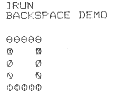
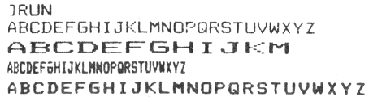
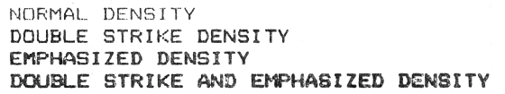
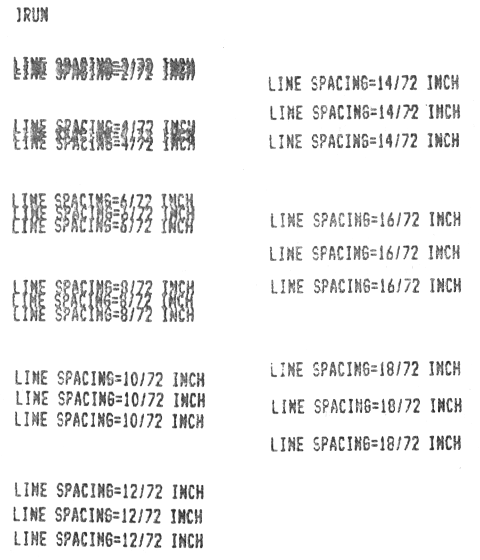
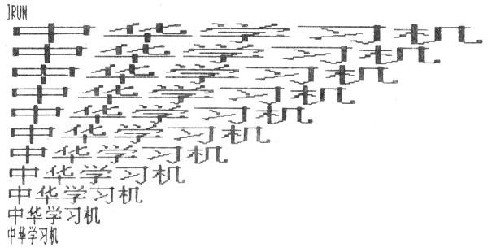
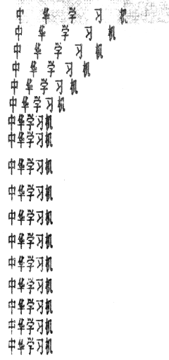
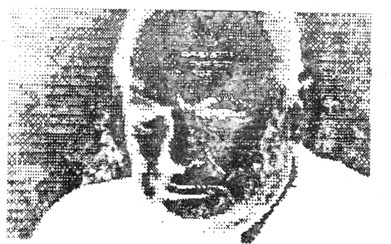
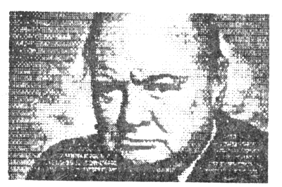

# 第七章 打印机输出控制

如果在你的 CEC-I 中华学习机系统中能够配上一台打印机，系统就更加完善了。这样，在你设计程序使用 CEC-I 时就会感到非常方便。通常我们把打印机的输出（打印的内容）称为“硬拷贝”，通过打印机，你可以把程序清单，文件报表、出错信息、甚至图形打印出来，作为永久的记录。

打印机通过打印机接口与主机系统相连接后，成为受控于主机系统的一个外部设备。它具有接收并处理由主机送来的控制命令和打印数据的能力。通过打印机对这些命令的执行和处理，可以控制和改变打印数据的格式，走纸量和字符形状等等。还可以将输出的数据作为图象信息进行打印，以达到打印汉字的目的。

CEC-I 中华学习机可以配备多种型号的打印机，常见的有 CP-80，RX-80，FX-80，YAMATO，STAR 等等。打印机的种类虽然很多，但其操作方式却大同小异。本章中，我们以 MS-80 型打印机为例，详细地说明如何操作和控制打印机。其它型号的打印机请参考随机所带的使用说明。

对打印机的操作方式通常分为手动方式和程序方式，下面我们分别加以说明。

---

## 7.1 打印机上的控制键

一般在打印机的侧面有一个标有 `ON / OFF` 的电源开关（有些打印机用打点位置表示电源开），在打印机的上方或前面板上有一排按键和指示灯，用来控制打印机的操作和指示其工作状态。下面是一些常用的按键和指示灯的功能：

| 按键 | 功能 |
| :--- | :--- |
| `ON / OFF` | 电源开关 |
| `SELECT`（带指示灯） | 暂停或重新开始打印机操作 |
| `FF` (`From Feed`) | 换页 |
| `LF` (`Line Feed`) | 换行 |

| 指示灯 | 功能 |
| :--- | :--- |
| `POWER` | 打印机电源接通 |
| `READY` | 打印机准备好，可以打印资料 |
| `PAPER OUT` | 没有纸了 |

打印机通常有自己的电源，因此，在使用打印机之前要注意是否已经把电源接好，然后再打开电源开关。一般的打印机都有一个标着 `POWER` 的电源指示灯，亮了就表示打印机已经通电了。另外一个重要的按键就是标有 `SELECT` 或 `ONLINE` 的按键，当这个按键上的灯亮时，就表示打印机由 CEC-I 控制，而当你按下这个按键时，灯就熄灭，打印机的动作也会停止，这时就可以用手动方式来控制打印机，再按一次这个按键，指示灯又会亮起来，进入由 CEC-I 控制的状态。

另外一个常用的指示灯就是 `READY`，这个指示灯用来指示打印机的工作状态。一旦打印机工作完成，可以接受下批印出的资料时，这个灯就亮；当打印机正在工作时，这个灯是熄灭的。

有些打印机上有一个 `PAPER OUT` 的指示灯，当打印纸用完或没有装好时，这个灯就会亮起来。另外，打印机里面还有一个小扬声器，当打印机出现故障时（如色带断了，或卡住了，或没有纸了），就会发出“嘟”的声音指示你来排除故障。

大部分的打印机都有一个 `FF` 按键，用来进行打印纸的换页操作。在进行换页时，首先要进入手动操作状态（按 `SELECT` 键，使灯熄灭），然后再按 `FF` 键，就会把打印纸卷到下一页的第一行上。另外一个重要的按键，就是 `LF` 键，用来对打印纸进行换行的操作。使用这个键，同样需要进入手动操作状态，按 `LF` 键会使打印纸空走一行。

关于打印机使用详细的操作，可以具体参考自己使用的打印机使用说明书。

---

## 7.2 打印机的连通与使用

当 CEC-I 在工作时，一般所产生的输出信息都会在屏幕上显示出来，而当你使用打印机时，CEC-I 只不过是把打印机看成是屏幕的“拷贝”。也就是说，当你想使用打印机打印输出结果时，只要告诉 CEC-I 把屏幕的输出送到打印机上就行了。CEC-I 连通打印机的命令为：

```basic
]PR#1
```

在这条命令中 `PR#` 的功能是把 CEC-I 的输出送到某个指定的扩充槽口上，一般打印机接口套是设定在 1 号槽口上，所以执行的命令应该是 `PR#1`（原文印作 CEC-I）。执行完这条命令以后，CEC-I 在屏幕上的所有输出内容，都会通过打印机打印出来，其打印的格式也会与屏幕上显示的一模一样。

使用这条命令要注意的是，如果打印机电源开关在执行命令之前没有打开，或者是打印机没有准备好可以接受打印信息，或者是扩充槽上根本没有打印机接口套，那么 CEC-I 就会进入等待状态。

如果你的打印机已经连通好了，那么现在就可以下达 `CATALOG` 命令，这样你就会同时在屏幕和打印纸上得到一份磁盘文件的目录，如果你下达 `LIST` 命令，就会在打印机上得到一份程序清单。

CEC-I 使用的打印机通常是能够在一行上打印 80 个字符，但我们在列程序清单时，却发现在打印出的一行上最多只有 40 个字符。这是因为 CEC-I 控制方式的缘故，通常只会印出与屏幕上格式完全相同的 40 个字符而已。所以要让打印机在一行上打印出超过 40 个字符时，就要下达特殊的命令。其命令为：

```basic
]PR#1
]POKE 1657,80
]LIST
```

在 `POKE` 命令中的 `80` 表示在一行中要印出 80 个字符。在 80 个字符打印状态下，输出的字符在屏幕上是不显示的（大于 40 个字符也一样），当打印工作完成以后，光标在屏幕上闪烁时，就表示所有的资料都印完了。要回到 40 个字符以及屏幕显示状态，只要用下面的命令：

```basic
POKE 1657,40
```

就可以了。

当打印完所需要的资料以后，希望打印机不再有作用，就可以用下面的命令把打印机与 CEC-I 的连通断开：

```basic
]PR#0
```

另外，当同时按下 `CTRL-RESET` 这两个键以后，也会自动解除打印机与 CEC-I 的连通。

---

## 7.3 在程序中使用打印机

### 7.3.1 在程序中连通打印机

`PR#1` 命令不但可以在 BASIC 提示符下直接使用连通打印机，而且也可以放在程序中做为一条语句使用。在程序中一旦执行了 `PR#1` 语句，那么就会连通在 1 号槽上的打印机，输出的资料就会送到打印机上印出来。反过来，`PR#0` 语句会解除打印机的输出。

下面是一个在没有 DOS 系统下使用打印机的例子：

```basic
10 REM OUTPUT 2 LINES TO A PRINT
20 PR#1
30 PRINT "CHINA EDUCATION COMPUTER"
40 PRINT "SHANNXI COMPUTER FACTORY"
50 PR#0
60 END
```

上面的例子中，20 行连通打印机，30 和 40 行打印出两行英文字母，然后在 50 行解除打印机的作用。如果在有 DOS 系统的情况下，那么在语句的写法上有点区别，这时 `PR#1` 就变成了 DOS 命令，在程序中要使用 DOS 命令的话，第一个字符必须是 `CTRL-D`、即 `CHR$(4)`，于是程序中的 20 行和 50 行语句就得改成：

```basic
20 PRINT CHR$(4);"PR#1"
50 PRINT CHR$(4);"PR#0"
```

### 7.3.2 打印字符的定位控制

程序中打印机的使用与在屏幕上的使用基本相同，但也有一些区别。比如说打印机的走纸只能向一个方向移动，所以就没有办法用 `VTAB` 来上下地定位移动；打印机在打印一行时，回车符没有发出之前，我们可以使打印头向左或向右移动，但是一旦送出回车符或换行命令后，打印头就无法回到上一行去了。

使用打印机时，`PRINT` 语句中的逗号（`,`）和 `TAB` 函数常常会得出一些很奇怪的结果，所以我们尽量不去使用它。通常是利用 `SPC` 函数和 `HTAB` 语句对一行中打印的字符进行定位。下面是一个使用 `HTAB` 语句定位的程序。

```basic
LIST

100 D$ = CHR$ (4)
110 PRINT D$;"PR#1"
120 PRINT
130 FOR I = 1 TO 39 STEP 5
140 HTAB I
150 PRINT "<><>";
160 NEXT I
170 PRINT
180 PRINT D$;"PR#0"
190 END

]RUN
```

---

## 7.4 打印机的控制命令

每种型号的打印机都有它特有的功能，这些功能显然要比 `SPC` 函数或 `HTAB` 语句等更有用些。通常 CEC-I（原文印作 CEE-I）并不会了解这些控制功能是什么，而需要使用者事先了解所使用打印机的特性，知道如何控制它。这样就可以在直接方式下或在程序中送出控制打印机的命令。这些控制命令通常是一些控制符号或 `ESC` 字符串，在 BASIC 程序中常用 `PRINT` 语句送给打印机，以达到控制，指挥打印机的目的。

### 7.4.1 基本动作的控制

首先我们看几个最基本的控制动作，这些动作如表 7.1 所示。

在这里要说明的是，`CR` 的原意是把打印头移回到最左边，纸张并没有走一行，所以如果再打印一行就会和上一次打印的内容重叠了。而 `LF` 只是让纸张走一行，打印头不一定移回到左边。但是一般打印机出厂时被设置成自动换行，也就是说，用 `CR` 就等于是 `CR` 加上 `LF`。我们可以用下列命令：

```basic
POKE 1529,255
```

把自动换行功能暂停，这样当你送出 `CR` 命令时只是把打印头向左移，而需要换行时，必须送出 `LF` 命令。要恢复自动换行功能，需要用下面的命令：

```basic
POKE 1529,0
```

**表 7.1 打印机基本控制动作**

| ASCII 符号 | 控制字符 | 十进制代码 | 纸张动作 | 控制功能 |
| :---: | :---: | :---: | :---: | :--- |
| `BELL` | `CTRL-G` | 7 | 无 | 响铃，使打印机鸣 3 秒 |
| `BS` | `CTRL-H` | 8 | 无 | 退格，从打印缓冲区删去一个字符 |
| `LF` | `CTRL-J` | 10 | 进一行 | 完成打印，并走纸一行 |
| `FF` | `CTRL-L` | 12 | 跳页 | 走纸到下一页的页首 |
| `CR` | `CTRL-M` | 13 | 进一行 | 送回车符，完成打印缓冲区数据打印 |

下面的程序为你示范 `BS` 控制符的用法。

```basic
100 REM BACKSPACE DEMO
110 DIM L$(5),M$(5)
120 B$ = CHR$ (92): REM BACK SLASH
130 V$ = CHR$ (124): REM VERTICAL BAR
140 BB$ = B$ + "   " + B$
150 VV$ = V$ + V$ + V$ + V$ + V$
170 L$(1) = "OOOOO":M$(1) = "-----"
180 L$(2) = "O   O":M$(2) = "X   X"
190 L$(3) = "O   O":M$(3) = "/   /"
200 L$(4) = "O   O":M$(4) = BB$
210 L$(5) = "OOOOO":M$(5) = VV$
220 REM CONTROL CODES
230 D$ = CHR$ (4)
240 BS$ = CHR$ (8)
250 B5$ = BS$ + BS$ + BS$ + BS$ + BS$
260 PRINT D$;"PR#1"
270 PRINT
280 PRINT "BACKSPACE DEMO"
290 PRINT
300 FOR I = 1 TO 5
310 PRINT L$(I);B5$;M$(I)
320 NEXT I
330 PRINT D$;"PR#0"
340 END
]RUN
```



程序中 `B$` 是反斜线（`\`），`V$` 是垂直线（`|`）。在每一行上先用 `O` 或空格印出 5 个符号（第 310 句），再印出 5 个退格符，于是打印头回到了开始的位置，接着再印出的 `M$(I)` 字符串就重叠地印在第一次打印的字符上。值得注意的是，连通打印机后（260 句），最好紧接着再 `PRINT` 一次，送出一个空行，否则的话下一行的第一个字符常常会丢失。

### 7.4.2 字型的控制

如果在你打印的文件或报表中，能够控制打印字符的字型和浓度变化，那么打印出的文件一定会更加美观。表 7.2 列出了常用字型的控制命令。在这些控制命令中，有些是用 `ESC` 字符串。例如，`ESC+G` 就表示要送出一个 `ESC`（`=CHR$(27)`），然后再送出字符 `G`。

**表 7.2 字符和浓度的控制符**

| 控制功能 | 控制符号（开始） | 控制符号（结束） | 对应的 ASCII 码值（开始） | 对应的 ASCII 码值（结束） |
| :---: | :---: | :---: | :---: | :---: |
| 标准型字宽 | `SO` | `DC4` | 14 | 20 |
| 缩小型字 | `SI` | `DC2` | 15 | 18 |
| 缩小型宽字 | `SI+SO` | `DC` (`DC2`) | 15, 14 | 18 |
| 每个字印两次 | `Esc+G` | `Esc+H` | 27, 71 | 27, 72 |
| 加强型字 | `Esc+E` | `Esc+F` | 27, 69 | 27, 70 |
| 加强型印两次 | `Esc+E+Esc+G` | `Esc+H+Esc+F` | 27, 69, 27, 71 | 27, 72, 27, 70 |

下面的程序是一个字型控制的示范程序：

```basic
1000 REM TEST PRINTING STYLE
1010 D$ = CHR$ (4)
1015 PRINT D$;"PR#1"
1016 PRINT
1020 SI$ = CHR$ (15)
1030 SO$ = CHR$ (14)
1040 ESC$ = CHR$ (27)
1050 RST$ = CHR$ (18)
1060 :
1070 REM DEACTIVATE SCREEN
1080 POKE 1657,80
1090 :
1100 REM NORMAL TYPE
1110 PRINT "ABCDEFGHIJKLMNOPQRSTUVWXYZ"
1120 :
1130 REM WIDTH PRINTING
1140 PRINT SO$;
1150 PRINT "ABCDEFGHIJKM"
1160 :
1170 REM COMPRESSED PRINTING
1180 PRINT SI$;
1190 PRINT "ABCDEFGHIJKLMNOPQRSTUVWXYZ"
1200 :
1210 REM COMPRESSED WIDTH PRINTING
1220 PRINT SO$;
1230 PRINT "ABCDEFGHIJKLMNOPQRSTUVWXYZ"
1240 REM RESET EVERY-THING
1250 PRINT RST$
1260 PRINT D$;"PR#0"
1270 END
]RUN
```



下面的程序是一个浓度控制的示范程序：

```basic
]LIST
1000 REM DENSITY DEMO
1010 D$ = CHR$ (4)
1015 PRINT D$;"PR#1"
1016 PRINT
1020 ESC$ = CHR$ (27)
1030 DN$ = ESC$ + "G"
1040 DF$ = ESC$ + "H"
1050 EN$ = ESC$ + "E"
1055 EF$ = ESC$ + "F"
1060 :
1070 REM DEACTIVATE SCREEN
1080 POKE 1657,80
1090 :
1100 REM NORMAL DENSITY
1110 PRINT "NORMAL DENSITY"
1120 :
1130 REM DOUBLE STRIKE DENSITY
1140 PRINT DN$;"DOUBLE STRIKE DENSITY";DF$
1160 :
1170 REM EMPHASIZED DENSITY
1180 PRINT EN$;"EMPHASIZED DENSITY";EF$
1200 :
1210 REM DOUBLE+EMPHASIZED DENSITY
1220 PRINT DN$;EN$;"DOUBLE STRIKE AND EMPHASIZED DENSITY";EF$;DF$
1260 PRINT D$;"PR#0"
1270 END
```



### 7.4.3 行间距控制

通常打印机在标准情况下每一英寸打印六行字符，也就是每 $1/6$ 英寸一行。我们也可以用控制字符来改变行与行之间的距离，其格式如下：

```text
Esc + A + n    (1 <= n <= 85)
```

上式中的 $n$ 是一个在 1 到 85 之间的十进制整数。当把这个控制符送给打印机之后，每次换行时，行与行之间的距离为 $n/72$ 英寸。使用该控制字符时要注意的是，送出 $n$ 时，必须要用 `CHR$(n)` 把它转换成对应的 ASCII 字符。

下面是一个行间距控制的示范程序：

```basic
]LIST

100 REM VARIABLE SPACEING DEMO
110 ESC$ = CHR$ (27)
120 SP$ = ESC$ + "A"
130 D$ = CHR$ (4)
135 CR$ = CHR$ (13)
140 PRINT D$;"PR#1"
145 PRINT
150 POKE 1657,80
160 FOR I = 2 TO 18 STEP 2
170 PRINT SP$ + CHR$ (I);
180 FOR J = 1 TO 3
190 PRINT "LINE SPACING=";I;"/72 INCH"
200 NEXT J
210 PRINT SP$ + CHR$ (12) + CR$
220 NEXT I
230 POKE 1657,40
240 PRINT D$;"PR#0"
250 END

]RUN
```



---

## 7.5 汉字状态下使用打印机

汉字系统中，汉字的打印驱动程序是针对 MS-80 Ⅲ型打印机设计的，并要求打印机的接口为 Centronics 接口，打印机接口套接在 I/O 槽口的 1 号槽上。因此有的打印机不能打印汉字。

在进入汉字系统后，可使用 BASIC 命令来控制和打印汉字。

### （1）设置打印方式

- **格式**：`POKE 1659, N`
- **说明**：`N = 0` 为不打印，以屏幕作为输出显示设备。
  `N = 1 ~ 15` 为打印，以打印机作为输出设备，所打印的字型与 `N` 的值有关，系统共提供 15 种字型，`N = 1` 最小，`N = 15` 最大。
  `N` 的值以 16 为模，若 `N - INT(N / 16) * 16 = 0` 则系统退出汉字打印模式，否则打印机被启动为汉字打印模式。

### （2）设置字间距

- **格式**：`POKE 1687, N`
- **说明**：`N` 为所打印的字符及汉字之间的字间距离，`N` 的取值为 `0 ~ 255` 之间，即字间距离可在 `0 ~ 255` 个点之间。初次进入打印方式后，字间距自动设置为 `1`。

### （3）设置行距

- **格式**：`POKE 1915, N`
- **说明**：`N` 为打印行之间的点间距，`N` 的范围在 `0 ~ 255` 之间，即行间距离在 `0 ~ 255` 个点间距之间，初次进入打印方式后，行间距自动设置为 `1`。

### （4）设置行打印字数

- **格式**：`POKE 2043, N`
- **说明**：`N` 为每行所打印的汉字个数。应注意一个汉字占有两个字符的位置。`N` 取值范围在 `0 ~ 255` 之间，初次进入打印方式后，自动设置为每行打印 40 个汉字，即 `N =`（原文此处漏印数值）。
  一行所允许打印的汉字个数与打印机型号有关。

下面是汉字打印简单举例。

```basic
]LIST

10 A$ = "中华学习机"
20 FOR I = 15 TO 1 STEP - 1
30 POKE 1659,I
40 PRINT A$
50 NEXT I
55 POKE 1659,5
60 FOR I = 20 TO 1 STEP - 3
65 POKE 1787,I
70 PRINT A$
80 NEXT I
90 FOR I = 10 TO 1 STEP - 1
95 POKE 1915,I
100 PRINT A$
110 NEXT I
120 POKE 1659,0

]RUN
```





---

## 7.6 高分辨率图象的打印

通常与 CEC-I 中华学习机配备的打印机都具有图形打印的功能，可以把高分辨率图形页的内容在打印机上打印出来。例如我们要打印第一页上的图形，首先应该把图形数据载入高分辨率图形第一页的地址区域（`$2000 ~ $3FFF`），然后用 `PR#1` 命令连通打印机，接下来我们就可发出命令进行图形的打印了。

在立即型方式下，只要按 `CTRL-Q` 键，不必按回车，打印机就会立即打印出第一页的图形。

图象打印完以后，最好用 `CTRL-X` 命令消除掉 `CTRL-Q` 命令，然后再用 `PR#0` 使打印机脱离开与主机的连通。图 7.1 就是用 `CTRL-Q` 打印的高分辨率第一页图形的例子。

由于屏幕上点的显示方式刚好与打印机的打印方式相反，即对应于“1”的点在屏幕上显示白点，而在打印机上打印的刚好是黑点。因此图 7.1 皆图象与屏幕上所看到的是反相的，就象是照像机的底片一样。



CEC-I 中华学习机为用户提供了一个 8 位的输出寄存器，对应于 1 号槽上的打印机来说，其内存地址为 `1913`（`$799`）。当用户给这个输出寄存器输入相应的数值控制时，就能控制高分辨率图形页打印的方式。输出寄存器各位码的含义如下：

| 参数组 | `U` | `D` | `I` | `L`（异或） | `L`（或） | `L`（与） | `P`（第二页） | `P`（第一页） |
| :---: | :---: | :---: | :---: | :---: | :---: | :---: | :---: | :---: |
| **功能含义** | 行方式 | 放大 | 反相 | 异或 | 或 | 与 | 第二页 | 第一页 |
| **位权数值** | 128 | 64 | 32 | 16 | 8 | 4 | 2 | 1 |

当该寄存器中的某一位为 1 时，便执行相应的操作。

在 BASIC 语言系统下，控制图形页打印方式命令为：

```basic
POKE 1913, N    (n = U + D + I + L + P)
```

命令中各参数的含义如下：

1. **`P` 参数为高分辨图形页选择**。`P = 1` 时，打印高分辨图形第一页；`P = 2` 时，打印高分辨图形第二页；`P = 3` 时，将两页图形并排打印，第一页在左，第二页在右。
2. **`L` 参数决定二页高分辨图形逻辑操作**。`L = 0`，无逻辑操作；`L = 4`，把第一页和第二页图中的点经过逻辑“与（AND）”操作以后打印出来；`L = 8`，把两页图形中的点经过逻辑“或（OR）”操作以后打印出来；`L = 16`，把两页图形中的点经过“异或（EOR）”操作以后打印出来。
3. **`I` 参数决定正相或反相打印方式**。`I = 0`，表示正相打印；`I = 32`，表示反相打印。
4. **`D` 参数决定打印图形的比例**。`D = 0` 为正常打印；`D = 64`，把图形放大一倍打印。
5. **`U` 参数设置行打印方式**。`U = 0`，对整幅图象进行打印。`U = 128`，仅打印由 `VTAB` 定位的那一行图象。

高分辨图形打印可以用立即型方式也可以用程序方式。在立即型方式下，连通打印机后，按 `CTRL-Q` 键，不用按回车，就可以立即打印高分辨图象；在程序方式下执行 `PRINT CHR$(17)` 语句，就可以打印高分辨图象。

下面是一个控制图形页反相打印方式的例子，如图 7.2 所示。

```basic
10 REM HI-GRAPHIC PRINTING DEMO
20 PRINT CHR$ (4);"BLOAD H10,A$2000"
30 POKE 1913,33
40 PRINT CHR$ (4);"PR#1"
50 PRINT CHR$ (17)
60 PRINT CHR$ (24)
70 PRINT CHR$ (4);"PR#0"
```


