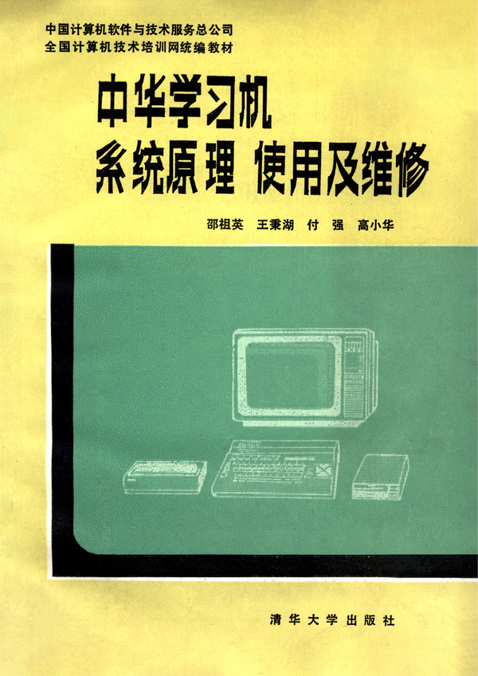

# 中华学习机系统原理 使用及维修

## 出版信息

- **丛书**：中国计算机软件与技术服务总公司 · 全国计算机技术培训网统编教材
- **书名**：中华学习机系统 原理 使用及维修
- **作者**：邵祖英、王秉湖、付强、高小华
- **出版社**：清华大学出版社（1989 年 11 月）
- **ISBN**：7-302-00823-X / TP·298
- **定价**：9.80 元

---

## 前言

中华学习机以其性能价格比高而广泛应用于中小学和家庭，它是广大青少年学习计算机知识、进行计算机辅助教育和开发智力的有力工具。由于中华学习机与国际上流行的 Apple IIe 机兼容，可在其上运行 Apple II 机上已有的各种软件，加上主板上配有国际一、二级字库，因此在国内应用日益广泛。

本书是中华学习机系列教材的第一本。它侧重于介绍中华学习机硬件原理、基本操作、6502 汇编语言及其编程方法、显示和打印等使用技巧及其维护等。是一本基础性、综合性、实用性很强的教材。全书共分九章（原文作“八章”，实为九章）：第一、二章介绍计算机的基本知识，为硬件原理的分析提供必要的基础；第三章介绍了中华学习机 CPU 6502 的性能及其指令系统；第四章全面而又详细地分析了中华学习机主板各组成部件的工作原理，是了解中华学习机原理、掌握维修技术的关键；第五、六、七章分别介绍了系统监控、磁盘操作系统以及 6502 编辑和汇编程序，是使用中华学习机必需掌握的知识；第八章用大量实例介绍了显示和打印的方法与技巧；第九章介绍了中华学习机的维护和常见故障分析，是大量维修实践中的经验总结，很有实用价值。本书各章的分工如下：邵祖英编写第一、二、四章；付强编写第五、六章；王秉湖编写第三、七、八章；高小华编写第九章；全书由邵祖英主持统编并定稿。

在本书编写过程中得到了教材编审委员会的大力支持，得到了朱家维和潘孝梅的帮助，朱家维还审阅了全书，并提出宝贵的意见，在此一并表示衷心的感谢。

本书难免有不足之处，敬请读者批评指正。

**作者**
1989 年 11 月

---

## 目录

- **[第一章 概述](ch01-02-fundamentals.md#第一章-概述)** (p. 1)
  - [§1-1 前言](ch01-02-fundamentals.md#1-1-前言) (p. 1)
  - [§1-2 计算机硬件的基本构成](ch01-02-fundamentals.md#1-2-计算机硬件的基本构成) (p. 1)
  - [§1-3 计算机解题过程的描述](ch01-02-fundamentals.md#1-3-计算机解题过程的描述) (p. 2)
  - [§1-4 计算机系统的组成及其主要技术指标](ch01-02-fundamentals.md#1-4-计算机系统的组成及其主要技术指标) (p. 5)
  - [§1-5 计算机软件概述](ch01-02-fundamentals.md#1-5-计算机软件概述) (p. 7)
- **[第二章 计算机的基本知识](ch01-02-fundamentals.md#第二章-计算机的基本知识)** (p. 11)
  - [§2-1 数的表示及其运算](ch01-02-fundamentals.md#2-1-数的表示及其运算) (p. 11)
  - [§2-2 逻辑代数简介](ch01-02-fundamentals.md#2-2-逻辑代数简介) (p. 16)
  - [§2-3 基本逻辑电路](ch01-02-fundamentals.md#2-3-基本逻辑电路) (p. 18)
  - [§2-4 存储器](ch01-02-fundamentals.md#2-4-存储器) (p. 23)
  - [§2-5 总线和信号的传送](ch01-02-fundamentals.md#2-5-总线和信号的传送) (p. 25)
- **第三章 微处理器 6502 及其指令系统** (p. 27)
  - **[Part 1: §3-1 ~ §3-2 前半](ch03a-6502-part1.md)**
    - [§3-1 6502 的基本性能](ch03a-6502-part1.md#3-1-6502-的基本性能) (p. 27)
    - [§3-2 6502 的指令系统（一）](ch03a-6502-part1.md#3-2-6502-的指令系统) (p. 35)
  - **[Part 2: §3-2 后半 ~ §3-3](ch03b-6502-part2.md)**
    - [§3-2 6502 的指令系统（二）](ch03b-6502-part2.md) (p. 48)
    - [§3-3 程序综合举例](ch03b-6502-part2.md#3-3-程序综合举例) (p. 60)
- **第四章 中华学习机主板工作原理** (p. 67)
  - **[Part 1a: §4-1 ~ §4-3](ch04a1-motherboard-part1a.md)**
    - [§4-1 中华学习机主板正视图及逻辑总框图](ch04a1-motherboard-part1a.md#4-1-中华学习机主板正视图及逻辑总框图) (p. 67)
    - [§4-2 中央处理器及地址总线缓冲器](ch04a1-motherboard-part1a.md#4-2-中央处理器及地址总线缓冲器) (p. 70)
    - [§4-3 存储器系统](ch04a1-motherboard-part1a.md#4-3-存储器系统) (p. 72)
  - **[Part 1b: §4-4 ~ §4-6](ch04a2-motherboard-part1b.md)**
    - [§4-4 时钟信号产生器](ch04a2-motherboard-part1b.md#4-4-时钟信号产生器) (p. 83)
    - [§4-5 外设卡输入/输出空间分配](ch04a2-motherboard-part1b.md#4-5-外设卡输入输出空间分配) (p. 86)
    - [§4-6 键盘和键盘接口电路](ch04a2-motherboard-part1b.md#4-6-键盘和键盘接口电路) (p. 94)
  - **[Part 2: §4-7 ~ §4-12](ch04b-motherboard-part2.md)**
    - [§4-7 盒式录音机接口](ch04b-motherboard-part2.md#4-7-盒式录音机接口) (p. 101)
    - [§4-8 扬声器接口](ch04b-motherboard-part2.md#4-8-扬声器接口) (p. 105)
    - [§4-9 软盘驱动器接口](ch04b-motherboard-part2.md#4-9-软盘驱动器接口) (p. 106)
    - [§4-10 游戏杆接口电路](ch04b-motherboard-part2.md#4-10-游戏杆接口电路) (p. 111)
    - [§4-11 打印机接口](ch04b-motherboard-part2.md#4-11-打印机接口) (p. 113)
    - [§4-12 汉字处理电路](ch04b-motherboard-part2.md#4-12-汉字处理电路) (p. 119)
- **[第五章 系统监控](ch05-monitor.md)** (p. 126)
  - [§5-1 概述](ch05-monitor.md#5-1-概述) (p. 126)
  - [§5-2 监控命令的使用](ch05-monitor.md#5-2-监控命令的使用) (p. 129)
  - [§5-3 小汇编的使用](ch05-monitor.md#5-3-小汇编的使用) (p. 139)
  - [§5-4 监控的特殊单元](ch05-monitor.md#5-4-监控的特殊单元) (p. 140)
  - [§5-5 一些有用的监控子程序](ch05-monitor.md#5-5-一些有用的监控子程序) (p. 141)
- **[第六章 中华学习机磁盘操作系统 DOS](ch06-dos.md)** (p. 145)
  - [§6-1 引论](ch06-dos.md#6-1-引论) (p. 145)
  - [§6-2 DOS 结构](ch06-dos.md#6-2-dos-结构) (p. 149)
  - [§6-3 DOS 命令及其使用](ch06-dos.md#6-3-dos-命令及其使用) (p. 152)
- **[第七章 6502 的编辑/汇编程序](ch07-editor-assembler.md)** (p. 170)
  - [§7-1 汇编语言程序概述](ch07-editor-assembler.md#7-1-汇编语言程序概述) (p. 170)
  - [§7-2 汇编语言源程序](ch07-editor-assembler.md#7-2-汇编语言源程序) (p. 174)
  - [§7-3 汇编命令和汇编过程的控制](ch07-editor-assembler.md#7-3-汇编命令和汇编过程的控制) (p. 181)
  - [§7-4 源程序的编辑](ch07-editor-assembler.md#7-4-源程序的编辑) (p. 182)
  - [§7-5 小结](ch07-editor-assembler.md#7-5-小结) (p. 190)
- **第八章 显示和打印** (p. 192)
  - **[Part 1: §8-1 ~ §8-5](ch08a-display-part1.md)**
    - [§8-1 中华学习机的显示方式](ch08a-display-part1.md#8-1-中华学习机的显示方式) (p. 192)
    - [§8-2 显示信号的形成](ch08a-display-part1.md#8-2-显示信号的形成) (p. 193)
    - [§8-3 显示方式软开关](ch08a-display-part1.md#8-3-显示方式软开关) (p. 199)
    - [§8-4 内存显示缓冲区内各单元与屏幕位置的对应关系](ch08a-display-part1.md#8-4-内存显示缓冲区内各单元与屏幕位置的对应关系) (p. 200)
    - [§8-5 如何用系统程序进行高分辨作图](ch08a-display-part1.md#8-5-如何用系统程序进行高分辨作图) (p. 203)
  - **[Part 2: §8-6 ~ §8-7](ch08b-display-printer-part2.md)**
    - [§8-6 高分辨图形作图的其它应用](ch08b-display-printer-part2.md#8-6-高分辨图形作图的其它应用) (p. 216)
    - [§8-7 打印机的使用方法](ch08b-display-printer-part2.md#8-7-打印机的使用方法) (p. 231)
- **[第九章 中华学习机的维护与故障维修](ch09-maintenance-schematics.md)** (p. 236)
  - [§9-1 中华学习机故障维修测试卡技术及使用说明](ch09-maintenance-schematics.md#9-1-中华学习机故障维修测试卡技术及使用说明) (p. 236)
  - [§9-2 中华学习机主板故障维修举例](ch09-maintenance-schematics.md#9-2-中华学习机主板故障维修举例) (p. 239)
  - [§9-3 软盘驱动器原理及维修](ch09-maintenance-schematics.md#9-3-软盘驱动器原理及维修) (p. 244)
  - [附图 1 ~ 附图 8（中华学习机全套电路原理图）](ch09-maintenance-schematics.md#全书电路原理附图附图-1--附图-8) (p. 254)
