# 第一章 概述

## §1-1 前言

1946 年世界上第一台数字电子计算机的诞生，以及它的迅猛发展，是本世纪最重大的科学技术成就之一。所有其他重大科学技术成就无不以此为工具而得以实现。电子计算机的出现及其发展，推动了微电子技术的进步，而微电子技术的进步又极大地促进了计算机的发展。微型计算机就是微电子技术高度发展的产物。它使计算机深入到社会的生产、国民经济以及人民生活的各个领域，它是当代新技术革命的原动力之一，是工业、农业、科学和国防现代化的一个重要标志。

我国的计算机工业近几年来得到了很大的发展，在各个领域里取得了不少应用成果。计算机科研、生产方面亦已初具规模，包括销售、培训、维修、开发在内的成套技术服务体系在全国范围内已经形成一支不可忽视的力量。这些成就无疑为我国计算机事业的进一步发展奠定了良好的基础。中华学习机就是这样的形势下诞生的。

邓小平同志指出：“计算机的普及要从娃娃抓起”。这是一个战略决策，是在全中华民族范围内开展计算机文化教育，提高中华民族文化素质的重要部署。它必将为我国国民经济各领域的腾飞与整个社会的进步和发展打下坚实的基础。因此中华学习机的生产，以及在全国推广应用，是造福子孙后代的一件伟大事业。

中华学习机是在吸取了国外流行的各种八位微型计算机的特点和优点的基础上，结合我国国情自行设计、自行生产的优选机种。目前生产的中华学习机配置适宜、功能齐全、具有汉字输入和输出等处理能力，又可利用家用电视机和录音机分别作为中华学习机主机的显示器和外存储器。因此，整个系统不要再花更多的资金就可建立起来。此外，由于中华学习机和美国生产的苹果 II（APPLE II）机兼容，所以苹果机上的大量软件，可以直接在中华机上运行。尤其是苹果机原有大量计算机辅助教学软件，十分适合中、小学使用，有益于开发青少年的智力，训练青少年的思维。而且，我们在推出这一机种的同时，还开发、移植、收集了许多具有汉字的计算机辅助教学软件和一定数量的游戏程序。这样，不但能使使用者学到计算机的各种知识，还能使他们得到一个不知疲倦、谆谆教导的良师和闲暇之时的娱乐伙伴。

当前，世界上许多发达国家的计算机教育已从高等院校转向普通教育、中小学教育以及家庭，计算机已逐步普及。可以断言，中华学习机在我国的普及，必将使我国亿万中小学生打下坚实的计算机基础知识，掌握信息时代最有力的工具，从而为我国在 21 世纪开始的全方位腾飞，造就一大批科技人才。

## §1-2 计算机硬件的基本构成

当今时代的计算机，不论是功能异常强大的大型机、巨型机，还是当前十分流行的微型机，都是由以下三部分组成：中央处理器（CPU）、存储器（Memory）和外部设备（Peripheral）或称输入/输出设备（I/O）。中央处理器是由早期称为运算控制部件演变而来，它仍保留了原来的特点，是执行全部运算并对整个系统进行控制的核心部件。存储器是存储信息和代码的部件。它好比人类存放了全部内在信息的大脑，这些信息一经调出，既能控制人体上的各种器官进行运动，又能进行计算或思维。存储器有的书上称之为内存储器或主存储器（或简称内存、主存）。它一般分成两大类：一类是随机存取存储器（RAM——Random Access Memory，原文印作“Random Accass Memory”），它既可随时读取数据，又能随时写入数据。另一类是只读存储器（ROM——Read Only Memory），它只能被读取数据，而不能对它写入数据，且其中的数据是不能修改的。外部设备是进行人机联系或存放大量信息的设备。例如键盘（输入设备），人们可以通过它向主机中键入数据；显示器（输出设备）可随时显示计算机中的信息、计算的结果或所要求的任何其它信息。磁盘驱动器（外存储器）则可存储大量信息，存放中间结果或最终计算结果等。外部设备种类很多，此处不再赘述。

以上三类部件或设备均是独立的，三者将由所谓总线（Bus）把彼此联系起来，成为一个完整的计算机硬件系统。总线随着计算机体系结构的不同而分成若干种，但不管哪种总线，其中定有三类：地址总线（Address Bus），用以指定内存单元的地址，或定位外部设备以便对指定的外部设备进行信息交换；数据总线（Data Bus），用以传递信息代码；控制总线（Control Bus），用以传送控制信号或状态信息，从而实现对整个系统的控制或使中央处理器及时了解整个系统各部件的状态。

图 1-1 就是一个典型的计算机硬件系统框图。

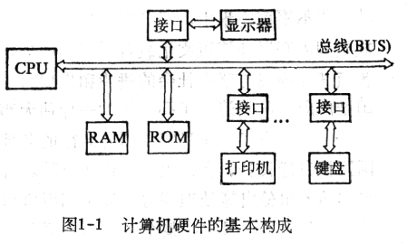

由图可知，中央处理器（CPU）经总线（地址、数据和控制总线）与所有部件或设备联接。从图中还可看到，所有外部设备都要经接口才能挂到总线上去，以便进行数据交换。也就是说，中央处理器的三类信号（地址、代码和控制等信号）或外部设备的状态信号等都要通过接口才能达到信息的流通。在这里，接口起到了联接和缓冲的作用，也只有这样才能充分发挥高速的中央处理器的潜力。因为所有外部设备，其信息的处理或信息传送的速度比中央处理器慢得多。如果中央处理器与外部设备交换信息的时候，要等待慢速的外设（例如打印机）处理或传送完毕信号之后才能作其他动作，则计算机就无法高速地运算和处理信息了。为了解决这一矛盾，微秒（十万分之一秒，原文如此，实为百万分之一秒）量级甚至毫微秒（亿分之一秒，原文如此，实为十亿分之一秒）量级计算或传送速度的中央处理器，在某一瞬间发出让打印机可打出一行字符的数据和控制信号以后，立即转到中央处理器进行若干次运算。一旦打印机花了若干毫秒（千分之一秒）打印完一行字符后，中央处理器能及时得到打印机打印完毕的状态信号。如果此时还要打印一行字符，则中央处理器再重复上述的动作，否则作其它事情。这种在系统中各部件和外部设备同时（并行）工作的方法（接口提供了物质保证），既达到了输入或输出的目的，又不影响中央处理器高速运行性能的发挥。

## §1-3 计算机解题过程的描述

既然计算机的运算速度如此之快，每秒钟之内可以完成数十万乃至上亿次的操作，那么，人是如何来控制计算机让它按规定的顺序去完成指定的动作呢？显然，在计算机运行的全过程中，人无法从中干预而只能靠计算机自动完成。也许读者会问，计算机怎么知道什么时候该做什么、这个操作完成后下一步要做什么操作呢？计算机又将在什么时候、什么地方去取要计算的原始数据呢？人们可提出一系列的问题。要回答这些问题并不难，原来计算机的一切动作，包括取数、送数、执行各种运算、显示一些数据、打印一些结果、存放一大批数据等等，都是由所谓软件，即系统软件和应用软件来完成的。

我们举一个简单的例子来说明计算机的解题过程。某公司的一个元件门市部，实行批量优惠政策，购买 100 个以上（不包括 100 个）的元件可打 80% 的折扣。现有一顾客买了 $X$ 个元件，单价是每个 5 元，问该顾客应交多少钱？

### 一、建立算法

上述问题十分简单，可以根据题意直接列出一个方程式。设顾客应付人民币是 $Y$ 元，则

$$
Y = \begin{cases}
5X & X < 101 \\
5X(1 - 20\%) & X \ge 101
\end{cases}
$$

### 二、设计流程图（亦称框图）

流程图是一种解决问题的图示方法，也就是用图形来表示某一种算法。它利用框图的形式，把解决问题的步骤用图形加以描述，实际上就是算法的图形表示。目前流行使用的框图如图 1-2 所示。其中 (a) 表示程序的开始或结束，(b) 表示要执行一次计算或一次操作，(c) 表示判断，满足某种条件走某种出口，(d) 表示下一步应转到哪一框。

根据上述方程，可以画出如图 1-3 所示的流程图。

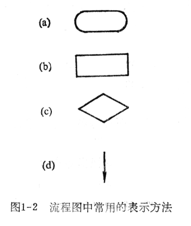

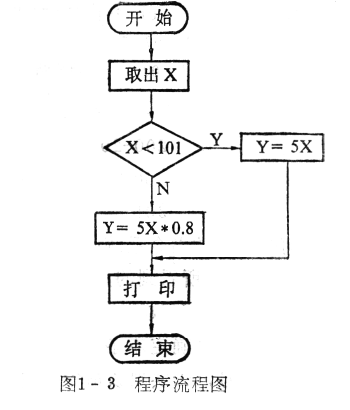

### 三、编制程序

根据所用计算机上所配制的程序设计语言和上述解题流程图，就可编制程序。我们在下一节中将知道，程序设计语言有许多种。到底采用哪一种，要根据所解问题的算法，使用者习惯使用的语言，以及计算机上现有的程序设计语言综合考虑而定。在本例中，为了叙述方便和直观，我们采用了机器语言来编写上列问题的程序。

假设某一台计算机的指令系统中有几条指令，如表 1-1 所示。

**表 1-1 指令表**

| 操作名称 | 操作码 | 操作名称 | 操作码 |
| :---: | :---: | :---: | :---: |
| 存数 | `01` | $\div$ | `06` |
| 取数 | `02` | 无条件转移 | `07` |
| $+$ | `03` | 结果为负转 | `08` |
| $-$ | `04` | 打印输出 | `09` |
| $\times$ | `05` | 停机 | `00` |

该指令表只是为了说明问题而假设的。在后面的章节中将专门介绍中华学习机使用的指令系统。表中操作名称代表该条指令要完成的功能。存数，表示向存储器存放一个数；取数，表示从存储器中取出一个数；无条件转移，是执行这条指令后就转到指令中指定的地址上继续执行（原文印作“续继执行”）；结果为负转，是指上一条指令经操作后其结果为负值时就转到指令中指定的地址上继续执行，否则顺序执行；打印输出，是把指令中指定的地址中的内容送到打印机中打出。

根据表 1-1 中的指令系统以及图 1-3 的流程图，可很快地编制出表 1-2 所示的程序。

**表 1-2 程序清单**

| 序号 | 地址 | 操作码 | 地址码 | 说明 |
| :---: | :---: | :---: | :---: | :--- |
| 1 | `$200` | `02` | `302` | $X \rightarrow$ 中央处理器的数据寄存器 |
| 2 | `$201` | `04` | `303` | $X - 101$ |
| 3 | `$202` | `08` | `207` | $(X - 101)$ 为负则转 `207`，否则继续 |
| 4 | `$203` | `02` | `302` | 同第一条 |
| 5 | `$204` | `05` | `301` | $X * 4 \sim$ 即 $X$ 乘上 5 元的 80% |
| 6 | `$205` | `01` | `304` | $X * 4 \rightarrow Y$ 把 $X * 4$ 送到 $Y$ 单元 |
| 7 | `$206` | `07` | `20A` | 无条件转到 `20A` 单元（表中地址码原印作 `210`） |
| 8 | `$207` | `02` | `302` | 同第一条 |
| 9 | `$208` | `05` | `300` | $X * 5$ 即 $X$ 5 元 |
| 10 | `$209` | `01` | `304` | $X * 5 \rightarrow Y$ 同第六条 |
| 11 | `$20A` | `09` | `304` | 把 $Y$ 单元内容送打印机打印 |
| 12 | `$20B` | `00` | | 停机结束 |

内存单元分配如下：

| 地址 | 内容 | 地址 | 内容 |
| :---: | :--- | :---: | :---: |
| `200-20B` | 存放程序 | `302` | $X$ |
| `300` | `5` | `303` | `101` |
| `301` | `4` | `304` | $Y$ |

在任何计算机的指令系统中，所有指令都有统一的格式，而且每条指令几乎都由两部分组成。正如表 1-2 中所看到的，一般指令由操作码和地址码两部分组成。中央处理器从内存储器中取出一条指令存放在它的指令寄存器中，然后中央处理器就把指令寄存器中的指令操作码进行译码判断，确定本条指令是什么指令，并根据该指令应完成的动作由中央处理器发出相应的控制信号，去实现该指令要完成的功能。指令的地址码部分提供一个地址，让该指令到指定的地址中取出操作数，以便进行各种运算等。

例如表 1-2 中第一条指令，是从内存地址为 `200` 的单元中取出一条指令，存放到中央处理器的指令寄存器中，其内容为 `02302`。中央处理器取到指令并对操作码 `02` 进行译码判断，确认本条指令是到内存中取一个数，该数是存放在内存的 `302` 单元中。由表 1-2 下方的内存单元分配可知 `302` 中存放的是数 $X$。因此，中央处理器就从内存 `302` 单元中取出数 $X$，存放到中央处理器的数据寄存器中。

### 四、程序输入、调试和运行

把上述编好的程序通过键盘输入到计算机中，同时把一些常数等亦按内存单元分配中指定的地址经键盘输入到内存。输入完毕后开始程序的调试，进行查错修改，然后正式运行。

应当指出，上述例子中我们用的是机器语言，这些指令也是假设的。这样，便于读者直观地了解到计算机的解题过程，使之一目了然。实际上，目前这种方法已不再采用。至于程序如何设计、如何输入、如何调试、如何运行，我们将在后面介绍汇编语言这一章中加以详述，此处从略。

## §1-4 计算机系统的组成及其主要技术指标

### 一、系统组成

计算机如果没有软件给予配合、给予运筹，将一事无成。那怕最简单的从存储器中取一个数或作一个四则运算，都要由程序设计语言之一（在本例中是机器语言）来完成。因此，可以毫不夸张地说，近代计算机硬件系统如果没有软件的支持和配合，将成为一堆无用的废物。计算机的强大功能要靠软件来实现，计算机出现了硬件故障可以用软件来加以诊断，人机对话要靠软件来进行，智能模拟更少不了软件的支持。计算机软件已成为计算机系统中必不可少的组成部分。目前，一个较完整的计算机系统如表 1-3 所示。这里强调了“较完整”和“系统”两个含义，是由于一般人们只把计算机的硬件看作是必不可少的，其余却被忽略了。殊不知，软件是必不可少的内容。尽管它看不见、摸不着，存放在一定的介质上，却起着能充分发挥硬件强大功能的作用。因此，对刚接触计算机的用户来说，一定要对计算机建立一个“完整”和“系统”的概念。

**表 1-3 计算机系统组成**

$$
\text{计算机系统} \begin{cases}
\text{硬件} \begin{cases}
\text{主机} \begin{cases}
\text{中央处理器} \begin{cases}
\text{运算器} \\
\text{控制器}
\end{cases} \\
\text{主存储器}
\end{cases} \\
\text{外部设备} \begin{cases}
\text{输入设备} \\
\text{输出设备} \\
\text{外存设备}
\end{cases} \\
\text{外围设备} \begin{cases}
\text{模数转换器} \\
\text{数模转换器} \\
\text{开关量输入/输出器} \\
\text{数据终端} \\
\text{其它}
\end{cases}
\end{cases} \\
\text{软件} \begin{cases}
\text{系统软件} \begin{cases}
\text{操作系统} \\
\text{编译系统} \\
\text{诊断系统} \\
\text{其它}
\end{cases} \\
\text{程序设计语言} \begin{cases}
\text{汇编语言} \\
\text{BASIC} \\
\text{FORTRAN} \\
\text{ALGOL} \\
\text{COBOL} \\
\text{PL/1} \\
\text{其它}
\end{cases} \\
\text{应用软件}
\end{cases}
\end{cases}
$$

从表中可以看出，硬件由三部分组成，即前面已经介绍过的主机（包括中央处理器、主存储器）、外部设备（包括输入设备、输出设备和外存储器）及我们尚未介绍过的外围设备。不论是外部设备还是外围设备，都是计算机的输入输出设备或外存储器。两者没有严格的区别，它们相对计算机主机而言，都是外部的辅助设备。我们之所以加以分类区别，是出于人们的习惯。外部设备一般泛指组成计算机配套或常用的设备，例如微型计算机系统中的键盘、显示器、外存储器、打印机等；而外围设备则基本上指的是工业控制计算机中常用的如 A/D（模拟量输入、数字量输出转换器）、D/A（数字量输入、模拟量输出转换器）、开关量输入、开关量输出等等。有的书中甚至有时用这个名字，有时用那个名字，这些都是允许的。

表 1-3 中的软件部分大体也分成三类。我们在后面将对其中的部分内容进行详述，此处从略。

### 二、计算机的主要技术指标

一台计算机性能的强弱是由它的系统结构、指令系统、硬件组成、软件配置以及外部设备配备等多方面的因素决定的，它不能单单用一两项技术指标去判断。例如，对于一台每秒计算 50 万次的计算机和一台每秒计算 100 万次的计算机，若解同一个题目，则所需解题时间不一定是 2 比 1。如果后者的综合性能不如前者或后者在程序设计的技巧方面不如前者，它们的解题时间也可能相差无几。所以，不能简单地追求某两项指标，而应综合分析，结合使用者的应用领域加以选择。

下面简单介绍一下几项主要的技术指标：

#### （一）字长

系指中央处理器处理数据时，一次能处理多少二进制位数。字长标志着计算的精度。巨型机或大型机字长一般在 32、64 位；中型机字长大多为 32 位；小型机字长一般在 16、32 位；微型机字长有 4、8、16、32 位。超级微型机目前大多数是 32 位字长。很多机器可以进行字节（一般是二进制八位）、双字节、双字长和多倍字长运算。

#### （二）内存（储器）容量

内存容量有的是按字节为单位，有的按字长来计算。微型计算机中目前都以字节为单位来表示。每 1024 个字节称作 1K 字节。计算机的内存容量是一个很重要的指标，它反映了计算机系统的解题能力、解题速度和同时解决多少问题的能力（要靠软件支持）。计算机内存容量配置的范围变化很大，同一种型号的计算机，可以配置不同容量的内存。一般某一机种都有一个基本配置，可在此基础上加以扩充。大型机的内存容量一般在几兆以上，微型机的内存容量近年来也有很大的增长，早期八位机从十几 K 至几十 K，目前有的微机上配置 1 兆（1000K），并可扩充到十六兆（美国 PS/2 的 50 型、60 型）。中华学习机主要用于中、小学，故内存容量为 64K 字节。

#### （三）时钟频率

主要是指中央处理器主时钟的频率。它基本上代表了计算机运行的速度。因为计算机的一切动作，都是以此作为时间标准和节拍的。目前一般的微型机的时钟频率都为 1 兆赫或十几兆赫（如中华学习机时钟频率为 1MHz，PS/2 80 型时钟频率为 16MHz）。

#### （四）运算速度

目前衡量这一指标的标准并不统一。一般采用每秒钟内执行多少条指令来计算，计量单位是次/秒。然而，不同的指令所花的时间是不一样的，这样算出的速度显然有很大差别。因此，就有一个算法问题。目前一般有三种方法：(1) 据不同类型的指令在解题过程中出现的频繁程度，乘上不同的系数，求出一个统计平均值，作为运算速度；(2) 以某条典型的指令所需的执行时间做为标准，去计算运算速度。例如国产 DJS-130 机，就是用加法指令算出其运行速度大致为 50 万次/秒。(3) 直接给出每条指令执行所需时间和机器的主频。

#### （五）可配置的外部设备的数量和种类

这一指标反映了系统功能可扩充的强弱程度。尤其要把计算机当作控制机用时，这一指标更为重要。

#### （六）软件的配置

正如前面所述，计算机没有软件的配合将成为一堆废物。软件配置的情况直接反映了该系统适应能力的大小以及是否能有效地发挥现有设备和有关资源的潜力。计算机是一种高技术的产品，存在着二次开发的问题。例如，一个用户买了一台计算机，买了系统软件和一些程序设计的软件。为了真正能发挥它的作用，还要给它配置上能完成本部门业务管理所需的应用软件，也就是二次开发。如果某一系统已经配置了一个通用的应用软件包，则用户买回这一软件包后，进行必要的修改（例如改一下单位名称等）就马上可以使用。因此软件配置是一个很重要的技术指标。

#### （七）外存容量

外存容量的发展是惊人的，也是现代化计算机追求的一个指标。外存容量在现代企业管理中占据有重要的地位，因为无论进行什么管理，都需要大量的信息为依据。光靠内存的几兆容量显然远远不能满足需要。一个具有一定规模的数据库管理系统，就希望有若干兆字节的容量。因此，尽管是微型机系统，也希望有几十兆的外存空间。目前，有一种海量磁带存储器，其容量竟高达 $472,000,000,000$ 字节。当然，这种外存是供大型机使用的。

以上七点是计算机的主要技术指标。真正挑选机器时，还需根据实际用途综合考虑，不能一味追求所有指标。例如，应用于事务处理的小型企业，则采用一般的微机，配有足够容量的外存，具有汉字处理能力，配有相应的软件即可；如用于工业控制方面，则不必追求速度和外存容量，而应注意选择平均无故障运行时间长的，具有实用的扩充接口板的机种更能适应需要。

## §1-5 计算机软件概述

本节侧重于对软件进行一些必要的介绍，以期读者对计算机软件有一个正确的概貌性的了解。由表 1-3 可知，计算机软件包括系统软件、程序设计语言和应用软件等三类。也有的地方把软件分成系统软件、支撑软件和应用软件等三类。到底如何划分，目前尚无一定之规，读者只要真正了解每种软件的功能，就可自行给以归类。

### 一、系统软件

这类软件是系统固有的，即每一类机种都有它自己的系统软件。这些软件的名称可能一样，但其内容则有很大差别。例如，同样称作操作系统的软件，有苹果机的，IBM PC 机的，王安机的等等，它们彼此是绝然不同的。然而，尽管如此，它们所完成的任务却基本一致。即这些系统软件都对计算机硬件本身进行控制、管理、运行、诊断或在用户把计算机源程序送进计算机时，进行翻译、解释、编辑使之成为可运行的目的程序。

#### （一）操作系统（Operating system）

正如上面所述，操作系统的主要任务是对计算机系统的所有资源（软件的和硬件的资源）进行统一管理、统一调度，使系统能自动地、高效地协调运行。它一般包括中央处理器——CPU 管理、存储器管理、文件管理和输入/输出管理。

##### 1. CPU 管理

一般来说，一个计算机系统中，只有一个 CPU，而同时运行的设备却可以有多个。此外，有的计算机系统中，为了发挥计算机各部件、设备的能力，引进了多道程序设计。即在一个时刻内有几个作业（程序）同时在计算机内运行。在这种情况下，如何及时提供信息，以使各设备或各作业能有条不紊地工作呢？这实质上是一个如何把 CPU 及时地、合理地分配给相应的设备或作业的问题。操作系统中的 CPU 管理就是为解决上述问题而设计的。

##### 2. 存储器管理

在计算机系统中至少有两种存储器，一种是主存（内存）储器，另一种是外存储器。内存的容量相对较小，速度较快，可随机存取，用于存放正在运行的程序、程序要使用的数据、运行后的中间结果或最终结果等。外存容量大，速度低，非随机（是顺序）存取，是一个后备的存储器。两者的配合和补充，既满足了计算机系统高速随机存取的要求，又解决了系统对容量要求尽可能大的问题。我们知道，内存要做到高速度、大容量在技术上是有一定难度的，相应地价格也会上升。其次，内存空间总是有限的，因此，在运行较大的程序时，总要从外存储器中调入一些程序或数据到内存中去。这里就有一个如何从外存中调出，又如何把它们调入到内存中去（不能把内存中常用的信息冲掉）的问题，此外，内存中有些区域有的不准随便调用，有的不准任意修改或抹去，这就是所谓存储器保护的问题。

凡此种种，都要有对存储器进行管理的功能，以便对存储器（外存和内存）资源进行统一管理、统一分配、统一调度。这就是操作系统中的存储器管理的职责。

##### 3. 文件管理

计算机的重要作用在于它能以极快的速度处理大量的信息。这些信息有的需要长期保存，有的只是临时使用。为了协助用户存储和管理好这些信息，在系统中引进了文件这一概念。例如，用户的程序、原始数据、常用的子程序、数据库信息等等都可以看作是一个个文件，并把它们以文件的形式存放在存储器介质上。

文件管理就是对上述文件进行管理和存取等的软件机构。从而给用户提供了一种简便的统一管理和存取的方法，而用户毋需知道这些文件具体存放的位置。在使用时，可以通过文件的名字直接调用，并可实现对文件的保密和保护。

##### 4. 输入/输出（I/O）管理

为解决高速的中央处理器和低速的外部或外围设备之间的矛盾，进行统一调度、并实现主机与外设进行工作，操作系统提供了 I/O 管理的功能。用户可以不必具体了解输入/输出设备方面的知识和编制输入/输出方面的程序，就能十分方便地使用输入/输出设备。

综上所述，操作系统使用户不必面向系统各个部分去编写各种驱动程序和对内存进行具体地分配等，而是统一面向操作系统，只要了解并熟悉操作系统的各种命令和系统调用的方法，就能很快掌握对计算机的基本使用。这样，既给用户带来了极大的方便，又能充分利用系统的各种资源，从而可使计算机的功能得到高效的发挥。

#### （二）诊断程序

诊断程序是系统软件重要的组成部分。顾名思义，它起到了诊断硬件各部分是否正常运行的作用。通过它可及时了解系统是否能正常运行，如有故障，则可通过显示器屏幕自动提示出故障所在的位置。因此，它是一个十分有用的软件。

#### （三）编译系统、解释程序

为了使程序设计不受机种差异的限制，使用户利用程序设计语言编制的程序可以在各种不同的计算机机型上运行，每种计算机上各自都配有各种程序可以在各种不同的计算机机型上运行，每种计算机上各自都配有各种程序设计语言所对应的编译系统或解释程序。它们的作用是把用户用程序设计语言编写好的源程序经翻译、编译，形成用本机型的机器语言来表示的程序。只有经过这一过程，使计算机有一个用机器语言表达的目的程序，计算机才能对它进行运行。

由此可知，计算机系统配置的语言编译程序种类愈多，则在其上能运行的程序设计语言程序的种类愈多。例如，某计算机配有 FORTRAN 和 COBOL 的编译程序，则用 FORTRAN（原文此处印作 FONTRAN）和 COBOL 编写的程序就可以在其上运行。而其它语言，例如用 ALGOL 或 PL/1 语言编写的程序，就无法在该计算机上运行。解释程序是对 BASIC 语言编写的程序进行编译的一种程序，其功能类似于编译系统。

### 二、程序设计语言

正如表 1-3 中所示的那样，计算机目前有多种程序设计语言供用户使用。然而，不同的语言所适应的解题对象也是不一样的。如 BASIC 语言，它是一种用途很广、简单易学的初级语言；汇编语言更适用于工业控制中要求尽可能少占用内存空间的场合使用；FORTRAN 语言适合于科学计算；COBOL 适合于商业领域的业务管理等等。还要强调指出，用什么语言还一定要看具体计算机的系统是否已配有相对应的编译程序，否则设计好的程序不能在该系统上运行。

### 三、应用软件

应用软件是针对某些应用而开发的软件，它是计算机系统必不可少的组成部分。计算机是否已经发挥作用，要看该系统上是否已配有能运行的、符合具体用户需要的应用软件。衡量一个计算机系统是否满足用户需要，除了硬件配置是否达到用户要求，系统软件是否配置得当之外，还有一个很重要的内容，就是是否有现成的应用软件，以便用户购买了此系统后，就能马上发挥它的作用。当然，目前还没有足够多的应用软件任用户选购。因此，存在一个二次开发的问题。它需要计算机的开发人员与计算机使用者互相结合，设计出符合要求的应用软件。

应用软件的设计，一定要考虑到使用方便，帮助用户尽量与计算机系统本身少打交道，即计算机的硬件和各种系统软件对用户来说都是“透明的”，用户可以不必了解这些内容的具体结构原理，而靠应用软件本身与系统提供的各种资源打交道。使用者只要利用应用软件提供的简单命令，甚至只要对应用软件提供的菜单（Menu）进行选择，即可执行并完成用户所要求的一系列工作。因而，不太了解计算机的人同样可以使用计算机。

应用软件的内容十分广泛。有各种业务管理（如仓库管理、财务管理、合同管理、文档管理、图书管理、人事管理等等）、办公室自动化（各种字处理、信件处理、报表处理、文件处理、图形等等）、数据库管理、各种辅助教学系统、辅助设计系统等等），几乎无所不包。这些应用软件的使用，推动并促进了计算机应用的深入发展和普及。可以这样断言，一个计算机系统所拥有的应用软件的数量和质量，是决定该系统用户多少的重要因素。

总之，计算机硬件系统犹如提供了一个很好的舞台，而是否能演奏出令人陶醉的乐曲，是否能演出扣人心弦的节目，还要靠系统软件和各种支撑软件（包括众多的程序设计语言）支持，并通过应用软件去实现。

---

# 第二章 计算机的基本知识

## §2-1 数的表示及其运算

### 一、进位计数制

#### （一）十进制数的表示

在日常生活中，我们最常用最熟悉的是十进制数。它的数值部分都是用十个不同的数字符号 $0, 1, 2, 3, 4, 5, 6, 7, 8, 9$ 来表示的，我们把它们叫做数码。但是，这些数码处于不同的位置（或称数位）所代表的意义是不同的。例如某一个数 $973.82$，小数点左边的第一位 $3$ 代表个位，表示它本身的数值；左边第二位是十位，表示 $7 \times 10$；左边第三位是百位，表示 $9 \times 100$；而小数点右边的第一位 $8$，表示 $8 \times 1/10$；第二位 $2$，表示 $2 \times 1/100$ 等等。因此上述的数可以改写成

$$
973.82 = 9 \times 10^2 + 7 \times 10^1 + 3 \times 10^0 + 8 \times 10^{-1} + 2 \times 10^{-2}
$$

一般来说，任何一个正数 $S$ 都可以表示为

$$
\begin{aligned}
S &= K_n(10)^n + K_{n-1}(10)^{n-1} + \cdots + K_1(10)^1 + K_0(10)^0 + K_{-1}(10)^{-1} + \cdots + K_{-m}(10)^{-m} \\
&= \sum_{i=n}^{-m} K_i(10)^i
\end{aligned}
$$

其中 $m$、$n$ 为正整数，$K_i$ 可以是 $0, 1, 2, 3, 4, 5, 6, 7, 8, 9$ 十个数中的任一个（原文漏印“$K_i$”），视具体的数而定。括号内的 $10$ 称为计数制的基值。

我们所说的进位计数制简称进位制，就是说它是按进位的方式计数的。所谓某进位制的基数，就是在该进位制中可能用到的数码的量。例如十进制基数为十，每位计满十就向高位进一，即“逢十进一”。

除了十进制以外，我们在日常生活中还碰到非十进制。例如，一个小时等于六十分钟，一分钟等于六十秒，这是六十进制。再如通常说的“一打铅笔”就是十二支，它是十二进制的，如此等等。

一般，若 $R$ 为任一进制的基数，则在 $R$ 进位制中，任一数 $S$ 可写成

$$
(S)_R = \sum_{i=n}^{-m} K_i(R)^i \tag{2-1}
$$

（注：原文公式中 $(R)$ 右上角漏印指数 $i$）

其中 $m$、$n$ 是正整数，$K$ 是 $0, 1, 2 \cdots, (R-1)$ 中某一个数码。

人们习惯用十进制进行计算，但在计算机中采用十进制就不大方便了。事实上，要研制一种具有十个不同物理状态的电子器件，以便表示十进制中的十个数字符号是非常困难的。其次在十进制中，加法、乘法等算术运算规则也比较复杂。例如，乘法规则，从 $1 \times 1$ 直到 $9 \times 9$ 共有八十一种结果。在计算机中采用二进制较为优越。

#### （二）二进制数的表示

在二进制数中，每个数位可能取两个不同的数码 $0$ 和 $1$，而且是“逢二进一”的。为了熟悉二进制数的表示，现就几个简单的数字列出十进制与二进制的对照表如下：

**表 2-1 二进制-十进制对照表**

| 十进制 | $2^n$ | 二进制 | 十进制 | $2^n$ | 二进制 |
| :---: | :---: | :---: | :---: | :---: | :---: |
| 0 | | 0 | 11 | | 1011 |
| 1 | $2^0$ | 1 | 16 | $2^4$ | 10000 |
| 2 | $2^1$ | 10 | 32 | $2^5$ | 100000 |
| 3 | | 11 | 0.5 | $2^{-1}$ | 0.1 |
| 4 | $2^2$ | 100 | 0.25 | $2^{-2}$ | 0.01 |
| 5 | | 101 | 0.125 | $2^{-3}$ | 0.001 |
| 6 | | 110 | 0.0625 | $2^{-4}$ | 0.0001 |
| 7 | | 111 | | | |
| 8 | $2^3$ | 1000 | | | |
| 9 | | 1001 | | | |
| 10 | | 1010 | | | |

我们用下列记号来表示十进制数与二进制数的对应关系：

$$
\begin{aligned}
(9)_{\text{十}} &= (1001)_{\text{二}} \\
(0.125)_{\text{十}} &= (0.001)_{\text{二}}
\end{aligned}
$$

括号右下角的数字表示进位制的基数。上列两式的意思是：十进制的 $9$ 表示为二进制是 $1001$，十进制小数 $0.125$ 表示为二进制是 $0.001$。

在一般表示式中，当基数 $R$ 为 $2$ 时，就是二进制的展开式：

$$
(S)_{\text{二}} = \sum_{i=n}^{-m} K_i(2)^i \tag{2-2}
$$

（注：原文公式中 $(2)$ 右上角漏印指数 $i$）

例如，二进制数 $11011.101$ 可以写成

$$
(11011.101)_{\text{二}} = 1 \times 2^4 + 1 \times 2^3 + 0 \times 2^2 + 1 \times 2^1 + 1 \times 2 + 1 \times 2^{-1} + 0 \times 2^{-2} + 1 \times 2^{-3}
$$

#### （三）八进制、十六进制、BCD 码和 ASCII 码

二进制书写起来很长，读起来也不方便，所以，在为计算机编制程序时往往用到八进制和十六进制。前者基数 $R = 8$，每位可以取八个不同的数码 $0, 1, 2, \cdots, 6, 7$ 中的一个，而且是“逢八进一”的；后者基数 $R = 16$，每位可以取 16 个不同的数码 $0, 1, 2, \cdots, 14, 15$ 中的一个，而且是“逢十六进一”的。因为 $2^3 = 8$，所以一位八进制数的数相当于三位二进制数，它们是完全对应的。所以八进制与二进制之间数的转换极为方便。从八进制转换成二进制时，只要把每位八进制数用三位二进制数表示即可；反之，从二进制数转换成八进制数时，也只需将每三位二进制数用一个八进制数表示即可。

**例 1** 将八进制数 $7266.123$ 转换成二进制数。

```text
 7   2   6   6  .  1   2   3
 ↓   ↓   ↓   ↓     ↓   ↓   ↓
111 010 110 110 . 001 010 011
```

因此，$(7266.123)_{\text{八}} = (111010110110.001010011)_{\text{二}}$

**例 2** 将二进制数 $11011101.110101111$ 转换成八进制数。

```text
011 011 . 110 101 111 11
 ↓   ↓     ↓   ↓   ↓   ↓
 3   5  .  6   5   7   3
```

（注：整数部分原文第二组误印为 `011`，按 $(11011101)_{\text{二}}$ 分组应为 `011 011 101` 即 `335`；小数部分末组原文印作 `11` 对应 `3`）

因此，$(11011101.110101111)_{\text{二}} = (335.657)_{\text{八}}$

由此可知，用八进制书写比用二进制要方便，它们之间的转换也十分容易。这种书写方式在小型机和微型机中被广泛使用。

同样道理，十六进制数相当于四位二进制数，可以用与上述类似的方法进行相互之间的转换。所不同的是十六进制数用 $0, 1, 2, 3, \cdots, 8, 9, \text{A}, \text{B}, \text{C}, \text{D}, \text{E}, \text{F}$ 这十六数符来表示十六种不同的数码。这种进制方式被广泛地应用在微型机的地址或程序设计中。

**例 3** 将二进制数 $11011111.10010111$ 转换成十六进制数。

```text
1101 1111 . 1001 0111
 ↓    ↓      ↓    ↓
 D    F   .  9    7
```

因此，$(11011111.10010111)_{\text{二}} = (\text{DF.97})_{\text{十六}}$（原文结果处误印为 `DF97.`）

有的书中把十六进制数写成如下形式：`$DF.97` 或 `DF.97H`，这里的 `$` 或 `H` 表示该数是一个十六进制的数。此外，在计算机中还经常用二进制编码来表示一个十进制的数。这样，对于使用计算机的人来说会带来一些方便。这就是在计算机界或通信系统中人们常用的所谓“8421”码或称“BCD 码”（Binary-Coded Decimal）。

表 2-2 列出了十进制数和 BCD 码的对照系统。

**表 2-2 十进制数与 BCD 码的对照**

| 十进制数码 | BCD 码 (8421) |
| :---: | :---: |
| 0 | 0000 |
| 1 | 0001 |
| 2 | 0010 |
| 3 | 0011 |
| 4 | 0100 |
| 5 | 0101 |
| 6 | 0110 |
| 7 | 0111 |
| 8 | 1000 |
| 9 | 1001 |

还应指出对于大于 $9$ 的十进制数应该用两个 BCD 码来表示。例如

$$
\begin{aligned}
(25)_{\text{十}} &= (00100101)_{\text{BCD}} \\
(36)_{\text{十}} &= (00110110)_{\text{BCD}}
\end{aligned}
$$

然而，这种表示法虽然方便，但它浪费了数位的空间，即多占了位数。例如一个 9 位的二进制数可表示的十进制数是 $512$，而如用 BCD 码来表示 $512$ 这个数，至少要占用十一个二进制位才行。显然，此处多用了两个二进制位。有的计算机为了便于十进制运算，专门设有对 BCD 码进行运算的功能部件。中华学习机的中央处理器就具有这种功能，所以中华学习机可以对用 BCD 码表示的十进制数直接进行运算。

8421 码实际上是 BCD 码的另一种称呼。因为 BCD 码中的四位二进制数，共有十六种组合状态，所以，它完全可以用来代表十进制的十个数码（还多余六个）。如果把十进制数分别由四个二进制数所表现的等值二进制数来表示，但实现逢十进一的法则，则就成为十进制表达了。这四个二进制数位上的权，符合二进制的位值法则，即从左到右分别是 $8, 4, 2, 1$。故把它称为 8421 码，它具备了二进制位、十进制数的特点。因此得名二-十进制数。

计算机除处理数字外，更经常地要处理各种字母、符号以至汉字等。但前面已经说过，计算机只认得 $0$ 或 $1$，即只认识用二进制表达的数。因此，要让计算机认得这些字母、符号或汉字，只能把它们以二进制数的形式表示才行。为此，应把要表示的字母、数字、符号等用统一的二进制数进行编码，使得每一个字母、数字、符号都有唯一的二进制数对应。这样只要向计算机送进一个指定的二进制数，计算机就自动识别出送进来的是哪一个字符。同样，要让计算机送出某一个字符，也只要对应送出一个二进制数即可。由于字母、数字和符号等都有唯一的二进制数来表示，所以只要在计算机的输入/输出设备中，设置一个能对两者进行自动转换的装置，就可以直接对这些字母、数字或符号进行处理。人们就可以直接用这些字符与计算机打交道了。

目前在全世界的计算机中，几乎都采用美国国家统一的一种编码，称为 ASCII 码（American Standard Code Information Interchange——美国标准信息交换码）。在这种编码方式下，使用 7 位二进制数表示一个数字、字母或符号（统称为字符），因而总共可表示 128 个字符。例如数字 `0`—`9` 相当于二进制 `0110000`—`0111001`（原文 `0110000` 少印一个 `0`，即 `$30`—`$39`）。而大写的英文字母 `A`—`Z`，则其二进制的十六进制表示法为 `$41`—`$5A`（原文印作 `$61`—`$7A`，实为小写字母范围或笔误）。

### 二、二进制的算术运算

#### （一）加减法

二进制算术运算的手算过程和十进制一样。二进制只有 $0$ 和 $1$ 这两个数码，用计算机进行算术运算，就比十进制容易得多。十进制的十个数码两两相加的和共有 55 个，而二进制的两个数码两两相加时只有 3 个，这就是：

$$
\begin{array}{r}
  0 \\
+ \quad 0 \\
\hline
  0
\end{array}
\qquad\qquad
\begin{array}{r}
  1 \\
+ \quad 0 \\
\hline
  1
\end{array}
\qquad\qquad
\begin{array}{r}
  1 \\
+ \quad 1 \\
\hline
 10
\end{array}
$$

其中 $1 + 1 = 10$ 体现了“逢二进一”的规则。

二进制的两个数码相减有以下四种情况：

$$
\begin{array}{r}
  0 \\
- \quad 0 \\
\hline
  0
\end{array}
\qquad\qquad
\begin{array}{r}
  1 \\
- \quad 0 \\
\hline
  1
\end{array}
\qquad\qquad
\begin{array}{r}
  1 \\
- \quad 1 \\
\hline
  0
\end{array}
\qquad\qquad
\begin{array}{r}
 10 \\
- \quad 1 \\
\hline
  1
\end{array}
$$

第四式中是因不够减时需向高位借 $1$，这里是“借一当二”。

#### （二）乘除法

二进制的乘除法比十进制就更加简单了。

$$
\begin{array}{c|cc}
\times & 0 & 1 \\
\hline
0 & 0 & 0 \\
1 & 0 & 1
\end{array}
\qquad\qquad\qquad
\begin{array}{c|cc}
\div & 0 & 1 \\
\hline
0 & 0 & \text{X} \\
1 & 0 & 1
\end{array}
$$

### 三、各进制数之间的转换

前面我们介绍了二进制数、八进制数和十六进制数之间的转换。使用计算机的人们最常碰到的是二进制数与十进制数之间的换算。

#### （一）十进制整数转换成二进制数——除二取余法

**例 1** 将十进制数 $25$ 转换成二进制数。

```text
2 | 25          余数为 1
  +----
  2 | 12        余数为 0
    +----
    2 | 6       余数为 0
      +---
      2 | 3     余数为 1
        +---
        2 | 1   余数为 1
          +---
            0
```

只要将上述算式中的余数自下而上排列，就可得到 $25$ 这个十进制数转换成二进制数的值，即为：

$$
(25)_{\text{十}} = (11001)_{\text{二}}
$$

**例 2** 将十进制数 $30$ 转换成二进制数。

```text
2 | 30          余数为 0
  +----
  2 | 15        余数为 1
    +----
    2 | 7       余数为 1
      +---
      2 | 3     余数为 1
        +---
        2 | 1   余数为 1
          +---
            0
```

因此，$(30)_{\text{十}} = (11110)_{\text{二}}$

#### （二）十进制小数转换成二进制小数——乘二取整

**例 1** 将十进制小数 $0.8125$ 转换成二进制数。

$$
\begin{array}{r}
  0.8125 \\
\times \quad 2 \\
\hline
  1.625 \\
\times \quad 2 \\
\hline
  1.25 \\
\times \quad 2 \\
\hline
  0.5 \\
\times \quad 2 \\
\hline
  1.0
\end{array}
$$

只要将整数自上而下地排列，就可得到 $0.8125$ 转换成二进制数的值为 $0.1101$，即

$$
(0.8125)_{\text{十}} = (.1101)_{\text{二}}
$$

需要指出，十进制小数转换成二进制小数时，整个换算过程可能无限地进行下去，考虑到计算机字长（即位数）有限，只要取机器字长的近似值就可以了。如果十进制数中既有整数部分，又有小数部分，则可将整数与小数分别进行换算，然后再合并。例如

$$
\begin{array}{ccccc}
(2.25) & = & (2) & + & (0.25) \\
& & \downarrow & & \downarrow \\
& & (10) & + & (0.01) = (10.01)
\end{array}
$$

#### （三）二进制数转换成十进制数

我们可以利用公式 (2-2) 来进行转换。

**例 1** 将二进制数 $1011.101$ 转换成十进制数。

$$
\begin{aligned}
1011.101 &= 1 \times 2^3 + 0 \times 2^2 + 1 \times 2^1 + 1 \times 2^0 + 1 \times 2^{-1} + 0 \times 2^{-2} + 1 \times 2^{-3} \\
&= 2^3 + 2 + 1 + 2^{-1} + 2^{-3} \\
&= (11.625)
\end{aligned}
$$

读者可以根据公式 (2-1)，用上述类似的方法对八进制与十进制之间进行转换。此处不再赘述。

## §2-2 逻辑代数简介

逻辑代数（或称布尔代数）是逻辑设计的数学基础。它不仅可以用于计算机的逻辑设计，还可以用于任何数字系统的逻辑设计；不仅可以用来分析已有的逻辑电路，还可对已有的逻辑关系进行综合分析。值得注意的是，虽然计算机或某些数字电路可能非常复杂，使用了大量的逻辑电路，但这些逻辑电路的种类并不多，而且用来分析逻辑电路的数学工具——逻辑代数也比较简单。逻辑代数在逻辑设计中起着很大的作用，它可以解决逻辑电路的分析和综合两类问题。所谓逻辑电路分析，就是对已知现成的电路，用逻辑函数来描述，并对所得的逻辑函数进行形式上的转换，检查给定的电路是否为最简路线，从而可以评定路线的经济性，并从中了解各逻辑量的关系，更深入地了解路线的工作原理和过程。所谓逻辑电路的综合就是建立描述某些逻辑职能的逻辑函数，根据已有的或选定的器件要求，对原始的逻辑函数进行适当的变换，设计出满足要求的逻辑电路。可见，逻辑代数是逻辑设计、分析和综合的有力工具。本节主要是简单介绍逻辑代数基础及最常用的逻辑运算，以便对其有一个概貌性的了解。

### 一、逻辑代数和逻辑变量

这里讲的逻辑代数是一种二值代数。逻辑代数和普通代数一样，用字母代表变量，但是逻辑代数中的变量（简称逻辑变量）取值是很简单的，只有两种可能性，即“$1$”或“$0$”，没有其它中间值。值得注意的是，逻辑代数和普通代数之间有着本质的区别。在逻辑代数中的数不表示数量的大小。它之所以也叫“代数”，只是由于它的逻辑推理（即运算规律）与普通代数有许多相似之处。逻辑代数中的 $0$ 和 $1$，不是数量上的“零”和“壹”，而只代表所要研究的问题的两种可能性（或两种稳定的物理状态），如晶体管的导通或截止，电压的高或低，开关的开或关，信号的有或无，如此等等。

### 二、逻辑运算

和普通代数要研究各个变量之间的运算关系相似，在逻辑代数中要研究逻辑变量之间的运算关系。逻辑变量之间的运算，称为逻辑运算，它包括三种基本运算：逻辑加（或运算）、逻辑乘（与运算）和逻辑否定（非运算）。

#### （一）逻辑加（或运算）

逻辑加通常用符号“$+$”或“$\lor$”来表示。例如有逻辑变量 $A$、$B$ 和 $C$，它们存在如下的关系：

$$
A + B = C \qquad \text{或 } A \lor B = C
$$

读成 $A$ 或 $B$ 等于 $C$。若逻辑变量采用各种不同的取值，则运算规则如下：

- $0 + 0 = 0$ 或 $0 \lor 0 = 0$，读成 $0$ 或 $0$ 等于 $0$；
- $0 + 1 = 1$ 或 $0 \lor 1 = 1$，读成 $0$ 或 $1$ 等于 $1$；
- $1 + 0 = 1$ 或 $1 \lor 0 = 1$，读成 $1$ 或 $0$ 等于 $1$；
- $1 + 1 = 1$ 或 $1 \lor 1 = 1$，读成 $1$ 或 $1$ 等于 $1$。

从上面各式可知，逻辑加法有或的含义。即在给定的逻辑变量中，只要有一个为 $1$，其逻辑加的结果就为 $1$；如果都为 $1$ 时，其结果仍为 $1$。它与算术加法的运算规律不全相同，特别要注意 $1 + 1 = 1$。

#### （二）逻辑乘（与运算）

与运算通常用符号“$\times$”或“$\land$”或“$\cdot$”来表示。它的运算规则为：

- $0 \times 0 = 0$ 或 $0 \land 0 = 0$ 或 $0 \cdot 0 = 0$，读成 $0$ 与 $0$ 等于 $0$；
- $0 \times 1 = 0$ 或 $0 \land 1 = 0$ 或 $0 \cdot 1 = 0$，读成 $0$ 与 $1$ 等于 $0$；
- $1 \times 0 = 0$ 或 $1 \land 0 = 0$ 或 $1 \cdot 0 = 0$，读成 $1$ 与 $0$ 等于 $0$；
- $1 \times 1 = 1$ 或 $1 \land 1 = 1$ 或 $1 \cdot 1 = 1$，读成 $1$ 与 $1$ 等于 $1$。

不难看出，逻辑乘法的运算规则与普通代数的运算规则是相同的。但它们的意义彼此是不同的，逻辑乘法含有与的意义。它表示只有参加运算的逻辑变量都同时取值为 $1$ 时，其结果才为 $1$。

#### （三）逻辑否定（非运算）

逻辑否定又称为“否”或“非”运算。这在普通代数中是没有的。在逻辑变量上方加一横线“$\overline{\phantom{A}}$”表示非，其运算规则如下：

- $\bar{0} = 1$，读成 $0$ 的非等于 $1$；
- $\bar{1} = 0$，读成 $1$ 的非等于 $0$。

因为不是 $0$，则唯一可能性就是 $1$；反之亦然。

### 三、真值表

逻辑设计的最终目标是希望获得最佳的逻辑电路。因此，通常是先将生产中的实际问题用逻辑代数来描述，建立起逻辑代数表达式。然后对表达式进行适当化简求得最简表达式，最后据简化后的表达式画出逻辑电路。在这一工作的过程中，要用到真值表。真值表往往是从具体问题过渡到逻辑代数表达式的有力工具。例如，我们要设计一种逻辑电路，它具有一定数量的输入信号 $A_1, A_2, \cdots, A_n$，有一个输出信号 $L$，如图 2-1 所示。

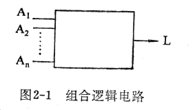

这种电路的特点是，输入信号 $A_1, A_2, \cdots, A_n$ 的每一组取值唯一地确定了输出信号 $L$ 的取值。我们称其为组合逻辑电路，或简称组合电路。所谓真值表，就是逻辑电路输入信号全部可能的组合与相应的输出信号之间的关系表。为便于理解，我们举一例子。

某电路的输入信号 $A_1, A_2, A_3$，其输入信号任意两个或两个以上为 $1$ 时，输出信号 $L$ 为 $1$；否则 $L$ 为 $0$。则其真值表如表 2-3 所示。

**表 2-3 真值表**

| $A_1$ | $A_2$ | $A_3$ | $L$ |
| :---: | :---: | :---: | :---: |
| 0 | 0 | 0 | 0 |
| 0 | 0 | 1 | 0 |
| 0 | 1 | 0 | 0 |
| 0 | 1 | 1 | 1 |
| 1 | 0 | 0 | 0 |
| 1 | 0 | 1 | 1 |
| 1 | 1 | 0 | 1 |
| 1 | 1 | 1 | 1 |

三个输入信号共有 $2^3 = 8$ 种组合，从给定要求可知，在输入信号为 $011$、$101$、$110$ 和 $111$ 时，输出信号为 $1$。表 2-3 的左边是八种可能的输入，右边则是相应的输出。

真值表在国内外器件手册上普遍采用。它以表格的形式确切地、简明地反映了被描述器件的输出与输入的逻辑关系。了解了真值表就能十分方便地使用手册，了解器材的功能和外特性。

## §2-3 基本逻辑电路

为便于对中华学习机逻辑电路的了解和分析，本节侧重介绍中华学习机中用到的几种逻辑电路及其变种。

### 一、反相器

数字系统中经常碰到的问题是把高电平信号变为低电平信号，或把低电平信号变为高电平信号。对正逻辑系统而言，就是在全系统中把高电平定义为“$1$”信号，其电压为 $3.6$ 伏左右；低电平定义为“$0$”信号，其电压在 $0.2$ 伏左右。对负逻辑系统则与上述相反，把高电平定义为“$0$”信号，低电平定义“$1$”信号。而在混合逻辑系统中，则是上述两者的结合。即在整个系统中，有的地点视高电平为“$1$”信号，视低电平为“$0$”信号；有的地方视高电平为“$0$”信号，低电平为“$1$”信号。图 2-2 示出了反相器的逻辑符号、真值表、电路图和逻辑表达式。这是一个逻辑非运算的电路。由图可知，它可以由一个晶体三极管组成，其工作原理十分简单，此处从略。

图 2-2 (A) 中，我们可以看到有一个小圆圈，它表示逻辑非的意思。即输入的逻辑变量经该电路后，要进行一次非操作。从而表达了 $Q = \bar{A}$ 这一反相器的功能。由图 2-2，我们可以推出该电路的两种变形，见图 2-3。

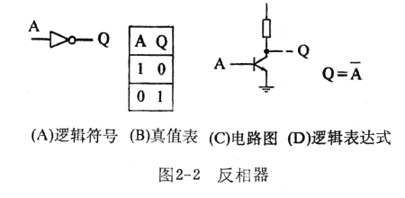

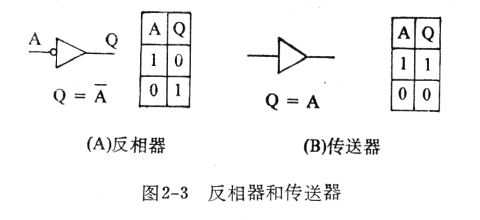

图 2-3 (A) 与图 2-2 (A) 相比，只是把小圆圈，从输出端移到了输入端。它们所实现的功能是完全相同的。这里要强调输入信号在什么状态起作用。图 2-3 (A) 表示输入信号 $A$ 在低电平状态起作用。

图 2-3 (B) 中，没有小圆圈，表示没有进行非操作，只是经过了一下该电路。然而，在实际使用中，这种电路是常见到的。它主要是起信号的放大整形作用，增强信号的驱动能力。

### 二、门电路

数字电路中有各种门电路，它们完成不同的逻辑功能。由于集成电路的出现，使得电路工作者不需了解电路内部的结构和工作过程，而只要了解电路的外特性及其逻辑关系就能运用自如。基于这一情况，并结合中华学习机所使用的门电路，本小节仅把它们的逻辑符号真值表及其逻辑式罗列出来，并加以必要的说明。必须指出，这些逻辑符号、真值表和逻辑式是了解全系统工作原理必不可少的基本知识，万万不能忽视。

对任一种门而言，它既可执行正逻辑操作，也可执行负逻辑操作，这是人为规定的。对于下面的逻辑符号我们统一的定为正逻辑，即高电平为“$1$”信号，低电平为“$0$”信号。

#### （一）基本逻辑门

图 2-4 (A) 示出了“与”门逻辑符号、逻辑式及其真值表。当输入 $A$ 和 $B$ 都为高时（即均为“$1$”时），输出（原文误印为“输入”）为高电平（“$1$”信号）。如输入 $A$ 与 $B$ 中有一个不为“$1$”时，输出就为“$0$”。真值表列出了所有可能的输入状态的组合以及与每种状态对应的输出。该表仅列出了两个输入端的情况，它同样适用于多输入端的逻辑，即所有输入都为“$1$”时，“与”门 $Q$ 输出才为“$1$”。图 2-4 (B) 中，“或”门的符号和“与”门类似，只不过输入端线是弯曲的，真值表列出了所有输入组合与输出的对应关系。

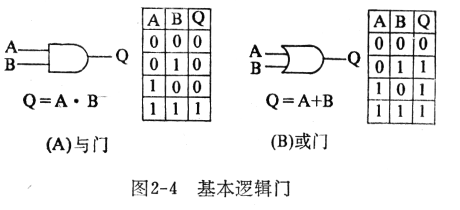

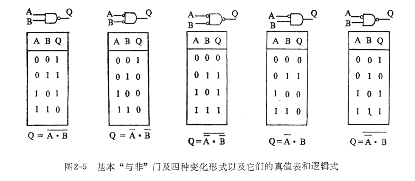

“与非”门符号是在门的输出端加一个表示非的圆圈。当输入 $A$ 与 $B$ 都为高时，输出 $Q$ 才为“$0$”。图 2-5 示出了一个基本“与非”门和它的四种变形门。

“或非”门既是正或门的非门，又是负与非门。其符号的输出端上有一个圆圈。图 2-6 还示出了基本“或非”门的四种变化形式。

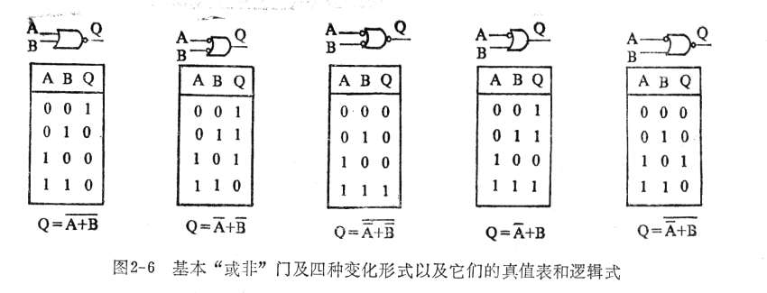

#### （二）“异或”门

图 2-7 示出了“异或”门和“异或非”门，这也是在逻辑电路中常用的，他们的输出反映了两个输入信号是相同还是不同。

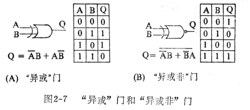

#### （三）开路输出门（OC 门）

图 2-8 示出了集电极开路输出门。对于输入而言它是一个电位与门，对输出而言一旦在 $Q$ 端接上负载就有反相功能。当输入 $A$ 和 $B$ 均为“$1$”时，$T_2$ 通导且 $T_3$ 饱和；输入 $A$ 和 $B$ 不同时为“$1$”时，$T_2$ 截止，$T_3$ 呈现高阻抗。这种电路大量地用于总线传输中。“线或”电路就是该电路典型的应用。

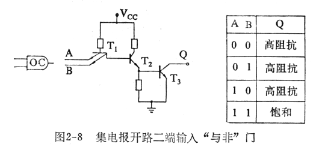

#### （四）“线或”电路

由图可知只要三个输出晶体管都截止（高阻抗），公共连接点对地的阻抗就很高。如果三个晶体管中有一个或一个以上饱和就会使其公共连接点接近于地电位。“线或”电路还可以理解为“线与”电路，只有当 $A'$、$B'$、$C'$ 都为高电位时，输出才为高电平，否则就为低电平。把公共连接的电平作为一个门的输入时，则需要有一个所谓上拉电阻（如图中虚线连接的电阻）。当所有输出晶体管都截止时，上拉电阻就给负载提供一个正电压。

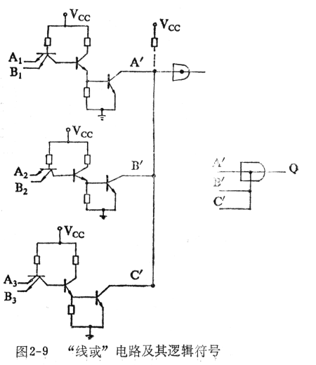

#### （五）三态逻辑门

在上述各种门电路中，除开 OC 门（又叫开路输出门）外，其他门电路的输出端或为高电平或为低电平，输出没有第三种状态，因此不能将各门的输出端接在一起。但在用单根双绞线实现各逻辑门之间来回传送信息时，常需要想办法使很多门能给同一个电路馈送信息，这在数据传送系统中，是经常发生的。为了解决这个问题，研制了一种如图 2-10 所示的三态逻辑电路。

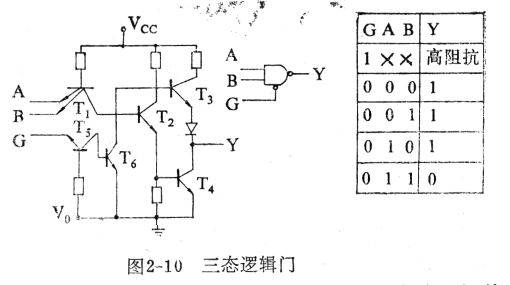

图 2-10 中用附加的晶体管 $T_5$ 和 $T_6$ 来控制 $T_2$ 集电极电压。当 $T_5$ 输入端加一高电平时，$T_6$ 将通导，使 $T_2$ 集电极电压接近 $0$ 伏（原文印作“$0$ 状”），致使两个输出管 $T_3$ 和 $T_4$ 同时截止，这时 $Y$ 端呈现高阻抗。因此三态门有三种状态：低电平“$0$”、高电平“$1$”和高阻抗（截止）。在前两种状态（“$0$”和“$1$”）中，门电路可把数据馈入公用线上；当处于第三种状态时，公用线上其他门中的一个可把数据馈与公用线上，而且被截止的门可以认为对公用线不起作用或与之无关。因此只要不让两个输出同时馈与公用线上，三态逻辑就允许有多个门电路的输出端联接在一起。我们在后面将要介绍的总线传送就要用到三态逻辑门。

三态逻辑门有几种变化形式，详见图 2-11。原理很简单，读者看一下相应真值表就很容易了解，此处不再赘述。

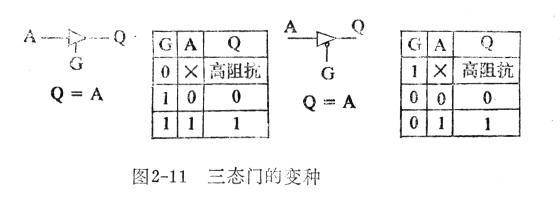

### 三、触发器

在所有形式的逻辑电路中，触发器是一种必不可少的基本电路。触发器能够存储数据、记忆信息，即保持数据。它们能够构成寄存器、记数器……等电路，触发器种类较多，我们只介绍中华学习机中用到的 R-S 触发器、D 型触发器和 J-K 触发器。

#### （一）R-S 触发器

R-S 触发器也称为置“$0$”、置“$1$”触发器，或复位、置位触发器。由图 2-12 可知它是由两个“与非”门构成的。对应于 $Q$ 输出的是 $\bar{S}$ 端输入，对应于 $\bar{Q}$ 端输出的是 $\bar{R}$ 端输入。$\bar{R}$ 和 $\bar{S}$ 上之所以在其上加“$-$”，是表示负信号“$0$”起作用。

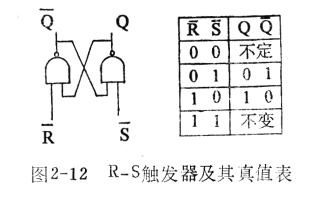

根据“与非”门正逻辑关系（即高电平为“$1$”，低电平为“$0$”），我们来分析 R-S 在不同状态时，触发器输出的情况：

- 当 $\bar{S} = 1$，$\bar{R} = 0$ 时，$Q = 0$，$\bar{Q} = 1$，即触发器处于“$0$”状态；
- 当 $\bar{S} = 0$，$\bar{R} = 1$ 时，$Q = 1$，$\bar{Q} = 0$，即触发器处于“$1$”状态；
- 当 $\bar{S} = 1$，$\bar{R} = 1$ 时，触发器保持原来状态；
- 当 $\bar{S} = 0$，$\bar{R} = 0$ 时，触发器输出端同时为“$1$”。则触发器到底稳定在哪一状态是不一定的，这就破坏了触发器常规的逻辑功能，在实际使用中一般是不允许的。

#### （二）D 型触发器

图 2-13 示出了 D 型触发器的逻辑图、真值表和逻辑符号。由图可知它由两部分组成。即由 A、B 两个“与非”门构成一个 R-S 触发器；由 C、D、E、F 四个“与非”门构成 D 型触发器引导门。利用“与非”门的关系不难得出以下几点结论：

1. D 型触发器是 CP 脉冲正边沿触发。触发后 $Q$ 端的状态由 CP 脉冲正边沿到来之前的 D 输入端电平决定。若 D 端为高电平，则 $Q = 1$；若 D 端为低电平，则 $Q = 0$。
2. E 门的 D 输入端为数据（Data）输入端。该端数据要借助于在它到来以后的 CP 脉冲正边沿触发才能寄存在该触发器中。而在 CP 脉冲的作用期间（即在 CP 脉冲为高电平的持续期间），D 端的变化对 D 型触发器状态不起作用。换句话说，D 端输入的信息一定要等到它来到之后的下一个 CP 脉冲作用下，打入到触发器中，这也就是 D（Delay）型触发器名称的来由。
3. CP 脉冲的宽度必须大于 $2t_p$（$t_p$ 为一个与非门的延迟时间）。因为从 CP（原文误印为 PC）脉冲正边沿开始到 D 型触发器翻转到稳定，需要 $3t_p$ 的时间（即门 C、A、B 或门 D、B、A 的延迟时间），故从 D 门或 C 门输出到 $Q$ 达到稳定输出就要 $2t_p$（即 A、B 门）的延迟时间。
4. 第一个时钟脉冲 CP 结束到下一次触发，最长要经过门 C、E、F 三级延时，即要 $3t_p$。这样 CP 脉冲休止期应大于 $3t_p$。

了解以上几个结论，是用好用活 D 型触发器的前提。由于 D 型触发器广泛地应用于数字电路中，因此熟练掌握 D 型触发器的外特性及其输入与输出的关系是很重要的。

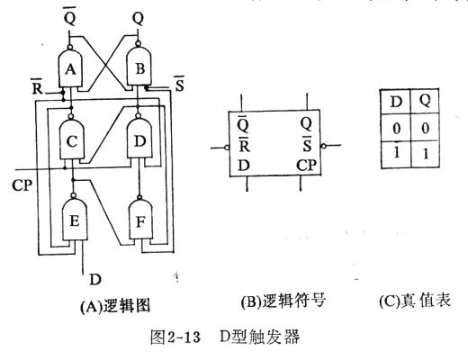

#### （三）J-K 触发器

J-K 触发器与 D 型触发器有类似的基本功能，即可作代码寄存用，又可作记数器用，J-K 触发器由于其他功能不同而分成若干种，有的是正沿触发，有的是负沿触发，有的可预置等。中华学习机使用的 J-K 触发器的逻辑符号如图 2-14 所示，真值表见表 2-4。

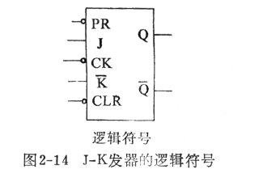

表中的 $Q_n$ 和 $\overline{Q_n}$ 为输入信号没作用时，J-K 触发器“$1$”端输出和“$0$”端输出；$Q_{n+1}$ 和 $\overline{Q_{n+1}}$ 为输入信号作用后，J-K 触发器“$1$”和“$0$”端输出；当表中序号 1 预置端低，清除端高时，J-K 触发器处于“$1$”状态（即 $Q_{n+1}$ 为高电平，$\overline{Q_{n+1}}$ 为低电平），这种状态实际上是预置，即预先把 J-K 触发器置成 $1$ 状态；当序号 5 预置和清除为高电平，J 端输入高电平、$\bar{K}$ 端输入低电平时，J-K 触发器处于计数状态。也就是说在这种情况下，CK 端每来一个正脉冲，J-K 触发器状态就改变一次，或是从“$1$”变为“$0$”状态，或是从“$0$”变为“$1$”状态。换句话说 $Q_{n+1} = \overline{Q_n}$、$\overline{Q_{n+1}} = Q_n$，中华学习机就工作在这种计数状态，其余情况可以类推。

**表 2-4 J-K 触发器的真值表**

| 序号 | 预置 ($\text{PR}$/$\text{PT}$) | 清除 ($\text{CLR}$) | 时钟 ($\text{CK}$) | $J$ | $\bar{K}$ | $Q_{n+1}$ | $\overline{Q_{n+1}}$ |
| :---: | :---: | :---: | :---: | :---: | :---: | :---: | :---: |
| 1 | L | H | $\times$ | $\times$ | $\times$ | H | L |
| 2 | H | L | $\times$ | $\times$ | $\times$ | L | H |
| 3 | L | L | $\times$ | $\times$ | $\times$ | $*$ | $*$ |
| 4 | H | H | $\uparrow$ | L | L | L | H |
| 5 | H | H | $\uparrow$ | H | L | $\overline{Q_n}$ | $Q_n$ |
| 6 | H | H | $\uparrow$ | L | H | $Q_n$ | $\overline{Q_n}$ |
| 7 | H | H | $\uparrow$ | H | H | H | L |
| 8 | H | H | L | $\times$ | $\times$ | $Q_n$ | $\overline{Q_n}$ |

> L——低电平；H——高电平；$\times$——无关；$*$——不稳定状态

## §2-4 存储器

在某种意义上讲，半导体存储器的发展带动了半导体技术与集成电路技术的发展。当前，半导体存储器集成度最高，从早期的磁杆存储器、磁心存储器发展到今天的大规模、超大规模的半导体存储器，使计算机的核心技术之一——存储器的工艺大大简化、体积大大减小、可靠性和存储容量大大提高、存取时间大大缩短。同时，它的发展也使计算机硬件工作者，可以不需了解其内部结构细节，可根据其外特性来使用它。因此，本节不从内部结构的细节入手，而只介绍中华学习机上使用的几种芯片的外特性。

### 一、RAM

中华学习机中，随机存取存储器（RAM），仅使用了两片 $64\text{K} \times 4$ 位的 HM 50464 芯片。由它们构成了 64KB 的存储器。HM 50464 芯片共有 262144 位的存储单元，它以 $64\text{K} \times 4$ 位的方式组成，亦即有 $2$ 的 $16$ 次方即 64K 的地址空间，每个地址中有 4 位二进制。两片 HM 50464 芯片就组成了 64K 的地址空间（每个地址存有八位二进制数），HM 50464 的基本性能如下：

- **高速度**：
  - HM 50464-12 型的访问时间为 $120\text{ns}$
  - 中华学习机采用的 HM 50464-15 型的访问时间为 $150\text{ns}$
- **低功耗**：
  - HM 50464-10 型的功耗为 $440\text{mW}$
  - HM 50464-12 型的功耗为 $396\text{mW}$
  - HM 50464-15 型的功耗为 $358\text{mW}$
- **三种刷新方式**：仅有 $\overline{\text{RAS}}$ 刷新，$\overline{\text{CAS}}$ 在 $\overline{\text{RAS}}$ 之前的刷新，隐含刷新

#### （一）HM 50464 引脚信号

图 2-15 示出了 HM 50464 芯片引脚。

1. $\overline{\text{OE}}$（输入）：输出使能信号。当它为低电位时，允许内部数据缓存器输出数据。中华学习机中，把这根引线接地，故输出使能信号总是加上的。
2. $\text{MD0}$—$\text{MD3}$（双向）：数据输入或数据输出（引脚图中标作 $\text{I/O1}$—$\text{I/O4}$）
3. $\text{R}/\overline{\text{W}}$（输入）：读/写数据控制信号线（引脚图中标作 $\overline{\text{WRITE}}$）。
4. $\overline{\text{RAS}}$（输入）：行地址选通信号线。
5. $\overline{\text{CAS}}$（输入）：列地址选通信号线。
6. $\text{RA0}$—$\text{RA7}$ 复用地址输入线（引脚图中标作 $\text{A0}$—$\text{A7}$），其中 $\text{RA0}$—$\text{RA7}$ 为行地址（在 $\overline{\text{RAS}}$ 信号作用下输入），$\text{RA8}$—$\text{RA15}$ 为列地址（在 $\overline{\text{CAS}}$ 信号作用下输入）
7. $\text{GND}$（输入）：电源和信号公共地线
8. $V_{CC}$（输入）：$+5$ 伏电源

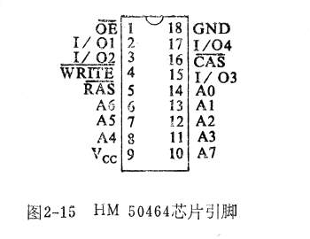

#### （二）对 RAM 的存取

中华学习机中的 RAM 共有 64K 字节，它主要用于存放数据和程序以及屏幕显示的内容。由于屏幕上的画面不能保持长久，为了使屏幕上所显示的文字或图象保持稳定，需要对整个屏幕反复显示（一般每秒需要重复进行 60 次显示）。所以，要把整个显示的内容存放在显示缓冲区中，并以每秒 60 次的速度不断地从中读出送到显示器显示。只有这样，人们在观看监视器时，才不致因画面闪烁而影响观看效果。

为了简化监视器的接口电路，中华学习机上采用了两相时钟信号（$\phi_0, \phi_1$）。在 $\phi_0$ 作用周期内，让 CPU 和 RAM 进行数据交换，而在 $\phi_1$ 作用周期内，令显示控制电路读 RAM 中的显示缓冲区的内容，进行显示。这种 CPU 和显示控制电路分时使用 RAM 的办法，不但可使控制电路大大简化，而且还可在 1MHz 主时钟工作频率下工作。由图 2-16 可知，在 $\phi_0$ 作用周期内，复用地址线上的行地址（$\text{A0}$—$\text{A7}$），由 CPU 送出，并在行地址选通信号（$\text{RAS}$）作用下，把 $\text{A0}$—$\text{A7}$ 地址打入 RAM 芯片内的八位行地址缓冲器中；当 CPU 送出列地址选通信号后，就把它们打入 RAM 芯片内的列地址缓冲器中，再由 $\text{R}/(\overline{\text{W}})$ 信号状态，控制对 RAM 芯片进行写或者读，并由此而决定 $\text{MD0}$—$\text{MD7}$ 这个双向数据线是输入（写）还是输出（读）。

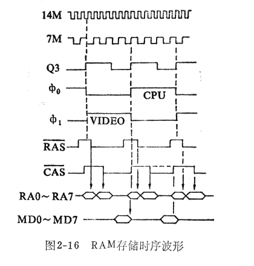

在 $\phi_1$ 作用周期内，复用地址线上的行列地址由显示控制电路分别送出。这时，只对 RAM 进行读操作，以便把要显示的内容从 RAM 的显示缓冲器中取出送屏幕显示。

#### （三）关于 RAM 的刷新

正如前面所述，HM 50464（原文此处误印为 HM 50646）芯片是动态 RAM 器件，该芯片信息的存储是靠内部结电容的充电方式记忆的。随着时间的推移，结电容上的电荷会逐渐消失。因此，必须定时地给它充电，这种定时地给结电容充电，称为对动态 RAM 的刷新。在 HM 50464 的基本性能中，已经介绍有三种刷新方式。中华学习机采用的是仅有 $\overline{\text{RAS}}$ 的刷新，即在读某一行的某一单元时，该行上的其它所有单元均被刷新（同理，在写某一行的某一单元时，该行上的其它所有单元也被刷新）。此外，HM 50464 芯片要求在 $4\text{ms}$ 内完成对 256 个连续地址的刷新周期，这恰恰就是从显示缓存区读取显示信息所要做的工作。在后面的章节中可以知道，显示缓存区八位行地址（共 256 种组合）每读一遍，就可保证对动态 RAM 的刷新。

### 二、ROM

中华学习机中，采用了七片只读存储器。它们是两片 27256（每片 32KB），两片 CEC-WL（每片 128KB），一片 2716（2KB），一片 2732（每片 4KB）和一片 PROM（$256 \times 8$）。这些芯片的工作原理基本相同。只要在地址输入端提供一个对应的地址（对 32KB 的芯片要提供 15 位地址，对 128KB 的芯片要提供 17 位地址，……等等），再在芯片使能信号 $\overline{\text{CE}}$ 及输出使能信号 $\overline{\text{OE}}$ 的作用下，就可对指定的地址读取信息，并从数据输出端上获得。例如附图 1 中的芯片 27256 是 32KB 的 EPROM（可擦的可编程的只读存储器）。图 2-17 是 27256 的引脚图。由图可知，该（原文印作“读”）芯片有 15 个地址输入端 $\text{A0}$—$\text{A14}$，其地址寻址范围为 32K。在 $\overline{\text{CE}}$（20 腿）和 $\overline{\text{OE}}$（22 腿）的作用下，就可从数据输出端上获得该地址内对应的八位二进制数。读者了解了 27256 的工作原理，就不难理解其它 ROM 芯片的工作过程了。

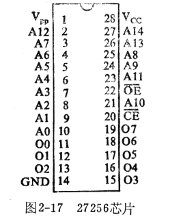

## §2-5 总线和信号的传送

第一章已介绍过，组成计算机的各个部件或各个设备之间信息的交换都要通过总线来进行。总线实际上是一组金属介质的传输线，每一个信号对应有一根导线。这些信号线（包括地址总线、数据总线和控制总线）的集合统称总线，或分别称作地址总线、数据总线和控制总线。某一个信号在同一条导线上可以是从一个信号源经本导线发送到几个目的地；或者几个信号源经同一条导线在不同的时间发送到同一目的地或若干个目的地。这样就要解决两个问题：1. 当某个信号在同条导线上有几个信号源时，到底选取哪一个源中的信号进行传送？2. 如若某一个信号在同一条线上有几个目的地时，到底传送到哪一个目的地？我们用一根数据传输线来举例说明，见图 2-18。由图可知，在数据总线第 $i$ 位上有三个源端（$D_{i1}$、$D_{i2}$、$D_{i3}$），它们分别受 $C_1$、$C_2$ 和 $C_3$ 控制；还有三个目的端（$R_{i1}$、$R_{i2}$ 和 $R_{i3}$），它们分别受 $C_4$、$C_5$ 和 $C_6$ 控制。在此例中我们假设：$D_{i1}$ 和 $R_{i1}$ 是中央处理机上的第 $i$ 位数据的输出端和输入端，$D_{i2}$ 和 $R_{i2}$ 是内存储器上第 $i$ 位数据输出端和输入端，而 $D_{i3}$ 是键盘上第 $i$ 位数据输出端；$R_{i3}$ 是打印机接口上第 $i$ 位的数据输出端。如果我们要从键盘上传送第 $i$ 位数据到中央处理机去，则只要在同一时刻发出 $C_3$ 和 $C_4$ 两个控制信号，这时存放在 $D_{i3}$ 端的数据，将经 3 门和 4 门传送到 $R_{i1}$ 端。同理，如要把中央处理器上第 $i$ 位数据，送到打印机接口时，只要发 $C_1$ 和 $C_6$ 两个控制信号即可。读者可以自行分析各设备间的各种传输情况。值得注意的是，凡送到总线上的数都采用了三态门，这样作是由于一般门电路的输出端不允许彼此连接的缘故（否则就会把门损坏）；另一个应指出的是在同一时刻不允许（计算机处于正常状态时）有两个源的数据同时送到总线上，但允许同时送到几个以上（如需要的话）的目的端。以上介绍的是信号如何通过总线进行传送的。顺便提一下，在早期的计算机中，为了避免一般门电路的输出端对接，而大量采用在上节中介绍的 OC 门，即集电极开路输出门（见图 2-8）。如果在总线上接一上拉电阻，再把若干个 OC 门并联起来，就形成了如图 2-9 的“线或”电路。该电路可实现几个源向同一条线发送信号的作用，亦可起到总线传送信号的作用。目前这种方式在长线传送中仍然广泛采用，参见图 2-19。

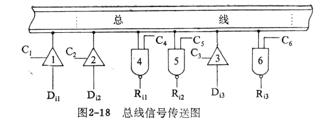

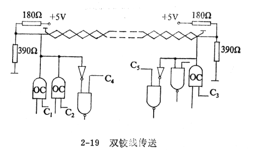

在频率较低的信号传送中，人们发现采用双绞线传送既可增强传输线的抗干扰能力，又可采取终端有源匹配电阻的线路进行电平补偿。图中标出的匹配电阻值是一个参考数值，在实际使用中可以根据传输的长度和各端的特性阻抗进行选取。图中的 OC 门一般采用驱动器，以增强其负载能力。双绞线实际上是两根相互绞合在一起的导线，把其中一根当作信号传输线，另一根的两端或任一端接地就构成了双绞线的传输线。
