# 第三章 微处理器 6502 及其指令系统

## §3-1 6502 的基本性能

### 一、6502 的基本性能

中华学习机采用八位微处理器 6502 作为中央处理单元（CPU）。这种微处理器是用得最为广泛的八位微处理器之一。它属于 6500 系列，是 1975 年由美国 MOS Technology 公司推出的。

八位微处理器中有两大类主流产品：一类是 8080 和 Z80 这两大系列；一类是 6800 和 6500 这两大系列。它们的代表性产品分别是 8080（Intel 公司，1973 年）、MC6800（Motorola 公司，1974 年）、6502 和 Z80（Zilog 公司，1976 年）。其中，Z80 与 8080 高级兼容，它有着许多较强大的功能（如 16 位数的运算、数据块的传送等等）。而 6502 则采取一些灵活措施和较先进的技术来提高性能/价格比。据统计，到 1978 年底为止，销售出去的 6500 系列微处理器比其他几个系列的都多。

6502 在设计上有许多独特的地方。例如，它采用了访内存方式的 I/O 结构（这一点与 6800 相似），被认为有其先进性；在指令寻址方式上，引进了某些小型机的寻址技术，增加了程序编制的灵活性。它有 13 种寻址方式，比 Z80 多 3 种，比 8080 和 6800 就更多了；在指令数量上它又比其他微处理器少很多，只有 56 条基本指令（Z80 有 150 条；8080 有 78 条；MC6800 有 96 条）。在设计中考虑到哪些指令是较常用的，哪些是用得较少而又能被其他基本指令所代替的，因此，舍去了一些不常用指令，而用以增加寻址方式。这样，指令系统同样很灵活，总计可形成 151 条不同指令。具体应用证明，完成同样的程序功能，在 6502 上与 Z80 上相比较，前者用的指令条数、程序占用内存空间数及执行时间等，与后者均相差不多；就指令执行速度来看，它略高于 Z80，而略低于 Z80A（Z80 时钟是 2.5M，但它访问一次内存要多个时钟周期。Z80A 是 4M 的。事实上，6502 也有 2M、3M 和 4M 的兼容产品）。

6502 其他的一些性能可概括如下：

- 地址总线 16 根，寻址范围 64K，数据总线 8 根。
- 单相片上时钟（8080 需两个时钟信号，M6800 需有另外的芯片配合）。时钟周期最小 1 微秒。
- 单一 +5V 供电（8080 需三种电源）。
- 内部结构简单，寄存器数量少，但功能较灵活。
- 固定 8 位堆栈。
- 有两种中断方式。
- 可自动进行十进制运算。
- 功耗较低，仅 250mW。

---

### 二、6502 的内部结构

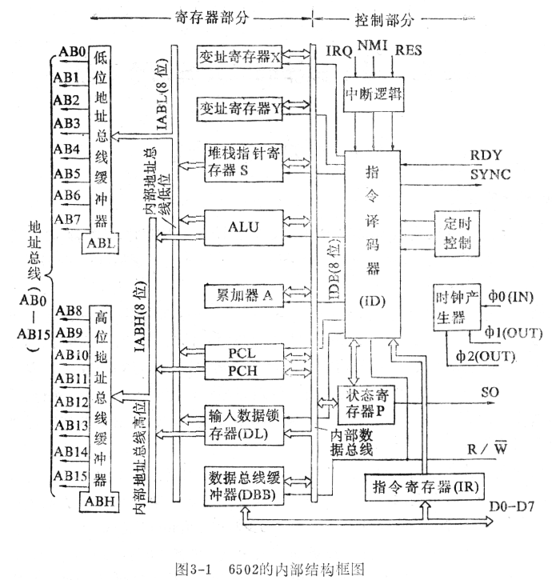

6502 的内部结构如图 3-1 所示。它做在一个标准的有 40 个引腿的电路芯片上。它的内部主要由两部分构成：一个是寄存器部分；一个是控制部分。寄存器部分主要包括：① ALU，一个可进行 8 位二进制数并行算术和逻辑运算的单元。② 累加器 A，一个 8 位寄存器，6502 中只有这一个累加器。③ 两个 8 位寄存器 X 和 Y，它们主要用做变址寄存器。④ 一个 16 位的程序计数器 PC，它分成高 8 位（PCH）和低 8 位（PCL）两部分。⑤ 堆栈指针寄存器 S。这些寄存器通过 8 位的内部数据总线（IDB）相联系。各寄存器与 IDB 间均是可双向传送数据的。当 6502 与外部数据总线发生数据传送时，均由内部数据总线经过一 8 位的数据总线缓冲器 DBB（DATA BUS BUFFER）来完成。在指令执行过程中，经常需要把从内存取回来的数据做为地址数而送到地址总线上去。为此，设置了一个输入数据锁存器（DL）。它可以从内部地址总线上输入一数据，也可将它所存的数据送到地址总线的低位或高位上去。

6502 的地址线是非三态输出的。它们被两个 8 位缓冲器所驱动，即高位地址总线缓冲器（ABH）和低位地址总线缓冲器（ABL）。而这些缓冲器又与上述部分寄存器以单向的内部地址总线（IABH 和 IABL）相连。

在 6502 的控制部分中，主要有五个部分构成。① 状态寄存器 P，本节第五部分将专门介绍它。② 时钟产生器和定时控制电路，它就是 6502 的片上时钟。它既可使用外部输入的单相时钟信号 $\phi_0(\text{IN})$，也可以接到一个决定时间常数的电路上。形成的系统双相时钟信号是 $\phi_1(\text{OUT})$ 和 $\phi_2(\text{OUT})$。③ 中断逻辑电路，它处理 6502 的两个中断信号和一个系统清零信号。④ 指令寄存器（IR）。⑤ 指令译码器（ID）。IR 可从外部数据总线直接读入数据（即取指令的操作码）；而 ID 是整个系统的控制部件，控制着系统各个部分的动作。图 3-1 表示出了它与各部分电路的联系。

---

### 三、6502 的引出信号及访内存时序

> *(注：原书标题误印为“三、6522的引出信号及访内存时序”，实为 6502。)*

图 3-1 表示出了 6502 的引出信号，图 3-2 则为它的芯片引腿图。

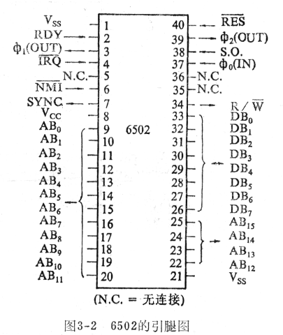

从图 3-1 可看出，数据总线 D0—7 是一组双向总线。地址总线 AB0—15 则是一组单向总线，对 6502 来说，它总是输出的。从图 3-2 中看到，除这 24 个引线外，还有地线 $V_{SS}$，+5V 电源输入端 $V_{CC}$。另外还有以下控制信号：

#### （一）系统清 0 信号 $\overline{\text{RES}}$

这个信号一般用来初始化微处理器。当 6502 接到从这个信号引腿来的负信号时，便开始进入初始化过程。它等待 $\overline{\text{RES}}$ 信号结束，然后再过 6 个时钟周期，便开始进行下面的操作：`($FFFC) → PCL`，`($FFFD) → PCH`。即，内存单元 `$FFFC` 和 `$FFFD` 的内容分别送到 PCL 和 PCH 中。因而，下一步便自动地以这两个单元中所存的数为地址，去取指令执行。

#### （二）时钟信号 $\phi_0(\text{IN})$、$\phi_1(\text{OUT})$ 和 $\phi_2(\text{OUT})$

6502 的时钟电路已做在片子中了。使用时可以从 $\phi_0(\text{IN})$ 信号端输入一个周期的 TTL 单相方波。此时，$\phi_0(\text{IN})$ 将与 $\phi_2(\text{OUT})$ 信号有相同的相位（但 $\phi_2(\text{OUT})$ 稍有延时）。也可以在片子外面仅接一决定时间常数的电路（如 RC 或晶体）。不管哪种情况，$\phi_1$ 和 $\phi_2$ 两个时钟输出信号有着图 3-3 的关系，其中几个主要时间指标列于表 3-1 中。从这里可以看到，6502 的时钟频率最大可为 1MC。

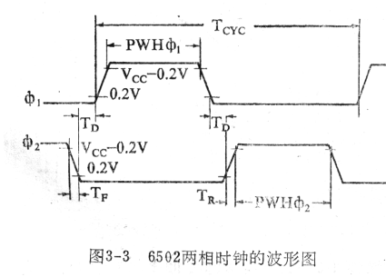

**表 3-1 6502 时钟特性时间表**

| 特性时间 | 符号 | 最小值 | 最大值 | 单位 |
| :--- | :---: | :---: | :---: | :---: |
| 周期 | $T_{\text{CYC}}$ | 1.0 | | $\mu\text{s}$ |
| 时钟脉冲宽度 $\phi_1$<br>时钟脉冲宽度 $\phi_2$ | $\text{PWH}\phi_1$<br>$\text{PWH}\phi_2$ | 430<br>430 | | ns |
| 上升和下降时间 | $T_F, T_R$ | | 25 | ns |
| 时钟间的延迟时间 | $T_D$ | 0 | | ns |

#### （三）读写控制信号 $\text{R}/\overline{\text{W}}$

这个信号是 6502 唯一的一个控制读和写操作的信号。6502 在每个时钟周期中可以完成一次对存储器的读或写操作。在读操作周期中，$\text{R}/\overline{\text{W}}=1$；在写操作周期中，$\text{R}/\overline{\text{W}}=0$。图 3-4 和 3-5 给出了 6502 读内存操作和写内存操作的定时图。其中各特性时间的最大最小值等列于表 3-2 中。由于 6502 访 I/O 设备和访内存是完全相同的，或者说，它访问 I/O 设备时也是把它们当做内存来访问的，因此，这也是访问外设的定时关系图。图中对数据总线 D0—7 和地址总线 A0—15 上的信号采取不同的表示法，这是因为 6502 的数据总线是三态的，地址总线则不同。

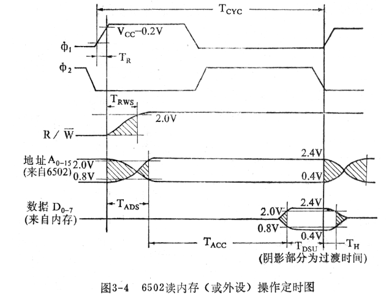

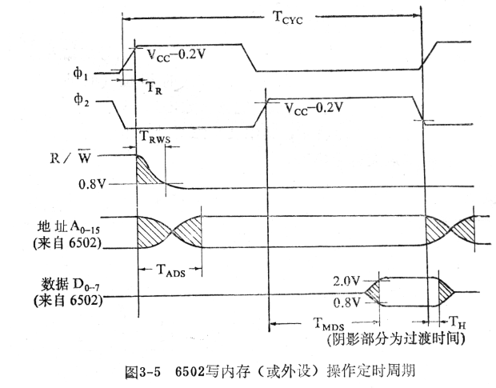

#### （四）“准备好”信号 RDY

**表 3-2 6502 读写操作定时表**

| 特性时间 | 符号 | 最小值 | 典型值 | 最大值 | 单位 |
| :--- | :---: | :---: | :---: | :---: | :---: |
| $\text{R}/\overline{\text{W}}$ 信号建立时间（来自 6502） | $T_{\text{RWS}}$ | — | 100 | 300 | ns |
| 地址建立时间（来自 6502） | $T_{\text{ADS}}$ | — | 200 | 300 | ns |
| 读操作访问时间（对内存要求）<br>$T_{\text{ACC}} = T_{\text{CYC}} - (T_{\text{ADS}} + T_{\text{DSU}} + T_R)$ | $T_{\text{ACC}}$ | — | — | 500 | ns |
| 数据稳定时间周期 | $T_{\text{DSU}}$ | 100 | — | — | ns |
| 数据保持时间 | $T_H$ | 10 | 30 | — | ns |
| 数据建立时间（来自 6502） | $T_{\text{MDS}}$ | — | 150 | 200 | ns |

这个信号主要用于慢速存储器（或外设）的读操作中。当 6502 访问它而欲做一读操作时，如果被访设备能够满足上面表 3-2 中对时间特性的要求，它不必利用 RDY 信号线，只要使它保持为 1 便可。这时，一个时钟周期便可完成一次读操作。但如果被访设备时间特性不满足上面的要求，即它的响应较慢，在预定的时间不能保证把数据正确地送到总线 D0—7 上去，这时便可以把 RDY 信号驱动到 0，使 6502 延时一个周期再完成读操作。如果还来不及，可以继续使 RDY 为 0，直到把数据送好为止。6502 是在 $\phi_2$ 信号的上跳沿检查 RDY 信号状态的，因此若想使 6502 延长读周期，必须在这以前把 RDY 置成所需状态。图 3-6 所示的实例中，3 个时钟周期才完成了一次读操作，因为 RDY 在 $T_1$ 周期中 $\phi_2$ 上跳沿前已被驱动到 0，而直到 $T_3$ 周期开始后才再变为高电平。因而在 $T_3$ 周期结束时，才完成了这一次读操作（数据是在 $\phi_2$ 的上跳沿打入到 6502 内部的寄存器中的）。

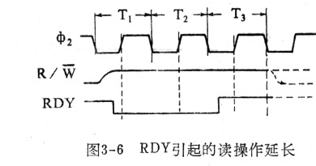

由此可见 RDY 信号主要对慢速存储器有用，一般用于访问 PROM 或 EPROM 片子（因这些片子速度较慢）。要记住，RDY 对写操作不能起到延长作用。当在写操作周期中 RDY 拉低时，写操作照常在一个时钟周期中完成。

#### （五）同步信号 SYNC

这个信号用来标志 6502 的取操作码周期。每个指令执行过程中，第一个时钟周期都用来取指令操作码。在每个这样的周期中 SYNC 为 1；而在其他周期中为 0。这样，用这个信号与 RDY 信号适当配合便可完成 6502 单步指令操作的功能。即在 $\text{SYNC}=1$ 时将 RDY 驱动到 0，机器便在结束了执行上一指令的过程后，停止下来，直到 RDY 变为 1 为止。

#### （六）溢出位置 1 信号 SO

状态寄存器中有一位是溢出标志位（V）。当 SO 信号端上有上跳沿时，这个 V 位便置 1。这便于与外部运算部件相连接由外部使 V 位置 1。

#### （七）中断请求信号 $\overline{\text{IRQ}}$ 和 $\overline{\text{NMI}}$

6502 提供两个外部程序中断请求信号。一个是可屏蔽的中断请求 $\overline{\text{IRQ}}$；一个是不可屏蔽的中断请求 $\overline{\text{NMI}}$。前者在状态寄存器 I 位（称中断屏蔽位）为 0 时请求才有效。即 $\text{I}=0$ 时，$\overline{\text{IRQ}}$ 变为 0，6502 便要响应中断；而 $\text{I}=1$ 时，$\overline{\text{IRQ}}$ 变为 0，6502 也不响应中断。但 $\overline{\text{NMI}}$ 不同，不管 I 位是什么状态，只要 $\overline{\text{NMI}}$ 有了负跳变，6502 便响应中断。

6502 响应 $\overline{\text{IRQ}}$ 以后，做以下几件事：

1. 完成当前正在执行的指令。
2. 让 PC 指向下一指令的起点地址，然后将它送入堆栈，即：`PC + 1 → PC`，`PCH → (S)`，`PCL → (S - 1)`。关于堆栈的操作，可见 §3-1 四。
3. 把状态寄存器中的 B 位置 0，然后送入堆栈（`P → (S - 2)`），再将状态寄存器中的 I 位置 1。
4. 从内存 `$FFFE` 单元中取新的地址低位：`($FFFE) → PCL`；从 `$FFFF` 单元中取新的地址高位：`($FFFF) → PCH`，从这个新地址开始执行程序。

完成上述 2–4 的动作，共需要 7 个机器周期。在 6502 的所有指令中，执行时间最长的是 7 个机器周期。因而，发出 $\overline{\text{IRQ}}$ 请求之后，在 7–14 机器周期的时间内便可进入中断处理程序了（中断处理程序的入口地址存在 `$FFFE` 和 `$FFFF` 单元）。

6502 响应 $\overline{\text{NMI}}$ 后，所做的工作与对 $\overline{\text{IRQ}}$ 的响应差不多，只是，其中断处理程序的入口地址不是存放在 `$FFFE` 和 `$FFFF` 单元中，而是存在 `$FFFA` 和 `$FFFB` 单元中。

为了对上述的 $\overline{\text{RES}}$、$\text{R}/\overline{\text{W}}$、RDY 和 SYNC 等信号的作用有个全面的了解，图 3-7 中给出了 6502 在启动过程及进入正常工作后，有关几个信号的波形图，从中可看出上述信号以及地址总线、数据总线上信号的时间关系。

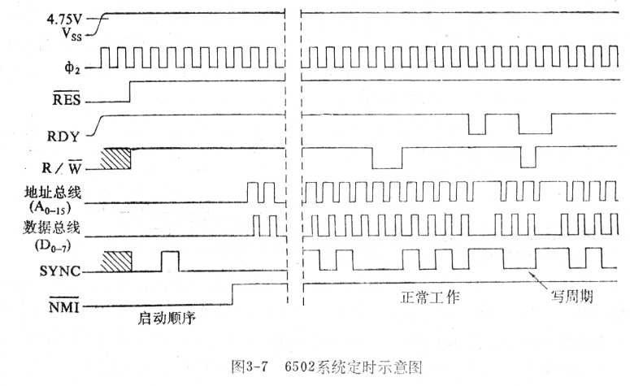

---

### 四、6502 的堆栈

6502 的内部结构中有一个 8 位寄存器 S，它是堆栈指针寄存器，有时也写做 SP。这个寄存器中的内容永远等于下一次将一个数推入堆栈时，其推入单元的地址低位。这个地址的高位则永为 `$01`。堆栈是内存的一个特别的区域，用来在程序执行过程中暂时存放一些数据。例如，在编写程序时，往往需要在某一点上停止顺序向下执行，而转向另一指令序列，执行完该序列再返回来。这样，转移之前显然应想法把按原来顺序下一个应执行的指令的地址保存下来，以便执行完转向的序列后，能正确地返回到原来的程序上去。这个应保存的地址为“断点”或“断点地址”。在内存中常常开辟一个专用的区域，用来保存断点，这个区域便称“堆栈”。当然，有了这个区域后，不仅能保存断点，也能用来暂时保存其他信息。

在编制程序时，往往会遇到这样的情形：某一指令序列会在许多地方出现，例如某些完成某一固定操作或运算的指令系列。为了使程序简化，可以将这一指令序列存在内存某一特定区域，当需要执行它时，就转到那里去；执行完后，又返回原来的程序上去，这时，我们称这段特定的指令序列为子程序。而转向它之前所执行的程序为主程序。事实上子程序本身又可转到（调用）另外的子程序，称为子程序的“嵌套”。图 3-8 便是调用子程序和子程序嵌套的示意图。在 6502 微处理器中，每当转向子程序时，CPU 自动地将断点地址打入堆栈中去。而当执行从子程序返回主程序的指令时，又自动地将保存的断点地址弹出来，送到程序计算器 PC 中去。

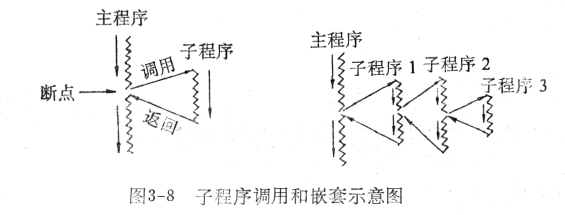

堆栈的另一作用是保存程序中断时的断点地址。这一点在本节第三部分对 $\overline{\text{IRQ}}$ 和 $\overline{\text{NMI}}$ 信号的说明中已可看到。这两种程序中断都是外部设备通过线路而实现的。§3-2 三（九）中我们还将看到内部中断的情形。它也要使用堆栈。程序中断后，原先的程序停止执行，转向处理中断服务程序，处理完后，再返回到原来的程序上去。这个过程与调用子程序有相似之处，它们自动返回时，都要借助堆栈找回原来程序的断点。在 6502 微处理器中，转入中断处理时，除自动处理（推入和弹出）PC 外，还自动处理状态寄存器。

当然，用户还可以安排堆栈暂存其他信息。例如，在执行子程序时，会改变某些寄存器（如 A、X、Y 等等）的内容。这样，返回主程序时也可能使主程序向下运行发生错误，因而也需要将它们保护起来。有时程序本身要找一个地方暂存一下某一数据。这些情形下，都可以使用堆栈。6502 采用的堆栈是固定在 `$01` 这一页中，即只有 256 个单元。每当程序访问堆栈时，SP 的内容送到地址总线的低 8 位上，而其高 8 位自动置 `$01`。如果将一个数推入堆栈（写操作），推入后，SP 自动减 1；如果将一数弹出堆栈，SP 先加 1，然后进行读操作。当堆栈存满时，SP 又回到初值上去。再继续向堆栈送数的话，必定会破坏原先存入的数据。

从上面的说明可见，6502 的堆栈是“先入后出”（First in last out）的，同时也是一个向下推的（Push Down）堆栈。

---

### 五、6502 的状态寄存器

处理器中一般均有一个专用的寄存器，它的内容表征着机器的状态。因而它的内容是随着机器指令的执行而动态变化着。这个寄存器就是状态寄存器 P。6502 的状态寄存器是 8 位的，其中七位是有用的，如图 3-9 所示。下面分别说明它们所标志的内容。

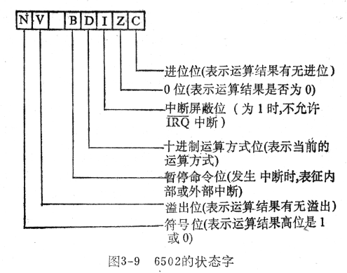

1. **C 位**
   C 位主要用来保存加法操作产生的进位。事实上它代表了运算过程产生的第 8 位的值。这种运算也包括了左右移位操作。当作无符号数的相加时，$\text{C}=1$ 表示有进位。而作减法时，由于是进行补码相加的操作，$\text{C}=1$ 代表无借位，而 $\text{C}=0$ 才代表有借位。6502 也有专门的指令使 C 置 1 或还 0。

2. **Z 位**
   Z 位表示运算结果是否为 0。若为 0，则 $\text{Z}=1$；否则 $\text{Z}=0$。没有专门使 Z 位置 1 或还 0 的指令。

3. **I 位**
   当 $\text{I}=1$ 时，即使有 $\overline{\text{IRQ}}$ 请求到达，6502 也不对其进行响应。只有 $\text{I}=0$ 时才能响应。也有专门的指令使 I 位置 1 或还 0。当发生中断响应时，I 位自动置 1。

4. **D 位**
   此位为 0 时，处理器所有运算均按 8 位二进制码来进行；当此位为 1 时，处理器则把一个字节看成是两位十进制数（即 BCD 码——二进制表示的十进制码）来处理。对 D 位也有专门的指令置 1 或还 0。

5. **B 位**
   当执行暂停指令（`BRK`）时，B 位自动置 1；当外中断源请求中断而被响应时，B 位自动还 0。这给微处理器提供一个区别内外中断的手段。关于 `BRK` 指令，将在 §3-2 三（九）中介绍。

6. **V 位**
   此位只对带符号数的运算有意义。因为 8 位二进制码，只能表示 $-128 \sim +127$ 之间的带符号数。如果运算结果超出了这个范围，V 位便自动置 1。显然，它与 C 位的含意是不同的。有进位（或借位）不一定有溢出；反之，有溢出的也不一定有进（借）位。
   6502 有专门指令可以使 V 位还 0，但无使 V 位置 1 的指令。通过 6502 的 SO 引腿，可以引入外界信号来使 V 位置 1。

7. **N 位**
   这一位既是带符号数的符号位（为负时，$\text{N}=1$；为正时，$\text{N}=0$），也是累加器中最高位（或无符号数运算结果的最高位）的指示位。

在写程序时必须注意，不是所有运算或操作都对 C、Z、N 和 V 位发生影响。例如后面讲到的加 1 和减 1 指令，并不对 C 位和 V 位发生影响；比较指令虽然基本上是做一个相当于减法的操作，但它也不影响 V 位。相反，减法指令却影响 V 位。这些将在 §3-2 三（三）中介绍。

---

## §3-2 6502 的指令系统

### 一、汇编语言程序的格式说明

第七章中，专门介绍了 6502 微处理器的汇编语言程序。在此，要使用它的格式，所以先介绍一下其格式规定，但不详细说明。6502 汇编程序规定，程序的每一行均划分成四个部分，它们之间以空格分开。第一部分在最左边，为标号。它是一任选字段。规定它必须以 A—Z 任一字母打头，但可包括数字和句号，总计不超过 16 个字符。标号中不得有空白。第二部分是操作码，这就是我们下面将用的指令符号。它事实上是指令操作码表的一个规定的代表符号。再向右则是操作数部分，有的指令需要它，有的指令则不需要，视具体指令而定。它通常是包含有常数、标号、运算符等组成的表达式。此表达式从左到右运算，无其他优先级规定。如果你要使用一个 16 进制数，其前面必须带有一个“`$`”符号；若是 8 进制的，则以“`@`”开头；如果你表示的是一个符号的 ASCII 码，则应将字符用单引号括起来；当你表示的是一个立即数而不是一个地址时，前面应加“`#`”。最后的部分是注释部分，它用来对程序的功能进行说明。这一部分也是可以选用的。在下面的所有例子中，我们均以“`;`”来表示注释部分的开始，如果一行写不下来，下一行仍用一“`;`”号打头。以后举程序实例时，基本采用上述的格式。例如：

```text
START   LDX   #0          ; 0→X
        LDY   #$FF        ; 255→Y
LOOP    INY
        LDA   (POINT), Y  ; 取出一个参数
        ⋮
        BEQ   LOOP        ; 跳到LOOP单元执行
        ⋮
```

这里，`START` 和 `LOOP` 是标号。例如 `START` 代表内存中存放“`LDX #0`”这条指令的两个单元中第一个单元的地址。第二部分是操作码。例如 `LDA`，`INY` 等等。第三部分是操作数，这当中可以引用标号。如“`BEQ LOOP`”表示此时 P 的 Z 位等于 0 时，就回到定义为“`LOOP`”的地址上去执行。最后一部分为注释（当然，实际应用时不能使用中文）。另外，在监控状态下有时还可用小汇编（见第五章），用户可使用它编制汇编程序，它只分三部分。代替标号部分的是该指令所存单元的绝对十六进制地址；第二部分相同；第三部分为十六进制的地址或立即数。它没有注释部分。例如上面的程序列，应写成：

```text
6000: LDX   #0
6002: LDY   #FF
6004: INY
6005: LDA   (F0), Y
      ⋮
603F: BEQ   6004
      ⋮
```

这里假定程序从 `$6000`（`=24576`）开始。第一条指令是两字节的，因而第二条存在 `$6002` 中，下面以此类推。最后，因 `BEQ` 指令存在 `$603F` 中，它与 `$6004` 相差 `-$3B`，本应以其补码表示为 `$C5`，但小汇编允许此时用绝对地址，汇编后再变为相对地址（`$C5`）。这种表示，显然较为麻烦一些，下面举例时，我们一般不用这种形式。但读者要用小汇编来编制程序时，则要把我们举的例子改成这样的格式。

---

### 二、6502 的寻址方式

计算机的指令一般分成两大部分，一是操作码部分，一是操作数部分。操作码告诉机器下一步要做什么。通常它总是要对一个数进行各种操作，这个数便是操作数。而指令本身可能已包含了这个数。但更多情形下，指令本身并不包含这个数本身，而是告诉 CPU 通过什么方法可以找到这个数。这种寻找操作数地址的方式，便是指令的寻址方式。

6502 有 13 种寻址方式，其灵活程度是在 8 位微型机中非常少见的，这成为它的一大特点。下面要介绍的绝对间接寻址方式、变址间接型方式和间接变址型方式等均是在一般小型机中才有的。下面我们逐一介绍这 13 种寻址方式。

#### （一）立即寻址方式

立即寻址方式的指令中，本身已含有操作数的值，因而执行此指令时，操作数立刻可以得到。这种指令都是两字节指令。其第一字节为操作码；第二字节就是操作数本身。例如：

```text
LDA   #$5A
```

这条指令的含意是把 `$5A` 这个数送到累加器 A 中去。执行完以后，A 的内容便从原先的值变成了 `$5A`（90）。这条指令的指令码是 `$A9`、`$5A`。即存此指令的两个连续单元中，低地址单元存有 `$A9`（`=169`），另一个存有 `$5A`（`=90`）。

所有立即寻址指令的执行时间均为两个机器周期（在中华学习机为 2 微秒的时间）。以上面的指令为例，其执行过程如下：

| 周期 | 地址总线 | 程序计数器 | 数据总线 | CPU 的操作 |
| :---: | :---: | :---: | :---: | :--- |
| 1 | `PC` | `PC+1` | `$A9` | 取操作码（`$A9`），结束上一指令 |
| 2 | `PC+1` | `PC+2` | `$5A` | 取数据 `$5A`，对操作码 `$A9` 进行译码 |
| 3 | `PC+2` | `PC+3` | 新操作码 | 取新操作码，完成操作码 `$A9` 规定的操作 |

下面说明一下这个全过程。在执行该指令的第一个周期中，将存有该指令的第一个内存单元地址 `PC` 送到地址总线上去。同时 `PC` 计数器自动加 1。由于是读操作，存储器便将操作码送上数据总线而传到 CPU 中。CPU 记下这个数，同时还完成上一条指令尚没完成的工作，这一个周期便是“取指周期”。下一周期，由于 `PC` 已变为 `PC+1`，送上地址总线的是 `PC+1`，即指向存有 `$5A` 的那个单元。数据总线上则出现了操作数 `$5A`。CPU 此时一边记下 `$5A`，一边对刚才取来的操作码 `$A9` 进行了译码，即根据 `$A9` 这个“密码”判断一下应当做什么工作。第三个周期是提取下一指令的操作码周期，但真正把 `$5A` 这个数写入累加器 A 中，也是在这个周期中。可见指令的执行过程是互相重叠的。从取操作码 `$A9` 到取下一指令操作码之间的时间，正好是两个周期。

#### （二）隐含寻址方式

在 56 条指令中，有 25 条指令有而且仅有这种寻址方式。这些指令不需要操作数，只有一个字节的操作码便可得到足够的信息以决定 CPU 做什么了。也可以说，操作数已经隐含在操作码中了。这些指令因而均为一字节指令。除了处理从中断或子程序返回的指令（`RTI` 和 `RTS`）及暂停指令（`BRK`）外，其余 22 条这种指令均只执行两个周期。下面举几例：

- `CLC`——操作码为 `$18`，CPU 的操作是将状态寄存器中的 C 位清 0。
- `TAX`——操作码 `$AA`，将累加器 A 的内容送到 X 寄存器中，A 不变。
- `DEX`——操作码 `$CA`，将 X 寄存器内容减 1。
- `NOP`——操作码 `$EA`，不进行任何操作。

这种指令的执行过程如下所示：

| 周期 | 地址总线 | 程序计数器 | 数据总线 | CPU 的操作 |
| :---: | :---: | :---: | :---: | :--- |
| 1 | `PC` | `PC+1` | 操作码 | 取操作码，完成上一指令 |
| 2 | `PC+1` | `PC+2` | 新操作码 | 不管新操作码，对上面的操作码译码 |
| 3 | `PC+2` | `PC+3` | 新操作码 | 取新操作码，完成老操作码规定的操作 |

至于 `RTI`、`RTS`、`BRK` 三个指令，执行周期较多，将在本节三中介绍。

#### （三）累加器寻址方式

有 4 条指令有这种寻址方式，从本质上说它和隐含寻址方式并没有什么区别。这里指定的操作数即在累加器之中。它们是：

- `ASL A`（`$0A`）将 A 内之数进行算术左移一位
- `LSR A`（`$4A`）将 A 内数进行逻辑右移一位
- `ROR A`（`$6A`）将 A 内数带 C 位循环右移一位
- `ROL A`（`$2A`）将 A 内数带 C 位循环左移一位

这四条指令也均为一字节指令，执行时间两个周期。

#### （四）绝对寻址方式

在这种方式下，指令的操作数部分有两个字节，它们便包含了存该操作数的单元的绝对地址。有 23 条指令有这种寻址方式，显然它们是三字节指令。例如：

```text
STX   $3F8A
```

这条指令的含意是将 X 寄存器中的存放到地址为 `$3F8A` 的单元中去。这条指令在内存中占的三个字节分别为：

- `$8E`（`STX` 的操作码）
- `$8A`（操作数地址低位）
- `$3F`（操作数地址高位）

绝对寻址令完成的时间是 3—6 个周期。显然，由于必须从内存三次取数，三个周期以下是不能完成这样一条指令的。事实上除了一条绝对跳转指令（`JMP`）外，执行时间大多为 4 个周期，有几个是 5—6 个周期。仍以上面的指令为例，执行情况如下：

这里 ADL 和 ADH 分别为操作数所在单元的地址的低位和高位，在第 4 个周期时就将它打到数据总线上进行写操作。而数据总线上出现的是 X 寄存器中的数（以 `(X)` 表示）。这样便将 X 内容送到了 `$3F8A` 单元中。

| 周期 | 地址总线 | 程序计数器 | 数据总线 | CPU 的操作 |
| :---: | :---: | :---: | :---: | :--- |
| 1 | `PC` | `PC+1` | `$8E` | 取操作码，结束上一指令 |
| 2 | `PC+1` | `PC+2` | `$8A` | 取 ABL，对操作码译码 |
| 3 | `PC+2` | `PC+3` | `$3F` | 取 ABH，保持 ABL |
| 4 | `$3F, $8A` | `PC+3` | `(X)` | `(X)→DB0-7` |
| 5 | `PC+3` | `PC+4` | 新操作码 | 取新操作码 |

#### （五）零页寻址方式

零页寻址方式事实上是绝对寻址方式的一种特例。即其操作数地址高位是 `$00`，因而不必用三字节来表示它，两个字节便可以了。这也就是说，操作数存放在内存的零页中。有绝对寻址方式的 23 个指令中，其中有跳转指令（`JMP`）和转子程序指令（`JSR`）两者无零页寻址方式，其余 21 条均有零页寻址方式，也仅此 21 条指令有此种寻址方式。同一种指令，零页寻址比绝对寻址少访问一次内存（不必读出 ADH，而自动迫使 `ADH=$00`），因而其执行时间也正好少一个周期。

#### （六）相对寻址方式

在这种寻址方式中，操作数部分是一个字节的带符号的相对数。这个数是相对于下一条指令的地址值来规定的，也称它为偏移量 $e$。6502 有 8 条条件转移指令，只有它们有且仅有这种寻址方式。它们均为两字节指令。前一字节为操作码，后面的为 $e$。例如：

```text
BMI   -$20 ($30  $E0)
```

这里，`-$20` 即相当于 `$E0`。这条指令表示：若当前状态寄存器 P 的 N 位为 1 的话，就以顺序的下一指令地址减 32 所得的值为地址，取下一指令执行；反之，如果 $\text{N}=0$，则顺序执行下一指令。假定上面的指令存于 `$3F50` 和 `$3F51` 单元中，当 $\text{N}=1$ 时，下一条要行的指令的操作码将存在 `$3F52 + (-$20) = $3F32`（相当于 $16210 - 32 = 16178$）这个单元中；若 $\text{N}=0$，则仍执行存于 `$3F52` 中的指令。这些指令均执行 2—4 个周期，如果不发生跳转（条件不符合），则执行 2 个周期；若发生跳转，则要看跳转前后地址是否在同一页内存之中。如果在同一页，则要执行 3 个周期，如果不在同一页，则执行 4 个周期。这是因为对地址值进行计算时发生了进位或借位，从而要对高位地址加减 1，需要一个周期。

#### （七）绝对间接寻址

在 6502 中只有无条件跳转指令 `JMP` 有绝对间接寻址方式，它为三字节指令。后两字节存放着一个 16 位的绝对地址。但程序并不跳到这个绝对地址上去执行，而是从这个地址单元及其相邻的下一个单元中分别取出另外一个地址的低位和高位，而后面的地址才是跳转的目的地址，例如：

```text
JMP   ($F6E8)
```

可用图 3-10 来说明这一跳转，假定这个指令的操作码存在 `$3000` 单元中，执行此指令前 `PC=$3000`，而执行后 `PC=$B385`。显然，这一指令要五次访内存，即先访 `$3000` 以取操作码，再访 `$3001` 和 `$3002`，以得到存有转向地址的内存单元的地址 `$F6E8`，然后再访 `$F6E8` 和 `$F6E9` 两个单元，才能真正找到转向的入口地址。这个指令的执行时间正好是 5 个周期。

这种寻址方式看起来很麻烦，事实上却很有用。例如，在某些情形下，程序要根据不同条件转向不同的入口地址去执行。这时，只要 CPU 根据条件动态地修改 `$F6E8` 和 `$F6E9` 两个单元的内容，便可达到这个目的。

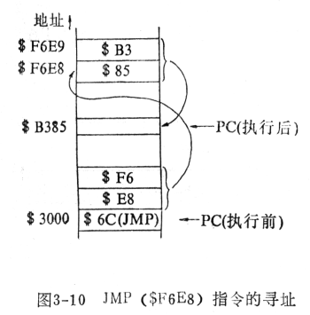

#### （八）绝对 X 变址寻址方式

这种寻址方式的指令，形式上很象绝对寻址。它也为三字节指令，一为操作码，后面为一绝对地址值，但操作数并不在此绝对地址所表示的单元中，而是将它与 X 寄存器中所存的无符号数相加，才得到存放操作数的地址。即：

$$\text{有效地址} = \text{绝对地址} + \text{X}$$

例如指令：

```text
LDA   $9C8A, X
```

假定 X 里面当前存的数是 `$3A`（58），则其寻址过程可用图 3-11 表示。操作数存放在 `$9CC4` 这个单元中（`$9C8A + $3A = $9CC4`）。指令存放在 `$3000` 开始的三个单元中，操作码为 `$BD`。假定 `$9CC4` 这个单元中存有 `$F5`，指令执行完后，A 中得到此数。有 15 条指令有这种寻址方式。这种寻址方式对数据块的处理（如从某一清单中取某一项），对清单排序等等非常有用。以后的程序例中会看到这一点。

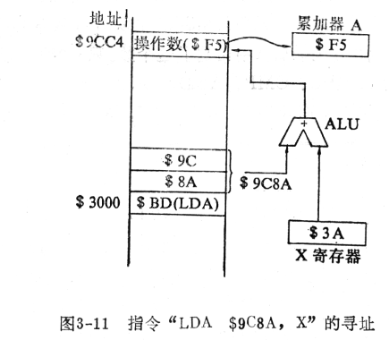

这种指令的执行过程和绝对寻址方式下的指令执行过程基本相同，大多数指令用的周期数也基本一样。只是在把绝对地址低位取到 CPU 中后要与 X 内容相加。相加的过程和取绝对地址高位是同一周期中并行进行的。在加的结果发生了进位的情形下，才需要对此绝对地址高位进行修正（加 1）。此时才需要多用一个周期来完成此项工作。

#### （九）绝对 Y 变址寻址方式

这种寻址方式与绝对 X 变址寻址方式的区别，仅在计算有效地址时不用 X 寄存器的内容而用 Y 寄存器的内容。只有 9 条指令有这种寻址方式。

#### （十）零页 X 变址寻址方式

这种寻址方式是绝对 X 变址的一种特例，正如 0 页寻址是绝对寻址的一个特例。这是一两字节指令，第二字节为零页地址。应说明的是，此地址与 X 寄存器相加后，仍得一零页地址为有效地址。如果相加结果有进位，将被舍掉。有 16 种指令有这种寻址方式，例如：

```text
LDA   $30, X ($B5, $30)
```

这种指令执行时，假定 `X=$F5`，则将 `$30` 与 `$F5` 相加，得到的结果是 `$125`，舍去高位，即为 `$25`。因而这条指令是将 `$25` 这个单元中的数送到 A 中去。

#### （十一）零页 Y 变址寻址方式

这种寻址方式与零页 X 变址寻址方式相同，仅变址寄存器由 X 改为 Y 了。仅有两条关于 Y 寄存的操作才有这两种寻址方式，即：

```text
LDX   Oper, Y (Oper——一个零页地址)
STX   Oper, Y
```

#### （十二）变址间接型寻址方式

这种寻址方式可以说是零页 X 变址和间接寻址的结合。它先进行 0 页 X 变址寻址，从寻到的单元中取出一 8 位数作有效地址低位，从此单元的下一单元中取出一 8 位数作有效地址的高位。然后，以此 16 位有效地址为地址去找操作数，例如：

```text
LDA   ($3F, X) (指令码为 $A1、$3F)
```

这一指令的执行过程可用图 3-12 来表示。假定指令执行前 `X=$8A`，它与 `$3F` 相加得到一 0 页地址 `$C9`，从 `$C9` 和 `$CA` 中取出的数 `$B3E6` 才是有效地址。假定在 `$B3E6` 单元中存放一数 `$8C`，则最后 A 中得到了这个数。只有 8 种指令有这种寻址方式。它们是：`LDA`、`STA`、`ADC`、`SBC`、`CMP`、`AND`、`ORA` 和 `EOR`。

仍以上面的指令 `LDA ($3F, X)`（原书误印为 `LDX ($3F, X)`）为例，它的执行过程如下：

| 周期 | 地址总线 | 程序计数器 | 数据总线 | CPU 操作 |
| :---: | :---: | :---: | :---: | :--- |
| 1 | `PC` | `PC+1` | `$A1` | 取操作码，完成上一指令 |
| 2 | `PC+1` | `PC+2` | `$3F` | 取基地址 `$3F`，译码 `$A1` |
| 3 | `$00, $3F` | `PC+2` | `($3F)` | 加：`$3F + X($8A) = $C9`，数据总线数据上无用 |
| 4 | `$00, $C9` | `PC+2` | `$E6` | 加：`$C9 + $1 = $CA`，得到有效地址低位 |
| 5 | `$00, $CA` | `PC+2` | `$B3` | 保持 `$E6`，得到有效地址高位 |
| 6 | `$B3E6` | `PC+2` | `$8C` | 取操作数 |
| 7 | `PC+2` | `PC+3` | 新操作码 | 取新操作码，结束上面的指令 |

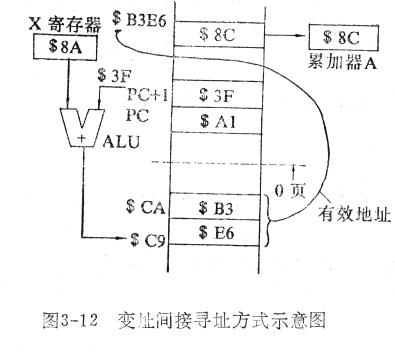

#### （十三）间接变址型寻址方式

这种变址方式也是两字节指令，第二字节也是一零页地址。但与上述的变化过程稍有不同，指令执行时，先从此零页地址和它的下一地址单元中分别取出一个 16 位的基地址的低位和高位，再将它与 Y 内的数值相加而得到真正的有效地址，从那里取出操作数来。只有有变址间接型寻址方式的 8 条指令有这种寻址方式。下面以“`LDA ($8A), Y`”为例说明这个指令执行的过程。图 3-13 给出了它的示意图。此指令的操作码是 `$B1`、`$8A`。假定 Y 中的数是 `$F1`（$-15$，按无符号数加则为 $+241$），`$8A` 和 `$8B` 中存有的 16 位地址是 `$10D5`。`$10D5 + $F1 = $11C6`，假定 `$11C6` 中存有 `$2E`。这就是要送向 A 的操作数。

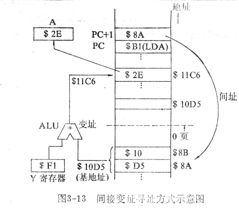

上面指令的执行过程如下：

| 周期 | 地址总线 | 程序计数器 | 数据总线 | CPU 操作 |
| :---: | :---: | :---: | :---: | :--- |
| 1 | `PC` | `PC+1` | `$B1` | 取操作码，结束上条指令 |
| 2 | `PC+1` | `PC+2` | `$8A` | 取间接地址低位，译码 `$B1` |
| 3 | `$00, $8A` | `PC+2` | `$D5` | 取基地址低位，间接地址加 1：`$8A + 1 = $8B` |
| 4 | `$00, $8B` | `PC+2` | `$10` | 取基地址高位（`$10`）。加：`$D5 + Y($F1) = C6`（进位位=1） |
| 5* | `$10C6` | `PC+2` | （无用） | 基地址高位加 1 |
| 6 | `$11C6` | `PC+2` | `$2E` | 取操作数 |
| 7 | `PC+2` | `PC+3` | 新操作码 | 取新操作码，结束上面的指令 |

> **注 \***：若基地址低位与 Y 相加无进位，则无这一周期。

另外要记住的是，存基地址的两单元必须是零页单元。

上述两种寻址方式给某些程序的编写带来很大方便。下面的程序举例中将会看到。例如对一些清单的处理，对数据块的处理等等均可看到这种寻址的灵活性。

---

### 三、6502 指令组

6502 共有 56 条基本指令（原书此处印作“52条”，应为 56 条）。由于每条指令都有自己特定的一种或几种寻址方式，因而总指令条数为 151 条。在“中华学习机 CEC-I 技术参考手册（硬件）”附录 B 中列出了所有指令并指出了它们的执行周期和执行过程中对状态寄存器的影响。下面我们将它们分成九类加以介绍。

#### （一）数据传送类指令

这一类指令数量最多，它又分成 CPU 内部寄存器间数据传送指令和寄存器与存储器（包括外设）间的数据传送指令。当然，寄存器与堆栈间的数据传送也是一种。后者在本节三（六）中单独介绍，因为它通常与转子程序和中断处理等有关。

##### 1. CPU 内部寄存器间数据传送指令

6502 中有以下几个寄存器与写程序关系密切：即累加器 A、变址寄存器 X 和 Y、堆栈指针寄存器 S、状态寄存器 P 和程序计数器 PC（后者分成 PCL 和 PCH 两部分，分别为 PC 的低 8 位和高 8 位）。这些寄存器间有的可直接进行数据传送，但大部分是不行的。为了读出有些寄存器的内容，不得不采用一定的程序技巧。可以直接相互传送数据的寄存器只有 Y、A、X 和 S，且不是两两都可以相互传送的。仅有 6 条相互传送数据的指令，它们是：

- `TAX`（Transfer A to X——A 传送到 X）
- `TXA`（Transfer X to A——X 传送到 A）
- `TAY`（Transfer A to Y——A 传送到 Y）
- `TYA`（Transfer Y to A——Y 传送到 A）
- `TSX`（Transfer S to X——S 传送到 X）
- `TXS`（Transfer X to S——X 传送到 S）

这些指令均为一字节指令，均只有隐含寻址方式。T 表示传送，后面两个字符表示了传送源和目的。例如 `TAX`，即将累加器 A 的内容送到 X 中去，A 不变，而 X 原来的内容丢掉了，可表示为 `A → X`。其他五个可以类推。为了便于记忆，图 3-14 给出了这条指令的示意图。应当记住，除了图上所示的这 6 条指令外，其它任何寄存器间的数据直接传送都是不可能的。另外，这 6 条指令中，`TXS` 执行时对状态寄存器无任何影响，而其它五条都对状态寄存器的 N、Z 两位产生影响，即所传送数据的第 7 位将决定执行完指令后的 N 值；该数据是否为 0 则决定了 Z 值。这些指令的执行时间均为 2 个周期。显然，`TXS` 可用来设置堆栈指针，而 `TSX` 可用来了解当前堆栈存放情况，其他的指令在许多场合下可使用到。例如转入子程序或中断处理程序时往往要保留 X、Y 值，但 X、Y 不能直接推入堆栈，只有 A 才可以直接推入或弹出堆栈。此时，往往要使用上述指令，然后间接使 X、Y 进出堆栈。后面我们将遇到这方面的例子。

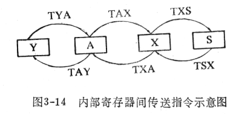

##### 2. 累加器 A 与内存间的数据传送指令

有两条指令完成 A 与内存 M 间的数据传送。它们是：

**(1) `LDA`（Load A with Memory——从内存输入到 A）**

我们可把它表示为 `M → A`。这条指令执行结果要对状态字的 N、Z 两位发生影响。它共有 8 种寻址方式。它们是：

```text
LDA   #Oper       (立即寻址)
LDA   Oper        (0页寻址)
LDA   Oper, X     (0页X变址)
LDA   OPER        (绝对寻址)
LDA   OPER, X     (绝对X变址)
LDA   OPER, Y     (绝对Y变址)
LDA   (Oper, X)   (变址间接寻址)
LDA   (Oper), Y   (间接变址寻址)
```

这里我们用 `Oper` 表示一 8 位（0 页）地址，`OPER` 表示一 16 位地址（绝对地址）。`#Oper` 则表示一个 8 位的立即数。以下均如此。

**(2) `STA`（Store A in Memory——将 A 存入内存）`A → M`**

此指令对状态字无任何影响，它有除立即寻址外的 `LDA` 所拥有的其它七种寻址方式。

##### 3. X 寄存器与内存间的数据传送指令

与 A 和内存间的数据传送指令相似，有两条 X 与内存传送数据的指令。

- `LDX`（Load X With Memory） `M → X`
- `STX`（Store X in Memory） `X → M`

但这两条指令的寻址方式却比 `LDA`，`STA` 少很多。即仅有：

```text
LDX   #Oper       (立即寻址)
LDX   Oper        (0页寻址)
LDX   Oper, Y     (0页Y变址)
LDX   OPER        (绝对寻址)
LDX   OPER, Y     (绝对Y变址)
STX   Oper        (0页寻址)
STX   Oper, Y     (0页Y变址)
STX   OPER        (绝对寻址)
```

其它方面这两条指令与 `LDA`，`STA` 无任何区别。

##### 4. Y 寄存器与内存间的数据传送指令

相应地也有 `LDY` 和 `STY` 两条指令，如果把上述的 `LDX` 和 `STX` 指令的符号及寻址方式中的 X 都换成 Y，把 Y 都换成 X，那正是这两条指令 `LDY`、`STY` 的情形了。或者说这两类指令是完全对称的。

##### 5. 数据传送程序例

上面所说的累加器、寄存器与 M 间的数据传送指令是计算机中使用得最多的指令。这里仅给出两个使用它们的简例：

**例 1.** 将两存储单元的内容互相交换一下，假定此二单元是 `$0035` 和 `$0045`。程序是：

```text
LDA   $35
LDX   $45
STA   $45
STX   $35
```

显然，这里也完全可以使用 A、Y 或 X、Y 两个寄存器，在程序设计中要根据具体情形而定。

**例 2.** 将 `AREA1` 单元开始存放的长度为 256 的数据块，对应地搬到 `AREA2` 单元开始的 256 个单元中（见图 3-15 所示）。

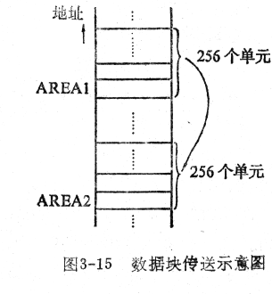

程序：

```text
        LDX   #0          ; 0→X
LOOP    LDA   AREA1, X    ; 取一数 (原书误印为 LDX AREA1, X)
        STA   AREA2, X    ; 送入新单元中
        INX               ; X+1→X
        BNE   LOOP        ; X≠0则循环
        BRK               ; 结束
```

这里执行 `INX` 指令时，X 内容加 1。而 `BNE` 是跳转指令。即当 X 内容不是 0 时，程序又回到 `LOOP` 去；`X=0` 时，则向下执行。`BRK` 是一条停机指令。显然，这段程序中，X 也可以换成 Y，但 A 不能换成 Y，因为 `STY` 没有绝对 X 变址寻址方式。上述两个数据区均没有假设在 0 页中。

上面的例子中，`AREA1` 和 `AREA2` 均没有定义具体的地址值。当使用汇编程序时，可以定义它们的值，程序存放的起始地址，也可定义（见第七章）。

---

#### （二）标志位操作指令

在 §3-1 中已对 6502 的状态字做了介绍，并且指出，7 个标志位中有 3 个是可以用指令置 1 和还 0 的，还有 V 位可以用指令还 0，但无法用指令置 1。这七条指令为：

- `CLC`（Clear carry flag） `0 → C`
- `SEC`（Set carry flag） `1 → C`
- `CLI`（Clear interrupt disable bit） `0 → I`
- `SEI`（Set interrupt disable bit） `1 → I`
- `CLD`（Clear decimal mode，原书误印为 `CED`） `0 → D`
- `SED`（Set decimal mode） `1 → D`
- `CLV`（Clear overflow flag） `0 → V`

显然，执行上述各指令时，除了规定的操作外，状态寄存器 P 的其它位不受影响。这些指令均只有隐含寻址一种寻址方式，执行时间为两个机器周期，均为单字节指令。

这些指令各有自己的用途。例如对进位的操作，在进行加减运算时是必须的。对 I 位的操作决定了程序是否允许外部中断。当一段程序执行时不允许外部中断，则用 `SEI` 指令将外部中断（$\overline{\text{IRQ}}$）屏蔽；允许中断的程序段，则可用 `CLI` 来开放中断。对 D 的操作则决定了此命令以后的算术运算的性质。当用 `SED` 指令使 D 位置 1 时，以下的运算便是按 BCD 码进行十进制运算了。当要回到二进制运算时，则要再执行一条 `CLD` 指令。最后一条指令 `CLV` 是使 V 位清 0 的。

---

#### （三）算术和逻辑运算指令

6502 的算术运算指令在一般 8 位微处理器中是较少的。它只有一条加法指令和一条减法指令，另外有三条加 1 指令和三条减 1 指令，逻辑运算指令也只有 3 条。

##### 1. 加法和减法指令

6502 只有一条加法指令和一条减法指令，它们是：

- `ADC`（Add Memory to A with Carry）
  `A + M + C → A, C`（原书印作 `A+M+C→M, C`）
  此为累加器与操作数连同进位位相加指令。
- `SBC`（Subtract Memory from A with Carry）
  `A - M - ~C → A, C`
  这是累加器与操作数带借位位相减的指令。在 §3-1 五中我们已说过，在做减法时 $\text{C}=0$ 才代表有借位，因此这里是与 $\overline{\text{C}}$ 相减。

许多微处理器都有两条加法指令和两条减法指令。一是带进借位的加减，一是不带进借位的加减。后者用于单字节数的加减，或用于多字节数的最低位字节的加或减中；而前者则用于多字节数的非最低位字节的加或减。但在 6502 中省去了后者。这是因为，真正做计算时以多字节为多。而有了 `CLC` 和 `SEC` 这样两条指令后，适当设置 C 位，仍可使用带进借位的加减操作代替不带进借位的加减操作。这样，可以节省编码空间，以增加其它功能。例如，做单字节加法时（或做多字节加法中最低位相加时），可用下面两指令：

```text
CLC
ADC ...
```

而做减法时，则要把指令 `CLC` 换成 `SEC`。这样，所做的运算即相当于不带进借位的运算了。而在做多字节数运算时，C 会自动地把低位的进位或借位带到高位运算中去。

上述两条加减法指令均有 8 种寻址方式：

```text
ADC   #Oper       (立即寻址)
ADC   Oper        (0页寻址)
ADC   Oper, X     (0页X变址)
ADC   OPER        (绝对寻址)
ADC   OPER, X     (绝对X变址)
ADC   OPER, Y     (绝对Y变址)
ADC   (Oper, X)   (变址间接型)
ADC   (Oper), Y   (间接变址型)
```

（对 `SBC` 也一样，省略）这些指令的执行均对 N、Z、V、C 四个状态位发生影响。

下面举几个加减法的例子：

**例 1** 两个 8 字节的 10 进制数分别存入 `FIRST` 和 `SECOND` 两个单元起始的 8 个单元中。高位在前，逐次排列。求它们的和并存于 `FIRST` 起始的 8 个单元中。

程序是：

```text
        SED               ; 置十进制运算方式
        CLC               ; 清C，进位=0
        LDX   #7          ; 7→X
LOOP    LDA   FIRST, X    ; 取被加数一个字节
        ADC   SECOND, X   ; 带进位加
        STA   FIRST, X    ; 存回
        DEX               ; X-1→X
        BPL   LOOP        ; 未完，循环
        BRK               ; 结束
```

此程序中，`DEX` 表示 X 内容减 1。而“`BPL LOOP`”表示：上面指令执行结果得的是正数时，跳回 `LOOP`。否则，继续向下执行。

**例 2** 上面例 1 中改为两数相减。

```text
        SED
        SEC               ; C置1，借位=0
        LDX   #7
LOOP    LDA   FIRST, X    ; 取被减数一个字节
        SBC   SECOND, X   ; 带借位相减
        STA   FIRST, X    ; 存回
        DEX
        BPL   LOOP        ; 未完，循环
        BRK
```

这两例中应注意的是：作加法前应清 C 为 0；作减法前应置 C 为 1。高位相加减时，C 自动由低位运算结果所决定，便可进行带进（借）位的运算而自动得出正确的结果。

##### 2. 加 1 和减 1 指令

6502 有 3 条加 1 指令，3 条减 1 指令：

- `INX`（Increment Index X by 1） `X + 1 → X`
- `INY`（Increment Index Y by 1） `Y + 1 → Y`
- `INC`（Increment Memory by 1） `M + 1 → M`
- `DEX`（Decrement Index X by 1） `X - 1 → X`
- `DEY`（Decrement Index Y by 1） `Y - 1 → Y`
- `DEC`（Decrement Memory by 1） `M - 1 → M`

这 6 条指令中有 4 条是对寄存器 X 或 Y 的内容进行加减 1，因而只有隐含寻址一种寻址方式；而 `INC`、`DEC` 两条指令是对某一内存单元内的数进行加 1 或减 1 运算的，它各有 4 种寻址方式：

```text
INC   Oper        (0页寻址)
INC   Oper, X     (0页X变址)
INC   OPER        (绝对寻址)
INC   OPER, X     (绝对X变址)
```

`DEC` 指令也是这 4 种寻址方式。所有这 6 条指令均对 N，Z 两个状态标志位有影响。应注意，它们对 C 位无影响，因而下面的程序段是不对的：

```text
        LDX   #0          ; 0→X
        CLC               ; 0→C
LOOP    LDA   FIRST, X    ; 取一数
        STA   SECOND, X   ; 存到目的地
        INX               ; X+1→X
        BCC   LOOP        ; C=0则循环
        ⋮
```

这里 `BCC` 指令的意思是 `C=0` 则回到 `LOOP` 上去。但 `INX` 不影响 C，开始 C 清了 0，因而此程序将永不间断地循环下去。

##### 3. 逻辑运算指令

6502 共有三条逻辑运算指令，它们是：

- `AND`（“AND” Memory with A） $A \land M \rightarrow A$（$\land$——与）
- `EOR`（“Exclusive-or” Memory with A） $A \oplus M \rightarrow A$（$\oplus$——异或）
- `ORA`（“OR” Memory with A） $A \lor M \rightarrow A$（$\lor$——或）

这三条指令均有 8 种寻址方式，与 `LDA`、`ADC`、`SBC` 等全同，这里不一一列出了。它们运算结果也均只影响 N、Z 两位。

与（`AND`）操作常常用来对某些数的某些位进行屏蔽。例如将共有 `STRNG` 个数字的数字串（0—9）的 ASCII 码变为 BCD 码的程序：

```text
        LDX   #0          ; 0→X
LOOP    LDA   BUFFER, X   ; 取一个ASCII码
        AND   #$0F        ; 屏蔽掉4位
        STA   BUFFER, X   ; 存回
        INX               ; X+1→X
        CPX   #STRNG      ; 比较
        BNE   LOOP        ; 未完，循环
        ⋮
```

这里假定此数字串存放在 `BUFFER`—`BUFFER+STRNG-1` 单元内。执行与操作时，这些数字的高位被屏蔽掉（即不管原来为什么值，相与后变为 0）。指令 `CPX` 是比较 X 内容与数 `STRNG` 的大小。事实上是作一减法操作。而减的结果不保留，只影响状态字（见三（四））。“`BNE LOOP`”指令表示上面比较结果不为 0，则跳到 `LOOP` 去执行。若等于 0 则向下顺序执行。这段程序执行结果将把 0—9 的 ASCII 码 `$30`—`$39` 分别变为 `$00`—`$09`。

`EOR`（异或）操作指令有时可用来“取反”。即 $\text{A} \oplus \text{\$FF} = \overline{\text{A}}$，所以连续两次异或操作又得到自己：$\overline{\text{A}} \oplus \text{\$FF} = \text{A}$。

或（`ORA`）操作可以完成与 `AND` 相反的过程。例如，与上面的例子相反，将 0—9 的 BCD 码变为 ASCII 码的程序是：

```text
        LDX   #0          ; 0→X
LOOP    LDA   BUFFER, X   ; 取一个BCD码
        ORA   #$30        ; 补上高位
        STA   BUFFER, X   ; 存回
        INX               ; X+1→X
        CPX   #STRNG      ; 比较
        BNE   LOOP        ; 不等，循环
        ⋮
```

---

#### （四）转移和条件测试指令

一般情形下，程序是按指令的先后顺序逐条进行的。但是，有时根据不同条件，程序必须分支，有时必须跳转到一定地址上去执行。这就必须设有这种进行转移的指令。转移指令分成两类，一类是无条件转移类，即不管处理器处于何种状态，凡执行此指令时都要跳转；另一类则是条件转移类，根据处理器的不同状态，决定是跳转还是顺序执行。

##### 1. 无条件转移指令

6502 只有一条无条件转移指令，它有两种寻址方式：

```text
JMP   OPER        (绝对寻址)
JMP   (OPER)      (绝对间接寻址)
```

这里 `OPER` 是一个 16 位地址，前者即跳到此地址执行。后者的跳转方式我们已在 §3-2 二（七）中讲过了。

##### 2. 条件转移指令

条件转移指令均是对一定的状态标志位进行检验，然后根据它们是 0 或 1 而决定转移或顺序执行。这种转移都是相对的，即这种指令均为两字节指令，第二字节为一偏移量 $e$。其逻辑原理图如图 3-16 所示。图中 Y 表示“Yes”，N 表示“No”。当条件成立时（Yes）则发……

> *(下文接 [Part 2: §3-2 后半 ~ §3-3](ch03b-6502-part2.md))*
