# 第三章 微处理器 6502 及其指令系统（续）

## §3-2 6502 的指令系统（续）

### 三、6502 指令的分类说明（续）

#### （四）转移和条件测试指令（续）

##### 2. 条件转移指令（续）

（承接上页：当条件成立时（Yes）则发）生转移；条件不成立（NO），则顺序执行。§3-2 二（六）中已介绍过这种转移的情形了。

6502 有 8 条条件转移指令，分别对 N、Z、C 和 V 位进行是 1 是 0 的检验，以决定转移否：

- `BCC` (Branch on carry Clear) （$\text{C}=0$ 则转移）
- `BCS` (Branch on carry set) （$\text{C}=1$ 则转移）
- `BEQ` (Branch on result zero) （$\text{Z}=1$ 则转移）
- `BNE` (Branch on result not zero) （$\text{Z}=0$ 则转移）
- `BPL` (Branch on result plus) （$\text{N}=0$ 则转移）
- `BMI` (Branch on result minus) （$\text{N}=1$ 则转移）
- `BVC` (Branch on overflow clear) （$\text{V}=0$ 则转移）
- `BVS` (Branch on overflow set) （$\text{V}=1$ 则转移）

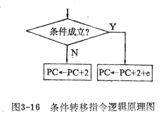

这 8 条指令均仅有相对寻址方式，其转移范围相对本条指令的地址来说相当于 $-126 \sim +129$。这些指令对状态字本身均无影响。

##### 3. 条件测试指令

从上面条件转移指令可看出，我们根据程序执行到某一点时的标志位情形，便可进行转移。但有时也有这样的情形：程序到达某一点后，希望根据某个内存单元或 A、X、Y 寄存器等的内容进行转移。例如希望根据某一内存单元为 0、为负和正三个条件进行不同的转移时，就必须提供一些方便的手段对这些内容进行测试。属于完成这种功能的指令，我们称之为条件测试指令。在 6502 中有两类这种类型的指令。一是比较指令，一是位测试指令。

###### （1）比较指令

- `CMP` (Compare Memory and A) $\quad \text{A}-\text{M}$
- `CPX` (Compare Memory and X) $\quad \text{X}-\text{M}$
- `CPY` (Compare Memory and Y) $\quad \text{Y}-\text{M}$

这三条指令事实上均是完成一个不带进位位的减法操作，但操作结果并不存下来，而只是根据这个结果去改变 N、Z、C 三个状态位。

`CMP` 指令有 8 种寻址方式，与 `LDA`、`ADC`、`SBC` 及逻辑运算指令等均一样。`CPX` 和 `CPY` 则仅有立即寻址、零页寻址和绝对寻址三种方式。

下面我们看一下比较指令对 N、Z、C 三个状态位的影响。由于有无符号数和带符号数之分，它们对 N、C 两位的影响是不相同的，我们将它们列于表 3-3 和 3-4 中。

**表 3-3 无符号数比较对 N、C、Z 位的影响**

| 比较 | N | C | Z |
| :--- | :---: | :---: | :---: |
| $\text{A (X, Y)} < \text{M}$ | $*$ | 0 | 0 |
| $\text{A (X, Y)} = \text{M}$ | 0 | 1 | 1 |
| $\text{A (X, Y)} > \text{M}$ | $*$ | 1 | 0 |

> $*$ N 值不定，有的情形为 1，有的情形为 0。

根据表 3-3 我们可得出对无符号数进行比较时进行分支所需用的指令，如表 3-5。

表中 `THERE` 表示分支条件成立时，想转向的地址；而 `HERE` 表示分支条件不成立时想转向的地址，对照表 3-3 不难看出表 3-5 的根据。

**表 3-4 带符号数比较对 N、C、Z 位的影响**

| 比较 | N | C | Z |
| :--- | :---: | :---: | :---: |
| $\text{A (X, Y)} < \text{M}$ | $1/*$ | $0/1$ | 0 |
| $\text{A (X, Y)} = \text{M}$ | 0 | 1 | 1 |
| $\text{A (X, Y)} > \text{M}$ | $0/*$ | $1/0$ | 0 |

> 说明：各项内分子表示两比较数同符号时的情形，分母为异号时的情形，$*$ 表示不定。

**表 3-5 无符号数比较分支**

| 分支条件 | 比较指令后的分支指令 |
| :--- | :--- |
| $\text{A (X, Y)} < \text{M}$ | `BCC THERE` |
| $\text{A (X, Y)} = \text{M}$ | `BEQ THERE` |
| $\text{A (X, Y)} > \text{M}$ | `BEQ HERE`<br>`BCS THERE` |
| $\text{A (X, Y)} \leqslant \text{M}$ | `BCC THERE`<br>`BEQ THERE` |
| $\text{A (X, Y)} \geqslant \text{M}$ | `BCS THERE` |

但是，从表 3-4 中可以看出，若比较的是带符号数，则问题比较麻烦。除了 Z 值以外，当比较的两数不等时，N 值和 C 值均不确定，要视两数是同号还是异号而再进一步判断。但可以看出，如果两数是同号的话，则也可按表 3-5 的情况进行转移。从表 3-4 也可见，此时按表 3-6 进行转移也可。若两数是异号的话，则又勿需比较，显然正者大。因而，对带符号数来说，可以先判断是否同号，然后再决定怎样转移。本节三（四）4 中还将给出几个转移的例子，以说明这一问题。

**表 3-6 符号相同的带符号数比较的一种分支方法**

| 分支条件 | 比较指令后的分支指令 |
| :--- | :--- |
| $\text{A (X, Y)} < \text{M}$ | `BMI THERE` |
| $\text{A (X, Y)} = \text{M}$ | `BEQ THERE` |
| $\text{A (X, Y)} > \text{M}$ | `BEQ HERE`<br>`BPL THERE` |
| $\text{A (X, Y)} \leqslant \text{M}$ | `BMI THERE`<br>`BEQ THERE` |
| $\text{A (X, Y)} \geqslant \text{M}$ | `BPL THERE` |

###### （2）位测试指令

- `BIT` (Test bits in M with A——用 A 对内存进行测试)

这条指令所完成的功能可表示如下：$\text{A} \land \text{M}$，$\text{M}_7 \to \text{N}$，$\text{M}_6 \to \text{V}$。即这条指令事实上执行累加器和操作数相与的操作。但操作结果不存放到任何地方，只对 Z 位发生影响，同时，无条件地将操作数的第 7 和第 6 位送到状态寄存器的 N 和 V 位中去。状态寄存器其它位不受影响。这条指令只有 0 页和绝对两种寻址方式，分别为两字节三周期和三字节四周期的指令。

事实上利用这一指令可以对操作数的所有位进行检验。对于高两位，当然可根据检验后的 N、V 位得知其为 1 或 0，从而可利用 `BMI`、`BPL`、`BVC` 和 `BVS` 等进行程序的条件转移。而对于其他各位，根据 A 中不同的值，判断不同的位，然后检查 Z 的结果，用 `BEQ` 和 `BNE` 来进行条件转移。例如：

```text
LDA  #$08
BIT  ADDR
BEQ  THERE
```

此时，地址为 `ADDR` 的单元中的数，其第 3 位为 0，则转向 `THERE`；而第 3 位为 1，则顺序执行。`BIT` 指令对外部设备中断标志或其他状态的查询，也是很有用处的。

##### 4. 程序转移举例

###### （1）使两个无符号数按大小排列程序

假定在地址 `ADDR` 和 `ADDR+1` 中存有两个无符号数。程序运行后要求 `ADDR` 中存其较小者，而 `ADDR+1` 中存其较大者，程序如下：

```text
      LDA  ADDR+1      ; A←ADDR+1的内容
      CMP  ADDR        ; 与ADDR中内容比较
      BCS  DONE        ; 前者大或相等，则转向DONE
      LDX  ADDR        ; 后者大则交换
      STA  ADDR
      STX  ADDR+1      ; 做完
DONE  ...
```

###### （2）上例中若为两个带符号数：

```text
       LDA  ADDR+1     ; A←(ADDR+1)
       EOR  ADDR       ; 异或，比较符号异同
       BMI  UNSAM      ; 不同，转向UNSAM
       LDA  ADDR+1     ; 相同，取回(ADDR+1)
       CMP  ADDR       ; 比较
       BCS  DONE       ; (ADDR+1)大或相等，转向DONE
EXCHG  LDX  ADDR       ; 交换
       STA  ADDR
       STX  ADDR+1
       JMP  DONE       ; 结束
UNSAM  LDA  ADDR+1     ; 取回ADDR+1单元
       BMI  EXCHG      ; 内容为负，转向EXCHG
DONE   ...             ; 结束
```

###### （3）三路判断程序

下面的程序比较 A 和常数 `CONT`，当 A 大时将 A 放入 `ADDR2` 单元；若相等则将 A 放入 `ADDR1` 单元；若 A 小时，则放入 `ADDR0` 单元。

```text
       CMP  #CONT      ; A与常数比较
       BCS  NOLES      ; 不小于常数，转向NOLES
       STA  ADDR0      ; A小，存于ADDR0
       JMP  DONE       ; 跳到DONE，结束
NOLES  BNE  GREAT      ; 与常数不等，转向GREAT
       STA  ADDR1      ; 相等，存于ADDR1
       JMP  DONE       ; 跳到DONE，结束
GREAT  STA  ADDR2      ; 存入ADDR2
DONE   ...             ; 结束
```

注意，在上面的程序中 `JMP` 指令也可用 `BCC` 和 `BEQ` 取代，例如第一个“`JMP DONE`”改为“`BCC DONE`”也可，因为 $\text{C}=0$ 才能执行到这里，而中间的 `STA` 指令对 C 无影响。同样，第二个“`JMP DONE`”也可用“`BEQ DONE`”取代，这样做，虽然执行时间上可能相同，也可能多一周期（假定 `DONE` 在内存另外一页的话），但指令的字节少一个。因而各有利弊。

###### （4）在一个数据区中找一关键字

假定想在自地址为 `BUFFER`—`BUFFER+L`（$\text{L} \leqslant 255$）的数据区中，找一下有无存有关键字 `#KEY` 的单元。找到后，将其绝对地址低位存放于 `POINT` 单元中，其高位则存放于 `POINT+1` 单元之中，若找不到，此二单元均存 0。

```text
START  LDX  #0         ; 0→X
       STX  POINT      ; 指示单元清0
       STX  POINT+1
       LDA  #KEY       ; #KEY→A
LOOP   CMP  BUFFER, X  ; 比较
       BEQ  FOUND      ; 相等，转到FOUND
       INX             ; X+1→X
       CPX  #(L+1)     ; 已找完?
       BNE  LOOP       ; 没完，转到LOOP
       JMP  DONE       ; 已完，转到DONE
FOUND  TXA             ; X→A
       CLC             ; 清C
       ADC  #BUFFERL   ; 求出绝对地址低位
       STA  POINT      ; 存于POINT
       LDA  #0         ; 0→A
       ADC  #BUFFERH   ; 求出绝对地址高位
       STA  POINT+1    ; 存入POINT+1
DONE   ...             ; 结束
```

其中 `#BUFFERL` 和 `#BUFFERH` 分别为绝对地址 `BUFFER` 这个数的低位和高位。从程序中也可看到，若这个数据区中有多个关键字 `#KEY`，则只找出了地址较低的第一个。

#### （五）移位与循环指令

6502 有两条移位指令，两条循环指令。它们是：

##### 1. `ASL` (Arithmetic Shift Left one Bit) （A 或 M）

这是一条算术左移指令。它的功能可用下图来表示：

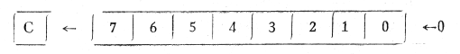

即将操作数逐位向左移一位，其最低位移位后为 0；而最高位则移到状态寄存器的进位位中。

##### 2. `LSR` (Logical Shift Right one Bit) （A 或 M）

这是一条逻辑右移的指令，它的功能如下：

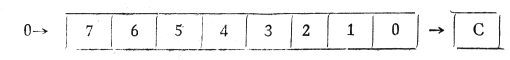

它是将操作数向右移一位。其最高位得到 0；而最低位送到 C 中。

##### 3. `ROL` (Rotate one Bit left) （A 或 M）

这是循环左移一位的指令，功能如下图：

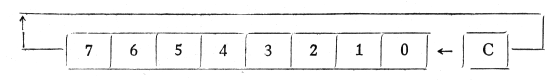

它是把操作数与 C 连接起来，形成一个九位循环移位的寄存器，然后左移一位。

##### 4. `ROR` (Rotate One Bit Right，原文印作 Righ) （A 或 M）

这条指令与 `ROL` 相似，仅其移位方向相反。可表示于下图：

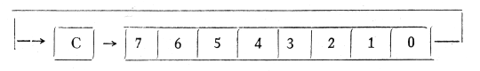

以上四条指令的寻址方式完全相同，均有以下五种寻址方式：累加器寻址、零页寻址、零页 X 变址、绝对寻址和绝对 X 变址。以 `ASL` 为例，其指令形式为：

- `ASL A` （累加器寻址）
- `ASL Oper` （零页寻址）
- `ASL Oper, X` （零页 X 变址）
- `ASL OPER` （绝对寻址）
- `ASL OPER, X` （绝对 X 变址）

这四条指令显然均对 C 位有影响，对 N、Z 两位也有影响。当操作数经移位或循环后，变为 0，则 $\text{Z}=1$；否则，$\text{Z}=0$。当它的第 7 位变为 1 时，则 $\text{N}=1$；反之，$\text{N}=0$。当然，在 `LSR` 指令执行后，N 永为 0。

移位和循环指令用的最多的是在乘法和除法运算中。可以看到，当一个操作数左移一次时，相当于它的值乘了 2。相反，右移则相当于除了 2。下面仅举几例加以说明。

**例 1.** 将 `DATA` 单元内的数乘 5。

```text
LDA  DATA  ; (DATA)→A
ASL  A     ; (DATA)×2
ASL  A     ; (DATA)×4
CLC        ; 清C
ADC  DATA  ; (DATA)×4+DATA=5×(DATA)
STA  DATA  ; 存回
```

（显然，此数如果乘 5 后大于 255，则结果不正确，需有存放其高位的地方。）

这个程序中然当（应当）也可对 `DATA` 单元进行左移，而 A 中存中间结果。但“`ASL A`”仅用两个周期，且是一字节指令。`DATA` 若在 0 页，指令“`ASL DATA`”也为两字节指令，执行周期数为 5。若不在零页，则上二数各又加 1。

**例 2.** 已知 `BUFFER`—`BUFFER+L` 这 $\text{L}+1$ 个单元中各存一两位的 BCD 码，现要求将它们转换成 ASCII 码，并逐个地将其按顺序存放到 `BUFFER`—`BUFFER+(2L+1)` 这些单元之中。

```text
START  LDY  #L          ; L→Y
       LDX  #(2L+1)     ; 2L+1→X
LOOP   LDA  BUFFER, Y   ; 取两个BCD码
       LSR  A           ; 舍去低位者
       LSR  A
       LSR  A
       LSR  A
       ORA  #$30        ; 得高位的ASCII码（原文印作ASSII码）
       STA  BUFFER, X   ; 存放至数据区
       DEX              ; X-1→X
       LDA  BUFFER, Y   ; 再取此二BCD码
       AND  #$0F        ; 屏蔽掉高位者
       ORA  #$30        ; 得低位的ASCII码
       STA  BUFFER, X   ; 存放
       DEX              ; X-1→X
       DEY              ; Y-1→Y
       CPY  #$FF        ; 已完?
       BNE  LOOP        ; 未完，再处理下一个
       BRK              ; 结束
```

#### （六）堆栈操作指令

真正能把内容直接推入堆栈或从堆栈弹出的寄存器只有累加器 A 和状态寄存器 P。其他寄存器欲推入或弹出堆栈，则必须通过间接的办法，即经过累加器 A 再进行堆栈操作。因此堆栈操作指令只有 4 条：

- `PHA` (Push A on Stack) $\quad (\text{A}\downarrow \quad \text{S}-1 \to \text{S})$
- `PHP` (Push P on Stack) $\quad (\text{P}\downarrow \quad \text{S}-1 \to \text{S})$
- `PLA` (Pull A from Stack) $\quad (\text{S}+1 \to \text{S} \quad \text{A}\uparrow)$
- `PLP` (Pull P from Stack) $\quad (\text{S}+1 \to \text{S} \quad \text{P}\uparrow)$

前两条分别为将 A 和 P 的内容推入堆栈，每次执行完该指令，堆栈指针将自动减 1；后两条指令分别为将堆栈中指针所指向的高一单元内容弹到 A 或 P 中。显然，执行后两条指令时，指针要先加 1。

这四条指令均为单字节指令，均只有隐含寻址一种方式。前两条的执行周期数为 3，后两条的为 4。前两条对状态寄存器各位均无影响，第三条则影响其 N、Z 位，而第四条执行后，P 的各位均是从堆栈中弹出来的内容了。

例如，欲将 X 内容送堆栈，则要执行：

```text
TXA
PHA
```

反之，欲将堆栈内容弹到 X 寄存器，则要：

```text
PLA
TAX
```

#### （七）子程序调用和返回指令

6502 有一条程序调用指令和一条从子程序返回主程序的指令。它们是：

- `JSR` (Jump to New Location Saving Return Address)
- `RTS` (Return from Subroutine)

##### 1. 子程序调用指令 `JSR`

这条指令只有一种寻址方式，即绝对寻址方式：

```text
JSR OPER (OPER——绝对地址)
```

当执行这条指令时，程序将自动转到地址 `OPER` 上去取指令而执行。但完成这条 `JSR` 指令，CPU 还要做许多别的工作，主要是要把断点地址保存下来，以便执行完子程序后，能返回到主程序的断点上去向下继续执行。`JSR` 为三字节指令，完成它要用 6 个机器周期，其动作过程为：

| 周期 | 地址总线 | 数据总线 | CPU 的操作 |
| :---: | :--- | :--- | :--- |
| 1 | `PC` | 操作码 (`$20`) | 取指令，结束前一指令 $\text{PC}+1 \to \text{PC}$ |
| 2 | `PC+1` | 新地址低位 (`ADL`) | 译码 `JSR`，$\text{PC}+1 \to \text{PC}$ |
| 3 | `0 1, S` | | CPU 保存 `ADL` |
| 4 | `0 1, S` | `PCH` | `PCH` 送堆栈，$\text{S}-1 \to \text{S}$ |
| 5 | `0 1, (S-1)` | `PCL` | `PCL` 送堆栈，$\text{S}-1 \to \text{S}$ |
| 6 | `PC+2` | 新地址高位 (`ADH`) | 取 `ADH` |
| 7 | `ADH, ADL` | 新操作码 | $\text{ADL} \to \text{PCL}$，$\text{ADH} \to \text{PCH}$，取下一指令 |

由此可见，在第二个周期结束时，PC 已变为 $\text{PC}+2$，即指向了“`JSR OPER`”三字节指令的最后一个字节。因此，在调用子程序时，堆栈中存的 `PCH` 和 `PCL` 值加 1 以后才真正是 `JSR` 指令下一指令的地址。

图 3-17 给出一个说明 `JSR` 指令执行情形的图示。假定在地址 `$5F28` 处存有指令“`JSR $8AC1`”。执行此指令前 PC 中存有地址 `$5F28`，而堆栈指针指向 `$01E8`。执行此指令后，PC 改为 `$8AC1`，而堆栈指针指向了 `$01E6`。堆栈中的 `$01E8` 和 `$01E7` 两个单元中分别存有了 `$5F` 和 `$2A`（即存有 `$5F28+2`）。

总的说我们可以把 `JSR` 指令的功能用下面的符号概括：

$$\text{PC}+2 \downarrow, \quad (\text{PC}+1) \to \text{PCL}, \quad (\text{PC}+2) \to \text{PCH}$$

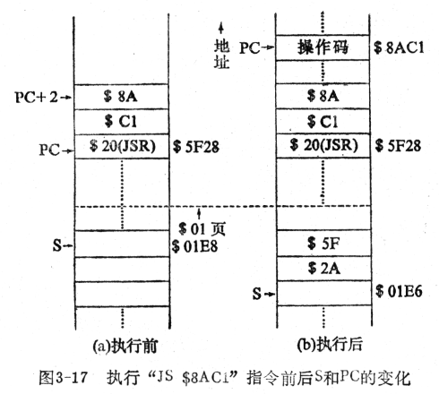

##### 2. 从子程序返回指令 `RTS`

此为一单字节指令，只有隐含寻址方式。当用 `JSR` 调用子程序时，此子程序最后一个指令便应当是 `RTS`。因而，`RTS` 是用来返回主程序断点的。它的功能也可表示如下：$\text{PC}\uparrow$，$\text{PC}+1 \to \text{PC}$。这条指令执行时间也是 6 个机器周期，其过程正好相似于 `JSR` 的逆过程。

我们仍以图 3-17 为例，假定通过一个“`JSR $8AC1`”而转到了地址单元 `$8AC1` 开始的一段子程序上执行，而执行到 `$8F30` 处遇到了一个从子程序返回指令。执行这条指令前后，S 和 PC 的变化则如图 3-18 那样了。可以看出，执行 `RTS` 后，PC 指向了调用此子程序的 `JSR` 指令的下一条指令地址上了。而堆栈指针又回到了 `$01E8`。

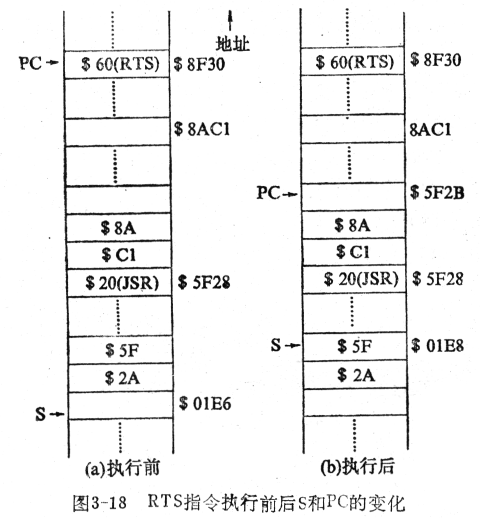

由上面两条指令可以看出，调用子程序和从子程序返回指令配合使用，可以使转向子程序的过程大为简化。但是，在使用它们时还应注意，在执行子程序过程中必定会使用 A 或 X、Y 等寄存器，也可能要破坏原来状态寄存器的状态。因此，为了返回时程序能正确向下行，必须在主程序或子程序中根据需要将这些寄存器的全部或一部分保存起来，执行完子程序后再恢复它们。另外，为保证正确返回，子程序开始和执行 `RTS` 时，堆栈指针必须相同。

##### 3. 调用子程序例

**例 1.** 假定在程序执行过程中，需要产生一个延时，延时后再继续向下执行，则可以用一段延时子程序。假定此子程序入口地址为 `DELAY`，我们可如下调用它：

```text
    ...
    PHP          ; 将P保存于堆栈
    PHA          ; 将A保存于堆栈
    TXA          ; X保存于堆栈
    PHA
    TYA          ; Y保存于堆栈
    PHA
    JSR  DELAY   ; 调用DELAY子程序
    PLA          ; 取回Y
    TAY
    PLA          ; 取回X
    TAX
    PLA          ; 取回A
    PLP          ; 取回P
    ...
```

这里我们先将 P、A、X、Y 保存起来（注意，要先将 P 保存起来，否则下面 `TXA`、`TYA`〔原文印作 `TXA`〕指令有可能改变它）。从子程序返回后，又将其恢复。因为下面的延时子程序中要使用 X、Y，且会破坏 P。而保存 X、Y 时又要破坏 A。但如果主程序向下执行时，A、X、Y 和 P 中的全部或部分内容并不需保留，则不必推入堆栈。另外，也可以存到另外的内存单元中，而不一定使用堆栈。在使用堆栈时，还应注意先入后出的原则。例如上面程序中按 P、A、X 和 Y 这样的顺序入栈，出来的顺序则是 Y、X、A 和 P。延时子程序如下：

```text
DELAY  LDX  ADDRX   (4)
       LDY  ADDRY   (4)
WAIT   DEX          (2)
       BNE  WAIT    (分支时为3，不分支为2〔原文印作“分支为2”〕)
       DEY          (2)
       BNE  WAIT    (分支时为3，不分支为2〔原文印作“分支为2”〕)
       RTS          (6)
```

这里假定地址 `ADDRX` 和 `ADDRY` 均非 0 页。它们各存有一个无符号数 X 和 Y。右边括号内的数值是执行此指令时用的机器周期数。此子程序执行时间可表示于下：

$$T = 28 + 5(\text{X}-1) + 1284(\text{Y}-1)\ \mu\text{s}$$

这里已包括了调用此子程序时，“`JSR DELAY`”指令所需消耗的 6 个机器周期。在这段程序中，第一次进入“`DEX`”和“`BNE WAIT`”循环时，有 $(\text{X}-1)$ 次要执行 5 个机器周期，最后一次只执行 4 个机器周期。因而出现了 $5(\text{X}-1)$ 这一项。而进入“`DEY`”指令后每次 Y 减 1 均要循环一次，共循环 $(\text{Y}-1)$ 次。这个循环中又包括了对 X 进行减 1 的小循环，这个小循环有 256 次，共用时间 $256 \times 5 - 1 = 1279$ 个机器周期，加上“`DEY`”和其后面的“`BNE WAIT`”指令的执行，每次循环正好为 1284 个机器周期，因而有 $1284(\text{Y}-1)$ 这一项，除此以外所用的时间正好是 28 个机器周期（这里一个机器周期按 $1\ \mu\text{s}$ 计，事实上应近似为 $0.9778\ \mu\text{s}$）。

当 $\text{X}=1$、$\text{Y}=1$ 时，$T$ 得最小值 $28\ \mu\text{s}$；当 $\text{X}=0$、$\text{Y}=0$ 时，则相当于 $\text{X}=\text{Y}=256$，此时 $T$ 最大，为 $328,723\ \mu\text{s}$。

**例 2. 数据块搬动子程序：** 假定内存中有一数据块，其起始地址的低位和高位分别存于 0 页单元 `ADDRR` 和 `ADDRR+1` 中。其长度则存在 0 页单元 `ADDRL` 中。现想将它搬到另一个区域中，此区域的起始地址低位和高位分别存在 0 页单元 `ADDRD` 和 `ADDRD+1` 中。而这两个区域的相对位置不定，且可以重叠。完成此搬动的子程序的流程图示于图 3-19 中。由图中可见，当进入此子程序时，首先要检查一下目的首地址和源首地址的差值（$e$），由它的正负决定数据块是从最后一个搬起，还是从第一个搬起，否则会发生搬动过程中破坏了数据的情况（如果两个区域有重叠部分的话）。

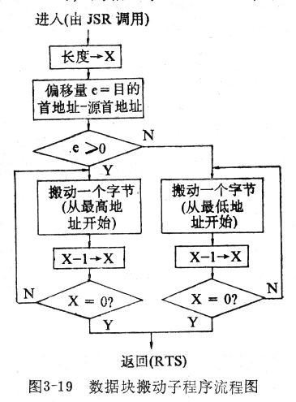

整个子程序如下：

```text
MOVE   LDX  ADDRL         ; 数据块长度→X
       SEC                ; 目的首地址-源首地址
       LDA  ADDRD
       SBC  ADDRR
       LDA  ADDRD+1
       SBC  ADDRR+1
       BCC  FIRST         ; 偏移量<0，则转向FIRST
       LDY  ADDRL         ; 数据块长度→Y
LOOP1  DEY                ; Y-1→Y
       LDA  (ADDRR), Y    ; 取一数据
       STA  (ADDRD), Y    ; 送到目的地址
       DEX                ; X-1→X
       BNE  LOOP1         ; X=0? 不等，则转向LOOP1
       RTS                ; 已完，返回
FIRST  LDA  #0            ; 0→Y
LOOP2  LDA  (ADDRR), Y    ; 取一数据
       STA  (ADDRD), Y    ; 送到目的地址
       INY                ; Y+1→Y
       DEX                ; X-1→X
       BNE  LOOP2         ; X=0? 不等循环
       RTS                ; 已完，返回
```

调用此子程序的指令是“`JSR MOVE`”。主程序调用此子程序前，应将目的块起始地址、源块起始地址及块长度分别存入上述的 `ADDRD`、`ADDRD+1`、`ADDRR`、`ADDRR+1` 和 `ADDRL` 五个单元之中。

#### （八）无操作指令

这是一个单字节指令，格式为：

```text
NOP (NO Operation)
```

6502 执行这个指令时，不做任何操作，只是空转两个时钟周期。它对任何状态都无影响。这个指令看来毫无用途，但程序调试过程常常要使用它。例如，如果想从一段程序中删去某些指令，而又不想使后面的所有指令均发生移动（因为这种移动也可能影响面很大。例如，有的 `JMP` 或 `JSR` 指令有可能也得随之变化了），便可在删去的指令处均以 `NOP` 指令代替。这对程序调试通常没有任何影响。

#### （九）与程序中断有关的指令

程序中断是外部电路通过驱动 $\overline{\text{IRQ}}$ 或 $\overline{\text{NMI}}$ 信号端而自动引起的。6502 还提供了一个内部程序中断指令——`BRK`。这主要是为程序调试提供的。另外，还有一条与中断处有关的指令 `RTI`——从中断返回指令。

##### 1. 内部中断指令 `BRK`

指令 `BRK` 是个单一字节指令（操作码 `00`）。CPU 执行它时和响应一个 $\overline{\text{IRQ}}$ 请求的情况是基本相同的。不同的是 `BRK` 与状态字中断屏蔽位 I 无关，且执行它时，自动将状态字的 B 位置 1。而 CPU 响应 $\overline{\text{IRQ}}$ 时，却将 B 位置 0。这样，程序本身也可引起程序中断，而 CPU 又可根据发生中断时 B 位是 1 还是 0 来判断是内部请求中断还是外部请求中断。

`BRK` 指令显然对计算机与外设的数据传送没有什么关系，但却使你可以使用程序手段来模拟一个中断。这对用户调试程序很有作用。用户可以在程序的一定地方安排一些 `BRK` 指令，执行到这里，程序被打断，便可通过一定手段检查这个断点的情形（如各个寄存器当时的数值）。这样，便可进一步分析，对程序进行调试，这在程序查错中是很有用的。

CPU 执行 `BRK` 指令时要完成以下一些动作：

1. 将状态字 B 位置为 1。
2. 将 PC 的现行值加 1（即 `BRK` 指令后的第二个地址值）打入堆栈，先将其高位打入，然后再将其低位打入。即 $\text{PCH} \to (\text{S})$，$\text{PCL} \to (\text{S}-1)$。
3. 将状态寄存器的内容打入堆栈。$\text{P} \to (\text{S}-2)$。打入后，将 I 位置 1。
4. 从 `$FFFE` 单元中取出新的程序地址的低位，送入 PC 计数器低位，`($FFFE) → PCL`。
5. 从 `$FFFF` 单元中取出新的程序地址的高位，送入 PC 计数器高位，`($FFFF) → PCH`。
6. 从上面得到的新的程序地址取操作码，从那里开始执行。上述过程总计用七个机器周期。

`BRK` 与 `JSR` 和 §3-1 三（七）中讲到的对外中断响应均有一点不同之处，它送向堆栈的 PC 值是 $\text{PC}+2$，如下所示，送向堆栈的 PC 值是 `302`。

```text
       ...
300    BRK          (左边是存BRK的单元地址)
       ...
```

这是因为 6502 的设计者假定大部分情形下 `BRK` 取代的是两字节指令。如果在程序调试过程中要用它取代三字节指令，可以加入一条 `NOP` 指令以代替。例如下面的例子：

```text
       ...
$63F9  INY
$63FA  LDA  $6308
$63FD  STA  $64FF
       ...
```

在内存的布局将是：

```text
       ...
$63F9  INY
$63FA  LDA
$63FB  $08
$63FC  $63
$63FD  STA
$63FE  $FF
$63FF  $64
       ...
```

如果想以 `BRK` 取代 `LDA` 以进行程序调试，则可：

```text
$63F9  INY
$63FA  BRK
$63FB  $08
$63FC  NOP   ←RTI返回此处
$63FD  STA
       ...
```

这样，当程序用 `RTI` 返回时，将从 `NOP` 开始执行。这与从 `$63FD` (`STA`) 开始执行将没有什么区别。在中华学习机中对 `BRK` 的处理是固定的，无法写一个中断处理程序，使之执行 `BRK` 后，转入执行此中断处理程序，而后又用 `RTI` 返回。但在监控程序中有办法使发生 `BRK` 之后，再回到 `BRK` 后面的第二个内存单元继续执行。

##### 2. 从中断返回指令 `RTI`

程序执行这条指令时，相当于完成响应中断时所进行的过程的逆过程：

1. 从堆栈中弹出一个数到状态寄存器 P 中，$(\text{S}+1) \to \text{P}$
2. 从堆栈中再弹出一个数到程序计数器的低位，$(\text{S}+2) \to \text{PCL}$
3. 从堆栈中再弹出一个数到程序计数器的高位，$(\text{S}+3) \to \text{PCH}$
4. 从现在 PC 指向的单元中，取操作码，开始执行。

由此可见，如果 CPU 在执行中断服务程序过程中，没有改变堆栈指针 S，或者改变了，而最后又恢复到初始值，则执行完成中断服务程序后，可以由 `RTI` 指令使它自动返回到主程序先头的断点处。而状态寄存器也恢复了原来的状态。

##### 3. 中华学习机对 `BRK` 的响应

用 §3-1 三（七）和本节三（九）中对 `BRK` 的说明中可以看到，不管是执行 `BRK` 指令，还是响应 $\overline{\text{IRQ}}$ 请求信号而引起程序中断，程序都将会转到一个新地址上去执行。而这个新地址是存在 `$FFFE` 和 `$FFFF` 单元之中的。这两个单元在中华学习机中属于存有监控程序的 ROM 区，它们已存好了一个地址，即 `$FA40`。也就是说，响应 $\overline{\text{IRQ}}$ 请求或执行 `BRK` 指令，都会使程序跳到 `$FA40` 这个地址上去。因而，由 `$FA40` 开始的程序必须先判别一下，是执行 `BRK` 而转过来的，还是响应 $\overline{\text{IRQ}}$ 而转过来的，然后做不同的处理，让我们看一下这段程序：

```text
$FA40  IRQ    STA  ACC        ; 将A保存于ACC单元 (ACC=$45)
              PLA             ; 取回状态字
              PHA             ; 恢复堆栈指针
              ASL  A
              ASL  A
              ASL  A          ; 判B位=1?
              BMI  BREAK      ; B=1转至BREAK
              JMP  ($03FE)    ; B=0，转至$03FE所存地址。
       BREAK  ...
```

从这段程序中可以看出，当从主程序转到中断服务程序时，CPU 首先把 A 保存好，然后从堆栈中把刚打入的状态字读回来。为了返回时能正确恢复 P 和 PC，又执行一条“`PHA`”以恢复 S 指针。然后，通过三次左移，把状态字第 4 位（B 位）移至第七位，便可通过对 N 位的检验，判明 $\text{B}=1$ 还是 $\text{B}=0$，从而判别此次中断请求是由 $\overline{\text{IRQ}}$ 信号引起，还是由执行指令 `BRK` 引起。如果是后者，程序转向 `BREAK` 去执行。在监控程序中这一段程序完成下面的工作：将断点处累加器 A 和寄存器 X、Y、P 和 S 的值及断点地址加 1 后的结果显示于屏幕上，然后返回监控的命令输入方式。这就便于用户调试自己的程序。若判明 $\text{B}=0$，则程序执行一个间接跳转，跳到 `$03FE` 和 `$03FF` 两个单元所存的地址上去。因此，如果用户在这两个单元中分别写入自己的中断处理程序入口地址的低位和高位时，发生 $\overline{\text{IRQ}}$ 中断后，CPU 便会自动地转到用户的中断处理程序上去执行。

回到前面用 `BRK` 替代“`LDA $6308`”指令的情况，当执行到 `BRK` 后，屏幕将显示：

```text
63FC-A=XX  Y=XX  P=XX  S=XX
```

这里“`XX`”表示一个两位的 16 进制数。显示了这些信息后，系统处于监控的命令状态。此时的 PC 计数器中事实上存的地址是 `$63FC`。如果再使用“`G`”命令，程序便从这里又向下执行。可参考第五章。

---

## §3-3 程序综合举例

下面我们给出几个综合性的程序例，以进一步加深了解 6502 指令系统的灵活使用。

### 一、8 位无符号数相乘子程序

假定内存单元 `MULCT` 和 `MULER` 中分别存有被乘数和乘数，相乘后的结果要求存放在累加器 A（存高位）和 `MULER` 单元（存放低位）中。此相乘子程序采取中间积右移的办法，每次将中间积存放在 A 中，其低位逐次移入 `MULER` 中。程序如下：

```text
MULT8   LDA  #0         ; 0→A，中间积开始为0
        LDX  #8         ; 8→X（原文印作 LDA #8）
LOOP    ROR  MULER      ; MULER移去一位到C
        BCC  NOADD      ; 是0则转向NOADD
        CLC             ; 非0，A与被乘数相加（原文印作“与乘数相加”）
        ADC  MULCT      ; A得到一个中间积
NOADD   ROR  A          ; A右移
        DEX             ; 已得8次循环?
        BNE  LOOP
        ROR  MULER      ; 最后得到低8位数
        RTS             ; 返回
```

这个程序中 C 位起了很大作用，它不仅用来判断乘数各位是 1 或 0，以便决定是否进行部分积与被乘数相加，同时它又将部分积低位逐次地传到 `MULER` 单元中。

### 二、8 位无符号数除法子程序

设被除数存于 `DIVND` 单元，除数存入 `DIVSR` 单元，已知它不等于 0，要求相除后商存入 `DIVND` 单元以取代被除数，而余数存入 `REMAN` 单元中。程序如下：

```text
DIV8    LDA  #0         ; A←0
        LDX  #8         ; X←8
LOOP    ASL  DIVND      ; 被除数左移一位
        ROL  A          ; A左移，被除数移出位移入
        CMP  DIVSR      ; 与除数比较
        BCC  NOSBC      ; A<除数，转向NOSBC
        SBC  DIVSR      ; A≥除数，减去除数
        INC  DIVND      ; 中间商送入DIVND中
NOSBC   DEX             ; X-1→X
        BNE  LOOP       ; 未完，循环（原文印作 BND LOOP）
        STA  REMAN      ; 余数存入REMAN单元
        RTS             ; 返回
```

由上面两例可见，作乘法时，事实上是逐次作加法（中间积与被乘数相加）来完成；作除法时，则用逐次作减法（被除数移出部分减去除数）而得到中间商的办法来实现。这两个程序是不难看懂的。

### 三、带符号数的乘除运算

让我们看一下带符号 8 位数的乘除运算。我们知道带符号数中只有 7 位是有效数字，而最高位表示正负。在计算机中负数是以其补码形式表示的，因此，直接使用上述的乘除法子程序便不可能。在带符号的乘除运算时，必须把符号和数字本身分开，运算前的符号决定结果的符号，而数字本身都变成正数（即其绝对值）再做运算。下面我们先看 8 位带符号数的除法运算子程序。

首先看一下运算前后的符号，可用右面的表来表示。

| 被除数 | 除数 | 商 | 余数 |
| :---: | :---: | :---: | :---: |
| $+$ | $+$ | $+$ | $+$ |
| $+$ | $-$ | $-$ | $+$ |
| $-$ | $+$ | $-$ | $-$ |
| $-$ | $-$ | $+$ | $-$ |

可见，余数总是与被除数同号，而商则视被除数和除数是否同号而定。图 3-20 给出了两个 8 位带符号数 A 和 B 相除的子程序流程图。进入此子程序首先检查 B 的符号。当 $\text{B}<0$ 时，要把它改为绝对值表示，并在一个符号标志字的 b 位中置 1；否则 B 不变，而 b 置 0。对 A 也一样进行，其标志位为 a。然后 $\text{A} \div \text{B}$ 便可按上面介绍的无符号数除法子程序来进行。除完以后，又要根据两个标志位对商和余数进行修正，即 $\text{a}=\text{b}=0$ 时，结果商和余数均为正，可直接返回；当 $\text{a}=0$，$\text{b}=1$ 时，则要对商求补后返回，因此时商为负而余数为正；若 $\text{a}=1$，$\text{b}=1$，则要对余数求补；若 $\text{a}=1$ 而 $\text{b}=0$，要对商和余数都求补后才返回。

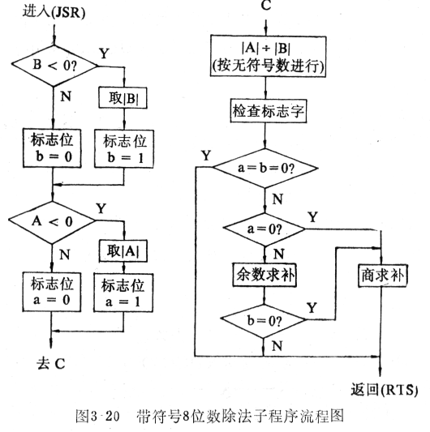

整个程序如下，其中 `DIVSR` 为存除数的单元；`DIVND` 为被除数所存单元，商则最后取代被除数而仍存于 `DIVND` 中；余数存于 `REMAN` 单元中；标志字则用 `SIGN` 单元暂存。

```text
DIV8S   LDY  #0         ; Y←0
        BIT  DIVSR      ; 检验除数符号
        BPL  CHKND      ; 为正，转向CHKND
        TYA             ; 0→A
        SEC             ; 对除数求绝对值
        SBC  DIVSR
        STA  DIVSR      ; 存回
        LDY  #$80       ; 标志位bit7=1（原文印作 LDY $80）
CHKND   BIT  DIVND      ; 检查被除数符号
        BPL  DIV8       ; 为正，转向DIV8
        LDA  #0         ; 对被除数求绝对值
        SEC
        SBC  DIVND
        STA  DIVND
        TYA             ; Y→A
        ORA  #$40       ; 得到符号标志字（原文印作 ORA $40）
        TAY
DIV8    STY  SIGN       ; 标志字存于SIGN单元
        LDA  #0         ; 进行无符号数除法
        LDX  #8
LOOP    ASL  DIVND
        ROL  A
        CMP  DIVSR
        BCC  NOSBC
        SBC  DIVSR
        INC  DIVND
NOSBC   DEX
        BNE  LOOP
        STA  REMAN
        LDA  #$C0       ; 对符号标志字进行检查（原文印作 LDA $C0）
        BIT  SIGN
        BEQ  RETRN      ; 全0，返回
        BVS  NEGR       ; 被除数为负则转向NEGR
NEGQ    LDA  #0         ; 商为负，求补
        SEC
        SBC  DIVND
        STA  DIVND
        RTS             ; 返回
NEGR    LDA  #0         ; 对余数求补
        SEC
        SBC  REMAN
        STA  REMAN
        BIT  SIGN       ; 再检查符号标志
        BPL  NEGQ       ; 除数为正，去对商求补
RETRN   RTS             ; 返回
```

### 四、无序清单的排序（气泡排序法）

如果想把一个无序清单中的各元素按大小排列好，可采用下面的所谓气泡排序法。假定清单中有 $N$ 个元素，目前的顺序是 $I_0, I_1, I_2, I_3 \cdots I_{N-1}$。为了按大小排序，我们先用 $I_{N-1}$ 与 $I_{N-2}$ 比较，若 $I_{N-1} < I_{N-2}$，则两者交换位置。然后再用 $I_{N-2}$ 位置上的元素与 $I_{N-3}$ 比较，交换条件同上。这样直到做了 $N-1$ 比较后便完成了第一轮排序。第二轮的过程也一样，但进行 $N-2$ 次比较就可以了。因为经第一轮排序后，原 $I_0$ 位置上肯定已是清单的最小值了，不必再进行第 $N-1$ 次比较。同理，以后各轮排序中，比较次数递减 1。因而总比较次数是 $\frac{1}{2}N(N-1)$。另外，如果某轮比较过程中，一次交换也不发生，则说明清单已按序排好了。

整个程序的流程框图示于图 3-21。$N$ 为清单长度，程序中设了 `TEMP` 和 `SIGN` 两个单元。`TEMP` 用来限制每轮比较次数；`SIGN` 则代表每轮比较中是否至少有一次交换发生。`TEMP` 单元开始存 0，以后每轮逐次开始置为非 0，发生一次交换后，便置为 0（注：指 `SIGN` 单元每轮开始置为非 0，发生交换后置为 0）。

整个程序如下，0 页单元 `LIST` 和 `LIST+1` 中存一清单起始地址，而单元 `LENTH` 中开始存有清单长度。

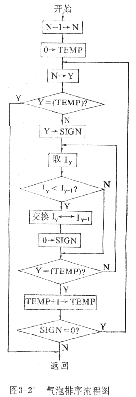

```text
        DEC  LENTH       ; N-1→N
        LDA  #0          ; 临时单元→0
        STA  TEMP
START   LDY  LENTH       ; N→Y
        CPY  TEMP        ; Y=(TEMP)，则返回
        BEQ  RETRN
        STY  SIGN        ; 标志字中存入非0数（原文印作 STY SIGH）
LOOP    LDA  (LIST), Y   ; 取I_Y
        DEY
        CMP  (LIST), Y   ; I_Y < I_{Y-1}?
        BCS  NEXT        ; 不满足，不交换，转至NEXT
        PHA              ; 交换
        LDA  (LIST), Y
        INY
        STA  (LIST), Y
        PLA
        DEY
        STA  (LIST), Y
        LDA  #0
        STA  SIGN        ; 发生交换，0→标志字
NEXT    CPY  TEMP        ; Y<>(TEMP)，续读
        BNE  LOOP        ; （原文印作 BEN LOOP）
        INC  TEMP        ; (TEMP)+1→TEMP
        LDA  SIGN
        BEQ  START       ; 标志字非0则结束
RETRN   RTS
```

### 五、检索有序清单（对分搜索法）

对一个有序清单，要从中找出一个已知值来，逐个搜索当然是不必要的。搜索的方法很多。这里介绍其中较通用的一种——对分搜索。用这种方法进行搜索时，首先从清单的正中开始比较，从而决定欲找的值是在清单的上半部，还是下半部（或者正好是正中这一单元）。这样，一次搜索，要么找到所需的值，要么把寻找范围压缩一半。使用这种方法继续搜索下去，便可很快地搜索完。假定有 $N$ 个元素存于清单之中，理论上说，检索的次数最多仅为 $\log_2 N - 1$（原文印作 $\log 2^N - 1$）。

现在我们假定内存中 `BUFFER+1`—`BUFFER+L` 这些单元存有一个有 $L$ 个元素的有序清单，而 `BUFFER` 单元存有这个清单的长度 $L$。现在，在内存单元 `KEY` 中存有欲寻找的值。假若在清单中的 `BUFFER+Y` 单元找到了这个值，要求程序运行完，将 Y 值存于 `SIGN` 单元中；假若找不到这个值，则要求在 `SIGN` 中存一个 0。

在开始搜索前，我们先设一上边界 U 和一下边界 D，以表示要搜索的范围。开始时，U 和 D 分别对应清单的第一个和最后一个单元。每次找出对应 $\frac{1}{2}(\text{U}+\text{D})$ 的单元进行比较，根据比较结果，若没找到，则用这个值代替 U 或 D（视清单是升序排列还是减序排列）。这样便可逐次完成对分搜索的功能。

程序的流程图示于图 3-22。这里假定清单是按地址顺序递减排列的。如果是递升的，只要交换图中的 A 和 B 便可。

当发现 $\text{U}=\text{D}$ 时，说明已找遍而没有找到。

整个程序如下，这里使用 X 寄存器存 U 值；`SIGN` 单元则先用来存放 D 值。从程序中可见，当 $\frac{1}{2}(\text{U}+\text{D})$ 不为整数时，相当于取了其整数部分：

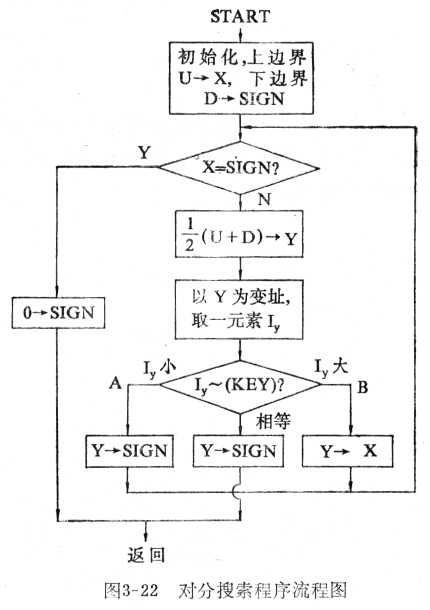

```text
START   LDX  #1          ; 上边界U=1，送X
        LDA  BUFFER      ; 下边界D=L，送SIGN
        STA  SIGN
LOOP    CPX  SIGN        ; U=D，没找到
        BEQ  NOFON
        TXA              ; U→A
        ADC  SIGN        ; U+D
        LSR  A           ; 1/2(U+D)
        TAY              ; A→Y
        LDA  BUFFER, Y   ; 取出一元素I_Y
        CMP  KEY         ; I_Y与(KEY)比较
        BEQ  FOUND       ; 相等，找到。转向FOUND
        BCS  LARGE       ; I_Y大，转向LARGE
        STY  SIGN        ; I_Y小，修改D
        JMP  LOOP        ; 循环
LARGE   TYA              ; 修改U
        TAX
        JMP  LOOP        ; 循环
NOFON   LDA  #0          ; 没找到，#0→SIGN
        STA  SIGN
        RTS              ; 返回
FOUND   STY  SIGN        ; 找到，Y→SIGN
        RTS              ; 返回
```

注意，在这段程序中的 `ADC` 指令前没有 `CLC` 指令。这是因为 U 总是小于等于 D 的，因而当执行前面的 `CPX` 指令时，要么相等而转向 `NOFON` 去了，要么必有 $\text{C}=0$。因而不必再多加一条 `CLC` 指令了。
