# 第四章 中华学习机主板工作原理（Part 1a）

> 本章分为三部分：
> - **Part 1a (§4-1 ~ §4-3)**：主板正视图及逻辑总框图、CPU 及地址总线缓冲器、存储器系统（当前部分）
> - [Part 1b (§4-4 ~ §4-6)](ch04a2-motherboard-part1b.md)：时钟信号产生器、外设卡 I/O 空间分配、键盘和键盘接口电路
> - [Part 2 (§4-7 ~ §4-12)](ch04b-motherboard-part2.md)：录音机接口、扬声器接口、软驱接口、游戏杆接口、打印机接口、汉字处理电路

---

## §4-1 中华学习机主板正视图及逻辑总框图

拧下中华学习机后部侧面及底部前面各三个螺钉，取下上盖，然后拿起键盘部件，拔下键盘与主板联接的 26 线插头，就可以清楚地看到主板顶视方向的全貌。如图 4-1 所示。

图 4-1 中共有集成电路 45 块（集成电路的型号、名称详见表 4-1）。它们和其它元器件（包括电阻、电容、晶体三极管、线圈、电位器、晶体二极管……等）一起构成了中华学习机的主板硬件。其中有中央处理器、存储器（有 RAM、ROM 和存储器管理部件）、时钟信号源、汉字处理电路、键盘输入接口电路、扬声器输出接口电路、监视器（或家用电视机）接口电路、盒式磁带机输入/输出接口电路、游戏杆输入/输出接口电路、扩充外设连接电路和 I/O 管理部件等。

**表4-1 集成电路型号及其名称**

| 编号 | 型号 | 逻辑器件名称 | 编号 | 型号 | 逻辑器件名称 | 编号 | 型号 | 逻辑器件名称 |
| :--- | :--- | :--- | :--- | :--- | :--- | :--- | :--- | :--- |
| U1 | 6502 | CPU | U16 | 74S109 | J-K触发器 | U31 | 74LS139 | 2-4译码器 |
| U2 | 74LS244 | 8个不反相三态门 | U17 | PAL4008 | 可编程阵列逻辑电路 | U32 | 74LS174 | 6D触发器 |
| U3 | 74LS244 | 同上 | U18 | MC1458 | 运算放大器 | U33 | CECWLⅠ | 字库ROM（Ⅰ） |
| U4 | MMU4006 | 内存管理部件 | U19 | NE558 | 4-单稳触发器时基电路 | U34 | CECWLⅡ | 字库ROM（Ⅱ） |
| U5 | 50464 | 4×64K RAM | U20 | 74LS251 | 三态门输出的三-八译码器 | U35 | 27256 | 256K EPROM |
| U6 | 50464 | 4×64K RAM | U21 | 74LS138 | 三-八译码器 | U36 | 74LS02 | 4-或非门 |
| U7 | 27256 | 256K EPROM | U22 | 74LS138 | 三-八译码器 | U37 | 74LS125 | 4-三态门（不带反相器） |
| U8 | 74LS00 | 4-与非门 | U23 | 74LS138 | 三-八译码器 | U38 | 74LS10 | 3-三输入与非门 |
| U9 | 74LS04 | 6-反相器 | U24 | 74LS245 | 8-三态门 | U39 | 74LS323 | 8位通用双向移位寄存器 |
| U10 | 74LS02 | 4-或非门 | U25 | KB3600 | 键盘编码器 | U40 | 256×8 PROM | 256×8 PROM |
| U11 | 74LS08 | 4-与门 | U26 | 2716 | 16K EPROM | U41 | 74LS259 | 8位可寻址锁存器 |
| U12 | 74LS374 | 8-三态门输出的D型触发器 | U27 | 74LS164 | 8位并行输出移位寄存器 | U42 | 74LS174 | 6D触发器 |
| U13 | 2732 | 32K EPROM | U28 | 74LS175 | 4-D型触发器 | U43 | 74LS132 | 施密特触发器 |
| U14 | 74LS166 | 8位移位寄存器 | U29 | 74LS74 | 2-D型触发器 | U44 | 74LS05 | 6-OC门 |
| U15 | IOU4007 | I/O管理部件 | U30 | TCA650 | 彩色信号解调器 | U45 | 555 | 精密定时器 |

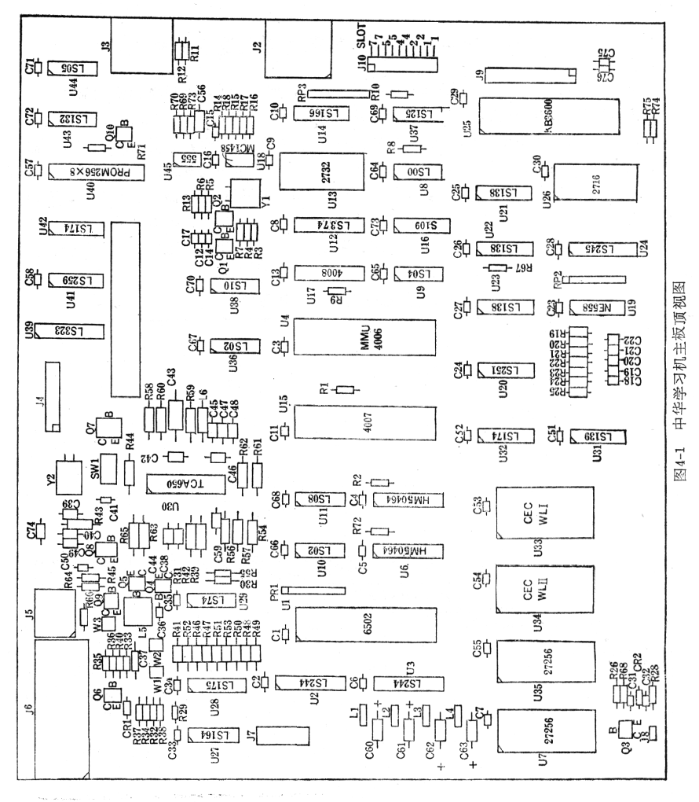
*图 4-1 中华学习机主板顶视图*

中华学习机的逻辑总框图见图 4-2。

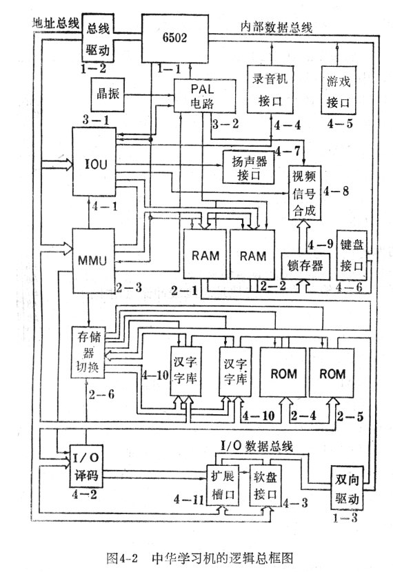
*图 4-2 中华学习机的逻辑总框图*

图中 1-1 到 1-3 是 CPU、地址总线驱动器和数据总线双向驱动器，它们对应图 4-1 中的 U1、U2、U3、U24；图中 2-1 到 2-6 是 64KB RAM、64KB ROM、存储管理部件和存储器切换控制电路，它们对应图 4-1 中的 U4、U5、U6、U7、U8、U9、U10、U11、U31、U32、U33、U34、U35、U37 等；图中 3-1 和 3-2 是时钟信号产生器，对应图 4-1 中的 U16、U17、U37、Q1、Q2、Y1 等；图中 4-1 到 4-10 是输入/输出管理部件和各种外设接口电路等，其中 4-1 外设管理部件对应图 4-1 中的 U15，4-2 I/O 译码电路对应 U21、U22、U23，4-3 软盘驱动器接口对应图 4-1 右上角的 U39—U44、J4、Q10 等，4-4 录音机接口电路对应图 4-1 中的 J3、U18 及 U20 和 U15 的部分功能电路，4-5 游戏杆接口对应图 4-1 中的 J2、U19 及 U20 的部分功能电路，4-6 键盘接口对应图 4-1 中的 J9、U25 和 U26，4-7 扬声器接口对应图 4-1 中左下角的 Q3 和 J8，4-8 和 4-9 视频信号合成电路对应图 4-1 中的 U12、U13、U14、U18 及右上角的 U27—U30、Y2、Q4—Q9、J5、J6 等，4-10 是汉字字库 ROM，对应图 4-1 中的 U33、U34，4-11 是扩充槽口，对应图 4-1 中的 J1、J10。此外，图 4-1 中的左中部有一个 J7，它是电源电压插座，C60—C63 以及 L1—L4 是电源电压的滤波电容和电感。

---

## §4-2 中央处理器及地址总线缓冲器

本节着重介绍中央处理器（CPU）各信号的来源和去处以及各信号完成的功能。

由图 4-2 可知，中华学习机的 CPU 采用了 6502 的八位中央处理器芯片。40 条外引线中，除 16 根地址线、8 根数据线、两根接地线、一条 +5 伏电源线外，中华学习机仅用了包括 $\overline{\text{RES}}$（第 40 脚）、$\overline{\text{IRQ}}$（第 4 脚）、$\overline{\text{NMI}}$（第 6 脚）、RDY（第 2 脚）、SYNC（第 7 脚）、$\phi 0$（第 37 脚）、$\text{R}/\overline{\text{W}}$（第 34 脚）等共七根控制或时钟信号线，其余的引脚（第 3、5、35、36、38、39 共 6 条）在本机中不用。为方便叙述，此处重画 CPU 芯片引脚图，见图 4-3。

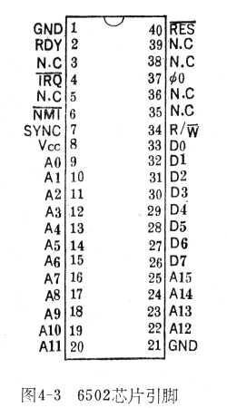
*图 4-3 6502芯片引脚*

### 一、A0—A15 地址线（输出线）

16 条地址线经两个八输入端的三态地址总线缓冲器（附图 1 中的 U2、U3）后送到地址总线上。

16 条地址线寻址范围为 64K 字节。这些地址信号来源于 6502 内部的程序计数器（PC）、输入数据锁存器（DL），堆栈指针寄存器（S）或运算部件（ALU）。到底具体来源于上述四个地址源的那一个要看程序运行情况及执行指令时的寻址方式。16 条地址线的去向主要有六处：

（一）到 MMU（附图 1 U4）存储器管理部件。通过 U4 形成 RA0—RA7 行地址（低 8 位）和列地址（高 8 位）再送到 U5、U6 提供访问存储器的地址。

（二）到 27256（附图 1 U7）选择自检 ROM、监控 ROM 和 BASIC ROM 等。

（三）到附图 2 U15。U15 只利用 A6 信号，去参加 I/O 管理部件的地址译码，以便产生某些与 A6 地址码有关的软开关。

（四）到附图 3 U21、U22、U23 形成使能外设卡 ROM 信号，对配有相应存储空间的外设卡进行片选。如 $\overline{\text{IOSEL1}}$—$\overline{\text{IOSEL7}}$ 这些信号是使能外设卡 256 个单元的固件；$\overline{\text{DEV1}}$—$\overline{\text{DEV7}}$ 是使能外设卡 16 个单元的 I/O 存储空间。

（五）到附图 5 的 U33、U34，这些地址是选择汉字字型点阵，形成一个完整的汉字。

（六）到附图 7 扩充接口卡 J1，去选择外设扩充接口卡上的 ROM 空间。综上所述，地址线 A0—A15 主要是去选择 RAM、ROM 的地址（包括显示 RAM 的地址），或者形成各种软开关，以便用同一地址码选择不同区域的地址空间。

### 二、D0—D7 数据总线（三态双向）

这 8 条数据线是一束可以从 6502 中输出或由外界输入到 6502 的双向传送的三态数据总线。它的传输方向由 $\text{R}/\overline{\text{W}}$ 信号（34 脚）来定。当 $\text{R}/\overline{\text{W}}=1$ 时，表示读取数据，D0—D7 由外界向 6502 传送数据；当 $\text{R}/\overline{\text{W}}=0$ 时，表示写数据，D0—D7 由 6502 向外界输出数据。

#### （一）向 6502 输入代码

1. **U5、U6（附图 1）**：从 64KB 的 RAM 中读取要运行的指令、数据等。
2. **U7（附图 1）**：如选中了集成电路 U7（附图 1），将从 ROM 中读取相应的信息（该信息包括自检程序、监控程序、BASIC 解释程序和 LOGO 子集），送到 6502 的 D0—D7 端。
3. **U24（附图 3）**：由输入设备输出的数据经三态双向传送器 U24（附图 3）送到 6502 的 D0—D7 端。
4. **U26（附图 3）**：把键盘上键入的代码（ASCII 码）取到 6502 中。
5. **U33、U34 和 U35（附图 5）**：为了对汉字进行处理（如打印或显示汉字），可以从 U35 中读取汉字处理程序或从 U33、U34 中读取字符和图形点阵，送到 6502 的 D0—D7 数据端上。

#### （二）从 6502 输出代码

1. **6502 输出到 U5、U6（附图 1）**：即把要存到 RAM 中的代码送到 U5、U6 这两片 RAM 芯片中。
2. **6502 输出到 U12（附图 2）**：即从 6502 中把要送去显示的字符或图形点阵用 ASCII 码方式送取 U12 三态输出锁存器（74LS374）中，以便形成各种要显示的图形或字符信号。
3. **6502 输出到 U24（附图 3）**：即把要从 6502 中送到除显示器外的其他输出设备的数据经 U24 三态双向传送器输出。例如送去打印或送到磁盘驱动器存放的信息都须经 U24 输送。

### 三、控制总线

#### （一）$\text{R}/\overline{\text{W}}$（输出）

$\text{R}/\overline{\text{W}}$ 为读写控制。在 6502 中，它用来控制数据线 $D_0-D_7$ 的传送方向，以便控制读或写操作；此外它经 $U_{37}$（附图 1）三态传送门后分两路：一路送到 U4（附图 1），对 U4 这个存储管理部件进行控制，产生相应的软开关信号或行列地址信号；另一路送到 U5、U6（附图 1），控制 RAM 进行读或写操作。

#### （二）$\overline{\text{RESET}}$（输入）

复位信号 $\overline{\text{RESET}}$，此信号为低电平时，可强制 6502 中央处理器进入初始化过程。一旦 $\overline{\text{RESET}}$ 为高电平，系统按设计者安排，自动进入工作状态。在系统加电时，$\overline{\text{RESET}}$ 保持低电平，当 +5V 电源及时钟信号源的晶体振荡器稳定后，复位信号 $\overline{\text{RESET}}$ 才复位变为高电平。因此可保证开机之后，中央处理器和全系统都处于初始状态。

该信号在加电后可直接由 U15（附图 2）送来，也可以由键盘中 RESET 按键产生。当按下 RESET 按键后，该信号经键盘的 26 线插座的第 22 腿（见附图 7 的 J9 22）送来。两者的作用是一样的，它们都经过由低电平变为高电平的过程，使主机进入工作状态。

#### （三）$\phi 0$（输入）

$\phi 0$ 为主时钟信号（$\phi 1$ 为 $\phi 0$ 的反相信号）。时钟信号源产生的时钟信号经分频器分频后，再由 U17（附图 2）输出。它的频率为 1MHz，其中 $\phi 1$ 送到附图 1 左上角的 U36 或非门第 12 端输入。$\phi 1$ 能否送至 6502 中央处理器，取决于扩充接口卡上的 $\overline{\text{DMA}}$ 信号。如 $\overline{\text{DMA}}$ 无，即 $\overline{\text{DMA}}$ 为高电平，$\phi 1$ 经反向送出 $\phi 0$ 到中央处理器 $\phi 0$ 端；如 $\overline{\text{DMA}}$ 为低电平，则 U36 的 10 端输出高电平，致使 U36 的 13 端总保持低电平，亦即没有 $\phi 1$ 输到 6502 的 $\phi 0$ 端。所以 $\overline{\text{DMA}}$ 为低电平期间，中央处理器停止工作。这时外部设备要交换的数据直接与存储器 RAM 进行交换，直接存储器存储（DIRECT MEMORY ACCESS）由此而得名。

#### （四）SYNC（输出）

SYNC 为同步信号，当处理器工作在取操作码周期时，这根线将变成高电平。即 SYNC 是高电平时，主机一定处于取操作码周期。因此，可以通过测试 SYNC 电平来判别处理器是否处在取操作码周期。SYNC 是由 6502 产生的，它被送到附图 7 的 J1-39 上。

#### （五）RDY（输入）

RDY 为准备好信号。它可延迟 6502 的读取周期，以适应慢速设备的需要。该信号在写周期时无效是从外设接口扩充卡送来的（见附图 7 的 J1-21）。

#### （六）$\overline{\text{NMI}}$（输入）

$\overline{\text{NMI}}$ 为非屏蔽中断请求信号。只要 $\overline{\text{NMI}}$ 信号从高电平跳变到低电平，则中央处理器在完成了当前指令的操作后，立即转入要求中断的设备的处理程序（关于中断的概念在后面的章节中介绍）。此中断的级别最高，该信号由中央处理器输送到外设扩充接口卡上，见附图 7 的 J1-29。

#### （七）$\overline{\text{IRQ}}$（输入）

$\overline{\text{IRQ}}$ 为可屏蔽的中断请求信号。它也是一个中断信号，但它的中断级别在非屏蔽中断请求信号 $\overline{\text{NMI}}$ 之下。当 $\overline{\text{IRQ}}$ 为低时，如中央处理器的中断屏蔽标志位为“0”，则处理器在执行完当前指令后转入中断响应；若中断屏蔽标志位为“1”时，则中央处理器不接受中断请求，该信号来自外设接口扩充卡，见附图 7 的 J1-30。

---

## §4-3 存储器系统

中华学习机的地址空间中有两类存储器：RAM（附图 1 中的 U5、U6）和 EPROM（附图 1 中的 U7 和附图 5 中的 U33、U34、U35）。此外还有两片 EPROM 不在系统的地址空间范围内，其中一片是键盘 ROM，另一片是显示 ROM。这两片 ROM 在后面的章节中予以介绍。

### 一、RAM 和 ROM

#### （一）RAM

中华学习机的随机存取存储器，由两片 HM50464 集成电路组成。RAM 物理地址的寻址范围为 $0000—$FFFF，共 64KB。它们的工作原理和数据流向已经介绍，此处不再赘述。

#### （二）ROM

中华学习机的只读存储器从用途上分为两类。一类作为固化程序用的固件，它存放有各种经常要用到的程序，如监控程序，BASIC 解释程序、汉字管理程序……等等。这类固件由两片 27256 集成电路组成。其物理地址的寻址范围各自均为 $0000—$7FFF，即有两个 32KB 的地址空间。另一类主要存放中西文字、符号、图形等各种点阵。如汉字点阵（U33、U34 其物理地址为 $00000～$1FFFF，共有 128KB 地址空间）、键盘 ASCII 字符码表（U26，其物理地址为 $000—$7FF，共有 2KB 地址空间）和供显示用的字符、图形点阵（U12，其物理地址为 $000—$FFF，共有 4KB 地址空间）。

### 二、存储器地址分配

前面我们介绍了各种用途的存储器及其物理地址。所谓物理地址即是相应的存储器芯片中实际需要寻找的地址。例如 27256 芯片是一个具有 32KB 的芯片。它的地址空间从二进制数 000 0000 0000 0000—111 1111 1111 1111。在它的每一个地址中，都存放着一个 8 位二进制数。通常我们称 27256 芯片为 256Kb 位（32K×8位）二进制存储器。要对 32KB 的地址空间寻址（这样才能访问所有单元），它的地址空间一定为 $0000—$7FFF；同样，对具有 1024K（1M）位的 U33、U34 存储器而言，它的寻址范围是 $00000—$1FFFF。即存有 128K×8位 = 1024K 位的二进制数。

至此，读者一定会问，中华学习机寻址范围最大只有 64KB，如何能对 128KB 地址空间进行寻址呢？又如何对众多的（包括 64KB RAM、2 个 32KB ROM 和 2 个 128KB ROM）地址空间进行访问呢？既然只有 64KB 的寻址范围，这些存储器的地址又是怎样规定的呢？

为了回答上述问题，应首先弄懂逻辑地址这一概念。这个名词是相对计算机系统固有的寻址范围而言的。在中华学习机中，CPU 的地址码为 A0—A15，共 16 位，其逻辑地址就是 $0000—$FFFF。有了逻辑地址的概念，就可以把上述问题归结为：如何把唯一的 64KB 逻辑地址空间，映射到多个同样大小的物理地址空间，从而使得我们可以在有限的逻辑地址空间内，访问比逻辑地址空间大得多的物理存储空间。

#### （一）存储器地址分配

中华学习机中，在 64KB 逻辑地址空间内进行统一编址的存储器有 U5（64K×4 RAM）、U6（64K×4 RAM）、U7（32K×8 ROM）、U35（32K×8 ROM）、U33（128K×8 ROM）和 U34（128K×8 ROM）。图 4-4 示出了上述存储器空间的分配。

主存储器地址空间的分配及相应的功能见图 4-5。

#### （二）主存储器地址空间的分配

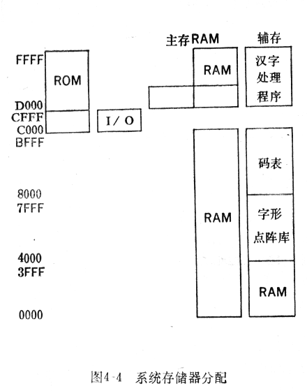
*图 4-4 系统存储器分配*

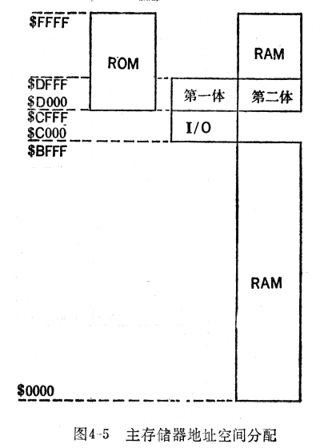
*图 4-5 主存储器地址空间分配*

主存储器由 48KB（$0000—$BFFF）的 RAM，16KB（$D000—$FFFF）的存储块交换区、12KB（$D000—$FFFF）的 ROM 区和 4KB（$C000—$CFFF）的 I/O 地址空间组成。

主存储器简称主存是相对辅助存储器（简称辅存）而言。主存与中华学习机的其它部件一起构成了一个完整的系统。它除了有图中所示的 64KB（$0000—$BFFF 和 $D000—$FFFF）两块 RAM 空间外，还配有系统必需具备的监控程序和 BASIC 解释程序的 ROM 空间。这种划分方法是以能构成一个完整的系统为基础的，严格地说应包括诸如自检程序、小汇编、错误返回信息表……等等固件（有固化程序的 ROM）。然而这仅仅是一种人们习惯的划分方法，没有什么本质的问题。只要读者了解固化的内容和它所在的位置空间，并能熟练、灵活地使用它们就行了。

##### 1. 主 RAM 空间的分配

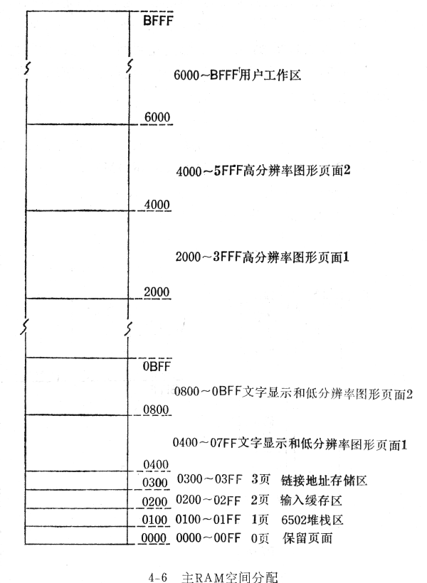
*图 4-6 主RAM空间分配*

图 4-6 把主 RAM 划分成许多存储块，其中大部分（一半以上）提供给用户存放程序和数据，小部份作为系统工作区，供监控或 BASIC 解释程序使用。系统工作区一般不能由用户使用，但系统并不具备禁止用户使用系统工作区的能力。因此，用户在访问系统工作区时，应十分小心，以防系统区受到破坏而导致系统错误动作甚至不能正常运行。

**(1) 0页——保留页面（$0000—$00FF）**

保留页面一般是供给 6502 指令系统中要用到零页寻址（例如零页寻址、变址间接型寻址、间接变址型寻址方式等）的指令，这些指令的共同特点是指令短、寻址灵活。在运行监控程序、BASIC 解释程序及 DOS 中的程序时，要使用到零页地址。因此，当系统在运行上述三类程序时，要避开它们所占用的单元。如果用户程序一定要使用零页单元存放基地址，可找那些没有被占用的单元（见图 4-7—图 4-10）存放基地址；另一种更安全可靠的办法是把用户程序要使用到的零页地址的内容存放到别处（例如存放在堆栈内），在运行完用户程序后（即不再使用零页地址时），把这些单元内容恢复，然后再转到下面要执行的其它程序。

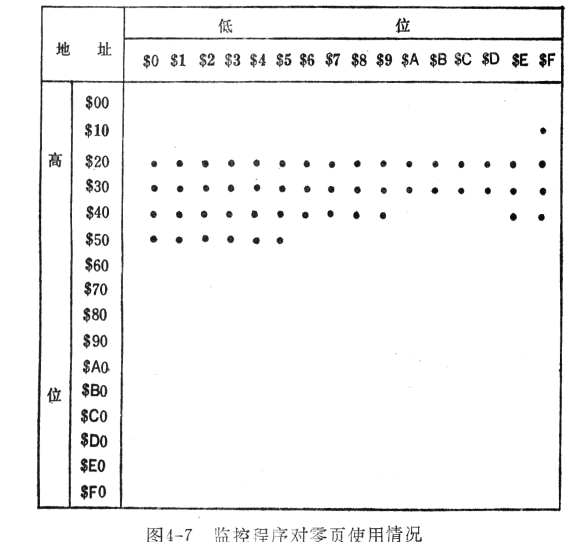
*图 4-7 监控程序对零页使用情况*

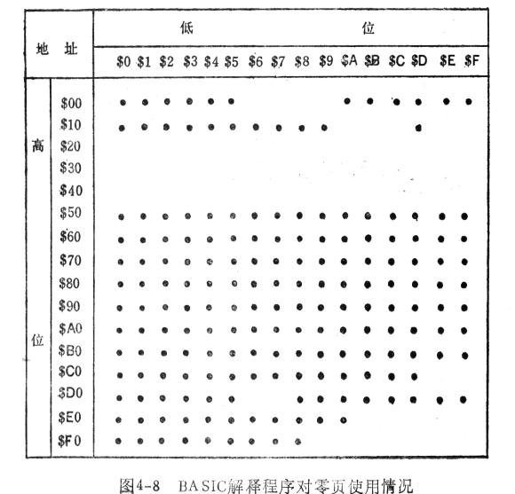
*图 4-8 BASIC解释程序对零页使用情况*

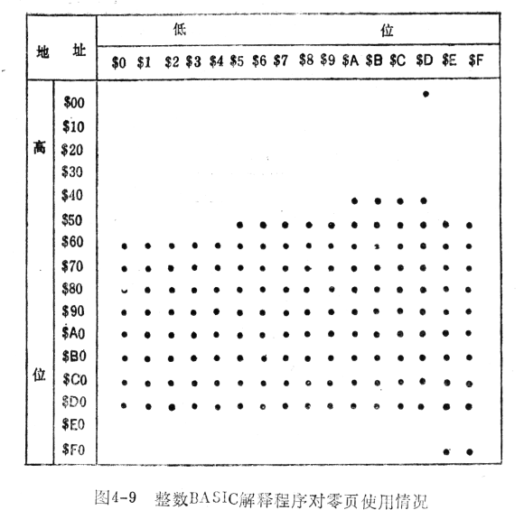
*图 4-9 整数BASIC解释程序对零页使用情况*

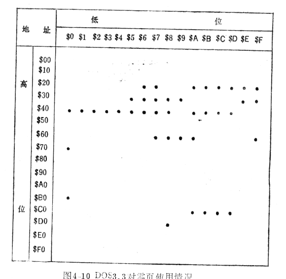
*图 4-10 DOS3.3对零页使用情况*

**(2) 1页——6502堆栈区（$0100—$01FF）**

6502 CPU 使用第一页面作为堆栈区。中华学习机中，有专门的堆栈操作指令使用堆栈区。在使用堆栈时，要注意由于堆栈最大容量是 256 个单元，当存放在堆栈中的字节数超过 256 以后，堆栈将把第 257 个数据存放到堆栈的第一个单元（$0100），从而破坏了原来存放在其中的数据，导致程序运行的错误。因此，在使用堆栈区时，要防止上面的情况发生，即避免所谓“堆栈溢出”现象发生。

**(3) 2页——输入缓存区（$0200—$02FF）**

当键盘输入数据时，输入子程序 GETIN 不断地把键盘上键入的数据取出，送到第 2 页存放。这个缓存区的容量为 256 个字节，亦即可以存放 256 个 ASCII 字符。

**(4) 3页——链接（或称矢量）地址存储区（$0300—$03FF）**

DOS3.3 和监控程序都使用第 3 页的高地址部份存放链接地址。关于 DOS3.3 使用第 3 页面的情况可参阅 DOS3.3 手册中有关内容。
表 4-2 则列出了监控程序使用第 3 页面中部份单元的情况。

**表4-2 监控程序使用第3页的情况**

| 地址 | 功能 | 地址 | 功能 |
| :--- | :--- | :--- | :--- |
| $3F0 $3F1 | 处理BRK请求子程序地址（通常为$59, $FA） | $3F8 $3F9 $3FA | 转向处理用户命令的转移指令 |
| $3F2 $3F3 | 复位矢量 | $3FB $3FC $3FD | 转向非屏蔽中断处理子程序的转移指令 |
| $3F4 | 加电标志 | $3FE $3FF | 中断矢量（存放中断请求的处理程序地址） |
| $3F5 $3F6 $3F7 | 转向处理BASIC命令的转移指令（通常为$4C, $58, $EE） | | |

由表可知监控程序使用了第 3 页面中最高的 16 个单元。而第 3 页面的低地址部份一般被 BASIC 程序中某些较短的机器语言子程序所占用。

**(5) 显示缓存区**

显示缓存区的使用在第八章中有详细叙述，此处只是介绍一般情况。从第 4 页面开始的八页被文本（或字符）显示和低分辨率图形显示所占用。我们把 $0400—$07FF 这个 1KB 的地址空间称作显示页面 1（其中有 34 个单元用作外设 RAM 空间，详见§4-5），把 $0800—$0BFF 这 1KB 地址空间称作显示页面 2。显示页面 1 只能存放要显示的字符和低分辨率图形点阵，不能存放程序或数据；而显示页面 2，主要用于替代字符和低分辨率图形显示。这一页面大多数程序不使用，在此情况下它就可用于存放程序和数据了。

地址 $2000—$3FFF 这 8KB 的空间称作高分辨率图形页面 1，亦称基本的高分辨率图形页面。当程序不使用此页面时就可存放程序和数据。

地址 $4000—$5FFF 是高分辨率图形页面 2。该页面大多数程序不用，此时就可存放程序和数据。

##### 2. 存储体可切换（可交换）空间

把具有相同单元的物理存储空间映射到同一逻辑地址空间，称为存储体间的交换（切换）。图 4-11 是存储体可交换空间。

存储体的交换是通过改变软开关状态来实现的，详细情况可参见本节三中关于存储器管理部件软开关部分。

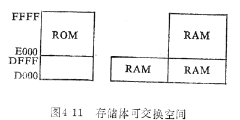
*图 4-11 存储体可交换空间*

从图 4-11 可以看出，存储体切换实际包含两个内容：其一是在同一逻辑地址 $D000—$FFFF 上，选择 ROM 空间还是选择 RAM 空间；其二是在同一逻辑地址 $D000—$FFFF 的 RAM 空间内，选择 RAM 第一体还是 RAM 第二体（在实际使用中，第一体包括了左边的 $D000—$DFFF 和右边的 $E000—$FFFF 空间；第二体包括右边的 $D000—$DFFF 和 $E000—$FFFF 空间）。对上述地址空间的使用，要求谨慎行事，否则会使程序运行混乱。

需要说明，在加电或者复位情况下，系统的初始状态为允许读地址在 $D000—$FFFF 的 ROM 空间，允许写地址为 $D000—$FFFF 的 RAM 空间和 RAM 第二体空间。

#### （三）辅助存储器地址空间的分配

除了主存以外剩余部分全归到辅助存储器的地址空间范围。这与主存一样也只是相对而言，因为在辅助存储器空间内还固化有 LOGO 语言的子集，这本应属于与 BASIC 语言相同的范畴，似乎应划归到主存内。然而我们说主/辅存的划分只是人为的一种分类，由于上述 LOGO 语言固件所在的物理地址空间，更接近于辅存的范围，因而人为地把它划入辅存地址空间去了。辅助存储器参见图 4-4，可以分为如下几个部分。

1. **RAM 空间（$0000—$3FFF）**  
   这部分物理空间在辅存中并不存在，当 CPU 访问 $C003、$C009 和 $C004 单元，设置了软开关后，就把主存中对应的物理存储空间切换到辅存。但这部分逻辑地址仍占用主存中的 $0000—$3FFF。因此，它们实际上仍使用 U5、U6 两个芯片的 $0000—$3FFF 地址空间。关于如何在主/辅存中进行切换可参阅本节存储器管理部件软开关部分。

2. **16 个 16KB ROM 空间（$4000—$7FFF）**  
   在 $4000—$7FFF 的逻辑地址空间中，实际上有 16 个物理地址空间与之对应。它们利用选体控制字 D3—D0 位（将在§4-12节汉字处理电路中介绍），来决定选用 16 个体中的哪一个。这 16 个体存放的是汉字字形点阵。

3. **辅存 ROM 第一、第二体（$8000—$BFFF）**  
   在 $8000—$BFFF 逻辑地址空间中，映射有两个物理地址空间：辅存 ROM 第一体在 EPROM U35 的 $0000—$3FFF 中，即 U35 32KB 空间的低 16KB 地址部分。该体内主要存放汉字码表及部分 LOGO 语言子集；第二体在 EPROM U7 的 $0000—$3FFF 中，即 U7 32KB 空间的低 16KB 地址部分，该体内主要存放 LOGO 语言的子集。两个体之间的切换是通过选体控制字 D6 位状态来实现的。当 D6=0 时选第一体，当 D6=1 时选第 2 体。

4. **辅存最高 12KB ROM（$D000—$FFFF）**  
   这个 12KB 地址对应于 EPROM U35 的高地址部分。该空间存放汉字处理程序。

5. **2KB 的 ROM 空间（$C000—$CFFF）**  
   在图 4-4 中还有三块各为 2KB 的 ROM 空间，即内部 ROM 中的 $C000—$CFFF，I/O ROM 空间中的 $C000—$CFFF 和划归辅存 ROM 范围内的 $C000—$CFFF。这三块 ROM 空间中，I/O ROM 空间和辅存 ROM 空间都是供 I/O 使用的，其中 I/O ROM 空间按常规讲，在主板上没有它所对应的物理地址空间，它们的空间应在外设的扩展卡上。但中华学习机中为了充分利用主机板上的 ROM 空间，除了在外设扩展卡（只有一扩展槽口，见附图 7 J1）上有 I/O ROM 相对立的物理空间外，其余的 I/O ROM 均使用了辅存 ROM 的空间。具体地说，在软盘驱动器接口卡要使用的 ROM 空间以及汉字处理电路使用的 ROM 空间，分别利用了辅存 ROM，其物理地址空间在 EPROM U35 芯片上。它们分别占用了 U35 上的 $4300—$43FF 空间（固化有汉字入口程序）和 $4600—$46FF 空间（固化有磁盘驱动器引导程序 $\text{BOOT}\phi$）。选择这两个空间的控制信号，可见附图 1。由附图 3 送来的 $\overline{\text{IOSEL3}}$ 和 $\overline{\text{IOSEL6}}$ 信号经低电位或非门（图中标出的是高电位与非门）U38 后，分别使该门输出端变高，再经 U9 反向送到 27256 芯片（U35）的 $\overline{\text{OE}}$ 使能端上，从而使这两个控制信号 $\overline{\text{IOSEL3}}$ 和 $\overline{\text{IOSEL6}}$ 能分别选择 U35 上的 $4300—$43FF 和 $4600—$46FF 空间。达到逻辑空间为 I/O ROM，但实际选择的却是辅存 ROM 的目的。  
   至于内部 ROM 的 $C000—$CFFF，它的物理地址空间是在附图 1 的 EPROM 27256 U7 的 ROM 中。这一块内部 ROM 空间的选择受内存管理部件 MMU 所控制。具体的控制信号是 MMU 的输出信号 $\overline{\text{ROMEN1}}$。这个信号又受 MMU 中的软开关控制，当 CPU 访问 $C007 把 MMU 中的软开关 SLOTCXROM 置位后，就选择内部 ROM 空间 $C100—$CFFF 了。

### 三、存储器管理部件

存储器管理部件控制着中华学习机整个存储系统，它可以把从 CPU 送来的地址码 A0—A15 转换成 64K RAM 所需要的行列地址再送到 RAM 中去；它在 CPU 控制下，可以产生一系列软开关，去选择主存储器或辅助存储器、内部 ROM、I/O 空间、RAM 存储体 1 和 RAM 存储体 2 等等。

MMU 实际上是把许多相关功能集成在一起，用门阵列构成了一个功能较强的控制电路。MMU 共有 40 条引脚，其中有 22 个输入，它们包括 16 根地址线，3 个输入定时信号（$\phi 0$、Q3 和 $\overline{\text{PRAS}}$）和三个输入控制信号 $\text{R}/\overline{\text{W}}$、$\overline{\text{INH}}$ 和 $\overline{\text{DMA}}$；16 个输出信号，它们包括 8 个复用行列地址线 RA0—RA7 和 8 个控制或状态输出 $\overline{\text{RAMEN}}$、$\overline{\text{ROMEN1}}$、$\overline{\text{ROMEN2}}$、$\overline{\text{KBD}}$、MD7、$\text{C}\times\times\times$、$\text{MDI}/\text{O}$、$\overline{\text{EN80}}$，具体引脚见图 4-12。

#### （一）引脚信号功能

- **A0—A15（输入）**：CPU 经三态输出门送来的 16 位地址信号。
- **$\phi 0$（输入）**：系统时钟信号，其频率为 1MHz，用作 MMU 存储器管理部件内部定时。来自 CPU。
- **Q3（输入）**：中间时钟信号，其频率为 2MHz，用作 MMU 内部定时或选通信号。来自 4008 PAL 电路。
- **$\overline{\text{PRAS}}$（输入）**：行地址选通信号，来自 PAL 电路。
- **$\text{R}/\overline{\text{W}}$（输入）**：读/写信号，用于产生 MMU 内部软开关，控制数据传送方向。来自 CPU。
- **$\overline{\text{INH}}$（输入）**：中断请求信号。当它起作用时（即 $\overline{\text{INH}}=0$ 时），禁止 CPU 访问主板上所有存储器，包括主存和辅存。这是由于 MMU 所管理的 RAM 和 ROM 存储体在 $\overline{\text{INH}}=0$ 时，$\overline{\text{RAMEN}}$、$\overline{\text{ROMEN1}}$、$\overline{\text{ROMEN2}}$、$\overline{\text{EN80}}$ 均变高，使受这些信号控制的芯片失去使能信号，而达到禁止 CPU 访问的目的。
- **RA0—RA7（输出）**：行、列地址复用线。在 $\phi 0$ 为高电平期间，由 $\overline{\text{PRAS}}$ 信号控制行、列地址的分时发送。它们与时钟信号的时间关系，可参见 64KB RAM 读/写时的波形图。这八位地址和 A0—A15 的对应关系见表 4-3。
- **$\overline{\text{KBD}}$（输出）**：在访问（读）$\$C00\times$ 或 $\$C01\times$ 时，读信号为低电平有效，以便读取键盘输入数据。
- **MD7（输出）**：软开关状态输出信号，MMU 中有不少软开关，有时 CPU 要读取这些开关状态，这时访问 $\$C011—\$C018$，就能知道对应的软开关状态。它之所以要放在数据总线第 7 位上，目的是直接送至寄存器最高位，便于判断。
- **$\overline{\text{RAMEN}}$（输出）**：RAM 使能信号。当 $\overline{\text{RAMEN}}=0$ 时，可以访问主 RAM 中的 $\$0000—\$BFFF$ 和 $\$D000—\$FFFF$。
- **$\overline{\text{ROMEN1}}$（输出）**：当 $\overline{\text{ROMEN1}}=0$ 时，允许对 ROM 空间 $\$C100—\$DFFF$ 进行访问，它们包括内部 ROM 空间 $\$C100—\$CFFF$ 和 ROM 空间 $\$D000—\$DFFF$。
- **$\overline{\text{ROMEN2}}$（输出）**：当 $\overline{\text{ROMEN2}}=0$ 时，允许访问 ROM 空间 $\$E000—\$FFFF$。
- **$\text{MDI}/\text{O}$（输出）**：该输出信号控制了附图 3 中三态双向传送器 U24 的传送方向。当 $\text{MD}=1$ 时，控制外部数据总线 D0—D7 向内部数据总线 MD0—MD7 传送数据。其中包括：
  1. 访问 $\text{C}\times\times\times$ 时，除与对 $\$C00\times$、$\$C01\times$ 及内部 ROM $\$C100—\$CFFF$ 的访问以外，CPU 可以从外部数据总线读取数据。
  2. 当有中断请求，即 $\overline{\text{INH}}=0$ 时，CPU 利用外部数据总线 D0—D7 读取数据。
  3. 当有直接存储器存取时，$\text{DMA}=0$，CPU 利用外部数据总线 D0—D7，请求 DMA 的设备交换信息。
- **$\text{C}\times\times\times$（输出）**：使能外设卡 ROM 信号。输出高电平时有效，当 $\text{C}\times\times\times=1$ 时，可以访问除内部 ROM $\$C100—\$CFFF$ 及 $\$C0\times\times$ 以外的 $\$C\times\times\times$ 空间。

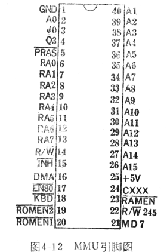
*图 4-12 MMU引脚图*

**表4-3 复用地址对照**

| 复用地址 | 行地址 | 列地址 |
| :--- | :--- | :--- |
| RA0 | A0 | A8 |
| RA1 | A1 | A9 |
| RA2 | A2 | A10 |
| RA3 | A3 | A11 |
| RA4 | A4 | A12 |
| RA5 | A5 | A13 |
| RA6 | A6 | A14 |
| RA7 | A7 | A15 |

#### （二）软开关

中华学习机使用了软开关，使得它能在较小的逻辑地址空间（$0000—$FFFF）内，可以访问比它大得多的物理地址空间。软开关的作用，就是利用程序指令，对某一个地址（不是存储器内部单元）进行访问，使其建立对应的状态，去切换具有相同逻辑地址空间的不同物理地址空间。换句话说，利用程序指令去拨动一个开关，以便接通对应的物理地址空间，让 CPU 对该空间进行访问。MMU 输出的信号，和选择存储器有关的控制信号，均受 MMU 中的软开关控制。MMU 的软开关可分成四大类：(1) 主存/辅存的切换；(2) 内部 ROM 和 I/O 空间的切换；(3) 空间 $D000—$FFFF 的选择；(4) 显示缓冲区页面的选择等。

##### 1. 主存/辅存的切换

这类开关共有四个，可以利用指定地址进行读操作，来设置对应的软开关状态，详见表 4-4。

(1) **80STORE**：选择主/辅存空间某段地址空间。  
当 80STORE 为 ON（写 $C001 单元）状态时，就可根据与显示页面有关的软开关 HIRES 和 PAGE2 的不同状态，去选择主存或辅存中的文本显示页面或高分辨率图形显示页面（详见第七章）；当 80STORE 为 OFF（写单元 $C000）时，则由 RAMRD 和 RAMWRT 两个软开关来选择主存或辅存的读写。

(2) **RAMRD**：在主存或辅存中选择读操作  
当 RAMRD 为 ON 时，选择对辅存中的 $0200—$BFFF 空间进行读操作；当 RAMRD 为 OFF 时，选择对主存空间 $0200—$BFFF 进行读操作。

(3) **RAMWRT**：在主存或辅存中选择写操作  
当 RAMWRT 为 ON 状态时，选择对辅存空间 $0200—$BFFF 进行写操作；当 RAMWRT 为 OFF 时，选择对主存空间 $0200—$BFFF 进行写操作。

(4) **ALTZP**：选择主存 RAM 或辅存 RAM  
当 ALTZP 为 ON 时，将 $0000—$01FF 和 $D000—$FFFF 映射给辅存；当 ALTZP 为 OFF 时，把上述空间映射给主存。

上述三个软开关 (2)—(4) 的作用见表 4-5。

**表4-4 主/辅存切换软开关访问地址**

| 软开关 | 置位 | 复位 | 读状态 |
| :--- | :--- | :--- | :--- |
| 80STORE | $C001 | $C000 | $C018 |
| RAMRD | $C003 | $C002 | $C013 |
| RAMWRT | $C005 | $C004 | $C014 |
| ALTZP | $C009 | $C008 | $C016 |

*(注：原书表头误印为“位置”，实为“置位”)*

**表4-5 RAMRD、RAMWRT及ALTZP三个软开关作用**

| 软开关 | 状态 | 说明 | 访问地址 |
| :--- | :--- | :--- | :--- |
| RAMRD | OFF | 对主存 $0200—$BFFF 进行读操作 | $C002 |
| | ON | 对辅存 $0200—$BFFF 进行读操作 | $C003 |
| RAMWRT | OFF | 对主存 $0200—$BFFF 进行写操作 | $C004 |
| | ON | 对辅存 $0200—$BFFF 进行写操作 | $C005 |
| ALTZP | OFF | 选主存堆栈 0 页和存储块交换反映射给主存 | $C008 |
| | ON | 选主存堆栈 0 页和存储块交换反映射给辅存 | $C009 |

##### 2. 内部 ROM 空间和 I/O 空间的切换

内部 ROM 空间和 I/O 空间的切换有两个软开关。它们除了完成上述切换外，还可控制把 $C3\times\times$ 空间映射到内部 ROM 或 I/O。当这两个软开关中有一个状态把空间 $C3\times\times$ 映射到内部 ROM，则 $C3\times\times$ 这一页一定映射到内部 ROM；当这两个软开关状态都把 $C3\times\times$ 映射到 I/O 空间，即 SLOTCXROM 处于 OFF、SLOTC3ROM 处于 ON 时，才将 $C3\times\times$ 空间映射到 I/O 空间。

**表4-6 内部ROM和I/O之间的切换**

| 软开关 | 置位 | 复位 | 读状态 |
| :--- | :--- | :--- | :--- |
| SLOTCXROM | $C007 | $C006 | $C015 |
| SLOTC3ROM | $C00B | $C00A | $C017 |

##### 3. 对存储块可交换区 $D000—$FFFF 的选择

软开关 ALTZP 可将 RAM 中的 $D000—$FFFF 映射到辅存（当 ALTZP = ON 时）或主存（当 ALTZP = OFF 时）。

但从图 4-4 地址空间分配图中看到，在此地址范围内还有一块 ROM 区。因此需要把逻辑地址空间 $D000—$FFFF 映射到 RAM 区或 ROM 区。此外还要求在同一地址内将读操作映射到 ROM、写操作映射到 RAM、对 RAM 进行写保护以及选择 $D000—$DFFF 空间内的两个 4KB RAM 区。以上空间的选择都可通过 MMU 软开关来实现。

**表4-7 存储器选择开关**

| 软开关地址 | 写 RAM | 读 RAM | 读 ROM | 4K RAM体 第一体 | 4K RAM体 第二体 | 注 |
| :--- | :---: | :---: | :---: | :---: | :---: | :---: |
| $C080 | | • | | | • | |
| $C081 | • | | • | | • | 1 |
| $C082 | | | • | | • | |
| $C083 | • | • | | | • | 2 |
| $C084 | | • | | | • | |
| $C085 | • | | • | | • | 1 |
| $C086 | | | • | | • | |
| $C087 | • | • | | | • | 2 |
| $C088 | | • | | • | | |
| $C089 | • | | • | • | | 1 |
| $C08A | | | • | • | | |
| $C08B | • | • | | • | | 2 |
| $C08C | | • | | • | | |
| $C08D | • | | • | • | | 1 |
| $C08E | | | • | • | | |
| $C08F | • | • | | • | | 2 |

注：
1. 这些软开关写使能 RAM，读使能 ROM。
2. 连续两次读这些软开关既能使能 RAM 读，也能使能 RAM 写。〔编者按：原书误印为“使能ROM写”，ROM无法写入，实为使能RAM写〕

从表中可归纳出一些对这些地址空间访问的规律：
- ROM读和RAM读分别为 $A_0+A_1$ 和 $\overline{A_0+A_1}$ 〔编者按：硬件实际逻辑为异或关系 $A_0 \oplus A_1$ 与 $\overline{A_0 \oplus A_1}$〕
- RAM写和RAM禁止分别为 $A_0$ 和 $\overline{A_0}$
- RAM第一体和RAM第二体分别为 $A_3$ 和 $\overline{A_3}$

应注意，在 $D000—$DFFF 存储空间的两块 RAM 中，不能选择成读一块 RAM，写另一块 RAM，而只能在同一体内进行读写。此外在 $D000—$FFFF 存储空间中不能读其中一部分 ROM 又读剩下的 RAM 空间。例如绝不能既读 ROM 中的监控又读存储可交换区中的 RAM。如果要让存储块可交换区 RAM 中的程序使用监控程序，必需首先把 ROM 中的监控程序调出，存放到低地址的 RAM 区中，然后再移入存储块可交换区中的 RAM 空间。此后就能使用驻留在存储可交换区 RAM 中的程序和已调到该区内的监控程序。

##### 4. 显示缓存区页面选择软开关

有关内容将在§8-3节中介绍，此处不再赘述。
