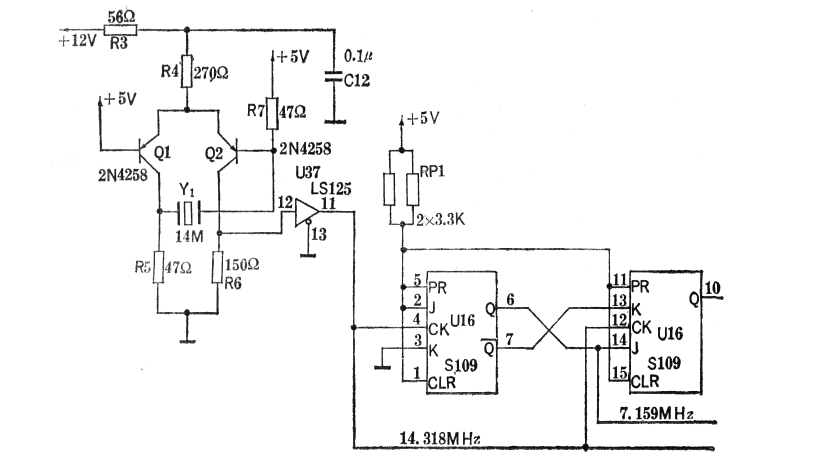
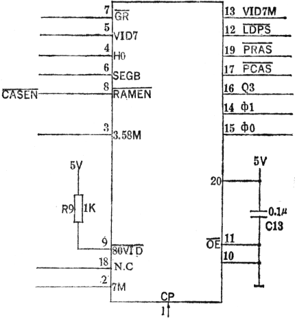
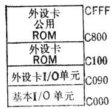
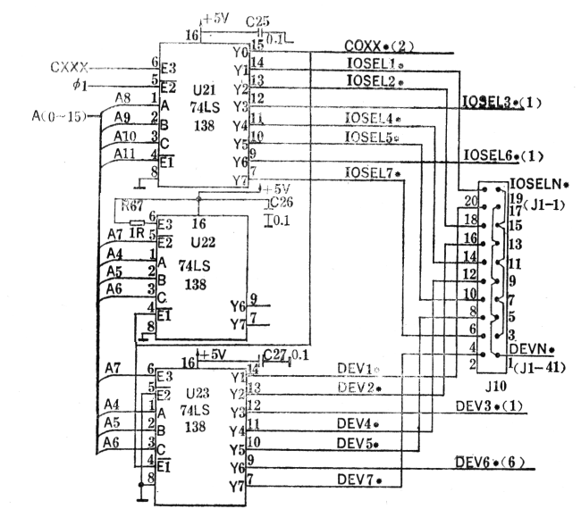
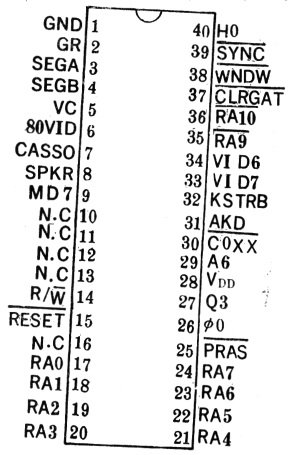
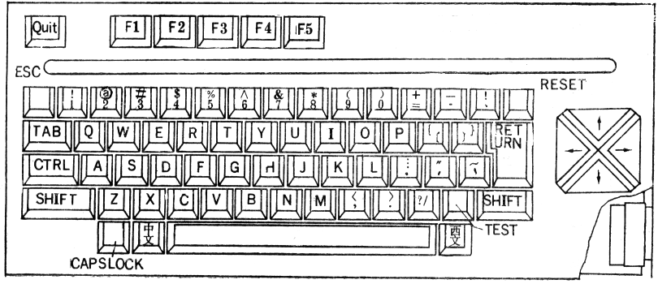
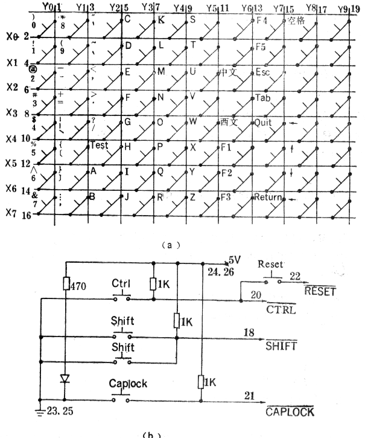
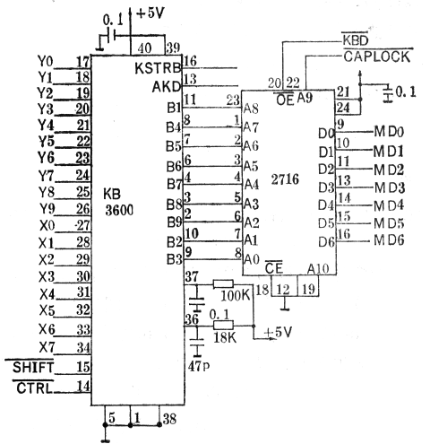
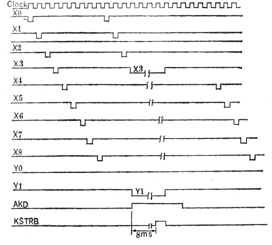

# 第四章 中华学习机主板工作原理（中）

> 前接：[第四章 中华学习机主板工作原理（Part 1a: §4-1 ~ §4-3）](ch04a1-motherboard-part1a.md)  
> 后接：[第四章 中华学习机主板工作原理（Part 2: §4-7 ~ §4-12）](ch04b-motherboard-part2.md)

---

## §4-4 时钟信号产生器

时钟信号产生器是由主振电路、二分频和四分频电路以及可编程阵列逻辑电路 PAL（Program Array Logic）构成。

### 一、主振电路及其分频

主振电路是由一个晶体振荡器产生 $14.318\text{MHz}$ 信号，经 U37 门输出到 U16 两个 J-K 触发器，每一个触发器实现一次二分频，所以 U16 的 6 端输出的信号为 $7.159\text{MHz}$，U16 的 10 端输出 $3.58\text{MHz}$ 的信号（见图4-13或附图2）。


*图4-13 主振电路及其分频*

#### （一）14.318MHz 信号

该信号有三个去向：
1. 到 U17（附图2）作为可编程阵列逻辑 PAL 电路的 CP 输入端，时钟脉冲 CP（CLOCK PULSE）输入端给 PAL 电路提供了一个基准时钟，以便在 PAL 电路中产生其他时钟及控制信号；
2. 到 U14（见附图2）视频并转串行移位寄存器的 CP 端，给移位寄存器提供一个移位脉冲，从而把并行输入到移位寄存器（U14）的字符图形点阵转换成串行方式输出；
3. 到八位串行输入并行输出的移位寄存器（见附图4的 U27）的 CP 端，从而把要显示的视频信号转换成并行信号。

综上所述，$14.318\text{MHz}$ 信号，主要用作上述电路中的时钟信号。

#### （二）7.159MHz 信号

$7.159\text{MHz}$ 时钟信号是由 $14.318\text{MHz}$ 信号经 J-K 触发器分频而产生的。它有两个去向：其一，到 U17（见附图2）的 2 脚输入端，提供一个 $7.159\text{MHz}$ 的时钟信号，供 U17 可编程阵列逻辑电路使用；其二，送到外接扩充插口。

#### （三）3.580MHz 信号

$3.580\text{MHz}$ 信号是由 $7.159\text{MHz}$ 信号经 J-K 触发器分频而产生的。它有三个去向：其中两个去向与 $7.159\text{MHz}$ 信号类似；其三是送到 U28（附图4）的 9 脚上，供给 U28 一个时钟信号。

---

### 二、可编程阵列逻辑（PAL）——时钟形成电路

可编程阵列逻辑电路简称逻辑阵列电路，这种器件在制作过程中，采用了内部编排逻辑阵列的方式，在完成制作后，编排的方式或者说电路的输入/输出之间的逻辑关系确定了。该电路接收时钟信号产生器送来的 $14\text{MHz}$、$7\text{MHz}$ 和 $3.5\text{MHz}$ 及其他控制信号，经阵列逻辑电路提供给中华学习机各种控制信号和时钟信号。图4-14即为 PAL 电路的引脚及连接图。


*图4-14 PAL电路的引脚及连接图*

由图4-14可知，PAL 共有 20 根引线，其中有 10 个输入信号，8 个输出信号，一个电源，一条是地线。

#### （一）时钟输入（3个）

CP1 端的 $14.318\text{MHz}$、2 端的 $7.159\text{MHz}$ 和 3 端的 $3.58\text{MHz}$ 信号，都是用来产生其他时钟及控制信号的基准时钟的。

#### （二）其他输入控制信号

1. **$\text{H}_0$（显示计数器水平计数位）、$\text{SEGB}$（显示计数器垂直计数位）与 $\overline{\text{GR}}$（选择图形方式信号）**  
   这三个信号均由 U15（附图3）即 IOU（输入输出管理部件）中的各种软开关控制而产生的。这三个信号在图形方式下对 $\text{VID7M}$（视频移位寄存器并行输入转串行输出的使能信号）和 $\overline{\text{LDPS}}$（视频移位寄存器串行输出的使能信号）的波形和相位产生影响。
2. **$\text{VID7}$**  
   来自 U12（附图2）视频数据线第七位 $\text{VID7}$。其功能同 1，即对 $\text{VID7M}$ 和 $\overline{\text{LDPS}}$ 的波形和相位产生影响。
3. **$\overline{\text{RAMEN}}$**  
   是 U11（附图1）的输出信号 $\overline{\text{CASEN}}$。该信号为零时，在 $\phi_0$ 期间使 PAL 电路产生列使能信号 $\overline{\text{PCAS}}$。当 $\overline{\text{CASEN}}=1$（即为高）时，在 $\phi_0$ 期间不产生 $\overline{\text{PCAS}}$ 信号。
4. **$\overline{\text{80VID}}$**  
   是控制监示器产生 80 列显示还是 40 列显示的控制信号。$\overline{\text{80VID}}=0$ 时，产生 80 列显示；当 $\overline{\text{80VID}}=1$ 时产生 40 列显示。中华学习机不用 80 列显示，故把该输入端经电阻接 +5V 电源。
5. **$\text{ENTMG}$**  
   主时钟使能信号图中为 $\overline{\text{OE}}$。该信号为低时，可使 PAL 电路输出各种定时信号和控制信号。而当该信号为高时，时钟信号被锁死。中华学习机中，$\text{ENTMG}$ 总为零，即 PAL 电路 11 脚接地，以保证 PAL 电路上的所有输出信号总能输出信号。

#### （三）系统时钟输出信号

1. **$\phi_1$——1MHz 系统主时钟输出信号**  
   它输出到 U36 和 U37（见附图1）。$\phi_1$ 在没有“直接存储器存取”请求时，给 6502CPU 提供 1MHz 主时钟信号。此外，$\phi_1$ 还作为 U37（三态门）的控制信号，当 $\phi_1$ 为高电平时，使 U37 的输出为高阻抗，这时 +5V 电源经 R72 电阻给 U5、U6 的 $\text{R}/\overline{\text{W}}$ 输入端一高电平，确保在 $\phi_1$ 作用期间只能从 RAM 中读取代码，不能写入代码。从而在 $\phi_1$ 期间实现了主 RAM 存储器只能被用作仅要求读操作的显示存储器。在 $\phi_0$ 期间主 RAM 才起主存储器的读/写存储器作用。  
   $\phi_1$ 送到 U21（附图3）的控制端作 U21 的片选控制信号。还送到 J1 38（附图7）外设接口插座，供扩充外设接口使用。

2. **$\phi_0$——1MHz 时钟输出信号**  
   （1）主时钟输出信号 $\phi_0$ 到 U4（附图1），用作 MMU 存储器管理部件的时钟信号。在 $\phi_0$ 期间，主 RAM 成为 6502CPU 的随机存储器。通过 $\phi_0$，MMU 存储管理部件向 6502CPU 首先送出数据访问地址。$\phi_0$ 其他作用见前面 MMU 的介绍。  
   （2）$\phi_0$ 到 U12（附图2），作 U12 的时钟输入 CP 和输出使能 $\overline{\text{OE}}$ 控制信号。故在 $\phi_0$ 作用期间，即 $\phi_0$ 为低电平时，打开 U12 的接收门和发送门，从而把刚输入的 8 位数据（MD0—MD7）接收到 D 型触发器并经 D 型触发器送出。  
   （3）$\phi_0$ 到 U15（附图2），作为 IOU 的主时钟信号。  
   （4）$\phi_0$ 到 U36（附图3），并经 U36 等对 U24（附图3）的 74LS245 这个三态输出双向传送器进行控制。  
   （5）$\phi_0$ 到 U38（附图3），以便与 $\text{C}\times\times\times$ 和 A11 两个信号一起形成 $\overline{\text{IOSTROB}}$ 信号，即扩充外设接口卡上要用到的 2K ROM 使能选通信号。  
   （6）$\phi_0$ 到 J1 40（附图7），直接供外设扩充卡使用。

#### （四）中间时钟输出信号 Q3

它是一个频率为 $2\text{MHz}$ 的内部定时选通信号。Q3 到 U4（附图1）MMU 存储管理部件的 Q3 输入端，用作定时时钟选通信号；到 J1 17（附图7）外设插座，为扩充外设接口卡提供时钟控制信号。

#### （五）行和列地址选通输出信号 $\overline{\text{PRAS}}$ 和 $\overline{\text{PCAS}}$

行和列地址选通信号可把 A0—A15 送入 RAM 中，其中 $\overline{\text{PRAS}}$ 与 $\phi_0$ 和 Q3 一样都是时钟信号的一种，只要系统进入正常状态，PAL 电路总会产生该信号，它的频率为 $2\text{MHz}$。$\overline{\text{PCAS}}$ 信号则不然，在 $\phi_0$ 期间当 $\overline{\text{RAMEN}}$ 信号为低电平时，才产生此信号。如 $\overline{\text{RAMEN}}=1$ 时，则不产生 $\overline{\text{PCAS}}$ 信号。但是在 $\phi_1$ 期间，$\overline{\text{PCAS}}$ 信号不受 $\overline{\text{RAMEN}}$ 信号的控制，即在 $\phi_1$ 期间总有此信号。

$\overline{\text{PCAS}}$ 信号的频率为 $1\text{MHz}$。它比行地址选通信号 $\overline{\text{PRAS}}$ 低一倍。它是工作在 $\phi_1$ 周期内的读取显示 RAM 所用的列地址选通信号。行地址信号 $\overline{\text{PRAS}}$〔原书作PARS〕，送到 U5、U6（附图1）作为 RAM 的行地址选通信号；送到 U15（附图2）作为显示缓冲区的行地址选通信号（详见 IOU 介绍）。

列地址信号 $\overline{\text{PCAS}}$ 只送到 U5、U6，作为 RAM 的列地址选通信号。

#### （六）$\overline{\text{LDPS}}$ 输出信号

送到 U14（附图2）移位寄存器，作为该寄存器的并行数据输入的使能信号。

---

## §4-5 外设卡输入/输出空间分配

中华学习机 CPU6502 的指令系统中，没有专门的输入/输出指令，也没有专用的外部设备控制线。主机与外设间信息的传送方式和主机与内存的信息交换一样，是通过访问分配给外设的地址空间来实现的。这个外设地址空间即图4-4中显示的 I/O 空间，它占用了 $\$C000—\$CFFF$ 共 4K 地址。这些地址空间的分配见图4-15。

由图4-15可知，I/O 空间 $\$C000—\$CFFF$ 被分成两类：第一类是基本的输入/输出，它占用了 $\$C000—\$C08F$ 地址空间；第二类是供外设卡输入/输出使用的，其地址空间为 $\$C090—\$CFFF$。


*图4-15 I/O存储空间的分配*

### 一、基本输入/输出存储空间（$C000—$C08F）

基本输入/输出主要用于数据和状态的输入/输出或进行软开关的设置，以便进行对存储体的切换或系统工作状态的改变。

#### （一）数据输入

中华学习机中基本的数据输入只有一种，即从键盘上输入数据（其键盘的设备地址码为 $\$C000$）。它是一个八位数，其中低七位为 ASCII 码，最高位是键盘选通信号。当它为“1”时，表示有新的键码输入。所以最高位实际上是一个键盘码输入标志位。

#### （二）标志输入

基本输入中大部分是执行标志输入，中华学习机中这些标志位均设置在对应单元的最高位。显然标志位值只能取“0”或“1”值。游戏接口标志输入的地址码为 $\$C061—\$C067$，盒式录音机接口标志输入的地址码为 $\$C060$，此外各软开关状态也属于标志输入。例如显示方式的软开关状态就属于标志输入，各方式开关的地址为 $\$C050—\$C057$。

#### （三）标志输出

中华学习机中基本的标志输出有两个。一个是盒式录音机接口用的标志输出信号 CASSO，其地址为 $\$C020$；另一个是扬声器接口电路用的标志输出信号 SPKR，其地址为 $\$C030$。CPU 每访问一次上述对应的地址单元，其相应输出状态就翻转一次。

#### （四）选通输出

选通输出信号一般用专门的地址码来完成。例如清键盘的选通信号就是利用专用地址码 $\$C010$。一旦有此选通信号，则键盘选通标志被置为“0”，等待新的键再按下时，重新把此标志置为“1”；游戏接口也是利用地址码作为选通信号，一旦游戏接口被选通，则接口电路中的时基电路触发，开始作延时操作。

#### （五）软开关

中华学习机所采用的 CPU6502 没有专门的输入/输出指令，而寻址范围只有 64K。为了在有限的逻辑地址空间内使用更多的物理地址空间，设置了若干个软开关。软开关是利用对一些特定单元进行访问，去设置对应的开关状态触发器的状态来实现的。置“1”某一个软开关状态触发器，即设置相应的某一软开关；置“0”某一个软开关状态触发器，即清除（复位）相应的某一软开关。这些软开关状态触发器可以控制系统去访问具有同一个逻辑地址但其物理地址不一样的存储空间。在输入/输出的软开关中，相应的触发器的状态决定了主机 CPU 与哪种外设交换信息，或对应的外设处于何种工作方式（如显示器是处于字符方式还是图形方式等等）。

综上所述，基本输入/输出地址空间为 $\$C000—\$C08F$。详细的地址空间分配见表4-8。

**表4-8 基本输入/输出地址分配表**

| $\text{X} \backslash \text{Y}$ | 0 | 1 | 2 | 3 | 4 | 5 | 6 | 7 | 8 | 9 | A | B | C | D | E | F |
| :---: | :---: | :---: | :---: | :---: | :---: | :---: | :---: | :---: | :---: | :---: | :---: | :---: | :---: | :---: | :---: | :---: |
| **0** | <td colspan="16" align="center">读键盘</td> |
| **1** | <td colspan="16" align="center">清键盘</td> |
| **2** | <td colspan="16" align="center">盒带输出</td> |
| **3** | <td colspan="16" align="center">扬声器输出</td> |
| **4** | <td colspan="16" align="center">游戏机数据选通</td> |
| **5** | <td colspan="16" align="center">显示方式软开关</td> |
| **6** | \* | <td colspan="3" align="center">读游戏机开关</td> | <td colspan="4" align="center">读游戏机摇杆</td> | \* | <td colspan="3" align="center">读游戏机开关</td> | <td colspan="4" align="center">读游戏机摇杆</td> |
| **7** | <td colspan="16" align="center">游戏机摇杆位置测量启动</td> |
| **8** | <td colspan="16" align="center">存储体切换软开关</td> |

\* 读盒带，表中 XY 为地址 $\$C0\text{XY}$ 中的值。

---

### 二、外设扩充卡的存储空间（$C090—$CFFF）

每个外设的接口卡上都有 16 条地址线，用于选择装在外设接口卡上的 I/O 空间，以便进行信息代码的输入或输出。不同的外设接口所占用的空间可以是不同的。在设计中华学习机时，各个外设接口卡的地址空间彼此是不相同的，至于具体外设接口卡是否使用分配给它的 I/O 存储空间，要视具体外设而定。

中华学习机上有 7 个扩充接口卡号供用户选择，但实际上只装有一个扩充插口槽。其中 3 号插口和 6 号插口分别被汉字处理部件和磁盘驱动器所占用。这两个接口均被装配在主机板上，剩下的五个槽口，即 1、2、4、5 和 7 号槽口，用户只能选择其中的一个。因为主机板上只有一个 50 线扩充槽口供用户使用。为了使用户随意选择不同号码的槽口，主板内设有短接插塞，利用改变短接插塞的位置来选择要采用的扩充槽口号码。

#### （一）外设卡的 I/O 空间（$C090—$C0FF）

每个外设卡上，允许配置 16 个单元存放输入输出的信息，中华学习机上，有 7 个外设插口，插口中有 $16\times 7$ 个单元，这些单元占有的地址为 $\$C090—\$C0\text{FF}$。各个外设卡的地址分配见表4-9。

**表4-9 外设卡的 I/O 存储单元**

| 插口槽号 | 单 元 | 使能信号 |
| :---: | :---: | :---: |
| 1 | $\$C090 — \$C09\text{F}$ | DEV 1 |
| 2 | $\$C0\text{A}0 — \$C0\text{AF}$ | DEV 2 |
| 3 | $\$C0\text{B}0 — \$C0\text{BF}$ | DEV 3 |
| 4 | $\$C0\text{C}0 — \$C0\text{CF}$ | DEV 4 |
| 5 | $\$C0\text{D}0 — \$C0\text{DF}$ | DEV 5 |
| 6 | $\$C0\text{E}0 — \$C0\text{EF}$ | DEV 6 |
| 7 | $\$C0\text{F}0 — \$C0\text{FF}$ | DEV 7 |

当表中的 $\text{DEVn}$（$\text{n}=1—7$）外设卡使能信号为低电平时，就选中了对应的 n 号外设接口卡。这时该接口的 16 个单元均可被访问，它们的单元地址相应为 $\$C0\text{m}0—\$C0\text{m}\text{F}$（$\text{m}=\text{n}+8$）。相应接口卡上的 16 个单元中哪一个单元被选中，由相应地址码最低 4 位 A0—A3 来选定。

#### （二）外设卡 ROM 空间

每个扩充外设卡上都可配置具有 256 个字节的 ROM。在这个 ROM 区内，可以固化外设的驱动程序，以便实现对外设的控制。7 个外设接口卡共占用 7 页地址空间，分配给这 7 页空间的地址范围是 $\$C100—\$C7\text{FF}$。

**表4-10 外设卡 ROM 空间分配表**

| 插口槽号 | 单 元 | 使能信号 |
| :---: | :---: | :---: |
| 1 | $\$C100—\$C1\text{FF}$ | $\overline{\text{I/OSEL 1}}$ |
| 2 | $\$C200—\$C2\text{FF}$ | $\overline{\text{I/OSEL 2}}$ |
| 3 | $\$C300—\$C3\text{FF}$ | $\overline{\text{I/OSEL 3}}$ |
| 4 | $\$C400—\$C4\text{FF}$ | $\overline{\text{I/OSEL 4}}$ |
| 5 | $\$C500—\$C5\text{FF}$ | $\overline{\text{I/OSEL 5}}$ |
| 6 | $\$C600—\$C6\text{FF}$ | $\overline{\text{I/OSEL 6}}$ |
| 7 | $\$C700—\$C7\text{FF}$ | $\overline{\text{I/OSEL 7}}$ |

当表中（$\overline{\text{I/O SELn}}$）信号为低时，就使用了 n 号外设卡上的 ROM 空间。至于选择该 ROM 中的哪一个单元，则由最低 8 位地址码 A7—A0 来选择。

#### （三）扩充外设卡上的扩充 ROM 空间

有一些外设比较复杂，需要存放占用更多存储单元的程序去控制外设的工作。因此在中华学习机上留有 $\$C800—\$C\text{FFF}$ 共 2K 存储空间供扩充外设卡选择使用。这 2K 地址空间不像上述各自的空间，仅供相应外设使用，而是作为七个扩充外设卡公用的逻辑地址空间。凡使用上述公用逻辑地址空间的外设卡，都配有 2K（或小于 2K）的物理地址空间及相应的存储体（ROM），每个外设均可单独使用，但系统不许在同一时刻有两个或多个扩展卡同时使用。

#### （四）外设卡可使用的 RAM 单元——便笺存储器

上述外设卡可使用的空间均在 $\$C000—\$C\text{FFF}$ 范围内。除此之外，各外设卡还可使用主存 RAM 中的 56 个单元。它们平均分配给 7 个外设卡使用，每个卡有 8 个单元。RAM 单元与各外设卡的对应关系见表8-7。它们将在第八章中介绍，此处不再赘述。

---

### 三、外设扩充接口控制电路

中华学习机上，有 7 个扩充卡供用户选择。下面介绍用硬件电路实现对 7 个扩充槽口及其中的存储空间的控制。

#### （一）$\overline{\text{IOSELn}}$ 及 $\overline{\text{DEVn}}$ 信号的产生


*图4-16 外设接口控制电路*

图4-16就是附图3右上角部分。它是一个完整的外设接口控制电路。它由三个三-八译码器 74LS138 芯片组成。当这三个芯片 U21、U22 和 U23 的 $\overline{\text{E1}}=0$、$\overline{\text{E2}}=0$、$\text{E3}=1$ 时，该芯片就把输入到 A、B、C 上的代码译成对应的 Y0—Y7 信号输出。ABC 三位二进制数对应八种（Y0—Y7）状态。当 $\text{ABC}=000$ 时，Y0 输出端为低电平，其余（Y1—Y7）输出均为高电平。同理，当 $\text{ABC}=111$ 时，Y7 输出低电平，其余（Y0—Y6）输出均为高电平。

按照上述 74LS138 芯片的输入/输出特性，我们不难分析出 U21 的输出与输入的关系。针对上述 $\overline{\text{E1}}=0$、$\overline{\text{E2}}=0$、$\text{E3}=1$ 时，才能选中三-八译码器的条件，可以推断只有当 $\text{A11}=0$、$\phi_1=0$（低电平）、$\text{C}\times\times\times=0$ 时，U21 才被使用。这些条件用语言表达为：在 $\phi_0$ 作用期间（因为 $\phi_0=\overline{\phi_1}$），当地址码为 $\text{C}0\times\times$ 时使能 U21。所以 U21 的 Y0 输出对应的是 $\text{C}0\times\times$（$\text{A10A9A8}=000$），Y1 输出对应的是 $\text{C}1\times\times$（$\text{A10A9A8}=001$），...，Y7 对应的是 $\text{C}7\times\times$。这八个输出除 Y0（$=\text{C}0\times\times$）用于另外两个三-八译码器的控制信号以及 U15（附图2）输入/输出控制部件的控制信号外，其余（$\text{C}1\times\times—\text{C}7\times\times$）七个输出信号均用来选择各接口上的 256 个字节 ROM 空间的控制信号，我们用符号 $\overline{\text{IOSEL1}}—\overline{\text{IOSEL7}}$ 来表示。

读者可用上述类似的方法，得到 U22 的 Y6 为 $\text{C}07\times$、Y7 为 $\text{C}07\times$，U23 的 Y1—Y7 为 $\text{C}09\times—\text{C}0\text{F}\times$（图中用 $\overline{\text{DEV1}}—\overline{\text{DEV7}}$ 表示）。这些信号用作选择外设卡 I/O 空间（共 16 个单元）的控制信号。

#### （二）外设扩充接口卡槽号的选取

图4-16中的右边有一个 20 线插座 J10，它专门用于选择主板上唯一的 50 线扩充槽口的槽号。

我们已介绍了外设接口控制电路上的两类信号 $\overline{\text{IOSELn}}$ 和 $\overline{\text{DEVn}}$。其中已用于汉字处理部件和磁盘驱动器接口的各两个，剩余的信号均接到了 J10 的各插脚上。我们可以利用两个短接插塞插到不同的位置，来选择 $\overline{\text{IOSELn}}$ 和 $\overline{\text{DEVn}}$ 中的 n 数（$\text{n}=1$、2、4、5、7）。例如，要引出 $\overline{\text{IOSEL5}}$ 和 $\overline{\text{DEV5}}$ 信号，则只要把短接插塞插到 J10 的 8、7 和 6、5 即可。

#### （三）外设插槽上的信号

附图7中的 J1 即为 50 线扩充槽口的插座。其对应的信号说明见表4-11。

**表4-11 50线槽口信号说明**

| 引出线编号 | 信号名字\* | 模式\*\* | 说 明 |
| :---: | :---: | :---: | :--- |
| 1 | $\overline{\text{I/O SEL}}$ | I | I/O选择。七条单独的译码线供插槽1—7之用。当访问 $\$C\text{N}00—\$C\text{N}\text{FF}$ 时，在 $\phi_2$ 期间任何一个接插头上的 $\overline{\text{I/O SEL}}$ 变为低电平。N为插槽编号。 |
| 2—17 | A0—A15 | B | 16位地址总线。地址在 $\phi_1$ 期间变为有效，并在 $\phi_2$ 的整个期间保持有效。 |
| 18 | $\text{R}/\overline{\text{W}}$ | B | 读/写。在 $\phi_1$ 期间变为有效，并在 $\phi_2$ 的整个期间保持有效，读为高电平，写为低电平。 |
| 19 | $\text{SYNC}$ | I | 视频同步信号 |
| 20 | $\overline{\text{I/O STB}}$ | I | I/O选通，当访问范围为 $\$C800—\$C\text{FFF}$ 时，这是一条在 $\phi_2$ 期间变为低电平的公共选择线。 |
| 21 | $\text{RDY}$ | B | 就绪。在 $\phi_1$ 期间得到低电平以插入等待状态。6502仅在读周期内能识别 RDY 的低电平。 |
| 22 | $\overline{\text{DMA}}$ | O | 直接存储器访问。在 $\phi_1$ 开始时取低电平以停止处理器并产生地址、数据和 $\text{R}/\overline{\text{W}}$ 线的高阻态。 |
| 23 | 未用 | | |
| 24 | 未用 | | |
| 25 | +5V | | +5伏特 |
| 26—28 | GND | | 地线 |
| 29 | $\overline{\text{NMI}}$ | O | 不可屏蔽中断。取低电平以启动6502的不可屏蔽中断。 |
| 30 | $\overline{\text{IRQ}}$ | O | 中断请求。取低电平以启动6502的可屏蔽中断。仅当中断禁止标志未置位时可以识别。 |
| 31 | $\overline{\text{RESET}}$ | B | 作输出时，取低电平使6502和其它外围设备复位。作输入时，在从键盘来的复位期间，加电时和从其它外围设备来的复位期间变为低电平。 |
| 32 | $\overline{\text{INH}}$ | O | 禁止访问主板上所有的存储器，低电平有效 |
| 33 | -12V | | -12伏特 |
| 34 | -5V | | -5伏特 |
| 35 | 3.58M | I | 彩色基准。仅连到插槽7。 |
| 36 | 7M | I | 7MHz。是 $7.15909\text{MHz}$ 的时钟。 |
| 37 | Q3 | I | $2.040968\text{MHz}$（平均）的时钟。 |
| 38 | $\phi_1$ | I | 相1。$1.020484\text{MHz}$（平均）的系统时钟。在总线上用来代替 $6502\phi_1$。 |
| 39 | $\mu\text{PSYNC}$ | I | 6502的同步信号，取指令期为高电平。 |
| 40 | $\phi_0$ | I | 相0。$1.020484\text{MHz}$（平均）的系统时钟，与 $\phi_1$ 相位相反。在总线中用来代替 $6502\phi_2$。 |
| 41 | $\overline{\text{DEV SEL}}$ | I | 设备选择。八条单独译码的选择线，每个插槽一条。当访问 $\$C0\times0—\$C0\times\text{F}$ 时，在 $\phi_2$ 期间在任何一个接插头上的 $\overline{\text{DEV SEL}}$ 都变为低电平；$\times=\text{N}+3$，N为插槽编号。 |
| 42—49 | D7—D0 | B | 八位双向数据总线。数据在 $\phi_2$ 期间变为有效，且保持有效直到 $\phi_2$ 结束。 |
| 50 | +12V | | 12伏 |

注：  
\* 除非另有说明，全部信号都在所有的八个插槽上出现。  
\*\* I：输入，O：输出，B：双向（均相对于外围卡而言）。

---

### 四、输入/输出管理部件（IOU）

输入/输出管理部件包括显示器的视频产生电路、视频扫描电路、视频地址生成电路、录音机和扬声器输出电路、键盘有关的逻辑电路以及四个指示器输出信号电路（中华学习机上没使用这四个信号）。另外，还有若干个软开关。

首先我们介绍 IOU 部件中 40 根引脚信号，见图4-17。


*图4-17 IOU芯片引脚*

#### （一）IOU 的软开关

IOU 中的软开关根据其用途不同，大致可以分为三类：显示方式控制，录音机、扬声器接口输出控制和指示器输出控制，以下介绍显示方式控制。

##### 1. PAGE2 显示页面软开关
这信号与 MMU 内的 PAGE2 软开关有相似之处。它们是在 $\phi_0$ 周期，由 CPU 访问 $\$C055$ 而分别在 MMU 和 IOU 中建立起来的。但它们作用的时间和功能各不相同。MMU 的 PAGE2 在 $\phi_0$ 期间，CPU 从规定的页面上存取数据；而 IOU 的 PAGE2 则是在 $\phi_1$ 期间，由 IOU 控制在规定的显示页面（与 MMU 同）读取显示数据进行显示。

##### 2. HIRES 高分辨率图形方式软开关
该开关与上一个 PAGE2 类似，也是在 $\phi_0$ 周期，通过 CPU 访问 $\$C057$ 地址而建立起来的。只是 MMU 中的内部软开关 HIRES 是在 $\phi_0$ 期间起作用，而 IOU 中的 HIRES 软开关是在 $\phi_1$ 期间内起作用。

##### 3. TEXT 文本方式软开关
TEXT 的状态将影响 IOU 的输出信号 GR 及其它显示控制信号。当 TEXT 为 ON 时，显示方式为文本方式显示字符；为 OFF 时，显示方式为图形方式。再根据 HIRES 的状态确定是低分辨率图形显示还是高分辨率图形显示。

##### 4. MIXED 混合方式软开关
MIXED 的状态将影响 IOU 的输出信号 GR 及其它显示控制信号。MIXED 为 ON 时，表示显示为混合方式。

##### 5. 80COL 80列显示软开关
80COL 为 ON 时表示显示设置为 80 列文本方式；为 OFF 时，表示显示设置为 40 列文本方式。

##### 6. ALTCHARSET 选择替代字符集软开关
ALTCHARSET 状态将影响 IOU 的两条输出线 RA9 和 RA10，ALTCHARSET 为 ON 时，表示在文本方式中选择替代字符进行显示；为 OFF 时，表示在文本方式中，显示的字符属于基本字符集。

##### 7. 80STORE
此软开关在 MMU 中已有介绍，它是控制主存/辅存空间进行切换的。

上述软开关的置位、复位和读状态请见表4-12。

**表4-12 控制显示方式软开关地址表**

| 软 开 关 | 置 位 | 复 位 | 读 状 态 | 注 |
| :---: | :---: | :---: | :---: | :---: |
| 80STORE | $\$C001$ | $\$C000$ | — | 1 |
| 80COL | $\$C00\text{D}$ | $\$C00\text{C}$ | $\$C01\text{F}$ | 1 |
| ALTCHARSET | $\$C00\text{F}$ | $\$C00\text{E}$ | $\$C01\text{E}$ | 1 |
| TEXT | $\$C051$ | $\$C050$ | $\$C01\text{A}$ | |
| MIXED | $\$C053$ | $\$C052$ | $\$C01\text{B}$ | |
| PAGE2 | $\$C055$ | $\$C054$ | $\$C01\text{C}$ | |
| HIRES | $\$C057$ | $\$C056$ | $\$C01\text{D}$ | |

注1：这些软开关状态的设置需要对相应单元进行写操作，其余的则可读可写。

综上所述显示方式基本上有十种。它们与软开关状态有如表4-13那样的关系。此外，中华学习机还有一种基本字符集和替代字符集的显示方式，可参看 ALTCHARSET 软开关。

**表4-13 软开关状态与显示方式关系表**

| 序号 | TEXT | MIXED | PAGE2 | HIRES | 显 示 方 式 |
| :---: | :---: | :---: | :---: | :---: | :--- |
| 1 | ON | OFF | OFF | OFF | 第一页字符显示 |
| 2 | ON | OFF | ON | OFF | 第二页字符显示 |
| 3 | OFF | OFF | OFF | OFF | 第一页低分辨率图象显示 |
| 4 | OFF | OFF | ON | OFF | 第二页低分辨率图象显示 |
| 5 | OFF | OFF | OFF | ON | 第一页高分辨率图象显示 |
| 6 | OFF | OFF | ON | ON | 第二页高分辨率图象显示 |
| 7 | OFF | ON | OFF | OFF | 第一页低分辨率图象与字符混合显示 |
| 8 | OFF | ON | ON | OFF | 第二页低分辨率图象与字符混合显示 |
| 9 | OFF | ON | OFF | ON | 第一页高分辨率图象与字符混合显示 |
| 10 | OFF | ON | ON | ON | 第二页高分辨率图象与字符混合显示 |

#### （二）输入信号（共10个）

1. **$\overline{\text{PRAS}}$**：行地址选通信号，来自 PAL 电路，在 $\phi_1$ 期间 $\overline{\text{PRAS}}$ 为高时，控制 IOU 在复用地址线上输出显示的行地址；在 $\overline{\text{PRAS}}$ 为低时，输出显示的列地址。在 $\phi_0$ 期间，IOU 在 $\overline{\text{PRAS}}$ 控制下，对 MMU 输出的行地址采样，详见 RAM 定时信号图。
2. **$\text{R}/\overline{\text{W}}$**：来自 CPU 的读写控制信号，用于控制 IOU 内部一些专用单元的读/写操作。
3. **$\phi_0$ 和 Q3**：系统主时钟（$1\text{MHz}$）信号和中间定时时钟（$2\text{MHz}$）信号。
4. **A6**：来自地址总线第七位，用于 IOU 内部单元的地址译码。
5. **$\text{C}0\times\times$**：输入 IOU 内部地址译码使能信号，当 CPU 访问 $\$C000—\$C0\text{FF}$ 时，此信号为低电平（有效）。该信号作为访问 IOU 内部专用单元的地址译码信号，以便参与形成各种软开关。
6. **AKD 和 KSTRB**：来自键盘，它们分别为键盘按下的标志信号和键盘的选通信号（当按下键盘中任一按键时，就产生上述信号）。该信号在 IOU 内通过键盘逻辑控制电路，参与形成某些软开关。
7. **VID6 和 VID7**：视频显示数据位6（VID6）和数据位7（VID7），来自三态数据锁存器 U12。作为显示控制位去决定显示属性。用于显示 ROM 的地址线信号（见 IOU 输出信号 $\overline{\text{RA9}}$ 和 $\overline{\text{RA10}}$）。

#### （三）输出信号

1. **GR 图形方式使能信号**  
   用以控制显示 ROM 2732 的 4KB 空间。当 $\text{GR}=0$ 时，选择低地址 2KB，其内存有字符点阵；当 $\text{GR}=1$ 时，选择高地址 2KB，其内存有图形点阵。GR 由内部软开关控制，当内部软开关 $\text{TEXT}=1$ 时，为文本显示，GR 输出为低电平；当 $\text{TEXT}=0$ 时，为图形方式显示图形，GR 输出为高电平。
2. **SEGA、SEGB、SEGC（或 VC）**  
   它们输出后分别接到显示 ROM 2732 的 A0、A1、A2 端。这三个信号，在文本方式和图形方式中的取值见表4-14。  
   表中 VA、VB、VC 是视频垂直计数器的最低三位，H0 为视频水平计数器第0位，$\overline{\text{HIRES}}$ 是高分辨率图形方式软开关 OFF 状态。  
   在文本方式下，这三个信号代表选择字符所占区域的行，三位共可选 8 行（即字符区域 $7\times 8$ 点阵中的 8 行）；在图形方式下，SEGA 代表水平记数位 H0，用于选择奇偶数列（$\text{H0}=0$，为偶数列；$\text{H0}=1$，为奇数列）图形点阵；SEGB 代表 $\overline{\text{HIRES}}$，即低分辨率方式下用于选择上半部色块（$\text{VC}=0$）点阵或下半部色块（$\text{VC}=1$）点阵。

**表4-14 SEGA、SEGB、SEGC的取值**

| 方 式 | SEGA | SEGB | VC |
| :---: | :---: | :---: | :---: |
| 文本方式 | VA | VB | VC |
| 图形方式 | H0 | $\overline{\text{HIRES}}$ | VC |

3. **$\overline{\text{80VID}}$ 80列视频使能信号**  
   当 IOU 内部软开关 80COL 接通时，此信号为有效低电平；当 80COL 软开关断开时该信号无效。此信号可控制 PAL 电路，产生 $\overline{\text{LDPS}}$ 视频显示电路中的移位寄存器 U14（附图2）8位并行装入信号和 $\text{VID7M}$（视频显示电路中）移位寄存器 U14 的使能信号的使能信号。
4. **MD7 内部标志位**  
   IOU 各个软开关的状态，通过 MD7 输出到数据总线的 D7 位，得到相应的软开关状态。
5. **AN0—AN3 指示器输出信号**  
   它们的输出电平是由读（或写）相应的专用单元来实现的，中华学习机中没有采用。
6. **$\overline{\text{RA9}}$ 和 $\overline{\text{RA10}}$ 视频显示控制位**  
   它们送到显示 ROM 的 A9、A10 地址线上。在 GR 和 ALTCHARSET 状态的控制下，取 IOU 的 VID6 和 VID7 输入的不同组合作为输出。见表4-15。  
   AL 信号不断在“0”和“1”两种状态之间变化。从而实现选择 ROM 中的基本字符集还是替代字符集。

**表4-15 $\overline{\text{RA9}}$和$\overline{\text{RA10}}$的取值**

| GR | ALTCHARSET | $\overline{\text{RA9}}$ | $\overline{\text{RA10}}$ |
| :---: | :---: | :---: | :---: |
| 1 | $\times$ | VID6 | VID7 |
| $\times$ | 1 | VID6 | VID7 |
| 0 | 0 | $\text{VID6}\cdot\overline{\text{VID7}}$ | $\text{AL}\cdot\text{VID6}+\text{VID7}$ |

7. **$\overline{\text{CLRGAT}}$ 彩色同步脉冲选通信号**  
   在图形方式下，$\overline{\text{CLRGAT}}$ 在 $\overline{\text{SYNC}}$ 信号有效后，它产生宽度为 $4\mu\text{s}$ 的负脉冲，允许彩色同步信号输入到彩色解调器 TCA650 中。
8. **$\overline{\text{WNDW}}$ 显示消隐信号**  
   在显示有效期间，该信号为低电平，允许字符 ROM 工作，使字符 ROM 产生显示数据点阵。在显示消隐期间，$\overline{\text{WNDW}}$ 为高电平，禁止字符 ROM 工作，亦即没有显示数据点阵送去显示，从而达到显示消隐的目的。
9. **$\overline{\text{SYNC}}$ 视频水平同步信号**  
   它输送到产生组合视频电路的输入端。
10. **H0 显示水平定时信号**  
    它送到 PAL 可编程阵列逻辑电路上。控制图形方式下 PAL 电路输出信号 VID7M 的波形。
11. **CASSO 输出到录音机的信号**  
    此信号经分压后接附图7的 J3，以便把该信号录入磁带中。
12. **SPKR**  
    该信号输出到附图3的扬声器接口，它经晶体管 Q3 放大后驱动扬声器发出声音。

#### （四）双向信号

1. **$\overline{\text{RESET}}$ 复位信号**  
   当系统加电时，IOU 中的加电复位电路产生一负信号输出。当外部复位信号输入到 IOU 时（例如键盘上来的 RESET 信号），则对 IOU 内部状态进行复位。
2. **RA0—RA7 复用地址线**  
   在 $\phi_1$ 期间用于产生显示地址。当 Q3 为高，$\overline{\text{PRAS}}$ 为低时产生行地址；在 Q3 为高，$\overline{\text{PRAS}}$ 为高时，它接收来自 MMU 产生的行地址，作为 IOU 内部被访问的专用单元地址，从而产生一系列软开关。值得注意的是，用于专用地址的高 8 位一定是 $\$C0$，所以列地址不必从 RA0—RA7 上接收进来，而是由 $\$C0\times\times$ 来产生。当 $\overline{\text{C0}\times\times}$ 有效时，即为低电平时，输入的有效行地址经内部地址译码，选择相应的软开关。当 $\text{C0}\times\times$ 为高时，或行地址无效时，对软开关不起作用。

---

## §4-6 键盘和键盘接口电路

### 一、键盘

键盘是中华学习机人-机对话的主要设备之一。操作者可以通过键盘把字符代码输入到计算机中。中华学习机的键盘共有 69 个键，采用 ASCII 码的编码方式，编码数共 128 个。键盘排列位置见图4-18。


*图4-18 键盘排列位置图*

由图可以看出它是由标准英文键盘再加上一些其他功能键组成的。

#### （一）英文字母 A—Z 共 26 个
#### （二）数字、符号、空格键共 22 个
#### （三）光标移动键五个即 $\rightarrow$、$\leftarrow$、$\uparrow$、$\downarrow$ 和 TAB 键
各箭头键按其方向分别表示光标右移一格、左移一格、上移一行、下移一行。  
其中 TAB 键是光标定位键。例如，操作员把屏幕上的第 1、11、21、31 这四列的位置定好后，假如光标当前处于第 12 列，则按下 TAB 键后光标自动跳到 21 列；同样如光标处在 25 列时，按下 TAB 键后，光标就自动跳到 31 列上去了。

#### （四）功能键 F1—F5 共 5 个
- **F1**：使系统进入 ASCII 方式。
- **F2**：使系统进入拼音输入方式。
- **F3**：使系统进入区位输入方式。
- **F4 和 F5**：留给用户扩充键盘功能用，其键盘码的地址分别为 $\$14$ 和 $\$06$。

#### （五）其他控制键（11个）
1. **Caplock 键：大小写锁定键**  
   当按下此键时，按键自动锁定并保持按下位置，此时所输入的 26 个英文字母均为大写。如再按下此键，该键将自动跳起，这时所输入的字母均为小写。
2. **Return 键**  
   结束一个命令行或回车换行都使用这个键。一般俗称回车键。
3. **Reset 键**  
   系统复位，它和 Ctrl 键同时按下时产生系统复位信号。
4. **Test 键：测试键**  
   它和 Ctrl 键及 Reset 键同时按下后，先释放前两个键，最后释放 Test 键，系统进入自检状态。在自检过程中可以反复执行自检程序，直至同时按下 Ctrl 和 Reset 键后，才退出自检，进入 BASIC 状态。
5. **Ctrl 键**  
   该键单独按下无任何意义，只有和其它键连用时才产生一个控制键码。
6. **Shift 键**  
   该键与 Ctrl 键类似，单独使用没有意义。键盘左右两边各有一个 Shift 键（也叫上挡键），当单独按下数字/符号键时，表示输入下面的数字或符号；当按下 Shift 键的同时按数字/符号键时，则输入的是上面的符号。
7. **ESC 键**  
   按下此键后再按某些字母键，将产生新的 ASCII 控制码，该控制码可用作屏幕编辑。
8. **Quit 键**  
   退出键。按下此键，可使系统从监控状态返回到 BASIC 状态。它不破坏内存里原有的 BASIC 程序。该键的功能和 $\text{Ctrl}+\text{C}$（同时按下 Ctrl 键和 C 键）的作用一样。
9. **中文键和西文键**  
   用于中西文方式转换，按中文键为中文方式；按西文键为西文方式。

#### （六）各按键对应的 ASCII 码见表4-16

**表4-16 按键对应的ASCII码表**

| 键 符 | Normal | Shift | Control | both | 键 符 | Normal | Shift | Control | both |
| :---: | :---: | :---: | :---: | :---: | :---: | :---: | :---: | :---: | :---: |
| ) / 0 | 30 | 29 | 30 | 29 | I | 69 | 49 | 09 | 09 |
| ! / 1 | 31 | 21 | 31 | 21 | J | 6A | 4A | 0A | 0A |
| @ / 2 | 32 | 40 | 32 | 40 | K | 6B | 4B | 0B | 0B |
| # / 3 | 33 | 23 | 33 | 23 | L | 6C | 4C | 0C | 0C |
| $ / 4 | 34 | 24 | 34 | 24 | M | 6D | 4D | 0D | 0D |
| % / 5 | 35 | 25 | 35 | 25 | N | 6E | 4E | 0E | 0E |
| ^ / 6 | 36 | 5E | 1E | 1E | O | 6F | 4F | 0F | 0F |
| & / 7 | 37 | 26 | 37 | 26 | P | 70 | 50 | 10 | 10 |
| * / 8 | 38 | 2A | 38 | 2A | Q | 71 | 51 | 11 | 11 |
| ( / 9 | 39 | 28 | 39 | 28 | R | 72 | 52 | 12 | 12 |
| _ / - | 2D | 5F | 2D | 1F | S | 73 | 53 | 13 | 13 |
| + / = | 3D | 2B | 3D | 2B | T | 74 | 54 | 14 | 14 |
| \| / \ | 5C | 7C | 1C | 1C | U | 75 | 55 | 15 | 15 |
| { / [ | 5B | 7B | 1B | 1B | V | 76 | 56 | 16 | 16 |
| } / ] | 5D | 7D | 1D | 1D | W | 77 | 57 | 17 | 17 |
| : / ; | 3B | 3A | 3B | 3A | X | 78 | 58 | 18 | 18 |
| " / ' | 27 | 22 | 27 | 22 | Y | 79 | 59 | 19 | 19 |
| ~ / \` | 60 | 7E | 60 | 7E | Z | 7A | 5A | 1A | 1A |
| < / , | 2C | 3C | 2C | 3C | 中文 | 1F | 1F | 1F | 1F |
| > / . | 2E | 3E | 2E | 3E | 西文 | 11 | 11 | 11 | 11 |
| ? / / | 2F | 3F | 2F | 3F | F1 | 01 | 01 | 01 | 01 |
| Test | 16 | 16 | 16 | 16 | F2 | 0C | 0C | 0C | 0C |
| A | 61 | 41 | 01 | 01 | F3 | 17 | 17 | 17 | 17 |
| B | 62 | 42 | 02 | 02 | F4 | 14 | 14 | 14 | 14 |
| C | 63 | 43 | 03 | 03 | F5 | 06 | 06 | 06 | 06 |
| D | 64 | 44 | 04 | 04 | ESC | 1B | 1B | 1B | 1B |
| E | 65 | 45 | 05 | 05 | TAB | 09 | 09 | 09 | 09 |
| F | 66 | 46 | 06 | 06 | Quit | 03 | 03 | 03 | 03 |
| G | 67 | 47 | 07 | 07 | Return | 0D | 0D | 0D | 0D |
| H | 68 | 48 | 08 | 08 | 空格 | 20 | 20 | 20 | 20 |
| | | | | | $\leftarrow$ | 08 | 08 | 08 | 08 |
| | | | | | $\uparrow$ | 0B | 0B | 0B | 0B |
| | | | | | $\downarrow$ | 0A | 0A | 0A | 0A |
| | | | | | $\rightarrow$ | 15 | 15 | 15 | 15 |

---

### 二、键盘内部结构

键盘本身实际是一个矩阵开关（见图4-19(a)）。某一按键按下，相当于某一个开关的两个触点接通。例如，由图4-19(a)可知：按下 S 键，则 X0 和 Y5 接通；按下 L 键，则 X1 和 Y4 接通...等等。

此外，还有 Ctrl、Shift（2个）和 Caplock 等四个键，它们均直接与 26 芯电缆相接。平时保持 +5V（见图4-19(b)）。一旦按下这些键，它们就分别与地接通，输出一个低电平。而 Reset 复位键，与上述四键接法不同。它平时为 +5 伏高电平，单独按下此键，其输出仍为高电平（见图4-19(b) Reset 键）。因此，在实际使用中，如要进行系统复位，必需同时按下 Ctrl 键和 Reset 键，此时 Reset 输出端才为低电平。


*图4-19 (a) 键盘矩阵开关；(b) Ctrl、Shift、Caplock和Reset键电路*

---

### 三、键盘接口

#### （一）键盘接口电路

中华学习机的键盘接口在主机板顶视图的右下角，它主要由 KB3600 和 2716（见附图3）两块集成电路所组成。为了叙述方便我们把它示于图4-20中。


*图4-20 键盘接口电路*

键盘上的信号经 26 芯电缆送到主板 J9 插座，这些信号除 Reset 信号是送往 U1（附图1）、U15（附图2）、U32（附图5）、U4（附图1）和 U45（附图6）、J1（附图7）外，其余信号均送到键盘接口电路。其中 Y0—Y9 信号分别送入 KB3600 的 17—26 脚；X0—X7 信号分别送到 KB3600 的 27—34 脚；Shift 和 Ctrl 键的低电位信号分别输入到 KB3600 的 15 和 14 脚上；KB3600 的 36 脚是 OSC，它接 RC 电路网络，以便调整内部 90KHz 左右的时钟信号频率；KB3600 的 37 脚是 $\overline{\text{MCLR}}$ 输入，实际上是一个清除信号。当加电时，由于电容上的电压不能突变，它要经时间常数 R74、C75（约 1ms）后，37 端才变成高电平。这相当于在加电时给 37 端一个低电位信号，起到了清除作用；KB3600 的矩阵编码从 B1—B9 端输出。

#### （二）按下数字键 3 后的扫描波形

图中 KB3600 是一个扫描编码器，它主要由两个计数器、一个编码时钟信号源（频率约为 90kHz）及一些控制电路组成。90kHz 的内部时钟信号送到 X 计数器，使 X 计数器从 0、1...7 循环计数，当 X 计数器计到 $7+1$ 时，产生一个进位信号并送到 Y 计数器计数，Y 计数器从 0、1、...9 循环计数。X 计数器的 0、1、...7 这 8 个计数信号分别依次输出到 X0...X7 端，对连接到这八根线上的所有按键进行扫描。Y0—Y9 这 10 根线是从键盘输入到 KB3600 的，在没有任何按键按下时，Y0—Y9 没有信号。一旦某键被按下时，输出到 X0—X7 的信号就会因该按键所对应的一对触点闭合，而使某一根 Y 线上有一信号输入到 KB3600 中。例如按下 3 键时，当 X 计数器计到 3 时，Y0 上就产生一信号。当 KB3600 接到 Y0 线上送来的信号后，立即停止 X 和 Y 计数器的计数，并产生 AKD（表示键按下）信号，使 KB3600 第 13 脚输出高电平。此信号，在 AKD 信号产生后，经 8ms（为避免按键按下时，由于颤动而造成多余的信号）延时使 KB3600 的 KSTRB 端输出一正方波信号。上述的 AKD 和 KSTRB 信号均送到输入/输出管理部件 U15（附图2）中，去设置相应的标志。键盘扫描波形示意图见图4-21。


*图4-21 键盘扫描波形示意图（以按数字键3、X3、Y1为例）*

#### （三）KB3600 矩阵编码

当按下按键，扫描电路扫到了按键位置后，就发生 AKD、KSTRB 信号，同时计下 X 和 Y 计数器的值（上例中为 X3、Y1）。这两个值将送到 KB3600 的矩阵编码器，使 KB3600 芯片的 B1—B9 端输出 02C—02F 四个地址码中的一个。各 Xi、Yj 所对应的输出码表见表4-17。

由表中可以看到，每一格中有 4 个地址码，它们分别由 Ctrl 和 Shift 键的状态控制。该地址码的最末两位为 00 的地址，存放的是按下字符键相应产生的键码，01 地址存放的是字符键与 Shift 键同时按下时产生的键码，10 地址存放的是字符键与 Ctrl 键同时按下时产生的键码，11 地址存放的是字符键与 Shift 和 Ctrl 键同时按下时产生的键码。

**表4-17 KB3600矩阵编码**

| B9~B1输出 | X0 | X1 | X2 | X3 | X4 | X5 | X6 | X7 |
| :---: | :---: | :---: | :---: | :---: | :---: | :---: | :---: | :---: |
| **Y0** | 000~003 | 028~02B | 050~053 | 078~07B | 0A0~0A3 | 0C8~0CB | 0F0~0F3 | 118~11B |
| **Y1** | 004~007 | 02C~02F | 054~057 | 07C~07F | 0A4~0A7 | 0CC~0CF | 0F4~0F7 | 11C~11F |
| **Y2** | 008~00B | 030~033 | 058~05B | 080~083 | 0A8~0AB | 0D0~0D3 | 0F8~0FB | 120~123 |
| **Y3** | 00C~00F | 034~037 | 05C~05F | 084~087 | 0AC~0AF | 0D4~0D7 | 0FC~0FF | 124~127 |
| **Y4** | 010~013 | 038~03B | 060~063 | 088~08B | 0B0~0B3 | 0D8~0DB | 100~103 | 128~12B |
| **Y5** | 014~017 | 03C~03F | 064~067 | 08C~08F | 0B4~0B7 | 0DC~0DF | 104~107 | 12C~12F |
| **Y6** | 018~01B | 040~043 | 068~06B | 090~093 | 0B8~0BB | 0E0~0E3 | 108~10B | 130~133 |
| **Y7** | 01C~01F | 044~047 | 06C~06F | 094~097 | 0BC~0BF | 0E4~0E7 | 10C~10F | 134~137 |
| **Y8** | 020~023 | 048~04B | 070~073 | 098~09B | 0C0~0C3 | 0E8~0EB | 110~113 | 138~13B |
| **Y9** | 024~027 | 04C~04F | 074~077 | 09C~09F | 0C4~0C7 | 0EC~0EF | 114~117 | 13C~13F |

#### （四）键盘 ROM

由图4-20可以看到，键盘 ROM 是一个 2716 2K 字节的只读存储器。它的地址码 A0—A8 是由 KB3600 的 B1—B9 提供。芯片使能信号 $\overline{\text{CE}}$ 端已接地，输出使能信号 $\overline{\text{OE}}$ 由来自存储管理部件 U4 的 $\overline{\text{KBD}}$ 输出，$\overline{\text{KBD}}$ 是使能键盘数据信号，当读 $\$C00\times$ 或 $\$C01\times$ 时 $\overline{\text{KBD}}=0$，使得键盘数据进入数据总线的低 7 位。由于 2716 的 A10 输入端接地故仅使用了 2K 键盘 ROM 的一半，即 $\$000—\$377$。Caplock 信号来自键盘 Caplock 按键，平时它输出高电平，因此 2716 的 A9 端为高，选择 $\$200—\$3\text{FF}$ 地址空间，在此地址空间内存放的是小写字母及控制码；当把 Caplock 按下并自动锁定时，它输出低电平，故 2716 的 A9 端为低，选择 $\$000—\$1\text{FF}$，在此地址空间内存放的是大写字母。

---

### 四、键盘的读过程

了解了键盘及其接口的内部结构和动作过程之后，再进一步介绍按键是怎样通过上述电路，把字符送入计算机中的。在此先给出一个简明的输入代码流程：

$$\text{按下按键} \longrightarrow \text{经 X、Y 扫描形成 Xi 和 Yi 值} \longrightarrow \text{发出 KSTRB（选通信号）去设置键选通标志位和 AKD（有键按下信号）去设置键按下标志位}$$
$$\longrightarrow \text{字符 ROM 在 } \overline{\text{KBD}} \text{（使能键盘数据信号）作用下，按照 KB3600 发出的 B1—B9 地址，从 D0—D6 输出与按键相对应的 ASCII 码}$$
$$\longrightarrow \text{经数据总线 MD0—MD6 送到 CPU 的 A 寄存器}$$

此外，由于某键按下时，键盘数据及选通单元的最高位为 1，所以在 MD7 上的代码为 1，A 寄存器的最高位亦为 1。上述流程中，只要按一次键，编码矩阵就产生一个 B1—B9 的键码，并送到字符 ROM。但 ROM 中的 ASCII 码能否输出到数据总线，要由 $\overline{\text{KBD}}$ 信号来定。为了从键盘 ROM 中获得 ASCII 码，就要执行一条机器语言指令。分配给键盘的单元地址，即 $\$C000$ 和 $\$C010$，见表4-18。

表中给出了三种不同形式的单元地址。十六进制地址用于汇编语言，十进制地址用于中西文 BASIC 中，负数十进制地址用于整数 BASIC 中（整数 BASIC 中，大于 32767 的地址用其补码，具体数值是用实际值减去 65536 而得到）。

**表4-18 键盘存储单元**

| 十六进制 | 十进制 | 单元内容说明 |
| :---: | :---: | :--- |
| $\$C000$ | 49152, -16384 | 键盘数据及选通单元 |
| $\$C010$ | 49168, -16368 | 键按下标志及清除选通单元 |

由上表可知，要读键盘 ASCII 码，只要执行一条 LDA 指令，即：

```assembly
LDA $C000
```

执行了上述指令，就使 $\overline{\text{KBD}}=0$，从而把键盘 ROM 中相应的字符送到 CPU 的 A 寄存器中，且 A 寄存器的最高位为“1”（因为键选通标志位为 1）。

下列程序可用查询的方式来读键盘 ASCII 码：

```assembly
LOOP    LDA $C00X    ; 读入键盘ASCII码
        BPL LOOP     ; 判键选通位为1否？为0再读
        BIT $C01X    ; 清键选通位
        ...          ; 以下为字符送入键盘缓冲区及其处理程序
        JMP LOOP     ; 返回
```

其中 $\$C00\text{X}$ 和 $\$C01\text{X}$ 均处在 $\$C000—\$C00\text{F}$ 和 $\$C010—\$C01\text{F}$ 这些地址范围内的某一个地址。平时，程序在前两条指令中不停地循环检测键选通位是否为 1。当有键按下该位为 1 时，程序就执行第三条，清除键选通位准备下次按下键后再把它置位。然后去执行其它程序，把 A 寄存器内容送键盘输入缓冲区（$\$0200—\$02\text{FF}$）中，并作其它必要的处理。最后程序返回到第一条指令，准备接收新的键入码。
