# 第四章 中华学习机主板工作原理（续）

> 接上篇：[第四章 中华学习机主板工作原理（Part 1: §4-1 ~ §4-6）](ch04a-motherboard-part1.md)

---

## §4-7 盒式录音机接口

中华学习机上，可以利用普通家用录音机作外存，因此在中华学习机上设置了相应接口，以便从磁带上读取信息或把信息存放到磁带上。

### 一、磁带存储原理和磁带记录格式

#### （一）磁带存储原理

作为磁带存储设备，在磁带上存放的是数字（0或1）信号，而通常用的歌曲或英语带存放的是模拟信号。如何记录数字1或0呢？如何判断读出的是1还是0呢？这要从磁带记录原理中得到解答。

中华学习机使用的盒式录音机采用的是不同时间间隔来区别 1 或 0 的记录方式。如数字“1”的频率为 $1000\text{Hz}$，数字 0 的频率为 $2000\text{Hz}$。两者频率正好相差一倍。因此只要有一个电路能产生与输出的二进制代码“0”或“1”序列相应的频率为 $2000\text{Hz}$ 或 $1000\text{Hz}$ 的序列脉冲，经录音机话筒插座 MIC 输入到盒式录音机中，就能实现写“0”或写“1”。同样道理只要有一个电路能区分读出的信号频率是 $2000\text{Hz}$ 还是 $1000\text{Hz}$，并还原成原输入的二进制“0”或“1”代码序列，就能从盒式录音机耳机插孔正确读出。

#### （二）磁带记录格式

数据在磁带上是按记录块的格式存放的。每个记录块由四部分组成：引导段、同步位、数据段和检查字段。二进制文件或机器码文件都是由一个记录组成；BASIC 程序文件由两个记录块组成，前一个记录块的数据段中存放的是 BASIC 程序的长度，后一个记录块的数据段中存放的是 BASIC 程序本身。记录格式见表4-19。

**表4-19 磁带中信息记录格式**

**（a）二进制数据或机器语言程序**

| 前导 | 同步 | 数据 | 检查和 |
| :---: | :---: | :---: | :---: |
| $\longleftarrow$ | **1个记录** | | $\longrightarrow$ |

**（b）BASIC语言程序**

| 前导 | 同步 | 程序长度 | 检查和 | 前导 | 同步 | 程序 | 检查和 |
| :---: | :---: | :---: | :---: | :---: | :---: | :---: | :---: |
| $\longleftarrow$ | **记录1** | | $\longrightarrow$ | $\longleftarrow$ | **记录2** | | $\longrightarrow$ |

---

### 二、盒式录音机接口电路及数据的读写

盒式录音机是利用磁道进行读写的，它只能串行存取数据，因此读写时也只能串行进行。所以盒式录音机接口电路就显得十分简单（见图4-22）。

#### （一）读接口电路

盒式录音机的输出信号，经耳机插孔（EAR）及信号电缆和插座 J3（附图7）的 5、6、7 脚送到图4-22(a)中的 $\text{CASSOUT}$。此信号经运算放大器 U18 放大判别整形，送到数据选择器 U20 输入端 $\text{I0}$。在地址译码器输出读 `$C060` 单元的地址信号时，可把 $\text{I0}$ 端上的数据信号送到数据总线的第七位，至此就读出了一位代码。

#### （二）写过程

中华学习机中，写过程也很简单。只要在图4-22(b)中的 $\text{CASSIN}$ 端输入 $2000\text{Hz}$ 方波（“0”信号）或 $1000\text{Hz}$ 的方波（“1”信号），并经图4-22(c) J3 插座和信号电缆，送至盒式录音机话筒输入端（MIC），就可实现“0”代码或“1”代码的写入。要使 $\text{CASSIN}$ 端产生 $2000\text{Hz}$ 或 $1000\text{Hz}$ 的方波，只要按它们相应的周期长度 $500\mu\text{s}$ 和 $1000\mu\text{s}$（原文印作 $100\mu\text{s}$，实为 $1000\mu\text{s}$）来改变软开关 $\text{CASSO}$ 的状态即可。在中华学习机中，软开关 $\text{CASSO}$ 的状态可以通过访问单元 `$C020` 来实现。因此对“0”信号而言，只要每 $250\mu\text{s}$ 访问一次 `$C020` 单元，则 $\text{CASSIN}$ 端就能产生一串方波，这串方波的频率为 $2000\text{Hz}$（空度比为1）。同样道理如每 $500\mu\text{s}$ 访问一次 `$C020` 单元，即可在 $\text{CASSIN}$ 端产生频率为 $1000\text{Hz}$（空度比为1）的一串方波。

在这里应当指出，在这种记录方式中，一般利用测定信号周期的长短来鉴别“0”、“1”代码。所以不论 $\text{CASSO}$ 软开关初始状态处于“0”或“1”，只要按规定时间翻转即可。因此在加电或复位时，也不必对软开关 $\text{CASSO}$ 进行初始化。换句话讲开关初始状态是随机的。

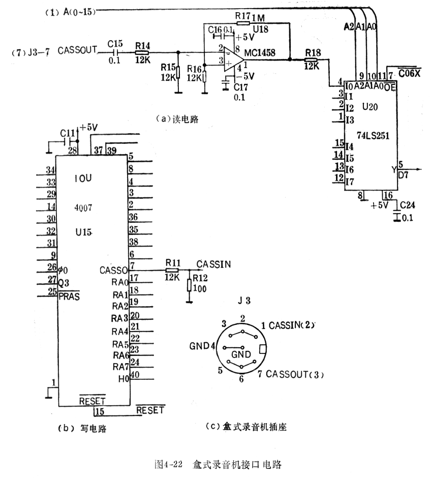

#### （三）盒式磁带接口电路的各点波形

为了把记录块中的引导段、同步位和数据块彼此区分开来，规定引导段是一串频率为 $770\text{Hz}$（周期为 $1300\mu\text{s}$）的方波；同步位是一个宽度为 $200\mu\text{s}$ 的正方波（或负方波）和宽度为 $250\mu\text{s}$ 的负方波（或正方波）组成。上述各种波形的时间关系见图4-23(a)。在记录数据时，首先记录处于低地址上的数据；对每个字节，则首先记录最高的一位。“检查和”是把数据块中所有字节（按模为256）相加，而得到的字节代码。并将此代码和写入磁带以备读代码时检查读出的数据是否正确。在读过程中，用同样的办法把读出的全部字节代码（除检查和）按模为256进行相加。再把新得到的结果和最后读出的检查和比较，如两数一致表明读出的代码正确，否则读出的代码有误。图4-23示出了盒式录音机接口的各点波形。由波形可知，在盒式录音机中，随机数据的平均传输率约为 1333 位/秒。

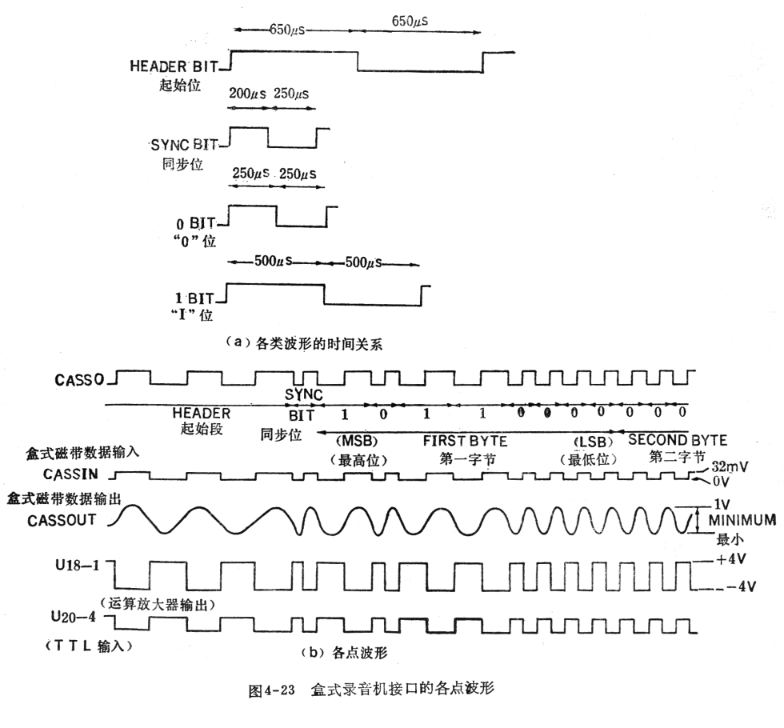

从图4-23可以看到记录格式中的引导段、同步位和数据块这三类不同的信号。图中前三个是引导信号，它们的周期为 $1300\mu\text{s}$；第四个是同步位信号，其周期为 $450\mu\text{s}$；第五个及其以后的信号均为数据块信号，它们的周期有的是 $500\mu\text{s}$，有的是 $1000\mu\text{s}$（分别代表“0”和“1”代码）。此外，由图还可以看出，$\text{CASSIN}$ 信号的幅度要比 $\text{CASSO}$ 小，这是因为 $\text{CASSIN}$ 信号应该和录音机话筒插孔（MIC）输入信号相匹配，所以要把 $\text{CASSO}$ 的 TTL 电路信号经接口上的 R11（$12\text{k}\Omega$）和 R12（原文印作 R10，$100\Omega$）分压以便得到一个大约为 $25\text{mV}$ 的信号；同样，图中 U18-1 的信号比 U20-4 的信号大，是因为 U18-1 的电压经 R18 衰减后形成 U20-4 的电压所致。盒式录音机的输出信号（$\text{CASSOUT}$）的峰-峰值约为 $1\text{V}$，经 C15 隔直流及 R14 和 R15 分压送到 U18 的 2 端。U18（原文印作 U1）是一个运算放大器，按图4-22的接法接好后，U18 的输出端将得到高电平为 $+4\text{V}$、低电平为 $-4\text{V}$ 的方波。$+4\text{V}$ 加在 U20-4 上正好是 TTL 电路的高电平，但 $-4\text{V}$ 如加到 U20-4 上将是 TTL 电路不允许的（TTL 电路低电平接近 $0\text{V}$）。因此用 R18 进行衰减和限流，从而保证各信号间的匹配。

那么，如何来判断在 U20-4 同一个输出端上，得到的各相似信号是引导段、同步位、代码“0”还是代码“1”信号呢？这是由监控程序中的测试程序来实现的。该程序每隔 $12.8\mu\text{s}$ 访问一次 `$C060` 该地址单元，并判断第七位数据（D7）是否改变了状态，即是否由高电平变为低电平或由低电平变为高电平。通过检测该状态变换的周期，测试程序就可以区分出上述各种信号是“0”、“1”代码还是引导及同步信号，并能正确地读出它们。

---

## §4-8 扬声器接口

扬声器接口可见附图2中 U15 和附图3中的 Q3 等电路，为了方便把它们图示于4-24中。

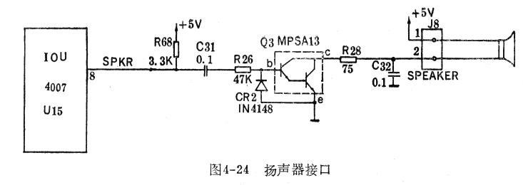

中华学习机中有一个 $0.25\text{W}$ $8\Omega$ 扬声器，该扬声器由 U15 IOU 部件第 8 脚输出信号 $\text{SPKR}$ 经 Q3 放大后驱动。

控制扬声器的软开关 $\text{SPKR}$ 所对应的地址为 `$C03X`，CPU 每访问一次 `$C03X` 单元，该软开关就翻转一次。也就是说，如 CPU 不断地访问 `$C03X` 单元，在 U15 第 8 脚上就会产生一个个方波信号，该信号经 C31 和 R26 耦合，并经 Q3 放大，再通过 R28 降压，送到扬声器上。只要 $\text{SPKR}$ 信号有一定的持续时间，且其频率在音频范围之内就会使扬声器发出声音。信号持续时间的长短可决定扬声器发出声音的长短，信号的频率的高低则决定扬声器的音调。读者可以根据音调的频率和周期编制各种程序，从而可在扬声器上听到所编制的乐曲。

为使中华学习机能较方便地编制乐曲，在该机的 BASIC 语言中，增加了一条音乐语句命令，从而使音乐爱好者可以很方便地编制乐曲程序。其命令格式如下：

```basic
MUSIC X Y
```

该语句是定义一个音阶和节拍，并使扬声器发音。语句中的 `X` 表示发音频率，`Y` 表示节拍。`X`、`Y` 的取值范围在 0～255 之间。它们的值与音阶及节拍的对应关系见表4-20。

**表4-20 音阶和节拍**

| X 值 | 255 | 228 | 205 | 192 | 171 | 152 | 140 | 128 | 114 | 102 | 95 | 84 | 75 | 68 | 62 |
| :---: | :---: | :---: | :---: | :---: | :---: | :---: | :---: | :---: | :---: | :---: | :---: | :---: | :---: | :---: | :---: |
| **音阶** | $\underset{\cdot}{5}$ | $\underset{\cdot}{6}$ | $\underset{\cdot}{7}$ | $1$ | $2$ | $3$ | $4$ | $5$ | $6$ | $7$ | $\dot{1}$ | $\dot{2}$ | $\dot{3}$ | $\dot{4}$ | $\dot{5}$ |

| Y 值 | 30 | 70 | 110 | 160 | 255 |
| :---: | :---: | :---: | :---: | :---: | :---: |
| **音长** | 1/4拍 | 1/2拍 | 1拍 | 2拍 | 4拍 |

---

## §4-9 软盘驱动器接口

软盘驱动器是一种机电设备，它本身不能存储信息。把软盘片插入其内，恒速电机可带动软盘片作旋转运动。通过写磁头把电信号转换成磁信号，并存储到软盘片的磁介质上；通过读磁头把软盘片上的磁信号再转换成电信号，实现信息的读取。那么磁信息是怎样存储到软盘上，又怎样从软盘片上读取的呢？为此我们首先介绍一下软磁盘片。

### 一、软磁盘片

软磁盘片，亦称作软盘片或盘片，软盘片是一个表面涂有磁性材料的圆盘，工作时它被固定在磁盘驱动器的驱动马达上。而用来读写信息的磁头被固定在磁盘片上方可移动的小车上。它是电能和磁能相互转换的部件。当磁头上通有电流时，它将产生一个磁场去磁化磁盘上的磁性介质，从而把各种电信号变成了磁盘上各不相同的小磁化区，进而达到存储信息的目的。

软磁盘的出现给计算机提供了一种成本低廉，具有较大容量而存储速度比较快的外部存储器。目前，具有较强功能的微型计算机几乎没有不带软磁盘的。目前常见的有三种不同尺寸的磁盘，即 8.25 英寸盘、5.25 英寸盘、3.25 英寸盘。中华学习机用的是 5.25 英寸单面单密度软盘，其外型见图4-25。

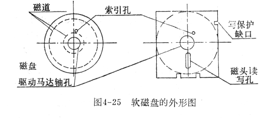

图4-25中的圆形磁盘，放在一个黑色方形的硬纸壳封套内，中心是一个驱动器轴孔，以便当磁盘插入磁盘驱动器后，被驱动器中的恒速马达带动匀速旋转。磁盘表面只有封面上开一个窄槽部份露在外面，磁头就在这个槽面上读写信息。通过磁头径向移动可以选择半径各不相同的同心圆磁道。为了能精确地寻找所需的磁道位置，磁头及磁头小车是由一个步进电机带动的。磁盘纸套上还有一个小孔称为索引孔，用它表明磁道起始位置。它是控制磁头寻道、寻区和正确读写的重要信息。磁盘纸套上还有一个小缺口，是起保护作用的。当要保护磁盘上的原有信息不被删除时，可以在此缺口上粘上贴纸，就可以起到禁止写入的保护作用。

磁盘属于磁性介质，使用时必须注意如下几点：

- （一）要远离磁场，如电力变压器、螺管线圈等。
- （二）必须把盘片存放在防尘套内，磁盘转动槽窗口应放在纸套里。
- （三）不能用其它东西擦摸磁盘表面，否则会引起读写错误。
- （四）防止阳光爆晒，引起变形，更不能弯曲和折叠磁盘。
- （五）中华学习机的驱动器是单面的，如使用双面的盘片，可以在保护缺口的对称的另一边开个缺口，则能把双面盘片反过来使用，一张双面盘片顶两张单面盘片使用。

---

### 二、磁盘驱动器的功能

磁盘驱动器是一个机电设备，它应具备的部件及功能如下：

- （一）**恒速马达**。该马达受接口控制，一旦接口发出马达使能信号（$\text{ENBL}$）它就应恒速旋转，以便确保在读写时磁感应信号的一致。也只有这样，才能正确地读写。
- （二）能产生**写保护信号**（$\text{WPROT}$），以便当插进驱动器的软盘片粘有封写纸时，禁止对磁盘进行写入操作。
- （三）能接收接口发来的**写数据信号**（$\text{WRDATA}$），以便把要写的数据信号经过写磁头写到盘片上。
- （四）能接收接口送来的**写请求信号**（$\text{WRREQ}$），以便在驱动器接到写信号后再开始进行写操作。
- （五）能向接口发送从读磁头上读出的**数据信号**（$\text{RDDATA}$）。
- （六）能接收接口发来的**步进马达驱动脉冲信号**（$\text{CLK0}$—$\text{CLK3}$），以便精确地把磁头定位在指定的磁道上进行读写操作，这四个控制脉冲按照一定的时序关系对步进电机进行控制（见图4-26）。电机上的四个绕阻线圈即 $\phi 0$、$\phi 1$、$\phi 2$、$\phi 3$（图中标为 $\phi 1 \sim \phi 4$），每次有两个线圈同时加有控制信号，在下一个节拍控制信号到来后，只有其中一个线圈导通状态改变一次，步进电机马达就转动一个角度，从而带动磁头移动一个磁道的距离。

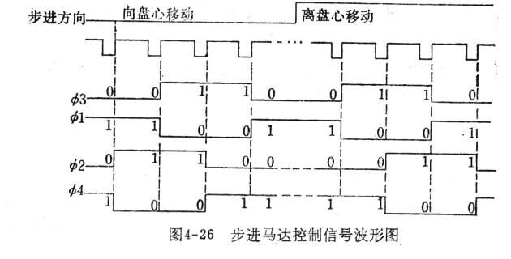

由图4-26可知当四个绕阻按如下规律通电时，即

```text
→ 4与1 → 1与2 → 2与3 → 3与4 →
↑ ........................... ↓
```

磁头就朝磁盘中心方向移动。绕阻每改变一次通电状态，磁头就移动一个磁道距离。当四个绕阻按下述规律通电时：

```text
→ 1与4 → 4与3 → 3与2 → 2与1 →
↑ ........................... ↓
```

磁头就背向磁盘中心方向移动。上述变化使磁头向盘边沿方向移动了四个磁道。

---

### 三、磁盘驱动器接口

中华学习机磁盘驱动器接口，应能实现驱动器的上述功能，提供相应的控制信号和代码，其接口电路见附图6。

#### （一）CPU 和接口之间的信号

1. **D0—D7 数据总线的八位代码**。它们是双向传送的，当写盘时，CPU 向接口中的 U39 并行传送代码；读盘时，CPU 从接口的 U39 并行接收代码。
   应当指出，中华学习机对写到磁盘上的数据有特殊的规定：其一，高位必须为 1；其二，连续出现的“0”的个数不得超过两个，且每个字节中最多出现一组连续的两个“0”。这样做的目的是可以用比较简单的接口电路和比较简单的磁盘驱动器控制电路，来完成主机和磁盘驱动器之间的信息交换，以及提高磁盘的存储密度。
   中华学习机中，上述的编码是由 DOS 操作系统自动完成的。经过 DOS 编码后的数据，我们称之为 $6/2\text{GCR}$（Group Code Recording）码。至于具体如何实现，请见 DOS 分析中成组编码有关部份，此处不再赘述。
   正是利用了对要写入的数据进行重新编码的方法，我们才能用“1”信号作为一个字节的起始位，从而可对串行数据进行分段，完成对读数据的解调。DOS 在进行信息段同步时，就是利用了这一特性实现同步的。
2. **A0—A15 地址总线**
   在磁盘驱动器接口中只使用了其中的 A0—A3 这四条地址线，其中 A0 送至接口的 U39，A0—A3 送至接口的 U41。A0 送至 U39 的作用是控制该电路的输出，当 $\text{A0}=1$ 时，D0—D7 为三态高阻抗输出，这标志着处在磁盘驱动器接口上的 8 位数据端与数据总线已脱开，这时 U39 也就不能接收或发送数据，只能当作移位寄存器使用。送到 U41 的 A0—A3 地址码用来选择磁盘驱动器接口卡上的输出单元，以便从各单元中向磁盘驱动器发送相应的控制信号。
3. **$\overline{\text{DEV6}}$ 信号**，从表4-9可知这个信号实际上对应着一个地址空间 `$C0E0`—`$C0EF`。换句话说，该地址空间内的任何一个地址的出现都会产生 $\overline{\text{DEV6}}$ 信号。
4. **Q3** 是从 PAL 电路来的 $2\text{MHz}$ 系统中间时钟信号，用作本接口上的移位寄存器（U39）的移位信号或时序电路的信号源。
5. **$\text{RESET}$ 信号**是一个清除信号，前面已有介绍。

#### （二）磁盘驱动器接口工作原理

附图6中 U41 及有关的门电路是控制接口的核心，它由选择信号 $\overline{\text{DEV6}}$ 控制。当 $\overline{\text{DEV6}}=0$ 时，表明上述的地址空间（`$C0E0`～`$C0EF`）有效，使 U41 处于可寻址锁存器的工作方式。该信号也是 U41 的使能信号，它与 U41 上的 4 个地址码（A0—A3 配合），就唯一确定了地址空间（`$C0E0`—`$C0EF`）的某一地址，进而去控制 Q0—Q7 这八个输出信号。这些信号的用途及它们与 16 个地址码的对应关系见表4-21。

**表4-21 访问地址与输出状态对照表**

| 访问地址 | 用途 |
| :---: | :--- |
| `$C0E0` | `phase 0 off`（定位） |
| `$C0E1` | `phase 0 on`（定位） |
| `$C0E2` | `phase 1 off`（定位） |
| `$C0E3` | `phase 1 on`（定位） |
| `$C0E4` | `phase 2 off`（定位） |
| `$C0E5` | `phase 2 on`（定位） |
| `$C0E6` | `phase 3 off`（定位） |
| `$C0E7` | `phase 3 on`（定位） |
| `$C0E8` | `power down`（磁盘机 off） |
| `$C0E9` | `power up`（磁盘机 on） |
| `$C0EA` | `select 1`（选 1 号磁盘机） |
| `$C0EB` | `select 2`（选 2 号磁盘机） |
| `$C0EC` | $Q_6=0$ |
| `$C0ED` | $Q_6=1$ |
| `$C0EE` | $Q_7=0$ |
| `$C0EF` | $Q_7=1$ |

表中 `phase0`～`phase3` 是步进马达的控制信号，它们各点波形符合图4-26的变化规律。表中 `off` 对应的输出为“0”信号，`on` 对应的输出为“1”信号。

Q4 是驱动器使能信号，它经 U44 反相输出到 U45 的 2 端，使 U45 的 3 端输出高电平，该电平信号与驱动器选择信号一起形成 $\text{ENBL1}$ 信号，去驱动被选中的驱动器恒速电机。当 $\text{Q4}=1$、$\text{Q5}=0$ 时，选择 1 驱动器；当 $\text{Q4}=1$、$\text{Q5}=1$ 时，选择 0 驱动器（或第 2 驱动器）。中华学习机主板上只配有一个与驱动器“1”相连的 20 线插座，要想扩大外存容量，增加磁盘驱动器个数，只要再增加一个 20 线插座即可。

Q6、Q7 是读/写数据转换电路的控制信号，这两个输出信号有四种不同的组合。它们可使读/写数据转换电路处于四种不同的工作方式。

Q6、Q7 的具体功能见下面第（三）部分。

#### （三）读写转换电路

读写转换电路是由 U39、U40、U42 以及有关的门电路组成。U39 是一个 8 位通用移位寄存器，它有四种工作方式，即保持、左移、右移和并行数据的输入/输出。这四种工作方式由 S0 和 S1 的输入状态控制：当 $\text{S1S0}=00$ 时，为保持状态；当 $\text{S0S1}=10$（即 $\text{S1S0}=10$）时，为左移；当 $\text{S1S0}=01$ 时，为右移；当 $\text{S1S0}=11$ 时，为输入/输出状态。

电路中 U42 是 6D 触发器。U40 是 PROM 电路（其内有调制解调的时序控制固件），该电路被磁盘驱动器的使能信号（$\text{ENBL1}$）控制，因此只有当驱动器工作时，PROM 电路才开始工作，它的工作状态是由可寻址锁存器送来的 Q6Q7 信号状态而定，详见表4-22。

- **（1）当 $\text{Q6Q7}=10$ 时，检测是否有写保护信号**。在写数据之前，首先检查磁盘驱动器是否处在写保护状态。从附图6中可以看到，$\text{WPROT}$ 写保护信号从驱动器送到代码移位寄存器（U39）的（PIN）输入端。当 $\text{Q6Q7}=10$ 时，由 U40 和 U42 构成的时序控制电路控制代码移位寄存器（U39）作右移操作，从而把写保护信号（$\text{WPROT}$）移到该寄存器的第七位（D7）。当访问该寄存器（U39）的第七位时，如 $\text{D7}=1$，表示有写保护信号，这时不允许进行写操作；当 $\text{D7}=0$ 时，表示无写保护信号，则可以进行写操作。
- **（2）当 $\text{Q6Q7}=11$ 时，可把经 DOS 编码后的数据送入代码移位寄存器**。
- **（3）当 $\text{Q6Q7}=01$ 时，接口电路把代码寄存器中的代码写入到软盘中**。
  当写数据时，首先向锁存器（U41）发送使能信号 $\overline{\text{DEV6}}$ 和地址码 A0—A3，使 $\text{Q6Q7}=11$（原文印作 Q3Q7=11），这时把经 DOS 编码后的数据并行送入寄存器 U39 中。然后 $\overline{\text{DEV6}}$ 与地址码 A0—A3 再使锁存器的 $\text{Q6Q7}=01$，这时由 PROM 与 U42 组成的时序控制电路控制磁盘驱动器进入写数据状态。在写入时，系统中间时钟信号 Q3 作为代码移位寄存器的移位脉冲，每隔 8 个 Q3 脉冲就使移位寄存器的代码左移一位。即经 64 个 Q3 脉冲移位，可把寄存器中 8 位并行代码由该寄存器的 QA 端串行移出，然后送到时序电路 U40 PROM 的 A1 端进行调制。调制方式为常见的不归零制中的一种，即逢“1”翻转式。当 $\text{QA}=\text{A1}=1$ 时，时序电路中的 U42 6D 触发器 1Q 端翻转一次；当 $\text{QA}=\text{A1}=0$ 时，1Q 输出端保持不变（见图4-27）。

**表4-22 Q6Q7不同状态的功能**

| Q6 | Q7 | 读/写转换电路状态 |
| :---: | :---: | :--- |
| 0 | 0 | 转换读盘信号 |
| 0 | 1 | 调制写盘数据 |
| 1 | 0 | 检测写保护标志 |
| 1 | 1 | 装入写盘数据 |

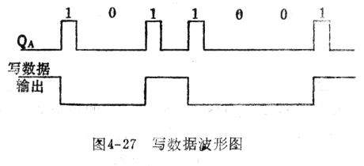

- **（4）$\text{Q6Q7}=00$**
  执行从磁盘中读数的操作，这时时序控制电路处于读状态。根据写入信息的特征，数据段的第一位规定为“1”信号。在尚未读出“1”信号之前，时序电路处于等待状态；一旦读出信号端 $\text{RDDATA}$ 出现“1”信号，它经 U42 的 5D 输入端并由 5Q 和 4Q 输出，使整形电路的输出端有一负跳变。该负跳变信号触发时序电路，对八位串行调制数据进行解调操作。在解调操作前，系统首先对移位寄存器（U39）清“0”，再把读出的首位信号经 U39 的 LIN 输入端输入到移位寄存器 U39 中。对该移位寄存器连续作八次左移操作后，它的高位输出 QA 一定为“1”，至此时序电路进入等待状态。下一个起始“1”信号到来时，转换电路又重复上述读数过程。由此可见数据最高位为“1”的作用，不仅仅表示数据信号最高位的数值，而且还作为串行数据的定位信号。从磁盘接口转换电路上得到的，是通过 DOS 编排的成组编码（$6/2\text{GCR}$ 编码）信号，再经 DOS 转换就可还原成原来的数据了。

---

## §4-10 游戏杆接口电路

游戏杆接口一般有三种功能：其一，能输出四个指示信号和一个选通脉冲信号；其二，能接收三个开关信号；其三，能接收四个模拟输入（或称手控）信号。中华学习机中，只配置了后两种功能。游戏杆接口电路见附图3，为了方便分析现图示如下：

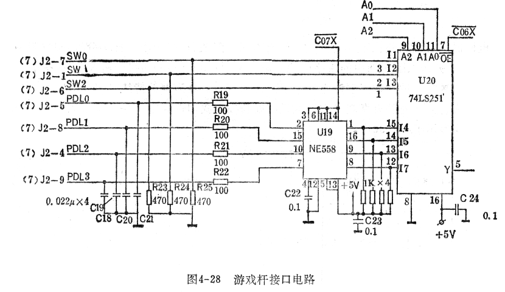

### 一、游戏开关

在图4-28中，左上方有三个游戏开关输入量：$\text{SW0}$、$\text{SW1}$、$\text{SW2}$。这三个信号分别由游戏插座 J2 的 7、1、6 脚上引来，它们直接被送到八选一数据选择器（U20 74LS251）上。游戏开关一般如图4-29(a)所示，平时 SW 上因有一接地电阻而使该点电位接近 0 伏，一旦开关按下，SW 被接到 $+5\text{V}$。故而随开关的闭合或断开就有高电平或低电平输入到 U20 上。

从图4-28及 74LS251 外特性，我们可以得到该开关的地址表（见表4-23）。

**表4-23 读游戏开关地址表**

| 地址 1 | 地址 2 | 游戏开关 |
| :---: | :---: | :---: |
| `$C061` | `$C069` | `SW0` |
| `$C062` | `$C06A` | `SW1` |
| `$C063` | `$C06B` | `SW2` |

由表4-23可知，只要访问 `$C061` 或 `$C069` 就可以把开关 $\text{SW0}$ 当时的电平（高为“1”、低为“0”）状态读出，经 Y 端输出送到数据总线 D7 处。表中每个开关对应两个地址，是因为 74LS251 中只使用了三个地址码 A2、A1、和 A0，而 A3 取“0”或“1”值均可使用，因此每个开关各有两个地址。

---

### 二、游戏摇杆

在游戏杆接口中有四路是摇杆模拟量输入，实际上它们是如图4-29(b)所示的电位器组成。

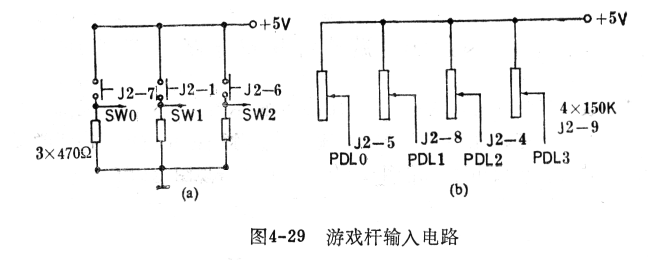

电位器中心抽头处在不同的位置，就有不同的阻值。这四个中心抽头分别经 J2（附图7）的 5、8、4、9 脚送入图4-28中的四路单稳态触发器（U19 NE558）的四个输入端。这些单稳态触发器一旦被触发，就在输出端产生一个正的方波信号。其方波的持续时间（即宽度）与上述电位器取值有关。为了更直观更方便地说明此特性，我们选其中一个单稳态触发器为例，把它的各点波形示于图4-30中。

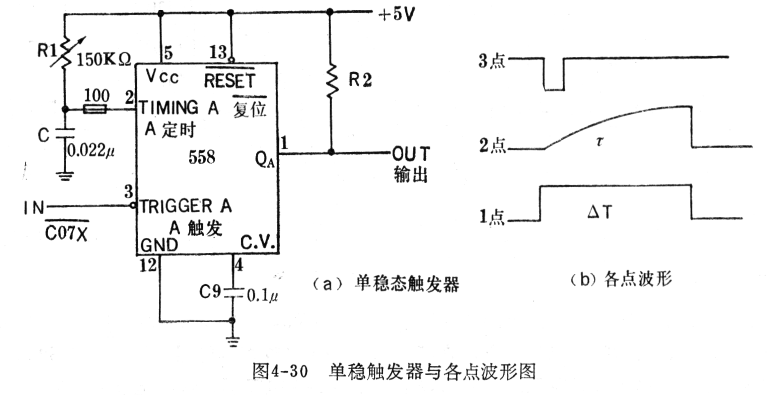

由图可知，根据单稳态触发器的外特性，当图4-30(a)的 3 端输入一个负信号时，输出马上有一个正的突跳。此后，2 点开始有一个充电时间，其时间常数为 $\tau$ 的持续时间，$\tau$ 的值与摇杆电位器中心抽头位置有关。电位器的最大值是 $150\text{k}\Omega$。根据图中 RC 参数的值以及单稳触发器 $\Delta T$ 计算公式可计算出 $\Delta T$ 的最大值和最小值。

$$\Delta T_{\max} = 0.7 (150\text{k}\Omega + 100\Omega) \times 0.022\mu\text{F} = 2.31\text{ms}$$

$$\Delta T_{\min} = 0.7 \times 100\Omega \times 0.022\mu\text{F} = 1.54\mu\text{s}$$

图4-30(b)中点 2 的波形，反映了摇杆电位器中心抽头的不同位置对应有不同的电压变化。四路单稳态触发器均由图4-28的 3、6、11、14 点上的地址信号 $\overline{\text{C07X}}$ 触发，它们的输出信号均送到八选一的开关电路 U20 中，再由不同的 A0—A3 地址码选择后送到数据总线 D7 端。其中 A3 地址码同开关输入（SW）类似，也可取“0”和“1”两值，因此摇杆输出信号也对应两个地址码，它们的对应关系见表4-24。

**表4-24 读摇杆信号地址表**

| 地址 1 | 地址 2 | 摇杆信号 |
| :---: | :---: | :---: |
| `$C064` | `$C06C` | `PDL0` |
| `$C065` | `$C06D` | `PDL1` |
| `$C066` | `$C06E` | `PDL2` |
| `$C067` | `$C06F` | `PDL3` |

送入 D7 的方波的持续时间，从计算公式可知是和摇杆电位器的阻值成正比，因此测出时间 $\Delta T$，就可得到摇杆的相对位置。中华学习机的监控程序中有一个子程序专门用来测时间 $\Delta T$ 的，该子程序入口地址为 `$FB1E`。在此程序中规定，摇杆号（$\text{PDL0}$—$\text{PDL3}$）所对应的地址放在 CPU 的 X 寄存器中。从入口地址开始执行子程序时，首先去访问 `$C070`，产生单稳触发器的触发信号 $\overline{\text{C07X}}$，并去清除 CPU 中的 Y 寄存器。此后，作约 $5\mu\text{s}$ 的延迟，再按 X 寄存器中的地址去 D7 端读相应的摇杆输出信号。若 $\text{D7}=0$，即退出子程序；若 $\text{D7}=1$，做 $(\text{Y})+1 \longrightarrow \text{Y}$ 的操作（即 Y 寄存器的内容加 1 再送入 Y 寄存器）。此操作完成后程序作 $10.8\mu\text{s}$ 的延时，然后又开始重复执行子程序。退出子程序后接着检查 Y 寄存器的内容，当 $\text{Y}=0$ 表示电位器已调到零点。假设 $\text{Y}=225$（或 255），这时测到 D 端的脉冲宽度 $\Delta T = 255 \times 10.8 = 2.7\text{ms}$。

此脉冲宽度 $\Delta T$ 大于电位器调到最大值 $150\text{k}\Omega$ 时测得的 $\Delta T_{\max}$（即 $2.7\text{ms} > 2.31\text{ms}$）。因此，容量为 255 的 Y 寄存器可以用来表示摇杆所处的各种不同位置的值。

必须指出，执行了上述动作后，只完成了一路摇杆的输入，要测其它路摇杆的位置还得重复上述动作。然而，由于单稳态触发器一旦被触发，在输出端电压没有由高变低（换句话说，电容上的电压还未放完）之前，触发信号将不起作用。因此，为了测到准确的值，在两次测试摇杆位置之间必须有足够大的延迟时间。中华学习机规定该值为 $4\text{ms}$，这是为了等待单稳态触发器恢复到初始状态，以便进行下一次触发。

---

## §4-11 打印机接口

中华学习机中，打印机接口插在 1 号扩展槽上，实际上是把 J10 上的两个短接插塞插到在 $\overline{\text{DEV1}}$ 和 $\overline{\text{I/OSEL1}}$ 的插脚上，使 50 线插座 J1 成为一号槽口。打印机接口卡（见附图8）由三部分组成：256 个单元的外设扩充卡 ROM 和公用 ROM（合用一个 ROM 器件 2716）及其控制电路、数据输出电路和打印机状态检测电路。

### 一、接口与主机、打印机的信号线

#### （一）接口与主机的信号线

1. **A0—A11 地址线**供选择 ROM 地址用
2. **D0—D7 双向数据线**
   主机把要打印的代码送到打印机接口，从接口上的 2716 EPROM 内读取要执行的打印机驱动程序或读取打印机状态。
3. **$\phi 0$、$\phi 1$ 系统主时钟信号**。
4. **$\overline{\text{DEV1}}$**
   该信号低时，接口卡的逻辑电路开始工作，由 CPU 选择接口卡上 16 个字节的输入/输出单元，单元地址空间为 `$C090`—`$C09F`。
5. **$\overline{\text{I/OSEL1}}$**
   接口卡 EPROM 的使能信号，它使用最低 8 位地址（`$C100`—`$C1FF`）选择 256 个字节的外设扩充 ROM。
6. **$\overline{\text{I/OSTROBE}}$**
   该信号低时，选择外设接口卡上的 2K 公用 ROM 单元，其地址为 `$C800`—`$CFFF`。
7. **$\text{R}/\overline{\text{W}}$ 读/写控制信号**
8. **$\overline{\text{RESET}}$ 复位信息**

#### （二）接口与打印机的信号线

1. **D0—D7**，要送打印机打印的八位代码。
2. **$\overline{\text{STROBE}}$ 代码寄存器选通信号**
   在该信号的作用下，接口中送出打印的八位代码方可送入打印机。
3. **$\overline{\text{ACK}}$ 打印机回答信号**
   当打印机处于可接收数据状态时，就向接口发出 $\overline{\text{ACK}}$ 信号。
4. **$\text{BUSY}$ 打印机忙信号**
   当 $\text{BUSY}$ 为高电位时，表示打印机正在忙于打印或处理内部工作，暂不能接收要打印的数据。

---

### 二、数据输出

#### （一）选通信号的产生

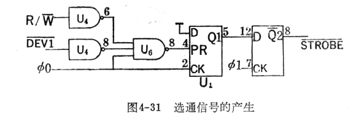

图4-31中 U6 输出为低电平的条件是，CPU 发出写控制信号（$\text{R}/\overline{\text{W}}=0$）。在选中设备 1（打印机）之后，当 $\phi 0$ 的正信号出现时，U6 就有一个负跳变信号。该信号去置图中的 Q1，使 $\text{Q1}=1$，因此当 $\phi 1$ 到来时，$\overline{\text{Q2}}=0$，此后就如图4-32的波形图那样，使 $\overline{\text{Q2}}$ 端有 $1\mu\text{s}$ 的负方波。

#### （二）数据的传送

CPU 送来的数据在写信号结束之前已在数据总线上，也就是说已送到 U8 的代码输入端上。U6 输出的负脉冲信号，再经“与非”门 U5 反相送到锁存器 U8 的 G 端，作为该芯片的使能信号，从而把总线上的数据打入到 U8 锁存器中。当 $\overline{\text{STROBE}}$ 信号出现时，就把 U8 锁存器内代码送到打印机的数据缓冲器内，完成了接口向打印机传送一个字节的整个过程。

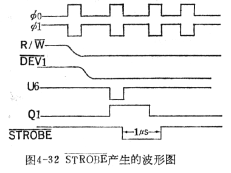

---

### 三、2716 芯片的控制电路

图4-33示出了 2716 芯片的控制电路。

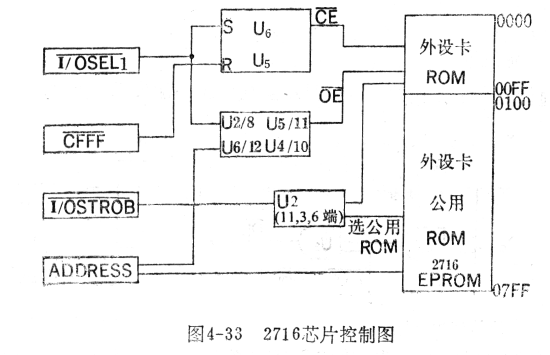

#### （一）两个地址空间

在打印机接口卡上有一个 2716，即 2K 字节的 EPROM 芯片（见附图8）。它提供了 256 字节的外设接口 ROM 和 1792 字节的公用 ROM 空间。在同一个物理空间要正确地对上述两种 ROM 进行读出，必需有相应的电路进行控制。

从图中可以看出，A0—A7 是直接与 2716 的 A0—A7 相连的。256 字节的外设接口 ROM 是由 $\overline{\text{I/OSEL1}}$ 及“与”门 U2 的 11、3、6 之输出信号保证的。当 CPU 发出 $\overline{\text{I/OSEL1}}$ 信号，即为低电平时，它将封死门 U2 的 13、1、4 端，使它的 12、2、5 相应的 A8、A9、A10 不起作用，U2 的 11、3、6 端保持低电平。从而确保 CPU 访问外设接口 ROM 时，只能访问 EPROM 中 2K 地址内最低的 256 个单元。

当 $\overline{\text{I/OSEL1}}$ 为高电平时，“与”门 U2 开通，把 A8—A10 地址信号送入 EPROM 的地址输入端 A8—A10 上。此外，2716 芯片的使能信号 $\overline{\text{I/OSTROBE}}$ 为低电平时，CPU 即可访问 EPROM 的整个 2K 字节空间。

然而，在编程时设计者有意避开地址码 A8、A9、A10 同时为零的 256 个单元地址空间，因此在运行公用 ROM 程序时，只能访问 2K 中大于 256 的存储单元。

#### （二）$\overline{\text{OE}}$ 和 $\overline{\text{CE}}$ 信号的产生

以上介绍了如何通过电路及软件编程把 EPROM 即 U1 的 2K 字节分成两个存储空间。要使 U1 能正常工作还需允许输出（OUTPUT ENABLE）和芯片使能（CHIP ENABLE）信号，它们分别简写为 $\overline{\text{OE}}$ 和 $\overline{\text{CE}}$ 信号。

##### 1. $\overline{\text{OE}}$ 允许输出

$\overline{\text{OE}}$ 允许输出信号是由 $\overline{\text{I/OSEL1}}$，A6 和 A7 信号产生的，现将附图8中生成 $\overline{\text{OE}}$ 的逻辑图示于图4-34中。

$$\overline{\text{OE}} = \overline{\overline{\overline{\text{I/OSEL1}} \cdot \overline{\text{A6} \cdot \text{A7} \cdot \text{I/OSEL1}}} \cdot \overline{\text{I/OSTROBE}}}$$

为了读取 EPROM 中的内容，必需要求 $\overline{\text{OE}}$ 端输出低电平。而要使 $\overline{\text{OE}}$ 输出低电平，由上述逻辑图表达式可知存在有两种情况：其一，当 A6、A7 不同时为“1”，且 $\overline{\text{I/OSEL1}}$ 为低电平时；其二，当 $\overline{\text{I/OSTROBE}}$ 为“0”时。第一种情况的物理意义是：当读 EPROM 最低 256 单元时，$\overline{\text{I/OSEL1}}$ 为低，A6、A7 两个地址码不同时为“1”，所以 U6 的输出为高电平，使门 U5 输出为低电平；第二种情况的物理意义是：当读 2K 地址（除上述 256 单元外）空间时，$\overline{\text{I/OSTROBE}}$ 一定为低电平。因此，在上述两种情况时，门 U2 输出信号 $\overline{\text{OE}}$ 为 EPROM 使能。

##### 2. $\overline{\text{CE}}$ 芯片使能信号

$\overline{\text{CE}}$ 亦称片选信号，它是由门 U6，门 U5 组成的 R-S 触发器产生的。生成 $\overline{\text{CE}}$ 信号有关的电路如图4-35所示。

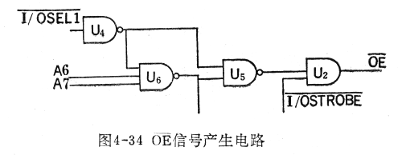

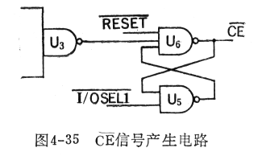

在启动外设卡前，CPU 都要先访问 `$CFFF` 单元，使 U3 输出为低电平，把图4-35中的 R-S 触发器复位，即 $\overline{\text{CE}}$ 为高电平。

此后，启动外设程序向打印机 EPROM 发出访问低地址 256 个单元的读命令，即使 $\overline{\text{I/OSEL1}}$ 信号为低电平，故使 R-S 触发器 U5 输出端为高电平。因外设程序在正常运行时，U6 输入端的 $\overline{\text{RESET}}$ 信号不会产生，上述 U3 输出随访问 `$CFFF` 结束也变为高电平。因此 R-S 触发器 U6 输出端变为低电平，向 2716 U1 芯片发出 $\overline{\text{CE}}$ 片选信号。

要指出的是，在选择公用 2K 字节 EPROM 之前，启动外设程序必须按上述先后次序执行，即先访问低地址 256 个字节单元，后访问 2K 字节的其他存储单元。这是由于 CPU 在运行时不再向打印机 EPROM 发送 `CFFF` 地址访问信号，因此 R-S 触发器将保持不变，即 $\overline{\text{CE}}$ 片选信号将在访问整个 2K 公用 ROM 时保持始终。

综上所述，有了 $\overline{\text{CE}}$ 和 $\overline{\text{OE}}$ 两个使能信号之后，2716 就可以根据 A0—A11 的地址码读取 EPROM 中的内容，并把 2716 的 D0—D7 端输出数据经总线送到 CPU。EPROM 的内容主要是打印机驱动程序。

---

### 四、打印机状态检测电路

打印机的状态信号有两个，即忙态 $\text{BUSY}$ 正在打印和闲态 $\overline{\text{ACK}}$ 打印机可接收数据状态。CPU 在使用打印机之前首先要检查打印机的状态，只有在 $\overline{\text{ACK}}=1$，$\text{BUSY}=0$ 时，也就是打印机已打印完毕并处于正常等待状态，且打印机已准备好可接收数据时，才可启动打印机打印新的内容。打印机状态检测电路见图4-36。

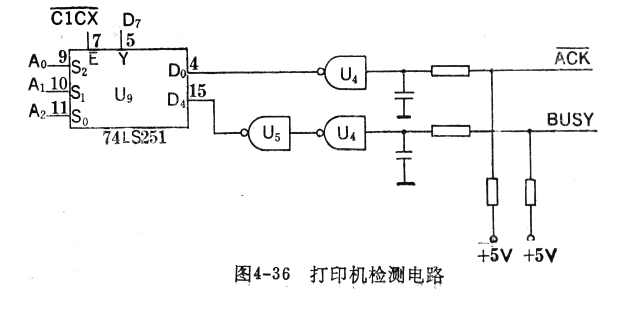

图4-36中，$\overline{\text{ACK}}$ 信号经反向器 U4，$\text{BUSY}$ 经反向器 U4、U5 分别送到多路数据选择器 U9 的 D0 和 D4 端。当 CPU 访问 `$C1CX` 地址时，$\overline{\text{I/OSEL1}}=0$，$\text{A6}=1$，$\text{A7}=1$，所以 U6 门的输出端为低电平，该电平为 U9 多路数据选择器的使能信号，它与地址码 A0，A1，A2 配合来决定选择 U9 的 D0 端还是 D4 端。当译码地址为 `$C1C4` 时，选择 $\text{BUSY}$ 状态；当译码地址为 `$C1C0` 时，选择打印机 $\overline{\text{ACK}}$ 状态，两者均从 U9 的 Y 端输出送入数据总线 D7，从而可供 CPU 来判断打印机所处的状态。

**表4-25 打印机的控制命令字符表**

| 类别 | 控制字符 | 十六进制代码 | 十进制代码 | 控制功能 |
| :---: | :--- | :--- | :--- | :--- |
| **打印动作** | `CTRL-M` | `0D` | `13` | 送回车字符，完成打印缓冲区数据打印。 |
| **打印动作** | `CTRL-J` | `0A` | `10` | 完成打印，并走纸一行。 |
| **打印动作** | `CTRL-K` | `0B` | `11` | 功能同 `CTRL-M`。 |
| **打印动作** | `CTRL-H` | `08` | `8` | 退格符，从打印缓冲区删去一个字符。 |
| **打印动作** | `CTRL-G` | `07` | `7` | 响铃字符，使打印机鸣 3 秒。 |
| **打印动作** | `CTRL-L` | `0C` | `12` | 走纸到下一页的页首。 |
| **打印方式** | `CTRL-N` | `0E` | `14` | 置放大字符打印方式。 |
| **打印方式** | `CTRL-O` | `0F` | `15` | 置压缩字符打印方式。 |
| **打印方式** | `CTRL-T` | `14` | `20` | 清除放大字符打印方式。 |
| **打印方式** | `CTRL-R` | `12` | `18` | 清除压缩字符打印方式。 |
| **打印方式** | `CTRL-Q` | `11` | `17` | 启动高分辨率图象的硬拷贝。 |
| **打印方式** | `CTRL-W` | `17` | `23` | 夹在二个 `CTRL-W` 间的字母按小写字母打印。 |
| **走纸控制设置** | `NUL` | `00` | `00` | 设置命令的终结标志。 |
| **走纸控制设置** | `ESC 0` | `1B 30` | `27 48` | 设置行间隔为 $1/8$ 英寸。 |
| **走纸控制设置** | `ESC 2` | `1B 32` | `27 50` | 设置行间隔为 $1/6$ 英寸。 |
| **走纸控制设置** | `ESC A m` | `1B 41 m` | `27 65 m` | 设置行间隔为 $m/72$ 英寸。 |
| **走纸控制设置** | `ESC 3 n` | `1B 33 n` | `27 51 n` | 设置行间隔为 $n/216$ 英寸。 |
| **走纸控制设置** | `ESC C m` | `1B 43 m` | `27 67 m` | 设置每页的间隔行数，$m$ 在 1～127 之间。 |
| **走纸控制设置** | `ESC C 0 m` | `1B 43 30 m` | `27 67 48 m` | 设置每页间的间隔为 $n$（或 $m$）吋，$n$ 在 1～22 之间。 |
| **走纸控制设置** | `ESC D n1 n2 ... nk 0` | `1B 44 n1 n2 ... nk 30` | `27 68 n1 n2 ... nk 48` | 设置 $k$ 个表格定位，其中 $nk$ 必须在 1～233 间，正常打印 $\le 79$，压缩打印 $\le 131$。 |
| **打印控制位图象** | `ESC K n1 n2` | `1B 4B n1 n2` | `27 75 n1 n2` | 由文本打印变成标准密度的位图象打印。 |
| **打印控制位图象** | `ESC L n1 n2` | `1B 4C n1 n2` | `27 76 n1 n2` | 由文本打印变成倍密度位图象打印。 |
| **表格定位** | `HT`（原文作 `I0`） | `09` | `09` | 移打印头到表格指定位置，须与 `ESC D n1 n2 ... nk` 命令连用。 |

---

### 五、打印机控制命令字符和软开关

#### （一）控制命令字符

主机通过打印机接口向打印机发送各种命令，控制打印机执行打印字符、汉字、图象以及执行走纸、回车等动作。表4-25列出了打印机的各种控制命令字符表。表中的字符可以用 BASIC 语言中的 `PRINT CHR$(m)` 语句送到打印机中。语句中的 `m` 是控制命令字符表中的十进制代码。

#### （二）软开关

除了上述控制命令字符外，还有一种打印机的控制软开关。这些控制软开关同样可以控制打印机的一些动作。表4-26列出了各种软开关。

**表4-26 打印机的软开关**

| 序号 | 软开关 | 控制功能 |
| :---: | :--- | :--- |
| 1 | `POKE 1656+SLOT, n` | 设置打印宽度（$n$ 个字符/行） |
| 2 | `POKE 1528+SLOT, 255` | 禁止执行换行（LF） |
| 2 | `POKE 1528+SLOT, 0` | 释放 LF |
| 3 | `POKE 1912+SLOT, M` | 设置高分辨率图形打印方式 |
| 3 | `M=U+D+I+L+P` | （U, D, I, L, P 参数说明见后面的介绍） |
| 4 | `POKE 1272+SLOT, 255` | 初始化接口 |
| 5 | `POKE 1144+SLOT, 76` | 设置倍密度位图象打印（960点/行） |
| 5 | `POKE 1144+SLOT, 75` | 设置标准密度位图象打印（480点/行） |
| 6 | `POKE 1400+SLOT, YY` | 将控制字符变为小写字母 |

表4-26中 `SLOT` 是打印机接口所在的扩展槽口号。中华学习机中，打印机的槽口号为 1。表中 `M=U+D+I+L+P`，实际上对应的是一个地址号为 1913 的输出寄存器的内容，该寄存器中的 8 位数据含义如下：

**表4-27 M中各项的含义**

| 参数组 | U | D | I | L | L | L | P | P |
| :---: | :---: | :---: | :---: | :---: | :---: | :---: | :---: | :---: |
| **功能** | 行方式 | 放大 | 反相 | 异或 | 或 | 与 | HI-RES 第二页 | HI-RES 第一页 |
| **权值** | 128 | 64 | 32 | 16 | 8 | 4 | 2 | 1 |

当该寄存器中某一位为 1 时，便执行相应的操作。

1. **P 参数为高分辨率图形的选择**
   - `P=1`，打印高分辨率图形第一页。
   - `P=2`，打印高分辨率图形第二页。
   - `P=3`，打印机将第一、第二页高分辨率图形并列打印。
2. **L 参数决定上述两页高分辨率图形彼此之间的逻辑操作**
   - `L=0`，无逻辑操作。
   - `L=4`，进行与操作。
   - `L=8`，进行或操作。
   - `L=16`，进行异或操作。
3. **I 参数表示打印方向**
   - `I=0`，表示正向打印。
   - `I=32`，表示反向打印。
4. **D 参数表示正常或放大打印方式**
   - `D=0`，正常打印方式。
   - `D=64`，放大打印方式。
5. **U 参数表示图象或行方式打印**
   - `U=0`，图象方式打印。在执行 `PRINT CHR$(17)` 时，对整幅图象打印。
   - `U=128`，行方式打印。在执行 `PRINT CHR$(17)` 时只对该图象的一行进行打印。

综上所述，在设置高分辨图形打印方式时，其软开关为 `POKE 1913, M`，其中 `M` 是上述各位参数的总和。

---

## §4-12 汉字处理电路

中华学习机之所以具有汉字处理能力，主要是由于在系统主板中，配置有汉字处理电路（见附图5）。该电路在中央处理器及有关程序的控制下，完成汉字输入码与汉字内码的转换、汉字字形点阵的检索、屏幕汉字显示及其编辑、汉字打印输出等动作。

汉字处理电路包括两片容量各为 128K 字节 ROM 的 U33（CECWL-I）、U34（CECWL-II），一片容量为 32K 字节 ROM 的 U35，一片双二-四译码器 U31 和一片 6D 触发器 U32。汉字处理电路中共有 288K 字节的 ROM 空间，存放有一、二级国标汉字（6763 个汉字、外文字母及符号等）。由于汉字字形显示采用 $16 \times 16$ 全点阵存储，因此字形点阵库的容量占了 $2\text{M}$ 位共 256K 字节 ROM 空间。至于汉字处理程序、输入码和内码转换的码表等则存放在 32K 字节的 ROM 空间内。

### 一、汉字处理电路中辅助存储空间的分配

在中华学习机中，通过存储器管理部件 MMU 以及一些辅助控制电路，就能在逻辑地址仅有 64K 字节的地址范围内访问比 64K 字节大得多的物理地址空间。尤其是在汉字处理过程中，使用了中华学习机的大部分物理空间。为方便起见，我们把中华学习机中的存储空间分配示于图4-37中。

图4-37与图4-5相比，主存储器所占空间只占整个存储器空间的一部分（见图4-37划有斜线的部分）。而被主存储器占用的那部分，在汉字处理过程中，大部分仍要用到。因此图4-37中未画斜线的那部分存储空间即辅助存储器空间，只是作为汉字处理所需的存储器的扩充。图4-37中的辅存被分成四块，其中三块为 ROM 区，一块为 RAM 区。

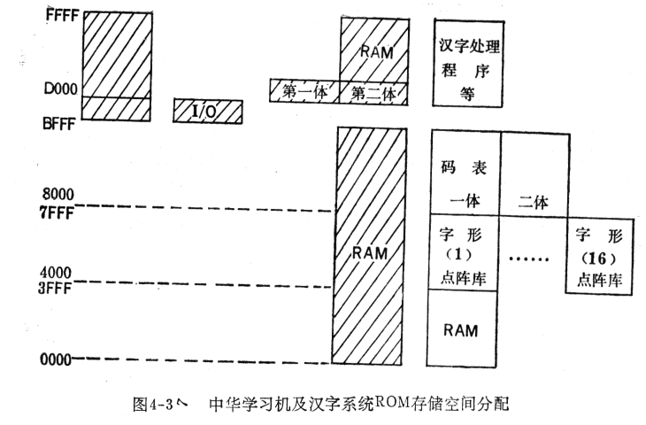

- **（一）地址空间 `$0000`—`$3FFF`（使用附图1的 U5、U6 芯片）**
  这 16K 字节的 RAM 区实质上在辅存空间中并没有对应的物理空间，换句话说，在辅存中这一块 RAM 区并不存在。它所映射的 RAM 存储器就是主存 RAM 中同一地址所对应的存储空间。因此访问辅存 16K RAM 区，实际上就是访问了同一逻辑地址的主存 RAM 区。
- **（二）地址空间 `$4000`—`$7FFF`（使用附图5中的 U33、U34 芯片）**
  这 16K 字节逻辑地址对应的物理地址空间是 $16 \times 16\text{K}$，即 256K 的字形点阵库。至于选择哪一块 16K 字形点阵库，将在辅助存储器的切换中加以叙述。
- **（三）地址空间 `$8000`—`$BFFF`（使用了 U7 和 U35 芯片中高地址的 16K 空间）**
  这 16K 的逻辑地址空间对应有两个同样大小的物理空间。汉字处理电路共使用了 U35 芯片中高 16K 地址空间，另一个 16K 物理空间是 U7 芯片的高地址部分（被 LOGO 子集占用），两者之间也存在切换问题。
- **（四）地址空间 `$D000`—`$FFFF`（使用了 U35 的低 16K 空间）**
  这 16K 地址空间中，只有 U35 芯片中高地址的一部分放汉字处理程序，另外的存储空间被 LOGO 语言子集等占用。

---

### 二、辅助存储器的切换

中华学习机整个存储空间里，存储器的切换有两层含义：一是对主存和辅存之间进行切换；二是在辅存中，处于相同逻辑地址的物理地址空间之间进行切换。

#### （一）主存和辅存之间的切换

主存和辅存之间的切换，在介绍 MMU 存储器管理部件时已有介绍，参见表4-5。

由图4-37可知，在辅存中有两块地址空间 `$0000`—`$BFFF` 和 `$D000`—`$FFFF`。但从表4-5中可以看出，在对主存和辅存进行实际切换时，是把存储空间分成两部分进行的，第一部分是地址空间 `$0200`—`$BFFF`，另一部分是 `$0000`—`$01FF` 和 `$D000`—`$FFFF`。

##### 1. 第一部分地址空间 `$0200`—`$BFFF` 的切换

由表4-5可知要把它块地址空间切换给辅存，只要执行指令：

```assembly
STA $C003
```

这时就可对辅存的 `$0200`—`$BFFF` RAM 区（实际上就是主存中对应的 RAM 区）、字形点阵库 ROM 区以及码表 ROM 区进行访问了。

如果把此空间切换给主存，只要使软开关 `RAMRD` 变成“OFF”状态即可，同样只要执行指令：

```assembly
STA $C002
```

就可对主存 RAM 区进行访问了。

##### 2. 对第二部分地址空间（`$0000`—`$01FF` 和 `$D000`—`$FFFF`）的切换

由图4-37可知，这部分中的 `$D000`—`$FFFF` 实际上有三块物理地址空间与之对应。因此，对它们的切换就要复杂一些。在对主存进行访问时，有可能正在访问主存中的 ROM 区。这时即使进行主存到辅存的切换，也不能把主存 ROM 区切换成辅存区。只有在切换之前，先将主存 ROM 区切换成主存 RAM 区后，才能把主存切换到辅存（包括 RAM 区和所有的 ROM 区）。因此可以执行如下指令：

```assembly
LDA $C080   ; 禁止主存ROM，允许读主RAM。
STA $C009   ; 由主存切换到辅存。
```

这样就能实现从主存 ROM 换到辅存 ROM 区了。同样若要从辅存切回到主存，只需执行如下指令即可：

```assembly
STA $C008
```

如还要禁止主 RAM，允许读主 ROM，则只要执行如下指令：

```assembly
LDA $C082
```

##### 3. 切换指令的存放

在主/辅存进行切换时，切换指令既不能放在主存中，也不能放在辅存中。否则切换后将造成混乱和错误。从表4-5中可以看出，I/O 空间并不参加主辅存的切换。因此，选择 I/O 空间作为切换指令存放区是适宜的。在中华学习机中，选择了 `$C300`—`$C3FF` 这一页作为汉字处理程序的入口和切换指令执行区。一旦系统进入汉字工作方式，从 I/O 空间的 `$C300` 单元作为入口，就可以正确地进行汉字处理了。

考虑到系统复位后，在 MMU 作用下，逻辑地址空间 `$C300`—`$C3FF` 是映射到内部 ROM 的，而当进入汉字工作方式时，此逻辑地址又映射到 I/O 空间。故在转向 `$C300` 单元执行汉字处理程序之前，根据上面分析，必须确保该逻辑地址空间所对应的是 I/O 的物理地址空间。为了达到这一目的要执行如下两条指令：

```assembly
STA $C00B   ; 使C3XX访问I/O空间。
STA $C006   ; 使C100—CFFF访问I/O空间。
```

这样，`$C300`—`$C3FF` 就映射到 I/O 空间了。

---

#### （二）汉字处理中辅存 ROM 的寻址方法

由图4-37（原文作图3-37）可知，字形点阵库共有 16 个体，每个体的容量为 16K 字节。因此，必需有两部分地址才能唯一地确定其中的某一个单元。

##### 1. 选体

字形点阵库中 16 个体的选择是由放在 `$C0B0` 单元中的选体控制字决定。选体控制字的格式如下：

```text
0  0  D5  D4  D3  D2  D1  D0
```

这个选体控制字可以通过执行 `STA $C0B0` 指令使 D5—D0 送入附图5的 U32 中寄存。其中 D3—D0 经 U32 从 4Q—1Q 端输出实现对 16 个存储体的选择。D4 经 U32 的 5Q 端输出，用作禁止彩色图形显示信号。因为在汉字显示中，用彩色显示时，其字迹的清晰度较差。所以在汉字显示中，如不要彩色显示时只要令 $\text{D4}=0$，如要彩色显示则令 $\text{D4}=1$ 即可。D5 经 U32 在 6Q 端输出 $\overline{\text{R80SEL}}$ 信号，它是切换图4-37中逻辑地址为 `$8000`—`$BFFF` 的两个体的。当 $\overline{\text{R80SEL}}=0$ 时选第一体（在 U35 内），当 $\overline{\text{R80SEL}}=1$ 时选第二体（在 U7 内）。选体控制字的最高两位不用，故令其为零。选择控制字中各位的功能见表4-28。

**表4-28 `$C0B0` 单元中各位的功能**

| 数据 `D7 D6 D5 D4 D3 D2 D1 D0` | 功能 |
| :---: | :--- |
| `× × × × 0 0 0 0` | 选择空间 `$4000`—`$7FFF` 的第1体 |
| `× × × × 0 0 0 1` | 选择空间 `$4000`—`$7FFF` 的第2体 |
| `× × × × 0 0 1 0` | 选择空间 `$4000`—`$7FFF` 的第3体 |
| `× × × × 0 0 1 1` | 选择空间 `$4000`—`$7FFF` 的第4体 |
| `× × × × 0 1 0 0` | 选择空间 `$4000`—`$7FFF` 的第5体 |
| `× × × × 0 1 0 1` | 选择空间 `$4000`—`$7FFF` 的第6体 |
| `× × × × 0 1 1 0` | 选择空间 `$4000`—`$7FFF` 的第7体 |
| `× × × × 0 1 1 1` | 选择空间 `$4000`—`$7FFF` 的第8体 |
| `× × × × 1 0 0 0` | 选择空间 `$4000`—`$7FFF` 的第9体 |
| `× × × × 1 0 0 1` | 选择空间 `$4000`—`$7FFF` 的第10体 |
| `× × × × 1 0 1 0` | 选择空间 `$4000`—`$7FFF` 的第11体 |
| `× × × × 1 0 1 1` | 选择空间 `$4000`—`$7FFF` 的第12体 |
| `× × × × 1 1 0 0` | 选择空间 `$4000`—`$7FFF` 的第13体 |
| `× × × × 1 1 0 1` | 选择空间 `$4000`—`$7FFF` 的第14体 |
| `× × × × 1 1 1 0` | 选择空间 `$4000`—`$7FFF` 的第15体 |
| `× × × × 1 1 1 1` | 选择空间 `$4000`—`$7FFF` 的第16体 |
| `× × × 0 × × × ×` | 禁止彩色图形显示 |
| `× × × 1 × × × ×` | 允许彩色图形显示 |
| `× × 0 × × × × ×` | 选择空间 `$8000`—`$BFFF` 的第1体 |
| `× × 1 × × × × ×` | 选择空间 `$8000`—`$BFFF` 的第2体 |

##### 2. 选字

一个汉字是由 $16 \times 16$ 点阵组成，也就是说一个汉字占用 32 个字节的地址空间。在制作字形点阵库时，规定汉字左侧点阵放在 U33 CECWL-I 中，汉字右侧点阵放在 U34 CECWL-II 中。因此选字涉及到两种地址，一种是选择某体内的某地址，它可以通过地址总线中的 A13—A1 来实现（参见附图5）；另一种是选汉字的左侧点阵还是右侧点阵，这是由 U31 的 Y20 和 Y21 的输出信号控制，这两个信号是由 $\overline{\text{EN80}}$、A14、A15 和 A0 通过两个 2-4 译码器 U31 产生。当选择辅存时，$\overline{\text{EN80}}=0$，使第一个 2-4 译码器工作，我们规定此时的 $\text{A15}=0$，$\text{A14}=1$。因此，U31 上的 $\text{Y11}=0$，该信号为使能第二个 2-4 译码器的使能信号。由于 U31 的 B2 接地，故 Y20 和 Y21 的输出由 A0 的状态而定。当 $\text{A0}=0$ 时，$\text{Y20}=0$，使能 U33 选汉字左侧点阵；当 $\text{A0}=1$ 时，$\text{Y21}=0$，使能 U34，选择汉字右侧点阵，所以上述 A13—A0 地址可选择 16K 字节的汉字点阵字库。

要指出的是，一个汉字的 32 字节总是存放在连续的地址单元中的。因此，一个汉字点阵库的首地址中最低 5 位 $\text{A4A3A2A1A0}=00000$，一个汉字点阵库的末地址中 $\text{A4A3A2A1A0}=11111$。总之 A13—A0 是选字的地址。

##### 3. 实例

我们以“中”字为例，看一下 32 个字节的地址点阵数据和汉字字形的位置关系。

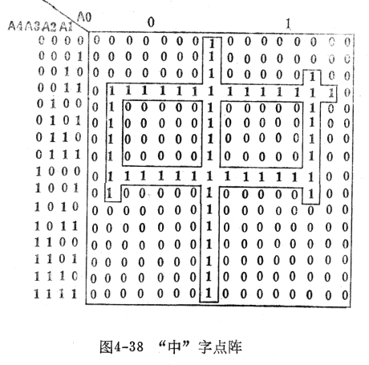

字形点阵的地址、点阵数据和从数据总线上读出的数据，见表4-29。

**表4-29 “中”字点阵数据**

| 地址 `A4A3A2A1A0` | 字库数据 | 读出数据 | 地址 `A4A3A2A1A0` | 字库数据 | 读出数据 |
| :---: | :---: | :---: | :---: | :---: | :---: |
| `$00` | `01` | `80` | `$01` | `00` | `00` |
| `$02` | `01` | `80` | `$03` | `00` | `00` |
| `$04` | `01` | `80` | `$05` | `04` | `20` |
| `$06` | `7F` | `FE` | `$07` | `FE` | `7F` |
| `$08` | `41` | `82` | `$09` | `04` | `20` |
| `$0A` | `41` | `82` | `$0B` | `04` | `20` |
| `$0C` | `41` | `82` | `$0D` | `04` | `20` |
| `$0E` | `41` | `82` | `$0F` | `04` | `20` |
| `$10` | `7F` | `FE` | `$11` | `FC` | `3F` |
| `$12` | `41` | `82` | `$13` | `04` | `20` |
| `$14` | `01` | `80` | `$15` | `00` | `00` |
| `$16` | `01` | `80` | `$17` | `00` | `00` |
| `$18` | `01` | `80` | `$19` | `00` | `00` |
| `$1A` | `01` | `80` | `$1B` | `00` | `00` |
| `$1C` | `01` | `80` | `$1D` | `00` | `00` |
| `$1E` | `01` | `80` | `$1F` | `00` | `00` |

---

#### （三）控制字及选字地址的形成

汉字的输入方式很多，例如拼音输入方式、区位输入方式、声韵声声输入方式、五笔字形输入方式……等等，有几十种之多。中华学习机目前使用的是全拼音输入方式和区位输入方式，这两种输入方式与汉字国标码一样统称为外码。不论采用哪种输入方式，其思路或实现的途径都是一样的。

##### （1）首先把每个输入的汉字外码，从键盘上键入

例如“啊”用拼音输入法则键入“A”，用区位码则键入“1601”。现在我们假设用区位输入。因为“1601”是两个字节的十进制数，所以转换成十六进制数为 `1001H`。

##### （2）把区位码转换成国标码及内码

从区位码转换成国标码，只要加上两位十六进制的常数 `2020H`，所以“啊”的国标码为 $2020\text{H} + 1001\text{H} = 3021\text{H}$。从国标码转换成内码，也只要加上两位十六进制的常数 `8080H`，所以“啊”的内码为 $3021\text{H} + 8080\text{H} = \text{B0A1H}$。内码与区位码和国标码一样，每一个码可唯一对应一个汉字或字母。国标码是我们对常用汉字的一种全国通用的标准编码。国标码之所以要转换成内码是为了与 ASCII 码加以区分。如采用两个 ASCII 字符代表一个汉字，显然也是可以的，但汉字和 ASCII 字符不易区分，为了易于区分，在每个 ASCII 码的最高位置成 1（ASCII 码的最高位都是 0）。因此两字节内码就要在原来两个字节的 ASCII 字符上加上 `8080H` 即二进制的 `10000000 10000000`，使两个字节的最高位都为“1”。

##### （3）内码转换成选体控制字和字形点阵地址

每个内码唯一确定一个汉字，但选体控制字和字形点阵地址都随着组成汉字点阵的不同而不同。例如 $16 \times 16$（原文印作 $16 \times 6$）点阵和 $24 \times 24$、$48 \times 48$ 的选体控制字及字形点阵地址显然不同。但不管怎样，从内码转换到选体控制字和字形点阵地址，必然与上面的转换一样，只要加一个常数就可获得。

##### （4）中华学习机字形点阵字库的考虑

中华学习机配有国标一、二级汉字字库共 6763 个（包括汉字、外文字母符号等）。它们可用 13 位二进制数（相应的十进制数为 8192）来查找。此外，每个汉字都是 $16 \times 16$ 的字形点阵，它需占用 32 个字节，可用 5 位二进制数来表示。8192 个字的全字形点阵共需 $8192 \times 16 \times 16 = 2097152$（$2\text{M}$）位即 256K 字节。因此中华学习机上专门配有两片各为 $1\text{M}$ 位的字形点阵 ROM。$2\text{M}$ 位即 256K 字节可用十八位二进制数来表示。

中华学习机中，地址长度为 16 位，字形点阵的逻辑地址空间为 `$4000`—`$7FFF`，在这个逻辑地址范围内共有 16 个对应的物理地址空间。因此，尽管 18 位二进制数能表示出 8192 个汉字、$16 \times 16$ 全字形点阵字库空间，但如要求在 16 个体、逻辑地址为 `$4000`—`$7FFF` 时，每个汉字的左侧点阵放在 U33 CECWL-I 中，每个汉字的右侧点阵放在 U34 CECWL-II 中，则存在如何形成选体地址、选 16KB 逻辑地址中的地址和选 U33 或 U34 的问题。我们结合附图5加以分析。

由附图5可知，地址码 A13—A1 直接连到两片字形点阵字库的地址输入端。A0 则是通过 2-4 译码器送到 U33 和 U34 芯片使能 $\overline{\text{CE}}$ 端。当 $\text{A0}=0$ 时，选择汉字左侧点阵库 U33（原文印作 U34）。$\text{A0}=1$ 时，选汉字右侧点阵字库 U34。剩下的字库芯片地址输入端还有四个，即 22、1、27 和 26 端。它是由数据总线 D3—D0 经 6D 触发器芯片 U32 而来，实际上这四位数恰恰就是选 16 个体的选体地址。因此我们可以分析出，前面所述的 18 位二进制（可以表示出 8192 个字形点阵的字库）数用下述符号表示：

```text
C17 C16 C15 C14 C13 C12 C11 C10 C9 C8 C7 C6 C5 C4 C3 C2 C1 C0
```

##### （5）体选控制字

把上述 18 位代码先分出高四位：

```text
C17 C16 C15 C14
```

它们对应的是体选地址 D3—D0。剩下 14 位 C13—C0 中 C0 对应上述的 A0，C13—C1 对应上述的 A13—A1。此外，只有当 $\text{A15}=0$、$\text{A14}=1$ 时，附图5中的双 2-4 译码器才能工作，才能控制字形左半侧和字形右半侧交替读出。所以，要在 256K 字节里检索一个汉字（或西文）字形点阵，需要作两件工作：一是要产生一个选体控制字，二是形成能逐字节（共 32）读取字形点阵的地址。

选体控制字占一个字节，具体格式如下：

```text
X  X  Y1  Y2  C17  C16  C15  C14
```

其中最高两位 `XX` 不用，可以是 1 或 0。`Y1` 是选择空间 `$8000`—`$BFFF` 两个体的控制位（$\text{Y1}=0$ 时，选第一个体，$\text{Y1}=1$ 时，选第二个体）。`Y2` 是禁止彩色图形显示位（$\text{Y2}=0$ 时禁止彩色，$\text{Y2}=1$ 允许用彩色）。

`C17`—`C14` 即是 16 个字形点阵体的体选地址。上述体选控制字拼装后通过访问 `$C0B0` 单元，把该字送到附图5中的 6D 触发器芯片 U32 寄存，实现对上述三种控制。

##### （6）字形点阵地址

逐字节读取点阵的地址格式如下：

```text
0   1   C13  C12  C11  C10  C9   C8   C7   C6   C5   C4   C3   C2   C1   C0
```

共 16 位。最高两位一定是 `01`，且每个字形点阵的首地址中 `C4 C3 C2 C1 C0` 一定为“`00000`”，当要取一个字节的字形点阵时，就把首地址加 1，一直加到 `C4`—`C0` 为“`11111`”时才读取完一个汉字（或西文）点阵。

---

### ＊附图7的说明

附图7中示出了 10 个接插座的示意图，现分别说明如下：

- **J1** 是一个扩充外设用的通用插座，它可以依据使用者的需要插上相应的外设接口卡。例如，插上打印机接口卡，就可以把主机和一个打印机连接起来。
- **J2** 连接游戏杆的插座。
- **J3** 连接盒式录音机的插座。
- **J4** 连接磁盘驱动器的插座。
- **J5** 连接监视器的插座（见附图4）。
- **J6** 连接家用电视机的插座（见附图4）。
- **J7** 连接电源的插座，附图7中右下方的电感电容电路是改善直流供电电源特性用的。
- **J8** 连接扬声器的插座（见附图3）。
- **J9** 连接键盘的插座。
- **J10** 短接插塞插座，利用它及短接插塞，可以任意选择 J1 插座上的 $\overline{\text{IOSELN}}$ 和 $\overline{\text{DEVN}}$（$N=1, 2, 4, 5, 7$）信号（见附图3）。
