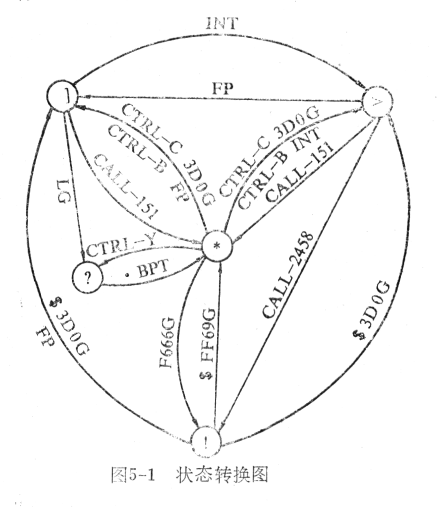
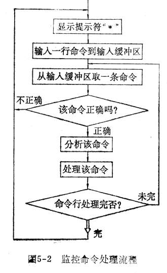
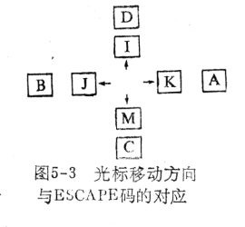

# 第五章 系统监控

## §5-1 概述

中华学习机的系统 ROM 中有一个功能较强的程序，称为系统监控程序（Monitor）。它是系统的管理者，系统的各项日常事务以及用户提出的各种要求都是通过它来完成的。同时，由于它提供了各种最基本的系统管理子程序，因此几乎所有别的程序都使用它。灵活地利用系统监控程序的各种功能，可以大大增进对整个系统的了解，并且在使用系统时会感到极大的方便。

### 一、系统监控的主要功能

系统监控的功能是很丰富的，涉及面也很广泛，归纳起来主要有以下几项：

#### （一）管理 64K 存储器

系统监控具有检查、修改、传送和比较存储器内各种信息的能力，能把大量数据和程序放入存储器中或从存储器中输出出去，同时还管理系统的各种工作区、缓存区和特殊向量单元，例如系统管理所用到的各种表格、状态保存区、各种标志单元、显示区、输入缓冲区、I/O 向量和中断向量等等。

#### （二）管理外部设备

中华学习机系统常规的内连 I/O 设备，如键盘、显示器、扬声器、盒式磁带机等，完全由监控来进行管理。对于那些外接的 I/O 设备，如软盘驱动器、打印机等，尽管在连接它们的 I/O 接口上通常配备有它们自己的驱动程序，但其驱动程序的启动也是靠监控来完成的。

#### （三）调试程序、简单计算

程序在机器里运行，用户如何了解它目前的状态呢？系统监控提供了这样的监督功能。用户可以在程序中设置一系列断点，程序运行到这些地方时，监控将立即作出反应，即中断程序的运行，保护好各种必要的信息，显示断点位置及各种状态，并允许用户从这一断点继续执行程序。

一些简单的数值计算工作（如十六进制数的加、减法），可直接作为监控命令来实现，而不用把这些简单的工作也编成程序，从而提高了效率。

#### （四）有丰富的子程序提供给用户

系统监控为了担当起系统管理者的重任，本身就包括了各种最基本的系统管理子程序，如完成字符、数字和命令输入输出功能的子程序，实现延时、响铃功能的子程序，以及各种具有图形处理功能的子程序等等。这些子程序都是对用户开放的，用户利用这些子程序编制的程序，不仅具有很强的功能，而且储存空间的占用也大为减少。

#### （五）引导操作系统、进入各种语言系统

使用监控命令，可以把软盘上的操作系统引导进来，使中华学习机系统处于相应操作系统的控制之下，这样，我们就可以利用各种操作系统的管理功能和丰富软件，使系统的功能大大增强。

在监控程序运行时，通过使用监控命令，还可以方便地退出监控状态，进入其它程序或语言系统。

### 二、进入监控的方法

根据用户不同的要求，中华学习机可以处在不同的系统工作状态，如扩展浮点 BASIC 状态、监控状态等等。当前系统处于何种工作状态，是通过给出不同的状态“提示符”来告诉用户的。例如，监控状态的提示符是符号“`*`”，当系统给出符号“`*`”时，即表明当前正处在监控状态下。所谓“进入监控”，就是指使中华学习机系统处于监控状态下。

进入监控的方法，总的来说就是使程序转向监控的入口，这个入口地址是 `$FF69`，其对应的十进制数表示为 `65385` 或 `-151`。下面，我们具体给出从各种不同的系统工作状态下进入监控的方法。

#### （一）在 BASIC 状态下

在通常情况下，中华学习机系统中可以有两种 BASIC 状态，一种叫扩展的浮点 BASIC，其提示符是符号“`]`”，另一种叫整数 BASIC，其提示符是符号“`>`”。无论是处在哪一种 BASIC 状态下，都可以用 BASIC 的“`CALL`”命令来转向监控的入口，从而进入监控。例如：

```text
] CALL-151↙
```

或：

```text
> CALL-151
*
```

其中符号“`↙`”表示按“`RETURN`”键。当“`*`”出现在屏幕上时，表示系统已处在监控状态下。

#### （二）在小汇编状态下

小汇编是中华学习机系统配置的另一系统软件，它具有基本的汇编功能，用来把助记符形式的 6502 指令翻译成机器指令（二进制指令码）。在小汇编状态下（其提示符为“`!`”）允许使用各种监控命令，但在监控命令前面须加上一个符号“`$`”。因此，从小汇编进入监控的最常用最便利的方法，是利用监控的“`G`”命令来直接转向监控的入口。即：

```text
! $FF69G↙
*
```

#### （三）在 LOGO 状态下

中华学习机可带有固化的 LOGO 语言解释程序，进入 LOGO 状态后将得到提示符“`?`”，这时可直接使用各种 LOGO 命令。从 LOGO 状态进入监控的命令是“`.BPT`”即：

```text
? .BPT↙
*
```

#### （四）状态转换图

在通常情况下，中华学习机系统处于监控、扩展浮点 BASIC、整数 BASIC、LOGO 和小汇编这五种工作状态之一。图 5-1 给出了从一种状态转换到另一种状态的途径，图中圆圈里的符号是相应状态的提示符，带箭头的线段指出了状态转换的方向，而相应的状态转换是通过线段上标明的命令来实现的。对于这个图，有几点需要说明：



1. 图中给出的状态转换命令中，有一些是必须在引导了中华学习机的磁盘操作系统 DOS 之后才能使用的，如命令“`3D0G`”执行后将转向 DOS 的热启动入口（由此可回到原来的语言系统），在未引导 DOS 时，该命令不能使用。另外，从监控或小汇编状态进入 BASIC 状态所使用的命令“`FP`”和“`INT`”，其本身就是 DOS 命令，当然也必须是 DOS 有效时才能使用。
2. 在中华学习机中，系统 ROM 中固化有扩展浮点 BASIC 解释程序，而整数 BASIC 解释程序是存放在软磁盘上的。因此，要使用整数 BASIC，必须在引导了 DOS，并把磁盘上的整数 BASIC 解释程序装入覆盖 RAM（覆盖了最高 12K 系统 ROM 空间）之后才行。这项装入整数 BASIC 解释程序的工作，通常是由 DOS 的“`HELLO`”程序来完成的。
3. 小汇编程序的入口地址是 `$F666`（其十进制表示为 `-2458`），直接转入这个地址即可进入小汇编状态。但是，小汇编程序是同整数 BASIC 解释程序一道被装入覆盖 RAM 的，而使用 ROM 时，覆盖 RAM 就断开。反之，使用覆盖 RAM 时，ROM 就断开。因此，从扩展浮点 BASIC 状态（这时正在使用 ROM）不能直接进入小汇编，而必须先通过访问软开关使覆盖 RAM 接通，从监控进入小汇编也有同样的问题，即必须先接通覆盖 RAM。解决这个问题可采用如下两种办法：

① 首先进入整数 BASIC 状态，这时覆盖 RAM 就接通了，然后可直接进入小汇编状态或通过监控进入小汇编状态。例如：

```text
]INT
>CALL-2458↙
!
```

或

```text
]INT
>CALL-151↙
*F666G↙
!
```

② 如果是从扩展浮点 BASIC 状态进入了监控，则在监控状态下可先访问软开关 `$C080`，使覆盖 RAM 接通，然后再进入小汇编。例如：

```text
]CALL-151↙
*C080↙
C080-××↙
*F666G↙
!
```

但要注意，上述两种做法的前提是整数 BASIC 解释程序（连同小汇编程序）已被装入覆盖 RAM。

---

## §5-2 监控命令的使用

监控为用户提供了若干条命令，这些命令包括了广泛的功能，如存储器检查、修改、传送和比较，设置屏幕显示方式，设置 I/O 通道，检查 6502 CPU 的状态，反汇编，运行机器语言程序，以及读写磁带等等。一旦系统进入监控状态，就可以使用监控命令来完成各种功能。

本节中，我们逐条介绍监控命令的使用方法，而不涉及其实现原理。

### 一、监控命令概述

一条完整的监控命令包含地址、数据和命令符这三种信息，其中的地址和数据采用大家已熟悉的形式，即以四位十六进制数字表示一个地址，以二位十六进制数字表示一个数据，若给出的地址和数据不足规定的位数，则监控会自动在前面添 `0`，反之，若超过位数则自动去掉前面多余的位。监控能识别 23 种不同的命令字符，它们包括标点符号、大写字母和控制字符，在表 5-1 中列出了全部监控命令字符。请注意，输入行中的控制字符并不显示到屏幕上。

**表 5-1 监控命令字符**

| 类别 | 命令字符 |
| :--- | :--- |
| 标点符号 | `+` `-` `:` `<` `CR` `SPC` |
| 大写字母 | `M` `V` `L` `N` `I` `G` `W` `R` `(T S)` |
| 控制符 | `CTRL-B` `CTRL-C` `CTRL-E` `CTRL-P` `CTRL-K` `CTRL-Y` |

表中，“`CR`”表示回车字符（`RETURN`），“`SPC`”表示空格字符（`SPACE`），控制字符的表示方式意味着：先按下“`CTRL`”键，保持按下的同时按后面的字符键，例如，输入控制字符“`CTRL-B`”时，先按下 `CTRL` 键，再按下 `B` 键（此时不放开 `CTRL` 键）。

那么，一条监控命令的处理过程是怎样的呢？首先，监控用提示符“`*`”通知用户：现在正等待你输入一行命令。这时可输入一行命令（命令行以 `RETURN` 字符结尾）。监控将接到的命令行放到输入缓冲区中，然后顺序处理其中的各个命令，对每一个识别出来的命令字符，都分别转入相应的处理子程序去处理，直至输入缓冲区中的命令全部处理完为止。图 5-2 对上述的处理过程作了简略的说明。



### 二、检查存储器内容

这类命令的格式为：`[首址][.末址]`

这里，方括号中的内容可以省略（下同）。

执行这一类命令，将把首址到末址区域中的存储器内容以二位十六进制数的形式显示出来。具体分为以下几种情况：

#### （一）检查单个存储器单元

只需简单地给出该存储器地址即可。例：

```text
*E000↙
E000-20
*300↙
0300-FF
*
```

此例说明，地址 `$E000` 和 `$0300` 的内容分别为 `$20` 和 `$FF`。

#### （二）检查一个存储区

当指定了首址和末址时，就把该存储区的内容显示出来。显示时，当最低位地址为 `0` 或 `8` 时，将换行显示。若指定的首址不小于末址，则只显示首址单元的内容。例如：

```text
*305.30A↙
0305-FF 32 FF
0308-00 00 35
*322.315↙
0322-5A
*
```

但有几点需说明如下：

1. 若省略首址，只给出圆点“`.`”和末址，则从上次最后访问的下一单元开始显示到末址单元。若末址不大于该单元地址也仅仅显示一个单元的内容。例如：

```text
*305↙
0305-FF
*.30A↙
0306-32 FF↙
0308-00 00 35
*.301↙
030B-4D↙
*
```

在此例中，第一条命令访问了单元 `$305`；第二条命令省略了首址，则它从单元 `$305` 的下一单元（`$306`）显示到末址 `$30A`；第三条命令也省略了首址，则它应该显示从单元 `$30B` 到末址区域中的内容，但由于末址 `$301` 不大于 `$30B`，因此结果只显示了单元 `$30B` 的内容。

2. 若省略首址和末址，只给出“`↙`”，将从上次最后访问的下一单元显示到最低地址位为 `7` 或 `F` 时为止。例如：

```text
*305↙
0305-FF
*↙
  32 FF
*↙
0308-00 00 35 4D 76 2E 5F 12
*
```

在此例中，单独使用“`↙`”时，第一次从地址 `$306` 显示到地址 `$307`（最低地址位为 `7`），第二次从地址 `$308` 显示到地址 `$30F`（最低地址位为 `F`）。

### 三、修改存储器内容（STORE）

命令格式：`[置换地址]: 数据1 数据2……`

执行这一类命令，将把数据序列“数据1”、“数据2”、……依次填入从“置换地址”开始的存储区中。我们可以利用这一类命令把目的程序及其所需的数据块送入存储器。例如：

```text
*0600: 0 1 2 3↙
*
```

注意，各数据之间用空格隔开。下面检查一下：

```text
*6000.6004
6000-00 01 02 03 FF
*
```

（注：上例中修改命令写作 `*0600:` 而检查命令写作 `*6000.6004`，原文如此，实指同一存储区 `$6000` 或 `$0600`。）

允许省略置换地址，即命令以冒号“`:`”开头。那么，省略指明的置换地址是什么呢？如果刚使用过修改存储器命令，则前面最后置换单元的下一地址就是这次的置换地址，否则前面通过“`首址[.末址]`”形式所给出的首址就是置换地址。我们通过下面的例子加以说明。

```text
*6000.6006
6000-00 01 02 03 FF FF 0A
*: 11 12 13 14 15↙
*: 16 17↙
*6000.6006↙
6000-11 12 13 14 15 16 17
*
```

在上面的例子中，第一条命令使用的首址 `$6000` 成了第二条命令的置换地址，而第二条命令的最后置换单元是 `$6004`，则第三条命令从单元 `$6005` 开始作置换。

### 四、存储器传送（MOVE）

命令格式：`目的地址<源首地址.源末地址M`

功能：把从源首地址到源末地址的源存储区中的数据传送到以目的地址为首址的目的区域中。

说明：

（一）`M` 命令只是把源区内容拷贝到目的区中，源区内容一般并不破坏。

（二）允许源区地址与目的区地址全部或部分重叠。但如果目的区首址在源区之中，则源区内容会被破坏。

（三）若给出的源末址比源首址小，则只传送该区首址的内容到目的地址。

（四）监控把源区末址作为最后访问单元保存起来，而把源区的首址作为置换单元保存起来。

### 五、比较两个存区的内容（VERIFY）

格式：`目的地址<源首地址.源末地址V`（注：原文格式处漏印 `V`，作 `目的地址<源首地址·源末地址>`）

功能：将源区内每个单元的内容逐一与目的区中相对应单元内容进行比较。

说明：

（一）比较是从源区首址和目的区首址开始逐对进行的。

（二）对那些不相等的单元将显示单元地址和两个不同的内容。

（三）比较命令不破坏存储器内容。

（四）若源区末址小于源区首址，则只比较两个首址的内容。

例：

```text
*C00: 0 1 2 3 4 5 6 7 8 9 A B C D↙
*300<C00.C0DM↙
*300<C00.C0DV↙
*C06: F↙
*300<C00.C0DV↙
C06-0F(06)
*
```

在此例中，首先将数据 `0`~`D` 存入从地址 `$C00` 开始的 14 个单元中，再将它们传送到从地址 `$300` 开始的存区中，比较后认为两个存区内容完全相同，将单元 `$C06` 的内容修改后再比较，结果发现有一处不相等。

### 六、运行存储器中的目的程序（GO）

当用户的机器语言程序（目的程序）装入内存后，在监控状态下，可以用 `G` 命令直接运行它，用 `T` 命令跟踪运行它或用 `S` 命令单步执行其中的一条指令。在通常情况下，在程序调试的初期阶段，由于这时程序中可能含有较多错误，因此常使用 `T` 命令和 `S` 命令来调试，当程序中多数错误已排除时，就较多使用 `G` 命令和 `S` 命令来调试了。最后，当程序调试完成后，就用 `G` 命令来运行之。

#### （一）直接运行目的程序（GO）

格式：`[转移地址]G`

功能：从转移地址开始执行程序。

说明：

1. 接到 `G` 命令后，系统监控在转到转移地址去执行之前，要先将保存在单元 `$45`~`$48` 中的内容送到寄存器 `A`、`X`、`Y` 和 `P` 中，这些内容通常是上次执行暂停指令（`BRK`）时所保存起来的各寄存器内容（`A`~`P`）。
2. 如果命令中省略了转移地址（只给出 `G`），则把 `PC` 保存单元（`$3A`，`$3B`）的内容作为转移地址，这内容通常是上次执行 `BRK` 指令时保存起来的 `PC` 值，其值 = {`BRK` 指令的地址} + 2。
3. 从上面两点说明可知，`BRK` 指令可以使程序暂停并保护暂停现场（各寄存器内容），而监控的 `G` 命令可以恢复暂停现场并使程序继续运行。因此，`BRK` 指令与 `G` 命令的结合使用是调试用户机器语言程序的基本手段。用户可以在程序中设置一系列断点（`BRK`），用 `G` 命令开始运行程序，运行到断点时程序停下来，这时可做各种必要的检查和修改，然后再用 `G` 命令继续运行程序。
4. 系统监控把根据 `G` 命令执行的程序，看作它的一个子程序，因此在该程序的最后必须是一条返回指令，即 `RTS` 指令，以便将控制权交回系统监控。从这里可以知道，系统监控接到 `G` 命令后，之所以只恢复寄存器 `A`、`X`、`Y` 和 `P` 的内容；而不恢复堆栈指针 `S` 的内容，正是为了在栈顶保留正确的返回地址，使用户程序运行结束后能返回监控。但是，这一点也对用户调试程序带来了限制：如果用户程序本身还要调用自己的子程序，那么，在用户子程序中设置了断点后，就不能使用 `G` 命令来从断点继续运行子程序了，否则当执行到子程序结束时的 `RTS` 指令时，将不会正确地返回到用户主程序，而是返回到监控。

下面是一个显示 26 个英文字母的目的程序例子，这里我们直接输入其机器代码，助记符形式的汇编指令将在 `L` 命令中给出。在这个程序例中，调用了系统监控的标准字符输出子程序，这个子程序把一个字符（其 ASCII 码放在累加器 `A` 中）显示到屏幕上，其起始地址是 `$FDED`。

下面先输入程序：

```text
*300: A9 C1 20 ED FD 18 69 01 C9 DB D0 F6 60↙
```

检查一下输入是否正确：

```text
*300.30C↙
0300-A9 C1 20 ED FD 18 69 01
0308-C9 DB D0 F6 60
```

下面运行该程序：

```text
*300G↙
ABCDEFGHIJKLMNOPQRSTUVWXYZ
*
```

我们不仅可利用 `G` 命令来运行和调试目的程序，而且可用于退出监控状态，进入小汇编（`F666G`）或进入 DOS（`3D0G`），以回到原来的语言系统去。

例：

```text
*F666G
!
```

或：

```text
*3D0G↙
>
```

#### （二）跟踪运行目的程序（TRACE）

格式：`[转移地址]T`

功能：同 `G` 命令一样，运行目的程序，直到程序结束或碰到 `BRK` 指令时为止。但是，对每一条指令，在执行前将显示其汇编助记符形式的指令码（反汇编），在执行后将显示其 CPU 状态（各寄存器内容）。省略“转移地址”时的情况与 `G` 命令相同。

另外，在用 `T` 命令跟踪运行过程中，可键入 `CTRL-S` 使运行暂停，以便察看当前的运行情况，此后按任一键都继续跟踪运行。

请注意，用 `T` 命令运行到 `BRK` 指令而使程序暂停时，存入 `PC` 保存单元的是该 `BRK` 指令的地址，而不是该地址 + 2，这一点与 `G` 命令不同。

#### （三）单步执行机器指令（STEP）

格式：`[转移地址]S`

功能：与 `T` 命令相同，但每次只执行一条指令，执行完后将下一条指令的地址存入 `PC` 保存单元，以便下面继续单步执行，即下面可简单地给出“`S`”去执行下一条指令。

### 七、列表（LIST）——反汇编

格式：`[首地址]L`

功能：把从首地址开始的二十条目的指令以汇编指令的形式列出来。

说明：若 `L` 命令中省略首地址（只给出 `L`），则把上次列表时最后显示单元的下一地址作为首地址，若前面未使用 `L` 命令，则把 `PC` 保存单元（`$3A`、`$3B`）内容作为首地址。

其程序如下：

```text
*300L↙
0300-   A9 C1          LDA   #$C1
0302-   20 ED FD       JSR   $FDED
0305-   18             CLC
0306-   69 01          ADC   #$01
0308-   C9 DB          CMP   #$DB
030A-   D0 F6          BNE   $0302
030C-   60             RTS
030D-   00             BRK
  ⋮      ⋮              ⋮
0319-   00             BRK
*$
```

### 八、写带（WRITE）

（注：原文标题印刷作 `WRLTE`，实为 `WRITE`。）

格式：`首地址.末地址W`

功能：把从首地址到末地址的存储区内容存入盒式磁带。

说明：

（一）盒带机读写操作前，应用信号电缆将中华学习机与盒式磁带机联结起来，并接上盒式磁带机电源线。

（二）在输入行按“`↙`”键之前，须先按下盒带机的录音键，数秒钟后再按“`↙`”，以保证能得到正确的记录。

（三）监控程序首先在磁带上写 10 秒“引导”，然后写数据，写完后发出“嘟”的一声，并给出提示符（`*`）。

（四）`WRITE` 命令在写完数据后，还要写一个“检查和”，它是这次写入盒带的所有数据的部分和，留给以后 `READ` 子程序用来检查读出是否正确。

### 九、读带（READ）

格式：`首地址.末地址R`

功能：将盒带上的数据读到存储区（`首地址.末地址`）中。

说明：

（一）给出命令，按“`↙`”前，须先按下盒带机的放音键，待听到“引导”声时，立即按“`↙`”。为了使走带平稳时再读数据，最好“引导”带之前有数秒走带时间。

（二）`READ` 命令可以把记录在盒带上的数据放到任一存储区中，不一定要放在 `WRITE` 命令指定的存储区中。

（三）监控程序读完盒带上的数据后，它自己生成一个“检查和”，再与带上读出的“检查和”比较，若两者相等，则表示读带正确，显示出一个提示符；否则显示出“`ERR`”，并发出“嘟”的一声，表示有错误，读入的数据不能使用。

### 十、显示方式控制

中华学习机显示器有正常显示、反相显示和闪烁显示三种显示方式。正常显示即屏幕上黑底白字，反相显示反之，而闪烁显示就是正常和反相两种方式交替。但要注意，在监控下，闪烁方式下只是字母和部分符号（`@`、`[`、`\`、`]`、`^`、`_`）闪烁，数字和别的符号均作反相显示。还有，无论是在什么显示方式下，输入的命令都按正常方式显示。通过监控命令可以设置正常和反相两种显示方式。

（一）正常显示命令 `N`（Normal）

（二）反相显示命令 `I`（Inverse）

### 十一、十六进制运算

利用监控命令可以实现十六进制数的加、减法。命令格式如下：

`数据1+数据2` 或 `数据1-数据2`

前面已讲过，数据是用二位十六进制数来表示的。

注意：

（一）如果运算结果大于二位十六进制数，也只显示低二位。

（二）如果运算结果小于 `0`，则显示的是该负数的补码（无符号位）。

例：

```text
*3E+2F↙
=6D$
*F5+42↙
=37$
*DB-A3↙
=38$
*03-F1↙
=12
*
```

### 十二、专用控制符命令

#### （一）`CTRL-E`（EXAMINE）

依次显示 6502 内部寄存器 `A`、`X`、`Y`、`P`、`S` 的内容，并将保存 `A` 寄存器内容的单元作为下一个置换单元，以便下面可以修改这些寄存器保存单元的内容。

例：

```text
*CTRL-E↙
A=0A  X=FF  Y=D8  P=B0  S=F8
*: 01 02 03↙
*CTRL-E↙
A=01  X=02  Y=03  P=B0  S=F8
*
```

#### （二）`CTRL-B`（BASIC）

退出监控，进入 BASIC 状态，这时存储器中原来的 BASIC 程序和变量都将丢失。称之为冷启动。

#### （三）`CTRL-C`

也是退出监控进入 BASIC 状态，但保留原来的程序和变量，称之为热启动。

#### （四）`CTRL-Y`

转到 `$3F8` 去执行。这是留给用户自己灵活使用的命令，利用它用户可以执行自己确定的任何程序。在使用“`CTRL-Y`”之前，用户必须把机器指令形式的子程序放入存储器的某一存储区中，并从地址 `$3F8` 开始放入一条跳转到该存区首地址去的 `JMP` 指令。在用户未确定自己的子程序时，系统在 `$3F8` 开始输入一条“`JMP MON`”指令（`MON` 是监控的入口），用户使用“`CTRL-Y`”时将回到监控入口。

#### （五）设置 I/O 通道

1. `nCTRL-P`（PRINTER）

这里“`n`”是接口槽号，1 ≤ n ≤ 7。该命令指定“`n`”号槽为输出通道。注意：当 n = 0 时，表示输出恢复为屏幕显示；当 7 < n ≤ 15 时，将使系统挂起；当 15 < n 时，作 n mod 16 处理。

2. `nCTRL-K`（KEYBOARD）

同 `CTRL-P` 命令相似，`CTRL-K` 命令指定“`n`”号槽为输入通道。当 n = 0 时，表示输入恢复为键盘输入；当 7 < n 时，同 `CTRL-P` 的处理相同。

3. 几点说明

① 中华学习机只保留了一个外围接口槽，其槽号可通过内部跨接线来指定，出厂时被指定为 1 号槽，通常可插入打印机接口板。6 号槽已做在系统主板上，用来连接软盘驱动器。所以，欲打印输出一批数据，使用“`1CTRL-P`”即可。使用“`6CTRL-P`”或“`6CTRL-K`”（原文印作 `6CTRK`）都将执行引导磁盘的操作。

② 在 DOS 工作时，I/O 操作将通过 DOS 来管理。这时，指定的输出通道必须立即使用才是有效的，否则，下一次输入时，DOS 将把输出恢复成屏幕显示；同样，指定的输入通道也必须立即使用，否则，下一次输出时，DOS 将把输入恢复成键盘输入。只有当你同时指定了输入和输出通道时，才能切断 DOS 对 I/O 的控制，使指定的 I/O 通道能够长久保持下去。

#### （六）输入行编辑命令

1. `CTRL-H`（`←`）

删去输入行的最末一个字符，并使屏幕上的光标左移一格。使用键盘上的左移键“`←`”与使用“`CTRL-H`”具有同样功能。若删除了整个输入行后还继续使用 `CTRL-H` 命令，将引起回车换行，给出新的提示符。这个命令往往用来纠正打字错误。

2. `CTRL-U`（`→`）

把光标处的字符加到输入行末尾，并右移光标一格。使用键盘上的右移键“`→`”与使用“`CTRL-U`”具有同样功能。这个命令与纯光标移动命令（ESCAPE 码）结合使用可把屏幕上的字符任意地装到输入行末尾，是一条很有用的命令。

3. `CTRL-X`

删去当前输入行，屏幕上显示“`\`”（或“`¥`”）字符，并回车换行，给出新的提示符，等待输入新的一行。

### 十三、ESCAPE 码

按下“`ESC`”键后，中华学习机就进入了 ESCAPE 方式。在该方式下，11 个键（`A`、`B`、`C`、`D`、`E`、`F`、`@`、`I`、`J`、`K`、`M`）称为“ESCAPE 码”，具有特殊的含义，利用它们可以完成光标移动和清屏幕功能，但它们对输入行无影响。中华学习机执行一个 ESCAPE 码后是否结束 ESCAPE 方式，这取决于执行的是哪一种 ESCAPE 码。`A`、`B`、`C`、`D`、`E`、`F` 和 `@` 这七个 ESCAPE 码执行后，将结束 ESCAPE 方式；`I`、`J`、`K` 和 `M` 这四个 ESCAPE 码执行后，不结束 ESCAPE 方式。在 ESCAPE 方式下，键入非 ESCAPE 码仅仅结束 ESCAPE 方式。

（一）`ESC A`：按“`ESC`”键后，再按“`A`”键，将使光标右移一格，移到行末将回车换行。

（二）`ESC B`：光标左移一格。移到一行左端时将使光标上移到上面一行末尾。

（三）`ESC C`：光标下移一行，水平方向不动。移到底行后将使窗口上卷一行。

（四）`ESC D`：光标上移一行，水平方向不动。移到顶行后将使光标停在那里，不再受“`ESC D`”控制。

（五）`ESC E`：清除至行末，即将光标所在行从光标起清除至本行末，光标不动。

（六）`ESC F`：清除至页末，即将窗口内光标右方和下方的内容全部清除，光标不动。

（七）`ESC @`：清除整个屏幕并使光标复位到左上角。

（八）`ESC K`
（九）`ESC J`
（十）`ESC M`
（十一）`ESC I`（注：原文（十一）处漏印字母 `I`）

这四个 ESCAPE 码依次与前面讨论过的四个纯光标移动的 ESCAPE 码（`A`、`B`、`C`、`D`）的功能相同。唯一差别是它们不结束 ESCAPE 方式，所以可以连续使用这些 ESCAPE 码。

例如，你按“`ESC`”再按“`I`”，光标上移一行，再按“`K`”，光标右移一格。

这些键的排列如图 5-3，由键盘中心到每个键的方向恰好对应于 ESCAPE 码移动光标的方向。



请注意，一般的监控命令在输入过程中并不执行，监控程序只是简单地把它们放到输入缓冲区中，直到输入一个“`↙`”符（`RETURN`）后，才执行这些命令。但是，上面讨论的输入行编辑命令和 ESCAPE 码却是例外，监控程序一接收到它们便立即去执行这些命令的功能，并不把它们放到输入缓冲区中去。

另外，换行符“`CTRL-J`”（`LF`）和响铃符“`CTRL-G`”（`BEL`）也能作为控制字符输入，并且能在输入后立即执行，但执行后，这一个字符被放到输入缓冲区中。这样，输入行中“`CTRL-J`”和“`CTRL-G`”之后的命令字符将是无效的，因为在执行输入行时，监控程序由于不认识这两个字符（仅认识前面讲过的 23 个字符）而停止执行其后的命令，并使程序转到监控入口去等待新的输入命令。

### 十四、监控命令的灵活使用

#### （一）在一行中可安排若干监控命令，各命令被顺序执行。一行中含有多个命令时，应注意下列几点：

1. 命令间用空格隔开。
2. 一行中字符总数应不多于 256 个，当字符数达到 248 个以后，每输入一个字符，监控都给以响铃警告，当输入字符超过 256 个时，给出“`/`”，表示此行作废，并回车换行，显示新的提示符。
3. `STORE`（修改存储器内容）命令后最好是使用一条 `N` 命令（只起分隔作用），以免出错。

例：

```text
*300.305 300: 1 2 3 N 300.305 303<300.302M 300.305↙
0300-00 00 00 00 00 00
0300-01 02 03 00 00 00
0300-01 02 03 01 02 03
*
```

在此例的命令行中含有六条监控命令；第一条命令显示地址 `$300` 到 `$305` 存区中的内容；第二条命令在该存区开头输入三个数据；第三条命令是正常显示命令，在这里仅仅起分隔作用；第四条命令再次显示该存区内容；第五条命令将该存区前半部的数据搬到该存区后半部去；第六条命令再一次显示该存区内容。当按下“`↙`”时，这六条命令被依次执行。

#### （二）以字母或控制符结尾的命令后面，可不用空格隔开。

例：

```text
*300<380.38FM300<380.38FV1CTRL-PCTRL-E↙
```

（下面从打印机打印出来）

```text
A=00  X=0A  Y=27  P=B0  S=01
*
```

又例如：

```text
*300LL↙
  ⋮
```

#### （三）利用 `M` 命令复制某种格式的数据到一个存储区。

前面曾指出，在使用 `M` 命令时，若给定的目的区首址落在源区之中，则源区内容会被破坏。这是因为，`M` 命令在执行时，是从源区首址开始，依次将源区中的数据全部传送到以目的区首址开始的存区中。如果目的区首址落在源区之中，则源区开头部分的数据会被传送到后半部分源区中（从目的区首址开始），从而破坏了源区原来的内容。但是，我们正好可以利用这一点，在源区开头部分先建立某种格式的数据块，然后有意使用目的区首址落在源区之中的 `M` 命令，使这样的数据块布满整个源区。具体做法如下：

1. 首先把数据块模型存入该存区的开头。
2. 使用如下格式的 `M` 命令：

`[源首地址+n]<[源首地址].[源末地址-n]M`

其中的“`n`”是数据块模型的字节数。

例如，要把数据 `$11`、`$22`、`$33` 和 `$44` 顺序填满 `$300`~`$31F` 的存区（即 n = 4），键入的命令及其执行结果列于下面：

```text
*300: 11 22 33 44↙
*304<300.31BM 300.31F↙
0300-11 22 33 44 11 22 33 44
0308-11 22 33 44 11 22 33 44
0310-11 22 33 44 11 22 33 44
0318-11 22 33 44 11 22 33 44
*
```

---

## §5-3 小汇编的使用

### 一、几点限制

中华学习机的小汇编用于 6502 程序设计的语言汇编。当整数 BASIC 解释程序从磁盘装入覆盖 RAM 时，小汇编程序就同时装入了。使用小汇编时，必须按 6502 汇编指令形式输入用户自己的汇编语言程序，但一定要注意下列限制：

#### （一）在汇编语言程序中不得使用标号

在完全的汇编程序中，允许用户编制的程序是浮动的，即程序中的转移地址都可用标号来代替，用不着写出具体的地址值。但在小汇编程序中不允许出现标号，必须给出确定的地址值，否则将不予接受。

#### （二）在分枝指令中使用目的地址

按分枝指令的定义，分枝指令中的操作数应该是相对偏移量，但小汇编要求用户在分枝指令中直接使用目的地址，用不着再去计算相对偏移量，而把这类计算工作都交给小汇编程序去完成。如在上面介绍 `L` 命令时的例中我们已看到，在分枝指令“`BNE`”（原文作“`BPL`”）中使用的是目的地址“`$302`”而不是相对偏移量“`$F6`”。

#### （三）数制

按照规定，6502 汇编指令中的操作数可以是十进制数（无前缀）、十六进制数（前缀以 `$`）、八进制数（前缀以 `@`）和 ASCII 码（用引号括起）。但在小汇编中这一点却大受限制，小汇编程序只认识十六进制数。它把“`#10`”认为是“`#$10`”，把“`300`”认为是“`$300`”，等等。

### 二、如何使用小汇编

#### （一）进入小汇编

图 5-1 给出了从各种状态进入小汇编的正确途径，读者可以参照使用。在通常情况下，系统处于 BASIC 状态，那么我们首先要使系统进入整数 BASIC 状态（使用“`INT`”命令，得到提示符“`>`”），然后用 BASIC 命令“`CALL-151`”使系统进入监控状态（提示符为“`*`”），最后用监控命令“`F666G`”即可进入小汇编，这时可以听到“嘟”的一声且屏幕上出现小汇编提示符“`!`”。从小汇编状态退到系统别的工作状态的办法也请参见图 5-1。

#### （二）汇编程序的输入

一旦系统进入了小汇编状态，就可以输入我们自己的汇编语言程序了。首先我们需要确定程序的首地址，然后按下述格式输入程序的第一条指令：

```text
!首地址: 程序的第一条汇编指令↙
```

以后的各条指令均按下述格式输入：

```text
! 汇编指令↙
```

指令前面的空格必须输入，这样小汇编程序就能把新输入的这条指令的机器代码紧接在上一条指令后面存入内存。

每输入一条指令，小汇编程序就立刻把它汇编成机器代码，并在屏幕上显示出来。

#### （三）监控命令在小汇编中的使用

我们可以在小汇编状态下使用监控命令，这对于我们检查、修改、运行和调试在小汇编中建立的汇编语言程序是十分有用的。在小汇编中使用监控命令的统一格式如下：

```text
!$监控命令行↙
```

这里的符号“`$`”是必不可少的，它告诉小汇编：其后的输入行是一行监控命令。在多数情况下，执行完监控命令行之后仍可回到小汇编状态。

---

## §5-4 监控的特殊单元

系统监控占用了第三页 RAM 中的一批单元，用来存放监控中要使用的一些特殊的转移指令、转移地址和数据，表 5-2 可概括地说明这点。

系统监控在第 0 页上还占用了大量工作单元，我们在这里就不再讨论了。

**表 5-2 监控在第三页的特殊单元**

| 地址（十六进制） | 老监控 | 用途（自启动 ROM） |
| :--- | :---: | :--- |
| `$03F0`<br>`$03F1` | 无 | 寄存“`BRK`”指令处理程序地址，通常值为 `$FA59` |
| `$03F2`<br>`$03F3` | 无 | 软向量入口，寄存热启动入口地址。监控置的地址是 `$E003`，DOS 置的地址是 `$9DBF`（`$03D0` 放的也是 `JMP $9DBF`） |
| `$03F4` | 无 | 加电字节，加电以后监控使其值为：`($3F3)` ⊕ `$A5` |
| `$03F5`<br>`$03F6`<br>`$03F7` | — | 寄存一条“`JUMP`”指令，转去处理 FPBASIC 的“`&`”命令，通常值为 `$4C, $58, $FF`（`JMP $FF58`） |
| `$03F8`<br>`$03F9`<br>`$03FA` | — | 寄存一条“`JUMP`”指令，转向处理用户“`CTRL-Y`”命令的子程序，一般由用户自己指定，系统初始化时存放进一条 `JMP MON` 指令（`$4C, $65, $FF`） |
| `$03FB`<br>`$03FC`<br>`$03FD` | — | 寄存一条“`JUMP`”指令，转向不可屏蔽中断 NMI 的中断处理子程序，由用户自己填入，系统在初始化时放入一条 `JMP MON` 指令。 |
| `$03FE`<br>`$03FF` | — | 寄存中断请求 IRQ 的中断用的子程序地址，由用户自己填入，系统在初始化时填入地址 `MON`（`$FF65`） |

---

## §5-5 一些有用的监控子程序

监控程序向用户提供大量功能全、内容十分丰富的子程序，了解并掌握这些子程序的功能和正确的调用方法，将使我们编制自己的机器语言程序十分方便，并使编制的程序具有较强的功能。总的来说，要使用这些子程序，需先根据子程序的要求置好相应存储单元和 6502 寄存器的初值（称为入口参数），然后即可使用“`JSR`”指令以转向子程序的起始地址。子程序完成其功能后将返回调用处。

### 一、`COUT` (`$FDED`) ——输出一个字符

`COUT` 是标准的字符输出子程序（其入口地址为 `$FDED`）。要输出的字符的 ASCII 码应放在累加器 `A` 中。`COUT` 调用现行字符输出子程序，其地址寄存在 `CSW`（单元 `$36` 和 `$37`）中，是执行监控命令 `[n]CTRL-P` 时置入的，通常是 `COUT1` 子程序。在前面介绍 `G` 命令时给出了使用 `COUT` 的例子。

### 二、`COUT1` (`$FDF0`) ——输出到 CRT

`COUT1` 把累加器 `A` 中的字符（按正常/反相/闪烁方式）显示到屏幕上现行输出光标的位置，且输出光标向前移一格。除了显示字符外，`COUT1` 还处理四个控制符：`CR`、`LF`、`BS` 和 `BELL`，值得注意的是，`COUT1` 在处理 `CR` 时，除了完成正常的回车换行功能外，还从键盘上接受并执行 `CTRL-S` 命令，即暂停屏幕显示直到再有任一键按下。`COUT1` 返回时，`A` 中的可显示字符被变换为其在当前显示方式下所对应的屏幕 ASCII 码，其余所有寄存器内容不变。

### 三、`SETINV` (`$FE80`) ——设定反相方式

设定 `COUT1` 以反相方式输出。返回时 `Y` 寄存器被改为 `$3F`，其余所有寄存器内容不变。

### 四、`SETNORM` (`$FE84`) ——设定正常方式

设定 `COUT1` 以正常方式输出。返回时 `Y` 寄存器被改为 `$FF`，其余所有寄存器内容不变。

### 五、`CROUT` (`$FD8E`) ——回车换行

送一个字符 `CR` 到现行输出设备，返回时累加器 `A` 的内容被改变为 `$8D`。

### 六、`CROUT1` (`$FD8B`) ——回车换行并清屏幕

从现行光标位置清除屏幕到行末（即执行一个“`ESC E`”命令），然后调用 `CROUT`。

### 七、`PRBYTE` (`$FDDA`) ——打印一个十六进制字节

将累加器 `A` 的内容以二位十六进制数的形式在现行输出设备上输出，返回时累加器 `A` 的内容被改变。

### 八、`PRHEX` (`$FDE3`) ——打印一个十六进制数

将累加器 `A` 的低半字节以一位十六进制数的形式在现行输出设备上输出，返回时累加器 `A` 的内容被改变。

### 九、`PRNTAX` (`$F941`) ——按十六进制打印 `A` 和 `X` 的内容

将 `A` 和 `X` 的内容以四位十六进制数的形式输出，`A` 中包含着输出的高位字节，`X` 中包含低位字节，返回时通常 `A` 的内容被改变。

### 十、`PRBLNK` (`$F948`) ——输出三个空格

向现行输出设备输出三个空格，返回时，`A` 中包含 `$A0`，`X` 中包含 `0`。

### 十一、`PRBL2` (`$F94A`) ——输出很多空格

向现行输出设备输出 1~256 个空格。在入口，`X` 寄存器中应包含要输出的空格数，`X = 0` 则表示要输出 256 个空格。返回时与 `PRBLNK` 相同。

### 十二、`BELL` (`$FF3A`) ——响铃

向现行输出设备输出一个 `BELL`（`CTRL-G`）字符，使扬声器以 1KHz 频率发声 0.1 秒。返回时 `A` 的内容变为 `$87`。

### 十三、`RDKEY` (`$FD0C`) ——获取一个输入字符

这是标准的字符输入子程序，它将闪烁的输入光标置于输出光标的位置，并转向现行输入子程序。其地址寄存在 `KSW`（`$38` 和 `$39`）中，是执行监控命令 `[n]CTRL-K` 时置入的，通常是 `KEYIN` 子程序。返回时 `A` 和 `Y` 的内容被改变，得到的输入字符放在何处由现行输入子程序来规定，比如 `KEYIN` 子程序是放在 `A` 中的。

### 十四、`RDCHAR` (`$FD35`) ——获取一个输入字符并解释 ESC 码

通过调用标准输入子程序 `RDKEY` 来获取字符，此外还处理全部 11 个 ESC 码。

### 十五、`KEYIN` (`$FD1B`) ——读键盘

这是键盘输入子程序，在入口须将输入光标处的字符放在 `A` 中，`KEYIN` 等待按键，得到一个按键之后，它用 `A` 中的字符消去闪烁光标，并读入键码到 `A` 中。

### 十六、`GETLNZ` (`$FD67`) ——获取一个输入行

首先回车换行，输出一个提示符，然后从现行输入设备收集一个输入行，并将输入行送入输入缓冲区（从 `$0200` 单元开始），`X` 寄存器计算输入行长度。在收集输入行过程中处理所有立即执行的监控命令（输入行编辑命令和 ESC 码），同时将输入字符送到现行输出设备。

如果不需要 `GETLNZ` 开头的回车换行功能，可以从 `GETLN` (`$FD6A`) 调用，这样就只输出一个提示符，并收集一个输入行。

如果不仅开头的回车换行功能不需要，而且输出提示符功能也不需要，那么可以从 `GETLN1` (`$FD6F`) 调用，这样就只收集一个输入行。

### 十七、`WAIT` (`$FCA8`) ——延迟

该子程序延迟一指定时间，然后返回调用它的程序。在入口通过累加器 `A` 指定延迟量，延迟时间的计算公式是：

$$T = (26 + 27 \cdot A + 5 \cdot A^2) / 2\ \mu\text{s}$$

（注：原文印作 `T = (28 + 29 * A + 5 * A * A) 12μs`，系将除号 `/2` 误排为 `12`。）

`WAIT` 返回时，`A` 的内容为 `0`，而 `X` 和 `Y` 寄存器不变。

### 十八、`SETCOL` (`$F864`) ——设定低分辨率图象的颜色

这个子程序设定在低分辨率屏幕上画图的颜色。在入口把颜色值放在累加器中，这个值应介于 0 到 15 之间，否则在程序中将对该值作 mod 16 处理。返回时，`A` 的高四位和低四位都是该颜色值，`X` 和 `Y` 内容不变。

### 十九、`PLOT` (`$F800`) ——在低分辨率屏幕上画一个方块

（注：标题原文印刷作 `RLOT ($F800)`，实为 `PLOT`。）

这个子程序以预先指定颜色在低分辨率屏上画一个方块，该方块的垂直座标（0~47）放在累加器 `A` 中，其水平座标（0~39）在 `Y` 寄存器中。`PLOT` 返回时，`A` 中内容改变了，`X` 和 `Y` 寄存器内容不变。

### 二十、`HLINE` (`$F819`) ——画一行水平方块

该子程序以预先指定的颜色在低分辨率屏上画一行水平方块。在入口将该行的垂直座标置于 `A` 中，最左的水平座标置于 `Y` 中，最右的水平座标放在单元 `$2C` 中。若 `(Y) > ($002C)`，将只画最左一个方块。返回时 `A` 和 `Y` 的内容变了，`X` 寄存器内容不变。

### 二十一、`VLINE` (`$F828`) ——画一列垂直方块

该子程序以预先指定的颜色在低分辨率屏上画一列垂直方块。调用 `VLINE` 时，该列的水平座标在 `Y` 中，顶部的垂直座标在 `A` 中，底部的垂直座标在单元 `$2D` 中。若 `(A) > ($002D)`，将只画最顶部的一个方块。返回时 `A` 的值被改变。

### 二十二、`CLRSCR` (`$F822`) ——清除整个的低分辨率屏幕

（注：标准 Apple II / 中华学习机监控中 `CLRSCR` 入口为 `$F832`，原文印作 `$F822`。）

`CLRSCR` 子程序清除低分辨率图象屏幕。调用 `CLRSCR` 时，若显示是文本方式，则以反相方式全屏显示字符“`@`”。返回时 `A` 和 `Y` 的内容被改变。

### 二十三、`CLRTOP` (`$F836`) ——清除低分辨率屏的顶部

`CLRTOP` 子程序与 `CLRSCR` 子程序功能相同，只是它仅清除屏幕顶部的 40 行。

### 二十四、`SCRN` (`$F871`) ——读低分辨率屏幕

该子程序取低分辨率屏上指定方块的颜色值，它的调用方法与调用 `PLOT` 相同。返回时此方块的颜色值存于 `A` 中，其他寄存器不变。

### 二十五、`PRERR` (`$FF2D`) ——打印“`ERR`”

将字符串“`ERR`”和紧接着的响铃符“`BELL`”送到现行输出设备。返回时 `A` 的值被改变。

### 二十六、`SAVE` (`$FF4A`) ——保存全部寄存器内容

将 6502 内部寄存器的内容按 `A`-`X`-`Y`-`P`-`S` 的顺序存入 `$45` 到 `$49` 单元。返回时 `A` 和 `X` 的内容被改变，十进制方式被清除。

### 二十七、`RESTORE` (`$FF3F`) ——恢复寄存器内容

将地址 `$45` 到 `$48` 内的值依次送回 6502 内部寄存器 `A`、`X`、`Y`、`P`。
