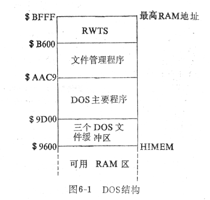
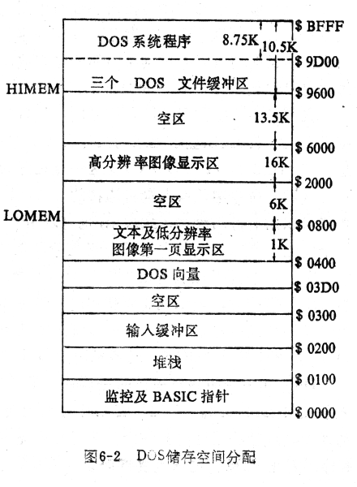
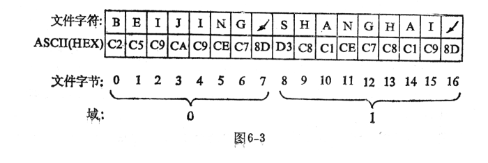
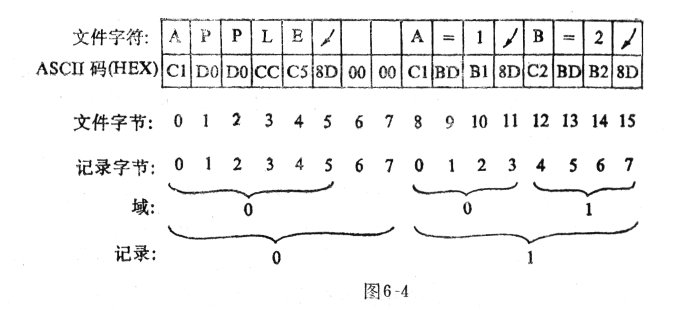

# 第六章 中华学习机磁盘操作系统 DOS

## §6-1 引论

DOS 是中华学习机的磁盘操作系统，用于磁盘文件管理。本章从 DOS 的结构开始，重点介绍 DOS 命令的使用。为此，有必要先了解一些 DOS 的基本使用方法、DOS 磁盘的格式和 DOS 系统磁盘的生成过程。在阅读本章时，读者应已基本熟悉了中华学习机系统，并能进行简单的 BASIC 程序设计。考虑到有些读者可能尚未接触过 BASIC 语言，在本章中凡是涉及 BASIC 程序的地方，都尽可能地给出了解释。

### 一、如何使用 DOS

#### （一）系统的引导（Booting）

所谓 DOS 的引导，就是把 DOS 系统程序从磁盘装入内存，并置中华学习机系统于其控制之下。

在中华学习机的 BASIC 语言中（即整数 BASIC 或扩展浮点 BASIC）没有针对磁盘操作的语句，这极大地限制了系统的功能。例如，用户程序或用户程序中用到的数据，只能通过键盘或磁带输入，这需要做大量的手工操作，如磁带机操作以及键入一系列监控或 BASIC 命令等，这样是很不方便的。而一旦引导了 DOS，通过各种 DOS 命令的使用，就可以完成各种磁盘文件操作，从而使信息的存取永远地从原始的磁带记录方式中解放出来。这不但大大地增强了系统的功能，提高了系统的使用效率，也给使用者带来极大的方便。这就是 DOS 的产生和引导 DOS 的必要性之所在。

那么，如何进行 DOS 的引导工作呢？总的来说，就是通过使用中华学习机的命令，调用磁盘接口中的驱动程序去自动引导磁盘。由于系统可以处在不同的工作状态下，因此，具体使用什么命令去引导 DOS，要视当前的系统工作状态而定。

若系统处于 BASIC 即整数 BASIC（提示符是“`>`”）或扩展浮点 BASIC（提示符是“`]`”）状态下，简单地使用 BASIC 命令 `PR#6` 或 `IN#6`，就可以实现 DOS 的引导。当然，在使用上述命令之前，必须把 DOS 系统磁盘插入磁盘驱动器。

若系统处在监控（提示符是“`*`”）状态下，在把 DOS 系统磁盘插入磁盘驱动器之后，使用监控命令 `6CTRL-P`、`6CTRL-K` 或 `C600G`，均可实现 DOS 的引导，这里的 `C600` 是中华学习机磁盘驱动程序的入口地址。关于这些监控命令请参阅第五章。

在 DOS 的引导过程中，首先把 DOS 系统程序由磁盘装入内存并置系统于 DOS 的控制之下，然后运行磁盘上的第一个 BASIC 程序，该程序是在系统磁盘被初始化时存入磁盘的，它通常是问候类的或执行特定功能的程序。例如，把整数 BASIC 解释程序装入内存。关于这一点，在本节第二部分有关磁盘初始化中再作进一步的介绍。

#### （二）列出文件目录

DOS 磁盘上，往往存储着大量的文件，并建有一个磁盘文件目录，用来存放有关这些文件的信息，如文件名、文件大小、文件类型等等。为了了解当前正在使用的磁盘上到底存有些什么内容，DOS 设置有专门的命令，即 `CATALOG`，来显示磁盘文件目录。例如，将一张 DOS 磁盘插入磁盘驱动器，然后通过键盘给出 `CATALOG` 命令，这时可以看到显示器显示出如下信息：

```text
] CATALOG
DISK VOLUME 254
 *A 006 HELLO
 *B 020 FID
  I 013 ANIMALS
 *T 003 PROMS
```

这就是一个磁盘文件目录的例子，我们把目录从左至右分为四个部分。

第一部分（最左边）给出了文件的封锁状况。凡加有“`*`”记号的文件皆被“写保护”了，即该文件只可读出，不可修改或删除。在此例中，除了第三个文件外其余文件都被写保护了。第二部分给出了文件类型，其中：

- “`A`”表示 Applesoft 文件；
- “`B`”表示二进制（Binary）文件；
- “`I`”表示 Integer 文件；
- “`T`”表示正文（Text）文件。

“`A`”类和“`I`”类文件是 BASIC 程序；“`B`”类文件由二进制数据组成，它可以是目标程序或程序中要用到的数据；“`T`”类文件由 ASCII 字符串组成，关于“`T`”类文件的详细介绍请参阅 §6-3。

第三部分是三位十进制数字，它表示文件在磁盘中占用的区段（Sector）数目。在本例中的四个文件分别占用了 6、20、13 和 3 个区段。在 DOS 磁盘中，一个区段包含 256 个字节，一张磁盘共有 496 个区段用来存储文件的信息。要注意，当文件长度超过 255 区段时，这部分的显示值又从 `000` 开始算起，即：

$$\text{显示值} = \{\text{文件实际占用区段数}\} \bmod 256$$

这一点虽然不会给文件的使用带来任何问题，但有时会给使用者造成错觉。

第四部分（最右边）是文件名，它是以字母开头且长度不超过 30 个字符的字符串组成。如在本例中的“`FID`”、“`HELLO`”等。

文件目录的每一行代表一个文件，一张 DOS 磁盘最多可以有 105 个文件。使用 `CATALOG` 命令将首先给出 18 行（18 个文件），以后按任何一个键（`CTRL` 键、`SHIFT` 键和 `RESET` 键除外）都将给出后面的 18 行，直至文件目录显示完了为止。

在文件目录的上方所显示的字符串“`DISK VOLUME 254`”表示当前使用的磁盘“卷号”是 254。“卷号”用来区分各个不同的磁盘，正如书籍可以分卷出版一样，我们也可以把磁盘编以不同的号，这就是“卷号”。关于“卷号”，将在 §6-3 中作进一步的介绍。

#### （三）文件的存取

下面，我们用一个例子来简单说明如何在 DOS 磁盘中建立我们自己的文件，如何把磁盘上的文件调入内存。此例中所用的文件是 BASIC 文件。

当 DOS 有效，并且已经用 BASIC 命令“`NEW`”清内存以后，通过键盘输入下列简单的程序段：

```basic
5  REM GREETING PROGRAM   ; 注释语句，指出程序名
10 HOME                   ; 清屏幕
20 VTAB 12                ; 指定显示列
30 HTAB 13                ; 指定显示行
40 PRINT "HOW DO YOU DO! "; 显示字符串
50 END                    ; 程序结束
```

这个程序所做的，就是在屏幕中央显示一条问候语“`HOW DO YOU DO! `”，故我们把它命名为“`GREETING`”。

当我们检查程序并运行后，确信无误时，就可以用以下命令把程序存入磁盘：

```text
SAVE GREETING
```

执行这条 DOS 命令，就把内存中的 BASIC 程序，以“`GREETING`”为文件名存到磁盘上。当光标重新出现在屏幕上时，程序已经在磁盘上存好了。

这时，我们可用“`CATALOG`”命令列出文件目录，看看磁盘上是否新增加了一个名为“`GREETING`”的文件。

为了把磁盘上的“`GREETING`”程序调入内存，我们可以再清一次内存，因为在执行上述“`SAVE`”命令时，内存并未遭到破坏，即我们从键盘输入的“`GREETING`”程序还完好地保留在内存中。现在输入 DOS 命令：

```text
LOAD GREETING
```

执行之后，即当屏幕上重新出现光标时，磁盘上的“`GREETING`”程序就已经装入内存了。下面就可以用 BASIC 命令“`LIST`”列出程序或用 BASIC 命令“`RUN`”运行它。

通过上面的例子，我们简单地介绍了 BASIC 程序的存取方法，目的是想让读者对磁盘文件的使用建立起一个初步的和直观的概念，这方面的进一步说明以及别的类型文件的使用都将在 §6-3 DOS 命令一节中介绍。

### 二、DOS 系统磁盘及其制作

#### （一）中华学习机的磁盘

中华学习机配备 DISK II 软磁盘系统。该系统使用 5.25 英寸单面单密度软磁盘，每张软盘被分为 35 个同心环（称为磁道 Track）来存储信息。磁道从软盘的最外边向里边编号，依次称作 0 磁道、1 磁道、…、34 磁道。每一磁道又进一步分为 16 个区段（Sector），被编号为 0 到 15，每个区段可存储 256 个字节的信息。这样每张磁盘的容量可达 140K 字节。在 DOS 系统中，磁盘的 0 磁道、1 磁道和 2 磁道用来存储 DOS 系统程序，17 磁道用来存放磁盘索引表，其余的 31 个磁道才用来存储文件的信息（共有 124K 字节）。

另外，每张磁盘还有一个“写保护”缺口，当封上缺口时该磁盘就被“写保护”了，任何企图往该磁盘写入信息的操作都不能成功。这主要用来防止由于误操作而造成的信息丢失，对于存有大量系统文件的磁盘，我们往往采取这种办法来加以保护。

#### （二）DOS 系统磁盘的制作

在厂家提供的中华学习机磁盘中，有一块称作“`SYSTEM MASTER`”的 DOS 系统主盘。在该系统主盘中，除了 DOS 系统程序外，还有几种 BASIC 解释程序和大量别的实用程序。这些程序的存在给我们使用中华学习机和 DISK II 系统带来了很大的方便，但由于这些程序的存在，使系统主盘的大量存储空间被占用，留给我们建立自己文件的余量就很少了。另外，引导系统主盘时，首先把 DOS 系统程序调入内存 RAM 的低地址区（从 `$800` 开始），然后根据当前系统内存容量的大小，再把 DOS 系统程序从低地址区“搬迁”到 RAM 最高地址区去。由于中华学习机内存容量是固定的，因此这种引导 DOS 的方式就不必要了。我们希望系统引导时，一次就把 DOS 系统程序从磁盘装到内存 RAM 最高地址区，而不用每次都做上述“搬迁”工作。这样，可大大减少系统引导的工作量，也不会破坏内存低地址区原有的信息。

归纳起来，我们希望 DOS 系统磁盘不象系统主盘那样，每次引导均需自定位内存容量，而是依赖于当前使用的系统构造起来；并把尽可能大的磁盘存储空间留给使用者。通过 DOS 的“`INIT`”命令就可以得到这样的系统磁盘，“`INIT`”命令的功能如下：

##### 1. 格式化空白磁盘

未使用过的磁盘称为空白磁盘，它上面没有任何信息，就象刚购买的空白磁带一样，必须为它划分磁道和区段，把磁道和区段的划分情况存入磁盘，通过读取这些信息，计算机就能找到软磁盘的各个磁道和各个区段。这项工作就称为磁盘的格式化，空白磁盘均需经过格式化才能使用。

##### 2. 写入 DOS 系统程序

把存放在系统内存高地址区的 DOS 系统程序直接存到磁盘的 0～2 磁道，这样，以后引导这张磁盘时就用不着再做那种“搬迁”工作了。

把事先输入内存的一段 BASIC 程序作为磁盘的第一个 BASIC 程序存到磁盘上，以后每次引导 DOS 之后都自动运行此程序。

##### 3. 写入第一个 BASIC 程序

DOS 把上述过程称为磁盘的初始化，由初始化得到的 DOS 系统磁盘称为“从属盘”（Slave）。从属盘只能在初始化该盘的系统上或内存容量更大的系统上使用，因为该磁盘上的 DOS 系统程序已经失去了自定位功能。

下面，我们通过“`INIT`”命令初始化磁盘的步骤，来了解从属磁盘的制作过程。假定系统正处在扩展浮点 BASIC 状态下。

（1）把系统主盘插入磁盘驱动器，并使用命令 `PR#6` 来引导 DOS；

（2）从磁盘驱动器中取出系统主盘，换入一张空白磁盘；

（3）用 `NEW` 命令清内存，然后输入一个问候程序。例如：

```basic
5  REM HELLO PROGRAM
10 PRINT "SLAVE DISKETTE CREATED ON 48 K SYSTEM"
20 PRINT "BY CS&S ON 1 MAY 1987"
30 END
```

我们把这个问候程序命名为“`HELLO`”，它所做的就是显示两行信息来说明该从属盘生成时的情况，即系统内存容量、生成者、生成时间等。

（4）输入“`INIT HELLO`”命令，当按下 `RETURN` 键时，系统就开始初始化磁盘驱动器中的空白磁盘。初始化工作完成时，屏幕上将重新出现提示符。

至此，一个从属磁盘就制作出来了。为了便于区分各个不同的磁盘，我们可以给磁盘做好必要的标记。

---

## §6-2 DOS 结构

### 一、DOS 结构

DOS 在逻辑上划分为四个部分：RWTS（读写磁道区段子程序）、文件管理程序、DOS 主要程序和 DOS 文件缓冲区，如图 6-1 所示。



#### （一）DOS 文件缓冲区

DOS 的文件缓冲区是在读写文件时使用的，当 DOS 要读写一个文件时，各个文件区段（Sector）的信息都通过文件缓冲区来传送，每次传送一个区段（256 字节）。每一个打开了的（即正在使用的）文件都对应一个文件缓冲区。每个缓冲区占有 595 个字节，其中含有读写的文件区段信息、文件各区段在磁盘上的位置（磁道号和区段号）、文件管理程序工作区（指出文件读写位置、文件是否改动过等）以及文件名等信息。并且，各文件缓冲区被链接成一条链，DOS 只需记住第一个文件缓冲区的地址，就能顺序找到所有缓冲区。

DOS 在初始化时设置了 3 个文件缓冲区。当需要使用一个文件时，DOS 就为该文件分配一个文件缓冲区；当文件使用完时，就收回其占用的文件缓冲区；如果需要同时使用更多的文件，可使用 DOS 的“`MAXFILES`”命令来改变文件缓冲区数目（见 §6-3 的第三部分）。

#### （二）DOS 主要程序

文件缓冲区上方到系统 RAM 的顶端存放 DOS 系统程序，其中以约占 3.5K 字节的 DOS 主要程序为首。DOS 主要程序由大量子程序和各种参数表组成，其主要功能是解释 DOS 命令，完成每一条命令所要求的操作。除此之外，它还具有 DOS 初始化、BASIC 状态管理以及文件缓冲区设置等功能。DOS 主要程序所执行的所有磁盘文件操作，都是通过调用 DOS 的文件管理程序而实现的。

#### （三）文件管理程序

文件管理程序（约占 2.8K 字节）也是一些子程序的集合，负责所有有关磁盘文件的操作，其功能包括下列对磁盘或磁盘文件的操作：

- 打开文件（`OPEN`）
- 关闭文件（`CLOSE`）
- 读文件（`READ`）
- 写文件（`WRITE`）
- 文件定位（`POSITION`）
- 删除文件（`DELETE`）
- 列磁盘文件目录（`CATALOG`）
- 置封锁状态（`LOCK`）
- 解除封锁（`UNLOCK`）
- 重新命名（`RENAME`）
- 文件校验（`VERIFY`）
- 磁盘初始化（`INIT`）

上述功能凡涉及读写磁盘信息的操作，都是通过调用 DOS 的更低一层的 RWTS 子程序而实现的。

#### （四）RWTS 子程序

DOS 系统程序的最高 2.5K 是 RWTS（Read or Write a Track and Sector）子程序。它由 DOS 的文件管理程序调用，用来读写磁盘的任一磁道任一区段的信息。

通常，用户对磁盘的访问都是通过使用 DOS 命令来实现的。但在机器语言程序中，可以通过调用 RWTS 子程序来直接访问磁盘，以实现读写一个区段的操作。要调用 RWTS 子程序，必须把读写磁盘所必须使用的一些参数（如要读写的区段在磁盘上的位置、读写的区段数据存放的地址以及要 RWTS 子程序做什么事的命令码等）传送给 RWTS 子程序，然后从 RWTS 子程序入口进入，即可实现调用。具体的调用步骤如下（对于初次接触磁盘操作系统的读者，可暂不关心这种直接调用 RWTS 的方法）：

1. 在内存的某存区设置好一张 I/O 控制块表 IOB，以便把其中的参数传递给 RWTS 子程序。IOB 表的格式如表 6-1 所示。
   IOB 表所指明的设备特性表 DCT（Device Characteristic Table）也必须事先设置好，其格式如表 6-2 所示。
2. 设置好上述的表后，把 IOB 表的首地址送入 6502 内部寄存器 Y 和 A 中，其中 Y 含有低字节，A 含有高字节。
3. 使用指令“`JSR $3D9`”转向 RWTS 子程序的入口，去完成 IOB 表所要求的磁道区段读写操作。返回时，IOB 表中存有返回信息。若是读操作，则区段数据缓冲区中存有读入的信息；若是写操作，则区段数据缓冲区中的信息已写入指定的区段。

**表 6-1 IOB 表的格式**

| 字节 | 内容说明 |
| :--- | :--- |
| `$0` | 表格类型。其值必须为 `$01`。 |
| `$1` | 要读写的磁盘所在的槽号。其值为槽号乘以 16。 |
| `$2` | 要读写的磁盘所在的驱动器号，其值为 `$01` 或 `$02`。 |
| `$3` | 要读写的磁盘的卷号。其值为 `$00` 时表示任意卷号。 |
| `$4` | 要读写的区段所在的磁道号（`$00`～`$22`）。 |
| `$5` | 要读写的区段号（`$00`～`$0F`）。 |
| `$6/$7` | 设备特性表（DCT 表）的地址。 |
| `$8/$9` | 区段数据缓冲区地址。该缓冲区占 256 字节存放区段数据。 |
| `$A` | 未用。 |
| `$B` | 未用。 |
| `$C` | 命令码。<br>`$00` = 磁头定位<br>`$01` = 读一个区段<br>`$02` = 写一个区段<br>`$03` = 格式化磁盘 |
| `$D` | 返回码，返回时由 RWTS 填入。若返回码 $\neq \$00$，则 6502 的状态标志位 $\text{C}=1$。<br>`$00` = 正常返回，无错误<br>`$08` = 初始化错<br>`$10` = 写保护错<br>`$20` = 卷号错（不相符）<br>`$40` = 驱动器错<br>`$80` = 读出错 |
| `$E` | 磁盘的实际卷号，由 RWTS 填入。 |
| `$F` | 前一次使用的槽号，由 RWTS 填入。 |
| `$10` | 前一次使用的驱动器号，由 RWTS 填入。 |

**表 6-2 DCT 表的格式**

| 字节 | 内容说明 |
| :--- | :--- |
| `$0` | 设备类型。使用 Apple 的 DISK II 系统时其值必须为 `$00`。 |
| `$1` | 每磁道的相位数。使用 DISK II 时其值必须为 `$01`。 |
| `$2/$3` | 马达运转时间计数的补码。使用 DISK II 时其值必须为 `$EF/$D8`。 |

必须注意，用户若要直接调用 RWTS 子程序，必须对中华学习机的磁盘格式和 6502 机器语言有相当清楚的了解，否则可能会破坏磁盘上的信息。

### 二、DOS 存储空间分配

引导 DOS 之后，系统存储空间进行了重新分配。DOS 系统程序占据了最高存储地址区；DOS 所支持的 BASIC 语言所使用的存区也有了变化。图 6-2 给出了 DOS 存储空间的分配情况，下面对此图作一简略说明。



地址 `$0`—`$2FF` 是监控和 BASIC 的工作区，用作堆栈、输入缓冲区以及存放工作指针。

从 `$3D0` 开始是 DOS 的向量区，用来实现热启动、冷启动、调用系统子程序以及中断处理等功能。

从 `$400` 开始的 1K 存区是中华学习机的正文及低分辨率图象第一页显示区。

BASIC 的 `LOMEM` 指针用来指示最低可用存区，由此向上存放 BASIC 程序中的变量。`LOMEM` 最初被设置在 `$800`，当装入扩展浮点 BASIC 程序时，`LOMEM` 指针上移到程序的末尾。

地址 `$2000`～`$5FFF` 是中华学习机的高分辨率图象显示区（第一页和第二页）。如果 BASIC 程序太长，这个区将受到侵占。

DOS 把 BASIC 的 `HIMEM` 指针设置在 `$9600`，由此向下存放扩展浮点 BASIC 的字符串或整数 BASIC 的程序行。

---

## §6-3 DOS 命令及其使用

### 一、语法说明

语法是指计算机的命令结构，它规定了命令的组成、各部分的顺序及其正确的形式。DOS 命令的语法描述比较简单，它的一般格式是这样的：

```text
<命令字> <文件名> [, 参数]
```

（一）在 DOS 命令中，命令字、参数中的大写字母以及逗号“`,`”必须按照所给出的形式输入。

（二）方括号“`[ ]`”中的参数是可选择的，使用者可以根据自己的需要来决定是否省略它，并且这些参数的排列次序是没有限制的。

（三）命令中的文件名在语法说明中用“`f`”和“`g`”来表示，使用者必须代之以具体的文件名，即以字母开头且长度不超过 30 的字符串。文件名前面的空格将被 DOS 忽略，并且，当文件名长度超过 30 时，其超出部分也将被 DOS 忽略。文件名中不允许出现逗号“`,`”，因为该符号已被用作参数的分隔符了。

文件名中可以出现控制字符，但控制字符不会显示在屏幕上。因此，如果文件名中有控制字符，而我们仅仅以显示出来的文件名去调用该文件，则会遭到失败，计算机将会显示如下信息：“`FILE NOT FOUND`”。这一点正好为我们提供了一种简单而巧妙的文件保密手段。

（四）命令中还有大量可选择的参数，其中的小写字母表示要由使用者提供的数值，这些数值可以用十进制数的形式表示，也可以用十六进制数的形式表示，在十六进制数前面须加上一个美元符号“`$`”。我们在这里介绍三种最常用的参数，其余的参数将在下面有关命令中介绍。

- **`Ss`**：用来说明磁盘所在的槽（Slot）号。“`s`”的范围是 1～7，例如 `S6` 表示使用 6 号槽。当“`Ss`”省略时，表示现在要使用的槽号就是最近使用过的槽号。在未插入附加磁盘控制接口卡的情况下，中华学习机系统只能使用做在主板上的磁盘驱动接口（其槽号规定为 6），该槽号在引导 DOS 时已经指明，因此“`Ss`”总是被省略掉。
- **`Dd`**：用来说明磁盘所在的磁盘驱动器（Driver）号。“`d`”的值可以是 1 或 2，例如 `D2` 表示使用 Driver 2。“`Dd`”省略时的情况与“`Ss`”省略时相似，表示现在要使用的磁盘驱动器就是最近使用过的那一个。在通常情况下，中华学习机系统只有一台磁盘驱动器（Driver 1），因此“`Dd`”也总是被省略。
- **`Vv`**：用来说明磁盘的卷（Volume）号。卷号是磁盘初始化时分配给磁盘的，而且这个卷号是不可更改的，除非重新初始化该磁盘。卷号的选择是用来防止磁盘被意外地写入。当我们选择的卷号与磁盘实际具有的卷号不一致时，计算机将给出出错信息“`VOLUME MISMATCH`”。“`v`”的范围是 1～254，省略“`Vv`”时表示现在要使用的磁盘的卷号是 254。要注意，给出“`V0`”或仅仅给出大写字母“`V`”都是要求 DOS 忽略磁盘的卷号，就好象“`V0`”或“`V`”可以代表任何卷号似的。我们把具有“`V0`”或“`V`”这种性质的项称为“百搭”项。例如，“百搭”字符可以代替任何别的字符，“百搭”数可以代替任何别的数，等等。

### 二、DOS 命令分类

DOS 命令字有 28 个，构成了 31 种不同的 DOS 命令。DOS 命令的分类法有很多种，例如，可以按执行方式分类，可以按功能分类，也可以按文件类型来分类，等等。我们在这里按执行方式对 DOS 命令进行了分类，并且在下面的讲述中都以这种分类法作为依据。

DOS 命令可以有两种执行方式，即立即执行方式和延缓执行方式。立即执行方式是指直接从键盘输入 DOS 命令和 `RETURN` 字符后，计算机立即执行该 DOS 命令的功能。例如我们在 §6-1 中使用的“`INIT`”和“`CATALOG`”命令就是在立即执行方式下使用的。绝大多数 DOS 命令都可以在立即执行方式下使用。延缓执行方式要求把 DOS 命令放到程序中去执行，也就是在程序中建立 DOS 命令，当这段程序被执行时，程序中的 DOS 命令也同时被执行了。同样地，绝大多数 DOS 命令均可在延缓执行方式下使用。

#### （一）只能立即执行的 DOS 命令

`INIT`、`FP`、`INT` 和 `MAXFILES`

其中，“`MAXFILES`”命令十分特殊，在后面具体介绍该命令时再详细讨论。

#### （二）两种方式下均可使用的 DOS 命令

`CATALOG`、`RENAME`、`DELETE`、`VERIFY`、`LOCK`、`UNLOCK`、`SAVE`、`LOAD`、`RUN`、`MON`、`NOMON`、`PR#`、`IN#`、`CHAIN`、`BSAVE`、`BLOAD`、`BRUN`、`CLOSE` 和 `EXEC`

#### （三）只能在延缓执行方式下使用的 DOS 命令

`OPEN`、`READ`、`WRITE`、`APPEND` 和 `POSITION`

其中，“`OPEN`”、“`READ`”和“`WRITE`”命令都各有两种形式，分别作用于顺序正文文件和随机正文文件，这一点我们在 §6-3 讨论上述三个命令时将给出详细的说明。

下面，我们按照上述分类，逐条地介绍 DOS 中使用的各条命令。

### 三、立即执行类命令

#### （一）`INIT f [, Ss][, Dd][, Vv]`

“`INIT`”命令称为“初始化（磁盘）命令”，其功能和使用的例子已作介绍，这里仅仅给出几点进一步的说明。

格式化磁盘是把空白磁盘划分为磁道和区段，在每一个区段中存入该区段在磁盘中的地址（磁道号和区段号），并且把磁盘卷目录表 VTOC（Volume Table of Content）和磁盘文件索引表 TDD（The Diskette Directory）存入磁盘的 17 磁道中。这两张表分别记录磁盘各磁道（区段）的使用情况和每一文件的情况（如文件名、文件类型、文件长度、文件在磁盘上存放的地址，等等），磁盘上每存入、修改或删除一个文件，这两张表都要被 DOS 修改。

“`INIT`”命令中的任选项“`Ss`”和“`Dd`”用来指出要格式化的空白磁盘所在位置，对于通常只接有一台磁盘驱动器的中华学习机系统，这两项都省略了。任选项“`Vv`”用来给新初始化的磁盘规定一个卷号，这要根据我们的需要来指定。若省略“`Vv`”任选项，则 DOS 把磁盘的卷号定为 254。

“`INIT`”命令中的文件名“`f`”就是存到磁盘上的第一个 BASIC 程序的名字，我们通常把它命名为“`HELLO`”，当然也可以使用任一别的文件名，只要你不会把它同磁盘上另外的文件名混淆起来就行了。

#### （二）`FP [, Ss][, Dd][, Vv]`

“`FP`”代表的是“浮点”（Floating Point），执行“`FP`”命令将使系统工作状态转换为扩展浮点 BASIC 状态。只有当系统处于扩展浮点 BASIC 状态时才可以运行扩展浮点 BASIC 程序。

要注意，使用“`FP`”命令时，内存中的 BASIC 程序将被清除。

#### （三）`INT`

“`INT`”命令用来把系统工作状态转换为整数 BASIC 状态以便能运行整数 BASIC 程序。命令中没有任何参数，并且执行“`INT`”命令时将清除内存中的 BASIC 程序。

使用“`INT`”命令时，系统中必须已装有整数 BASIC 解释程序，对于中华学习机，往内存装入整数 BASIC 解释程序的工作通常是由 DOS 系统主盘上的 `HELLO` 程序来完成的。

#### （四）`MAXFILES n`

“`MAXFILES`”命令用来设置文件缓冲区的数目，即允许系统中同时有“`n`”个文件在使用，这里“`n`”范围是 1～16。

前面讲过，一个文件缓冲区占用 595 个字节的内存空间。每一个正在使用的文件都占用一个文件缓冲区。读该文件时，首先从磁盘上把一个区段的信息（256 个字节）读到文件缓冲区，然后再传送其中某一部分给程序；写该文件时，也是把信息送到文件缓冲区，待写满 256 个字节时再存到磁盘上。

引导 DOS 时，系统自动地执行了“`MAXFILES 3`”命令，把文件缓冲区的数目定为 3 个，这在大多数情况下已足够使用了。

“`MAXFILES`”命令也可以在延缓执行方式下使用，但由于执行“`MAXFILES`”命令将修改指针“`HIMEM`”的值，放在“`HIMEM`”之下的扩展浮点 BASIC 字符串或者整数 BASIC 程序行将被抹涂，因此要求尽可能不在延缓执行方式下使用“`MAXFILES`”命令。这也就是我们把“`MAXFILES`”命令归类于立即执行类的原因。另外，在 BASIC 程序中使用“`HIMEM`”命令时，注意不要进入文件缓冲区，以免引起混乱。

### 四、混合执行类命令

混合执行类命令指既能以立即执行方式使用又能以延缓执行方式使用的 DOS 命令，大多数 DOS 命令都属于这一类。

#### （一）`CATALOG [, Ss][, Dd]`

关于“`CATALOG`”命令的功能和执行“`CATALOG`”命令后屏幕上显示的文件目录各部分的含义，在 §6-1 中已作了说明。还需说明一点，通过使用任选项“`Ss`”和“`Dd`”可显示出任一驱动器中的磁盘文件目录，并且，卷号的选择对“`CATALOG`”命令是没有作用的，即如果在“`CATALOG`”命令中使用了“`Vv`”任选项，它也会被系统所忽略。

#### （二）`RENAME f, g [, Ss][, Dd][, Vv]`

“`RENAME`”命令称为“重新命名命令”，它的功能是：把指明或省略指明的驱动器中的文件“`f`”改名为“`g`”，文件的内容不受影响。

如果文件“`f`”是已打开的（正在使用的），则“`RENAME`”命令将关闭该文件。

“`RENAME`”命令不检查磁盘上是否已经存有文件“`g`”，因此经过重新命名的磁盘上有可能出现重名文件。这种混乱情况是我们所不希望出现的，在使用“`RENAME`”命令时应尽量避免之。

#### （三）`DELETE f [, Ss][, Dd][, Vv]`

执行“`DELETE`”命令将从指明或省略指明的驱动器的磁盘中删除文件“`f`”。这个“删除”过程，实际上仅仅把文件从磁盘文件索引表中清除，并释放该文件占用的磁盘存储空间，没有也不必要把文件的全部信息从磁盘中清除掉。

如果文件“`f`”是“写保护”的，或者磁盘的“写保护”缺口已封上，则无法删除文件“`f`”。如果磁盘上并不存在你要删除的文件，则执行“`DELETE`”命令时，DOS 将给出出错信息“`FILE NOT FOUND`”。如果文件“`f`”是已打开的，则“`DELETE`”命令将关闭该文件后再作删除。

#### （四）`LOCK f [, Ss][, Dd][, Vv]`

该命令封锁文件“`f`”，即“写保护”该文件，以免文件意外地被修改或删除。当使用“`CATALOG`”命令来显示磁盘文件目录时，被封锁的文件用符号“`*`”来标记。

#### （五）`UNLOCK f [, Ss][, Dd][, Vv]`

该命令解除文件“`f`”的封锁状态，使我们能够对该文件进行修改或删除。

#### （六）`SAVE f [, Ss][, Dd][, Vv]`

该命令的功能是把内存的 BASIC 程序按文件名“`f`”存放到磁盘上。

如果磁盘上原来并没有文件“`f`”，执行“`SAVE`”命令将建立该文件；如果磁盘上原来已有文件“`f`”，“`f`”与当前内存中的 BASIC 程序类型相同且未被封锁，则原来文件的信息将全部丢失，而被当前内存中的 BASIC 程序所取代；如果磁盘上原来的文件“`f`”与当前欲存盘的 BASIC 程序类型不同，则执行“`SAVE`”命令时，DOS 将给出出错信息“`FILE TYPE MISMATCH`”。

在使用“`SAVE`”命令时，如果仅仅给出命令字“`SAVE`”，而略去文件名“`f`”和所有任选项，这就只是一条 BASIC 命令了，它的功能是把当前内存中的 BASIC 程序存到磁带上而不是磁盘上。下面我们还会遇到类似的情况：许多 DOS 命令字看上去同 BASIC 命令完全一样，它们如何区分呢？最关键的区别在于：BASIC 命令不涉及文件，也不需要选择槽号、驱动器号和卷号等；而 DOS 命令需给出文件名，也可指明若干任选项。

#### （七）`LOAD f [, Ss][, Dd][, Vv]`

该命令从指明的或省略指明的磁盘驱动器中的磁盘上寻找 BASIC 程序“`f`”，如果卷号匹配且磁盘上存在程序“`f`”，则将该程序装入内存。

执行“`LOAD`”命令时，系统工作状态将被转换成适合文件“`f`”的语言状态，相当于事先执行了一条“`FP`”命令（若“`f`”是扩展浮点 BASIC 文件）或“`INT`”命令（若“`f`”是整数 BASIC 文件）。“`LOAD`”命令将关闭所有已打开的正文文件，并清除内存中原有的任何 BASIC 程序。

若仅仅给出命令字“`LOAD`”（省略文件名“`f`”和所有任选项），则是一条从磁带上装入程序的 BASIC 命令。

#### （八）`RUN f [, Ss][, Dd][, Vv]`

该命令的功能是：执行 DOS 的“`LOAD`”命令，然后执行 BASIC 的“`RUN`”命令，即把 BASIC 程序“`f`”装入内存并运行之。

仅仅给出命令字“`RUN`”，则是 BASIC 的“执行程序”命令。

#### （九）`VERIFY f [, Ss][, Dd][, Vv]`

我们知道，在把信息存到磁盘上的过程中，首先把信息存入文件缓冲区，待存满 256 个字节的信息时，DOS 再把这些信息作为一个数据块存到磁盘的一个区段里。这时，存到该区段中的信息，除了 256 个字节的文件信息外，还有一个由这 256 个字节文件信息计算得到的称之为“检查和”的校验字节。根据这个检验字节，我们可以检查文件传输的正确性。因此，往磁盘的区段存入该检验字节是一项十分必要的措施。

“`VERIFY`”命令对存入磁盘的文件“`f`”的信息进行正确性检查。它由文件每一区段的信息计算出一个新“检查和”，去与原来存储在这个区段中的“检查和”进行比较，如果两者相符，则证明文件传输正确，否则将给出出错信息“`I/O ERROR`”。能通过上述检查的文件，我们称之为“自相容”的。

“`VERIFY`”命令可适用于检查任何类型的文件。

#### （十）`MON [C][, I][, O]`

在通常情况下，DOS 命令以及主机与磁盘间的信息交换均不在屏幕上显示。但在调试程序时，监视这些信息却是十分必要的，我们可以通过它来找出程序中的问题。DOS 的“`MON`”命令可以满足我们监视这些信息的需要。

“`MON`”命令中的参数“`C`”代表“`COMMAND`”，即程序中出现的 DOS 命令；参数“`I`”代表“`INPUT`”，即从磁盘输入的信息；参数“`O`”代表“`OUTPUT`”，即向磁盘输出的信息。命令中至少必须包含这三个参数之一，且参数的排列次序可以是任意的，它们必须由逗号“`,`”分开。执行“`MON`”命令后，命令中的参数所指明的信息就随着程序的运行而全部显示在屏幕上。

下面是几条“`MON`”命令及其功能说明：

- `MON C`：监视 DOS 命令；当程序执行一条 DOS 命令时，该命令就显示到屏幕上；
- `MON I`：监视从磁盘读出的文件信息；
- `MON O, C`：监视 DOS 命令以及向磁盘写入的文件信息；
- `MON I, O`：监视中华学习机与磁盘间的信息交换。

一旦执行了一条“`MON`”命令，DOS 就开始监视有关信息，直到你执行如下命令之一为止：`NOMON`、`INT`、`FP`、`3D0G`（Monitor 状态下）、引导 DOS 或按“`RESET`”键。

#### （十一）`NOMON [C][, I][, O]`

该命令撤消对其参数所指明的信息的监视。参数的含义及使用方法都与“`MON`”命令中相同。

#### （十二）`PR#s`

该命令用来选择输出设备，“`s`”表示槽（slot）号，执行“`PR#`”命令后，系统的信息输出将转向“`s`”所指明的槽上连接的输出设备。

执行“`PR#`”命令时，若选择 `s=0`，则将输出恢复为屏幕显示；若选择 `s=1`，则以打印机作为输出设备，因为打印机通常连在 1 号槽上；若选择 `s=6`，则是从磁盘引导 DOS，而并不是把信息输出到磁盘驱动器去。“`s`”的值应介于 0 到 7 之间，否则将出错。

#### （十三）`IN#s`

“`IN#`”命令的功能与“`PR#`”命令的功能十分相似，不同的是“`IN#`”命令是用来选择输入设备，另外，选择 `s=0` 是将输入恢复为标准的键盘输入。

表 6-3 列出使用“`PR#`”命令和“`IN#`”命令时选择不同的“`s`”值所得到的结果。

**表 6-3 表处理**

| “`s`”的值 | 执行“`PR#`”或“`IN#`”的结果 |
| :--- | :--- |
| `<0` | 显示“`SYNTAX ERROR`”； |
| `0` | 恢复为标准 I/O 设备； |
| `1～7` | 从该号插槽进行 I/O，若“`s`”指向磁盘驱动器则引导磁盘； |
| `8～16` | 立即执行方式：显示“`SYNTAX ERROR`”；<br>延缓执行方式：系统挂起； |
| `17～65535` | 显示“`RANGE ERROR`”； |
| `≥65536` | 显示“`SYNTAX ERROR`” |

#### （十四）`BSAVE f, Aa, Lj [, Ss][, Dd][, Vv]`

关于如何使用 BASIC 程序文件，我们已经在前面介绍有关命令时详细说明了。下面我们介绍另一种类型的 DOS 文件即二进制文件的使用方法。我们在使用计算机时，经常需要把内存中一些有用的二进制信息，比如机器语言程序、数据或一幅图画，保存到磁盘上或从磁盘把这些信息装入内存，这些都归结为如何使用二进制文件的问题。DOS 提供了一组针对二进制文件操作的命令，这些命令的命令字都冠以字母“`B`”（Binary）作为标志，“`BSAVE`”命令就是其中之一。

“`BSAVE`”命令的功能是：把内存中的一段二进制信息，以“`f`”为文件名，存到指明或省略指明的驱动器中的磁盘上。

参数“`Aa`”用来指明要存储到磁盘上的那段二进制信息在内存的起始地址。字母“`A`”代表“`Address`”，小写字母“`a`”代表必须由使用者给出的该起始地址值。“`a`”的范围介于 0 到 65535 之间，超出此范围 DOS 将给出出错信息“`SYNTAX ERROR`”。

参数“`Lj`”用来指明该二进制信息段的长度（字节数）。字母“`L`”代表“`Length`”，小写字母“`j`”是使用者给出的字节数，“`j`”的范围介于 1 到 32767 之间。如果 `j=0` 或 $32767 \le j \le 65535$，DOS 将给出出错信息“`RANGE ERROR`”；如果 `j<0` 或 $j \ge 65536$，则将得到出错信息“`SYNTAX ERROR`”。由此可知，一条“`BSAVE`”命令最多往磁盘上存入 32767 个字节的信息，如果我们要存盘的内存区域大于 32767，则至少要使用两条“`BSAVE`”命令。

要注意，上述两个参数（“`Aa`”和“`Lj`”）是不能省略的。

下面两个“`BSAVE`”命令，用来创建一个名为“`PICTURE`”的二进制文件，文件中包含中华学习机内存的高分辨率图像第二页的图象信息。这两个命令的操作是相同的，只是参数的表示形式不一样，第一条命令使用十进制参数，第二条命令使用十六进制参数。

```text
BSAVE PICTURE, A16384, L8192
BSAVE PICTURE, A$4000, L$2000
```

#### （十五）`BLOAD f [, Aa][, Ss][, Dd][, Vv]`

该命令的功能与“`LOAD`”命令的功能十分相似，它从指明或省略指明的驱动器中的磁盘上寻找二进制文件“`f`”。如果该文件存在于磁盘上且磁盘卷号匹配，则将该文件的二进制信息装入内存的指定区中。执行“`BLOAD`”命令时，系统工作状态不会发生变化，并且，内存中的 BASIC 程序不会被破坏，除非二进制文件被装入到 BASIC 程序所占用的存储区域中。

参数“`Aa`”的含义和规定与“`BSAVE`”命令中一样，只是这里指明了二进制文件装回到内存区域的起始地址，并且参数“`Aa`”是可以省略的。省略“`Aa`”时，起始地址就是该文件由“`BSAVE`”命令创建时所指明的起始地址，即二进制信息被装回到其原来的内存区域中。

在“`BSAVE`”命令的例中创建的二进制文件“`PICTURE`”，可用下面的“`BLOAD`”命令装回到原来的存区中（即高分辨率图像第二页存区中）：

```text
BLOAD PICTURE
BLOAD PICTURE, A16384
BLOAD PICTURE, A$4000
```

使用下面的命令将把该图象装到高分辨率图像第一页存区中：

```text
BLOAD PICTURE, A8192
BLOAD PICTURE, A$2000
```

要注意，使用“`BLOAD`”命令把机器语言程序装入内存时，如果指定的存区与该程序原来建立时的存区不一致，则该程序可能就不能运行了。

#### （十六）`BRUN f [, Aa][, Ss][, Dd][, Vv]`

命令“`BRUN`”中的二进制文件“`f`”必须是机器语言程序，否则可能引起混乱。

该命令的功能是：首先执行“`BLOAD`”命令的功能，把程序“`f`”装入内存，然后转移（`JMP`）到该程序的第一个字节去运行该程序。

#### （十七）`CHAIN f [, Ss][, Dd][, Vv]`

DOS 的“`CHAIN`”命令只能在整数 BASIC 工作状态下使用，用来链接两个整数 BASIC 程序。

使用计算机时，通过顺序地装入运行两个或更多个程序，可以非常容易地实现一些应用。在这种情况下，后一个程序往往需要利用前一个程序中的变量或数组的值，即需要实现程序之间的链接。通常使用 DOS 的“`RUN`”命令来装入后一个程序时，将清除前一个程序的全部信息，包括其变量和数组。为了避免这一点，在整数 BASIC 状态下，可以利用“`CHAIN`”命令来实现两个整数 BASIC 程序间的链接。

执行“`CHAIN`”命令时，将从指明或省略指明的驱动器中磁盘上装入并运行名为“`f`”的整数 BASIC 程序，但是不清除原来内存中的整数 BASIC 程序的任何变量符值。

假设有两个整数 BASIC 程序“`PART ONE`”和“`PART TWO`”，要求运行“`PART ONE`”后链接上“`PART TWO`”，可以在“`PART ONE`”运行完毕之后使用如下 DOS 命令：

```text
CHAIN PART TWO
```

这样“`PART TWO`”被装入运行，并且在运行中就可以使用“`PART ONE`”中所使用的全部变量和数组值。

“`CHAIN`”命令仅限于整数 BASIC 中使用，扩展浮点 BASIC 程序的链接须通过 DOS 系统主盘上一个名为“`CHAIN`”的机器语言程序来实现。机器语言程序“`CHAIN`”的具体使用方法请参见本节第五部分。

在混合执行类的 DOS 命令中还有“`CLOSE`”命令和“`EXEC`”命令。这两个命令都用于正文文件的使用，由于大多数使用正文文件的 DOS 命令仅在延缓执行方式下才能使用，因此，为了便于读者理解命令的功能，为了使讲述更为系统，我们把“`CLOSE`”命令和“`EXEC`”命令放到延缓执行类命令中介绍。

### 五、DOS 命令的延缓执行方法

DOS 命令的延缓执行方式就是把 DOS 命令放到 BASIC 程序中，使其在程序运行的过程中自动地被执行。

其方法很简单，就是用一条 BASIC 的“`PRINT`”语句输出一个字符串，该字符串以一个控制字符“`CTRL-D`”开头，其后紧跟着一条 DOS 命令。

因为中华学习机不能显示控制字符，因此，为了使程序便于阅读，往往事先用一个字符串变量“`D$`”来定义控制字符“`CTRL-D`”。在扩展浮点 BASIC 中，定义“`CTRL-D`”的语句例子如下：

```basic
D$=CHR$(4): REM D$=CTRL-D
```

其中的“`D$`”是一字符串变量，“`CHR$`”是字符函数，函数值“`CHR$(4)`”是控制字符“`CTRL-D`”的 ASCII 码。BASIC 的程序行可含有若干条语句，各语句之间用冒号“`:`”隔开，在本例中，一条赋值语句（`=`）和一条注释语句（`REM`）放在了一行中。在整数 BASIC 中，没有函数“`CHR$`”，只能以下面的方法定义“`CTRL-D`”：

```basic
D$="" : REM D$=CTRL-D
```

其中引号里打入了控制字符“`CTRL-D`”，但不能被显示出来。

下面我们给出一个在程序中使用 DOS 命令的扩展浮点 BASIC 程序例子，通过这个例子，也附带说明了如何利用机器语言程序“`CHAIN`”使两个扩展浮点 BASIC 程序“`PART ONE`”和“`PART TWO`”链接起来。这里，文件“`CHAIN`”和文件“`PART TWO`”必须在同一张磁盘上。“`PART ONE`”程序如下：

```basic
5  REM PART ONE                  注释语句，指出程序名
10 A=123: B=456: C=A+B           给变量 A、B、C 赋值
20 PRINT "A=" ; A                显示 A 的值
30 PRINT "B=" ; B                显示 B 的值
40 D$=CHR$(4): REM CTRL D        定义 CTRL D
50 PRINT D$; "BLOAD CHAIN, A520" 装入“CHAIN”文件
60 CALL 520 "PART TWO"           用“CHAIN”链接“PART TWO”
70 END
```

注意，在进行程序链接时，（60 行）“`CALL`”语句的地址（`520`）与其后的引号之间不能有空格。并且，实现程序链接的两行语句（此例中行号是 50 和 60）必须紧挨在一起，放在程序的末尾。

“`PART TWO`”程序如下：

```basic
5  REM PART TWO
10 PRINT "C=" ; C    显示 C 的值
20 END
```

下面我们运行“`PART ONE`”。运行到行号 50 时，将执行 DOS 命令“`BLOAD`”，把二进制文件“`CHAIN`”装入内存 520 单元开始的存区中。运行到行号 60 时，系统转去运行“`CHAIN`”程序，它保留程序“`PART ONE`”中的变量 `A`、`B` 和 `C` 的值，把程序“`PART TWO`”装入内存并运行之。以下是运行程序“`PART ONE`”后屏幕上显示的信息：

```text
] RUN PART ONE
A=123
B=456
C=579
```

其中，“`A=123`”和“`B=456`”是程序“`PART ONE`”输出的信息，“`C=579`”是程序“`PART TWO`”输出的信息。

在使用 DOS 命令时，还应注意以下几个问题：

1. 在一条“`PRINT`”语句中只能有一条 DOS 命令，不能试图用一条“`PRINT`”语句去输出多条 DOS 命令。
2. 在程序中执行 DOS 命令时，紧接在 `D$`（控制字符“`CTRL-D`”）前面必须输出过一个回车（`RETURN`）字符，否则 `D$` 将被忽略。例如运行以下的程序：

```basic
5  REM TESTCATALOG PROGRAM
10 D$="" : REM THERE IS AN INVISIBLE CTRL-D BETWEEN THE
   QUOTES
20 PRINT "TEST" ;
30 PRINT D$; "CATALOG"
40 END
```

将显示出：`TESTCATALOG`。这是因为第 20 行的末尾使用了分号而不是回车字符，因此第 30 行的“`D$`”就被 DOS 忽略掉，从而把后面的“`CATALOG`”当作一般字符串给显示了出来。如果我们把第 20 行的分号去掉，则运行该程序时就能执行 DOS 的“`CATALOG`”命令，把磁盘的文件目录显示出来。

3. 扩展浮点 BASIC 的“`TRACE`”命令是一个很有用的调试工具。当“`TRACE`”有效时，每执行完一行 BASIC 程序，就把下一行的行号显示出来，然后再去执行该行的语句，这使你能够了解程序运行的轨迹，便于找出程序中的错误。但是由于在“`TRACE`”的这种工作方式中当“`TRACE`”有效时，程序中的 DOS 命令将不能被执行。上例中，假定我们已经把第 20 行末尾的分号删掉了，当“`TRACE`”有效时运行程序，执行完第 20 行时，系统将输出行号“`30`”，这样，执行第 30 行时，“`D$`”将由于其前面输出的不是回车字符（而是行号“`30`”）而被 DOS 忽略掉。于是“`CATALOG`”将被当作一般的字符串输出而不是作为 DOS 命令来执行。对其它 DOS 命令也同样如此。

解决这个问题的一个局部办法是在“`D$`”中插入一个回车字符即 `CHR$(13)`，按这种办法可将上例的第 10 行改为：

```basic
10 D$=CHR$(13)+CHR$(4)
```

这样，大多数 DOS 命令即使在“`TRACE`”的作用下，也能正确地操作。上述定义“`D$`”的办法，对于一般情况下在程序中使用 DOS 命令，也将是使 DOS 命令的执行更为保险的一种手段。

上述局部的解决办法，对于 DOS 读（`READ`）正文文件的操作，将是无效的，这时你的程序将停下来等待从键盘（而不是从磁盘）输入信息。这是 DOS 与扩展浮点 BASIC 的“`TRACE`”命令结合使用中的一点限制。

### 六、延缓执行类命令

下面介绍所有只能在延缓执行方式下使用的 DOS 命令。这些命令使用的文件类型是正文文件，并且带有一些到目前为止我们尚未介绍的参数。DOS 的延缓执行命令有时也叫作间接执行命令或程序执行命令。

#### （一）正文文件

正文（Text）文件是由 ASCII 码表示的字符串组成的，它的内容可以是 DOS 命令、BASIC 语句、信件的付本、账单、计算的中间结果或任何别的字符串，它有时也被称作数据文件。在用 DOS 命令“`CATALOG`”显示的文件目录中，以字母“`T`”标记正文文件。

正文文件是通过在 BASIC 程序中使用 DOS 命令来创建和检索的，DOS 提供了一组专门的命令用来完成上述任务。以前介绍的 DOS 命令大多不能用在正文文件上，但下面几个命令除外（包括那些不需要文件名的 DOS 命令，如“`CATALOG`”）：

```text
RENAME、DELETE、LOCK、UNLOCK、VERIFY
```

正文文件具有两种不同的类型：顺序存取正文文件（简称顺序文件）和随机存取正文文件（简称随机文件）。

##### 1. 顺序文件

首先我们假设有一个顺序文件，它是由两个地名组成的：“`BEIJING`”、“`SHANGHAI`”。该文件的磁盘存储如图 6-3 示。



图中的“`↙`”表示“`RETURN`”，它在多数的“`PRINT`”语句末尾都是自动传送的。“`HEX`”表示十六进制数。

从图中可以看出：顺序文件是由若干个紧接在一起的“域”组成；而每一个域又由若干个字节的字符组成，且一个域中的最后一个字符必定是“`↙`”符。简单地说，一个域是由两个“`↙`”符之间的字符串组成的。从文件的开头算起，文件中的域依次被编号为 0、1、2、…，一个顺序文件最多可以有 32768 个域。各个域中的字符数目可以是不同的，一个域中最多可以有 32768 个字符。

一个正文文件，无论是顺序文件还是随机文件，都以“`$00`”（即 ASCII 码的空字符）作为文件结束的标志。

##### 2. 随机文件

随机文件由记录组成，一个记录中可以有若干个域。在同一个随机文件中，每一个记录的长度都是相等的，这个长度（字符数）是由 DOS 命令在创建该随机文件的时候指定的，最大可以达到 32767。

假设有一个随机文件，它由两个记录组成，记录的长度为 8，该文件的磁盘存储如图 6-4 示。



从图可以看出，随机文件中的记录，从文件的开头算起，依次被编号为 0、1、……。记录中的域也是这样，从记录的开头起依次编号为 0、1、……。

对比一下这两种正文文件，它们之间的主要区别和各自主要的特点就清楚了。顺序文件存储信息以域为单位，各个域之间没有空隙，不会造成磁盘存储空间的浪费，因此，使用顺序文件来存储信息可以对磁盘存储空间有较高的利用率。随机文件以记录作为信息存储单位，各个记录只是从开头存放其中的域，记录的末尾难免会出现一些空字符，这样造成了磁盘存储空间的浪费。另一方面，也正是因为顺序文件的信息是由紧接在一起的若干个域组成，各个域可以有不同的长度，所以，试图从顺序文件中找出某一指定的域，并不是件十分容易的事，必须从文件的开头一个域一个域地顺序查找（顺序文件由此而得名），这决定了顺序文件检索速度很慢；而随机文件也正是由于其信息按记录存放，每个记录具有同样的长度，因此可以迅速地确定任一指定记录在磁盘上存放的位置，从而达到快速检索的目的。

从结构上看，一个随机文件可以看作是由若干个顺序文件组成的，其每一个记录就是一个完整的顺序文件。反过来，一个顺序文件可以看作是只有一个记录的随机文件。

#### （二）参数说明

用于正文文件的 DOS 命令中，带有一些专门的参数，理解并合理使用这些参数，将给我们使用正文文件带来极大的方便。

- **`Rp`**：用来指明顺序正文文件的一个相对域，该域是当前文件位置向前的第“`p`”个域。“`p`”的范围介于 0 到 32767 之间，省略“`Rp`”表示不移动文件位置指针，即 `p=0`。参数“`Rp`”用在“`EXEC`”命令中时，由于“`EXEC`”命令一开始总是把文件位置指针指向顺序文件的开头，因此这时参数“`Rp`”实际上指明了一个绝对域，即对位置 0 而言的相对域。
- **`Rr`**：用来指明随机文件的一个绝对记录号，即把文件位置指针指向文件的第“`r`”个记录的开头，省略“`Rr`”表示不移动文件位置指针。在使用“`OPEN`”命令打开正文文件时，自动地把文件位置指针指向文件的开头。“`r`”的值范围在 0 到 32767 之间。
- **`Bb`**：用来指明一个字节，计算机读写一个正文文件就从该字节开始。对于顺序文件，参数“`Bb`”指明文件的绝对字节。对于随机文件，该参数指明由“`Rr`”参数所指出的记录中的（绝对）记录字节位置。“`b`”的值范围应该在 0 到当前顺序文件的最末字节或到当前随机文件记录的最末字节之间。省略“`Bb`”参数时，表示不移动文件位置指针。
- **`Lj`**：这个参数在前面介绍的“`BSAVE`”命令中使用过，用来指明一个二进制文件的长度。在随机文件的“`OPEN`”命令中，参数“`Lj`”用来指明一个记录的长度。关于参数“`Lj`”的进一步讨论请参见本节的第四部分中有关“`BSAVE`”命令部分。

#### （三）顺序文件命令

##### 1. `OPEN f [, Ss][, Dd][, Vv]`

任何一个正文文件在进行读写之前，必须先“打开”它，本命令就是用来打开一个顺序文件的。

“`OPEN`”命令为正文文件“`f`”分配一个文件缓冲区，把文件位置指针指向该文件的开头，并设置好槽号和驱动器号，以便下面的读（`READ`）或写（`WRITE`）操作能正确地进行。如果指明的或省略指明的驱动器中磁盘上不存在正文文件“`f`”，则建立该文件的文件目录。如果磁盘上已有正文文件“`f`”，并且该文件是已经打开的，则“`OPEN`”命令首先关闭该文件，然后再打开它。

##### 2. `CLOSE [f]`

本命令用来“关闭”一个正文文件“`f`”，即释放该文件的文件缓冲区。如果曾执行了对该文件的写操作，则在释放文件缓冲区之前先把其中的输出信息存到磁盘上。省略文件名“`f`”时，“`CLOSE`”命令将关闭所有打开了的文件，但“`EXEC`”命令所使用的文件除外。

要注意，“`CLOSE`”命令中没有槽号和驱动器号参数。执行“`CLOSE`”命令时将关闭所有文件名为“`f`”的正文文件，无论它是在哪个槽和驱动器上。同样地，省略文件名“`f`”的“`CLOSE`”命令将关闭所有驱动器上的打开了的正文文件（除“`EXEC`”命令的文件）。

由“`OPEN`”命令所打开的文件，在读写操作完成之后，必须进行关闭，否则可能导致数据的丢失。“`CLOSE`”命令可以立即执行。

##### 3. `WRITE f [, Bb]`

该命令指明从顺序文件“`f`”的第“`b`”个字节开始写数据，此后所有输出信息（通常是由 BASIC 的“`PRINT`”语句输出的）都存到该文件中，而不是显示到屏幕上。这里的文件“`f`”必须是已经打开了的，并且要与“`OPEN`”命令中使用的文件名一致。

在写操作过程中（即使用了“`WRITE`”命令之后），执行任何 DOS 命令都将撤消“`WRITE`”命令的功能，即停止由“`WRITE`”命令所开始的文件写操作过程。使用 BASIC 的 `INPUT` 语句也将撤消“`WRITE`”命令的功能，并且 `INPUT` 语句的字符串或问号将作为最后一个域存入磁盘。此外，任何出错信息也将撤消“`WRITE`”命令的功能，并且本来该显示在屏幕上的出错信息将作为最后一个域存入磁盘。

请注意，如果打开了一个原来已在磁盘上存在的正文文件，再对它进行写操作（`WRITE`），这时，除非新写入的信息比原来旧文件的信息要多，否则得到的新文件内容将是新写入的信息与原来旧文件的信息的混和，即文件的前一部分是新写入的信息，而后面紧接着是文件没有改写的那一部分信息。为了避免出现这种混乱，使得到的新文件内容只有新写入的信息，在对一正文文件使用“`WRITE`”命令之前，可以采用下述方法来打开正文文件，在此假设文件名为“`MYFILE`”：

```basic
10 D$=CHR$(4)                  ; 定义 CTRL-D
20 PRINT D$; "OPEN MYFILE"     ; 打开 MYFILE
30 PRINT D$; "DELETE MYFILE"   ; 删除 MYFILE
40 PRINT D$; "OPEN MYFILE"     ; 建立 MYFILE
```

这样，无论磁盘上原来是否已有同名的旧文件，都不会出现上述混乱情况了。

参数“`Bb`”省略时，表示从文件当前位置开始写操作。

##### 4. `READ f [, Bb]`

该命令与“`WRITE`”命令是完全对应的，由“`WRITE`”命令创建的正文文件，由“`READ`”命令来开始其读操作。

使用“`READ`”命令后，BASIC 的“`INPUT`”语句（以及扩展浮点 BASIC 的“`GET`”语句）均从指定的顺序文件中获取输入数据，而不再象通常那样从键盘上获取。若“`READ`”命令带有字节参数“`Bb`”，则从文件的第“`b`”个字节处开始读。参数“`Bb`”省略时，表示从文件当前位置开始读操作。

命令中的文件“`f`”也必须是已经打开了的，并且与“`OPEN`”命令使用的文件名一致。同样，执行任何 DOS 命令，或执行 BASIC 的“`PR#`”命令和“`IN#`”命令，都将撤消“`READ`”命令的功能。

“`INPUT`”语句一次从文件中读入整数个域，其中的每个变量读入一个字符“串”，而每个域含有若干个“串”。一个串是由若干个字符组成的，到下一个字符是逗号“`,`”或回车符“`RETURN`”为止。简单地说，一个串包含两个相邻的逗号或回车符之间的全部字符。例如下面有一行字符：

```text
COCK, DUCK↓GOOSE, BOAR, DOG↓CAT↓
```

其中的“`COCK`”、“`DUCK`”、“`GOOSE`”、“`BOAR`”、“`DOG`”和“`CAT`”都分别是一个字符“串”，而该行中有三个域。

若“`INPUT`”语句读入的信息末尾不是“`↓`”（即未能读入整数个域），则将给出出错信息“`EXTRA IGNORED`”。

扩展浮点 BASIC 语言的“`GET`”语句一次从正文文件读入一个字符。

通过四条正文文件命令（`OPEN`、`CLOSE`、`WRITE` 和 `READ`）就能够对一个顺序文件进行读写操作了。使用这四条命令读写一个顺序文件的最通常的程序图示如下：

```text
        ⋮
     OPEN f
        ⋮
WRITE f 或 READ f
        ⋮
  PRINT 或 INPUT
        ⋮
    CLOSE f
        ⋮
```

上图只是使用命令的大概顺序要求，并不意味着命令或语句必须按上述顺序一条紧接着一条地使用。

##### 5. `POSITION f [, Rp]`

该命令把文件位置指针向前移动，以指向文件当前位置下面的第“`p`”个域的开头，使我们能够从文件当前位置下面的任何一个域开始读写顺序文件“`f`”。参数“`Rp`”指明了相对于文件当前位置的一个域，而不是文件的绝对域。省略参数“`Rp`”时，DOS 将不移动文件位置指针。

“`POSITION`”命令必须作用于一个已经打开的顺序文件，文件名“`f`”必须与“`OPEN`”命令中的顺序文件名一致。由于“`OPEN`”命令自动把文件位置指针移到文件的开头，因此，如果在“`OPEN`”命令之后立即执行“`POSITION`”命令，其指明的相对域实际上就是文件的绝对域。

“`POSITION`”命令象任何其它 DOS 命令一样，将撤消“`WRITE`”和“`READ`”命令的功能。因此，使用“`POSITION`”命令之后必须重新使用“`WRITE`”或“`READ`”命令才能够读写顺序文件“`f`”。

使用“`WRITE`”、“`READ`”或“`POSITION`”命令时，如果文件位置指针移到了文件的末尾之后，即遇到一个 ASCII 码空字符 `$00`，将显示信息“`END OF DATA`”。

##### 6. `APPEND f [, Ss][, Dd][, Vv]`

该命令自动打开顺序文件“`f`”，并把文件位置指针移到文件的末尾之后（即文件后面第一个空字符位置上）。很明显，使用“`APPEND`”命令是为了在文件的末尾增加新的信息。

在“`APPEND`”命令之后必须使用“`WRITE`”命令，如果试图使用“`READ`”命令将显示信息“`END OF DATA`”。虽然“`APPEND`”命令是用来写一个顺序文件的，但使用它时不会产生出错信息“`FILE LOCKED`”，即使该顺序文件是已被封锁的。只有在试图实际写（`WRITE`）该文件时才会产生上述出错信息。

##### 7. `EXEC f [, Rp][, Ss][, Dd][, Vv]`

我们可以创建这样一个顺序文件，它的内容是一些 BASIC 语句或 DOS 命令的集合，然后可用“`EXEC`”命令去执行这个文件，就好象这些命令是从键盘上一句一句地打入的。对于顺序文件“`f`”，“`EXEC`”命令首先打开它并把它的第“`p`”个域读入内存，并作为 BASIC 或 DOS 命令执行。然后以同样的方法去处理后面的每一个域。当文件“`f`”的最后一个域处理完时，“`EXEC`”命令的执行才告结束。

“`EXEC`”命令中的参数“`Rp`”指明文件“`f`”的一个绝对域，而不是相对域。这是因为“`EXEC`”命令一开始总是把文件位置指针指向文件“`f`”的开头，然后再根据参数“`Rp`”去移动文件位置指针，这一点与“`POSITION`”命令不一样。省略参数“`Rp`”时，“`EXEC`”命令从文件的开头去执行。如果“`Rp`”参数指出的域超过了文件结束后的第一个域，将产生出错信息“`END OF DATA`”。

如果“`EXEC`”命令所处理的文件“`f`”中又包含有“`EXEC`”命令，例如“`EXEC g`”命令，那么，当执行到“`EXEC g`”命令位置时，本来打开的文件“`f`”立即关闭，然后打开文件“`g`”并执行之。也就是说，在任一时刻都只有一个打开了的被“`EXEC`”执行的文件。“`EXEC`”执行完一个文件后将关闭它。执行到“`CLOSE`”命令时（如果文件“`f`”中有的话），文件“`f`”将不会被关闭。

如果文件“`f`”中包含有运行程序的命令，例如“`RUN g`”命令，那么，当执行到“`RUN g`”命令位置时，“`EXEC`”命令将耐心等待程序“`g`”运行结束，然后继续执行文件“`f`”的下一个域。但要注意，在“`EXEC`”命令下运行程序“`g`”时，程序中任何“`INPUT`”语句将把文件“`f`”的下一个域作为输入，而不是从键盘上输入，这时从文件“`f`”的下一个域开始必须事先已安排好程序“`g`”需要输入的数据，否则将造成十分混乱的局面。例如我们在磁盘上存有一个名为“`FILE1`”的 BASIC 程序，其程序为：

```basic
5  REM FILE1 PROGRAM
10 INPUT A, B, C
20 PRINT A, B, C
30 END
```

磁盘上还有一个顺序文件“`FILE2`”，其内容为：

```text
RUN FILE1
1, 2, 3
```

下面我们使用命令“`EXEC FILE2`”，屏幕上将显示文件“`FILE2`”中安排的三个数。但是，如果“`RUN g`”命令是文件“`f`”的最后一个域，则不会产生任何混乱，输入数据将仍是从键盘输入。

执行“`EXEC`”命令时，系统工作状态将不会发生变化，除非在文件“`f`”中包含了“`FP`”或“`INT`”命令。

可以在文件“`f`”中安排带有行号的 BASIC 程序行，但“`EXEC`”命令并不执行这些程序行，而是按其行号把它们装入内存，就象这些带行号的 BASIC 程序行是从键盘上输入内存的一样。“`EXEC`”命令的这种装入 BASIC 程序的功能，与“`LOAD`”命令或“`RUN`”命令不同，它并不清除内存中已存在的程序。利用这一点，我们可以实现把某一子程序插入主程序，修改程序的全部或部分行号，把几个程序结合成一个程序，等等。

使用“`EXEC`”命令时，若文件“`f`”中的某个域不能被解释为正确的 DOS 命令、BASIC 命令或 BASIC 程序行，则产生信息“`SYNTAX ERROR`”，然后去处理下一个域，而并不会由此中断“`EXEC`”命令的执行。利用这一点，我们可以快速地考察任何一个顺序文件的内容：对该文件执行“`EXEC`”命令，在“`MON C, I, O`”方式下，该文件的内容显示在屏幕上。这个方法虽然过于原始，但却十分方便。

如何使用“`EXEC`”命令来执行 DOS 命令和 BASIC 语句，系统主盘上给出了一个 BASIC 程序“`EXEC DEMO`”作为例子，有兴趣的读者可以分析一下该程序所做的工作，从而可以对“`EXEC`”命令的一般使用方法建立一个直观的印象。

“`EXEC`”命令可以在立即执行方式下使用。

#### （四）顺序文件使用举例

到此为止，我们已经了解了 DOS 的各个顺序文件命令，对这些命令的功能、它们的参数以及使用中的注意事项都作了讨论。下面给出一个例子，通过系统地使用基本的 DOS 顺序文件命令来创建并检索一个顺序文件“`TESTER`”，使读者初步了解顺序文件使用程序，具体掌握顺序文件命令的使用方法，为实际应用正文文件打一点基础。

以下程序称为“`MAKE TESTER`”，它用来创建一个正文文件“`TESTER`”：

```basic
5   REM MAKE TESTER
10  D$=CHR$(4): REM CTRL-D
20  PRINT D$; "OPEN TESTER"        打开
30  PRINT D$; "DELETE TESTER"      删除
40  PRINT D$; "OPEN TESTER"        重建
50  PRINT D$; "WRITE TESTER"       开始写
60  PRINT "TEST0"                  写入一个域
70  PRINT "TEST1"                  写入一个域
80  PRINT D$; "CLOSE TESTER"       关闭
90  PRINT D$; "APPEND TESTER"      打开并指向文件末
100 PRINT D$; "WRITE TESTER"       开始写
110 PRINT "TEST2"                  写入一个域
120 PRINT "TEST3"                  写入一个域
130 PRINT "TEST4"                  写入一个域
140 PRINT D$; "CLOSE TESTER"       关闭
```

运行上述程序后，我们就建立了顺序文件“`TESTER`”，它的内容是 `TEST0`、`TEST1`、`TEST2`、`TEST3`、`TEST4`。

以下是程序“`RETRIEVE TESTER`”，它用来检索上面创建的顺序文件“`TESTER`”：

```basic
5   REM RETRIEVE TESTER
10  D$=CHR$(4): REM CTRL D
20  PRINT D$; "OPEN TESTER"             打开
30  PRINT D$; "POSITION TESTER, R2"     指向下面第二个域
40  PRINT D$; "READ TESTER"             开始读
50  INPUT A$                            读出一个域
60  PRINT D$; "POSITION TESTER, R1"     指向下面第一个域
70  PRINT D$; "READ TESTER"             开始读
80  INPUT B$                            读出一个域
90  PRINT D$; "OPEN TESTER"             指向第一个域
100 PRINT D$; "POSITION TESTER, R3"     指向下面第三个域
110 PRINT D$; "READ TESTER"             开始读
120 INPUT C$                            读出一个域
130 INPUT E$                            读出一个域
140 PRINT D$; "CLOSE TESTER"            关闭
```

在使用“`MON C, I, O`”命令之后，运行上面的程序，屏幕上将显示出：

```text
OPEN TESTER
POSITION TESTER, R2
READ TESTER
? TEST2
POSITION TESTER, R1
READ TESTER
? TEST4
OPEN TESTER
POSITION TESTER, R3
READ TESTER
? TEST3
? TEST4
CLOSE TESTER
```

如果你认真地阅读了上面各节，理解这里的两个程序和最后显示的内容对你来说是毫无困难的。

#### （五）随机文件命令

使用随机文件，可实现快速地查找、增补和修改其中任何一个部分的内容，因此，象帐目管理一类的应用就特别适用于随机文件。

随机文件的创建和检索方法与顺序文件十分相似，所不同的是打开（`OPEN`）随机文件时需指明记录长度，而读（`READ`）和写（`WRITE`）该文件时也需指明记录号。这些都可以通过在命令中使用不同的参数来实现。

##### 1. `OPEN f, Lj [, Ss][, Dd][, Vv]`

该命令的命令格式和操作功能与顺序文件的“`OPEN`”命令都十分相似，唯一不同的是增加了参数“`Lj`”，用来指明随机文件“`f`”的记录长度，DOS 就以此来计算文件中各个记录的位置。例如下面的命令：

```text
OPEN MYFILE, L256
```

它打开随机文件“`MYFILE`”，并指明其每一个记录中有 256 个字节的信息。

参数“`Lj`”与“`BSAVE`”命令中介绍的完全类似，所不同的是：“`BSAVE`”命令中参数“`Lj`”用来指明二进制文件的长度，而这里的“`OPEN`”命令中的参数“`Lj`”则用来指明随机文件“`f`”的记录长度。关于该参数的具体规定请参阅“`BSAVE`”命令的介绍。

创建一个随机文件时，DOS 并不把该文件的记录长度存入磁盘，因此，当我们重新打开该文件时，如果指明的长度参数与创建时指明的参数不一致，则 DOS 仅仅按照新给的长度参数来计算文件中各个记录的位置，这样来读写该随机文件可能造成混乱的结果。为了避免出现这种混乱局面，我们必须保存好关于随机文件的结构和内容的详细记录。在通常情况下，我们把这些信息作为文件的第一个记录保存起来，而把长度参数附在文件名之中，例如使用如下的文件名：

```text
MYFILE(L256)
MYFILE L256
```

##### 2. `WRITE f [, Rr][, Bb]`

该命令的一般功能和使用中的注意事项与顺序文件的“`WRITE`”命令完全相同，只是这里的随机文件的“`WRITE`”命令要用“`Rr`”和“`Bb`”来移动文件位置指针。参数“`Rr`”用来指明一个绝对记录号，它把文件位置指针移到文件“`f`”的第 `r` 个记录的开头；参数“`Bb`”指明当前记录的绝对字节，它把文件位置指针移到当前记录（由参数“`Rr`”指定）的第 `b` 个字节上。省略参数“`Rr`”和“`Bb`”时将不移动文件位置指针，若在省略参数“`Rr`”时使用参数“`Bb`”，则可能把文件位置指针向前移动若干字节，也可能向后移动若干字节。

在实际使用中，对随机文件的读写通常需使用“`Rr`”参数，而不省略它，这是因为读写完一个记录后，不能不把文件位置指针指向下一个记录而继续读写操作。

在写（`WRITE`）一个记录时，如果写入的信息量超过记录的长度，所有的这些信息都可以存到磁盘上，但这些信息占用的磁盘空间是分配给当前记录的空间和分配给下一记录的一部分空间。当开始写下一记录时，DOS 将从该记录的开头写入新的信息，因而前一个超过长度的记录的最后一些字符（包括最后一个域的“`RETURN`”字符）将被复盖掉，这将引起混乱。因此，我们必须小心地把写入的信息量控制在记录长度之内。

##### 3. `READ f [, Rr][, Bb]`

除了在上面“`WRITE`”命令中说明的一些区别外，随机文件的“`READ`”命令与顺序文件的“`READ`”命令的功能和使用注意事项都完全一样。

随机文件的“`CLOSE`”命令与顺序文件的“`CLOSE`”命令的命令格式和操作功能都完全相同。

另外，顺序文件的“`POSITION`”命令可以作用于随机文件某一记录中的域，使文件位置指针在该记录中向前移动若干个域。当然，在使用了“`POSITION`”命令之后，还需再执行另一个“`WRITE`”命令或“`READ`”命令（这时不带参数），以建立相应的读写方式。

随机文件的使用与顺序文件没有太大区别，有兴趣的读者可以去读一读系统主盘上一个示范性的 BASIC 程序“`RANDOM`”，它使用一个随机文件“`APPLE PROMS`”来保存库存目录，整个程序用来示范一个小的库存控制方案。
