# 第八章 显示和打印

## §8-1 中华学习机的显示方式

中华学习机一开机工作，便伴随着有两种电视信号发生。一种是全电视视频信号，可直接送到专用的监视器中进行显示；另一种是上述信号经过调制载波于某电视频道的射频信号，可接到电视机的天线输入端上进行接受，在电视机上进行显示。后一种信号的电视频道是固定的（例如许多中华学习机是 4 频道的），电视机应调到与此相同的接受频道上。

至于所显示的内容，取决于系统处于什么显示方式。中华学习机有下述五种基本的显示方式：

### 一、英文字符显示方式

按 $5 \times 7$（如加上字符间隙为 $7 \times 8$）点阵构成的英文大小写字母、数字以及其他 28 种可见符号，可显示于屏幕任何一字符位置上。屏幕上共有 24 行和 40 列这样的位置，即总计可显示 960 个字符。除小写英文字母外，各种字符显示时可以是正常的（白字黑底），也可是反相的（黑字白底），还可是闪烁的（上述两种情形不停地交替，周期接近 1 秒）。

### 二、低分辨图象显示方式

屏幕上可显示 48 行 40 列（共 1920 个）彩色小方格，每个小方格均有 16 种不同的颜色可选择。当然，如果监视器和电视机不是彩色的，这些小方格只能是黑白或黑绿的。

### 三、高分辨图象显示方式

屏幕上可显示 192 行 280 列（共 53,760 个）彩色点。每个点均可在 4 种不同颜色中选择，但总共有 6 种可选择的颜色（红、紫、兰、绿、黑、白）。同样，如果监视器和电视机不是彩色的，各个点只能有两种可能的颜色。

### 四、低分辨图象和字符的混合显示方式

在这种显示方式下，屏幕上部（整个屏幕的 5/6 部分）用以显示彩色小方格。共可有 40 行 40 列小方格。屏幕的下部则可用来显示 4 行字符。上部小方格的各种特性与低分辨图形显示方式时完全相同。

### 五、高分辨图象和字符的混合显示方式

在这种显示方式下，下部也用来显示 4 行字符，上部则用来显示高分辨图象，共可显示 160 行 280 列个彩色点。这些彩色点的各种特性也与高分辨图形显示方式下完全相同。

上述五种显示方式的数据均来自对应的内存缓冲区。但每种显示方式下又都各有两页缓冲区与之对应（某一时刻下只能是一页起作用）。因此，事实上在中华学习机中共可有 10 种显示状态。这些不同显示状态之间的转换均可通过软件来实现。

上述各种显示方式对应的内存缓冲区地址如下：字符及低分辨图象显示对应全同的缓冲区，其第一页的地址为 `$400`—`$7FF`（1024—2047），第二页地址为 `$800`—`$BFF`（2048—3071），每页为 1K 字节；高分辨显示第一页缓冲区地址为 `$2000`—`$3FFF`（8192—16383，原文印作 8192—14575），每页有 8K 字节。各种混合显示方式下，上部的图形仍来自对应的图形显示缓冲区，下部的字符则来自字符显示的缓冲区。

这里应说明一点的是中华学习机对汉字的显示。汉字显示并不是系统的一种基本显示方式。当进到汉字方式时，系统事实上处于上述的第二页高分辨图象显示方式。这时，系统通过软件，用作图的方法把汉字字库（ROM 存储器）中对应的汉字字形逐个地显示在屏幕上。显示时，把屏幕分成了 11 行，每行 17 列。其中最下一行为提示行，因而总共可有 170 个汉字位置。同时显示的西文字母及其他符号，仅占半个汉字的位置（行的方向相同，列的方向分开）。每个汉字均由 $16 \times 16$ 的点阵构成，即在列的方向共有 272 个点，行的方向上，由于每行下边留一行空隙，11 行汉字共有 186 个点（下边余 5 行无用）。

只有在汉字方式下才能调用上面所说的汉字字库。这个字库中存有 7445 种图形字符，其中有 6763 个汉字，还有英文、俄文、日文、拉丁文和希腊文的字母，以及其他各种符号。

---

## §8-2 显示信号的形成

### 一、全电视信号

不管是驱动专用监视器还是电视机，主机内部都要首先形成全电视信号。

由于中华学习机是与美国 APPLE 系列机（APPLE II PLUS 或 APPLE IIe）相兼容的，在主机内部形成的全电视信号首先是按美国彩色电视广播的规定制式即 NTSC（平衡正交调制）式形成的。为适应我国的彩色电视广播制式 PAL（逐行倒相）式，在输出之前又用专门的电路进行转换。这两种制式是有一定差别的。如果使用适合我国使用的彩色电视机从天线输入端进行接受的话，只要对应频道调好，显示会完全正常。但如果使用的是监视器，则要看它是 NTSC 制的，还是 PAL 制的。当前的中华学习机向监视器输出的信号是 PAL 制的。如果使用 NTSC 制的监视器（如一般 APPLE 机上用的监视器），也可以进行显示，但不能显示正常的彩色。因为上述两种制式的彩色副载波信号是不相同的。在美国 NTSC 制下使用 $3.579545\text{ MHz}$ 的彩色副载信号；在我国的 PAL 制式下，彩色副载波信号频率为 $4.4336\text{ MHz}$。因此，要显示出正确的彩色特性，制式上必须要匹配。

现在先看一下中华学习机全电视中信号是由哪些信号构成的。

#### （一）行同步和行消隐信号

电视机内电子束在屏幕上扫描时，每扫描一行，需要的时间是 $64\ \mu\text{s}$。由于回扫时需要关掉亮度，因而每行均有一定时间的消隐，在行同步信号的同时伴有消隐信号，形成如图 8-1 那样的波形。图中 $T_2$ 为消隐时间，$T_3$ 为同步脉冲宽度。在我国的电视广播制式中规定 $T_2 = 12\ \mu\text{s}$，$T_3 = 4.7\ \mu\text{s}$。但在中华学习机中，屏幕上一行显示 280 点（在字符或低分辨图象显示时，一个字符或小方格在横的方向均相当有 7 个亮点；在高分辨图形显示时，一行正好有 280 个亮点）。每 7 个连续的点的扫描时间又正好等于一个 6502 的时钟周期，它近似为 $0.9778\ \mu\text{s}$。因而 280 个点的扫描时间是 $39.1\ \mu\text{s}$。就是说一个行扫描周期中，除这 $39.1\ \mu\text{s}$ 外都是消隐时间。在中华学习机中一行扫描时间（$T_1$）也不正好是 $64\ \mu\text{s}$，而是用 65 个时钟周期做为一行扫描的时间，即 $65 \times 0.9778 = 63.56\ \mu\text{s}$，因而消隐时间是 $24.46\ \mu\text{s}$。至于同步脉冲宽度，用 8 个时钟周期（原文误印作 38 个时钟周期），即 $T_3 = 7.82\ \mu\text{s}$。

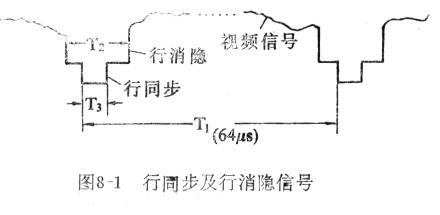

#### （二）场同步和消隐信号

为维持屏幕上的图形稳定不闪烁，每秒钟通常要扫描 25 帧以上。按我国的制式，每秒正好 25 帧，由每行 $64\ \mu\text{s}$ 可算出，每帧应有 625 行。按美国 NTSC 制，每秒有 30 帧，每帧有 525 行。由于采取隔行扫描技术，每帧又分成两场，一场扫描单数行，一场扫描双数行。但在中华学习机中，不采用隔行扫描，各场扫描是相同的行。最后形成的全电视信号中，每秒有 50 场，每场 312 行。由前所述已知屏幕上只有 192 个亮行（在字符显示方式下，每个字符占 8 行；在低分辨图象显示中，每个小方格占 4 行；在高分辨显示方式下，正好有 192 个亮行）。在此 192 行之外的行便都处于场消隐期间。因而场消隐信号的持续时间约为 $7.7\text{ ms}$（原文印作 $7.7\ \mu\text{s}$）。

同样，在场消隐过程中，要发出几个同步信号。由于没有采用隔行扫描，勿须发平衡脉冲。

#### （三）视频信号

中华学习机的视频信号与普通电视台发出来的视频信号有所区别。普通电视台发出的视频信号是模拟量信号，而中华学习机的视频信号相当于一个串行的逻辑（数字）信号，即每瞬间只可能处于两种状态：0 和 1。每行固定有 280 个点，每两相邻点的间隔需用 1/7 个时钟周期的扫描时间。这种视频信号均由移位寄存器产生出来，用来移位的时钟正好是 6502 时钟的 7 或 14 倍频的，即为 $7\text{M}$（$7.159\text{ MHz}$）或 $14\text{M}$（$14.318\text{ MHz}$）的信号。例如图 8-2 中，用 $7\text{M}$ 时钟可产生出图中那样的视频信号（图中假定产生的信号为 `1001101...`）。这样的视频信号显示出来的将是亮暗相间的点。例如对应图中的情形，将在屏幕的一行上产生 4 个亮点（对应 4 个为 1 的周期），3 个暗点（对应 3 个为 0 的周期）。如果视频信号中有许多连续为 1 的周期，则构成横的直线。在各种显示方式下，屏幕上的亮点和暗点都是这样与视频信号相对应的。而这种视频信号便可以与内存缓冲区中的内容直接（如高分辨图形显示时）或间接（如字符显示时）地联系起来。

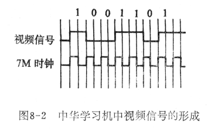

#### （四）彩色副载波信号

上面这样的视频信号用来形成单色显示是可以的。但为了亮点能有不同的颜色，在全电视信号中还须有彩色副载波信号发出。在美国 NTSC 制中规定这个信号的频率为 $3.5795\text{ MHz}$。它的 4 倍正好是 $14.318\text{ MHz}$。这就是为什么中华学习机中采用了这个频率为主振频率的原因。前面说过要形成视频信号的 $14.318\text{ MHz}$ 和 $7.159\text{ MHz}$ 两种信号，现在又需要 $14.318\text{ MHz}$ 的 4 分频信号。而这个信号的 14 分频信号正好又非常接近 $1\text{ MHz}$（事实上是 $1.0227\text{ MHz}$），正好是 6502 的工作频率。

但在我国的电视制式下，彩色副载波信号用的是 $4.4336\text{ MHz}$。因而在中华学习机中还有这个频率的一个晶体振荡器，以把 NTSC 制的全电视信号转换成我国的 PAL 制全电视信号。

在主机内要求每个行同步信号结束后，在固定的相位下发送至少 8 个色同步信号，它们的频率即为彩色副载波的频率。这些信号正好处于行消隐期间。视频信号为 1 和为 0 分别对应屏幕上的亮和暗。但当它为 1 时，由它与这个色同步信号的相位关系可决定其颜色。正是利用这一点，使视频信号有一定的位移以便控制亮点的颜色。在中华学习机中，高低分辨图象显示下均可有不同的颜色选择，也正是通过这样的原理实现的。

### 二、显示信号形成的简单过程

MC 的时钟，$1\ \mu\text{s}$ 一次地由 CPU 6502 访问内存（或 I/O 设备接口）。但真正访问内存的时刻是 $\phi_0 = 1$ 的这半个周期。只要在这半个周期结束之前，地址信号（$\text{A}_0\text{—A}_{15}$）和读写数据信号（$\text{D}_0\text{—D}_7$）都能达到稳定，6502 便可正常地工作。而 $\phi_0 = 0$ 这半个周期，事实上可以用来做别的工作。例如，如果这半个周期中能发出地址和 $\text{R}/\overline{\text{W}}$ 信号，只要内存的响应速度允许，仍然可以完成一次内存的访问。中华学习机正是利用这一点，完成一个周期内访问两次内存的。而 $\phi_0$ 为 0 的半周期中，驱动显示电路根据自己的要求，去读内存 RAM 的相应地址单元，以根据读出的信息和显示方式的规定去形成视频信号，从而在屏幕上显示出相应的字符或图形点阵。这就是说，真正访内存的过程，如图 8-3 那样。在 $\phi_0 = 0$ 的半周期中总是进行读内存操作（$\text{R}/\overline{\text{W}} = 1$），地址 1 是从显示电路来的。在 $\phi_0$ 从 0 向 1 转变时，便把读出的信号（$\text{D}_0\text{—D}_7$）存到数据锁存器中而后送到显示电路的有关电路中去。在 $\phi_0 = 1$ 的半周期中，地址 2 是 CPU 发出的。究竟是进行读还是写，决定于所执行的指令本身。

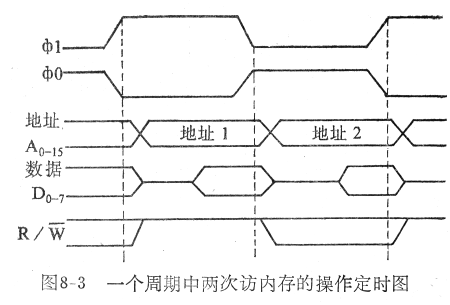

显示控制电路读内存时，其地址由一同步计数器决定。而这个同步计数器又决定了什么时候发出行消隐、行同步、场消隐和场同步等信号。这样，同步计数器的状态又与屏幕上的行和列严格地对应了起来。因而显示电路访问的内存单元地址便也就与屏幕上的行列严格地对应了起来。同步计数器的时钟也就是 6502 的时钟（$1\text{ MHz}$）。这种内存单元与屏幕坐标的对应关系，我们将在 §8-4 中具体说明。

显示方式的转换是通过软开关来实现的。即主机内设了控制显示方式的几个触发器电路，而这几个触发器的状态又取决于程序中访问了 `$C050`—`$C057` 这 8 个地址的哪一个或哪一些。关于软开关的驱动，我们将在 §8-3 中再作说明。

当处于字符显示方式下，软开关控制同步计数器的输出，对应于相应的字符显示内存缓冲区，不停地读出存在缓冲区中的 ASCII 码，然后把它们送到字符发生器中去。在图形显示时也是一样，也是软开关决定了地址的选择，把读出的图形信息送到图形发生器中去。同时，软开关又决定了视频信号选择电路的工作状态，在那里形成真正需要的视频信号，再把上面所说的其他必须的信号混入后，便形成了 NTSC 制式的全电视信号了。上述过程可用一个粗框图表示于图 8-4 中。形成的 NTSC 制全电视信号，还需改造成 PAL 制的。为此，经过分解、合成电路，对其进行重新分解，再重新按 PAL 进行合成（其中，原 $3.5795\text{ MHz}$ 的彩色副载波信号被吸收，送入 $4.4336\text{ MHz}$ 的）。从而可输出到 PAL 制的监视器中。最后再经一调制电路，形成某电视频道的射频载波全电视信号，可送到电视机的天线接收端中。

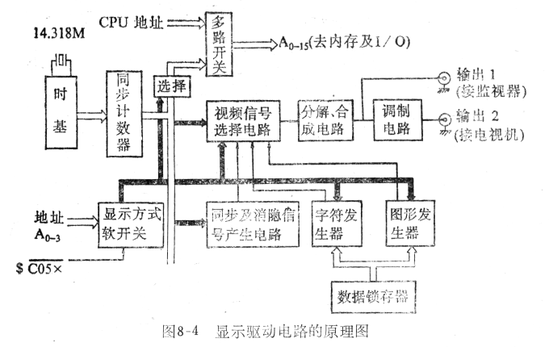

大部分显示电路为大规模集成电路，在此不详细说明其原理，仅对字符和图形形成的基本原理及其应用作一说明。

### 三、字符发生器

在字符显示内存缓冲区中，欲显示的字符是以其 ASCII 码的形式存在的，而在屏幕上的字符是以亮点构成的。例如显示一个字符“R”，如果以 8（行）$\times$ 7（列）的点阵显示（象在中华学习机中的情形一样），便可象图 8-5 所示的那样。

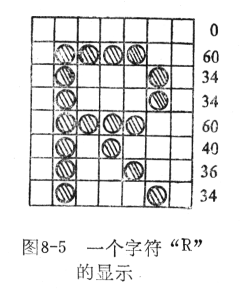

图中有圆形阴影的点为亮点，上部与左右两边的空白是字符间的间隙。右边的数字将在下面说明。

字符发生器主要电路是一个 ROM 电路。在这个 ROM 电路中，分成许多组。可假设每组内有 8 个 7 位的单元。每个组的地址正好是一个 ASCII 码，而这个组内的 8 个单元正好存有该 ASCII 码对应字符的“形象”信息。例如，假定一个组的地址是 82（R 的 ASCII 码），组内 8 个单元存的数正好是图 8-5 右边的 8 个数。这些数正好能代表显示时应在哪个对应位上显示亮点，而其他位为暗点。前面已经指出，屏幕上扫描的行列点阵与内存显示缓冲区是有对应关系的。一个字符占了 8 行。每当扫描到一个字符位置时，提前访问该位置对应的内存显示缓冲区内的单元，读出一 ASCII 码。然后又以此 ASCII 码为地址访问字符发生器中的 ROM 对应组。而组内单元数又正好是对应该字符位置 8 行中的行数。这样，把每次读出的数，变成串行视频信号送出去，屏幕上便可把该 ASCII 码对应的字符显示出来了。

在字符显示方式下，与原 APPLE 不同的是中华学习机中有两种字符组，一个是基本字符组，它与 APPLE 的字符显示是相同的，系统通常也使用这种显示；另一个是替代字符组，它的显示特性与 APPLE 稍有不同。这两组的切换是通过软开关实现的（见 §8-3）。

在显示基本字符组时，作了以下的规定：内存缓冲区中所读出的 ASCII 码若高位为 1（即大于 127。例如 A 的 ASCII 码为 65，高位为 1 则变为 $65 + 128 = 193$），则显示该字符时为正常显示；若高位为 0，次高位为 1，则为闪烁方式显示；若高位为 0，次高位也为 0（例如把 65 变为 1，就代表 A 的高位次高位均为 0 的 ASCII 码），则以反相方式显示。总的说可有 224 种字符在字符显示方式下显示出来。它们的显示结果与其内存缓冲区对应码的关系如表 8-1 所示。其中当对应码为 128（`$80`）—159（`$BF`）这一段时，显示出正常的字符，但却代表了控制码。例如当码为 129 时，显示正常的 A，但事实上它代表了 `CTRL-A`。另外，小写英文字符只有正常显示方式。

**表 8-1 中华学习机显示的字符在不同显示方式下的 ASCII 码表**

| 十进制 / 十六进制 | 反相<br>`0`<br>`$00` | 反相<br>`16`<br>`$10` | 反相<br>`32`<br>`$20` | 反相<br>`48`<br>`$30` | 闪烁<br>`64`<br>`$40` | 闪烁<br>`80`<br>`$50` | 闪烁<br>`96`<br>`$60` | 闪烁<br>`112`<br>`$70` | (control)<br>`128`<br>`$80` | (control)<br>`144`<br>`$90` | 正常<br>`160`<br>`$A0` | 正常<br>`176`<br>`$B0` | 正常<br>`192`<br>`$C0` | 正常<br>`208`<br>`$D0` | (小写)<br>`224`<br>`$E0` | (小写)<br>`240`<br>`$F0` |
| :---: | :---: | :---: | :---: | :---: | :---: | :---: | :---: | :---: | :---: | :---: | :---: | :---: | :---: | :---: | :---: | :---: |
| `0` / `$0` | `@` | `P` | ` ` | `0` | `@` | `P` | ` ` | `0` | `@` | `P` | ` ` | `0` | `@` | `P` | `` ` `` | `p` |
| `1` / `$1` | `A` | `Q` | `!` | `1` | `A` | `Q` | `!` | `1` | `A` | `Q` | `!` | `1` | `A` | `Q` | `a` | `q` |
| `2` / `$2` | `B` | `R` | `"` | `2` | `B` | `R` | `"` | `2` | `B` | `R` | `"` | `2` | `B` | `R` | `b` | `r` |
| `3` / `$3` | `C` | `S` | `#` | `3` | `C` | `S` | `#` | `3` | `C` | `S` | `#` | `3` | `C` | `S` | `c` | `s` |
| `4` / `$4` | `D` | `T` | `$` | `4` | `D` | `T` | `$` | `4` | `D` | `T` | `$` | `4` | `D` | `T` | `d` | `t` |
| `5` / `$5` | `E` | `U` | `%` | `5` | `E` | `U` | `%` | `5` | `E` | `U` | `%` | `5` | `E` | `U` | `e` | `u` |
| `6` / `$6` | `F` | `V` | `&` | `6` | `F` | `V` | `&` | `6` | `F` | `V` | `&` | `6` | `F` | `V` | `f` | `v` |
| `7` / `$7` | `G` | `W` | `'` | `7` | `G` | `W` | `'` | `7` | `G` | `W` | `'` | `7` | `G` | `W` | `g` | `w` |
| `8` / `$8` | `H` | `X` | `(` | `8` | `H` | `X` | `(` | `8` | `H` | `X` | `(` | `8` | `H` | `X` | `h` | `x` |
| `9` / `$9` | `I` | `Y` | `)` | `9` | `I` | `Y` | `)` | `9` | `I` | `Y` | `)` | `9` | `I` | `Y` | `i` | `y` |
| `10` / `$A` | `J` | `Z` | `*` | `:` | `J` | `Z` | `*` | `:` | `J` | `Z` | `*` | `:` | `J` | `Z` | `j` | `z` |
| `11` / `$B` | `K` | `[` | `+` | `;` | `K` | `[` | `+` | `;` | `K` | `[` | `+` | `;` | `K` | `[` | `k` | `{` |
| `12` / `$C` | `L` | `\` | `,` | `<` | `L` | `\` | `,` | `<` | `L` | `\` | `,` | `<` | `L` | `\` | `l` | `\|` |
| `13` / `$D` | `M` | `]` | `-` | `=` | `M` | `]` | `-` | `=` | `M` | `]` | `-` | `=` | `M` | `]` | `m` | `}` |
| `14` / `$E` | `N` | `^` | `.` | `>` | `N` | `^` | `.` | `>` | `N` | `^` | `.` | `>` | `N` | `^` | `n` | `~` |
| `15` / `$F` | `O` | `_` | `/` | `?` | `O` | `_` | `/` | `?` | `O` | `_` | `/` | `?` | `O` | `_` | `o` | `■` (DEL) |

当切换到替代字符组显示时，情况与上稍有不同。它没有闪烁显示方式。原先相应于显示闪烁大写字符的（`$40`—`$5F`），将显示反相大写字符；应显示闪烁特殊字符的（`$60`—`$7F`），对应地显示反相英文小写字符。

### 四、图形发生器

低分辨图形的形成过程与字符显示有相似的地方。它们的内存显示缓冲区是同一个，因此内存缓冲区地址与屏幕位置的对应关系是一样的。不同的是，读回来的码（不再代表一个字符的 ASCII 码）被分成高低两个 4 位的二进制码。在前 4 行扫描过程中，把低 4 位数用 14MC 的高频时钟进行串行循环移位，然后把它变成视频信号发出去。后 4 行扫描时处理方法一样，只是用来循环移位的是高 4 位数。因而，一个单元的数就形成两个小方格。其宽度也是一个字符的宽度（每次送出的高频信号持续 $1\ \mu\text{s}$）。从内存中读出的数不同，形成的高频视频信号也不同，表现出来的是小方格的颜色不同。其对应关系如表 8-2 所示。表中的 16 进制数是内存缓冲区对应单元的高位或低位数。

**表 8-2 低分辨图形显示时数与颜色的对应**

| 数（16 进制，10 进制） | 颜色 | 数（16 进制，10 进制） | 颜色 |
| :---: | :---: | :---: | :---: |
| `$0` , `0` | 黑 | `$8` , `8` | 棕 |
| `$1` , `1` | 绛红 | `$9` , `9` | 橙 |
| `$2` , `2` | 深蓝 | `$A` , `10` | 灰 2 |
| `$3` , `3` | 紫 | `$B` , `11` | 粉红 |
| `$4` , `4` | 深绿 | `$C` , `12` | 浅绿 |
| `$5` , `5` | 灰 1 | `$D` , `13` | 黄 |
| `$6` , `6` | 中蓝 | `$E` , `14` | 蓝绿 |
| `$7` , `7` | 浅蓝 | `$F` , `15` | 白 |

在高分辨图形显示时，屏幕一行上连续 7 个点对应一个内存单元。此时，一个点对应该单元的一个位。自左向右，7 个点分别对应 0—6 位。最高位不与具体点对应。当扫描到某对应一个内存单元的 7 个点之前，先将该单元内容读出，然后用 7MC 时钟进行右移位（0 位先移出），移出来的串行码即做为视频信号输出。这样，屏幕上对应 7 个点的亮暗便正好由对应单元的 7 个位所决定。至于亮点（对应位为 1）的颜色特性，则又由对应单元的最高位决定。通过最高位为 1 或 0，对移位的相位进行一点控制而达到改变颜色的目的。总的说，彩色亮点的特性与对应单元内数的关系，可用表 8-3 来表示。

**表 8-3 高分辨图象显示时单个点的彩色特性**

| 高位数 \ 对应位数 | 偶数列：`0` | 偶数列：`1` | 奇数列：`0` | 奇数列：`1` |
| :---: | :---: | :---: | :---: | :---: |
| **`0`** | 黑 | 紫 | 黑 | 绿 |
| **`1`** | 黑 | 蓝 | 黑 | 红 |

从表 8-3 看出，当一个点处于偶数列或奇数列时，有不同的彩色特性。屏幕上共有 280 列，这里最左列为 0，因而列数可为 0—279。一个偶数列点，内存对应位为 1，则视该内存单元高位为 0 或 1，该点分别为紫或蓝色；一个奇数列位，则分别为绿或红。另外，如果任何相邻两点均为亮点时，它们只能都是白色的。因此可以说，对应一个单元的相邻 7 个点，只能同时出现 4 种颜色：或者是白、黑、紫、绿，或者是白、黑、蓝、红。这是高分辨图象显示方式下彩色特性的一点限制。至于这种方式下显示其他的颜色，则不是一个点能决定的，只能在一块面积上，用调色的原理来形成。

---

## §8-3 显示方式软开关

系统处于什么显示方式下取决于软件开关的状态。例如刚一开机进入 BASIC 语言状态，或引导了操作系统后进入 BASIC 语言状态，均处于字符显示第一页的显示方式下。如果进入了汉字 BASIC 语言状态，则处于高分辨图象显示第二页的显示方式下。这种显示方式的转换事实上是依靠软件来驱动软开关完成的。

显示方式软开关是经地址 `$C050`（49232）—`$C057`（49239）而驱动的。表 8-4 列出了这 8 个地址代表的相应显示方式。

**表 8-4 显示方式软开关的地址及其功能**

| 地址（16 进制，10 进制） | 功能 | 地址（16 进制，10 进制） | 功能 |
| :---: | :---: | :---: | :---: |
| `$C050` , `49232` | 图象显示 | `$C054` , `49236` | 第 1 页 |
| `$C051` , `49233` | 字符显示 | `$C055` , `49237` | 第 2 页 |
| `$C052` , `49234` | 纯图象显示 | `$C056` , `49238` | 低分辨图象显示 |
| `$C053` , `49235` | 混合显示 | `$C057` , `49239` | 高分辨图象显示 |

显示方式软开关的驱动很简单，只要访到了上述地址单元，便相当于拨动了该开关。例如用指令 `LDA $C050` 或 `BIT $C050` 等等，均可拨动第一个软开关，使显示有可能进入图象显示方式。同样，在 BASIC 语言下，使用 `PEEK` 或 `POKE` 语言也可驱动它们。例如，用 `X=PEEK(49233)` 或 `POKE 49233, n`（$n$ 可为 0—255 的任意整数），便驱动了上面第 2 个开关，使显示进入字符显示方式。在监控方式下，使用检查单个内存单元命令（直接键入 16 进制的地址值）或修改单个内存单元命令（键入 16 进制地址值后，键入冒号，再键入欲置的值），都可驱动这些开关。

另外还应说明几点：

（一）这些开关是每两个为一对（在电路上看是同一触发器的 0 端和 1 端）。例如 `$C050` 和 `$C051`，访问前者就否定了后者；访问了后者也就否定了前者。`$C052` 和 `$C053`、`$C054` 和 `$C055`、`$C056` 和 `$C057` 也都属于这种情形。

（二）在驱动了 `$C050` 之后，`$C052`、`$C053`、`$C056` 和 `$C057` 这些软开关才有意义。在字符显示方式下（驱动了 `$C051` 后），不可能进入各种纯图象显示或混合显示方式。

表 8-5 列出了进入各种显示方式所必须访问的软开关。

在实际应用中到底应访问哪几个开关就能转换成预期的显示状态，还要看转换前各开关状态。例如，原处于低分辨图象显示第 1 页，而欲转换到高分辨图象显示第 1 页，只须访问一下开关 `$C057` 便可。因为其他 3 个开关相当于已访问过了。如果想再进入到高分辨图象与字符混合显示第 1 页，则只再访问一个 `$C053` 就可以了。

为实现两种字符组之间的切换，中华学习机中又增加了一对软开关，这是原 APPLE II 中所没有的。这一对开关的地址是 `$C00E`（49166）和 `$C00F`（49167）。拨动表 8-5 各软开关时，用读或写操作均可，但这一对开关必须使用写操作。即对 `$C00F` 进行一次写操作便接通了替代字符组；反之，对 `$C00E` 进行一次写操作便接通了基本字符组（断开替代字符组）。

**表 8-5 各显示方式的转换表**

| 显示方式 | 需访问软开关 |
| :--- | :--- |
| 字符显示，第 1 页 | `$C051`, `$C054` |
| 字符显示，第 2 页 | `$C051`, `$C055` |
| 低分辨图象显示，第 1 页 | `$C050`, `$C052`, `$C054`, `$C056` |
| 低分辨图象显示，第 2 页 | `$C050`, `$C052`, `$C055`, `$C056` |
| 高分辨图象显示，第 1 页 | `$C050`, `$C052`, `$C054`, `$C057` |
| 高分辨图象显示，第 2 页 | `$C050`, `$C052`, `$C055`, `$C057` |
| 低分辨图象与字符混合显示，第 1 页 | `$C050`, `$C053`, `$C054`, `$C056` |
| 低分辨图象与字符混合显示，第 2 页 | `$C050`, `$C053`, `$C055`, `$C056` |
| 高分辨图象与字符混合显示，第 1 页（原文印作第 2 页） | `$C050`, `$C053`, `$C054`, `$C057` |
| 高分辨图象与字符混合显示，第 2 页 | `$C050`, `$C053`, `$C055`, `$C057` |

---

## §8-4 内存显示缓冲区内各单元与屏幕位置的对应关系

在各种显示方式下，屏幕上行列坐标与对应的内存显示缓冲区内的单元均有一定的关系。例如字符显示时，某行某列处所显示的字符是固定地由内存缓冲区中一确定单元内的数所决定。而这种对应关系在中华学习机中并非简单的连续对应关系，但有一定的规律。这给显示的驱动稍微带来了一点麻烦。这种关系是由硬件决定的，这也同时保持了与美国微型计算机 APPLE II 系列相兼容的特性。

### 一、字符显示方式

前面已指出字符显示时的两页存缓冲区的地址。一般系统软件均采用其第 1 页作为系统固定使用的字符显示（如 BASIC 语言、监控、汇编/编辑软件等均如此）。因此，在 BASIC 语言下，程序只能从 `$800`（2048）开始装；在汇编/编辑程序运行时，编辑/汇编程序本身也从那里开始装，以躲开字符显示第 1 页缓冲区。

在字符显示时，缓冲区中共有 1024 个单元，而屏幕上有 960 个字符的位置。可见有 64 个是无用单元。而其中 960 个有用单元与屏幕上行列坐标有一定的关系，它们可用下面的式子表示：

$$A = 128 \times (I \bmod 8) + 40 \times \text{INT}(I / 8) + J$$

这里 $A$ 为一个有用单元的相对地址（对于第 1 页，其绝对地址为 $A + \text{\$400}$；对于第 2 页，其绝对地址为 $A + \text{\$800}$）。该内存单元对应的屏幕字符位置可用 $I$ 和 $J$ 表示。其中 $I$ 为自上而下的行数，取值为 0—23；$J$ 为自左至右的列数，取值为 0—39。表达式“`I MOD 8`”表示 $I$ 除以 8 所得余数，“`INT(I/8)`”表示 $I$ 除以 8 所得商。

例如，第 12 行的 40 个字符对应的 $A$ 值为：

$$A = 552 + J$$

即 $A$ 的值为 552—591。当为第 1 页时，相当于 1576（`$628`）—1615（`$64F`）这 40 个单元。

也可用表 8-6（原文误作表 8-5）来表示上面的关系。表内的数表示的是行数，行内各列与内存地址是连续的对应关系。

**表 8-6 字符显示时，字符位置与缓冲区内之地址的对应关系表**

| 十六进制地址 | 十进制地址 | 列 `$0`—`$27`<br>(0—39) | 列 `$28`—`$4F`<br>(40—79) | 列 `$50`—`$77`<br>(80—119) | 列 `$78`—`$7F`<br>(120—127) |
| :---: | :---: | :---: | :---: | :---: | :---: |
| `$0` | `0` | 0 | 8 | 16 | （显示无用） |
| `$80` | `128` | 1 | 9 | 17 | （显示无用） |
| `$100` | `256` | 2 | 10 | 18 | （显示无用） |
| `$180` | `384` | 3 | 11 | 19 | （显示无用） |
| `$200` | `512` | 4 | 12 | 20 | （显示无用） |
| `$280` | `640` | 5 | 13 | 21 | （显示无用） |
| `$300` | `768` | 6 | 14 | 22 | （显示无用） |
| `$380` | `896` | 7 | 15 | 23 | （显示无用） |

> 注：地址为相对地址，首地址应为：第 1 页 `$400` (1024)，第 2 页 `$800` (2048)。

仍以第 12 行为例，从表内可见，其最左列（第 0 列）对应的相对地址为 $512 + 40 = 552$；其最右列则对应 $512 + 79 = 591$。列中右边阴影部分共有 64 个单元，为显示无用。系统定义第 1 页中这 64 个单元分配给各 I/O 接口，用做便笺存储器使用。由于在 APPLE II 中共有 8 个通用接口插槽，因此规定每个插槽 8 个单元，但 #0 插槽没有。有 8 个单元由系统程序所使用。其分配情形如表 8-7 所示。

**表 8-7 各插槽的便笺存储器单元地址**

| 基地址 | #1 插槽 | #2 插槽 | #3 插槽 | #4 插槽 | #5 插槽 | #6 插槽 | #7 插槽 |
| :---: | :---: | :---: | :---: | :---: | :---: | :---: | :---: |
| `$0478` | `$0479` | `$047A` | `$047B` | `$047C` | `$047D` | `$047E` | `$047F` |
| `$04F8` | `$04F9` | `$04FA` | `$04FB` | `$04FC` | `$04FD` | `$04FE` | `$04FF` |
| `$0578` | `$0579` | `$057A` | `$057B` | `$057C` | `$057D` | `$057E` | `$057F` |
| `$05F8` | `$05F9` | `$05FA` | `$05FB` | `$05FC` | `$05FD` | `$05FE` | `$05FF` (原表误印 `$06FF`) |
| `$0678` | `$0679` | `$067A` | `$067B` | `$067C` | `$067D` | `$067E` | `$067F` |
| `$06F8` | `$06F9` | `$06FA` | `$06FB` | `$06FC` | `$06FD` | `$06FE` | `$06FF` |
| `$0778` | `$0779` | `$077A` | `$077B` | `$077C` | `$077D` | `$077E` | `$077F` |
| `$07F8` | `$07F9` | `$07FA` | `$07FB` | `$07FC` | `$07FD` | `$07FE` | `$07FF` (原表误印 `$06FF`) |

在中华学习机中，只留有一个插槽，#0、#3 和 #6 槽已做在主机板上了，留有的这个插槽可以规定为其他各号插槽。例如，当接打印机时，就要规定它为 #1 插槽，表 8-7 中第 2 列某些单元在驱动打印机时的用途见 §8-7。

第 1 列（基地址列）归系统使用，操作系统使用了它们。

**表 8-8 高分辨图象显示点位置与内存缓冲区内单元地址对应关系表**

| 十六进制地址 | 十进制地址 | `$0`—`$27`<br>(0—39) | `$28`—`$4F`<br>(40—79) | `$50`—`$77`<br>(80—119) | `$78`—`$7F`<br>(120—127) | 十六进制地址 | 十进制地址 | `$0`—`$27`<br>(0—39) | `$28`—`$4F`<br>(40—79) | `$50`—`$77`<br>(80—119) | `$78`—`$7F`<br>(120—127) |
| :---: | :---: | :---: | :---: | :---: | :---: | :---: | :---: | :---: | :---: | :---: | :---: |
| `$0` | `0` | 0 | 64 | 128 | 阴影无用 | `$1000` | `4096` | 4 | 68 | 132 | 阴影无用 |
| `$80` | `128` | 8 | 72 | 136 | 阴影无用 | `$1080` | `4224` | 12 | 76 | 140 | 阴影无用 |
| `$100` | `256` | 16 | 80 | 144 | 阴影无用 | `$1100` | `4352` | 20 | 84 | 148 | 阴影无用 |
| `$180` | `384` | 24 | 88 | 152 | 阴影无用 | `$1180` | `4480` | 28 | 92 | 156 | 阴影无用 |
| `$200` | `512` | 32 | 96 | 160 | 阴影无用 | `$1200` | `4608` | 36 | 100 | 164 | 阴影无用 |
| `$280` | `640` | 40 | 104 | 168 | 阴影无用 | `$1280` | `4736` | 44 | 108 | 172 | 阴影无用 |
| `$300` | `768` | 48 | 112 | 176 | 阴影无用 | `$1300` | `4864` | 52 | 116 | 180 | 阴影无用 |
| `$380` | `896` | 56 | 120 | 184 | 阴影无用 | `$1380` | `4992` | 60 | 124 | 188 | 阴影无用 |
| `$400` | `1024` | 1 | 65 | 129 | 阴影无用 | `$1400` | `5120` | 5 | 69 | 133 | 阴影无用 |
| `$480` | `1152` | 9 | 73 | 137 | 阴影无用 | `$1480` | `5248` | 13 | 77 | 141 | 阴影无用 |
| `$500` | `1280` | 17 | 81 | 145 | 阴影无用 | `$1500` | `5376` | 21 | 85 | 149 | 阴影无用 |
| `$580` | `1408` | 25 | 89 | 153 | 阴影无用 | `$1580` | `5504` | 29 | 93 | 157 | 阴影无用 |
| `$600` | `1536` | 33 | 97 | 161 | 阴影无用 | `$1600` | `5632` | 37 | 101 | 165 | 阴影无用 |
| `$680` | `1664` | 41 | 105 | 169 | 阴影无用 | `$1680` | `5760` | 45 | 109 | 173 | 阴影无用 |
| `$700` | `1792` | 49 | 113 | 177 | 阴影无用 | `$1700` | `5888` | 53 | 117 | 181 | 阴影无用 |
| `$780` | `1920` | 57 | 121 | 185 | 阴影无用 | `$1780` | `6016` | 61 | 125 | 189 | 阴影无用 |
| `$800` | `2048` | 2 | 66 | 130 | 阴影无用 | `$1800` | `6144` | 6 | 70 | 134 | 阴影无用 |
| `$880` | `2176` | 10 | 74 | 138 | 阴影无用 | `$1880` | `6272` | 14 | 78 | 142 | 阴影无用 |
| `$900` | `2304` | 18 | 82 | 146 | 阴影无用 | `$1900` | `6400` | 22 | 86 | 150 | 阴影无用 |
| `$980` | `2432` | 26 | 90 | 154 | 阴影无用 | `$1980` | `6528` | 30 | 94 | 158 | 阴影无用 |
| `$A00` | `2560` | 34 | 98 | 162 | 阴影无用 | `$1A00` | `6656` | 38 | 102 | 166 | 阴影无用 |
| `$A80` | `2688` | 42 | 106 | 170 | 阴影无用 | `$1A80` | `6784` | 46 | 110 | 174 | 阴影无用 |
| `$B00` | `2816` | 50 | 114 | 178 | 阴影无用 | `$1B00` | `6912` | 54 | 118 | 182 | 阴影无用 |
| `$B80` | `2944` | 58 | 122 | 186 | 阴影无用 | `$1B80` | `7040` | 62 | 126 | 190 | 阴影无用 |
| `$C00` | `3072` | 3 | 67 | 131 | 阴影无用 | `$1C00` | `7168` | 7 | 71 | 135 | 阴影无用 |
| `$C80` | `3200` | 11 | 75 | 139 | 阴影无用 | `$1C80` | `7296` | 15 | 79 | 143 | 阴影无用 |
| `$D00` | `3328` | 19 | 83 | 147 | 阴影无用 | `$1D00` | `7424` | 23 | 87 | 151 | 阴影无用 |
| `$D80` | `3456` | 27 | 91 | 155 | 阴影无用 | `$1D80` | `7552` | 31 | 95 | 159 | 阴影无用 |
| `$E00` | `3584` | 35 | 99 | 163 | 阴影无用 | `$1E00` | `7680` | 39 | 103 | 167 | 阴影无用 |
| `$E80` | `3712` | 43 | 107 | 171 | 阴影无用 | `$1E80` | `7808` | 47 | 111 | 175 | 阴影无用 |
| `$F00` | `3840` | 51 | 115 | 179 | 阴影无用 | `$1F00` | `7936` | 55 | 119 | 183 | 阴影无用 |
| `$F80` | `3968` | 59 | 123 | 187 | 阴影无用 | `$1F80` | `8064` | 63 | 127 | 191 | 阴影无用 |

> 注：地址为相对地址，首地址应为：第 1 页 `$2000` (8,192)，第 2 页 `$4000` (16,384)。

### 二、低分辨图象显示方式

低分辨图像显示时，屏幕上小方格位置与内存缓冲区内各单元的对应关系与字符显示的情形相同。不过原来一个字符的位置上将显示出上下两个小方格，这两个小方格对应同一个内存单元，如果把小方格按两行算一行这样来编号，表 8-6 仍然适用。从这里可以看到，当显示方式为低分辨图象与字符混合方式时，显示电路对内存的访问与单纯字符显示或单纯低分辨图象显示将无任何区别（只要是同一页），只是在形成全电视信号时，后面 32 行（相当于 8 行小方格或 4 行字符）的扫描时间中，送出字符发生器的视频信号；前面 160 行则送出图形发生器的低分辨图形视频信号。

### 三、高分辨图形显示方式

高分辨图像显示时对应着不同的、空间更大的两页缓冲区。由于屏幕上共有 192（行）$\times$ 280（列）$=$ 53760 个亮点，每 7 个亮点对应一个内存单元，共需 7680 个单元。因此各缓冲区均为 8K 字节的。由此可见，各缓冲区中也有 512 个显示无用单元。这时也可以用一个表达式来表示屏幕上亮点位置与缓冲区对应单元页内相对地址的对应关系：

$$A = 1024 \times (I \bmod 8) + 128 \times \text{INT}((I \bmod 64) / 8) + 40 \times \text{INT}(I / 64) + \text{INT}(J / 7)$$

这里 $A$ 的含意同前，$I$ 和 $J$ 分别为行和列号。其中 $I = 0\text{—}191$，$J = 0\text{—}279$。`INT` 和 `MOD` 的含意同前。

例如，第 77 行中的 280 个点对应的 $A$ 是 5288—5327 这 40 个单元。一行内各点顺序地按 7 点一组，每组与内存单元的对应关系是连续的。一个内存单元的 0—6 位，顺序对应自左至右的 7 个点。考虑到页首地址后，上述地址对于第 1 页缓冲区，应为 13480（`$34A8`）—13519（`$34CF`）；对于第 2 页缓冲区则变为 21672（`$54A8`）—21711（`$54CF`）。

上述关系如表 8-8 所示。表中只表示出行数（0—191），行内各列与连续的 40 个单元对应关系上面已说明了。表中阴影部分也是显示无用单元。

---

## §8-5 如何用系统程序进行高分辨作图

### 一、概述

不仅在游戏程序和教学软件中经常用到静止的或动态的图形，在许多其他的应用中，如自动控制系统中，仪器系统中等等，也都常常要求系统中的计算机显示各种图形。对中华学习机来说，汉字显示也是图形显示。因此，高分辨图形的制作及应用就成为中华学习机应用中很重要的一个方面。

下面将介绍中华学习机提供的一些作图方法，也介绍一些用汇编语言实现的其他有关作图的应用，这些应用也是本书所讲内容的一种综合应用。

至于低分辨图象显示，其应用较少，使用也较简单，这里仅提及一下 BASIC 语言中有关低分辨图形作图语句及函数。它们是：

#### （一）`GR`（原文印作 `CR`）

进入低分辨图象与文字混合显示第一页。

#### （二）`COLOR=n`

$n = 0\text{—}255$，定义颜色，$n$ 是以 16 为模的值，它指明了以后的作图语句中所规定的颜色（参看表 8-2，原文印作表 7-2）。

#### （三）`SCRN(X, Y)`

这是一个函数，它的值为屏幕上坐标为 `X`、`Y` 的小方格的颜色值（也按表 8-2 定义）。`X` 的值是 0—39，`Y` 的值是 0—47，以下相同。

#### （四）`PLOT X, Y`

在 `(X, Y)` 处显示一个小方格，颜色由 `COLOR` 语句确定。

#### （五）`HLIN X1, X2 AT Y`

作一水平直线，起点为 `(X1, Y)`，终点为 `(X2, Y)`。

#### （六）`VLIN Y1, Y2 AT X`

作一垂直线，起点为 `(X, Y1)`，终点为 `(X, Y2)`。

#### （七）`TEXT`

从低或高分辨图形显示（或混合显示）方式回到字符显示方式。

### 二、用 BASIC 语言作高分辨图形

中华学习机中固化的 BASIC 语言提供了两种作高分辨图形的方法。一是象低分辨作图一样，直接作点或直线。另一种是所谓向量作图法。下面分别作简单介绍。

#### （一）直接作图方法

以下是一些与作高分辨图形有关的语句：

##### 1. `HGR`

进入高分辨图形和字符混合显示第 1 页（相当于访问了软开关 `$C050`、`$C053`、`$C054` 和 `$C057`），同时将高分辨图形显示屏幕清除（缓冲区全清 0）。

##### 2. `HGR2`

进入高分辨图形显示第 2 页（即相当于访问了软开关 `$C050`、`$C052`、`$C055` 和 `$C057`），并清屏。

##### 3. `HCOLOR=n`

定义颜色，$n$ 为 0—7 的整数，代表的颜色如表 8-9。这个表与表 8-3 是相对应的。虽然 $n$ 有 8 种情形，事实上不是每个点都可有除黑白外 4 种的选择。例如，在偶数列（如 $X = 0, 2, 4$ 等等），显示绿或红（$n = 1$ 或 $5$）便不可能。

**表 8-9 n 值与颜色对应表**

| n 值 | 颜色 |
| :---: | :---: |
| `0` | 黑 |
| `1` | 绿 |
| `2` | 紫 |
| `3` | 白 |
| `4` | 黑 |
| `5` | 红 |
| `6` | 蓝 |
| `7` | 白 |

##### 4. `HPLOT` 语句

这个语句的格式是：

```basic
HPLOT [X1, Y1] [TO X2, Y2] [TO X3, Y3]...[TO Xi, Yi]
```

这里的方括号表示其内的项可有可无，语句本身并没有括号。

这个语句是作点或直线语句，其颜色由上面的 `HCOLOR` 语句定义。当仅有 `(X1, Y1)` 项时是作点，有带 `TO` 的项是作直线。例如：

`HPLOT 5, 5` 表示在坐标 `(5, 5)` 处作一色点。

`HPLOT TO 100, 100` 表示在上次作点或线后最后作的点处开始，向坐标 `(100, 100)` 处引一直线。

`HPLOT 5, 5 TO 100, 100 TO 200, 180` 表示从坐标 `(5, 5)` 处开始向坐标 `(100, 100)` 处作一直线，然后再自 `(100, 100)` 处向坐标 `(200, 180)` 处作一直线。

应说明的是颜色的限制，例如下述程序：

```basic
10 HGR
20 HCOLOR=1
30 HPLOT 6, 100 TO 6, 0
```

这将作不出一条亮线来，因为 $X = 6$ 处不可能显示绿色（$n = 1$）。

下面介绍一个使用上述命令作图的例子。

```basic
10  HGR
20  FOR I=0 TO 100
30  HCOLOR=3
40  GO SUB 100
60  HCOLOR=0
65  GO SUB 100
70  NEXT
80  GO TO 10
100 HPLOT 140-I, 40+I TO 148-I, 28+I TO 148-I, 36+I TO 164-I,
    36+I TO 164-I, 44+I TO 148-I, 44+I TO 148-I, 52+I TO 140-I,
    40+I
110 RETURN
```

这个例子中的 100 号语句，画出一个箭头。执行时可看到这个箭头沿一条斜线（自右上至左下）循环地不停移动。这是不停地用白色（`HCOLOR=3`）和黑色（`HCOLOR=0`）画同一图形，也就是画了就抹，于是形成一个动画。

打断这个程序的方法是用 `CTRL-RESET` 或用 `CTRL-C`。

#### （二）向量作图方法

这种作图方法的原理是将作图的轨迹用一组“向量”表示出来，按一定规定把它们构成向量表，然后调用相应命令根据向量表把图形作出来。

在高分辨图形方式下作图，由于是点阵构成图形，从微观来看，所作的线都是由分离的点构成。因此用向上、下、左和右四个方向的小线段，连续地描绘出一定形状的图形来。如图 8-6，便是用 12 个线段顺序地描绘出一个十字图形来。如果我们从 A 点开始，把每一个线段元都解剖出来，可以按顺序地表示在图 8-7(a) 中。

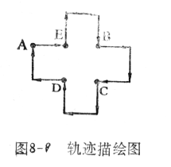

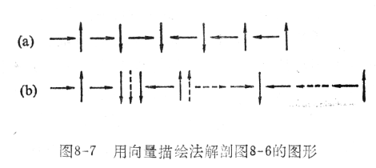

如果我们考虑到有些图形允许有不连续部分，则也可包括只移动而实际上不画线的虚线段元。例如图 8-6 的图形也可以在画到 B 后移到 C，再画三个实线段而由 D 移到 E，移到 B，从 B 以三个实线段到 C，再移到 D，而后回到 A。这样，各个线段的向量描绘便如图 8-7(b) 所表示的那样。这里，虚线是只移动而不画线的虚线段。

在中华学习机的 BASIC 语言中对上述 8 种向量做了如表 8-10 那样的描绘。每种向量有一个 3 位二进制数与之对应。

**表 8-10 向量表示及其编码**

| 向量符号 | 动作 | 二进制码 |
| :---: | :--- | :---: |
| $\dashleftarrow$ (向上虚线箭头) | 上移而不画图 | `000` |
| $\dashrightarrow$ (向右虚线箭头) | 右移而不画图 | `001` |
| $\dashdownarrow$ (向下虚线箭头) | 下移而不画图 | `010` |
| $\dashleftarrow$ (向左虚线箭头) | 左移而不画图 | `011` |
| $\uparrow$ (向上实线箭头) | 上移并画图 | `100` |
| $\rightarrow$ (向右实线箭头) | 右移并画图 | `101` |
| $\downarrow$ (向下实线箭头) | 下移并画图 | `110` |
| $\leftarrow$ (向左实线箭头) | 左移并画图 | `111` |

在应用时，可以用一个字节表示两个或 3 个向量。如图 8-8 所示，0—2 三位表示一个向量；3—5 三位表示下一个向量；而 6—7 两位可以表示下一个向量，也可以不表示。但如果表示的话，只能表示移动而不画图的那些向量中的后 3 种（`001`—`011`）。把各字节顺序排列起来，最后补一个全 0 字节，便构成一个向量表。例如图 8-7 中两种向量描绘对应的向量表分别示于表 8-11 和表 8-12。

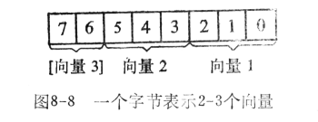

**表 8-11 图 8-7(a) 对应的向量表**

| 字节 | 二进制数 | 十六进制数 | 十进制数 |
| :---: | :---: | :---: | :---: |
| 1 | `00100101` | `$25` | 37 |
| 2 | `00110101` | `$35` | 53 |
| 3 | `00110101` | `$35` | 53 |
| 4 | `00110111` | `$37` | 55 |
| 5 | `00100111` | `$27` | 39 |
| 6 | `00100111` | `$27` | 39 |
| 7 | `00000000` | `$00` | 0 |

**表 8-12 图 8-7(b) 对应的向量表**

| 字节 | 二进制数 | 十六进制数 | 十进制数 |
| :---: | :---: | :---: | :---: |
| 1 | `00100101` | `$25` | 37 |
| 2 | `10110101` | `$B5` | 181 |
| 3 | `00111110` | `$3E` (原表误印 `$37`/55) | 62 (原表误印 55) |
| 4 | `01000100` | `$44` | 68 |
| 5 | `00110101` | `$35` | 53 |
| 6 | `00011111` | `$1F` | 31 |
| 7 | `00100111` | `$27` | 39 |
| 8 | `00000000` | `$00` | 0 |

但向量表还不能直接由程序使用，要把它们先形成一个含有各向量表及它们的索引的索引向量表。索引向量表的构成示于表 8-13 中。程序中只有统一的这一个索引向量表，它存在内存之中。表中第一字节表示有几个向量表（最多 256 个，当它为 0 时，即代表 256 个）。然后，从第 2 号单元开始，顺序存放各向量表第一个字节的存放地址。此地址为相对于第 0 号单元的相对地址。这种向量表可以用很多方法产生。例如，可用 BASIC 语言的 `POKE` 语句逐个地写入内存中；也可以用监控命令逐个输入；也可用汇编语言编辑程序用 `DFB` 伪指令等写成文件，经汇编后形成二进制文件，再用 DOS 命令引入内存。当然，用 BASIC 语言或监控命令产生一次后，也可以用 DOS 的 `BSAVE` 命令作成文件，需要时再用 `BLOAD` 命令调入内存。作图之前还需把索引向量表的地址低位存入 232（`$E8`）单元，其高位存入 233（`$E9`）单元中。下面再看一下与向量作图法有关的几个 BASIC 语言的语句。

**表 8-13 索引向量表结构**

| 索引向量表内容 | 相对字节偏移（字节） |
| :--- | :--- |
| 向量表总数 $M$（0—255） | `0` |
| 无用 | `1` |
| #1 向量表相对首地址（$N_1$）低位 | `2` |
| #1 向量表相对首地址（$N_1$）高位 | `3` |
| #2 向量表相对首地址（$N_2$）低位 | `4` |
| #2 向量表相对首地址（$N_2$）高位 | `5` |
| $\vdots$ | $\vdots$ |
| #M 向量表相对首地址（$N_m$）低位 | `2M` |
| #M 向量表相对首地址（$N_m$）高位 | `2M+1` |
| #1 向量表 | `N1(2M+2)` |
| #2 向量表 | `N2` |
| $\vdots$ | $\vdots$ |
| #M 向量表 | `Nm` |

##### 1. `DRAW` 命令

格式：`DRAW n [AT X, Y]`

此语句执行时，是以 `(X, Y)` 为起点，按第 $n$ 个向量表的规定进行作图。如果没有方括号内的项，则以上次作图（使用 `HPLOT`、`DRAW` 或 `XDRAW` 语句）的终点为起点。图颜的颜色仍由 `HCOLOR` 语句确定。图形的旋转及放大等见下。`X` 的范围为 0—279；`Y` 的范围 0—191。

##### 2. `XDRAW` 语句（原文标题误印作 `XDRBW` 语句）

格式：`XDRAW n [AT X, Y]`

此语句用法与 `DRAW` 全同。不过作图时颜色正好是 `HCOLOR` 所规定颜色的补色。所谓两色互补就是两种颜色的值相加为 7。见表 8-9，显然黑和白互为补色。因此，用 `DRAW` 语句画的白色图形，可不改变颜色而用同样的 `XDRAW` 语句把该图形抹掉。

##### 3. `SCALE=n`

这个语句确定作图时的比例因子 $n$。当 $n = 0$ 时，比例因子为 256。当 $n = 1$ 时，对应每个向量所移动的距离仅为屏幕上水平或垂直方向上相邻两点的长度。$n > 1$ 时，则按此因子成比例地放大。

##### 4. `ROT=n`

这是确定旋转角度的量。当 `SCALE=1` 时，允许 $\text{ROT} = 8N\ (N = 0\text{—}7)$，即可有 8 种选择，表示于图 8-9 中。当 `ROT` 为 0 或 64 时，图形不旋转。当 $\text{ROT} > 64$ 时，要先对 64 取模。当 `SCALE` 为 2 和 3 时，则有 16 种旋转角度，即允许 $\text{ROT} = 4N\ (N = 0\text{—}15)$。旋转方向与图 8-9 相似。当 `SCALE=4` 时，有 32 种旋转方向，允许 $\text{ROT} = 2N\ (N = 0\text{—}31)$。当 `SCALE=5` 或 $\text{SCALE} > 5$ 时，有 64 种旋转方向，即允许 `ROT` 为 0—63 的任意值。

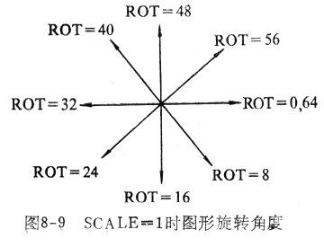

使用上面的语句时，还须注意以下几个问题：

（1）当旋转不为 0 时，用 `DRAW` 作的图，不一定能用 `XDRAW` 完全抹掉，在某些角度下要留有残存的一些点。因此，最好的办法还是用黑色（`HCOLOR=0` 或 `4`），用同样的 `DRAW` 命令去抹。

（2）在一对 `DRAW` 和 `XDRAW` 语句之间，增加 `HCOLOR=n` 语句是无效的。后面的 `XDRAW` 语句，仍用前面 `DRAW` 命令的颜色规定。

（3）当有旋转时，有些角度下比例因子不准确。例如 `SCALE=1` 时，`ROT=8, 24, 40, 56` 这些角度的图形放大了。其他比例因子下，也有类似情形。

（4）当 $\text{SCALE} \ge 5$ 时，所旋转的 64 个角度并非是等分的。事实上，有 40 个是近似等分的，其他几个旋转增量很小。

（5）使用 `DRAW` 和 `XDRAW` 语句时，`X` 和 `Y` 的值不能超出允许值。但作图时允许超出屏幕，从一个方向超出的部分将在屏幕的相对方向的开始处出现（即把 `X` 和 `Y` 坐标均看成循环连续的。例如应画在 $X = 280$ 处的点，将出现在 $X = 0$ 处）。

由此可见，使用上述语句可以设计出很好的动画图形来。但在使用旋转功能时，要注意图形的比例不对与抹不干净等缺陷引起的不良效果。

下面给出一个用向量作图法作动画例子。如图 8-10 所示，希望在屏幕上作出这样一个“战斗机”不停地直线运动的动画。

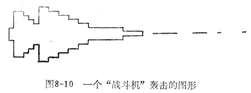

用图 8-11 来表示“战斗机”的放大图，以便看一下其向量表应如何设计。假定 A 点为起始点，自 A 开始向上画线。最后可以得到一个由 47 个字节构成的向量表。同样，对图 8-10 中右边部分也可写出一个 11 个字节的向量表。我们预定把这两个向量表构成的索引向量表放在内存高端 `$9500` 处。使用编辑/汇编程序编出该索引向量表如下：

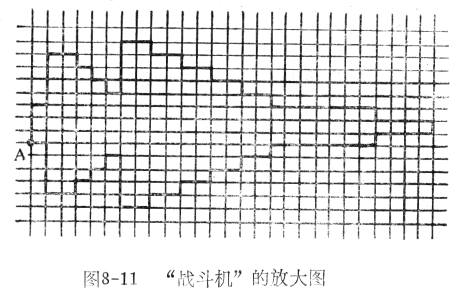

```nasm
1        ORG  $9500
2  TABLE DFB  2
3        DFB  0
4        DFB  6, 0
5        DFB  53, 0
6        DFB  $24, $25, $24, $2C, $35, $35, $35, $25
7        DFB  $24, $2C, $35, $2D, $2E, $35, $2D, $2E
8        DFB  $35, $2D, $2D, $2D, $35, $2D, $2D, $3E
9        DFB  $3F, $37, $3F, $3F, $3F, $37, $3F, $3E
10       DFB  $37, $3F, $3E, $37, $3F, $24, $24, $37
11       DFB  $37, $37, $3F, $24, $24, $27, 0
12       DFB  $2D, $2D, $4D, $29, $6D, $29, $49, $69
13       DFB  $49, $03, 0
```

把这张表进行汇编以后，产生出一个二进制文件 `TABLE.OBJ0`，利用下面这段 BASIC 语言程序便可做出我们所需要的动画了。

```basic
10  D$=CHR$(4)
20  PRINT D$; "BLOAD TABLE.OBJ0"
30  POKE 232, 0: POKE 233, 149
40  HGR: SCALE=1
50  ROT=0: HCOLOR=3
60  FOR I=0 TO 279
70  DRAW 1 AT I, 100
80  K=I+30: IF K>279 THEN K=K-279
90  DRAW 2 AT K, 99
100 XDRAW 2 AT K, 99
110 XDRAW 1 AT I, 100
120 NEXT: GOTO 60
```

> 注：第 40 行原文印作 `HGE: SCALE=1`，实为 `HGR: SCALE=1`。

从这段程序可看到一个动画的制作过程。程序中将索引向量表自磁盘中引入（如果没有磁盘驱动器，也可在监控下键入，或在 BASIC 程序中加入一连串的“`POKE`”语句），然后把索引向量表的地址存入 232 和 233 单元。以下的过程便是根据向量表作图，抹图，移动后再作图，再抹图……。

### 三、用汇编语言调用系统子程序进行作图

上面介绍的两种 BASIC 语言作图方法，也可以直接用汇编语言来完成。完成的方法是用汇编语言调用内存 ROM 中 BASIC 解释程序的作图子程序。这样做的好处是能加快作图的速度。虽然作图本身的过程没有加速（因是同一子程序完成的），但却省去了 BASIC 语言的解释过程，代替的是速度很快的较为简单的机器语言程序。

为了调用 BASIC 解释程序中的作图子程序，必须先了解几个主要作图子程序的入口、调用条件及其功能。表 8-14 列出了几个常用作图子程序的程序名、调用地址及调用前 6502 累加器和寄存器 X、Y 应处的状态。下面分别说明它们的功能。

**表 8-14 几个作图子程序的调用**

| 子程序名 | 入口地址 | 累加器 A | X 寄存器 | Y 寄存器 |
| :---: | :---: | :---: | :---: | :---: |
| `HGR` | `$F3E2` | 无要求 | 无要求 | 无要求 |
| `HGR2` | `$F3D8` | 无要求 | 无要求 | 无要求 |
| `HCOLOR` | `$F6F0` | 无要求 | 颜色 (0—7) | 无要求 |
| `HPOSN` | `$F411` | Y 坐标 | X 坐标低位 | X 坐标高位 |
| `HPLOT` | `$F457` | Y 坐标 | X 坐标低位 | X 坐标高位 |
| `HLINE` | `$F53A` | X 坐标低位 | X 坐标高位 | Y 坐标 |
| `SHPTR` | `$F730` | 无要求 | 向量表序号 | 无要求 |
| `DRAW` | `$F601` | ROT 值 | (`$1A`) | (`$1B`) |
| `XDRAW` | `$F65D` | ROT 值 | (`$1A`) | (`$1B`) |

#### （一）`HGR`

这个子程序完成的功能也就是 BASIC 语言中 `HGR` 语句的功能。

#### （二）`HGR2`（原文印作 `HRR2`）

这个也全同于 BASIC 语言中的 `HGR2` 语句。

#### （三）`HCOLOR`

置颜色，也与 BASIC 语言中的 `HCOLOR` 语句相同，但颜色值要放在 X 寄存器中。

#### （四）`HPOSN`

屏幕每个瞬间都对应一个点，这个点作为下次作图的参考点。我们称它为当前点。这个子程序用来置这个当前点，但不把它画出来。

#### （五）`HPLOT`

这个子程序包括了 `HPOSN`。不同的是，它把当前点画出来。

调上面两个程序时，均须先把 Y 坐标（0—191）放入 A 累加器，把 X 坐标（0—279）的低位和高位分别放入 X 和 Y 寄存器中。

#### （六）`HLINE`

这个子程序与 BASIC 语言中的“`HPLOT TO X, Y`”语句功能相同，即画一个线段。它的起点为当前点；终点就是累加器 A 和 X，Y 寄存器所表示的点。其中 Y 寄存器表示其 Y 坐标值，A 和 X 则分别表示其 X 坐标值的低位和高位。当这个程序返回时，该终点也就变成了当前点（下次作图若不希望以它为起点，则须用 `HPOSN` 程序重置）。

#### （七）`SHPTR`

这个子程序的功能是根据 X 寄存器所表示的向量表序号，求出该向量表起始地址的绝对值，并把它存于 `$1A`（存放低位）和 `$1B`（存放高位）单元之中。因此，调用它之前应当把索引向量表装入内存，并把它的起始地址存于 `$E8` 和 `$E9` 单元之中（与 BASIC 语言中的情形一样）。

#### （八）`DRAW` 和 `XDRAW`

这两个子程序的功能也与对应的两个 BASIC 语句 `DRAW` 和 `XDRAW` 一样。不过，它的颜色由 `HCOLOR` 子程序确定；其比例因子 `SCALE` 则预先放置在 `$E7` 单元之中，而旋转度 `ROT` 调存在累加器 A 中。另外，它要求调用前把 `$1A` 和 `$1B` 这两个单元的值先送到 X 和 Y 寄存器之中。这两个单元所存放的内容又预先由 `SHPTR`（原文印作 `SHPRT`）子程序所决定。

了解了这些子程序功能及调用方法后，便可象使用 BASIC 语言的两种作图方法一样地用汇编语言来进行作图了。下面介绍两个例子。

#### 1. 用画线子程序作移动图形

仍以 §8-5 二（二）中的移动箭头为例，看一下如何直接由汇编语言程序来完成。下面是此例的源程序：

```nasm
1   HCR     EQU  $F3E2
2   HPOSN   EQU  $F411
3   HLINE   EQU  $F53A
4   HCOLOR  EQU  $F6F0
5   COLOR   EQU  $FC
6   BASE    EQU  $FD
7           ORG  $8000
8           JSR  HCR          ; 置显示方式；清屏
9           BIT  $C052
10          LDA  #5           ; 置颜色单元
11          STA  COLOR
12  LOOP1   LDX  COLOR
13          JSR  HCOLOR       ; 置颜色
14          JSR  DRAW1        ; 画一箭头
15          LDA  COLOR
16          EOR  #5
17          STA  COLOR        ; 改颜色单元（#5—#0）
18          CMP  #5
19          BEQ  CHANG
20          JMP  LOOP1        ; 抹图
21  CHANG   LDX  #0           ; 修改参数，移一点。
22  LOOP2   DEC  DATA, X
23          INX
24          INC  DATA, X
25          INX
26          CPX  #14
27          BNE  LOOP2
28          DEX
29          LDA  DATA, X
30          CMP  #192         ; 到边界？
31          BEQ  AGAIN
32          JMP  LOOP1        ; 再画图
33  AGAIN   LDX  #0           ; 恢复初值
34          LDA  DATA1, X
35          STA  DATA, X
36          INX
37          CPX  #14
38          BNE  AGAIN+2
39          JMP  LOOP1
40  DELAY   RTS
41  DATA    DFB  180, 40, 188, 28, 188, 36
42          DFB  204, 36, 204, 44, 188, 44
43          DFB  188, 52
44  DATA1   DFB  180, 40, 188, 28, 188, 36
45          DFB  204, 36, 204, 44, 188, 44
46          DFB  188, 52
47  DRAW1   LDY  #0           ; 画箭头子程序
48          LDX  DATA, Y
49          INY
50          LDA  DATA, Y
51          INY
52          STY  BASE
53          LDY  #0
54          JSR  HPOSN        ; 置当前点
55  LOOP    LDX  BASE
56          LDA  DATA, X
57          INX
58          LDY  DATA, X
59          INX
60          STX  BASE
61          LDX  #0
62          JSR  HLINE        ; 画一线
63          LDX  BASE
64          CPX  #2           ; 已画完？
65          BNE  CM14
66          RTS
67  CM14    CPX  #14          ; 是最后一条线？
68          BNE  LOOP
69          LDY  #0
70          STY  BASE
71          JMP  LOOP
```

> 注：原书印刷中第 5 行 `EQU` 印作 `EOU`，第 8 行 `HCR` 印作 `$HCR`，第 12 行 `LOOP1` 印作 `COOP1`，第 28 行 `DEX` 印作 `BEX`，第 38 行 `AGAIN+2` 印作 `ACAIN+2`，第 40 行 `DELAY RTS` 印作 `DHLAY PTS`，第 46 行 `DFB` 印作 `LDY`，此处已予校订。

这个程序的流程框图于图 8-12 中。程序于 `$8000` 开始的内存中。程序开始置初始状态，其中 `COLOR` 单元存有每次画图的颜色值。其初始值定为 5（红色）。然后转子程序 `DRAW1`，它是作一个箭头的子程序，每次作出一完整的箭头（主要用 `HLINE` 子程序）。每次画一箭头后，修改颜色单元，使之保持为红、黑两种颜色相交替，保证一次为画，一次为抹。每次抹图之后，移动图形位置。这是通过修改作图数据来完成的：把 `DATA` 开始的 14 个参数中与 X 方向对应的减 1，与 Y 对应的加 1。当 Y 值已达到 192 时，则重新将 `DATA1` 开始的 14 个单元的值，对应地送到 `DATA` 开始的 14 个单元中。开始时，这两个数据区均存有相同的参数。作图过程中 `DATA` 区不断变化；`DATA1` 区则保持初始值。

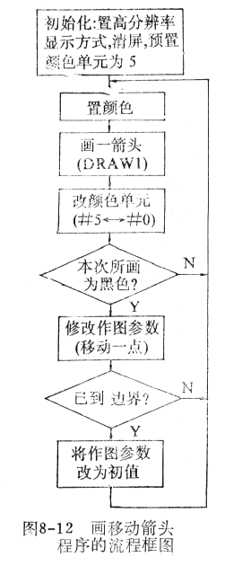

#### 2. 用向量表作图

仍用前面 §8-5 二（二）中的例子，在屏幕上画一个自左至右不停移动的“战斗机”（为简单计，不包括前部的射击轨迹）。下面是完成这个功能的汇编语言源程序。图 8-13 是其程序流程图。

```nasm
1           ORG  $8000
2   DRAW    EQU  $F601
3   XDRAW   EQU  $F65D
4   HPOSN   EQU  $F411
5   HGR     EQU  $F3E2
6   HCOLOR  EQU  $F6F0
7   SHPRT   EQU  $F730
8           JSR  HGR          ; 置显示方式
9           LDX  #0           ; 索引向量表地址→$E8, $E9
10          STX  $E8
11          LDA  #$95
12          STA  $E9
13          LDA  #2           ; SCALE=2
14          STA  $E7
15          LDX  #3           ; 颜色=3
16          JSR  HCOLOR
17  STAT    LDX  #0           ; X 座标初值=0
18          STX  $FE
19          STX  $FF
20  LOOP    JSR  PRES         ; 确定原点，置向量表序号
21          LDA  #0           ; 画一个战斗机
22          LDX  $1A
23          LDY  $1B
24          JSR  DRAW
25          JSR  PRES1        ; 再置向量表序号
26          LDA  #0           ; 抹图
27          LDX  $1A
28          LDY  $1B
29          JSR  XDRAW
30          INC  $FE          ; 位移一点
31          BNE  PIC
32          INC  $FF
33          JMP  LOOP
34  PIC     LDA  $FE
35          CMP  #24          ; X>279?
36          BNE  CONT
37          LDA  $FF
38          CMP  #1
39          BNE  CONT
40          JMP  STAT         ; X>279，重新开始
41  CONT    JMP  LOOP
42  PRES    LDA  #100         ; 置当前点
43          LDX  $FE
44          LDY  $FF
45          JSR  HPOSN
46  PRES1   LDX  #1           ; 置向量表序号
47          JSR  SHPRT
48          RTS
```

> 注：第 3 行 `XDRAW` 入口地址原文印作 `$F650`，实为 `$F65D`；第 11 行原文印作 `LDA $95`，实为立即数寻址 `LDA #$95`。

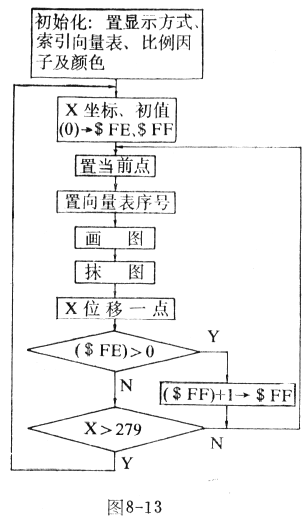

在这个程序中仍假定使用 §8-5 二（二）中的索引向量表 `TABLE.OBJ0`。因此，运行其目的程序之前，必须用操作系统命令“`BLOAD TABLE.OBJ0`”把此表引入内存中。由于索引向量表是存于 `$9500` 开始的内存单元中，因而开始时需把这个地址值置到 `$E8` 和 `$E9` 单元之中。程序中使用 `$FE` 和 `$FF` 两个单元做为 X 坐标单元，Y 坐标固定为 100。每次画抹一图，均将 X 坐标加 1。当它比 279 大时，又置为 0。由于所作图形是封闭的，用 `DRAW` 作图后，又回到原点，再用 `XDRAW` 抹图时，便不需再置当前点（不转向子程序 `PRES`，而直接调 `PRES1`）。

附带说明的是，每次调用 `DRAW` 或 `XDRAW` 之前都要把向量表序号送入 `$1A` 和 `$1B` 单元中（通过调 `SHPRT` 完成）。因为在执行 `DRAW` 或 `XDRAW`（原文印作 `XDRW`）过程中，`$1A` 和 `$1B` 的值在变化（跟踪向量表中的各个字节地址）。执行完以后，`$1A` 和 `$1B` 单元的值已不对准该向量表的起始地址了。从这一点来看，我们还可以把调用过程作得更简单些，不必一定要构成索引向量表。可以把某个或某些向量表分别存于内存的一定空间中，当使用某一个向量表时，把该表的起始地址存于 `$1A` 和 `$1B` 单元。这就不必再调用 `SHPTR` 子程序，也没有必要预置 `$E8` 和 `$E9` 单元，使程序更简单些。

事实上还可更进一步，在调用 `DRAW` 或 `XDRAW` 时，X、Y 寄存器直接存入向量表的起始地址，不必再使用 `$1A` 和 `$1B` 单元进行地址传送。因而，可把上面的程序改写为：

```nasm
1           ORG  $8000
2   DRAW    EQU  $F601
3   XDRAW   EQU  $F65D
4   HPOSN   EQU  $F411
5   HGR     EQU  $F3E2
6   HCOLOR  EQU  $F6F0
7           JSR  HGR
8           LDA  #2
9           STA  $E7
10          LDX  #3
11          JSR  HCOLOR
12  STAT    LDX  #0
13          STX  $FE
14          STX  $FF
15  LOOP    JSR  PRES
16          LDA  #0
17          LDX  #$06         ; 直接置索引表首地址 ($9506)
18          LDY  #$95
19          JSR  DRAW
20          LDA  #0
21          LDX  #$06         ; 同 17, 18
22          LDY  #$95
23          JSR  XDRAW
24          INC  $FE
25          BNE  PIC
26          INC  $FF
27          JMP  LOOP
28  PIC     LDA  $FE
29          CMP  #24
30          BNE  CONT
31          LDA  $FF
32          CMP  #1
33          BNE  CONT
34          JMP  STAT
35  CONT    JMP  LOOP
36  PRES    LDA  #100
37          LDX  $FE
38          LDY  $FF
39          JSR  HPOSN
40          RTS
```

> 注：原文第 3 行 `$F65D` 印作 `$F650`，第 17—18、21—22 行立即数寻址 `#` 漏印（正文第 216 页顶部指明为 `#$06` 和 `#$95`），第 26 行 `INC` 印作 `INE`，第 31 行 `$FF` 印作 `$FE`，此处已予校订。

在这段程序中，由于仍使用 §8-5 二（二）中的索引向量表 `TABLE.OBJ0`，向量表真正存放的地址是 `$9506`。因而在调用 `DRAW` 和 `XDRAW` 时，均分别先给 X、Y 寄存器赋为 `#$06` 和 `#$95`。

向量作图法是一种绘制一般形状图形的较好方法。其缺点是向量只有 8 种，包括 4 种移动方向。这对制作斜线来说不很方便。如果能增加 $45^\circ$ 线方向的向量，对较复杂形状的图形作图更容易些。
