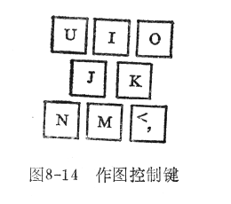
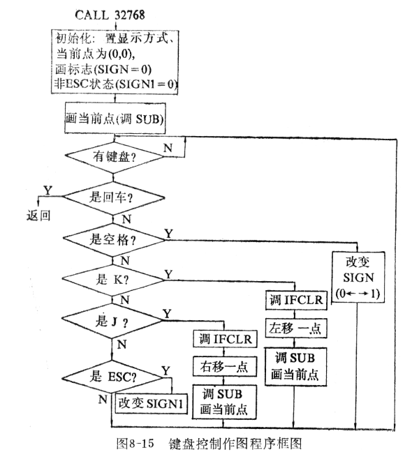
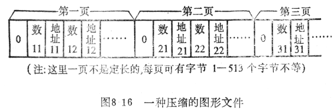
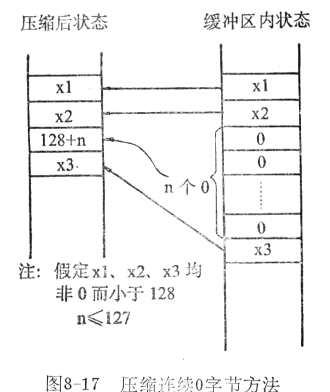
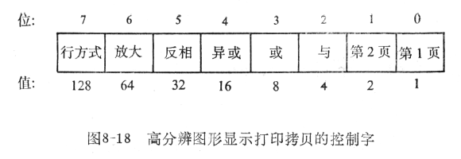
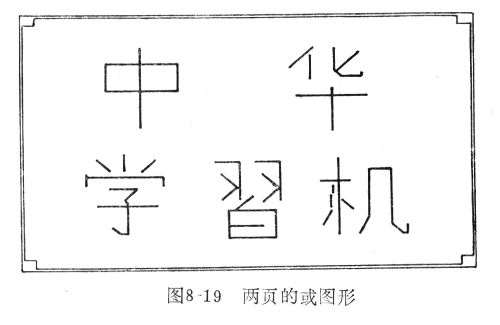

# 第八章 显示和打印（续）

## §8-6 高分辨图形作图的其它应用

### 一、计算法作图

经常需要在屏幕上逐点地进行作图，而每个点的坐标是已知的。在这种情形下，调用前面说过的子程序无疑是可以完成的。但用户也可以自己设计子程序，根据坐标把内存缓冲区的对应单元地址和对应的位等计算出来。作点的过程，也就是向对应位送入相应信息的过程。

计算的出发点就是 §8-4 三中所给出的表达式。这个式子中共有 4 项。前两项是很好处理的，因为不管是对 8 或 64 求模，还是除以 8，或者是乘 1024 或 128，都可通过简单的逻辑操作指令或移位指令来完成。第 3 项也并不难，一个数与 40 相乘，可以转换为该数乘 8 和乘 32 后得到的两个积相加。上述 3 项便决定了对应 1 行的 40 个内存单元中首单元的相对地址。对于第 4 项来说，通常要作一个除法操作。但为提高效率还是用减法操作为好。因为 $J$ 是一个二字节的数，但高位数最多为 1。当它为 1 时，相当于高位数代表了 $36 \times 7 + 4 (= 256)$。这时，把低位数加 4，再进行减 7 操作，得到的商加 36 便为行内的相对地址（对应行内首址）。而余数则为该点对应的位数。如果高位为 0，也进行同样的减 7 操作，直接得到除 7 的商和余数便可。这样设计，用单字节减 7 操作代替了除法，程序效率反而提高了。

根据上面所述，不难写出一个汇编子程序来，用以直接根据坐标（$I$ 和 $J$）来求出作图缓冲区对应单元的相对地址，及对应单元内的位数。事实上，§8-5 三中的 `HPOSN` 子程序基本上便是这样的一个子程序。

将相对地址转换成绝对地址也很容易，只要知道处于第几页显示便可以了。应当说明的是，如果是使用 BASIC 中 `HGR` 或 `HGR2` 语句，或调用了 §8-5 三中的 `HGR` 或 `HG2` 子程序而进入高分辨图象显示的，在 0 页的 `$E6` 单元中便记下了当前的显示页数。当为第 1 页时，它存有 `#$20`；当为第 2 页时，它存有 `#$40`。这样，从相对地址转换成绝对地址时，只要进行一个相对地址高位与 `$E6` 单元内容相或（`ORA`）的操作便可得到了。

根据以上所说，不难设计出一个计算程序来。这正是 §8-5 三中 `HPOSN` 子程序的功能，因此，通常不必单独编写，可以直接调用它。

### 二、查表法作图

如果对 §8-4 中的表 8-8 进行一些分析，不难得出这样一个结论：对应每一行的 40 个内存单元的首单元相对地址，有一定的规律。这个地址的低位只有 6 种，且根据行的顺序按一定规律变化；这个地址的高位只有 32 种，也有一定的规律。这样我们可写出下面一张表来：

```nasm
1   PICTL   DFB   0, $80, $28, $A8, $50, $D0
2   PICTH   DFB   $00, $04, $08, $0C
3           DFB   $10, $14, $18, $1C
4           DFB   $01, $05, $09, $0D
5           DFB   $11, $15, $19, $1D
6           DFB   $02, $06, $0A, $0E
7           DFB   $12, $16, $1A, $1E
8           DFB   $03, $07, $0B, $0F
9           DFB   $13, $17, $1B, $1F
```

> **[注]**：第 1 行第 4 个字节原书印作 `$AB`，根据高分辨行首地址规律实为 `$A8`。

这里，`PICTL` 开始的 6 个数，对应了上述 6 种低位相对地址；`PICTH` 开始的 32 个数，对应了上述 32 种高位相对地址。如果分析一下表 8-8，可以得出这样的规律：假设用 $Y$（$0\text{—}191$）表示屏幕上的垂直坐标，把 $Y$ 表示成二进制数，“$\text{B}_7\ \text{B}_6\ \text{B}_5\ \text{B}_4\ \text{B}_3\ \text{B}_2\ \text{B}_1\ \text{B}_0$”，则若以 `PICTL` 为基地址，以二进制数“$\text{B}_7\ \text{B}_6\ \text{B}_3$”（$0\text{—}5$）为偏移量，马上可以从上面的表中找出对应 $Y$ 行的内存单元首地址的低位（相对地址）。同样，以 `PICTH` 为基地址，以二进制数“$\text{B}_5\ \text{B}_4\ \text{B}_2\ \text{B}_1\ \text{B}_0$”（$0\text{—}31$）为偏移量，也马上可以从表中找到上述单元相对地址的高位。例如 $Y = 174$ 时，其二进制数表示为“$10\ 10\ 11\ 10$”，可指出低地址为 `$D0`，高地址为 `$1A`。即其相对地址为 `$1AD0`。这与表 8-8 中查出来的是一致的。

下面以一程序为例。此程序用来置已知行（行坐标存于 `$FD` 单元）的前 7 个点为亮点。

```nasm
1           ORG   $8000
2   YCR     EQU   $FD         ; YCR中存有垂直坐标Y(0—191)
3   INDEX   EQU   $FE         ; 间址单元
4           LDA   YCR
5           AND   #$C8        ; 以下从YCR所存数求低位偏移量（原书作 $C8）
6           CLC               ; （原书误印为 LCL）
7           ROL   A
8           ROL   A
9           ROL   A
10          ROL   A
11          BPL   NONE
12          ADC   #1
13          AND   #$7         ; （原书作 $7）
14  NONE    TAX               ; 偏移量→X
15          LDA   PICTL,X
16          STA   INDEX       ; 相对地址低位→INDEX
17          LDA   YCR
18          AND   #$37        ; 以下求高位的偏移量（原书作 $37）
19          TAY
20          AND   #$30        ; （原书作 $30）
21          LSR   A
22          STA   INDEX+1     ; 中间结果暂存INDEX+1中
23          TYA
24          AND   #$7         ; （原书作 $7）
25          ORA   INDEX+1
26          TAX               ; 偏移量→X
27          LDA   PICTH, X
28          ORA   $E6         ; 把相对地址变为绝对地址
29          STA   INDEX+1
30          LDY   #0
31          LDA   #$FF        ; （原书作 $FF）
32          STA   (INDEX),Y   ; 把该行前7点变为亮点
33          RTS
34          CHN   PICT        ; 把相对地址表连入
```

在这段程序中，使用了 3 个 0 页单元：`$FD`、`$FE` 和 `$FF`。前一个存有行数（$0\text{—}191$），后两个用来做间接变址寻址时的存基地址单元。程序中 4—15 这些指令完成了找相对地址低位的操作。分析一下便可知，它正是取出 `YCR`（`$FD`）中数的 $\text{B}_7$、$\text{B}_6$ 和 $\text{B}_3$ 三位构成偏移量，从而求得所求地址。得到的结果存入 `INDEX` 中。同样，下面又求得其高位。在 28 行中，与 `$E6` 单元相或是因为 `$E6` 中存有当前高分辨图形显示页的首地址高位。如果不是通过 `HGR` 或 `HGR2` 进入此程序的，则必须相应地在程序中预先把 `$20` 或 `$40`（原书误作“把 `$20` 或 `$20`”）存入 `$E6` 单元之中。得到的绝对地址分别存入 `$FE`（存低位）和 `$FF`（存高位）后，用间接变址指令便可对该单元进行操作了。程序后面连接的 `PICT` 即为前面指出的相对地址低位和高位表示表。

这个程序汇编后，把目的程序引入内存中，再执行下述 BASIC 程序：

```basic
10 HGR
20 POKE 49234, 0
30 FOR I=0 TO 191
40 POKE 253, I: CALL 32768
50 GET Q
60 NEXT
```

> **[注]**：第 60 行原书印作 `60 NEST`，实为 `60 NEXT`；第 50 行若用字符变量应为 `GET Q$`。

便可不停地按任意键使屏幕上自上而下不停地画一短线（每线由每行开始的 7 个点构成），最后形成一条垂直的亮带。

上面的汇编和 BASIC 语句程序可用来证明我们指出的查表法找 $Y$ 坐标对应内存单元地址的正确性。这种方法的优点就在于速度快。例如上面的程序中，求一个地址只需 $50\ \mu\text{s}$ 多一点。这种方法求出的地址，事实上相当于求出了 §8-4 三中表达式的前三项之和。

如果希望把查表的速度再加快，可以把表加大。例如，我们把上面的 `PICT` 表中的代表低位地址的单元扩展到 192 个，代表高位地址的单元也扩展到 192 个，便可以直接用 $Y$ 坐标值当做偏移量，更快地找出相对地址来。本节第三部分中我们将介绍一个共使用 256 个（一页）单元构成的表的例子。

这种查表法只求出了每行对应的 40 个单元中的第一个单元地址。要进一步求出到底是哪一个单元，还要根据 $X$ 坐标进一步确定，也就是要求出 §8-4 三中表达式第 4 项的值（$J$ 即相当于 $X$ 坐标值）。另外，还要求出对应该单元的那个位来。这一步当然也可用计算法（除 7 或连续减 7 的方法），也可用查表法。但相对地说，这一步不大适于采用查表法。在多数作图过程中，图形是连续作的，即每作一点后，下面要作的点一定是与前一点在 $X$ 方向上是相邻的。例如，$X$ 坐标每次只加 1 或减 1，或者不变。这种情形下也可以用两个内存单元 `ROW` 和 `BIT` 来分别记录行内单元相对地址（$0\text{—}39$）和对应单元内的位数。`BIT` 单元中的数一定是 2 的 $n$ 次方，（$n = 0\text{—}6$），哪一位为 1，便代表对应的是哪一位。这样，当 $X$ 右移一点时，`BIT` 便进行一次左移；$X$ 左移一点时，`BIT` 便进行一次右移。但当移到 `BIT` 中数为 128 时，便使 `ROW` 加 1，而 `BIT` 中改为数 1；当 `BIT` 中为 0 时，又使 `ROW` 减 1，同时使 `BIT` 中数为 64。我们可以称这种方法为游标法。本节第三部分的例子中我们将看到这种方法的采用。

在上面的应用中，常常要设一些 0 页单元做为某种专门应用的中间单元，例如前例中的 `INDEX` 和上面说的游标法中的 `ROW` 和 `BIT`（当然，这二者也可不用 0 页单元）。这是因为 0 页单元有时有特殊功能，有时有操作速度快的优点，但不是所有 0 页单元用户均可使用，因为大量 0 页单元已被监控程序、DOS 和 BASIC 解释程序所使用（请见“中华学习机 CEC-I 技术参考手册”）。这里附带说明的是，下述 0 页单元通常用户可以随意使用，系统没有用它们：`$F9`—`$FF`、`$EB`—`$EF`、`$06`—`$09` 和 `$19`—`$1F` 等等。

---

### 三、应用举例——用键盘控制作任意图形

这里我们介绍一个画图程序，它允许使用者控制高分辨图形显示屏幕上的点，使之可向 8 个方向运动，从而画出其轨迹或沿其轨迹抹掉已有亮点。这 8 个方向由图 8-14 中的 8 个键所控制，其中“`I`”、“`J`”、“`K`”和“`M`”键分别使点向上、左、右和下 4 个方向运动；而“`O`”、“`U`”、“`N`”和“`,`”键则使之沿 45 度线分别向右上、左上、左下和右下 4 个方向运动。每按一下键，移动一点，相当于 $X$ 或 $Y$ 增或减 1，或者，相当于 $X$ 和 $Y$ 同时增或减 1。例如，向右上方移一点，则 $X$ 加 1，同时 $Y$ 加 1。

为了能画能抹，我们还用空格键控制是画还是抹。空格键用作一反复开关。开始处于画状态，点每移动一下，原来位置上便留下一亮点；按一下空格键后，则处于抹状态，每移动一点原先位置上便成为暗点。再按空格键，便又回到画状态。此外，还设一 `ESC` 键，按下它，便进入不画不抹状态：点随意运动，不改变当前画面的任一点。从这一状态下退出，仍用 `ESC` 键，退到原来状态。程序运行完（当图作完，退出时），按回车便结束。

这样一个程序可用来通过键盘在屏幕上画任意图形，如广告、菜单（包括汉字）或学生的美术作品等。



现在看一下此程序的汇编部分：

```nasm
1           ORG   $8000
2   INDEX   EQU   $EE
3   SIGN    EQU   $FA
4   BIT     EQU   $FB
5   ROW     EQU   $FC
6   LINE    EQU   $FD
7   SIGN1   EQU   $FE
8   SIGN2   EQU   $FF
9           BIT   $C052       ; 置纯高分辨显示方式
10          BIT   $C057
11          BIT   $C050
12          LDA   #0
13          STA   SIGN        ; 初始状态为画状态
14          STA   SIGN1
15          STA   LINE        ; 当前行数
16          STA   ROW         ; 当前列对应的行内相对地址
17          LDA   #1
18          STA   BIT         ; 当前列对应的位
19          JMP   SUB
20  LOOP1   LDA   $C000       ; 读键盘
21          BPL   LOOP1
22          BIT   $C010
23          CMP   #$8D        ; 是回车?（原书印作 $80，回车键码实为 #$8D）
24          BNE   MOVE
25          BIT   $C051
26          RTS               ; 结束
27  MOVE    CMP   #$A0        ; 是空格（原书作 $A0）
28          BNE   PROS
29          LDA   #1          ; （原书作 $1）
30          EOR   SIGN
31          STA   SIGN        ; 改变SIGN(0←→1)
32          JMP   LOOP1
33  PROS    CMP   #$CB        ; 是K?（原书作 $CB）
34          BNE   NEXT1
35          JSR   IFCLR
36          JSR   MVXR        ; （原书行号误印为 26）
37          JMP   SUB
38  NEXT1   CMP   #$CA        ; 是J?（原书作 $CA）
39          BNE   NEXT2       ; （原书误印为 NEXTZ）
40          JSR   IFCLR
41          JSR   MVXL
42          JMP   SUB
43  NEXT2   CMP   #$C9        ; 是I?（原书作 $C9）
44          BNE   NEXT3
45          JSR   IFCLR
46          JSR   MVYU        ; （原书误印为 MVXU）
47          JMP   SUB
48  NEXT3   CMP   #$CD        ; 是M?（原书作 $CD）
49          BNE   NEXT4
50          JSR   IFCLR
51          JSR   MVYD
52          JMP   SUB
53  NEXT4   CMP   #$CF        ; 是O?（原书作 $CF）
54          BNE   NEXT5
55          JSR   IFCLR
56          JSR   MVXR
57          JSR   MVYU
58          JMP   SUB
59  NEXT5   CMP   #$D5        ; 是U?（原书作 $D5）
60          BNE   NEXT6
61          JSR   IFCLR
62          JSR   MVXL
63          JSR   MVYU
64          JMP   SUB
65  NEXT6   CMP   #$CE        ; 是N?（原书作 $CE）
66          BNE   NEXT7
67          JSR   IFCLR
68          JSR   MVXL
69          JSR   MVYD
70          JMP   SUB
71  NEXT7   CMP   #$AC        ; 是, ?（原书作 $AC）
72          BNE   NEXT8
73          JSR   IFCLR
74          JSR   MVXR
75          JSR   MVYD
76          JMP   SUB
77  NEXT8   CMP   #$9B        ; 是ESC?（原书作 $9B）
78          BNE   BAK
79          LDA   SIGN1
80          EOR   #1
81          STA   SIGN1       ; 改变SIGN1(1←→0)
82  BAK     JMP   LOOP1
83  MVYD    LDY   LINE        ; 行数加1（原书标号误印为 MVYC）
84          INY
85          CPY   #192
86          BNE   NOVYD
87          LDY   #0
88  NOVYD   STY   LINE
89          RTS
90  MVXR    ASL   BIT         ; 列数加1
91          BPL   RET1
92          LDA   #1
93          STA   BIT
94          LDX   ROW
95          INX
96          CPX   #40
97          BNE   NOVXR
98          LDX   #0
99  NOVXR   STX   ROW
100 RET1    RTS
101 MVXL    LSR   BIT         ; 列数减1
102         BCC   RET2
103         LDA   #64
104         STA   BIT
105         LDX   ROW
106         DEX
107         CPX   #$FF        ; （原书作 $FF）
108         BNE   NOVXL
109         LDX   #39
110 NOVXL   STX   ROW
111 RET2    RTS               ; （原书标号误印为 RES2）
112 MVYU    LDY   LINE        ; 行数减1
113         DEY
114         CPY   #$FF        ; （原书作 $FF）
115         BNE   NOVYU
116         LDY   #191
117 NOVYU   STY   LINE
118         RTS
119 SUB     JSR   ADDRS       ; 找绝对地址
120         LDY   ROW         ; 以下画当前点
121         LDA   (INDEX),Y
122         BIT   BIT
123         BNE   REST
124         ORA   BIT
125         STA   (INDEX),Y   ; （原书误印为 (INEX),Y）
126         LDA   #1          ; 当前点原来是暗点(SIGN2←1)
127         STA   SIGN2
128         JMP   LOOP1
129 REST    LDA   #0          ; 当前点原来是亮点(SIGN2←0)
130         STA   SIGN2
131         JMP   LOOP1
132 IFCLR   LDA   SIGN1       ; 移动后，上次的当前点要否清洗
133         BEQ   DOCLC
134         LDA   SIGN2
135         BNE   CLC
136         RTS
137 DOCLC   LDA   SIGN        ; SIGN1=1到此，SIGN=1同时SIGN2≠0也到此
138         BNE   CLC         ; SIGN=1则清
139         RTS
140 CLC     JSR   ADDRS       ; 清原先的点
141         LDA   BIT
142         LDY   ROW
143         EOR   #$7F        ; （原书作 $7F）
144         AND   (INDEX), Y
145         STA   (INDEX), Y
146         RTS
147 ADDRS   LDY   LINE        ; 找地址，先找到行号
148         LDA   PICTL, Y    ; 找到低位
149         STA   INDEX       ; 存入INDEX
150         TYA
151         AND   #$3F        ; （原书作 $3F）
152         TAY
153         LDA   PICTH, Y    ; 找到相对高度
154         ORA   $E6
155         STA   INDEX+1     ; 将绝对高位→INDEX+1（原书注作 INDE+1）
156         RTS
157         CHN   PICT        ; 连接相对地址表
```

这里我们仍使用上述的查表法，但上面程序后面连看的 `PICT` 是一个更大的表，这样查起来更为方便。它的形式如下：

```nasm
1  PICTL  DFB  0, 0, 0, 0, 0, 0, 0, 0
2         DFB  $80, $80, $80, $80, $80, $80, $80, $80
3         DFB  0, 0, 0, 0, 0, 0, 0, 0
4         DFB  $80, $80, $80, $80, $80, $80, $80, $80
5         DFB  0, 0, 0, 0, 0, 0, 0, 0
6         DFB  $80, $80, $80, $80, $80, $80, $80, $80
7         DFB  0, 0, 0, 0, 0, 0, 0, 0
8         DFB  $80, $80, $80, $80, $80, $80, $80, $80
9         DFB  $28, $28, $28, $28, $28, $28, $28, $28
10        DFB  $A8, $A8, $A8, $A8, $A8, $A8, $A8, $A8
11        DFB  $28, $28, $28, $28, $28, $28, $28, $28
12        DFB  $A8, $A8, $A8, $A8, $A8, $A8, $A8, $A8
13        DFB  $28, $28, $28, $28, $28, $28, $28, $28
14        DFB  $A8, $A8, $A8, $A8, $A8, $A8, $A8, $A8
15        DFB  $28, $28, $28, $28, $28, $28, $28, $28
16        DFB  $A8, $A8, $A8, $A8, $A8, $A8, $A8, $A8
17        DFB  $50, $50, $50, $50, $50, $50, $50, $50
18        DFB  $D0, $D0, $D0, $D0, $D0, $D0, $D0, $D0
19        DFB  $50, $50, $50, $50, $50, $50, $50, $50
20        DFB  $D0, $D0, $D0, $D0, $D0, $D0, $D0, $D0
21        DFB  $50, $50, $50, $50, $50, $50, $50, $50
22        DFB  $D0, $D0, $D0, $D0, $D0, $D0, $D0, $D0
23        DFB  $50, $50, $50, $50, $50, $50, $50, $50
24        DFB  $D0, $D0, $D0, $D0, $D0, $D0, $D0, $D0
25 PICTH  DFB  $00, $04, $08, $0C, $10, $14, $18, $1C
26        DFB  $00, $04, $08, $0C, $10, $14, $18, $1C
27        DFB  $01, $05, $09, $0D, $11, $15, $19, $1D
28        DFB  $01, $05, $09, $0D, $11, $15, $19, $1D
29        DFB  $02, $06, $0A, $0E, $12, $16, $1A, $1E
30        DFB  $02, $06, $0A, $0E, $12, $16, $1A, $1E
31        DFB  $03, $07, $0B, $0F, $13, $17, $1B, $1F
32        DFB  $03, $07, $0B, $0F, $13, $17, $1B, $1F
```

> **[注]**：第 21 行行号原书误印为 `01`；第 30 行第 4 个字节原书误印为 `$0F`，按规律应为 `$0E`。

可见，这里有 192 个低位地址，64 个高位地址。因而，找低位地址时，可直接根据行数来找，而找高位时，也很容易，即行数二进制数的低 6 位便是相对 `PICTH` 的偏移量。上面程序中 147 行开始的子程序 `ADDRS` 便是根据行数（存于 `LINE`）查表找到相对地址，然后根据 `$E6` 单元的值，找到绝对地址的子程序。

为便于了解这段程序，图 8-15 中绘出了它的框图。程序开始，屏幕左上角显示一点，坐标为 $(0, 0)$，它就是此时的当前点。当用控制键移动它时，读入了相应的键，便先看一下移动后原先的当前点是否应抹掉。如果处于抹状态，便先抹去，然后显示新的当前点；如果处于画状态，便不抹。如果处于 `ESC` 状态，则是否抹要看进入该点之前，该点是亮还是暗，要保持原有状态。



键盘控制作图这个程序虽然较长，但并不难看懂，主要要了解下述几点：

1. 系统设了 3 个标志字：`SIGN`、`SIGN1` 和 `SIGN2`（原书此处印作 `SICN`、`SICN1` 和 `SICN2`）。其中 `SIGN=0` 表示画状态；反之 `SIGN=1` 表示抹状态。`SIGN1` 表示 `ESC` 状态。进入 `ESC` 状态时，`SIGN1` 置 1，退出又退还 0。`SIGN2` 为当前点原来状态的代表。原来为亮点，`SIGN2=0`；原来是暗点，`SIGN2=1`。
2. 每移动当前点，都要先处理原来的当前点，这就是 `IFCLR` 子程序完成的功能。下述情况下，原先的当前点要抹掉：
   - ① `SIGN=1`，`SIGN1=0`：这时是处于抹状态，而又非 `ESC` 状态，所以必须抹掉。
   - ② `SIGN1=1`，`SIGN2=1`：这时处于 `ESC` 状态，而当前点原先又是暗点，要保持原先状态，因而也要抹掉。

**表 8-15 `IFCLR` 子程序功能**

| `SIGN` | `SIGN1` | `SIGN2` | 抹? | 说明 |
| :---: | :---: | :---: | :---: | :--- |
| 0 | 0 | 0 | 否 | 处于画状态，非 `ESC` 状态 |
| 0 | 0 | 1 | 否 | 同上 |
| 0 | 1 | 0 | 否 | 处于 `ESC` 状态，该点原来是亮点 |
| 0 | 1 | 1 | 是 | 处于 `ESC` 状态，该点原来是暗点 |
| 1 | 0 | 0 | 是 | 处于抹状态，非 `ESC` 状态 |
| 1 | 0 | 1 | 是 | 处于抹状态，非 `ESC` 状态 |
| 1 | 1 | 0 | 否 | 处于 `ESC` 状态，该点原来是亮点 |
| 1 | 1 | 1 | 是 | 处于 `ESC` 状态，该点原来是暗点 |

我们也可以用表 8-15 来表示什么状态要抹，什么状态要保留亮点。根据表对照 `IFCLR` 子程序，便可知该程序的功能。

调用键盘控制作图这个程序时要注意，若不是用 `HGR` 或 `HGR2` 进入高分辨图形显示方式，必须先预置 `$E6` 单元为合适的值。

下面我们给出一个调用这个程序的 BASIC 语言程序。假定其目的程序为 `PIT.OBJ0`：

```basic
10  D$=CHR$(13)+CHR$(4)
20  PRINT D$; "BLOAD PIT.OBJ0"
30  HOME
40  HTAB 5: VTAB 10
50  PRINT "1.NEW PICTURE"
60  HTAB 5: VTAB 12
70  PRINT "2.CONTINUE THE UNFINISHED"
80  HTAB 5: VTAB 14
90  PRINT "3.READ THE FILE AND CONTINUE"
100 HTAB 8: VTAB 20: PRINT "WHICH ONE DO YOU SELECT?";: GET Q$: A%=VAL(Q$)
110 IF A%>3 OR A%<1 GOTO 100
120 HOME: HTAB 10: VTAB 10
130 PRINT "PAGE 1 OR 2 ? (1/2)" ; : GET B$
140 IF B$<> "1" AND B$<> "2" GOTO 120
150 E$= "2" : IF B$= "2" THEN E$= "4"
160 ON A% GOTO 170,190,210
170 IF B$= "1" THEN HGR: GOTO 260
180 HGR2: GOTO 260
190 IF B$= "1" THEN POKE 230,32: POKE 49236,0: GOTO 260
200 POKE 230,64: POKE 49237,0: GOTO 260
210 HTAB 10: VTAB 14: INPUT "THE FILE NAME? " ; C$
220 IF B$= "1" THEN HGR: GOTO 240
230 HGR2
240 PRINT D$; "BLOAD " ; C$; ",A$" ; E$; "000"
250 GOTO 260
260 CALL 32768
270 TEXT: HOME: HTAB 10: VTAB 8
280 PRINT "TO SAVE THE PICTURE? (Y/N)" ; : GET Q$
290 IF Q$<> "Y" GOTO 330
300 HTAB 10: VTAB 12
310 INPUT "THE FILE NAME? " ; A$
320 PRINT D$; "BSAVE " ; A$; ",A$" ; E$; "000,L$2000"
330 END
```

> **[注]**：第 60 行原书误印为 `THAB 5: VTAB 12`；第 200 行 `GOTO` 原书误印为 `COTO`；第 320 行 `"A$"` 前原书漏印逗号。

这个程序允许用户选择：

1. 在第 1 页还是第 2 页高分辨图形屏幕上作图。
2. 是作一新图（`NEW PICTURE`），还是接上次的继续作（`CONTINUE THE UNFINISHED`），还是接已有在磁盘上的图继续作（`READ THE FILE AND CONTINUE`）。作新图则将清屏；接上次的作不清屏；接已存磁盘的图继续作则在清屏后，把上次作的结果再复制出来（不管上次是在哪一页上作的）。
3. 作完图后，用回车返回，可再选择是否要把所作结果存盘。要的话给出文件名（`THE FILE NAME?`，原书作 `THE FILE MANE?`）。

这里存盘时，是把显示缓冲区中 8K 的内存单元的内容，全部存入盘中，作成一二进制文件（使用 `BSAVE` 命令）。下次要调入继续作图，也可以再运行此程序。

上面的键盘控制作图程序还可进一步改进。例如可设控制长移动的键（例如每次可连续移动 10 或 20 个点等），了解了上述原理，在程序中加入功能是不难的。这样，使用起来更方便。

---

### 四、图形文件的压缩

为了要保存一幅图形，就要把整页的高分辨图形显示缓冲区的内容作成一个二进制文件，存入磁盘。这个文件是相当大的，因为它要原封不动地记录 8K 个字节。但是，一幅图形中有亮点也有暗点，因此缓冲区中常常是有大量为 0 的字节存在。图形越简单，0 字节就越多。这就提出一个问题：为了节省磁盘空间，也提高读写效率，可否把这 8K 多长的文件压缩一下，使之变得短一些。

解决这个问题的办法有许多，这里仅介绍两个方法：一种是在图形比较简单时，分页记录非 0 字节，每个这样的字节既记录其内容又记录其页内相对地址。例如，可把缓冲区的 8K 字节分成 32 页（每页 256 字节）。对应地在文件中每页以全 0 字节开始，然后，记录页内一个非 0 数，记录它的页内地址，再记录一个非 0 数，记录其页内地址。以此类推下去，可产生象图 8-16 那样形式的一个二进制文件。这样，各个数均为非 0 的数。为 0 的字节被排除了。可以写一个程序用以产生这样的图形文件；再写一个程序，能根据这样的文件再在内存缓冲区中恢复其内容。用这种方法时，每在应出现第一个地址的地方有可能出现 0 字节，但这没有关系，由它的位置决定，不会把它当成分页的 0 字节。但这种文件不适于较复杂（亮点较多）的图形，弄不好反而比 8K 还长。

另一种方法是要重点介绍的，采用把连续的 0 字节集中记录的方法。由于对黑白图形来说，缓冲区内各单元高位是无用的，因此，在图形文件中可把非 0 字节记下其低 7 位，高位记为 0。而对连续的 0 字节，可记录在一个字节中，此字节高位为 1，低 7 位代表的数即为连续的 0 字节个数（当这个个数超过 127 时，使用下一字节继续记录）。我们可用图 8-17 来说明这种文件的构成方法。应说明的是，图中假定 $x_1$、$x_2$、$x_3$ 均非 0 而小于 128。它们原封不动地存入压缩文件中。而连续的 $n$ 个 0，只要 $n \le 127$，便只需存入一个字节中。但当 $x_1 > 128$ 时，仍按去掉其高位（相当于减 128）后的值计。若为 128，便认为是 0 字节。

已介绍的键盘控制作图的情形，便很适合使用这种方法进行压缩（只适于黑白图形）。





下面介绍一个制作这种压缩文件的程序。它通过把高分辨图形缓冲区中的所有单元按上述方法转储到 `$6000` 开始的内存区中的办法，来实现压缩。程序返回时，该文件的长度存在 0 页的 `$FE`（低位）和 `$FF`（高位）两个单元之中：

```nasm
1   SIGN    EQU   $FD
2   ADDD    EQU   $FE         ; 目的地址（文件缓冲区）
3   ADDR    EQU   $EE         ; 源地址
4   UPLM    EQU   $ED         ; （原书印作 $FD，与 SIGN 冲突，恢复程序中为 $ED）
5           ORG   $9000
6           LDX   #0
7           STX   ADDR
8           LDA   #1
9           STA   SIGN        ; 标志：上次是非0字节时为1
10          LDA   #255
11          STA   ADDD
12          LDA   $E6
13          STA   ADDR+1
14          CLC
15          ADC   #$20        ; （原书作 $20）
16          STA   UPLM        ; 上限地址为起始地址+$2000
17          LDA   #$5F        ; （原书作 $5F）
18          STA   ADDD+1
19  STAT    LDA   (ADDR,X)    ; 取缓冲区内一个字节
20          CMP   #0          ; 为0?
21          BEQ   NOPT
22          CMP   #128        ; 为128?
23          BEQ   NOPT
24          AND   #$7F        ; （原书作 $7F）
25          INC   ADDD
26          BNE   STOR
27          INC   ADDD+1
28  STOR    STA   (ADDD,X)    ; 非0字节，去掉高位后，存入文件缓冲区
29          LDA   #1          ; 存标志
30          STA   SIGN
31  READY   INC   ADDR        ; 准备取下一个
32          BNE   AGIN
33          INC   ADDR+1
34          LDA   ADDR+1
35          CMP   UPLM        ; 结束?
36          BEQ   RETN
37  AGIN    JMP   STAT
38  RETN    INC   ADDD        ; 文件长度存在ADDD和ADDD+1中
39          BNE   SUBC
40          INC   ADDD+1
41  SUBC    SEC
42          LDA   ADDD+1
43          SBC   #$60        ; （原书作 $60）
44          STA   ADDD+1
45          RTS
46  NOPT    LDA   SIGN        ; 上次是否为非0字节
47          BEQ   ZBEFR
48          LDA   #128        ; 上次非0，存128
49          INC   ADDD
50          BNE   NOC
51          INC   ADDD+1
52  NOC     STA   (ADDD,X)    ; （原书误印为 (ADD,X)）
53          LDA   #0          ; 存标志
54          STA   SIGN
55          JMP   READY
56  ZBEFR   LDA   (ADDD,X)    ; 上次为0字节
57          CMP   #255        ; 是否已存满?
58          BEQ   NTLC1
59          CLC
60          ADC   #1          ; 加1存回
61          STA   (ADDD,X)
62          JMP   READY
63  NTLC1   LDA   #128        ; 已存满，下一单元存128
64          INC   ADDD
65          BNE   NTLC2
66          INC   ADDD+1
67  NTLC2   STA   (ADDD,X)
68          JMP   READY
```

上面的程序中，用 `SIGN` 单元作标志，当读到 0 字节时，`SIGN` 便置 0，下次再读到 0，便可在一个单元内加 1。反之，读到一个非 0（也非 128）的字节，`SIGN` 便置 1。了解了上面的原理，这段程序不难读懂。在这段程序执行完之后，可用 DOS 命令把压缩后的文件存入磁盘。如果在 BASIC 程序中，可用下述程序存盘：

```basic
10  B%=PEEK(255)*256+PEEK(254)
20  D$=CHR$(4)
30  INPUT "THE FILE NAME? " ; A$
40  PRINT D$; "BSAVE " ; A$; ",A$6000, L" ; B%
```

> **[注]**：第 30 行原书误印为 `INPU "THE FIE NAME? " ; A$`。

下次再要把这个压缩的文件在缓冲区内恢复，使屏幕上重显原来的图形，也需运行一段恢复程序。例如我们可用 DOS 命令“`BLOAD`”把已压缩的二进制文件再调入（仍调到 `$6000` 的内存中），然后执行下面的程序：

```nasm
1   ADDD    EQU   $FE
2   ADDR    EQU   $EE         ; （原书作 #EE）
3   TEMP1   EQU   $FA         ; （原书作 #FA）
4   UPLM    EQU   $ED
5   TEMP2   EQU   TEMP1+1
6           ORG   $9200
7           LDA   #0
8           STA   ADDR        ; 显示缓冲区地址指针
9           STA   ADDD        ; 数据输入区地址（$6000）指针
10          STA   TEMP2
11          LDY   #0
12          LDA   $E6         ; 见注
13          STA   ADDR+1
14          CLC
15          ADC   #$20        ; （原书作 $20）
16          STA   UPLM        ; 显示缓冲区高位地址上限
17          LDA   #$60        ; （原书作 $60）
18          STA   ADDD+1
19  STAT    LDA   (ADDD), Y   ; 取一数
20          INY
21          STY   TEMP1       ; 存指针（用于变址，找下一个数）
22          BNE   NOCY1
23          INC   ADDD+1
24  NOCY1   LDY   TEMP2       ; 取指针（用于变址，指向显示缓冲区）
25          CMP   #128
26          BCC   STOR
27          AND   #127        ; 为0字节到此，去掉高位
28          TAX
29          INX               ; X中存有连续0字节的数目
30          LDA   #0
31  LOOP    STA   (ADDR),Y    ; 存回一个0字节
32          DEX
33          BEQ   SVY         ; 直存到X=0
34          INY
35          BNE   LOOP
36          INC   ADDR+1
37          JMP   LOOP
38  SVY     INY               ; 指向下一个缓冲区单元
39          STY   TEMP2
40          BNE   NOCY2
41          INC   ADDR+1
42          LDA   ADDR+1
43          CMP   UPLM        ; 是否已存到8K字节
44          BEQ   RETN
45  NOCY2   LDY   TEMP1       ; 未完，再指向下一个数
46          JMP   STAT
47  RETN    RTS               ; 返回
48  STOR    STA   (ADDR),Y    ; 非0字节到此，存入缓冲区
49          JMP   SVY
```

**注意**：应用此程序前应先使用 `HGR` 或 `HGR2`，否则要予置 `$E6` 单元（`$20` 或 `$40`）。

了解了上述的文件结构及如何制作出这种文件的程序，这一段程序便更容易理解，这里不再多解释。我们也可以在上节的 BASIC 程序中调入键盘控制作图程序后，把上述两个汇编程序的目的程序也调入内存，作完图退回 BASIC 语言时，便可先调用压缩程序，然后，不存原先那种文件，而存入压缩文件。当用户要求重显某个压缩文件所代表的图形时，又可调入该文件，然后用 `CALL 37376`（`$9200`）把图形恢复出来。这就组成一个完整的作图应用程序。

---

## §8-7 打印机的使用方法

中华学习机右上角留有一个插孔，下面有一通用 I/O 插槽，通常定义为 #1 插槽，插入打印机接口板后，便可与打印机连接，从而可在打印机上打印文字或高分辨图形。

§8-4 中曾指出，各个插槽可有 8 个单元的便笺存储器单元。它们主要用于各个 I/O 接口的控制。对 #1 插槽来说，这些单元是以下八个：

- `$479(1145)`，`$4F9(1273)`，`$579(1401)`，`$5F9(1529)`，
- `$679(1657)`，`$6F9(1785)`，`$779(1913)`，`$7F9(2045)`

下面要讲到的各种打印方式的控制，有的要通过这几个单元来实现。

### 一、字符方式打印

在监控和 DOS 中均有各自的连通和断开打印机的命令。这里再介绍一个断开打印机的命令。在 BASIC 语言下为：

```basic
POKE 53247, X    (X为0—255的整数)
```

在监控程序下，访问 `$CFFF` 单元，或在汇编中访问该单元也可。

这是因为在打印机接口板上装了地址为 `$C800`—`$CFFF` 的 2K ROM，固化了打印程序。当用“`PR#1`”或监控下用“`1 CTRL-P`”接用打印机时，便接通了这段 ROM 中的程序。中华学习机规定，当系统访问一下 `$CFFF` 单元时，各 I/O 接口中的占用上述这段地址的程序便都关闭了。对打印机来说，使用“`PR#0`”或在监控下使用“`0 CTRL-P`”后，只断开打印机打印子程序，并不断开格式子程序。但访问了 `$CFFF` 单元后，把这两者都断开。因此这种断开是更为彻底的断开。

除了接通和断开外，在字符打印方式下，还有以下一些控制项目：

#### （一）改变行宽

地址 `$679 (1657)` 是对行宽进行控制的单元。通常打印时，与屏幕上的显示相一致，为 40 个字符一行。如果在这个单元中存入大于 40 的数，便可加大行宽，但打印时屏幕不再伴随进行显示。

我们可用监控命令给上述单元赋值，也可用 BASIC 中的 `POKE` 语句。例如，执行了

```basic
POKE 1657, 72
```

这个语句后，再连通打印机进行字符打印时，便按每行 72 个字符进行。

#### （二）打印小写字母

当打印一个字符串时，要求把它的大写字母变成小写字母打印出来，可以向打印机送入 `CTRL-W`（ASCII 码为 23）。例如下面的程序：

```basic
10  PR#1
20  PRINT "B" ; CHR$(23); "EIJING." ; CHR$(23);
30  PRINT "C" ; CHR$(23); "HINA." CHR$(23)
40  PR#0
```

运行后打出：

```text
Beijing.China
```

可见，`CTRL-W`（`CHR$(23)`）是一反复开关。再次使用便回到上次使用前的状态。还应注意，一行中它应成双出现，否则有时会出现其他现象。

到底是由 `CTRL-W` 控制上述功能还是由其他字符来控制，则由 `$579(1401)` 单元决定。例如，若我们希望用 `CTRL-X` 来控制，则应在此单元中放入数 152（`CTRL-X` 的 ASCII 码，高位为 1）。平常该单元中存有 151（`CTRL-W` 的 ASCII 码）。

#### （三）将字符放大或缩小

打印时，可以将字符放大或缩小，使用的控制字符如下：

| 功能 | 控制字符 |
| :--- | :--- |
| 放大设置 | `CHR$(14)` (`CTRL-N`) |
| 恢复 | 一行结束 或 `CHR$(20)` (`CTRL-T`) |
| 缩小设置 | `CHR$(15)` (`CTRL-O`) |
| 恢复 | `CHR$(18)` (`CTRL-R`) |

例如我们执行下面一段程序：

```basic
10  PR#1
20  PRINT "BEIJING." ; CHR$(14); "CHINA."
30  PRINT "BEIJING." ; CHR$(15); "CHINA."
40  PRINT "BEIJING." ; CHR$(18)
45  PRINT "CHINA."
```

这将打印出：

- 第 1 行：`BEIJING.`（正常）`CHINA`（放大）
- 第 2 行：`BEIJING.`（正常）`CHINA`（缩小）
- 第 3 行：`BEIJING.`（缩小）
- 第 4 行：`CHINA.`（恢复正常）

由此可见，放大设置仅对一行有效，而缩小设置则总是有效。

#### （四）加重打印

设置和取消加重打印的控制符分别为 `ESC`(`CHR$(27)`) + `"E"` 和 `ESC` + `"F"`。

例如运行下面的程序：

```basic
10  PR#1
20  PRINT "BEIJING." CHR$(27); "E" ; "CHINA."
25  PRINT "CHINA."
30  PRINT CHR$(27); "F" ; "CHINA."
```

将打印出下述结果：

```text
BEIJING.CHINA.
CHINA.
CHINA.
```

第一行和第二行的“`CHINA`”为加重打印。

#### （五）打印下划线

对字符串打印输出时，可规定它附有下划线。设置它的控制符是：`CHR$(27); "-"; CHR$(1)`（相当于 `ESC` + `"-"` + `CTRL-A`），清除的控制符是：`CHR$(27); "-"; CHR$(0)`（相当于 `ESC` + `"-"` + `NULL`）。

请看下面的例子：

```basic
10  PR#1
20  PRINT "CS&S" ; CHR$(27); "-" ; CHR$(1);
30  PRINT "BEIJING." ;
40  PRINT CHR$(27)+ "-" +CHR$(0);
50  PRINT "CHINA."
```

执行这段程序后打印出来的结果为：

```text
CS&S BEIJING.CHINA.
     ^^^^^^^^
```

（其中 `BEIJING.` 带有下划线。）

#### （六）反复打印

在打印过程中，每输出一回车（`CHR$(13)`），系统自动补一个换行 `LF`（`CHR$(10)`）。要实现反复打印，即在同一行上再回来继续打，则要去掉 `LF`。控制此功能的是 `$5F9(1529)` 单元。当它存有 255 时，则去掉了换行符；当它置 0 时，则又恢复有换行符的情形。

例如，执行程序：

```basic
10  PR#1
20  POKE 1529, 255
30  FOR I=1 TO 5
35  PRINT "BEIJING." ; "CHINA."
40  NEXT
50  POKE 1529, 0
55  PRINT
60  PRINT "CHINA."
```

可打印出：

```text
BEIJING.CHINA.   （在同一行反复打印5次，效果加重）
CHINA.
```

#### （七）改变行间距

通常打印机标准的输出行间距是 $1/6$ 或 $1/8$ 英寸。在中华学习机上可以对此进行控制，同时可以以 $1/72$ 英寸为增量，在一定的范围内调节行间距。控制的方法如下：

1. **置行间距为 $1/8$ 英寸**：
   向打印机送控制字符 `ESC` + `"0"`（`CHR$(27)+CHR$(48)`）。
2. **置行间距为 $1/6$ 英寸**：
   向打印机送控制字符 `ESC` + `"2"`（`CHR$(27)+CHR$(50)`）。
3. **置行间距为 $m/72$ 英寸（$1 \le m \le 16$）**：
   向打印机送入 `ESC` + `"A"` + `CHR$(m)`（`CHR$(27)+CHR$(65)+CHR$(m)`）。

下面仅给一个例子便可说明在 BASIC 语言中如何控制行间距：

```basic
10  PR#1
15  PRINT CHR$(27); "0"
20  FOR I=0 TO 2
30  PRINT "BEIJING.CHINA."
40  NEXT
50  PRINT CHR$(27); "A"; CHR$(16)
60  FOR I=0 TO 2
70  PRINT "BEIJING.CHINA."
80  NEXT
```

> **[注]**：第 30 行原书误印为 `"BEING.CHINA."`；第 50 行原书漏印 `"A";`，作 `PRINT CHR$(27); CHR$(16)`。

这段程序的执行结果为：

```text
BEIJING CHINA.
BEIJING CHINA.
BEIJING CHINA.

BEIJING CHINA.

BEIJING CHINA.

BEIJING CHINA.
```

应说明的是，在 BASIC 语言中置了行间距后，转到其他系统（如监控）下，仍保持。

---

### 二、高分辨图形的打印拷贝

在中华学习机中有两页高分辨图形显示，这种图形事实上是存在两个各为 8K 单元的内存之中。这里所说的打印拷贝，就是把内存缓冲区中的信息送到打印机中去，使之打印出与屏幕上应显示出的图形完全相似的图形。因此，形式上看是对屏幕进行拷贝，事实上是从内存中读信息进行打印。对于这种打印拷贝，主要是通过一个控制字来完成。这个字的 8 个位代表有不同的含意。图 8-18 表示了这个控制字的构成。下面我们将 8 位中各位为 1 时的含意说明于下：



| 位 | 7 | 6 | 5 | 4 | 3 | 2 | 1 | 0 |
| :---: | :---: | :---: | :---: | :---: | :---: | :---: | :---: | :---: |
| **功能** | 行方式 | 放大 | 反相 | 异或 | 或 | 与 | 第 2 页 | 第 1 页 |
| **值** | 128 | 64 | 32 | 16 | 8 | 4 | 2 | 1 |

- **0 位**：拷贝高分辨图形第 1 页。
- **1 位**：拷贝高分辨图形第 2 页。
- **2 位**：两页中相对应的单元（页内相对地址相同的单元）逐个地进行与操作，拷贝这个操作后的结果。
- **3 位**：与 2 位相似，进行的是或操作。
- **4 位**：与 2 位相似，进行的是异或操作。
- **5 位**：进行的拷贝是相反的。但在此反相时是黑底白画；当此位为 0 时，为正相拷贝，但却是白底黑画（亮点打印成黑色）。
- **6 位**：放大 1 倍（在水平或垂直方向上均放大一倍，因而相当面积放大 4 倍）。
- **7 位**：采用行方式打印。采用这种打印时，可用 BASIC 中的 `TAB` 或 `VTAB` 语句设置行数，打印时只打相应的行。此时一行代表垂直方向上的 8 行（相当于字符显示时一行的宽度），水平方向仍为 280 点。

进行打印拷贝时，先把欲置的控制字送入 `$779(1913)` 单元，然后向打印机送入字符 `CTRL-Q`（`CHR$(17)`）。当然，打印前还应预先接通打印机。

此外，打印拷贝时，还可以采用倍密度打印，使图形更精细。这一点是通过在 `1145($479)` 单元存入数 `76($4C)` 而完成的。回到普通密度拷贝的方法是在该单元中送入数 `75($4B)`（原书误印为 `$48`）。当采用倍密度打印时，图形在横的方向上压缩一倍。

例如，下面的打印程序执行结果打印出反相拷贝（即黑底白字）、正相拷贝（白底黑字）、两页的或图形等三幅图形。这里我们事先在第 1 页显示中，用上节介绍的作图程序，写出了“中华学习机”五个字，而在第 2 页中画了一个边框。图 8-19 是两幅图的或。

```basic
10  POKE 1913, 33
20  PR#1
30  PRINT CHR$(17)
40  POKE 1913, 2
50  PRINT CHR$(17)
60  POKE 1913, 11
70  PRINT CHR$(17)
80  END
```


