# 第九章 中华学习机的维护与故障维修

## §9-1 中华学习机故障维修测试卡技术及使用说明

### 一、说明

中华学习机故障维修测试卡是中国计算机软件与技术服务总公司研制的为检测学习机、Apple II、Apple IIe机主板故障的专用产品。使用本测试卡，可使维修人员在维修学习机或Apple机主板故障时，缩小故障范围，减少故障维修时间，尽快找到故障点。经实践证明，此测试卡确是维修维护人员的一个有力工具。

维修人员在维修时，首先将有故障的学习机主板上的6502CPU拔下来，将测试卡插入一台好的学习机I/O槽中，并将40针电缆插头插入有故障的学习机主板CPU位置，并将槽号选择跳线J10—#2短接，如图9-1所示。键入`PR#2`，此时显示器上为菜单显示。按照提示进行操作，即可使用。

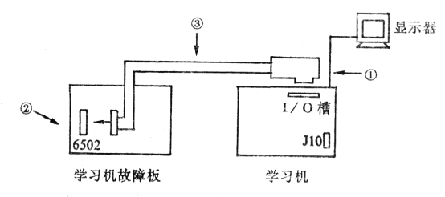

**图9-1 中华学习机故障维修测试卡安装图**
- ①将测试卡插入I/O槽，将槽号选择跳线J10—#2短接；
- ②将故障板6502CPU拔下来；
- ③将测试卡40针电缆插头插入故障板CPU位置

学习机故障检测程序固化在测试卡EPROM上，执行检测程序时，可将故障板ROM数据读入到好的学习机主机中，并与好的学习机ROM进行数据比较，可判断故障板ROM有无故障。对故障板RAM进行读、写测试，可判断地址总线、数据总线、RAM有无故障。另外，还具备对显示电路、驱动器驱动电路、I/O开关选择电路进行测试的功能。

学习机主板上本身虽带有检测程序，但当学习机主板出现故障时，如挂在地址总线上某个芯片出现故障，造成地址线恒高、恒低，或线路间短路等故障，靠启动主板上的测试程序是无法检查故障的。因总线上已出现故障，CPU读取ROM检测程序时，获得的不是正确的指令，因此无法执行检测程序。如用逻辑笔、逻辑示波器、逻辑分析仪查找故障，此时地址总线状态全是恒高，CPU已不再工作。这些故障现象给维修人员查找故障带来了不少困难。使用本测试卡时，检测程序固化在测试卡EPROM上，由好的学习机主机上的CPU执行检测程序，通过40针电缆插头取代故障板上的6502CPU。这样，由好的学习机对故障板进行读写操作，并进行数据比较，可判断出地址总线、数据总线及芯片故障。我们可将有故障的学习机主板看成是被动的，将好的学习机主板看成是主动的。由主动的学习机向被动的学习机发送读写操作，以达到检测故障的目的。

### 二、主要设计思想

（一）要想检测被测板故障，就要对被测板进行读写操作，并将故障信息显示出来。我们用一台好的学习机作为主机，用这台主机上的CPU执行测试卡上的检测程序。去掉被测板上的CPU，通过CPU这个端口，向被测板发送读写指令，控制被测板的存取操作。故障板和好的学习机主机两台机器CPU所用的时序虽然都是1MHz，但由于开机启动时间不一致，所以二者的时序有一定差别。测试时，要按照故障板的时序进行读写操作。

（二）测试卡电路主要包括：

1. 检测程序，固化在EPROM中。检测程序包括：确定读写被测板地址范围，向被测板发送读取操作，将故障板数据读入到学习机主机内存中，并将故障信息显示出来；向被测板发送写操作，将数据写到故障板内存RAM中。
2. 测试卡EPROM地址译码电路。
3. 地址、数据总线锁存、释放电路。
4. 时序匹配电路。执行检测程序时使用主板时序，读写故障板数据时使用故障板时序。
5. 开关控制电路。对不同地址范围进行开关控制。
6. 抗干扰保护电路。由于故障板与好的学习机主板之间用扁平电缆连接，因此要加上保护电路，防止线路间电磁耦合或其它外界干扰。
7. 读写控制电路。对故障板进行读写操作。

### 三、主要技术性能

（一）读故障板数据。包括读ROM、RAM数据。

（二）向故障板写数据。可向RAM、I/O接口写数据。向RAM写入00、01、55、AA、FF数据，再读RAM数据，可判断从CPU到RAM这部分电路中地址译码、数据、缓冲，地址和数据总线及RAM故障。

（三）判断故障板时序故障。当向故障板读写数据时，根据发光二极管是否闪烁判断故障板时序 $\phi_0$ 是否正常。

（四）数据比较功能。将故障板ROM数据与好的学习机主板ROM数据进行比较，判断故障板ROM故障。

（五）进入主机系统监控（MONITOR）。当读完故障板ROM数据后，可进入系统监控，显示所读数据。

### 四、安装使用

（一）使用测试卡所需配置：

1. 中华学习机（或Apple IIe、Apple II机）一台。
2. 彩色或单色显示器一台。

（二）按照图9-1所示安装测试卡，将槽号选择跳线J10—#2短接。然后打开主机电源开关，再打开有故障的学习机电源开关。键入`PR#2`，此时显示器上为菜单显示：

```text
    CHINA EDUCATION COMPUTER
& APPLE II, IIe DIAGNOSTIC CARD
        (C)COPYRIGHT CCTS
    WRITENED BY GAO XIAO HUA
1. READ DATA FROM FAULT BOARD
2. WRITE DATA TO FAULT BOARD
3. VERIFY
4. MONITOR
YOU CHOICE?
```

选择1为读故障板数据。可以读RAM、ROM或I/O接口等数据，并将所读数据存入好的学习机中主机起始地址为`$1000`的区域内。所读故障板数据的地址范围可以任选。

进入选择1后显示提示：

```text
DATA LDAD IN START ADDRESS $1000
```

即将故障板ROM、RAM或I/O端口上的数据读到好的学习机主机内存从起始地址为`$1000`的区域内。

显示提示：`START ADDRESS: $`
输入所读故障板ROM或RAM数据的起始地址。

显示提示：`TO ADDRESS: $`
输入所读故障板ROM或RAM数据的结束地址。

显示提示：`ONE TIME OR MANY TIMES? (O/M)`
为读故障板数据进行一次读操作还是反复读操作。键入`O`为只读一次，键入`M`为反复读故障板数据。

选择2为向故障板写数据。可以向RAM、I/O接口写数据。所写数据的地址范围可以任选。进入选择2后显示提示：

`WRITE DATA: $`
输入向故障板写入的数据。

显示提示：`START ADDRESS: $`
输入向故障板写入数据的起始地址。

显示提示：`TO ADDRESS: $`
输入向故障板写入数据的结束地址。

显示提示：`ONE TIME OR MANY TIMES? (O/M)`
为向故障板写数据进行一次写操作还是反复写操作。键入`O`为只写一次，键入`M`为反复向故障板写数据操作。

选择3为将从故障板所读的ROM数据与主板ROM数据进行比较。这主要用于查找被测板ROM故障。

选择4为进入主板监控状态。当从故障板读完数据以后，可进入监控显示所读的数据。所读故障板数据存入主机起始地址为`$1000`的区域内。

### 五、故障维修举例

**例1.** 故障现象：开机系统不工作，显示横条。

此种故障大部分是系统总线故障。先用测试卡读故障板系统监控程序。系统监控程序起始地址为`$F800`。因此进入菜单选择1从`$F800`开始读入2K程序，读完后进入菜单选择3与学习机主机`$F800`～`$FFFF`进行数据比较。发现数据位D1总为高，因系统监控程序固化在主板位置U7的EPROM里。经检查U7 ROM27256数据线D1虚焊。

**例2.** 故障现象：同例1。

我们用故障维修测试卡驱动地址总线，作循环测试，同时用逻辑笔检测U2，U3 74LS244的输出端口，发现U2 74LS244的输出端口无脉冲跳变，总为恒低状态。说明此器件已损坏。

**例3.** 故障现象：同例1。

对故障板RAM进行读写测试。我们对地址总线采用斜坡测试法（RAMP TESING），即从地址线A0到A15，以每位逐次为“1”的过程递增。发现地址`$0008`的数据与向地址`$0000`写入的数据一样。经检查发现地址线A3与电源线+5V短路，故向地址`$0000`写入的数据写进了`$0008`。

---

## §9-2 中华学习机主板故障维修举例

下面我们举几个故障维修实例，以供维修与维护人员在维修时参考。解决某些故障对维修人员深入理解电路原理是有一定帮助的。维修时，应将一些常用维修仪器及工具备齐。如逻辑笔：用来检测高电平（被测点电位高于3V）、低电平（被测点电位低于0.8V）及脉冲。示波器：用来检测彩色显示付载波频率是否准确。逻辑示波器：用来对数字信号各种状态及时序进行检测。万用表：检测电路故障（如电源短路，开路）及一些分立元件。组件测试仪：检测74系列芯片故障，如MATE TC2000测试仪。有关74系列器件说明可查有关的手册。

### 一、系统时序故障维修

**故障现象：** 电源无故障，开机显示器无任何字符、图象显示，喇叭无声。

首先检查系统时序产生电路。见附图2。这部分电路包括：14MHz晶体管振荡器及Q1、Q2振荡器驱动电路，U16 74LS109二分频及四分频电路，U17 PAL4008可编程逻辑阵列电路。PAL4008产生6502CPU系统工作时钟脉冲 $\phi_0$ 信号，动态RAM行选通 $\overline{\text{PRAS}}$ 信号，列选通 $\overline{\text{PCAS}}$ 信号及视频数据控制等信号。如这部分电路出现故障，系统便无法工作。没有提供给6502CPU的工作时钟，6502CPU便无法工作。没有提供给显示电路的时钟频率，视频显示电路便无法显示字符。所以这种故障现象一般为：开机喇叭无声，显示器无任何字符显示。检查这部分电路，先用逻辑示波器或逻辑笔测U37 74LS125的第11脚，看其是否有14MHz的主振频率。如无脉冲显示，说明频率振荡电路有故障，检查14MHz晶振，振荡器驱动电路Q1、Q2及三态门74LS125，如U37 74LS125的第11脚有14MHz频率，则继续向下检查。14MHz主振频率送入U16 74LS109的时钟控制信号CK端。74S109为双J-K正边沿触发器，PR端为预置控制端，CLR端为清除控制端，这两端都接至+5V。第1个触发器的J端高电平，K端接地，当CK端有一个上升沿跳变信号时，输出端Q1便由原状态翻转一次，即将14MHz主振频率信号二分频成7MHz。然后，两个反相输出 $Q$ 端与 $\overline{Q}$ 端分别送入第2个触发器J端与K端，再将7MHz频率二分频由Q端输出3.58MHz的频率。因此用逻辑示波器测U16-74S109的第6脚及第10脚，看其是否为7MHz和3.58MHz的频率。如无逻辑示波器，用逻辑笔测其管脚是否有脉冲也可以。检查完这部分电路，再检查U17 PAL4008，U15 IOU4007电路。PAL4008的主要作用是产生6502CPU的工作时钟脉冲、内存RAM行选通与列选通信号、视频显示电路所需的时钟脉冲信号。用逻辑笔测PAL4008的第15脚 $\phi_0$ 信号，第19脚 $\overline{\text{PRAS}}$ 信号，第16脚Q3信号。如果这几个信号没有提供给U15 IOU4007，IOU4007便无法产生视频地址及视频点阵控制信号。

### 二、系统总线电路故障维修

**故障现象：** 开机系统不工作，喇叭不响，显示横条。

我们把挂在系统总线上的所有器件，包括6502CPU、地址缓冲器74LS244、存储管理器MMU4006、内存RAM HM50464、ROM27256及地址译码用到的逻辑组合电路所出现的故障称为系统总线故障。见附图1。如这部分电路其中某个芯片损坏，故障现象一般为开机系统不工作，显示横条或满屏混乱字符。判断这部分电路故障比检查其它电路要困难些。例如内存RAM HM50464出现故障，用逻辑分析仪或逻辑笔检测地址总线时，假如我们先测6502CPU地址线，将发现地址线全是恒高状态，但6502CPU并未损坏，只是由于RAM HM50464损坏从而导致CPU无法正常工作。而CPU不工作，则管理ROM、RAM的存储管理器MMU4006及ROM、RAM都不工作。这时要判断这部分电路中哪个芯片损坏，就要进行逐个检查。检测这部分电路用故障维修测试卡效果较好。如U5 HM50464 RAM损坏，我们用故障维修测试卡进行检测，将U1 6502CPU拔掉，将测试卡插入I/O接口，先读U7 27256 ROM数据，经比较测试，确定驻存在ROM的数据全部正确，这样我们便可排除地址总线缓冲器U2，U3 74LS244，ROM U7 27256及地址译码等芯片无故障，我们可将故障范围缩小到MMU 4006和U5，U6 HM50464 RAM这几个芯片。再对RAM进行读写测试，发现8位数据线第2、3位即D1、D2总是恒高，由于U5 HM50464为64K×4位RAM，它存储8位数据的最低4位，这样我们就基本可以断定是存储器U5 HM50464故障。检查系统总线电路故障的主要内容有：U1 6502CPU，首先检测其第37脚 $\phi_0$ 时钟信号是否为1MHz，无此时钟脉冲，6502CPU便无法工作。地址缓冲器U2，U3 74LS244起着驱动6502CPU地址总线的作用。存储管理器U4 MMU4006产生ROM、RAM及I/O等电路的地址译码控制信号。用逻辑笔测MMU4006第3脚 $\phi_0$ 信号，看其是否有脉冲，这个信号由U17 PAL4008提供。在 $\phi_0$ 为高期间，MMU才产生地址译码及其它控制信号。MMU控制U7 27256输出使能 $\overline{\text{OE}}$ 端的信号有 $\overline{\text{ROMEN1}}$、$\overline{\text{ROMEN2}}$、$\overline{\text{EN80}}$。这几个信号全部是低有效，用逻辑笔或逻辑示波器测这几个信号，判断MMU输出的ROM控制信号是否正确。如果输出信号不对，先更换MMU4006，这样，即使别的器件仍有故障，我们也可将故障范围缩小。接下来检查U7 27256，U8 74LS00，U10 74LS02，U9 74LS04，U11 74LS08及两个64K×4位RAM，U5，U6 HM50464等器件。

### 三、汉字显示电路故障维修

**故障现象：** 进入汉字状态只显汉字一半部分，有些故障现象只显示汉字的左半部分，有些现象为只显示汉字的右半部分。

检查汉字点阵字库ROM及字库ROM片选控制信号。见附图5。一个汉字点阵占32个字节，全部汉字库存放在两片1M位（128K字节）MASK ROM内。U33存放汉字点阵左侧字形，U34存放汉字点阵右侧字形。这两片字库ROM的片选控制信号 $\overline{\text{CE}}$ 端由U31 74LS139二—四译码器控制，首先由 $\overline{\text{EN80}}$、A14、A15产生字库区（`$4000`～`$7FFF`）的选通信号，当地址线为偶数地址、即A0=0时，U33第20脚片选信号 $\overline{\text{CE}}$ 选通；当地址线为奇数地址，即A0=1时，U34第20脚片选信号 $\overline{\text{CE}}$ 选通。因此，如果故障现象为只显示汉字右半侧部分，检查U31 74LS139及U33，先进入汉字状态，用逻辑笔测U33第20脚 $\overline{\text{CE}}$ 信号是否选通，如有片选信号，更换U33，如无片选信号，更换U31 74LS139。同样，如果故障现象为只显示汉字左半侧部分，检测U34第20脚 $\overline{\text{CE}}$ 信号，如有片选信号，更换U34。如无片选信号，更换U31 74LS139。

### 四、视频显示电路故障维修

**例1.** 学习机接彩色电视机用PAL制显示时，有图形无彩色。

彩色电视机主要采用三种显示制式：MTSC制，PAL制，SECAM制。其中PAL制为英文for Phase Alternajing Lines的缩写，译为逐行倒相正交平衡调幅制。它是把R-Y与B-Y两个色差信号分别在频率相同、相位相差90°的两个付载波上平衡调幅。在学习机彩色视频显示电路中，R-Y色差信号按余弦调制，B-Y色差信号按正弦调制。然后将两个已调色差信号进行正交矢量相加，由U30 TCA650第10、12脚输出色度信号。色度信号包括视频点阵的色调（颜色）和色饱和度（彩色浓淡）。因此PAL制4.43361875MHz（简称4.43MHz）付载波频率必须准确，R-Y与B-Y这两个色差信号也必须准确地平衡调幅在付载波频率上。如这三处哪一个信号不准确，都无彩色显示或显示出的颜色不对。见附图4彩色显示电路部分。微调C41控制4.43MHz振荡电路的频率。W1、W2微调控制R-Y、B-Y两个色差信号平衡调幅。首先调整彩色微调电容C41可调电容，再调整色差微调电位器W1与W2。如反复调整仍无彩色，则要检查彩色显示电路部分。这部分电路包括彩色信号分解电路、编码矩阵、色差微调电路、倒相开关、彩色调制电路。彩色分解及编码矩阵电路主要由U27 74LS164、U28 74LS175组成。74LS164为8位并行输出串行移位寄存器，它的输出端Q3、Q4、Q5、Q6为四个彩色分量，这四个彩色分量并行送入四D触发器74LS175的输入端，74LS175按PAL制的彩色编码进行线性组合，在Q6的发射极形成B-Y色差信号，集电极形成R-Y色差信号，直接送入U30 TAC650的第7、6管脚，用逻辑笔测TCA650的第6、7脚，看其是否有脉冲，并检查三极管Q5、Q6。色差微调电路由U18 MC1458及可调电位器W1、W2等电路组成，MC1458起放大作用，以使色差信号达到平衡调幅的电压。U29 74LS74第1个触发器将彩色同步脉冲选通 $\overline{\text{CLRGATE}}$ 信号进行二分频作为TCA650付载波相位倒相开关。用逻辑笔测74LS74第5脚，看其倒相电路是否工作正常。PAL制4.43MHz副载波频率振荡电路由晶振Y2，三极管Q7、电阻R43等电路组成，用示波器观察TCA650第1脚，看其付载波频率是否准确。最后检查TCA650，它的作用是将B-Y，R-Y两色差信号调制在4.43MHz付载波率上，并相加形成PAL制色度信号，由第10、12脚输出。

**例2.** 接电视机有图象、字符显示，但屏幕显示抖动不稳定。

见附图4。调整电位器W3。Q9的发射极通过电位器W3接至RF调制解调器，它产生彩色全电视混合信号，此信号包括亮度信号（即显示数据信号）、色度信号及同步信号。其中，同步信号是用来控制计算机输出的显示数据与电视机接收的显示数据同步，如果电视机扫描电路的频率和相位与计算机的视频显示输出信号不同步，就不能获得稳定的图象。所以应调整电位器W3及电视机的行同步及帧同步旋钮。

**例3.** 接电视机后，字符、图形显示正常，但背景有螺纹显示。

这主要是由于学习机内部或外部环境产生的射频干扰（Radio Frequency Interference）与射频调制器的载波差拍，产生微弱的图象干扰纹或叫“螺纹”。消除这些干扰纹，一是更换连接调制解调器与电视机的信号电缆线，采用带铜质屏蔽层的信号电缆线。另一种办法是打开调制解调器的金属盒，在射频信号端口中加入20Ω左右的电阻，或阻值较小的可调电位器，进行调整直到消除干扰纹。

**例4.** 开机喇叭有声响，但无任何显示。

此故障不同于系统时序故障，如是时序故障，开机既无喇叭声响，也无任何显示。这种现象为开机有声响，说明系统能正常工作，只是没有将显示数据送入到显示器。所以，应检查视频显示电路部分，见附图2。先检查U14 74LS166，它的第1脚输出视频点阵数据，这是个8位移位寄存器，它将8位并行数据按D7至D0顺序串行输出，并行数据置入及串行数据输出由第15脚 $S/\overline{L}$ 信号控制，当此管脚为低电平时，输入端8位并行数据置入74LS166寄存器中。当此管脚为高电平时，74LS166将数据串行移出。检查时，用逻辑笔测74LS166第1脚看其是否有脉冲，如有脉冲，说明74LS166工作正常。再检查附图4中的U27 74LS164（8位并行输出串行移位寄存器），它的第13脚Q7输出亮度信号（即视频点阵信号），再通过U8 74LS00的第6脚送到Q8 2N3906的基极。在Q8的基极，将亮度、色度、同步三个信号叠加，再通过Q9进行功率放大，最后形成PAL制视频信号，送入显示器。用逻辑笔测U27 74LS164的第12脚及U8的第6脚，如有脉冲，说明前一部分电路无故障，最后检查Q8、Q9二级射极跟随电路。并检查电路是否有虚焊。

**例5.** 开机，显示反向字符，即背景应为黑色，现显示成白色。

见附图2，显示字符存放在U13 ROM2732中，在此ROM内，有一段区间存放反向字符显示字库，由于U12 74LS374出现故障，产生了错误的显示地址正好指向这部分区域，因此，显示出反向字符。维修：更换U12 74LS374。

### 五、键盘故障举例

**例1.** 某些键按下，却显示另外一些字符。如键5按下，显示`0 1 2 3 4 5 6 7`，而有些键按下显示正常。

见附图3，键盘电路主要由键盘矩阵、扫描式编码器U25 KB3600、键盘编码字库U26 ROM2716等电路组成。上述故障现象为某个键或某几个键不起作用，如果键盘矩阵无故障，则应检查KB3600和编码字库ROM2716。KB3600的键扫描位X0—X7与键列扫描位Y0—Y9连接键盘并一一对应。KB3600通过反复扫描键盘矩阵，确定是否有键按下。如有某一键按下，即将相应的X线与Y线连接起来，并产生ROM2716的编码地址，ROM2716按KB3600输出编码地址产生相应的ASCII码并送入数据总线MD0—MD7，完成键码的传送。如果KB3600输出的编码地址不正确，ROM2716产生的编码地址也不会正确。因此维修时，更换KB3600即可修复。

**例2.** 按某些键，却显示其他字符。如按键F显示8，按W显示C。

我们用逻辑笔检测U26 2716的地址输入端A0—A8，发现2716第1脚A7虚焊，将其焊接好，修复。分析一下故障产生的原因：KB3600键盘编码扫描器扫描到字符键后，产生的字符编码地址（B1—B9）是正确的，原因是U26 2716由于第1脚A7虚焊，所接收的地址编码不正确，所以产生了错误的ASCII字符。

### 六、驱动器I/O接口电路故障维修

**例1.** 开机软盘驱动器引导正常，能读盘，但存盘时，去掉写保护标签，却写不进数据，并显示：`WRITE PROTECTED`。

首先检查软盘驱动器，无故障。可判断为主机软盘驱动电路写保护检测部分故障。见附图6。主板U39 74LS323第11脚与J4 20写保护WPROT信号连接。74LS323为通用移位/存储寄存器，第11脚为右移控制信号，当74LS323检测到此信号为低时，便将输入端8位并行数据D0～D7进行串行移位送至输出端第8脚QA。然后再经过一些处理将串行数据送入软盘驱动器中。现用逻辑笔测74LS323第11脚，发现没有任何信号。因此74LS323无法将数据进行并行至串行转换。我们检查线路部分，发现74LS323第11脚与J4 20 WPROT信号线未连接上。用导线将第11脚与J4 20连接好，修复。

**例2.** 软盘驱动器无故障，但开机驱动器指示灯不亮，不引导盘。

检查驱动器接口电路部分，见附图6。开机时，用逻辑笔测U43 74LS132第6脚。这是驱动器使能信号 $\overline{\text{ENBL1}}$，此信号为低时，才能引导驱动器。现在此信号恒高，再检查输入部分，发现U45 NE555第3脚输出信号为“0”。NE555为精确定时器。它的管脚信号为：第2脚触发信号（TRIGGER），第3脚输出信号（OUTPUT），第4脚复位信号（RESET），第6脚门栏控制信号（THRESHOLD）。当第6脚门栏控制信号的电压达到一定阈值时，给第2脚一个触发信号，第3脚才有高电平输出。现在我们检查第2脚，有触发信号，并且NE555电路无故障。再检查门栏控制信号周围电路。C56 22μF电容与R73 47K电阻构成一个RC振荡电路，如果此电路产生的振荡电压达到不到NE555所需的阈值，则第3脚便无输出控制信号。检查发现，C56与R73都无故障，象这种NE555、C56、R73器件都无损坏，而电路又不工作的故障属于电路不匹配。我们去掉R73 47K电阻，换上阻值范围在50K左右的电位器进行调整，直到第3脚能输出高电平，驱动器能引导为止。

**例3.** 驱动器无故障。开机驱动器指示灯亮，磁头能步进到00磁道，但不读盘。

首先，我们能初步判断出无故障的电路器件。见附图6。驱动器指示灯亮，转速马达运转，说明控制驱动器使能信号 $\overline{\text{ENBL1}}$ 的电路无故障，可说明U45 NE555、U43 74LS132这两个芯片无故障。开机，步进马达能驱动磁头向外滑动，步进到00磁道，说明控制步进马达 $\phi_0$～$\phi_3$ 脉冲的8位可寻址锁存器U41 74LS259无故障。因此，应检查驱动器接口电路中的U42 74LS174、U40 PROM、U39 74LS323、U44 74LS05、U43 74LS132等芯片。74LS174为6D触发器，它的第13脚接收软盘数据信号。U40 PROM为可编程ROM，这种可熔断熔丝PROM通过有选择地烧断连接元件的熔丝来编程，并且只能进行一次编程，其内驻存的是DOS引导程序，引导程序的作用是将软盘数据读入内存，并将GCR编码转换成标准的8位并行数据。74LS323为8位双向通用移位/存储寄存器，它的作用是完成串行与并行数据之间的转换。这几个IC片其中任何一个出现故障，都可导致不读盘。

### 七、喇叭接口电路故障维修

**故障现象：** 开机显示正常，进入浮点BASIC，但喇叭不响。

见附图3。喇叭接口电路由IOU、Q3、CR2、C31、C32及一个0.25W 8Ω的扬声器组成。各种响声的控制信号由U15 IOU第8脚SPKR信号控制，当访问地址`$C030`时，SPKR信号状态便由原状态翻转一次，即由高电平状态变为低电平，或由低电平状态变为高电平。因此，要检测IOU是否有输出SPKR控制信号时，用逻辑笔测IOU第8脚，进入监控向`$C030`随便写一个数，如`$C030: FF`，同时观察逻辑笔显示的电平状态，如信号状态没有改变，说明IOU输出信号电路有故障。如IOU无故障，检查达林顿三极管Q3，它的作用是把IOU第8脚送来的SPKR信号进行放大，以便驱动扬声器，用万用表检查Q3的基极、发射极、集电极之间是否击穿。接下来检查二极管CR2，它的作用是为C31提供放电回路，最后检查分压电路R28，积分电路C32及扬声器。

### 八、盒式录音机接口电路故障维修

**故障现象：** 磁带程序装不进内存。

首先检查磁带，有些磁带磁性表面上有裂痕、油迹，有的磁带程序中夹有噪声。在装入磁带程序时，计算机读不到正确的数据，导致磁带程序装不进内存。如果盒式磁带录音机及磁带都无故障，在装入磁带程序时，录音机的音量和音调控制不当，也会引起磁带程序装入失败。一般来说，应将音量调整到最大值的50～70%，如果还有音量调控制的话，则应调整到最大值的80～100%。如果是由主板电路引起的磁带程序装入失败，则应检查附图3中U18 MC1458、U20 74LS251等电路。读磁带数据时，录音机的耳机插孔（EAR）与主板CASSOUT信号连接，录音机输出磁带数据信号经C15耦合后，再由R14与R15将信号衰减一半，然后送入运算放大器MC1458的反相输入端。MC1458的作用是将录音机输出信号进行整形放大，并送入U20 74LS251的第4脚I0端。从录音机耳机插孔（EAR）的输出信号峰-峰值电压应不小于1V，MC1458检测输入信号，并将其放大到+4V与-4V之间。U20 74LS251为三态输出的数据选择器/多路开关，它将MC1458输出信号送入数据总线D7端。当读`$C060`端口数据时，74LS251第5脚Y输出端为第4脚I0输入时的数据。系统监控磁带处理子程序每隔12.8μs访问`$C060`单元一次，并通过判别D7的值，确定是否为磁带数据。检查读磁带电路故障时，将磁带机PLAY键按下，用万用表量MC1458的第1脚，其输出端电压应在±4V之间。同时用逻辑笔测74LS251的第5脚，无故障的情况下应有脉冲显示。

---

## §9-3 软盘驱动器原理及维修

### 一、概述

中华学习机采用APPLE机软盘驱动器。目前国内所用的APPLE软驱动器大都是美国、日本及国内一些厂家的产品。

5" 1/4软盘驱动器主要分两大类型：标准型（STANDARD），见图9-2；APPLE型，见图9-3。

大部分PC机主要采用标准型软盘驱动器。它与APPLE机软盘驱动器有很大区别。两者的接口电路、驱动电路及软盘记录格式有很大不同。标准型驱动器包括较复杂的磁头移动控制电路。使用步进马达（STEP MOTOR）控制磁头。三个检测器为索引检测（INDEX SENSOR）、写保护检测（WRITE PROTECT SENSOR）与00磁道检测（TRACK00 SENSOR）。而APPLE机驱动器省略了复杂的步进马达控制电路，由接口板4条控制线（$\phi_0$～$\phi_3$）直接控制步进马达。另外，没有索引检测与00磁道检测，并简化了写电路。标准型驱动器软盘记录格式主要采用改进调频制编码方式（MFM）。APPLE机软盘记录格式采用GCR成组编码方式（GROUP-CODED RECORDING）。由于线路简化，也产生了一些问题。APPLE机驱动器与标准型软盘驱动器相比至少有以下3个缺点：

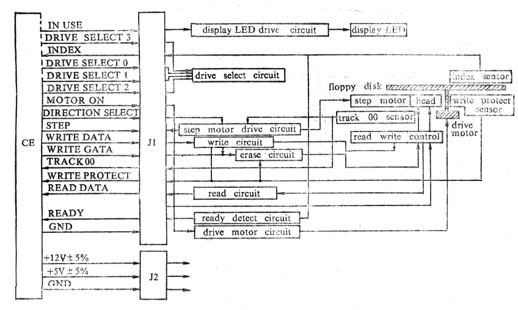

**图9-2 标准软盘驱动器功能框图**

1. 由于省略了00磁道检测（TRACK00 SENSOR），而改用铁片挡住磁头不再向外移动，因此，每次开机驱动臂带动磁头向00磁道移动时，常能听到一阵铁片撞击声，如果磁头支架总是猛烈地撞击铁片，将使铁片位置偏离，造成一开机读不到00磁道数据现象。
2. 由于控制信号线与电源线（±5V，±12V）均集中于20PIN电缆插头接口，如用户误将20PIN电缆插头反接或插偏时，±12V电源正好接至TTL电路，从而导致烧毁电路或冲盘。
3. 由于将写电路的一部分防止误写电路（如主机开、关时电源不稳定时的误写保护电路）省略掉，即使软盘上贴上了写保护标签，也会将00磁道或其它磁道数据冲掉。因此有些厂商已针对上述缺点加以改进，增加了00磁道检测与防止误写电路。

APPLE软盘驱动器为单面（SINGLE SIDE）、双密度（DOBLE DENSITY）、单磁道（SINGLE TRACK）。单面是指驱动器只有一个磁头。双密度指使用MFM或GCR编码方式。APPLE软盘驱动器是专为GCR编码方式设计的。单磁道是指48TPI而言。TPI（TRACK PER INCH）是指软盘片上沿径向每一英寸可使用几个磁道。一般来说，单磁道驱动器可使用40磁道，APPLE驱动器一般只用到35个磁道。另外APPLE机还有另一种驱动器为80磁道。这种驱动有两个磁头即双面（DOUBLE SIDE）。它的00磁道在1面，1磁道在2面，2磁道在1面，…依次排列下去。驱动器读/写哪面的磁道由驱动器接口控制器上的驱动管理程序决定。

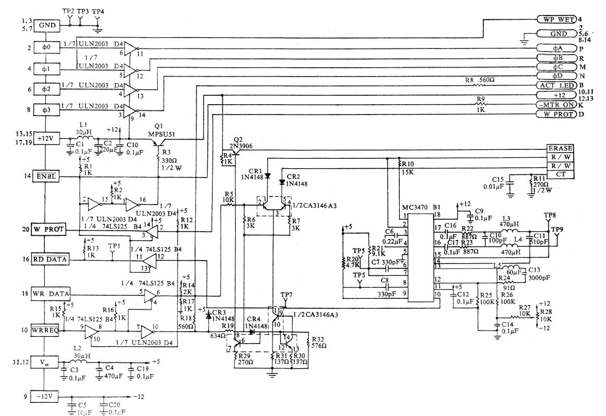

**图9-3 APPLE机软盘驱动器电路图**

APPLE机软驱动器主要技术指标：

| 序号 | 技术指标名称 | 指标参数 |
| :--- | :--- | :--- |
| 1 | 格式化容量 | 143.3KB（用户可用124KB） |
| 2 | 磁道数 | 35磁道（单面） |
| 3 | 每道扇区数 | 16或13扇区 |
| 4 | 每扇区字节数 | 256字节 |
| 5 | 记录密度 | 5162位/英寸 |
| 6 | 文件数 | 105个文件 |
| 7 | 转速 | 300r/min |
| 8 | 平均等待时间 | 100ms |
| 9 | 寻道稳定时间 | 10ms |
| 10 | 道-道寻道时间 | 20ms |
| 11 | 输入电源 | $\pm 12\text{V} \pm 5\%$：0.9A（典型）、1.8A（最大）<br>$\pm 5\text{V} \pm 5\%$：1.5A（典型）、0.7A（最大） |

### 二、软盘驱动器电路基本原理及结构

#### （一）基本原理

APPLE驱动器主要由软盘驱动机构和磁头定位机构组成，它通过磁头与软盘片直接接触，在软盘上产生剩磁状态和剩磁方向以表示二进制数字信息。它的记录过程是一种电磁信号转换过程。见图9-4。

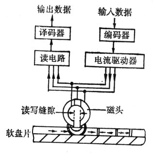

**图9-4 数字磁记录工作过程方框图**

软盘驱动器的工作过程包括两个方面，即写入过程与读出过程。写入过程为：将GCR编码通过差动放大器（CA3146，见图9-3）转换成电流后，送入磁头线圈，磁头铁芯产生相应的磁场磁化软盘片。磁头的读写缝隙中置有一种非导磁材料，因此磁通会受到读/写缝隙的阻挠，而通过磁盘介质形成回路，使磁盘介质被磁化，这就是将数码转换成相应磁化状态的过程。当软盘片相对磁头作恒速运动时，若电流随输入数码不断改变方向，软盘上便留下一连串与输入数码相对应的磁化翻转图形。读出过程为：软盘上的磁化图形通过磁头读写缝隙时，在磁头线圈感应出电压信号，此电压经过放大后还原为GCR编码，这就是将磁化状态还原为数码的过程。

#### （二）基本结构

软盘驱动器的基本结构分为以下几个部分：

1. **软片驱动定位机构**
   其作用是将软盘片快速、准确地定位于主轴中心位置，并使它以一定速度匀速旋转。它由盘片插入引导机构、主轴驱动轮系统、盘片压紧机构以及盘片弹射机构等部分组成。
2. **磁头定位机构**
   其作用是：驱动磁头，将它定位在所需进行读写的指定磁道上。APPLE机驱动器磁头定位采用的是步进电机开环控制方式。其中有钢带定位结构和螺旋轮式定位结构两种。象TEAC公司生产的Supper型驱动器采用的是钢带定位结构。早期的美国APPLE机驱动器采用的是螺旋轮式定位结构。
3. **磁头及磁头加载机构**
   APPLE机驱动器使用的是接触式磁头。这种磁头的前极面与磁介质表面接触。因磁介质与磁头之间有相对运动，使磁头的极尖容易磨损。其磨损程度与移动速度、极尖几何形状、材料硬度、接触压力、磁介质表面质量及使用环境有关。因此在使用驱动器时，应注意周围环境保持清洁。磁头加载机构的作用是保证磁头工作时与盘片接触良好。
4. **写保护检测机构**
   当驱动器检测到写保护控制信号时，不再向软盘内写数据，以保护软盘数据内容。
5. **电子线路板**
   包括软盘驱动器各种控制功能电路。

### 三、GCR编码方式（GROUP-CODED RECORDING）

数据写入软盘前，必须先作一番编码处理，常见的编码方式有FM调频制（FREQUENCY MODULATION），MFM改进调频制（MODIFIED FREQUENCY MODULATION）等。这两种方式均是在数据之间加入时钟脉冲（CLOCK PULSE），使得记录的数据密度被时钟脉冲占用而无法增加。而GCR编码方式则没有时钟脉冲。按这种记录方式编码每英寸最大记录密度可达8457位。GCR编码的好处是能大大提高记录密度，且软盘驱动器控制板的电路十分简单。GCR与MFM编码为双密度编码方式。

APPLE机驱动器GCR编码方式有如下规定：
1. 只能连续两个零连在一起，而且一个字节中最多只有两个零连在一起。
2. 一个字节的最高位必需为高。见图9-5。

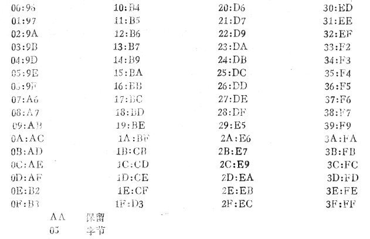

**图9-5 6位数据转换成GCR码对应表**

| 6位数据 : GCR码 | 6位数据 : GCR码 | 6位数据 : GCR码 | 6位数据 : GCR码 |
| :---: | :---: | :---: | :---: |
| `00 : 96` | `10 : B4` | `20 : D6` | `30 : ED` |
| `01 : 97` | `11 : B5` | `21 : D7` | `31 : EE` |
| `02 : 9A` | `12 : B6` | `22 : D9` | `32 : EF` |
| `03 : 9B` | `13 : B7` | `23 : DA` | `33 : F2` |
| `04 : 9D` | `14 : B9` | `24 : DB` | `34 : F3` |
| `05 : 9E` | `15 : BA` | `25 : DC` | `35 : F4` |
| `06 : 9F` | `16 : BB` | `26 : DD` | `36 : F5` |
| `07 : A6` | `17 : BC` | `27 : DE` | `37 : F6` |
| `08 : A7` | `18 : BD` | `28 : DF` | `38 : F7` |
| `09 : AB` | `19 : BE` | `29 : E5` | `39 : F9` |
| `0A : AC` | `1A : BF` | `2A : E6` | `3A : FA` |
| `0B : AD` | `1B : CB` | `2B : E7` | `3B : FB` |
| `0C : AE` | `1C : CD` | `2C : E9` | `3C : FC` |
| `0D : AF` | `1D : CE` | `2D : EA` | `3D : FD` |
| `0E : B2` | `1E : CF` | `2E : EB` | `3E : FE` |
| `0F : B3` | `1F : D3` | `2F : EC` | `3F : FF` |

> 保留字节：`AA`、`D5`

在对应表上，将6位（`00`～`3F`）的数据对应为8位的GCR编码（如`00`对应`96`）。这些GCR编码都符合上述两项规定，才能真正写入软盘上。为了将所有的数据分成为6位一组，APPLE采用图9-6的6/2分块法，见图9-6。

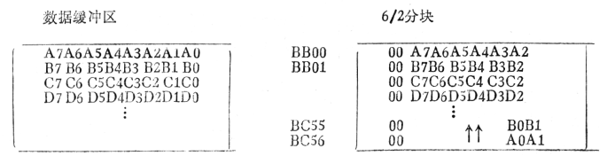

**图9-6 6/2分块法**

驱动程序将8位的数据分成每6位为一组（`00xxxxxx`），按图9-5转成GCR编码后才进入软盘中，将数据读出时，按上述过程相反顺序将真正数据分离出来。256字节的数据需要342个字节的GCR码表示。

为了在一连串的0与1中区分出哪8位是一个字节，APPLE机使用了自同步字节的技巧，一个自同步字节由`1 1 1 1 1 1 1 1 0 0`组成，驱动器控制电路每次碰到1时就一次输入8位，如图9-7所示。

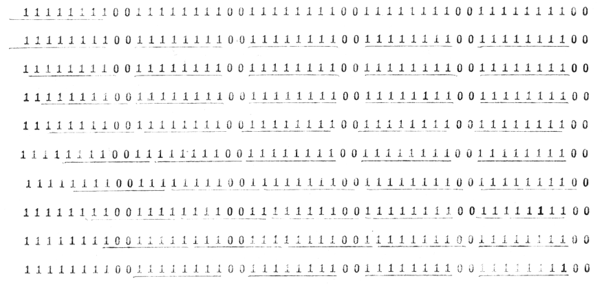

**图9-7 自同步字节**

不管从哪个起始点开始读入，最多只要5个自同步字节便可找到真正的`1 1 1 1 1 1 1 1`，数据跟在这些自同步字节的后面，即可把8位看成一个字节。图9-8为磁道记录格式。在每段数据前至少加入5个以上的自同步字节，以保证能读到真正的每个字节的数据。

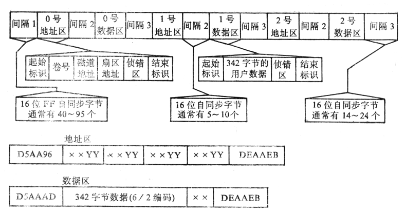

**图9-8 APPLE软盘磁道记录格式**

### 四、读电路

APPLE驱动器读电路主要由图9-3中的MC3470（读取放大器）及周围电路组成。由于磁头的读信号比较微弱，且磁头内阻较高，很容易引进干扰。同时由于磁化曲线的非线性，磁头材料和机械驱动电路所产生的噪声，有时也会混杂在微弱的读出信号中，以致非线性噪声和磁记录引起的脉冲拥挤效应相当严重。所以MC3470读出电路要进行信号放大，抑制噪声来检测出数据信号，同时对读信号进行整形等处理。见图9-9。

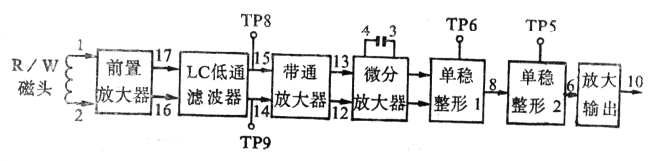

**图9-9 MC34700及外围电路**

1. **前置放大器**
   R/W磁头读出的信号输入到MC3470的第1、2管脚。由于磁头的读信号很微弱，这样小的信号只有经过放大后，才能对信号进行正确的处理。
2. **低通滤波器**
   前置放大器输出后由17、16管脚接到低通滤波器，滤掉由于磁头引线、电源及线路所带来的干扰信号，滤波器采用LC滤波网络（C10、C11、L3、L4）滤掉高频杂波，再由15、14端输入MC3470。
3. **带通放大器**
   由L5、C13及R24～R28组成（见管脚13、12、11及周围电路）。
4. **微分电路（3、4管脚）**
   要从读信号中恢复数据，必需检出读信号的峰点。由于读出幅度随编码方式不同而改变，且受其它因素影响，所以一般不宜采用幅值检测法来检测峰点。而是采用先把读信号微分，利用峰点的微分为零这一性质，把峰点转换成零点，然后用检测零点的方法检出峰点。
5. **整形电路（6、7、8、9管脚及RC电路组成）**
   读信号经微分放大后，峰点变成零点，鉴零是指当信号经过一个零点时就输出一个脉冲。然后对输出的脉冲进行整形，把波形整形为方波，变成标准的TTL逻辑电平。最后由第10管脚输出GCR编码数据。

### 五、写电路

写电路的功能是根据写脉冲产生写电流。写电流应达到一定值，以保证软盘能彻底饱和磁化。如写电流过小，则磁头读出幅度小。反之，如写电流过大，会使磁头的分辨力降低，因而使记录密度降低。所以写电流值应保持恒定，否则会使读脉冲产生的峰点位置漂移。写电流的跳变沿应足够陡，跳变沿不陡会使记录密度降低。另外，写电流在翻转时不应产生振荡。

写电路主要由CA3146、74LS125等电路（见图9-3）组成。接口信号主要由写请求WRREQ、写数据WRDATA、写保护WPROT信号组成。写入时WRREQ=0，所要写入的数据经74LS125和CA3146差动放大器（内部为5个晶体管所组成的放大器）放大后，通过CR1或CR2到R/W磁头写入软盘。与此同时抹电路驱动管Q2也导通，使±12V输入抹线圈（ERASE）。通过抹磁消去磁道两边多余的信号，使磁道保持一定宽度，以提高信噪比和可靠性。

磁头的消磁方式分为STRADDLE与TUNNEL两种，APPLE驱动器主要采用STRADDLE ERASE磁头。这种磁头中读写磁头与消磁头在同一条线上，其优点是消磁线路简单，缺点为读写头磁场与消磁头磁场互相干扰，效果较差，一般用于48TPI驱动器。TUNNEL ERASE磁头，是将消磁头后拉一段距离，与读写磁头不在同一条线上，这样可避免两者互相干扰，但消磁头线路较复杂。值得一提的是，软盘驱动器并不像录音机那样，须先经消磁才能录音，驱动器的读写磁头在写时已有足够能量将原来的数据消去，消磁头的功能只是维持磁道的一定宽度，目的是为将该读写磁头在写时产生的多余信号消除，以增加软盘与驱动器之间的互换性，而不是将原有的数据消除。在TUNNEL ERASE驱动器中，软盘先经读写磁头，再经消磁头。

### 六、寻道电路

驱动器在读、写操作之前必须把磁头定位到指定的磁道上，磁头驱动由步进马达控制完成，步进马达接有6条线，其中2条接到电源线±12V，另外4条为控制信号线（$\phi_A$～$\phi_D$）。

控制的方法是这样的：
1. 如按 $\phi_A \rightarrow \phi_B \rightarrow \phi_C \rightarrow \phi_D \rightarrow \phi_A$ 的顺序，则磁头往内圈移动，称为步进。
2. 如按 $\phi_A \leftarrow \phi_B \leftarrow \phi_C \leftarrow \phi_D \leftarrow \phi_A$ 的顺序，则磁头往外圈移动，称为步退，见图9-10。

例如上次的信号为 $\phi_A$，这次为 $\phi_B$ 时，则磁头向内圈移动一步。如这次为 $\phi_D$，则磁头向外圈移动一步。驱动器须控制步进马达每两步才走一个磁道。

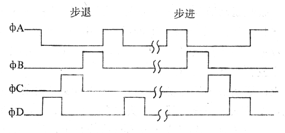

**图9-10 步进步退时序**

在学习机主板的右上角为驱动器I/O控制电路，在U14 74LS259的第4～7脚产生步进脉冲 $\phi_0$～$\phi_3$，见附图6。步进脉冲，马达开关电路及读写等控制信号均由地址译码产生。$\phi_0$～$\phi_3$ 信号送至驱动器ULN2003后，将其反相放大成+12V，形成 $\phi_A$～$\phi_D$ 直接控制步进马达以驱动磁头。

### 七、APPLE软盘驱动器故障维修举例

**例1：** 开机，步进马达不动，转速马达旋转，读不出数据，且冲盘。

用户在连接APPLE机驱动器时，误将20针插头反插。这样使±12V正好接至74LS125输入管脚，见图9-3。由于电压太高，将其烧毁。通常将74LS125的第8脚烧成恒低状态，此时写保护信号（74LS125第10脚）已失去保护控制功能，使CA3146误动作，从而写入数据，将软盘00磁道数据冲掉。维修时，更换74LS125。将所冲的盘片数据内容恢复。可找张原盘，将其00磁道数据拷贝到所冲盘的00磁道。这样，所冲的盘片即可重新使用。

**例2：** 开机，转速马达转，但不步进，不冲盘。

检查步进马达驱动电路，见图9-3。检测ULN2003输出端，其输出管脚全部为恒高状态。此电路已损坏。维修：更换ULN2003。

**例3：** 开机引导正常，能装入程序，但存盘时，显示`I/O ERROR`，盘片无故障，但数据写不到盘上。

检查，发现74LS125第8脚电平状态恒高，至使74LS125第4脚使能控制失效，所写数据无法从输入端第5脚送入输出端第6脚。因此，数据写不到盘上。维修：更换74LS125。

**例4：** 开机，转速马达旋转，步进马达能驱动磁头步进到00磁道，但不读盘。

见图9-3。用逻辑笔检查，发现MC3470第10脚恒低，此管脚输出软盘数据的GCR编码。由于MC3470器件坏，故读不出软盘数据。维修：更换MC3470。

**例5：** 开机，转速马达旋转，步进马达能驱动磁头步进到00磁道，但不读盘，偶然也能启动引导装入数据，盘片在别的驱动器上能正常读出。

检查：驱动器电路板上元器件无故障。分析可能有两种原因，第一，驱动器00磁道位置偏移，第二，马达转速不准。如果是第一种情况，则需要调整00磁道，插入磁道调整盘（DISK DRIVE ALIGNMENT）。启动软盘驱动器，将步进电机的螺钉松开，按照屏幕提示内容，缓慢调整，使磁头在00磁道的偏移量越小越好。然后，将螺钉拧紧，即可使用。如果是第二种情况，则要进行马达转速调整。马达转速太快或太慢均读不到正确的数据。维修时，插入马达转速检测盘DDT，启动驱动器，调节速度调整电位器，使马达转速接近300转/分。

### 八、软盘驱动器及软盘片维护与保养

软盘驱动器的其中一部分带有马达及可移动的机械装置，因此它比主机更需要精心保养与维护。因为电视机释放出的磁场能引起驱动器磁头磁力线工作混乱，至使驱动器不能正常读写数据，甚至导至驱动器永久损坏。所以，不要把驱动器放在电视机的上面或旁边，应将驱动器放在远离电视机至少2英尺（feet）的地方。软盘驱动器磁头易受灰尘等环境影响，在尘土、烟灰很多的环境中开机，驱动器读写软盘数据，对磁头、软盘的寿命影响都很大的。因此，用户最好隔段时间用磁头清洗盘清洗磁头，保护磁头的清洁度。清洗盘为一种特制的软盘片。清洗时，先将清洗液倒到清洗盘上，然后插入软盘驱动器中，开机启动，转动一段时间，便可清除磁头的灰尘和污垢。

软盘片是在厚约0.05～0.06mm的聚脂薄膜基片上，两面涂敷铁铬氧化物颗粒的磁胶圆片。在软盘上存储着大量的信息（一张盘可存储931,000位的信息），任何微小的划伤、指印、油迹，都可引起软盘上数据混乱。软盘片对温度极为敏感，应将软盘放在远离阳光及温度较低的地方。由于软盘片属于磁性材料，应将软盘放在远离磁场的地方，象磁铁、马达、大功率音箱及电视机等设备，都可损坏软盘上的数据。评价软盘的主要技术指标有：磁性能，包括饱和磁化强度、磁层厚度；机械性能，包括基片的几何精度（即光洁度、不平度）；以及磁层的附着能力、表面的耐磨力与抗腐蚀能力等。我们可以用手转动软盘片的圆心孔，通过读写孔观察软盘片，质量较次或盘片已经老化的软盘从表面上看很不平滑、光洁。

使用驱动器时，要注意，应在关机状态下，插取软盘片。当驱动器正读写软盘时，最好不要取软盘片，也不要关机、停电，这些误操作，都可破坏软盘数据，使程序不能正常运行。

---

# 全书电路原理附图（附图 1 ~ 附图 8）

本节收录《中华学习机系统原理使用及维修》全书附带的8幅完整硬件电路原理图（原书第254～260页，附图1～附图8），涵盖中华学习机（CEC-I）主板各功能模块及并行打印机接口卡电路。

## 附图 1：CPU、地址缓冲器、存储管理器（MMU）与主存（RAM/ROM）电路图

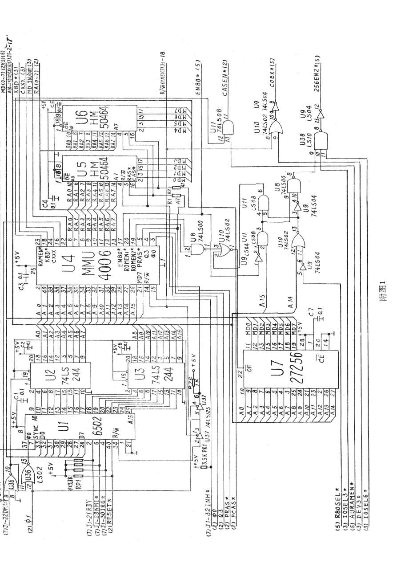

- **核心器件：**
  - `U1`：6502 微处理器（CPU）
  - `U2`、`U3`：74LS244 八三态缓冲器/线驱动器（驱动A0～A15地址总线）
  - `U4`：MMU 4006 存储管理集成电路（产生RA0～RA7多路复用行/列地址及 $\overline{\text{EN80}}$、$\overline{\text{ROMEN1}}$、$\overline{\text{ROMEN2}}$、$\overline{\text{PRAS}}$、$\overline{\text{KBD}}$、$\overline{\text{CXXX}}$、$\text{MD IN/OUT}$ 等控制信号）
  - `U5`、`U6`：HM50464（64K×4位动态RAM，共2片组成64KB主存，分别负责MD0～MD3与MD4～MD7）
  - `U7`：27256（32KB 系统EPROM，固化系统监控与BASIC/中文字幕管理程序）
  - `U8`（74LS00）、`U9`（74LS04）、`U10`（74LS02）、`U11`（74LS08）、`U36`（74LS02）、`U37`（74LS125）、`U38`（74LS10）：ROM片选与总线控制组合逻辑电路。

---

## 附图 2：系统主振时序产生、IOU视频控制与西文字符发生器电路图

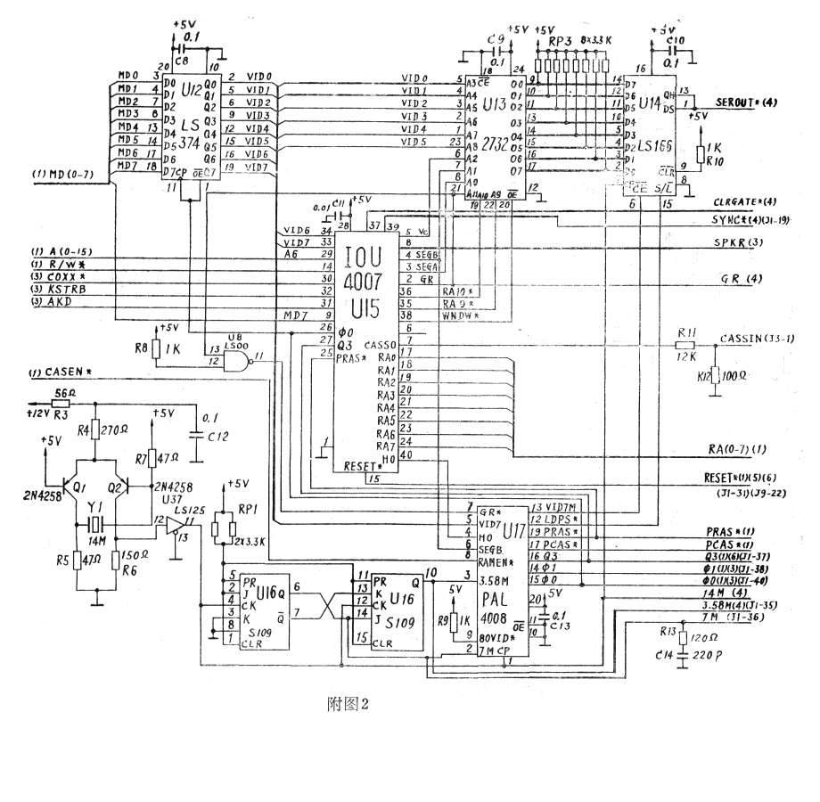

- **核心器件：**
  - `Y1`（14MHz晶振）、`Q1`/`Q2`（2N4258）、`U37`（74LS125）：14MHz主时钟振荡及缓冲驱动电路
  - `U16`：74LS109 双J-K正边沿触发器（二分频及四分频产生7MHz与3.58MHz时钟）
  - `U17`：PAL4008 可编程逻辑阵列（产生系统时钟 $\phi_0$、$\phi_1$、$Q_3$、动态RAM选通 $\overline{\text{PRAS}}$、$\overline{\text{PCAS}}$ 及视频控制信号 $\overline{\text{VID7M}}$、$\overline{\text{LDPS}}$ 等）
  - `U15`：IOU 4007 输入/输出与视频地址控制大规模集成电路（产生RA0～RA7视频刷新/显示地址、$\overline{\text{CLRGATE}}$、$\overline{\text{SYNC}}$、$\text{SPKR}$、$\text{CASSO}$ 等信号）
  - `U12`：74LS374 八D三态锁存器（视频数据锁存，输出VID0～VID7）
  - `U13`：2732（4KB 西文字符点阵发生器ROM）
  - `U14`：74LS166 8位并入串出移位寄存器（输出视频串行点阵信号 $\overline{\text{SEROUT}}$）

---

## 附图 3：I/O设备译码、键盘编码接口、录音机及手柄接口与喇叭驱动电路图

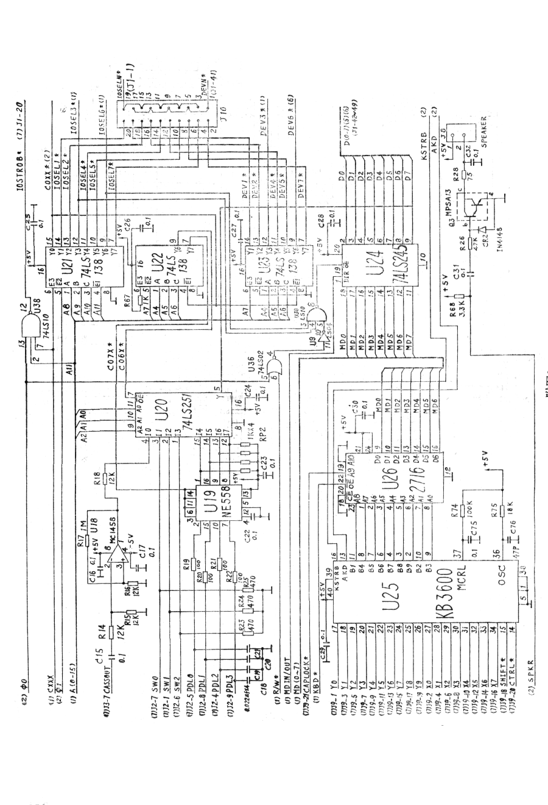

- **核心器件：**
  - `U21`、`U22`、`U23`：74LS138 三—八译码器（产生I/O扩展槽及板载外设选通信号 $\overline{\text{IOSEL1}}$～$\overline{\text{IOSEL7}}$、$\overline{\text{DEV1}}$～$\overline{\text{DEV7}}$、$\overline{\text{C06X}}$、$\overline{\text{C07X}}$）
  - `U24`：74LS245 八双向三态总线收发器（隔离与驱动MD0～MD7与D0～D7数据总线）
  - `U25`：KB3600 扫描式键盘编码器（扫描X0～X7行线与Y0～Y9列线）
  - `U26`：2716（2KB 键盘ASCII编码字库EPROM）
  - `U18`：MC1458 双运算放大器（盒式录音机磁带读入信号CASSOUT整形放大）
  - `U19`：NE558 四定时器（游戏杆/桨形控制器PDL0～PDL3模拟量转脉冲宽度定时电路）
  - `U20`：74LS251 八选一数据选择器（选通录音机输入、按键开关SW0～SW2及PDL0～PDL3状态送入D7）
  - `Q3`（MPSA13达林顿管）、`CR2`（1N4148）：喇叭（SPEAKER）驱动电路

---

## 附图 4：PAL制彩色视频编码、色度调制与射频（RF）输出电路图

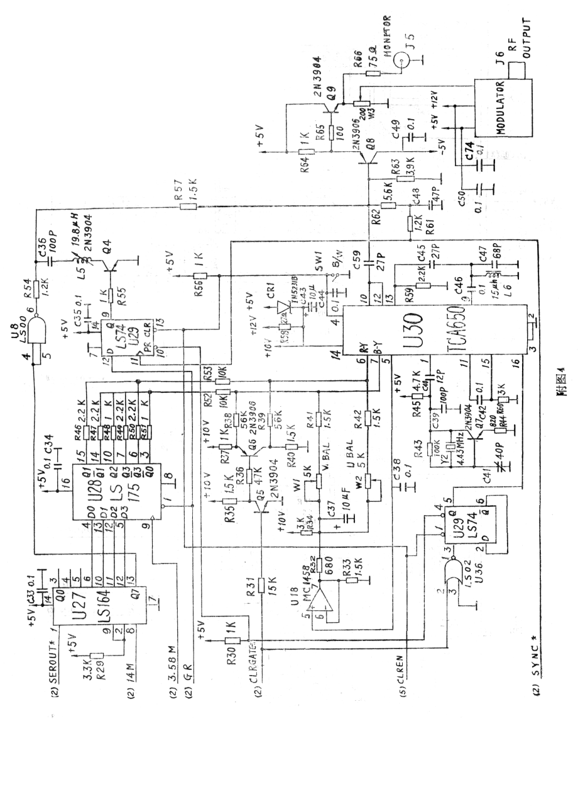

- **核心器件：**
  - `U27`：74LS164 8位串入并出移位寄存器（彩色信号分解及视频亮度信号延时）
  - `U28`：74LS175 四D触发器（同步锁存四个彩色分量）
  - `Q5`（2N3904）、`Q6`（2N3906）及电阻网络：PAL制彩色编码矩阵，生成 $B-Y$ 与 $R-Y$ 色差信号
  - `U18`（MC1458）、电位器 `W1`（V.BAL）、`W2`（U.BAL）：色差平衡调节放大器
  - `U29`：74LS74 双D触发器（将 $\overline{\text{CLRGATE}}$ 二分频产生PAL逐行倒相开关信号，以及3.58MHz图形彩色副载波控制）
  - `Y2`（4.43MHz晶振）、`C41`（微调电容）、`Q7`（2N3904）：PAL制4.43361875MHz副载波振荡器
  - `U30`：TCA650 PAL制平衡调制器集成电路（正交平衡调幅输出色度信号）
  - `Q8`（2N3906）、`Q9`（2N3904）、电位器 `W3`：亮度、色度与同步信号叠加及射极跟随驱动，输出至监视器插口 `J5 MONITOR` 及射频调制器 `J6 RF MODULATOR`

---

## 附图 5：一、二级汉字库（MASK ROM）与扩展EPROM及片选译码电路图

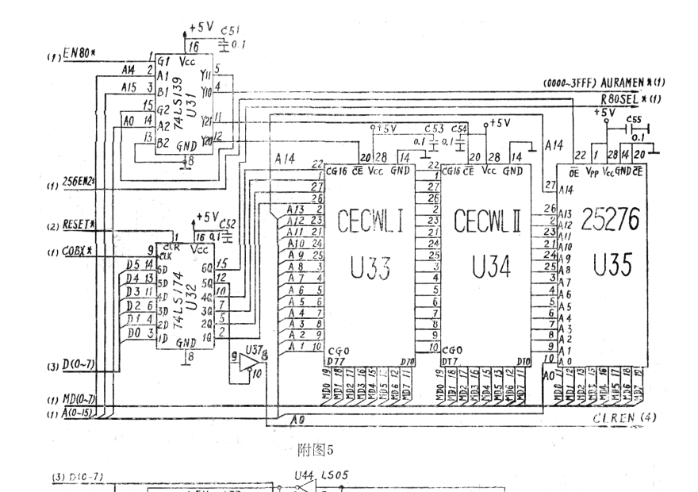

- **核心器件：**
  - `U31`：74LS139 双二—四译码器（根据 $\overline{\text{EN80}}$、A14、A15、A0及 $\text{256EN2*}$ 产生汉字库及扩展ROM片选信号）
  - `U32`：74LS174 六D触发器（由 $\overline{\text{C0BX}}$ 锁存D0～D5，提供高阶页面扩展地址CG0及字库控制信号 $\text{CLREN}$）
  - `U33`：CECWLI（1Mbit / 128KB 掩膜ROM，存放16×16点阵汉字库左半部字形）
  - `U34`：CECWLII（1Mbit / 128KB 掩膜ROM，存放16×16点阵汉字库右半部字形）
  - `U35`：27256 / 25276（32KB 扩展ROM插座）

---

## 附图 6：主板软盘驱动器（Disk II）I/O接口控制电路图

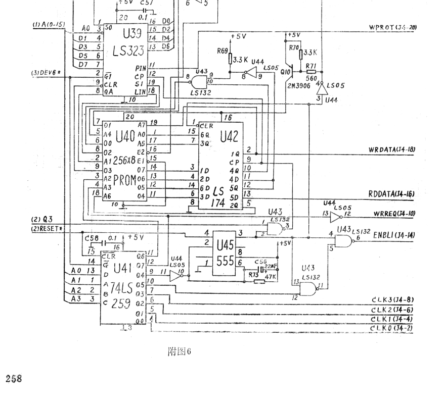

- **核心器件：**
  - `U39`：74LS323 8位双向通用移位/存储寄存器（完成软盘串行读写数据与并行数据总线D0～D7之间的转换）
  - `U40`：256×8 PROM（固化软盘控制器状态机逻辑与DOS自举引导程序）
  - `U41`：74LS259 8位可寻址锁存器（受 $\overline{\text{DEV6}}$ 控制，输出步进马达相控脉冲 `CLK0`～`CLK3` 即 $\phi_0$～$\phi_3$、马达启动控制、读写方式控制等信号）
  - `U42`：74LS174 六D触发器（配合PROM构成GCR读写状态机并接收软盘读出数据 `RDDATA`）
  - `U45`：NE555 定时器（与C56 22μF、R73 47K组成马达延时关断定时电路）
  - `U43`（74LS132 四2输入施密特触发与非门）、`U44`（74LS05 六反相器，集电极开路）：产生驱动器接口信号 `WPROT`、`WRDATA`、`RDDATA`、`WRREQ`、$\overline{\text{ENBL1}}$（送至20针插头 `J4`）

---

## 附图 7：主板外部接口插座与电源滤波接口定义图（J1 ~ J10）

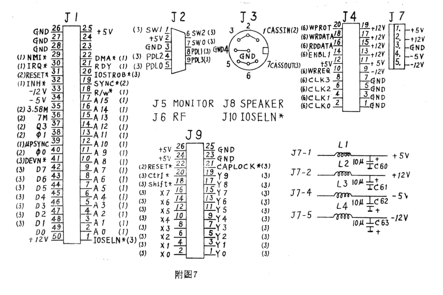

- **接口定义：**
  - `J1`：50针系统总线扩展槽接口（包含A0～A15、D0～D7、电源及控制总线）
  - `J2`：9针游戏杆/桨形控制器接口（SW0～SW2、PDL0～PDL3、+5V、GND）
  - `J3`：盒式磁带录音机DIN插座（CASSIN、CASSOUT、GND）
  - `J4`：20针软盘驱动器扁平电缆插座（WPROT、WRDATA、RDDATA、ENBL1、WRREQ、CLK0～CLK3及电源）
  - `J5`：复合视频监视器插座（MONITOR）
  - `J6`：射频（RF）电视输出插座
  - `J7`：5针主机电源输入插座（+5V、+12V、GND、-5V、-12V）及L1～L4、C60～C63 LC滤波网络
  - `J8`：2针机内扬声器插座（SPEAKER）
  - `J9`：26针键盘矩阵插座（X0～X7、Y0～Y9、Ctrl*、Shift*、CAPLOCK*、RESET*、+5V、GND）
  - `J10`：槽号选择跳线插座（`IOSELN*`）

---

## 附图 8：并行打印机接口卡电路原理图

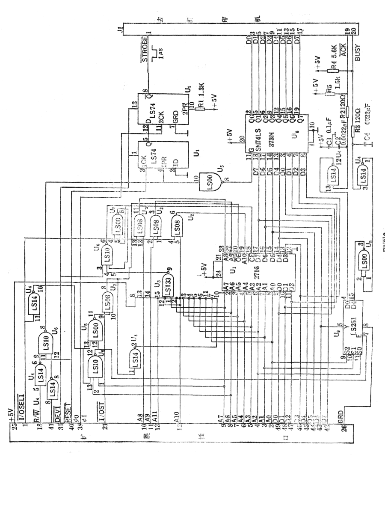

- **核心器件：**
  - `U1`（2716）：2KB 打印机接口驱动程序EPROM
  - `U8`（SN74LS373N）：8位三态输出透明锁存器（锁存输出至打印机的数据位D0～D7）
  - `U9`（74LS251）：8选1数据选择器（读取打印机状态信号如 `ACK`、`BUSY` 等）
  - `U1`（74LS74 双D触发器）：产生打印机数据选通脉冲 `STROBE`（1μs负脉冲）及应答锁存
  - `U2`（74LS08）、`U3`（74LS133）、`U4`（74LS14）、`U5`（74LS00）、`U6`（74LS10）：扩展槽I/O与ROM地址译码及握手信号整形逻辑电路
  - `J1`：20针并行打印机输出插头（D0～D7、`STROBE`、`ACK`、`BUSY`、`GRD`）
