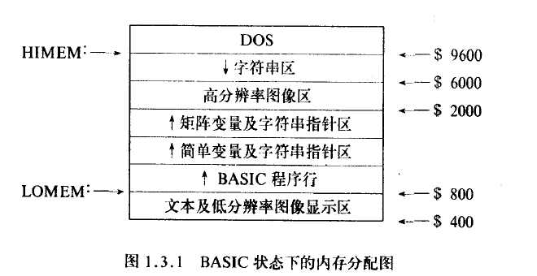
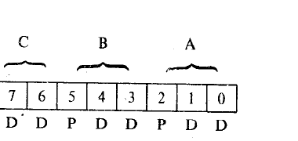
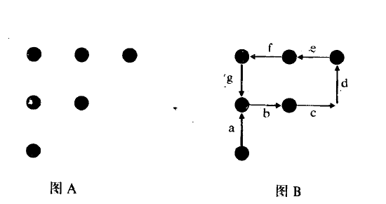
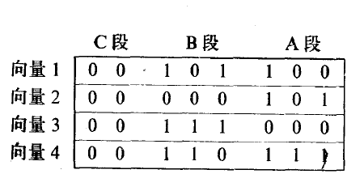
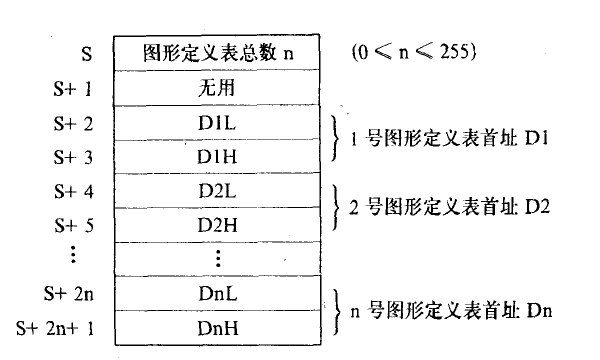
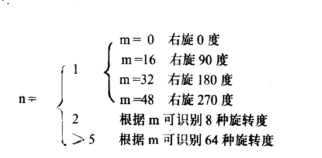

# 第一部分 CEC-BASIC

## 第三章 CEC-BASIC 的语句和函数（后半部分）

## 3.6 其它语句与实用函数

### 3.6.1 PEEK 和 POKE

- **功能**：使用户可以直接读写内存单元的值。
- **格式**：
  ```basic
  PEEK (X)
  POKE X, Y
  ```
- **说明**：`PEEK` 函数返回由 $X$ 值表示的内存地址单元中的内容，函数值用 10 进制数表示。$X$ 值应在 `-65535` 和 `65535` 之间。$X$ 也可以用算术表达式代替。
  
  `POKE` 语句的作用是将 10 进制数 $Y$ 存储到 $X$ 值表示的内存地址单元中。$Y$ 值必须在 `0` ～ `255` 之间，$X$ 值必须在 `-65535` 和 `65535` 之间。

### 3.6.2 LOMEM 和 HIMEM

- **功能**：限制 BASIC 程序工作区域的上、下限地址。目的是防止 BASIC 的数据破坏高分辨率图像显示区域或机器语言子程序。
- **格式**：
  ```basic
  HIMEM: X
  LOMEM: X
  ```
- **说明**：在引导 DOS 系统之后，HIMEM 值自动设置为 `$9600`，LOMEM 值一般由“HELLO”程序的大小决定，即指向内存中 BASIC 程序的尾部。若不装入 DOS，则 HIMEM 值自动设置为 `$C000`，LOMEM 设置为 `$0804`。下图为装入 DOS 后在 BASIC 状态下的内存分配图。



从内存分配图上我们可以看到，BASIC 的字符串正是在高分辨率图象区之上，因为字符串区是向下延伸的，当它大到必须侵占高分辨率图象区时，高分辨率图象区就会被破坏。再譬如，BASIC 程序中要调用机器语言子程序，将机器语言子程序放在 `$801` ～ `$9600` 之间的某一区域中。这时该子程序很容易被 BASIC 程序的数据破坏。因为这个区域是系统自动设置的 BASIC 工作区，随时都有可能占用这个区中的任何一个位置。LOMEM 和 HIMEM 给用户提供了自己设置 BASIC 工作区域的手段。如果要求用高分辨率图象方式作图，执行 `HIMEM: 8191` 命令就可以实现对高分辨率显示区进行保护的目的。也可以通过将机器语言子程序放在 HIMEM 设置的地址之上的空闲区中的办法，使之免遭破坏。

由于 CEC-BASIC 在中文状态下使用 `$9200` 到 `$9600` 作为屏幕映射区，所以进入中文状态后 HIMEM 自动设置到 `$9200`。

内存中的 BASIC 程序的第一条语句都是从 `$801` 地址开始向上存放的，程序最末尾地址加 4 就表示当前“LOMEM 地址”。“LOMEM 地址”是随程序行的增加、删除而自动调整的。

LOMEM 和 HIMEM 所置的地址值必须在 `-65535` ～ `65535` 之间的 10 进制数，该地址若为实数将自动转换成整数。

LOMEM 的当前地址值存放在 106 与 105 单元中（即 `$6A`、`$69` 单元）；HIMEM 的当前地址值存放在 116 和 115 两个单元中（即 `$74`、`$73` 单元）。可以执行以下命令得到它们的当前值：

```basic
?PEEK(106) * 256 + PEEK(105) 
?PEEK(116) * 256 + PEEK(115) 
```

### 3.6.3 FRE(X) 函数

- **功能**：释放数据区中的无用单元，返回可用变量的内存量，即余下的简单变量空间和数组变量空间。
- **格式**：`FRE (X)`
- **说明**：$X$ 可以用表达式代替。但 $X$ 实际上是一个“虚”元，设为零即可。
  
  在程序的运行期间，当一个串的内容被修改时，BASIC 并不清除旧的字符串内容，而是给新的串内容开辟内存单元。其结果是大量的废弃字符慢慢从 HIMEM 向下填补。如果你正在使用机器语言程序或高分辨率显示方式，你的程序区或高分辨率图象区有可能被字符串变量破坏。在这种情况下，定期使用 `X = FRE(0)` 的语句可防止被破坏的结果产生。

### 3.6.4 SPEED

- **功能**：改变计算机到 I/O 设备的字符传送速度。表达式之值确定速度的大小，最低速度为零，最高速度为 255。
- **格式**：`SPEED = 算术表达式`

### 3.6.5 CALL

- **功能**：调用机器语言子程序。
- **格式**：`CALL 算术表达式`
- **说明**：算术表达式值在 `-65535` ～ `65535` 之间。算术表达式的值即为机器语言子程序的首地址，机器语言子程序的返回指令 RTS 可使程序的执行回到 BASIC 程序并执行 CALL 后面的语句。

### 3.6.6 TRACE

- **功能**：跟踪程序的执行，将执行过的行号显示在屏幕上。
- **格式**：`TRACE`

### 3.6.7 NOTRACE

- **功能**：取消 TRACE 语句的作用，即停止跟踪程序的执行。
- **格式**：`NOTRACE`
- **说明**：只有 NOTRACE 才能取消 TRACE 的作用。`RUN`、`CLEAR`、`NEW`、`DEL` 与 `RESET` 都不能解除 TRACE 的作用。

### 3.6.8 WAIT

- **功能**：使得程序在执行过程中处于等待状态，直到某个指定单元的值变化成满足一定要求时才能继续执行。
- **格式**：
  ```basic
  WAIT X, Y
  WAIT X, Z, Y
  ```
- **说明**：$X$ 值表示一个存储单元地址，它必须在 `-65535` 和 `65535` 之间。$Y$ 与 $Z$ 分别表示两个 `0` ～ `255` 之间的 10 进制数，执行 WAIT 命令时，它们被转换成 2 进制数。$Z$ 可以选择使用。$X, Y, Z$ 可用算术表达式代替。
  
  在第一种格式中，程序先读 $X$ 单元，所读出的内容和 $Y$ 值相与（AND），结果若为零则重复这个过程，结果非零，程序便向下继续执行。
  
  在第二种格式中，程序读 $X$ 单元后所得值与 $Z$ 值先异或（XOR），然后再和 $Y$ 值相与（AND）。结果为零，则重复这个过程；结果非零，则向下继续执行。

### 3.6.9 POP

- **功能**：与 `RETURN` 语句相似。差别在于当执行 `RETURN` 语句时，堆栈顶部的地址被弹出，使计算机按照该地址返回继续执行；当 `POP` 被执行时，栈顶地址也被弹出，但是计算机不返回到这个地址执行，而是继续 POP 的下一个语句。因此在 POP 之后执行一个 `GOTO` 语句就可以使计算机转向任何地方去执行。

### 3.6.10 PDL 与游戏控制器的使用

#### 一、PDL(n) 函数

- **功能**：此函数可用来读取 $n$ 号（$n = 0 \sim 3$）摇杆位置量的编码值（编码值在 `0` ～ `255`）。
- **格式**：`PDL (n)`
- **说明**：下例为读 1 号摇杆位置并进行输出的程序：
  
  ```basic
  10 G = PDL(1)
  20 PRINT TAB(15); G: FOR I = 1 TO 100: NEXT
  30 GOTO 10
  ```
  
  如果用连续的 PDL 指令来读入二个游戏控制器的数据，那么第二个游戏控制器上的读数，可能受到第一个控制器上的读数的影响。要获得更精确的读数，可以在 PDL 指令之间放几个程序行或在 PDL 指令之间置一个短的延迟程序（`FOR I = 1 TO 10: NEXT I`）。

#### 二、读入开关量

已知三个开关量的地址为 `$C061` ～ `$C063`（或者 `$C069` ～ `$C06B`），此即相当于 `-16287` ～ `-16285`（或者 `-16279` ～ `-16277`）。因此下面的语句可读入三个开关量：

```basic
X = PEEK(-16287 + n)    (n = 0 ~ 2)
```

### 3.6.11 ONERR GOTO 及 RESUME

- **功能**：出错后转处理程序。
- **格式**：
  ```basic
  ONERR GOTO 行号
  RESUME
  ```
- **说明**：在程序执行过程中，如果发生错误，计算机将转到由本语句行号指定的“纠错处理”子程序入口执行。
  
  `RESUME` 是“纠错处理”子程序的返回语句。内存 216 单元为出错标志单元，若该单元的 B7 位为 1，则表示有错误发生。发生错误后，错误类型码存放在 222 单元，下表为错误类型编码表：

| 类型码 | 出错情况 | 对应标准错误信息 |
| :---: | :--- | :--- |
| 0 | NEXT 与 FOR 不匹配 | `?NEXT WITHOUT FOR ERROR` |
| 16 | 句法错 | `?SYNTAX ERROR` |
| 22 | RETURN 与 GOSUB 不匹配 | `?RETURN WITHOUT GOSUB ERROR` |
| 42 | 缺少数据 | `?OUT OF DATA ERROR` |
| 53 | 非法量 | `?ILLEGAL QUANTITY ERROR` |
| 69 | 溢出 | `?OVERFLOW ERROR` |
| 77 | 缺少内存 | `?OUT OF MEMORY ERROR` |
| 92 | 未定义语句 | `?UNDEF'D STATEMENT ERROR` |
| 107 | 不适当的下标 | `?BAD SUBSCRIPT ERROR` |
| 120 | 重定义数组 | `?REDIM'D ARRAY ERROR` |
| 133 | 除数为零 | `?DIVISION BY ZERO ERROR` |
| 163 | 类型不匹配 | `?TYPE MISMATCH ERROR` |
| 176 | 串太长 | `?STRING TOO LONG ERROR` |
| 191 | 形式太复杂 | `?FORMULA TOO COMPLEX ERROR` |
| 224 | 未定义函数 | `?UNDEF'D FUNCTION ERROR` |
| 254 | 响应 INPUT 语句时输入不适当 | `?RE-ENTER` |
| 255 | 用 CTRL-C 中断纠错程序 | `?BREAK` |

下面的程序说明 `ONERR GOTO` 语句的用法，及“纠错”子程序的编写方法。此程序处理了“非法量”与“除数为零”两种类型的错误。为了帮助理解，将程序的执行过程用 `TRACE` 命令记录下并显示出来。

```basic
10 ONERR GOTO 100
20 T = -5
30 A$ = LEFT$ ("Education Computer", T)
40 PRINT A$
50 S = 300
60 ONERR GOTO 100
70 A(5) = S / A(0)
80 PRINT "A(5) ="; A(5)
90 END
100 POKE 216, 0
110 PRINT "PEEK (222) ="; PEEK (222)
120 IF PEEK (222) = 53 THEN T = 9
130 IF PEEK (222) = 133 THEN A(0) = 5
140 RESUME
```

运行输出：

```text
]RUN
PEEK (222) = 53
Education
PEEK (222) = 133
A(5) = 60
]TRACE
]RUN
#10  #20  #30  #100 #110 PEEK (222) = 53
#120 #130 #140 #30  #40  Education
#50  #60  #70  #100 #110 PEEK (222) = 133
#120 #130 #140 #70  #80  A(5) = 60
#90
```

### 3.6.12 USR(X) 函数

- **功能**：为用户提供的利用机器语言子程序对算术表达式 $X$ 的值进行加工处理的函数。
- **格式**：`USR (X)`
- **说明**：此函数的执行过程如下：
  1. 计算出表达式 $X$ 的值，将其放在浮点累加器（即 `$9D` ～ `$A3` 单元）中。
  2. 转到 `$0A` 单元去执行。通常在 `$0A` ～ `$0C` 单元中存放一条 `JMP XXXX` 指令，其中 XXXX 是用户自己所设置的处理 `$9D` ～ `$A3` 单元中 $X$ 值的子程序入口。
  3. 在机器语言程序执行完毕（即遇到 RTS）后，该函数所得到的值将放在浮点累加器中。

---

## 3.7 低分辨率彩色作图

### 3.7.1 GR

- **功能与说明**：该语句的作用是将屏幕上部置成 $40 \times 40$ 可显示的小方块，作为低分辨率图象显示区，将屏幕下部四行作为文本显示区，即置成低分辨率图象与文本的混合显示方式。
  
  执行 `GR` 后，屏幕上图象显示区被置为黑色，因此 `GR` 命令有清除低分辨率图象画面的作用。同时原低分辨率图象区中的图象也被破坏。
  
  从低分辨率图象与文字混合显示转到纯低分辨率图象显示，可用 `POKE` 或 `PEEK` 语句访问地址 `-16302`（相当于 `$C052`）。再回到混合方式时可访问地址 `-16301`（相当于 `$C053`）。这两个地址是控制屏幕显示方式的软开关。用 `GR` 命令返回混合显示方式也可以，但屏幕被清除。

### 3.7.2 COLOR

- **功能**：置低分辨率图形的颜色。
- **格式**：`COLOR = n`
- **说明**：如果 $n$ 为实数，则将其自动转换为整数。$n$ 取值范围在 `0` ～ `255` 之间，大于等于 16 的 $n$ 自动以 16 为模处理。如果不执行该语句，系统自动将图形置为黑色。$n$ 值与颜色的对应关系如下表：

| n 值 | 颜色 |
| :---: | :--- |
| 0 | 黑 |
| 1 | 红 |
| 2 | 深蓝 |
| 3 | 紫 |
| 4 | 深绿 |
| 5 | 灰 1 |
| 6 | 中蓝 |
| 7 | 浅蓝 |
| 8 | 棕 |
| 9 | 橙 |
| 10 | 灰 2 |
| 11 | 粉红 |
| 12 | 浅绿 |
| 13 | 黄 |
| 14 | 绿蓝 |
| 15 | 白 |

### 3.7.3 SCRN 函数

- **功能**：取得低分辨率图形方式下某一点的颜色值。
- **格式**：`SCRN (X, Y)`
- **说明**：$(X, Y)$ 为所取颜色值的点的坐标。一般情况下 $X$ 在 `0` ～ `39` 之间，$Y$ 在 `0` ～ `47` 之间取值。

### 3.7.4 PLOT

- **功能**：在低分辨率图形方式下绘出一个点。
- **格式**：`PLOT X, Y`
- **说明**：$(X, Y)$ 为所作点的坐标。点的颜色由 `COLOR` 语句设定。

### 3.7.5 HLIN

- **功能**：在低分辨率图形方式下，绘出一条水平线。
- **格式**：`HLIN X1, X2 AT Y`
- **说明**：$(X1, Y)$ 为水平线的起点，$(X2, Y)$ 为水平线的终点。

### 3.7.6 VLIN

- **功能**：在低分辨率图形方式下，绘出一条垂直线。
- **格式**：`VLIN Y1, Y2 AT X`
- **说明**：$(X, Y1)$ 为垂直线的起点，$(X, Y2)$ 为垂直线的终点。

### 3.7.7 TEXT

- **功能**：由低分辨率图形方式或高分辨率图形方式转换到满屏文本显示方式。
- **格式**：`TEXT`

---

## 3.8 高分辨率彩色作图

### 3.8.1 HGR

- **功能**：置屏幕为高分辨率图形与文本显示混合方式。显示第一页。
- **格式**：`HGR`
- **说明**：执行 `HGR` 后，将屏幕上图形区清为黑色，如果原来在第一页有高分辨率图象，则图象也被清除。从混合显示方式转到纯高分辨率图象显示方式及再返回来时，也是分别访问地址 `-16302` 和 `-16301`。

### 3.8.2 HGR2

- **功能**：同 `HGR` 一样，仅使用第二页。
- **格式**：`HGR2`

### 3.8.3 HCOLOR

- **功能**：置高分辨率图象的颜色。
- **格式**：`HCOLOR = n`
- **说明**：在高分辨率图形方式下有 8 种颜色。$n$ 值所对应的颜色编码如下表：

| n 值 | 颜色 |
| :---: | :--- |
| 0 | 黑 |
| 1 | 绿 |
| 2 | 蓝 |
| 3 | 白 1 |
| 4 | 黑 2 |
| 5 | 红 |
| 6 | 黄 |
| 7 | 白 2 |

### 3.8.4 HPLOT

- **功能**：在高分辨率图象方式下画图。
- **格式**：
  ```basic
  HPLOT X, Y
  HPLOT TO X2, Y2
  HPLOT X1, Y1 TO X2, Y2 [{TO Xi, Yi}]
  (i = 3, 4, 5, ...)
  ```
- **说明**：
  - 格式 1 表示在 $(X, Y)$ 坐标位置画一个点。
  - 格式 2 表示以上一次所画的最后一个点到 $(X, Y)$ 坐标之间画一条线。
  - 格式 3 表示从 $(X1, Y1)$ 到 $(X2, Y2)$ 之间画一条线，再从 $(X2, Y2)$ 到 $(X3, Y3)$ 画一条线，依次画下去，它的范围受屏幕的限制，一条指令最多有 239 个字符的限制。
  
  $X$ 坐标值在 `0` ～ `279` 之间取值，$Y$ 坐标在 `0` ～ `159` 之间取值。如果在满屏图形方式下，$Y$ 坐标值可在 `0` ～ `191` 之间取值，$X$ 和 $Y$ 以及 $Xi$ 和 $Yi$ 都可以由算术表达式来代替。

---

## 3.9 高分辨率图形的向量作图法

在高分辨率作图方式下还有另一种画图方法称作向量作图法。这种方法的大致原理是：将绘制的图形用一组“描绘向量”将其轨迹描绘出来，再将这组向量存放在内存的某个区域。这一组“描绘向量”就构成内存中的“一张”图形定义表。然后使用特定的命令调用这张图形定义表中的“描绘向量”，图形就可以展现在屏幕上。

存放“描绘向量”的内存区中，每个字节被分成三段。如下图所示：



其中最低三位为 A 段；3 ～ 5 位为 B 段；最高二位为 C 段。

A、B 两段中三位数的低二位及 C 段中的二位数叫做 D 位；A、B 两段中的高位称 P 位。对于 D 和 P 做如下的规定：

$$
P = \begin{cases}
0 & \text{不画点} \\
1 & \text{画点}
\end{cases}
$$

$$
DD = \begin{cases}
00 & \uparrow \quad (\text{向上移}) \\
01 & \rightarrow \quad (\text{向右移}) \\
10 & \downarrow \quad (\text{向下移}) \\
11 & \leftarrow \quad (\text{向左移})
\end{cases}
$$

这表示，一个段中的 $P = 1$ 时，按此段作图时就先画一个点，然后根据 D 位的数移动一个坐标点（按高分辨作图时，屏幕上坐标点共有 $192 \times 280$）；若 $P = 0$ 或者无 P 位（C 段）时，则根据 D 位的数，仅移动一下坐标点。例如，要画出下图 (A) 中的 6 个点，可以用下图 (B) 中表示的 $a \sim g$ 七个步骤来完成：



其中 $a$ 表示画一个点，然后上移一个坐标；$b$ 表示画一个点，然后右移一个坐标；$c$ 与 $b$ 相同。但 $d$ 则表示不画点，仅上移一个坐标。因此，$a \sim g$ 对应的描绘向量段应分别为：

- $a$: `100`
- $b$: `101`
- $c$: `101`
- $d$: `000`（或 `00`）
- $e$: `111`
- $f$: `111`
- $g$: `110`

但是，把各个段组成“描绘向量”时还要考虑下面的规定：

1. 当画图时，顺序从图形定义表中逐个将“描绘向量”取出来，按其含意，由 A ～ C 的顺序作图。
2. 对每个“描绘向量”来说，如果 $C = 00$，则 C 段不起作用；如果 B 也为全 0，则仅 A 段起作用。
3. 没有 A、B、C 三段全为 0 的“描绘向量”。这种字节仅用来表示图形定义表的结尾。

因此，仍以上图为例，其“描绘向量”应为下图所示，共占 4 个字节：



| 向量序号 | C 段 | B 段 | A 段 | 16 进制值 | 10 进制值 |
| :---: | :---: | :---: | :---: | :---: | :---: |
| **向量 1** | 0 0 | 1 0 1 | 1 0 0 | `$2C` | 44 |
| **向量 2** | 0 0 | 0 0 0 | 1 0 1 | `$05` | 5 |
| **向量 3** | 0 0 | 1 1 1 | 0 0 0 | `$38` | 56 |
| **向量 4** | 0 0 | 1 1 0 | 1 1 1 | `$37` | 55 |

在使用时，内存中可以存放多个图形定义表。每个表中除最后一个单元为全 0 字节（表示表的结尾）外，均为“描绘向量”。这些表的总数及存放位置由另一个表——**索引表**表示。下图即为有 $n$ 个图形定义表时，索引表的安排。



| 相对地址 | 单元内容 | 作用与说明 |
| :---: | :--- | :--- |
| `S` | 图形定义表总数 $n$ | $0 < n \le 255$ |
| `S + 1` | 无用 | 保留 |
| `S + 2` | D1L | \ 1 号图形定义表首址 D1（低位在前，高位在后） |
| `S + 3` | D1H | / |
| `S + 4` | D2L | \ 2 号图形定义表首址 D2 |
| `S + 5` | D2H | / |
| $\vdots$ | $\vdots$ | $\vdots$ |
| `S + 2n` | DnL | \ $n$ 号图形定义表首址 Dn |
| `S + 2n + 1` | DnH | / |

图中 $S$ 是索引表的首地址，表中主要存放了各个图形定义表中第一个向量存放单元相对于 $S$ 的相对地址。而每个图形定义表，从这里开始存放“描绘向量”字节。存放完后，再存放一个全 0 字节。

这样，根据索引表便可逐次地找到各个图形定义表。找到每个表后，按上面说的规定逐段作图，直到遇到一个全 0 字节为止。最后便可把 $n$ 个表所要描绘的总的图形画在屏幕上。

当要使用这种向量作图时，要先把索引表的首址 ($S$) 存放到 `$E8` 和 `$E9` 单元中（`$E8` 存其低位，`$E9` 存其高位）。

BASIC 提供下述四个命令，利用它们在图形定义表的基础上可画出各种图形（包括放大或缩小的图形，旋转后的图形等等）。

### 3.9.1 DRAW

- **功能**：根据某一图形定义表在屏幕上进行作图。
- **格式**：
  ```basic
  DRAW n AT X, Y
  DRAW n
  ```
- **说明**：本命令将根据第 $n$ 个图形定义表作图。$(X, Y)$ 为图形起点的坐标值。其中：$0 \le n \le 255$，$0 \le X \le 279$ 且 $0 \le Y \le 191$。
  
  在使用第二种格式时，其起点定义为上次使用 `DRAW`、`HPLOT` 或 `XDRAW` 时，所画图形的最后一个点的位置坐标。若前面没有使用这些命令，则认为它为 `(0, 0)`。

### 3.9.2 XDRAW

- **功能**：清除 DRAW 语句所画的图形。
- **格式**：
  ```basic
  XDRAW n AT X, Y
  XDRAW n
  ```
- **说明**：此命令格式及使用方法与 `DRAW` 一样，但作用相反，它是对图形进行删除。例如，用 `DRAW` 画一个图形，然后用 `XDRAW` 画同一图形（命令参数都一样），则将该图形清除了。或者说，第二个图形是用第一个图形的补色沿同一轨迹画一遍（补为黑色）。

### 3.9.3 SCALE

- **功能**：决定用 `DRAW` 或 `XDRAW` 命令作图时的比例因子。
- **格式**：`SCALE = n`
- **说明**：$n$ 应取值在 `0` 到 `255` 之间。当 $n = 1$ 时，即如前面所说的，一个向量段只能移一个坐标点；$n = 2 \sim 255$ 时，此移动量放大了对应的几倍；当 $n = 0$ 时，相当于 $n = 256$，图形将放大 256 倍。

### 3.9.4 ROT

- **功能**：决定由 `DRAW` 或 `XDRAW` 命令作图时，图形的旋转度。
- **格式**：`ROT = m`
- **说明**：$m$ 值可取 `0` ～ `255` 的任何数，但大于 64 时，按 64 取模。$m$ 值的含意与 `SCALE` 命令中的 $n$ 值有关，表示如下：



$$
n = \begin{cases}
1 & \begin{cases}
m = 0 & \text{右旋 } 0^\circ \\
m = 16 & \text{右旋 } 90^\circ \\
m = 32 & \text{右旋 } 180^\circ \\
m = 48 & \text{右旋 } 270^\circ
\end{cases} \\
2 & \text{根据 } m \text{ 可识别 8 种旋转度} \\
\ge 5 & \text{根据 } m \text{ 可识别 64 种旋转度}
\end{cases}
$$

下面，给出一段程序，运行时可以得到一个动态的运动图形。可以看出，其索引表首址是在 `$300` ($= 768$)，共有五个图形定义表。

```basic
20  DATA 5, 0, 12, 0, 21, 0, 30, 0, 39, 0, 46, 0
30  DATA 45, 40, 32, 5, 168, 174, 21, 37, 0
40  DATA 45, 40, 32, 5, 40, 45, 21, 37, 0
50  DATA 45, 5, 40, 5, 40, 45, 21, 37, 0
60  DATA 45, 45, 45, 45, 45, 37, 0
70  DATA 9, 5, 32, 5, 40, 168, 21, 21, 173, 37, 0
80  FOR I = 768 TO 824
90  READ X: POKE I, X
100 NEXT I
110 POKE 232, 0: POKE 233, 3
120 HOME: HGR: HCOLOR=3: SCALE=1: ROT=0
130 FOR X = 10 TO 200 STEP 4
140 FOR I = 1 TO 5
150 DRAW I AT X, 100
160 XDRAW I AT X, 100
170 NEXT I
180 NEXT X
190 GOTO 130
```

---

## 3.10 系统实用命令与控制字符

### 3.10.1 LOAD

- **功能**：将磁带上 A 类文件装入内存。
- **格式**：`LOAD〔文件名〕`
- **说明**：见前面增加的 BASIC 语句和功能一节。

### 3.10.2 SAVE

- **功能**：将内存中的 BASIC 程序存入磁带。
- **格式**：`SAVE〔文件名〕`
- **说明**：见前面增加的 BASIC 语句和功能一节。

### 3.10.3 RUN

- **功能**：运行一个 BASIC 程序。
- **格式**：
  ```basic
  RUN
  RUN 行号
  ```
- **说明**：第一种格式是运行在内存中的 BASIC 程序。第二种格式是从指定行号开始运行内存中的 BASIC 程序。

### 3.10.4 NEW

- **功能**：删除当前内存中 BASIC 程序及所有变量。
- **格式**：`NEW`

### 3.10.5 LIST

- **功能**：列出当前内存中的 BASIC 程序清单。
- **格式**：
  ```basic
  LIST
  LIST 〔行号 1〕〔, 行号 2〕
  ```
- **说明**：第一种格式是列出全部程序清单。第二种格式是从行号 1 列到行号 2。

### 3.10.6 HOME

- **功能**：清屏幕，光标回到左上角。
- **格式**：`HOME`

### 3.10.7 STOP

- **功能**：中止程序执行。
- **格式**：`STOP`
- **说明**：执行 STOP 命令后，系统提示“`BREAK IN 行号`”，系统控制权交还给用户。

### 3.10.8 END

- **功能**：使程序终止执行，并且不输出任何提示信息。
- **格式**：`END`

### 3.10.9 CTRL-C 键

- **功能**：中断程序执行。
- **说明**：按下 `CTRL` 键，同时按下 `C` 键。

### 3.10.10 CTRL-S 键

- **功能**：暂停向上滚动的屏幕显示信息。
- **说明**：按下 `CTRL` 键，同时按下 `S` 键。再次按下时恢复滚动。

### 3.10.11 CONT

- **功能**：如果程序是由 `STOP`、`END` 或 `CTRL-C` 停止运行的，那么 `CONT` 命令可以使程序从下一个语句开始继续运行。
- **格式**：`CONT`

### 3.10.12 IN

- **功能**：选择输入设备。
- **格式**：`IN #n`
- **说明**：$n$ 表示输入通道号。它的取值只能是 `0` ～ `7` 之间的整数。
  - 当 $n = 6$ 时，启动磁盘驱动器进行读盘操作，即执行磁盘驱动程序（该程序装在第 6 号槽上）；
  - 当 $n = 3$ 时，进入汉字状态；
  - 当 $n = 0$ 时，返回以键盘作为输入设备的状态；
  - 在其它情况下，则将槽口所连的输入设备以 $n$ 作为槽号设定为后继输入的输入设备。
  - 进入汉字系统后，不能使用此语句。

### 3.10.13 PR

- **功能**：选择输出设备。
- **格式**：`PR #n`
- **说明**：$n$ 表示输出通道号。它的取值只能是 `0` ～ `7` 之间的整数。
  - 当 $n = 3$ 和 `6` 时，其作用与 IN 中介绍的相同；
  - 当 $n = 0$ 时，返回以 CRT 作为输出设备的状态（CRT 指显示器或电视机）；
  - 在其它情况下，则将槽口所连的输出设备以 $n$ 作为槽号设定为后继输出的输出设备。
  - 进入汉字系统后，不能使用此语句。
