# 第二部分 系统监控

## 第一章 概述

监控程序是用来管理中华学习机系统的重要程序。它已固化在 ROM 中。它通过监控命令提供对系统的基本操作，如检查、修改、传送、比较内存的数据，检查、修改 CPU 的内部寄存器，管理键盘输入、字符显示、盒式录音机存取，运行程序，跟踪程序执行的轨迹，反汇编等等。它所提供的管理系统的子程序可以为其它程序所调用，使其成为其它程序操作机器的工具。

为了进入监控状态，只需在 BASIC 状态下键入下列命令行：

```basic
CALL -151
```

退出监控可使用下面所介绍的 CTRL-C 或 CTRL-B 命令。

---

## 第二章 监控命令介绍

### 2.1 对监控命令格式的说明

监控命令的命令行中一般包含三种内容：地址、数据和命令字。其中地址和数据分别用 4 位和 2 位 16 进制数表示。如果监控命令中的 16 进制数的地址少于 4 位，监控程序就在它的前面加 0；若多于 4 位，则只取后 4 位的 16 进制数。监控程序能识别 22 个不同的命令字符，其中包括标点符号、大写字母及控制字符。任何一个监控命令均需在键盘上输入命令行之后，再按 RETURN 键才能执行。监控命令执行时，显示的内容均采用 16 进制数表示。

监控命令行的长度受到系统键盘缓冲区大小的限制，它不得超过 254 个字符，否则，监控系统将从本行跳出，并忽略该行所敲入的数据及命令。

### 2.2 监控命令

#### 2.2.1 显示存储器的内容

- **格式 1**：`〈地址〉`
  - **功能**：显示该地址单元的内容。
- **格式 2**：`〈地址 1〉.〈地址 2〉`
  - **功能**：显示从地址 1 到地址 2 之间的所有存储单元的内容。
- **格式 3**：`.〈地址 2〉`
  - **功能**：显示从现行的存储器位置至地址 2 之间的内容。
- **格式 4**：（只按一个 RETURN 键）
  - **功能**：显示下面 8 个存储单元的内容。

#### 2.2.2 改变存储器的内容

- **格式 1**：`〈地址〉:〈数据〉␣〈数据〉␣〈数据〉……`
  - **功能**：从地址单元开始顺次将所列数据送入存储器（符号“␣”表示空格，下同）。
- **格式 2**：`:〈数据〉␣〈数据〉␣〈数据〉……`
  - **功能**：从上次用来存放数据的地址之后开始，将数据顺次送入存储单元。

#### 2.2.3 移动存储器中的内容

- **格式**：`〈地址 1〉<〈地址 2〉.〈地址 3〉M`
  - **功能**：将地址 2 至地址 3 区域内的数据复制到从地址 1 开始的存储单元中去。

#### 2.2.4 核实存储器的内容

- **格式**：`〈地址 1〉<〈地址 2〉.〈地址 3〉V`
  - **功能**：核实从地址 2 到地址 3 之间的数据块与从地址 1 开始的长度相等的数据块是否完全相同。若有不同，就显示出来。

#### 2.2.5 磁带输入 / 输出

- **格式 1**：`〈地址 1〉.〈地址 2〉R`
  - **功能**：将磁带内的数据读入所规定的存储器地址区域内。磁带数据的长度必须与存储器区域的长度（即 `〈地址 2〉 - 〈地址 1〉 + 1`）相等。
- **格式 2**：`〈地址 1〉.〈地址 2〉W`
  - **功能**：将规定的存储器区域（即 `〈地址 1〉` 至 `〈地址 2〉`）内的数据写到磁带上。

#### 2.2.6 置屏幕显示方式

- **格式 1**：`I`
  - **功能**：置屏幕显示方式为反向方式（白底黑字）。
- **格式 2**：`N`
  - **功能**：置屏幕显示方式为正常方式（黑底白字）。

#### 2.2.7 反汇编命令

- **格式 1**：`〈地址〉L`
  - **功能**：将从指定地址开始的 20 条指令翻译成 6502 汇编记忆符，并在屏幕上显示出来。
- **格式 2**：`L`
  - **功能**：将现行地址开始的 20 条指令翻译成 6502 汇编记忆符，并显示出来。

#### 2.2.8 执行机器指令

- **格式 1**：`〈地址〉G`
  - **功能**：从指定地址开始启动机器语言程序。程序在执行完一条 BRK 指令后中断。
- **格式 2**：`CTRL-Y`
  - **功能**：从 `$3F8` 开始执行用户所确定的机器语言程序。通常在 `$3F8` 处放置一条 JMP 指令，转向用户程序的入口。

#### 2.2.9 显示及修改 CPU 寄存器

- **格式**：`CTRL-E`
  - **功能**：显示累加器 A，变址寄存器 X、Y，状态寄存器 P，以及堆栈指示器 S 的内容。如要修改上述寄存器的内容，可在键入“:”之后，用空格为界，键入 1 至 5 个 16 进制数据，它们按上述寄存器的顺序，分别取代原寄存器的内容。

#### 2.2.10 选择输入 / 输出设备

- **格式 1**：`〈槽号〉CTRL-P`
  - **功能**：将输出控制转给槽号所指定的连接槽上的接口卡，此时槽号只能取值为 1、2、4、5、7。若槽号为“0”，则返回以 CRT 为输出设备的状态。若槽号为“3”，则进入中文状态。若槽号为“6”，则转入软盘驱动程序执行。槽号的取值应小于 8。
  - **说明**：本命令只有在 `$C006` 软开关置位的情况下，方能有效地使用。若槽号为 3 时，则还需 `$C00B` 软开关置位。在系统 RESET 后，这两个软开关均已自动置位。本命令不能在中文状态下使用。
- **格式 2**：`〈槽号〉CTRL-K`
  - **功能**：当槽号之值为 1、2、4、5、7 时，将输入控制转给槽号所指定的连接槽口上的连接卡。当槽号为“0”时，则返回以键盘为输入设备的状态。在其它情况下，其功能与格式 1 相同。槽号的取值也应小于 8。
  - **说明**：同格式 1。

#### 2.2.11 16 进制加减法运算

- **格式 1**：`〈数据 1〉+〈数据 2〉`
  - **功能**：实现以 256 为模的两位 16 进制数的加法。
- **格式 2**：`〈数据 1〉-〈数据 2〉`
  - **功能**：实现以 256 为模的两位 16 进制数的减法。

#### 2.2.12 退出监控

- **格式 1**：`CTRL-B`
  - **功能**：使系统离开监控程序而进入 BASIC 状态，以前使用的 BASIC 程序及变量全部消失。
- **格式 2**：`CTRL-C`
  - **功能**：与 CTRL-B 相同，只是进入 BASIC 后，仍能保存原来的 BASIC 程序及变量。

#### 2.2.13 单步执行

- **格式**：`〈地址〉S`
  - **功能**：执行指定地址处的一条机器指令，并将该指令的反汇编记忆符显示出来。执行指令完后各寄存器的值也同时在屏幕上给出。如若想继续单步执行下一条机器指令，可再敲入一个 S（以 RETURN 结束）。此过程可以一直进行下去，直到不再需要执行程序时为止。

#### 2.2.14 跟踪执行

- **格式**：`〈地址〉T`
  - **功能**：从指定地址处开始执行机器指令，每条指令执行完后，其指令的反汇编记忆符和各寄存器的值被显示出来。程序在执行完一条 BRK 指令后中断。

#### 2.2.15 多重命令

监控程序允许在同一个命令行内写入多个以空格分开的监控命令，只要总字符数小于 254 个就可以了。但若在多重命令中使用了修改存储器内容的命令，则在该命令之后，应写一个单一字母的命令（通常用 N 命令），用于把随后的命令隔开。在多重命令中，单一字母命令之间不需用空格分隔。

---

## 第三章 监控程序的结构分析

### 3.1 复位处理

中华学习机在开启主机电源或在键盘上按 CTRL-RESET 键时，都将产生一个 RESET 中断，中断处理过程如图 2.3.1。

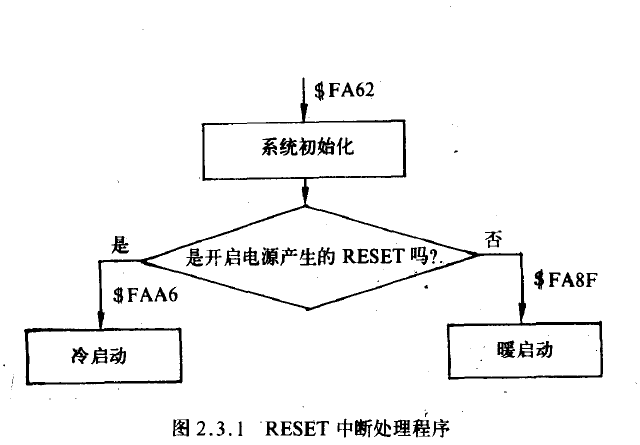

#### 3.1.1 系统初始化

图 2.3.2 表示了系统初始化的过程。

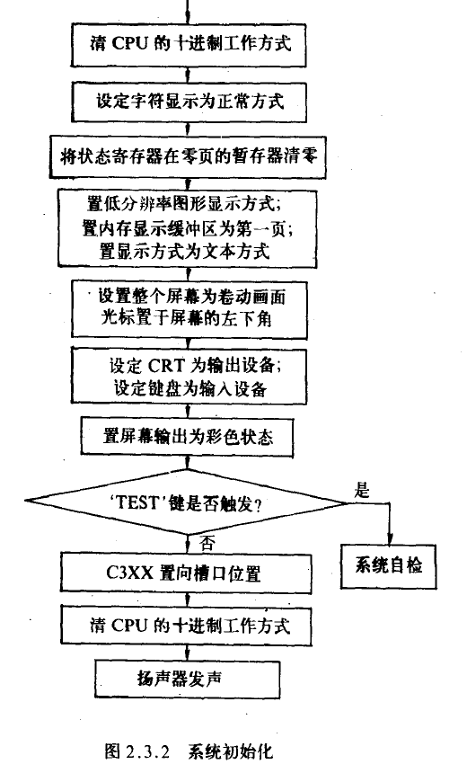

#### 3.1.2 暖启动

系统暖启动过程如图 2.3.3 所示。

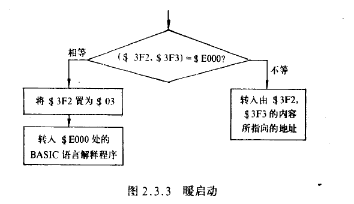

#### 3.1.3 冷启动

系统冷启动过程如图 2.3.4 所示。

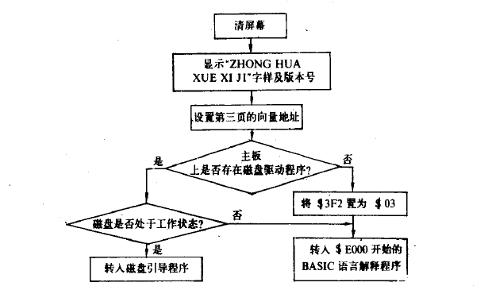

---

### 3.2 监控命令处理器

这是监控程序的一个重要部分，进入点在 `$FF69`（即 65385 或 -151）。在 BASIC 状态下，若执行 `CALL -151`，则实际上进入了监控命令处理器。监控命令处理器的框图如图 2.3.5 所示。

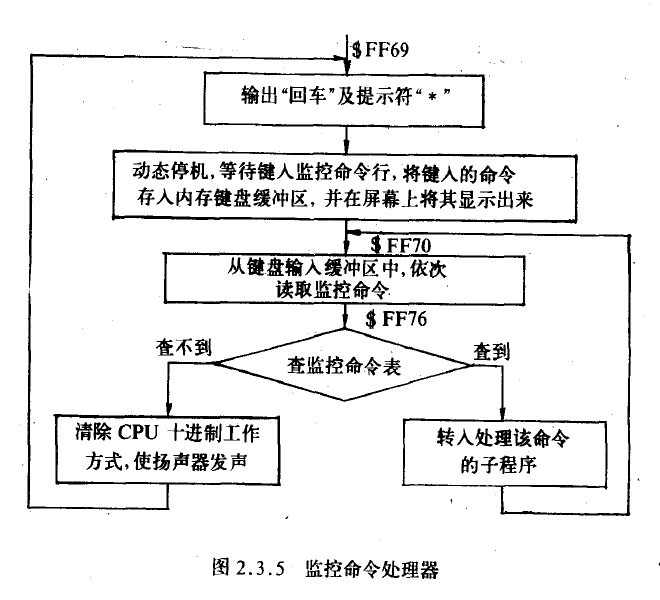

#### 3.2.1 监控命令的键入、保存与显示

图 2.3.6 说明了监控命令的键入、保存与显示的流程。

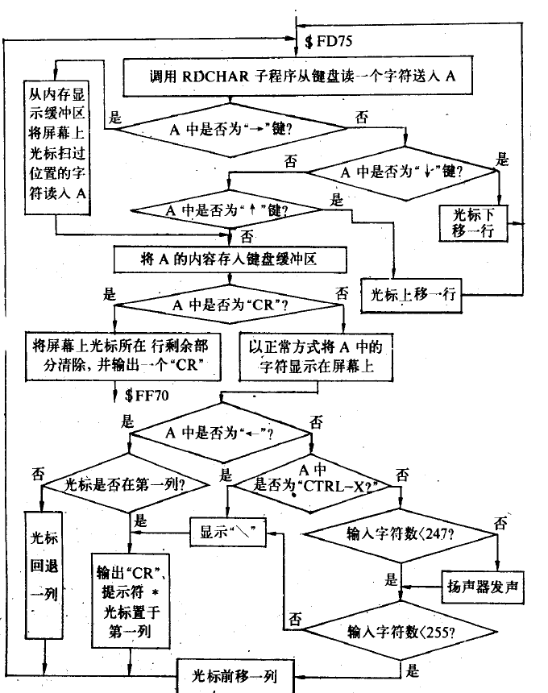

#### 3.2.2 读取监控命令

图 2.3.7 表示从键盘输入缓冲区读取监控命令的过程。

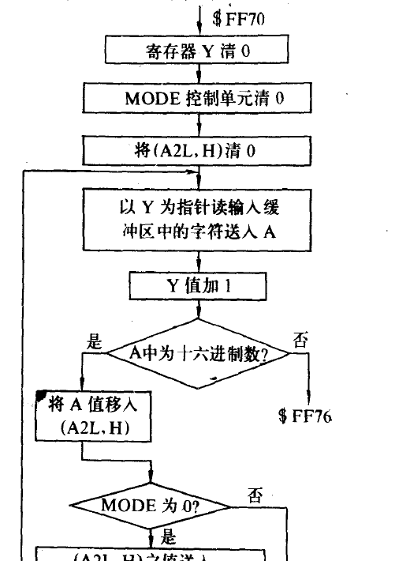

---

### 3.3 监控中一些常用的子程序

#### 3.3.1 RDCHAR 子程序

图 2.3.8 为 RDCHAR 子程序。

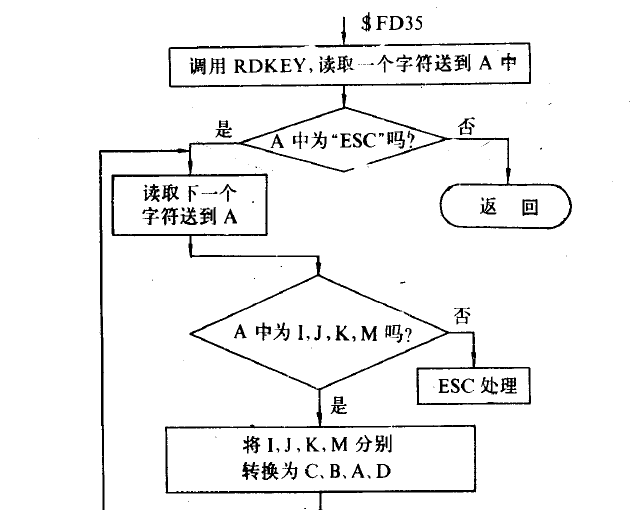

#### 3.3.2 ESC 处理

图 2.3.9 为 ESC 处理流程图。

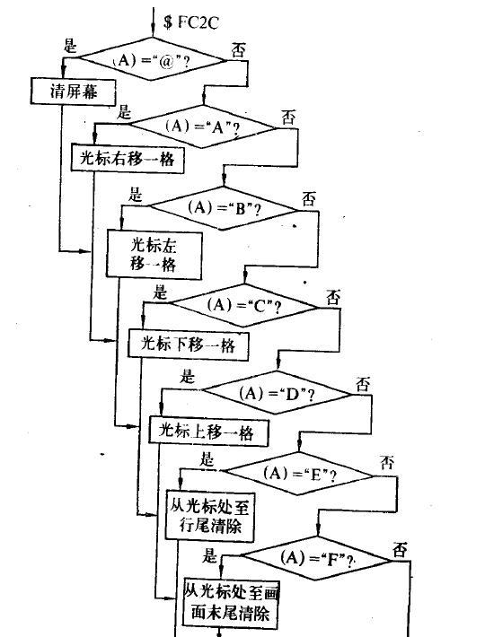

#### 3.3.3 VIDOUT 子程序

VIDOUT 子程序如图 2.3.10 所示。

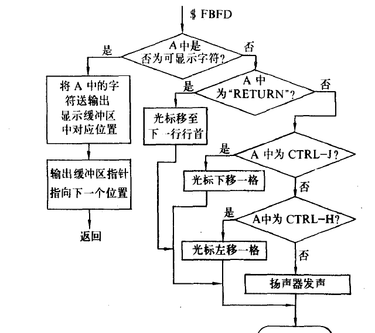

#### 3.3.4 KEYIN 子程序

KEYIN 子程序如图 2.3.11 所示。

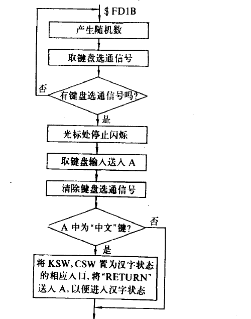

---

### 3.4 监控的其它功能

除了上面流程图所介绍的监控程序的功能外，它还具有一些完成其它功能的子程序，如：
- IRQ / BRK 中断处理子程序；
- 低分辨率绘图子程序；
- 延时子程序；等等。

这些子程序的功能及接口信息，将在后面详细地介绍。

---

### 3.5 监控程序对第 0 页及第 3 页的使用

#### 3.5.1 监控程序在第 0 页所使用的系统工作单元

表 2.3.1 及图 2.3.12 给出了监控程序在第 0 页中对系统工作单元的使用情况。

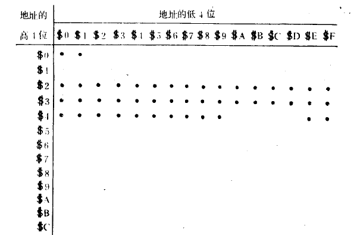

##### 监控程序对第 0 页单元的使用分布

| 地址的高 1 位 | $0 | $1 | $2 | $3 | $4 | $5 | $6 | $7 | $8 | $9 | $A | $B | $C | $D | $E | $F |
| :---: | :---: | :---: | :---: | :---: | :---: | :---: | :---: | :---: | :---: | :---: | :---: | :---: | :---: | :---: | :---: | :---: |
| **$0** | ● | ● | | | | | | | | | | | | | | |
| **$1** | | | | | | | | | | | | | | | | |
| **$2** | ● | ● | ● | ● | ● | ● | ● | ● | ● | ● | ● | ● | ● | ● | ● | ● |
| **$3** | ● | ● | ● | ● | ● | ● | ● | ● | ● | ● | ● | ● | ● | ● | ● | ● |
| **$4** | ● | ● | ● | ● | ● | ● | ● | ● | ● | ● | | | | | ● | ● |
| **$5** ~ **$F** | | | | | | | | | | | | | | | | |

*注：● 表示监控程序使用的单元。*

##### 表 2.3.1 第 0 页单元的监控程序符号表

| 地址 | 符号名 | 地址 | 符号名 |
| :--- | :--- | :--- | :--- |
| `$00` | LOC0 | `$35` | YSAV1 |
| `$01` | LOC1 | `$36` | CSWL |
| `$20` | WNDLFT | `$37` | CSWH |
| `$21` | WNDWDTH | `$38` | KSWL |
| `$22` | WNDTOP | `$39` | KSWH |
| `$23` | WNDBTM | `$3A` | PCL |
| `$24` | CH | `$3B` | PCH |
| `$25` | CV | `$3C` | A1L |
| `$26` | GBASL | `$3D` | A1H |
| `$27` | GBASH | `$3E` | A2L |
| `$28` | BASL | `$3F` | A2H |
| `$29` | BASH | `$40` | A3L |
| `$2A` | BAS2L | `$41` | A3H |
| `$2B` | BAS2H | `$42` | A4L |
| `$2C` | H2, LMNEM | `$43` | A4H |
| `$2D` | V2, RMNEM | `$44` | A5L |
| `$2E` | MASK, FORMAT, CHKSUM | `$45` | A5H, ACC |
| `$2F` | LASTIN, LENGTH | `$46` | XREG |
| `$30` | COLOR | `$47` | YREG |
| `$31` | MODE | `$48` | STATUS |
| `$32` | INVFLG | `$49` | SPNT |
| `$33` | PROMPT | `$4E` | RNDL |
| `$34` | YSAV | `$4F` | RNDH |

#### 3.5.2 监控程序对第 3 页单元的使用

监控程序仅仅把第 3 页的高端作为一些向量使用。其位置如下：

- **`$03F0` — `$03F1`**：这两个字节作为 BRK 指令的中断向量（地址）。
- **`$03F2` — `$03F3`**：这两个字节作为 RESET 向量（地址）。如果“`$A5`”与 `$03F3` 的内容作异或的结果等于 `$03F4` 的内容，则 RESET 向量有效。否则，RESET 中断将使自启动监控程序做冷启动。
- **`$03F8` — `$03FA`**：这三个字节内通常放入一条 JMP 指令，作为 CTRL-Y 向量（指令）。
- **`$03FB` — `$03FD`**：这三个字节为不可屏蔽中断向量（指令）。
- **`$03FE` — `$03FF`**：此两字节为 IRQ 中断向量（地址）。

---

## 第四章 使用监控程序中的子程序

在监控程序中有许多可为其它程序调用的子程序。这些子程序将为其它程序的编制提供方便。下面将按这些子程序的功能分类介绍它们的人口地址、使用条件及执行结果。

入口地址以 16 进制地址 / 10 进制地址的格式写出。如果在监控程序中该子程序入口地址有标号，则将标号写在地址后面，在标号后面写出返主后被破坏的 CPU 寄存器的名称。

### 4.1 低分辨率绘图

#### `F800` / `63488` / `PLOT` / 破坏寄存器：A
- **功能**：在行 (A) 列 (Y) 给出一个由 (COLOR) 决定色彩的低分辨率图形的点。返主后，GBASL, H 和 MASK 保留设定的状态。

#### `F819` / `63513` / `HLINE` / 破坏寄存器：A, Y
- **功能**：在行 (A) 从左边 (Y) 列到右边 (H2) 划一条由 (COLOR) 决定色彩的低分辨率图形的水平线。

#### `F828` / `63528` / `VLINE` / 破坏寄存器：A
- **功能**：在列 (Y) 从上边 (A) 到下边 (V2) 划一条由 (COLOR) 决定色彩的低分辨率图形的垂直线。

#### `F832` / `63538` / `CLRSCR` / 破坏寄存器：A, Y
- **功能**：把低分辨率图形的 48 行全部清除为黑色（若在文字显示方式下，全屏幕将形成黑白相反的 @ 符号）。

#### `F836` / `63542` / `CLRTOP` / 破坏寄存器：A, Y
- **功能**：将低分辨率图形上面的 40 行清除为黑色（若在文字显示方式下，上面 20 行字符变成黑白相反的 @ 符号）。

#### `F838` / `63544` / `CLRSC2` / 破坏寄存器：A, Y
- **功能**：将低分辨率图形的 0 行至 (Y) 行清除为黑色。

#### `F83A` / `63546` / 破坏寄存器：A, Y
- **功能**：将低分辨率图形的 0 行至 (V2) 行清除为黑色。

#### `F847` / `63559` / 破坏寄存器：A
- **功能**：计算 (A) 所对应的内存基地址。(A) 为低分辨率图形时屏幕的行号除 2 的值。对应该行的内存显示缓冲区基地址被存入 GBASL, H。

#### `F85F` / `63583` / `NXTCOL` / 破坏寄存器：A
- **功能**：将现有颜色的彩色码加 3，设定为低分辨率图形的新颜色。

#### `F864` / `63588` / `SETCOL` / 破坏寄存器：A
- **功能**：根据 (A) 中右半字节中的彩色值设定低分辨率图形的颜色。

#### `F871` / `63601` / `SCRN` / 破坏寄存器：A
- **功能**：将行 (A) 列 (Y) 的低分辨率绘图点的色彩值取至 A 的右半字节。

---

### 4.2 输入

#### `FD18` / `64792` / 破坏寄存器：A
- **功能**：间接转移至 (KSWL, H) 指向的输入子程序，通常是指向 KEYIN。

#### `FD1B` / `64795` / `KEYIN` / 破坏寄存器：A
- **功能**：等待键盘输入，形成随机数 (RNDL, H)，当测得有键盘输入时，将光标所指的闪烁字符恢复成正常显示，并将键盘输入数据读入 A。调用该子程序之前，光标所在行位置对应的内存显示缓冲区基地址应放入 (BASL, H) 中，光标列位置存入 Y 中，光标所在位置上的字符存于 A 中。返回调用程序后，A 中装有键盘输入的新数据。

#### `FD0C` / `64780` / `RDKEY` / 破坏寄存器：A, Y
- **功能**：把屏幕上光标位置的字符变成闪烁显示方式，而将原字符保留在 A 中，并经 (KSWL, H) 间接转移至输入子程序，通常是转移至 KEYIN 去读键盘。调用该子程序之前，光标所在行位置对应的内存显示缓冲区基地址应放入 (BASL, H)，光标列位置在 CH 中，返回调用程序之后，A 中存有输入数据。

#### `FD35` / `64821` / `RDCHAR` / 破坏寄存器：A, Y
- **功能**：调用 RDKEY 子程序从输入设备读一个字符到 A 中。判断读入字符是否为 ESC。若是 ESC 键，则再调用 RDKEY 子程序，从输入设备读一个字符到 A 中，根据新输入的字符分别做如下处理：
  - `@`：从行顶 WNDTOP 起清除屏幕显示的全部文字，返回 RDCHAR。
  - `A`：光标向右移一列，返回 RDCHAR。
  - `B`：光标向左移一列，返回 RDCHAR。
  - `C`：光标向下移一行，返回 RDCHAR。
  - `D`：光标向上移一行，返回 RDCHAR。
  - `E`：从光标处清除至本行末尾，返回 RDCHAR。
  - `F`：从光标处清除至画面末尾，返回 RDCHAR。
  - `I`、`J`、`K`、`M`：分别变换成 D、B、A、C，做相应处理后，再调用 RDKEY 子程序，从输入设备再读一个字符至 A 中，然后根据该字符再做上述处理。
  - 若不是 ESC 键，则直接返回调用程序（参见图 2.3.8 和图 2.3.9）。

#### `FD67` / `64871` / `GETLNZ` / 破坏寄存器：A, X, Y
- **功能**：输出一个 RETURN 及 PROMPT 中的提示符之后，从输入设备连续接收一串以 RETURN 为结尾的字符（最多允许 254 个），存入由 `$200` 开始的输入缓冲区，并将这一串字符显示在屏幕上（参见图 2.3.6）。

---

### 4.3 屏幕清除与光标控制

#### `FC42` / `64578` / `CLREOP` / 破坏寄存器：A, Y
- **功能**：将文字显示屏幕从光标所在位置行 (CV) 列 (CH) 处开始清除到卷动画面的结尾处。

#### `FC46` / `64582` / `CLEOP1` / 破坏寄存器：A, Y
- **功能**：将文字显示屏幕从行 (A) 列 (Y) 处开始清除到卷动画面的结尾处。

#### `FC58` / `64600` / `HOME` / 破坏寄存器：A, Y
- **功能**：从行顶 WNDTOP 起清除屏幕显示的全部文字，光标设定在屏幕的左上角。

#### `FC95` / `64661` / `SCRL3` / 破坏寄存器：A, Y
- **功能**：清除 (BASL, H) 对应的一行文字显示，然后用 CV 和 WNDLFT 来设定 BASL, H，即光标放在 (CV) 行的左端。

#### `FC9C` / `64668` / `CLREOL` / 破坏寄存器：A, Y
- **功能**：将文字显示从光标位置开始清除至行末。在调用该子程序前应将要清除的行位置所对应的内存显示缓冲区基地址放入到 BASL, H 中。

#### `FC9E` / `64670` / `CLEOLZ` / 破坏寄存器：A, Y
- **功能**：将文字显示从 (BASL, H) + (Y) 处起清除到行末。

#### `FC10` / `64528` / `BS` / 破坏寄存器：A
- **功能**：若光标不在右端，则左移一列；若光标在左端且在行顶，则移到本行的右端；若光标在左端且不在行顶，则移到上一行的右端，并按新的行位置更新 BASL, H。

#### `FC1A` / `64538` / `UP` / 破坏寄存器：A
- **功能**：如果光标不在行顶，即 `(CV) < (WNDTOP)`，则光标上移一行，并按新行位置更新 BASL, H；若光标在行顶，则行位置不变。

#### `FC62` / `64610` / `CR` / 破坏寄存器：A, Y
- **功能**：若光标不在底行，则光标移至下一行左端，并按新行位置更新 BASL, H；若光标已在底行，则光标移至该行左端，画面向上卷动一行，清除底行。

#### `FC66` / `64614` / `LF` / 破坏寄存器：A, Y
- **功能**：若光标不在底行，则不改变水平位置，垂直下移一行，并按新行位置更新 BASL, H；若光标已在底行，则行位置不变，画面向上卷动一行，并将底行清除。

#### `FBF4` / `64500` / `ADVANCE` / 破坏寄存器：A, Y
- **功能**：若光标不在右端，则光标右移一列；若光标在右端但不在底行，则光标移至下一行左端，并按新行位置更新 BASL, H；若光标在屏幕右下角，则光标从底行左端到右端，画面向上卷动一行，并清除底行。

---

### 4.4 文字显示及地址计算

#### `FB2F` / `64303` / `INIT` / 破坏寄存器：A
- **功能**：将 CRT 设定为以 24 行 40 列的格式显示第一页显示缓冲区内的文字，将光标置于底行，并将 STATUS 清零。

#### `FB5B` / `64347` / `TABV` / 破坏寄存器：A
- **功能**：将行位置 (A) 存入 CV 后，转到 VTAB 去计算 BASL, H。

#### `FBC1` / `64449` / `BASCALC` / 破坏寄存器：A
- **功能**：计算行位置 (A) 对应的第一页文字缓冲区的基地址，放入 BASL, H 中。

#### `FC22` / `64546` / `VTAB` / 破坏寄存器：A
- **功能**：根据行位置 (CV) 及字幕左边界 (WNDLFT)，计算该行左边界对应的第一页文字显示缓冲区地址，放入 BASL, H 中。

#### `FC24` / `64548` / `VTABZ` / 破坏寄存器：A
- **功能**：根据行位置 (A) 及字幕左边界 (WNDLFT)，计算该行左边界对应的第一页文字显示缓冲区地址，放入 BASL, H 中。

#### `FC70` / `64624` / `SCROLL` / 破坏寄存器：A, Y
- **功能**：将文字显示屏幕向上卷动一行。

#### `FE80` / `65152` / `SETINV` / 破坏寄存器：Y
- **功能**：将文字显示方式设定为反相方式，即白底黑字。

#### `FE84` / `65156` / `SETNORM` / 破坏寄存器：Y
- **功能**：将文字显示方式设定为正常方式，即黑底白字。

---

### 4.5 输出

#### `F940` / `63808` / `PRNTYX` / 破坏寄存器：A
- **功能**：将 (Y)(X) 用四位 16 进制数的 ASCII 码送到被选定的输出设备上。

#### `F941` / `63809` / `PRNTAX` / 破坏寄存器：A
- **功能**：将 (A)(X) 用四位 16 进制数的 ASCII 码送到被选定的输出设备。

#### `F944` / `63812` / `PRNTX` / 破坏寄存器：A
- **功能**：将 (X) 以两个 16 进制数的 ASCII 码，送到选定的输出设备上。

#### `F948` / `63816` / `PRBLNK` / 破坏寄存器：A, X
- **功能**：送出三个空格到选定的输出设备上。

#### `F94A` / `63818` / `PRBL2` / 破坏寄存器：A, X
- **功能**：送出 (X) 个空格到选定的输出设备上。

#### `FB78` / `64376` / `VIDWAIT` / 破坏寄存器：A, Y
- **功能**：在允许操作者要求暂停的情况下，处理累加器 A 中的控制字符或在光标位置显示累加器 A 中的显示字符。进入该子程序时，若累加器 A 中是“RETURN”字符，且键盘输入为“CTRL-S”，则清除键盘选通信号后，进入等待键盘重新输入状态，直至有新键入字符为止。若新键入的字符是“CTRL-C”，则保留该键盘字符转入 VIDOUT；否则，清除键盘选通信号后转入 VIDOUT。若累加器 A 中不是“RETURN”字符或键盘没输入“CTRL-C”，则直接转入 VIDOUT 去执行。

#### `FBFD` / `64509` / `VIDOUT` / 破坏寄存器：A, Y
- **功能**：若累加器 A 中的字符是可显示字符，则写入光标所对应的内存显示缓冲区，然后，若光标不在左端，则光标右移一列，否则移至下一行行首。若 A 中不为可显示字符，则做相应的控制动作（`$8D` 转至 CR；`$8A` 转至 LF；`$88` 转至 BS；否则使扬声器发声）。调用该子程序之前，光标列位置已存入 CH，光标行位置左端对应的内存显示缓冲区地址已存入 BASL, H（参见图 2.3.10）。

#### `FD8B` / `64907` / 破坏寄存器：A, Y
- **功能**：从光标所在位置到该行右端清屏幕，然后输出一个“RETURN”。

#### `FD8E` / `64910` / `CROUT` / 破坏寄存器：A
- **功能**：将“RETURN”输出到选定的输出设备上。

#### `FDDA` / `64986` / `PRBYTE` / 破坏寄存器：A
- **功能**：将 (A) 以两个 16 进制数的 ASCII 码送到选定的输出设备上。

#### `FDE3` / `64995` / `PRHEX` / 破坏寄存器：A
- **功能**：将 (A) 的低半字节中的 16 进制数变成 ASCII 码送到选定的输出设备上。

#### `FDED` / `65005` / `COUT`
- **功能**：由 (CSWL, H) 指向的输出子程序，将累加器 A 中的字符输出到一个选定的输出设备上。一般是由 COUT1 将 A 中的字符在 CRT 上显示或处理。

#### `FDF0` / `65008` / `COUT1`
- **功能**：将累加器 A 中的显示字符，经 INVFLG 处理成正常、反相或闪烁字符，再经由 VIDWAIT 和 VIDOUT 显示在光标位置上；若累加器 A 中是控制字符，则不经 INVFLG 处理，直接经由 VIDWAIT 和 VIDOUT 做适当的控制处理。

#### `FF2D` / `65325` / `PRERR` / 破坏寄存器：A
- **功能**：送出“ERR”到选定的输出设备上，并使扬声器发声。

---

### 4.6 监控命令

#### `FE2C` / `65068` / `MOVE` / 破坏寄存器：A, Y
- **功能**：将内存中 A1L, H 所指地址到 A2L, H 所指地址范围内的数据，传送至以 A4L, H 所指地址为起始地址的地方。调用前应将 Y 寄存器置为 0。

#### `FE36` / `65078` / `VFY` / 破坏寄存器：A, X, Y
- **功能**：将内存中 A1L, H 所指地址到 A2L, H 所指地址范围内的数据，与 A4L, H 所指地址为起始地址的数据块进行逐个比较，若有不相等，则将不相同的数据及其地址显示出来。调用前应将 Y 寄存器置为 0。

#### `FE5E` / `65118` / `LIST` / 破坏寄存器：A, X, Y
- **功能**：将 A1L, H 所指地址开始的 20 条机器语言指令的反汇编符号显示出来。

#### `FEB6` / `65222` / `GO` / 破坏寄存器：A, X, Y
- **功能**：转入 A1L, H 所指地址处执行。

#### `FECD` / `65245` / `WRITE` / 破坏寄存器：A, X, Y
- **功能**：将 A1L, H 所指地址至 A2L, H 所指地址之间的数据写至磁带上。

#### `FED0` / `65248` / `TRACE` / 破坏寄存器：A, X, Y
- **功能**：跟踪执行从 A1L, H 所指地址开始的程序，每执行一条指令后，将各寄存器之值及指令的反汇编码显示出来。

#### `FED2` / `65250` / `STEPZ` / 破坏寄存器：A, X, Y
- **功能**：单步执行 A1L, H 所指地址处的机器指令，并将执行后各寄存器之值及指令的反汇编码显示出来。执行完毕后，将下一条指令的地址置入 A1L, H 中。

#### `FEFD` / `65277` / `READ` / 破坏寄存器：A, X, Y
- **功能**：将磁带上的内容写至 A1L, H 所指地址与 A2L, H 所指地址之间的存储区中。磁带数据长度应该与该区域的长度相等，否则，给出错误信息。

---

### 4.7 其它

#### `FB1E` / `64286` / `PREAD` / 破坏寄存器：A, Y
- **功能**：读游戏控制器上第 (X) 号模拟量输入，返回时结果存于 Y 中。

#### `FBD9` / `64473` / `BELL1` / 破坏寄存器：A, Y
- **功能**：若 `(A) = $87`（即“BELL”），则等待 0.01 秒后扬声器产生 1kHz 声音，持续时间为 0.1 秒。若 `(A) ≠ $87`，则返回。

#### `FBE2` / `64482` / 破坏寄存器：A, Y
- **功能**：扬声器产生 1kHz 的声音，持续 0.1 秒。

#### `FBE4` / `64484` / `BELL2` / 破坏寄存器：A, Y
- **功能**：扬声器产生 1kHz 的声音，持续时间由 (Y) 决定。

#### `FCA8` / `64680` / `WAIT` / 破坏寄存器：A
- **功能**：使得计算机延迟一段时间。累加器 A 的值决定调用该子程序的延迟时间：

$$\text{延迟时间} = (2.5 \times A^2 + 13.5 \times A + 13) \times 1.023\,\mu\text{s}$$

#### `FEB0` / `65200` / `XBASIC`
- **功能**：进入 BASIC 语言，并清除存储器中的程序与变量。

#### `FEB3` / `65203` / `BASCOUNT`
- **功能**：返回 BASIC 语言，并保留存储器中的程序与变量。

#### `FF3A` / `65338` / `BELL` / 破坏寄存器：A
- **功能**：扬声器产生 1kHz 的声音，持续 0.1 秒。

#### `FF3F` / `65343` / `RESTORE` / 破坏寄存器：A, X, Y, P
- **功能**：从零页系统工作单元 `$45` ～ `$48` 恢复累加器 A，变址寄存器 X, Y，状态标志寄存器 P。

#### `FF4A` / `65354` / `SAVE` / 破坏寄存器：A, X
- **功能**：将累加器 A，变址寄存器 X, Y，状态标志寄存器 P，堆栈指示器 S 保存到内存零页系统工作单元 `$45` ～ `$49`，并清除 10 进制工作方式。

#### `FF69` / `65385` / `MONZ`
- **功能**：进入监控命令处理器。

---

## 第五章 小汇编程序

小汇编程序是中华学习机固化在 ROM 中的一个工具软件，它的作用是将 6502 汇编记忆符翻译成 6502 机器指令。

### 5.1 小汇编的进入及退出

在监控状态下敲入下列命令行，即可进入小汇编状态：

```text
* D350G
```

这时，屏幕显示小汇编状态的提示符“`!`”，表示系统已进入小汇编状态。

当需要退出小汇编状态时，只需敲入下列命令行：

```text
! $ D360G
```

### 5.2 汇编过程

在小汇编提示符下，可按下列格式进行工作：

```text
〈地址〉:〈汇编记忆符〉
```

每敲入一行上述格式的命令，便汇编一条 6502 汇编指令，即将对应的机器指令存入冒号 (`:`) 前面的地址（若为多字节指令，则存入以该地址为首地址的连续几个存储单元）。

若下一条指令接着上一条指令存放，则可省略地址的键入，这时，只需在空格符后直接敲入汇编记忆符即可。

### 5.3 使用监控命令

在小汇编状态下，可以使用各种监控命令，使用的方法是在各监控命令的前面加上符号“`$`”。

### 5.4 注意事项

由于中西文状态在存储器空间上的冲突，小汇编程序只宜在西文状态下使用。
