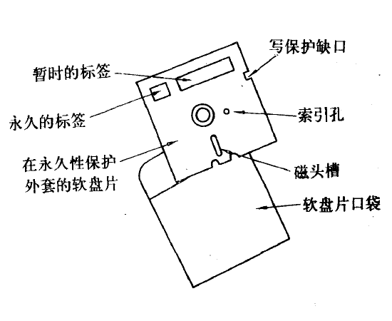
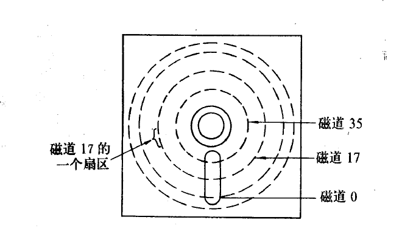
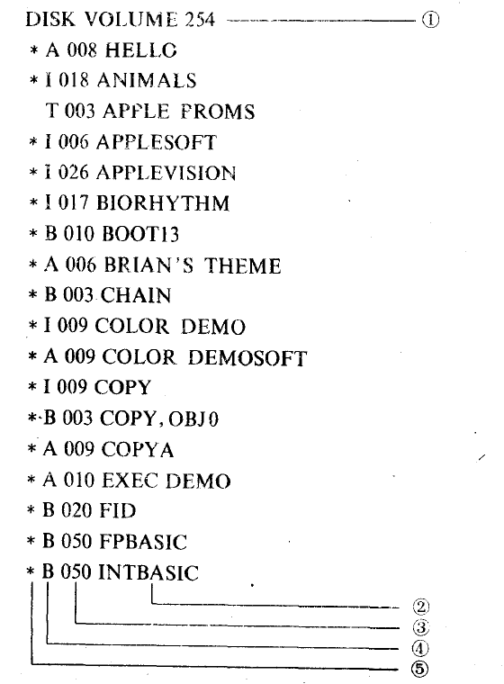
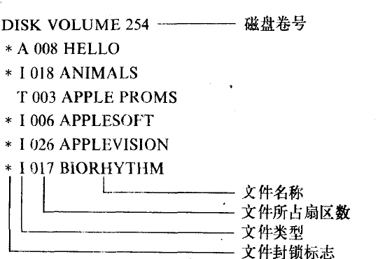

# 第三部分 DOS 磁盘操作系统

# 第一章 引言

中华学习机（CEC-I 型）是与紫金Ⅱ / APPLE Ⅱ相兼容的家庭学习电脑，其硬件、软件与 APPLE Ⅱ完全兼容。它具有软盘驱动器接口控制电路，可以直接和软盘驱动器相联接，可以运行在紫金Ⅱ / APPLE Ⅱ机上开发的各种磁盘软件。

中华学习机有丰富的系统软件和应用软件，它可以运行多种磁盘操作系统及各操作系统所支持的各种语言和应用软件、教学软件。它可以运行的磁盘操作系统包括有：APPLE DOS、PRODOS、UCSD-P 和 CP/M 操作系统等等，其基本用法和 APPLE Ⅱ机完全相同。

在这众多的系统软件和应用软件中，用户接触最多、使用最广泛的是 APPLE DOS 磁盘操作系统。本文仅以此为基础，向用户介绍 APPLE DOS 操作系统的基本命令及其用法。

---

## 1.1 APPLE DOS 磁盘操作系统

APPLE DOS 磁盘操作系统（简称为：APPLE DOS 或 DOS 操作系统）是美国 APPLE 计算机公司为 APPLE Ⅱ微机系统的使用而设计开发的一种磁盘操作系统。它面向磁盘机的使用和磁盘文件的管理，具有设计简单、面向用户、使用方便的特点。

APPLE DOS 操作系统的开发和完善大致经历了三个主要阶段：

1. **诞生阶段**：1978 年 6 月 29 日和 7 月 20 日分别推出了 DOS 3.0 和 DOS 3.1 版本。当时 DISK Ⅱ子系统的软盘读/写格式为 35 道、13 扇区，磁盘最大容量为 114 KB。
2. **维护改进阶段**：1979 年 4 月 16 日和 7 月 31 日又先后推出 DOS 3.2 和 DOS 3.2.1 版本。这二个版本的软件是在 DOS 3.1 基础上对其进行纠错和改进。
3. **更新阶段**：1980 年 8 月 25 日推出全新的 DOS 3.3 版本。这是从硬件、软件二个方面同时对 DOS 3.2.1 版本进行全面改进的结果。DISK Ⅱ子系统的软盘读写格式由 13 扇区改成 16 扇区，磁盘容量达到 143 KB。软件上增加了存储文件过程中自动进行校验等功能，为今后的 DOS 3.4、RAM DISK 及改进型 DOS 3.3 版本的开发提供了良好的开发环境。

为了能兼容于 DOS 3.2.1 以前版本软件的使用，在 DOS 3.3 系统主盘上向用户提供了 13 扇区到 16 扇区的转换程序、13 扇区磁盘的引导程序等。

APPLE DOS 操作系统除了包括了一般磁盘操作系统所具有的基本功能（即磁盘数据的读/写、磁盘文件的建立和管理、输入/输出接口命令等等）外，还专门为 BASIC 程序的使用提供了更多的操作命令。它与系统软件、用户程序的接口界面非常清晰，用户可以通过它所提供的一些命令很容易实现主机内存与磁盘之间的信息交换。

---

## 1.2 软盘驱动器

### 1.2.1 磁盘子系统

磁盘驱动器和显示器、录音机一样，是微电脑系统中一个重要的外部设备。利用磁盘驱动器这样一个外存储设备，可以将主机内存的程序和数据记录到磁盘上，并可以从磁盘上读回，达到重复使用、修改的目的。

磁盘驱动器、磁盘控制驱动电路以及与主机相连接的接口构成了微电脑系统的磁盘子系统。磁盘子系统为磁盘操作系统软件的使用提供了硬件环境的支持。

由于配置的磁盘驱动器的类型规格不同，相应的盘控驱动电路、控制接口电路也可能完全不同，它们所构成的磁盘子系统也就不同。目前，中华学习机（CEC-I 型）所具有的磁盘驱动器接口控制电路只支持 5.25 英寸单面单密度软盘驱动器的使用，接口控制信号与 APPLE DISK Ⅱ接口控制信号相兼容。

### 1.2.2 软盘驱动器是如何工作的

软盘驱动器和磁带录音机一样，都是利用磁化方式来储存数据的，软盘驱动器的存储介质是软盘片，它与磁带之间的主要差别就在于软盘片如同唱片一样，可以在软盘驱动器中进行旋转。而软盘驱动器内部的读/写磁头在其定位装置的控制下，可以在磁盘表面的磁道上进行移动，磁头下所经过磁盘表面存储介质就会被磁化，读/写数据就会记录在磁盘上。

由于磁盘的磁轨由同心圆组成，起始点和终止点相同，这样软盘驱动器就可以随机地读/写软盘上的信息，因此，它要比磁带机的顺序查找、读/写数据的方式快得多，也准确得多。

### 1.2.3 单盘驱动系统和多盘驱动系统

一台主机根据它所带有的软盘驱动器控制接口数可以配接一台或一台以上的软盘驱动器。由一台盘驱构成的系统我们称为单盘驱系统，而由二台以上盘驱构成的系统我们称为多盘驱系统。

中华学习机（CEC-I 型）仅有一个软盘驱动器控制接口，它可以通过 20 线扁平电缆与一台软盘驱动器相连接，该驱动器在 DOS 操作系统下的设备号为：6# 槽口，1# 驱动器。记为：`S6, D1`。

如果需要在中华学习机上配接二台以上的软盘驱动器，构成多盘驱系统，需要在主机的扩充槽口上另插上软盘驱动器接口卡，该插卡的设备号定义由主机内部的槽口选择插座的定义来决定。

例如：扩充槽口上设定的设备号为 Slot 5，则该软盘驱动器接口卡上所接的软盘驱动器的设备号分别为：`S5, D1` 和 `S5, D2`。

对于中华学习机，由于受扩充槽口数的限制，最多可接 3 台软盘驱动器。

### 1.2.4 软盘驱动器使用注意事项

1. 使用软盘驱动器要轻拿轻放，避免剧烈震动，以防定位机构松动。
2. 避免在软盘驱动器工作时移动盘驱本身。
3. 禁止在开机状态拔插软盘驱动器和软盘驱动器接口卡。
4. 不要在马达转动过程中抽、插软盘片。
5. 控制温升变化和使用环境温度。温升变化范围应小于每小时 15 ℃，环境温度一般在 10 ℃ ~ 38 ℃之间。
6. 避免灰尘的侵袭，不要将沾有灰尘的软盘片插入到软盘驱动器中。
7. 磁头的清洗，可用专用的清洗软盘片或磁带清洗液。
8. 软盘驱动器应远离磁场发生源，不用时不要将软盘片留在驱动器中。

---

## 1.3 软盘片

### 1.3.1 软盘片的包装与外形特点

软盘片密封于永久性保护套内（参见图 3.1.1），盘片由圆形聚脂塑料做成。盘片表面涂有磁性材料。使用时，软盘片在保护套内旋转，磁头通过保护套中的长孔（又称磁头读/写窗口）和磁盘表面接触，读/写数据。

- **永久性保护套**：由防静电皮革做成，内壁夹有防静电防潮材料，其作用是防止灰尘和保护盘面磁层不受损伤，同时也防止盘片旋转时所产生的静电而使信息丢失。
- **索引孔**：用来进行盘片划分扇区的物理定位标志。由于大部分软盘驱动器中没有装上索引孔识别装置，故索引孔不起作用。



图 3.1.1 软盘片结构

- **磁头读/写窗口**：这是在永久性保护套上开辟的一个长孔，是磁头与软盘片接触，读/写信息的界面。因此，在软盘片的使用过程中，绝对禁止用手指或异物接触这个长孔中所暴露出的磁盘部分。
- **写保护切口**：控制着软盘驱动器写电路开关，当用写保护封条贴在该切口上时，可以防止磁盘被写入任何信息。
- **永久性标签**：出厂时贴上的磁盘说明。用以指明磁盘的牌号和盘片的型号等。在使用盘片时，我们最好用手指捏着这部分取盘或插盘。
- **临时标签**：在使用软盘时，我们希望能够通过简单的方法注明该盘片的名称、作用等。此时我们可以用不干胶标签贴上，用软笔写上名称、标记等。不需要时，可以撕该标签，换贴新的标签。
- **盘纸套**：用来保护盘片，防止灰尘的侵蚀。我们要养成把不用的盘片及时插入盘片纸套中的习惯。

### 1.3.2 软盘片的选择

软盘片有多种型号和规格，它适用于不同类型的软盘驱动器。按照软盘驱动器磁头工作方式可以分成单面和双面读写，按照数据的记录方式又有单密度和双密度二种，按照扇区划分又有硬分段和软分段之分。

对于中华学习机和 APPLE Ⅱ来说，选用的是 5.25 英寸单面单密度软盘驱动器。因此，它对软盘片的选择要求比较低。一般地说，单面单密度、单面双密度、双面单密度和双面双密度的 5.25 英寸软分段软盘片均适合其使用。

### 1.3.3 磁道和扇区

软盘驱动器在读写信息过程中，由于盘片的旋转，读/写磁头将把盘片划分成若干个同心圆。这些同心圆称为磁道，如图 3.1.2 所示。

读/写磁头通过软盘的读/写窗口，可以从一个磁道移到另一个磁道，这可使磁头找到要读写的数据区。

软盘上的数据是以数据块的形式存放在磁道上的，每一个数据块称为一个扇区。

在 APPLE DOS 3.3 操作系统支持下，每张软盘被划分为 35 个磁道，每个磁道上有 16 个扇区，每个扇区可存放 256 个字节的信息（不包括数据块的地址索引）。因此，每张盘片的最大存储容量为 140 KB 左右。



图 3.1.2 软盘磁道和扇区

### 1.3.4 软盘片使用注意事项

1. 软盘片不能受重压，不可弯曲，使用后要及时插入盘片的纸盘套内，立放于软盘盒中。
2. 使用时把软盘片有标签的面朝上，用右手拇指按着有永久性标签处，将有磁头读/写窗口的一边先插入驱动器中。

---

<!-- 原书第 124-125 页缺页 -->
> [!NOTE]
> 原书第 124 ~ 125 页缺页。缺失内容包括第 1.3.4 节后续注意事项、第二章章名《第二章 DOS 操作系统的引导和使用》及第 2.1 节“引导”相关内容。

---

# 第二章 DOS 操作系统的引导和使用

## 2.2 用 DOS 3.3 系统主盘进行启动

现在我们可以尝试一下如何用 DOS 3.3 系统主盘来引导 DOS 操作系统的方法。

1. 从随机附带的软盘片盒中，取出一张贴有“DOS 3.3 系统主盘”标签的软盘片。
2. 插入与主机相连接的软盘驱动器中，关上驱动器的门。
3. 打开主机电源开关。
4. 此时软盘驱动器上的红色指示灯亮，磁盘同时转动起来。
5. 软盘驱动器指示灯熄灭后，屏幕将显示如下信息：

```text
DOS VERSION 3.3                08 / 25 / 80
APPLE II PLUS OR ROMCARD     SYSTEM MASTER
(LOADING INTEGER INTO LANGUAGE CARD)
]
```

至此，启动执行完毕，DOS 操作系统已装入内存，并准备接受命令。

做完了冷启动操作，如果我们还想再做一次“热启动”，那么，你打入命令 `PR #6` 或 `IN #6`，机器重复做上面所说的第 4、第 5 项操作，于是你又做了一次“热启动”操作。

如果你还想尝试一下在整数 BASIC 状态下进行“热启动”是怎么一回事，请你打入如下命令：

```text
]INT ↵ (注)
>PR #6 ↵
```

---

## 2.3 初始化新盘片

新买来的空白软盘片，上面没有记录任何信息，在使用 DOS 命令对空白片记录信息以前，必须对它们进行格式化，格式化的目的是在磁盘上按磁道和扇区来划分地址，并把地址以数据的形式记录在软盘上，便于读/写数据时，按其地址进行查找。

在 DOS 3.3 操作系统命令中，没有单独提供一条格式化磁盘的命令，但它提供了一条初始化盘片的命令（INIT）。利用初始化操作命令，可以完成对软盘进行格式化的操作。

初始化操作的步骤：
1. 用 DOS 系统盘进行启动。
2. 从盘上装入一个 BASIC 程序，或从键盘上键入一个新的 BASIC 程序。
3. 移去系统盘，插入空白盘，并关上驱动器门。
4. 打入命令：`INIT 文件名 ↵`

当屏幕上再次出现输入提示光标后，初始化操作执行完毕。

现在我们来做一下初始化新盘片的操作：
1. 取出 DOS 3.3 系统主盘进行启动。
2. 出现输入行提示光标后，打入如下命令：

```basic
]NEW
]10 TEXT: HOME
]20 VTAB 10: HTAB 7: PRINT "THIS DISKETTE CREATED BY"
]30 VTAB 12: HTAB 7: PRINT "WANG PIN 10 / 08 / 87"
]40 VTAB 20
]50 END
```

〔注〕↵ 表示按下 RETURN 键。

3. 取出 DOS 3.3 系统主盘，并插入空白盘片。
4. 打入初始化命令：
```text
]INIT GREETING
```
这样就可以完成对空白盘片的初始化操作。

在 APPLE DOS 操作系统中，所有经过初始化操作的空白盘片都存有 DOS 磁盘操作系统程序，也都可以作为操作系统的引导盘进行启动。

现在，我们不要移去新初始化后的盘片，关掉主机电源开关后数秒钟，再重新打开主机电源开关，屏幕上将出现如下信息：
```text
      THIS DISKETTE CREATED BY
      WANG PIN          10 / 08 / 87

]
```
这表明：我们用新初始化后的盘片引导 DOS 3.3 操作系统成功。这个盘片我们下面还要用到，权且称它为“工作盘”。

---

## 2.4 列文件目录

我们在使用软盘片过程中，很希望知道当前的软盘片已存放着哪些文件，列磁盘文件目录命令可以帮助我们完成这一工作。

现在，我们打入命令：`CATALOG`，屏幕上将出现如下信息：

```text
DISK VOLUME 254
 A 002 GREETING
```

如果我们换上 DOS 3.3 系统主盘，再打入 `CATALOG` 命令，屏幕上将出现如下信息：



```text
DISK VOLUME 254 ---------------------------------- ①
* A 008 HELLO
* I 018 ANIMALS
  T 003 APPLE PROMS
* I 006 APPLESOFT
* I 026 APPLEVISION
* I 017 BIORHYTHM
* B 010 BOOT13
* A 006 BRIAN'S THEME
* B 003 CHAIN
* I 009 COLOR DEMO
* A 009 COLOR DEMOSOFT
* I 009 COPY
* B 003 COPY, OBJ0
* A 009 COPYA
* A 010 EXEC DEMO
* B 020 FID
* B 050 FPBASIC
* B 050 INTBASIC
  | | | |_________________________________________ ②
  | | |___________________________________________ ③
  | |_____________________________________________ ④
  |_______________________________________________ ⑤
```

通过屏幕上所列出的这些信息，我们可以知道以下几件事情：

- **① 磁盘卷号**：该盘片所占有的卷号。一张盘片只能有一个卷号，它是在初始化命令执行过程中所确定的。
- **② 文件名**：每个文件名最大长度为 30 个字符。
- **③ 扇区数**：文件在软盘上所占用的扇区数。
- **④ 文件类型**：
  - **A** 表示 APPLESOFT 程序文件。
  - **I** 表示整数 BASIC 程序文件。
  - **B** 表示 2 进制代码文件。
  - **T** 表示文本文件。
  - **R** 表示由 EDASM 汇编程序所产生的可浮动目标文件。
  - **L** 表示由 LISA 汇编程序所生成的文件。
- **⑤ 文件保护标志**：它是操作系统所提供的对文件进行写保护的一项措施。

如果该文件有星号标志（`*`），则表示 DOS 对该文件进行了封锁保护，它只允许用户对该文件执行读操作，而不能对其执行改名、删除或写操作。否则，系统会给出：`FILE LOCKED` 信息。

在列目录过程中，可以用 CTRL-S 键暂停列目录，再按任意键使其继续列目录。如果目录内容多于屏幕一次能够显示的条目时，可按任意键使其继续显示。

---

## 2.5 保存 BASIC 程序

当我们在主机上编制了一个 BASIC 程序，很希望把它保存到软盘上去，在下次上机时，随时把它调入到主机的内存中来。这时，我们就可以使用 DOS 操作系统所提供给我们的存盘命令：`SAVE`。

在这个 DOS 命令中，我们要给出该程序在软盘上的文件名。这个文件名是以字母打头的字符串（但不能含有逗号），文件名的最大长度为 30 个字符。

例如：我们在主机上打入 BASIC 程序：

```basic
10 INPUT "GUESS A NUMBER: ";G
20 READ D
30 IF D = - 99999 THEN 80
40 IF G < > D THEN 20
50 PRINT "YOU ARE CORRECT !"
60 END
80 PRINT "BAD GUSS, TRY AGAIN !" : RESTORE : GOTO 10
100 DATA 1, 393, -39, 28, 391, 0, 3.14, 90, 15, 10, 5, -34, -99999
```

打入 RUN 命令检查程序执行正确后，可以把该程序保存到工作盘上，我们把该程序取名为：`GUESS A NUMBER`。可以打入如下命令：

```text
]SAVE GUESS A NUMBER
```

此时，若打入列文件目录命令，我们将会看到工作盘上已含有二个文件：

```text
]CATALOG

DISK VOLUME 254

 A 002 GREETING
 A 002 GUESS A NUMBER
```

利用 SAVE 命令，我们可以在工作盘上保存多个程序文本，换上其它软盘，还可以把这个程序保存到其它软盘上。

在使用 SAVE 命令时，我们要注意：保存程序的软盘片不能贴有写保护，也不能是没有经过初始化的空白盘片。否则，我们会得到信息：`I/O ERROR`。

---

## 2.6 装入 BASIC 程序

启动 DOS 操作系统后，我们可以利用 DOS 命令把软盘上的程序装入到主机内存中来。

例如：我们希望把在工作盘上的 GUESS A NUMBER 程序装入到主机内存，则可以打入如下命令：

```text
]LOAD GUESS A NUMBER
```

在用 LOAD 命令装入程序时，主机内原有的 BASIC 程序将被清除掉，由新装入的程序替换原有的程序，而软盘上的程序文件不会受任何影响。

如果用 LOAD 命令所指定的文件名不在软盘上，将得到信息：`FILE NOT FOUND`。

---

## 2.7 删除文件

在我们使用软盘来存储信息时，很希望在盘上保留对我们有用的信息，对于调试程序中留下的不用的旧版本程序，旧的数据文件，我们都可以用删除命令把它们删除，以使软盘上可以留下更多的空间来存放新的程序、新的数据。

例如：我们希望把工作盘上的 GUESS A NUMBER 删除掉，可以打入如下命令：

```text
]DELETE GUESS A NUMBER
```

要注意：打入 DELETE 命令后，软盘上所指定的文件名将被从文件目录中删除掉，并且是不可重新恢复的，所以操作时要十分小心，只有当我们证实了该文件确实对我们无用时，才可将该文件删除掉。在一般情况下为了防止因我们错误的操作而将盘上重要的文件删除掉，我们将对这些文件用 LOCK 命令加写封锁标志。

如果在 DELETE 命令中所指定的文件名不在软盘上，将得到信息：`FILE NOT FOUND`。

如果软盘上贴有写保护，将得到信息：  
```text
WRITE PROTECTED
```

如果 DELETE 命令中所指定的文件名，是用 LOCK 命令加了封锁的，将得到信息：`FILE LOCKED`。

如果我们用 LOAD 命令，而要装入的文件不是 BASIC 程序（即文件类型不是 A 或 I），则得到信息：  
```text
FILE TYPE MISMATCH
```

---

# 第三章 DOS 3.3 磁盘操作系统命令

## 3.1 DOS 命令格式

DOS 操作系统命令由**命令保留字**和**命令参数**二部分组成。

命令保留字代表了 DOS 操作系统所提供的命令。它必须由大写字母组成。

命令参数则是提供 DOS 命令执行时所需要的辅助信息。如：磁盘驱动器的设备号，文件存放的地址，磁盘的卷号，文件名等等。命令参数由文件名、参数标记和参数组成。参数标记必须是大写字母，参数则可以是算术表达式。

一条 DOS 命令可以带有若干命令参数，命令参数之间必须用逗号隔开。

DOS 命令格式如下：

$$\text{COMMAND} \underbrace{\text{ f }}_{\text{文件名}} \underbrace{\text{[, Ss] [, Dd] [, Vv]}}_{\text{命令参数}}$$

在上述 DOS 命令语法描述中，方括号（`[` 和 `]`）之中的项为可选择命令参数，大写字母为参数标记，小写字母为参数。可选择命令参数的顺序是任意的。当命令所选用的有关驱动器所在槽号、设备号省略时，总是指定最后使用操作的磁盘设备为当前 DOS 命令所执行的设备。

### 命令参数说明：

1. **f**：文件名，以字母打头的字符串组成（其中不能含有逗号），文件名的有效长度最多可达 30 个 ASCII 字符。
2. **Ss**：设定软盘驱动器所在的槽口号，s 值可以是 1 ~ 7 之间的整数（但不允许为 3）。  
   中华学习机盘驱接口上所接盘驱的槽口号 s=6。
3. **Dd**：设定软盘驱动器在盘驱接口卡上的设备号。d 值必须是 1 或 2。  
   一块盘驱接口卡最多可接二台盘驱。中华学习机盘驱接口上所接盘驱的设备号 d=1。
4. **Vv**：软盘片的卷号，一张软盘片只能有一个卷号，卷号的值 v 可以是 1 — 254 之间的整数。  
   卷号是在用 INIT 命令进行盘片初始化操作时就已确定了的，是不可更改的，卷号起着核对盘片的作用。
5. **Bb**：用以指明文本文件起始字符的位置，b 值可以是 0 ~ 32767 之间的整数。
6. **Rr**：在顺序文件中用来指明数据域起始标志，而在随机文件中则用来指明记录数。r 值可以是 0 ~ 32767 之间的整数。

---

## 3.2 DOS 命令调用方法

在没有引导 DOS 操作系统情况下，只能使用 ROM 中的 CEC-BASIC 解释程序。而在引导 DOS 操作系统后，便可在 BASIC 方式下来调用 DOS 命令。其调用方式有二种：1. 立即方式，2. 程序方式。

### 3.2.1 立即执行方式

在 BASIC 提示符下，直接打入 DOS 命令，DOS 将立即解释执行该命令。这种工作方式类似于 BASIC 中的立即型命令。

可以立即执行的 DOS 命令有：

| | | | | |
|---|---|---|---|---|
| BLOAD | BRUN | BSAVE | CATALOG | CLOSE |
| DELETE | EXEC | FP | INIT | IN # |
| INT | LOAD | LOCK | MAXFILES | MON |
| NOMON | PR # | RENAME | RUN | SAVE |
| UNLOCK | VERIFY | | | |

### 3.2.2 程序调用方式

在 BASIC 程序中，DOS 操作系统命令均可作为一条特殊的 BASIC 语句被调用。它与一般 BASIC 语句不同的是：DOS 操作系统命令必须通过一条特殊的 PRINT 语句来执行。这条 PRINT 语句将 DOS 命令及其命令参数作为一输出行进行输出，而在这输出行的第一个字符是 CTRL-D。

CTRL-D 是 DOS 命令的引导标记，当 BASIC 解释程序执行 PRINT 语句时，遇到第一个输出字符为 CTRL-D，则作为 DOS 命令去处理，它不会将 CTRL-D 字符及其后面的 DOS 命令字符串作为一般的输出字符显示到屏幕上或输出设备上（当然，如果系统中没有启动 DOS 操作系统，BASIC 程序是不会对 CTRL-D 字符作特殊处理的）。

调用 DOS 命令的语句格式：

```basic
PRINT "CTRL-D DOS 命令和命令参数"
```

或

```basic
PRINT CHR$(4);"DOS 命令和命令参数"
```

对于整数 BASIC 程序，由于没有 CHR$(4) 函数，所以只能用第一种语句格式，对于 APPLESOFT 程序二种语句格式均可以使用。

如果我们把 CTRL-D 字符先赋值给串变量，上述语句可改写为：

```basic
D$ = "CTRL-D" 或 D$ = CHR$(4)
PRINT D$;"DOS 命令和命令参数"
```

下面这段程序将显示盘片上的文件目录：

```basic
10 REM DOS 3.3 COMMAND
20 PRINT "CATALOG OF DOS 3.3 SYSTEM MASTER"
30 PRINT CHR$(4);"CATALOG"
40 END
```

在使用 BASIC 语句调用 DOS 命令时应注意：

(1) 在一个 PRINT 语句输出行中，只能含有一条 DOS 命令，而在这个输出行中必须以 CTRL-D 字符打头，以回车字符 (CTRL-M) 表示 DOS 命令的结束。

请比较一下下面二段程序为什么不执行 DOS 命令和出现语法错的原因：

例一：
```basic
10 REM DOS 3.3 COMMAND
20 PRINT "CATALOG OF DOS 3.3 SYSTEM MASTER";
30 PRINT CHR$(4);"CATALOG"
40 END
```

例二：
```basic
10 REM DOS 3.3 COMMAND
20 PRINT CHR$(4);"CATALOG",
30 PRINT CHR$(4);"CATALOG"
40 END
```

仅能以程序调用方式执行的 DOS 命令有：

| | | | |
|---|---|---|---|
| APPEND | CLOSE | OPEN | POSITION |
| READ | WRITE | | |

---

## 3.3 初始化命令

### INIT

- **用途**：初始化软盘片。
- **格式**：`INIT f [, Ss] [, Dd] [, Vv]`
- **说明**：该命令将对软盘片进行初始化，并把现已建立在内存中的 BASIC 程序作为 DOS 操作系统引导后，装入并运行的第一个程序，存入软盘，冠以文件名 f。

INIT 命令一般仅用于对初次使用的空白盘片进行初始化，但当某张已使用过的软盘片上所存储的文件已全部无用，并打算将该盘片用来重新存放一些新文件时，亦可对其进行初始化操作。执行初始化操作后，原盘片上的所有信息都将被清除。

INIT 命令将对软盘执行以下操作：
1. 对盘片格式化，删除盘片上所有信息，在磁盘表面划分磁道和扇区段。并将所有区段内容写成 0。
2. 将 DOS 操作系统存放到软盘的 $00 ~ $02 三个磁道上。  
   所有经过初始化的软盘上均装有 DOS 操作系统，也均可以作为 DOS 系统的引导盘。
3. 在 $11 道上为该盘片建立文件目录区，填写该盘所属卷号。  
   卷号可以通过 Vv 参数由用户自行指定，当 Vv 参数省略，或 v=0 时，将自动分配一个卷号为 254，一张盘片只能有一个卷号，一旦建立就不能被修改。
4. 将当前已建立在主机内存中的 BASIC 程序作为引导 DOS 操作系统后，自动装入执行的第一个程序（通常称为问候程序）存放到软盘上，冠以指定的文件名 f。
5. 用 INIT 命令初始化后的软盘，只能是“从属盘”，它不能像 DOS 3.3 系统主盘一样可以在 16 ~ 64KB RAM 的任一类型的 APPLE Ⅱ机上进行启动，但可以通过 MASTER CREATE 程序的运行使其变为系统主盘（详见第四章第 8 节）。

例如，下面这些步骤的操作将初始化一张空白盘片：

1. 用 DOS 3.3 系统主盘进行启动。
2. 清除内存，并打入如下程序：
```basic
10 REM HELLO PROGRAM
20 PRINT "THIS HELLO PROGRAM CREATED BY"
30 PRINT "BILL JONES          11 / 25 / 86"
40 END
```
3. 打入命令 RUN，检查运行结果：
```text
]RUN
THIS HELLO PROGRAM CREATED BY
BILL JONES          11 / 25 / 86
```
4. 取出系统主盘，插入空白盘片。
5. 打入初始化命令：
```text
]INIT HELLO, V10
```
6. 从盘驱中取出软盘片，贴上临时标签，不用时，及时插入磁盘的纸套中，并立放在盘片盒中。

---

## 3.4 管理磁盘文件的 DOS 命令

### 3.4.1 CATALOG

- **用途**：列磁盘文件目录。
- **格式**：`CATALOG [, Ss] [, Dd] [, Vv]`
- **说明**：该命令将按命令所设定的软盘驱动器列出该盘驱上盘片的文件目录。目录中包括：磁盘的卷号，文件的名称，文件所占用盘片的扇区数，文件的类型和文件的封锁标志等等。

例如：
```text
]CATALOG
```



```text
DISK VOLUME 254 ---------------- 磁盘卷号
* A 008 HELLO
* I 018 ANIMALS
  T 003 APPLE PROMS
* I 006 APPLESOFT
* I 026 APPLEVISION
* I 017 BIORHYTHM
  | | | |________________________ 文件名称
  | | |__________________________ 文件所占扇区数
  | |____________________________ 文件类型
  |______________________________ 文件封锁标志
```

### 3.4.2 LOCK

- **用途**：置文件封锁。
- **格式**：`LOCK f [, Ss] [, Dd] [, Vv]`
- **说明**：该命令将对指定的文件置封锁（写保护）状态，使得该文件不会因意外的写操作而遭破坏。

对某一个文件执行封锁操作后，列磁盘文件目录，该文件类型标志的左边将有一星号标志（`*`），对于被封锁的文件，用户只能执行 LOAD / READ / EXEC / VERIFY 操作，而不能对其执行 SAVE / WRITE / RENAME / DELETE 等操作。否则将会得到信息：`FILE LOCKED`。

例如，插入刚刚初始化完毕的工作盘，列出磁盘文件目录：
```text
]CATALOG
DISK VOLUME 010
A 002 HELLO
```
现在执行 LOCK HELLO 命令，再次列出磁盘文件目录时，HELLO 文件将被封锁：
```text
]LOCK HELLO
]CATALOG
DISK VOLUME 010
* A 002 HELLO
```

### 3.4.3 UNLOCK

- **用途**：解除文件封锁。
- **格式**：`UNLOCK f [, Ss] [, Dd] [, Vv]`
- **说明**：该命令将解除对文件的封锁，这样可以使得对软盘上的该文件进行删除、重新命名、修改或重写等操作，解除文件封锁后，该文件的封锁标志将消失。

LOCK 和 UNLOCK 命令可以对任意类型的文件进行操作。

### 3.4.4 RENAME

- **用途**：修改文件名。
- **格式**：`RENAME f1, f2 [, Ss] [, Dd] [, Vv]`
- **说明**：该命令将对指定的文件重新命名。用文件名 f2 取代原有的文件名 f1，改名后的文件其内容不受影响，可以对任意类型文件执行该操作。

这里的 f1 是一个已在软盘上存在的文件名，f2 必须是软盘上所没有的新文件名，f1 文件必须不被封锁。

例：若工作盘上的文件目录为：
```text
]CATALOG
DISK VOLUME 010
* A 002 HELLO
  A 009 ABC
```
现欲将 ABC 文件改名为 BCD，可执行如下命令：
```text
]RENAME ABC, BCD
]CATALOG
DISK VOLUME 010
* A 002 HELLO
  A 009 BCD
```

注意：RENAME 命令并不检查文件名 f2 是否在软盘上已存在，因此有可能通过 RENAME 命令而使得在一张软盘上有多个同名文件，最好要避免这种不必要的混乱出现。

### 3.4.5 VERIFY

- **用途**：文件校验。
- **格式**：`VERIFY f [, Ss] [, Dd] [, Vv]`
- **说明**：该命令将通过读操作对指定文件 f 的校验和进行检查，以确定该文件在软盘上的信息是否正确。

我们知道，DOS 操作系统在把信息存到软盘上的过程中，首先把信息存入文件缓冲区，待存满 256 个字节时，DOS 再把这些信息作为一个数据块存到软盘的扇区中。这时，存到该扇区中的信息除了 256 个字节是文件信息外，还有一个作为“检查和”的校验字节，根据这个校验字节，可以检查文件传输的正确性。

一般说来，从主机写到软盘上的信息都是很可靠的，通过 DOS 命令的使用是可以重新将它读回到内存中来。但是由于人为因素，盘片长期存放，软盘片部分地遭到损伤，使得信息被丢失，DOS 不得将它读回到内存中来。通过 VERIFY 命令可以对盘上的文件进行一次读操作，校验一下该盘片上文件的正确性。

VERIFY 命令操作过程中，如果被校验的文件正确，将得不到任何回答信息，否则，将给出 `I/O ERROR` 信息。这将提示你，该文件已遭破坏，这时应考虑重新复制该文件，或者将该盘上的其它文件盘制到其它软盘上，以避免整张盘片被损坏。DOS 3.3 操作系统在存储每个文件时，都将自动执行一次 VERIFY 操作，以保证存盘操作是成功的。

VERIFY 命令可适用于对任何类型的文件进行校验操作，该操作过程将不破坏主机内存中程序和数据，也不影响软盘上的文件。

### 3.4.6 DELETE

- **用途**：删除文件。
- **格式**：`DELETE f [, Ss] [, Dd] [, Vv]`
- **说明**：该命令将从软盘上删除所指定的文件，这个文件可以是任意类型的，并且文件是不被封锁的。

如果要删除的文件不存在，将出现信息：`FILE NOT FOUND`。如果该文件被封锁，将得到信息：`FILE LOCKED`。

---

## 3.5 与 BASIC 程序有关的 DOS 命令

### 3.5.1 LOAD

- **用途**：装入 BASIC 程序。
- **格式**：`LOAD f [, Ss] [, Dd] [, Vv]`
- **说明**：该命令将从软盘上装入一个类型为 A 或 I 的 BASIC 程序。

如果命令中所指出的文件名不在软盘上，将得到信息：`FILE NOT FOUND`。如果欲装入的文件，其文件类型不是 A 或 I，则会得到信息：`FILE TYPE MISMATCH`。如果没有用 DOS 3.3 系统主盘进行启动，或没有将整数 BASIC 解释程序装入到主机内存中，而要装入的却是 I 类型文件，将会得到信息：`LANGUAGE NOT AVAILABLE`。（注：原书排印为 `LANGUAGE NOT AVAILABEL.`）

LOAD 命令装入 BASIC 程序之前，首先要检查磁盘文件的类型，根据装入的是 A 类型文件还是 I 类型文件，转入 APPLESOFT 解释程序或整数 BASIC 解释程序，然后才将该文件的内容装入到主机内存中。

在装入 BASIC 程序时，盘上的文件保持不变，原先已在内存中的 BASIC 程序将被清除。

### 3.5.2 SAVE

- **用途**：保存 BASIC 程序。
- **格式**：`SAVE f [, Ss] [, Dd] [, Vv]`
- **说明**：该命令将把当前已建立在主机内存中的 BASIC 程序保存到软盘上，以建立程序副本。

f 指出的是程序副本的文件名。文件类型根据当前系统处于何种 BASIC 语言状态所确定。如果该盘上没有该文件名，则在软盘上创建该文件。如果该文件名在软盘上已存在，并且文件类型与系统的当前状态相吻合，则用当前已在内存中的 BASIC 程序替代原有文件。如果软盘上的文件类型和主存中 BASIC 程序类型不一致，则给出信息：`FILE TYPE MISMATCH`。

利用 SAVE 命令，我们可以在一个软盘上建立多个程序副本，也可以在多个软盘上建立多个程序副本。

例如，我们把在 DOS 3.3 系统主盘上的 COLOR DEMO 程序存到工作盘上，可以执行如下操作：
1. 用 DOS 3.3 系统主盘进行启动。
2. 打入命令：`LOAD COLOR DEMO`
3. 换上工作盘，打入命令：`SAVE COLOR DEMO`

这样，在你的工作盘上，便保存了一个和 DOS 3.3 系统主盘上一模一样的整数 BASIC 程序：COLOR DEMO。

### 3.5.3 RUN

- **用途**：运行软盘上的 BASIC 程序。
- **格式**：`RUN f [, Ss] [, Dd] [, Vv]`
- **说明**：该命令将把软盘上的某一 BASIC 程序 f 装入到内存并运行之。

该命令的执行步骤是：① 执行 DOS 的 LOAD 命令，② 执行 BASIC 的 RUN 命令。

---

## 3.6 语言之间进行转换的 DOS 命令

DOS 3.3 操作系统为方便 APPLE Ⅱ机不同版本用户的使用提供了 APPLESOFT 解释程序和整数 BASIC 解释程序二种语言状态相互切换的命令。

### 3.6.1 INT

- **用途**：进入整数 BASIC。
- **格式**：`INT`
- **说明**：该命令使系统进入整数 BASIC 状态，并清除内存中现有程序，恢复有关程序指针。

如果我们想从 APPLESOFT 状态进入整数 BASIC 状态，可以使用这一命令。该命令不带任何参数，它不能设定软盘驱动器的槽号和设备号。

如果机内没有装入整数 BASIC 解释程序，系统将给出信息：`LANGUAGE NOT AVAILABLE`。（注：原书排印为 `LANGUAGE NOT ANAILABEL.`）

### 3.6.2 FP

- **用途**：进入 APPLESOFT。
- **格式**：`FP [, Ss] [, Dd]`
- **说明**：APPLESOFT 程序又称为浮点 BASIC 程序，该命令将使得系统进入 APPLESOFT 状态，并清除内存中现有的 BASIC 程序，恢复各有关指针。

如果我们在运行了某一整数 BASIC 程序，想回到 APPLESOFT 状态可以打入 FP 命令，如果我们想清除当前内存中的 BASIC 程序，可以打入 FP 命令。如果我们因运行了某个 BASIC 程序，使得系统有关指针的改变，现在想装入第二个程序执行时，系统回答“OUT OF MEMORY”信息拒绝执行时，可以使用 FP 命令。
