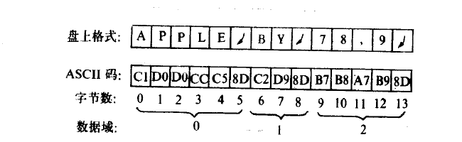
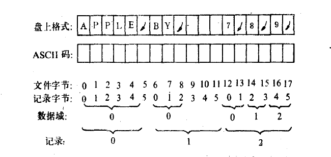

# 第三部分 DOS 磁盘操作系统

## 第三章 DOS 3.3 磁盘操作系统命令（后半部分）

> **说明（承接前文 3.6.2 FP 命令说明）**：APPLESOFT 程序又称为浮点 BASIC 程序，该命令将使得系统进入 APPLESOFT 状态，并清除内存中现有的 BASIC 程序，恢复各有关指针。  
> 如果我们运行了某一个整数 BASIC 程序，想回到 APPLESOFT 状态可以打入 FP 命令，如果我们想清除当前内存中的 BASIC 程序，可以打入 FP 命令。如果我们因运行了某个 BASIC 程序，使得系统有关指针的改变，现在想装入第二个程序执行时，系统回答“OUT OF MEMORY”信息拒绝执行时，可以使用 FP 命令。

---

### 3.7 对文本文件进行操作的 DOS 命令

文本文件是用来存放数据信息的文件，其数据信息可以是：运算数据、计算的结果、信件的副本、帐单和表格等，也可以是组成 DOS 命令和 BASIC 命令的字符串。

文本文件是通过程序方式调用 DOS 命令来创建和检索的，它可以通过某一程序来创建，而由另一程序进行检索。

文本文件按其存取方式可以分成顺序文件和随机文件。这两种文件在目录中的类型标识符均为 **T**，但在使用方法和存储格式上却有所不同，如果使用不当，可使得存取过程中所得到的数据结果与预期的大不相同，甚至会得到出错信息。

#### 3.7.1 顺序文件

顺序文件由数据域组成，每个数据域由回车（CR）字符作为终结标志，它通常由不带逗号和分号的 PRINT 语句自动生成，也可以由输出 `CHR$(13)` 字符来产生。顺序文件在软盘上是连续存放的，各个数据域之间没有间隙。其数据域的长度和文件长度可以是任意的。

顺序文件在盘上的存放格式如图所示：



##### 一、顺序文件的一个例子

假设我们想把单词：APPLE、BANANA、FRUIT、EAGLE 和 GOOSE 作为一个文本文件保存到软盘上，我们可以用如下的程序来完成：

```basic
10  REM  MAKE-WORD1
15  DIM A$(10)
20  D$ = CHR$(4): REM CTRL-D
30  PRINT D$;"OPEN WORD1"
40  PRINT D$;"WRITE WORD1"
50  FOR I = 1 TO 5: READ A$(I): PRINT A$(I): NEXT I
60  PRINT D$"CLOSE WORD1"
70  END
100 DATA "APPLE","BANANA","EAGLE","GOOSE","FRUIT"
```

在这个程序中，我们使用了三条 DOS 命令：OPEN、WRITE 和 CLOSE，其作用是：OPEN 创建一文本文件 WORD1，并把该文件建立在目录中，WRITE 命令对 WORD1 文件执行写操作，使得第 50 列语句中的 PRINT 命令将把输出信息送到文件 WORD1 中，而不是屏幕上，CLOSE 命令则是停止对 WORD1 文件执行写操作。

如果我们不是在 DOS 的监视命令方式下运行该程序，屏幕上将看不到任何信息，如果我们打入置监视方式命令：`MON C, I, O`，然后再打入 RUN 命令，则会在屏幕上看到如下信息：

```
]MON C, I, O
]RUN
OPEN WORD1
WRITE WORD1
APPLE
BANANA
EAGLE
GOOSE
FRUIT
CLOSE WORD1
```

这样我们可以确信已把这些单词保存到了 WORD1 文件中，那么如何再从这个文件中读回这些信息呢？下面这个程序将帮助你解决这个问题：

```basic
]LIST
10  REM  RETRIEVE-WORD1
15  DIM B$(10)
20  D$ = CHR$(4): REM CTRL-D
30  PRINT D$;"OPEN WORD1"
40  PRINT D$;"READ WORD1"
50  FOR I = 1 TO 5: INPUT B$(I): NEXT I
60  PRINT D$"CLOSE WORD1"
70  END
```

在这个程序中，我们同样也使用了三条 DOS 命令：OPEN、READ 和 CLOSE。这里的 OPEN 命令将打开 WORD1 文件，READ 命令将告诉 DOS：第 50 行语句中的 INPUT 命令将从 WORD1 文件中读取数据，而不是从键盘上。CLOSE 命令将关闭 WORD1 文件，结束对 WORD1 文件执行读操作。

如果打入 `MON C, I, O` 命令，再运行该程序，我们可以看到如下信息：

```
]MON C, I, O
]RUN
OPEN WORD1
READ WORD1
?APPLE
?BANANA
?EAGLE
?GOOSE
?FRUIT
CLOSE WORD1
```

为了进一步确认 WORD1 文件中的数据被读了回来，我们可打入如下命令：

```basic
]PRINT B$(1), B$(3), B$(5)
APPLE       EAGLE       FRUIT
```

通过这二个例子我们看到了顺序文件的写过程和读过程，与它所使用的 DOS 命令有着密切的关系。

##### 二、OPEN

- **用途**：打开顺序文件。
- **格式**：`OPEN f [, Ss] [, Dd] [, Vv]`
- **说明**：该命令将打开一顺序文件 f，如果该文件不存在，则在磁盘的目录中创建该文件。

在对某一文件进行读操作或写操作之前，首先必须打开该文件。此时 DOS 将给该文件分配 595 个字节的文件缓冲区，供磁盘与主存之间的信息交换用。程序一次允许同时打开的文件个数是由 MAXFILES 命令所决定，最多不得超过 16 个，DOS 启动后将自动执行 MAXFILES 3 命令，此时系统允许打开的文件个数最多为 3 个。

##### 三、CLOSE

- **用途**：关闭文件。
- **格式**：`CLOSE [f]`
- **说明**：对某一文本文件在完成读/写操作后必须及时关闭该文件，使得 DOS 命令收回分配给该文件的文件缓冲区，使它可以用于新打开的文件。否则会由于打开的文件太多，而出现：`NO BUFFER AVAILABLE` 信息。

该命令执行时，f 指出了要关闭的文件名，当文件名省略时，将关闭所有已打开的文件。

##### 四、WRITE

- **用途**：写顺序文件。
- **格式**：`WRITE f [, Bb]`
- **说明**：该命令将对已打开的文件 f 执行写操作，参数 Bb 指明从顺序文件的第 b 个字节开始写数据，如果参数 Bb 省略则从顺序文件的第 0 个字节开始写数据。执行该命令后，所有 PRINT 语句输出的信息都将存到文件中，而不是显示到屏幕上。

> **注意**：如果打开了盘上已有的文本文件，再对它进行执行写操作，此时除非新写入的数据多于原有文件的信息，并覆盖了原有的信息，否则得到的文件内容将是新写入的信息和原来文件混合构成。

在下面这个例子中，我们虽然在 WORD1 文件中只存储了二个数据，但因原来已有 5 个数据，所以从该文件中读到了 5 个数据。

```basic
10  REM  MAKE WORD1
15  DIM A$(10), B$(10)
20  D$ = CHR$(4): REM CTRL-D
30  PRINT D$;"OPEN WORD1"
40  PRINT D$;"WRITE WORD1"
50  FOR I = 1 TO 2: READ A$(I): PRINT A$(I): NEXT I
60  PRINT D$"CLOSE WORD1"
80  DATA 123, 456
100 REM  RETRIEVE WORD1
110 PRINT D$;"OPEN WORD1"
120 PRINT D$;"READ WORD1"
130 FOR I = 1 TO 5: INPUT B$(I): NEXT I
140 PRINT D$"CLOSE WORD1"
150 END
```

打入 `MON C, I, O` 命令后，打 RUN 命令所以从屏幕上得到如下信息：

```
]MON C, I, O
]RUN
OPEN WORD1
WRITE WORD1
123
456
CLOSE WORD1
OPEN WORD1
READ WORD1
?123
?456
?NANA
?EAGLE
?GOOSE
CLOSE WORD1
```

通过这个例子，我们知道 WORD1 文件的内容是由二个程序的写入数据混合构成的，为了避免出现这种混乱，使得得到的新文件内容只有新写入的数据，可以采用打开—删除—打开的方式来建立新文件。在该例中的 30 行语句前面增加二条语句：

```basic
22  PRINT D$;"OPEN WORD1"
24  PRINT D$;"DELETE WORD1"
```

这样无论磁盘上是否有 WORD1 文件，都不会出现混乱情况。

##### 五、READ

- **用途**：读顺序文件。
- **格式**：`READ f [, Bb]`
- **说明**：该命令将对已打开的文件 f 执行读操作，参数 Bb 指明了从顺序文件的第 b 个字节开始读数据，如果参数 Bb 省略则从顺序文件的第 0 个字节开始读数据。执行该命令后，所有 INPUT 语句或 GET 语句都将从文件中读到数据，而不是从键盘上读数据。

> **注意**：在用 INPUT 语句读入数据时，一次读入一个域，并把这个域中以逗号分隔的数据串依次赋给 INPUT 语句中的各个变量。

如果变量的类型和所给的数据类型不匹配，则给出 `?REENTER` 信息，继续取下一个数据，如果数据域中的数据多于 INPUT 语句中的变量个数，则给出信息：`?EXTRA IGNORED`，忽略多余的数据部分。如果数据域中的数据个数少于 INPUT 语句中变量的个数时，屏幕将出现 `??` 信息，自动到下一个数据域中取数据。这种情况的出现和 BASIC 语句一样，是我们所不希望的错误，会使得读数据丢失。

防止读数据出错的有效办法是：检索程序读数据的格式应按照写数据文件的格式来设计，变量类型也应和写数据程序的变量类型相一致。

##### 六、APPEND

- **用途**：使文件添加内容。
- **格式**：`APPEND f [, Ss] [, Dd] [, Vv]`
- **说明**：该命令将自动打开顺序文件 f，并把文件位置指针移到文件的末尾（即文件最后一个字符的后面）。很明显，使用该命令的主要目的是在文件的末尾增加新的信息。

在 APPEND 命令之后必须使用 WRITE 命令，如果使用了 READ 命令，执行 INPUT 语句时，则会显示信息：`END OF DATA`。

下面这个例子将在 WORD1 文件中增加 2 个单词，SHEEP 和 WOOD。

```basic
10  REM  APPEND-WORD1
20  D$ = CHR$(4)
30  PRINT D$;"APPEND WORD1"
40  PRINT D$;"WRITE WORD1"
50  PRINT "SHEEP"
60  PRINT "WOOD"
70  PRINT D$;"CLOSE WORD1"
80  END
```

相应的检索程序可改为：

```basic
10  REM  RETRIEVE-WORD1
15  DIM B$(10)
20  D$ = CHR$(4)
30  PRINT D$;"OPEN WORD1"
40  PRINT D$;"READ WORD1"
50  FOR I = 1 TO 7: INPUT B$(I): NEXT I
70  PRINT D$;"CLOSE WORD1"
80  END
```

##### 七、POSITION

- **用途**：文件的定位。
- **格式**：`POSITION f [, Rr]`
- **说明**：该命令用来对顺序文件执行定位操作，它可以把文件位置指针从当前位置移到下面第 r 个域的起始位置。参数 Rr 指明的是当前位置的第 r 个域。当参数 Rr 省略时，表示不移动文件的位置指针。

POSITION 命令必须作用于一个已打开的顺序文件，文件名 f 必须与 OPEN 命令中的文件名一致，它和其它 DOS 命令一样，将撤消 WRITE 和 READ 命令的功能，所以，POSITION 命令必须用在 WRITE 和 READ 命令之前，否则，使用过 POSITION 命令之后还需要重新使用 READ 或 WRITE 命令，才能执行读操作或写操作。

**例**：在 MAKE-WORD1 例子程序中，我们已建立了一个顺序文件 WORD1，它由五个域构成，每一个域包含了一个单词。APPLE 单词在文件中是第 0 域。现在我们想从 WORD1 文件中读取第三、四两个域中的单词，可用下面程序来实现。

```basic
10  REM  POSITION-WORD1
20  D$ = CHR$(4)
30  PRINT D$;"OPEN WORD1"
40  PRINT D$;"POSITION WORD1, R3"
50  PRINT D$;"READ WORD1"
60  INPUT A$
65  INPUT B$
70  PRINT D$;"CLOSE WORD1"
80  PRINT A$: PRINT B$
90  END
```

打入 RUN 命令可得到：

```
]RUN
GOOSE
FRUIT
```

---

#### 3.7.2 随机文件

随机文件由记录组成，它以记录为单位进行数据的读操作和写操作。每个记录中可以包含有许多数据域，各个记录的记录长度是固定的，一个记录的最大长度是 32767 个字符。

设有一随机文件，它由三个记录构成，记录长度为 6，它在盘上的存放格式为：



从这里可以看出顺序文件是随机文件的一个特例，其中所含的记录个数为 1。

使用随机文件，可以实现快速地查找、增补或修改其中任一记录中的数据，而不影响其它记录中的内容。因此，象帐目管理一类的应用软件特别适用于随机文件。

##### 一、OPEN

- **用途**：打开随机文件。
- **格式**：`OPEN f, Lj [, Ss] [, Dd] [, Vv]`
- **说明**：该命令将打开一随机文件 f，其记录长度由参数 Lj 来决定，j 是 1—32767 之间的数。如果文件 f 不存在，则在磁盘目录中建立该文件。

在打开随机文件时，DOS 并不把该文件的记录长度存入磁盘，如果我们重新打开 f 文件时，参数 Lj 所指明的长度与创建时指明的长度不一致，则 DOS 将按照新给的参数来计算文件中各记录的位置，这样读写随机文件时可能会造成混乱的结果。为了避免出现这种情况，我们必须保存好关于随机文件的结构和数据格式，以便在编制检索程序时不至于搞错。最为简单的办法是把这些信息作为文件的第 0 个记录保存起来，而把记录长度附在文件名中。例如：MAILER 文件可取名为 MAILER.L30 或 MAILER(L30) 等。

##### 二、CLOSE

该命令的用途和使用格式与 3.7.1 节 CLOSE 完全相同。

##### 三、WRITE

- **用途**：写随机文件。
- **格式**：`WRITE f [, Rr] [, Bb]`
- **说明**：该命令将对随机文件 f 执行写操作。这里有二个参数 Rr 和 Bb，分别用来指明是对随机文件中第 r 个记录执行写操作，其起始位置为 b 字节。

参数 Rr 指定文件的 r 个记录，r 值可以是 0 ～ 32767 之间的一个数，当 r=0 或省略该参数时表示对 f 文件的第 0 个记录执行写操作。

参数 Bb 表示从该记录中第 b 个字节开始执行写操作。如果 b 值很大，超出了记录长度，则在使用 PRINT 语句后，写入的数据可能会破坏下一个记录中的内容。

在使用 WRITE 命令后，不能使用其它 DOS 命令或 INPUT 语句或 GET 语句，否则将会终止 WRITE 命令的执行。

##### 四、READ

- **用途**：读随机文件。
- **格式**：`READ f [, Rr] [, Bb]`
- **说明**：该命令将对随机文件 f 执行读操作。这里有二个参数 Rr 和 Bb，分别用来指明是对随机文件中第 r 个记录执行读操作，其起始位置为 b 字节。

在使用 READ 命令后，不能使用其它 DOS 命令或 PRINT 语句，否则将会终止 READ 命令的执行。

##### 五、随机文件的一个例子

这里给出一个创建和使用随机文件的例子。在这个例子中，随机文件的记录长度为 30 个字符，每个记录中包含有 3 个域，即姓名 N$、电话号码 P$ 和邮政编码 Z$。

```basic
10  REM  MAKE MAILER
15  DIM N$(10), P$(10), Z$(10)
20  D$ = CHR$(4)
22  PRINT D$;"OPEN MAILER, L30"
25  PRINT D$;"DELETE MAILER"
30  PRINT D$;"OPEN MAILER, L30"
40  FOR I = 1 TO 5
50  PRINT D$;"WRITE MAILER, R";I
60  READ N$(I), P$(I), Z$(I)
70  PRINT N$(I): PRINT P$(I): PRINT Z$(I)
80  NEXT I
90  PRINT D$;"CLOSE MAILER"
100 DATA ZHANG, 28-2451, 100010
102 DATA WANG, 66-8841, 100012
104 DATA ZHOU, 5-2300, 210031
106 DATA ZEN, 1-7001, 100015
107 DATA XIU, 5-4321, 210033
110 END
```

在内存中建立完该程序后，打入 RUN 命令，即在 MAILER 文件中建立含有 5 个记录的随机文件。

下面这段程序，将把 MAILER 文件（原书误作 MAILE）的记录取出来，并显示到屏幕上：

```basic
10  REM  RETRIEVE MAILER
15  DIM N$(10), P$(10), Z$(10)
20  D$ = CHR$(4)
30  PRINT D$;"OPEN MAILER, L30"
40  FOR I = 1 TO 5
50  PRINT D$;"READ MAILER, R";I
60  INPUT N$(I): INPUT P$(I): INPUT Z$(I)
70  NEXT I
80  PRINT D$;"CLOSE MAILER"
90  FOR I = 1 TO 5: PRINT N$(I), P$(I), Z$(I): NEXT I
100 END
```

打入 RUN 命令后，我们将得到如下信息：

```
]RUN
ZHANG       28-2451     100010
WANG        66-8841     100012
ZHOU        5-2300      210031
ZEN         1-7001      100015
XIU         5-4321      210033
```

---

#### 3.7.3 EXEC

- **用途**：执行顺序文件。
- **格式**：`EXEC f [, Rr] [, Ss] [, Dd] [, Vv]`
- **说明**：该命令将从顺序文件 f 中第 r 个域开始执行该文件汇总所含的命令。这些命令就像是从键盘上一句一句打入的一样。

在这个命令中，参数 Rr 指出文件 f 的一个绝对域地址，如果参数 Rr 省略则表示从文件的开头去执行。

顺序文件 f 中所含的命令可以是 BASIC 命令、监控命令和 DOS 命令。下面这个例子中将建立一个含有 DOS 命令、BASIC 命令和监控命令的文本文件 TEST。

```basic
10  REM  MAKE-EXEC
20  D$ = CHR$(4)
30  PRINT D$;"OPEN TEST"
40  PRINT D$;"WRITE TEST"
50  PRINT "CATALOG"
60  PRINT "CALL -151"
70  PRINT "FD18L"
80  PRINT "FP"
90  PRINT "?34+16"
100 PRINT D$;"CLOSE TEST"
110 END
```

打入这段程序后，打入命令 RUN。此时，在软盘上建立了可执行的顺序文件 TEST。

打入命令 EXEC TEST，屏幕上将出现信息：

```
]EXEC TEST
]
DISK VOLUME 254
 A 002 HELLO
 A 002 MAKE-WORD1
 T 002 WORD1
 A 002 RE-WORD1
 A 003 MAK-RE
 A 002 MAKE-EXEC
 T 002 TEST
]
*
FD18-   6C 38 00    JMP   ($0038)
FD1B-   E6 4E       INC   $4E
FD1D-   D0 02       BNE   $FD21
FD1F-   E6 4F       INC   $4F
FD21-   2C 00 C0    BIT   $C000
FD24-   10 F5       BPL   $FD1B
FD26-   91 28       STA   ($28),Y
FD28-   AD 00 C0    LDA   $C000
FD2B-   2C 10 C0    BIT   $C010
FD2E-   60          RTS
FD2F-   20 0C FD    JSR   $FD0C
FD32-   20 A5 FB    JSR   $FBA5
FD35-   20 0C FD    JSR   $FD0C
FD38-   C9 9B       CMP   #$9B
FD3A-   F0 F3       BEQ   $FD2F
FD3C-   60          RTS
FD3D-   A5 32       LDA   $32
FD3F-   48          PHA
FD40-   A9 FF       LDA   #$FF
FD42-   85 32       STA   $32
*
]
50
]
```

在使用 EXEC 命令时要注意以下几点：

(1) 如果在 f 文件中含有 EXEC 命令，假设为“EXEC g”，那么当执行到 EXEC g 命令时，将自动关闭 f 文件，而打开并执行 g 文件。

(2) 如果在 f 文件中含有 DOS 的 RUN 命令，假设为“RUN g”，那么当执行到 RUN g 命令时，系统将执行 RUN g 操作，等 g 程序执行完毕后，再继续执行 f 文件中的后续操作命令。但要注意，在 EXEC 命令下运行程序 g 时，程序中的任何 INPUT 语句都会将文件 f 的下一个域作为输入数据，而不从键盘上输入数据。

(3) 如果在文件 f 中含有带行号的 BASIC 程序行，EXEC 命令并不执行这些程序行中的命令，而是按其行号次序将它们装入内存中，就像这些 BASIC 语句行是从键盘上输入到内存中一样。

利用 EXEC 的这一特性，我们可以把某一子程序插入到主程序中，修改部分程序，或把几个程序合并为一个程序。也可以把整数 BASIC 程序转换成 APPLESOFT 等等。

关于使用 EXEC 命令来执行 DOS 命令和 BASIC 语句，DOS 3.3 系统主盘上给出了一个 BASIC 程序：“EXEC DEMO”作为范例，有兴趣的读者可以分析一下该程序所做的工作。

---

### 3.8 对 2 进制文件进行操作的 DOS 命令

DOS 操作系统除了可以对 BASIC 程序文件、文本文件进行操作处理外，还能够对 2 进制文件进行操作。在文件目录中，2 进制文件的类型标志是 **B** 文件。

2 进制文件存放的是主机内存中的 2 进制信息副本，即把主机内存中某个地址段的信息以文件的形式保存在软盘上。这些文件信息可以是机器语言程序，也可以是 2 进制数据或者是图象信息等。2 进制文件在软盘上的存储格式为：

```
地址    长度    2 进制数据块
```

DOS 操作系统对 2 进制文件提供了三条操作命令，即：BSAVE、BLOAD 和 BRUN。

#### 3.8.1 BSAVE

- **用途**：保存 2 进制文件。
- **格式**：`BSAVE f, Aa, Lj [, Ss] [, Dd] [, Vv]`
- **说明**：该命令将把内存中指定的一段 2 进制数据，以 f 为文件名，保存到指定的软盘上。

命令参数 Aa 指明了要存储的 2 进制数据在内存中的起始地址。a 的值可以在 0 ～ 65535 之间。

命令参数 Lj 指明了该 2 进制数据块的字节长度。j 的值可以在 0 ～ 32767 之间。

值得注意的是：在此命令中命令参数 Aa 和 Lj 均是必须的。参数 a 和 j 可以用 10 进制来表示，也可以用 16 进制来表示。用 16 进制表示时，在数值前面要冠以字符“$”。

**例**：用下面二个命令都可以创建一个名为“PICTURE”的 2 进制文件，该文件将包含在主机内存中高分辨图象第二页内的图象信息。

```basic
BSAVE PICTURE, A $4000, L $2000
BSAVE PICTURE, A16384, L8192
```

#### 3.8.2 BLOAD

- **用途**：装入 2 进制文件。
- **格式**：`BLOAD f [, Aa] [, Ss] [, Dd] [, Vv]`
- **说明**：该命令的作用是将盘上的 2 进制文件 f 装入到主机内存的指定区域中。

执行该命令时，系统工作状态不会发生变化，也不会破坏内存中的 BASIC 程序，除非被装入的 2 进制文件侵入到 BASIC 程序所占用的存储空间。

命令参数 Aa 指明了 2 进制文件装入到内存区域的起始地址。a 的值可以在 0 ～ 65535 之间（16 进制则为 $0 ～ $FFFF）。当该命令参数省略时，其起始地址就是该文件由“BSAVE”命令创建时所指明的起始地址。

例如，若要将 PICTURE 文件装回到原来的存储区中（即高分辨图象区的第二页）中，可用命令：

```basic
BLOAD PICTURE
BLOAD PICTURE, A $4000
BLOAD PICTURE, A16384
```

使用下列命令则将该图象信息装入到高分辨图象区的第一页：

```basic
BLOAD PICTURE, A $2000
BLOAD PICTURE, A8192
```

要注意，使用“BLOAD”命令将机器语言程序装入内存时，如果指定的存储区与该程序原来建立时的存区不一致时，该程序可能就不能运行了。

#### 3.8.3 BRUN

- **用途**：装入并运行机器语言程序。
- **格式**：`BRUN f [, Aa] [, Ss] [, Dd] [, Vv]`
- **说明**：该命令首先将装入以 f 为文件名的 2 进制文件，然后转移 (JMP) 到该文件的第一个字节去执行程序。

在使用该命令时要做到以下几点才不致于引起系统的混乱和“挂起”：

(1) 必须确保 f 是由机器语言程序所组成的 2 进制文件。  
(2) 该程序的入口地址是该文件中的第一个字节。  
(3) 如果在命令中使用了命令参数 Aa，则参数 a 所给出的地址要和建立该文件时起始地址相一致。

---

### 3.9 辅助命令

#### 3.9.1 MON

- **用途**：置监视方式。
- **格式**：`MON [C] [, I] [, O]`
- **说明**：在用程序方式调用 DOS 命令时，DOS 命令及主机与磁盘之间的信息交换均不在屏幕上显示出来，但在调试程序时，监视这些信息却是十分必须的，通过它们我们可以找出程序中的问题。MON 命令可以满足我们监视这些信息的要求。

在该命令中有三个参数可供我们选择，它们分别代表命令信息、输入信息和输出信息：

- **C**：显示所使用的 DOS 命令。
- **I**：显示由磁盘读入主机的文本信息。
- **O**：显示由主机输出到文本文件中的信息。

这三个参数可以按任何顺序和任意组合形式出现，这取决于希望监视的信息。如果这三个参数均不出现，则 MON 命令不起任何作用。

**例**：下面这个例子将显示 DOS 命令和从主机写到软盘上的数据。

```basic
10  D$ = CHR$(4): REM CTRL-D
20  DIM A$(10)
30  NAME$ = "ANIMALS"
40  PRINT D$;"MON C, O"
50  PRINT D$;"OPEN";NAME$
60  PRINT D$;"WRITE";NAME$
70  FOR I = 1 TO 3: READ A$: PRINT A$: NEXT I
80  PRINT D$;"CLOSE";NAME$
90  FOR I = 1 TO 3000: NEXT I
100 PRINT D$;"OPEN";NAME$
110 PRINT D$;"READ";NAME$
120 FOR I = 1 TO 3: INPUT A$(I): NEXT I
130 PRINT D$;"CLOSE";NAME$
140 DATA HORSE, CAT, DOG
150 END
```

> *(注：原书第 70 行印为 `PRITN A$`，录入时更正为 `PRINT A$`)*

其运行结果如下所示：

```
]RUN

OPEN ANIMALS
WRITE ANIMALS
HORSE
CAT
DOG
CLOSE ANIMALS
OPEN ANIMALS
READ ANIMALS
CLOSE ANIMALS

]
```

该命令执行后一直有效，除使用了 RESET 键或使用了 NOMON、FP、INT 等命令，或者在监控方式下执行了 3D0G 或 3D3G 等操作后，才会使得 MON 命令不起作用。

#### 3.9.2 NOMON

- **用途**：解除监视方式。
- **格式**：`NOMON [C] [, I] [, O]`
- **说明**：该命令将撤消对其参数所指明的 DOS 操作信息的监视。参数的含义和使用方法和 MON 命令完全相同。

#### 3.9.3 PR#

- **用途**：置输出设备选择。
- **格式**：`PR# S`
- **说明**：该命令用来选择输出设备，其中参数 S 表示该设备所占用的槽口号，S 值可以是 0 ～ 7 之间的整数。

执行该命令后，系统的输出信息都将送到 S 值所指明的槽口设备上处理。对于中华学习机来说，S=0 表示输出为屏幕显示，S=3 表示进入汉字系统，S=6 表示从软盘上引导 DOS 操作系统。

例如，如果我们在中华学习机扩充槽内接有打印机，且槽口号定义为 1 号槽。我们要打印数据，可按下列程序执行操作：

```basic
10  PRINT CHR$(4);"PR#1"
20  A$ = "ABCDEFG0123456789"
30  FOR I = 1 TO 3: PRINT A$: NEXT I
40  PRINT CHR$(4);"PR#0"
50  END
```

#### 3.9.4 IN#

- **用途**：置输入设备选择。
- **格式**：`IN# S`
- **说明**：该命令用来选择输入设备，其中参数 S 表示该设备所占用的槽口号，S 值可以是 0 ～ 7 之间的整数。

执行该命令后，系统的输入信息都将由 S 值所指定的槽口设备所提供，对于中华学习机来说，S=0 表示输入设备为键盘，S=3 表示进入汉字系统，S=6 表示从软盘上引导 DOS 操作系统。

#### 3.9.5 MAXFILES n

- **用途**：置文件缓冲区的大小。
- **格式**：`MAXFILES n`
- **说明**：该命令用来设置文件缓冲区的个数，参数值 n 可以是 1 ～ 16 之间的整数。

一个文件缓冲区占用 595 个字节的内存空间，每一个被使用的文件均占用一个文件缓冲区，对某个文件执行读操作时，首先从盘上将一个扇区的信息（256 个字节）读入到该文件的缓冲区中，然后再将其中的一部分送给程序。如果对某个文件执行写操作时，也是把信息送到文件缓冲区，待写满 256 个字节时再送到磁盘上。

文件缓冲区的个数决定了程序一次可以打开的文件个数。启动 DOS 时，系统将自动执行“MAXFILES 3”命令，把文件缓冲区的数目定为 3 个。所以它一次最多可以打开的文件个数只能是 3 个文件。如果一次打开的文件个数大于 MAXFILES 命令中指定参数值 n 时，将给出信息：`NO BUFFERS AVAILABLE`。

例如，我们在主机内存中打入如下程序：

```basic
5   DIM A$(10), B$(10)
10  D$ = CHR$(4): N1$ = "ABC": N2$ = "XYZ"
20  PRINT D$;"OPEN";N1$
25  PRINT D$;"DELETE";N1$
30  PRINT D$;"OPEN";N1$
35  PRINT D$;"WRITE";N1$
40  FOR I = 1 TO 5: READ A$(I): PRINT A$(I);: NEXT I
50  PRINT D$;"OPEN";N2$
55  PRINT D$;"DELETE";N2$
60  PRINT D$;"OPEN";N2$
65  PRINT D$;"WRITE";N2$
70  FOR I = 1 TO 5: B$ = LEFT$(A$(I), 1): PRINT B$: NEXT I
80  PRINT D$;"CLOSE"
90  DATA ABC, BCD, CDE, DEF, EFG, GHI
100 END
```

在打入 RUN 命令前，我们执行 `MAXFILES 1` 命令。在 DOS 监视方式下，我们会得到如下信息：

```
]MAXFILES 1

]RUN
OPENABC
DELETEABC
OPENABC
WRITEABC
ABC
BCD
DEF
EFG
GHI
OPENXYZ

NO BUFFERS AVAILABLE

Break in 50
```

遇到 `NO BUFFERS AVAILABLE` 错误时，其解决的唯一办法是关闭文件，我们把上面这段程序稍加改造，其程序及运行结果如下：

```basic
5   DIM A$(10), B$(10)
10  D$ = CHR$(4): N1$ = "ABC": N2$ = "XYZ"
15  ONERR GOTO 110
20  PRINT D$;"OPEN";N1$
25  PRINT D$;"DELETE";N1$
30  PRINT D$;"OPEN";N1$
35  PRINT D$;"WRITE";N1$
40  FOR I = 1 TO 5: READ A$(I): PRINT A$(I): NEXT I
50  PRINT D$;"OPEN";N2$
55  PRINT D$;"DELETE";N2$
60  PRINT D$;"OPEN";N2$
65  PRINT D$;"WRITE";N2$
70  FOR I = 1 TO 5: B$ = LEFT$(A$(I), 1): PRINT B$: NEXT I
80  PRINT D$;"CLOSE"
90  DATA ABC, BCD, CDE, DEF, EFG, GHI
100 END
110 PRINT D$;"CLOSE": RESUME
```

```
]MAXFILES 1

]RUN
OPENABC
DELETEABC
OPENABC
WRITEABC
ABC
BCD
CDE
DEF
EFG
OPENXYZ CLOSE
OPENXYZ
DELETEXYZ
OPENXYZ
WRITEXYZ
A
B
C
D
E
CLOSE
```

> **注意**：在执行 MAXFILES 命令时，系统将修改 HIMEM: 的值，所以放在 HIMEM 之下的整数 BASIC 程序和 APPLESOFT 程序的字符串变量有可能被破坏。故在使用 MAXFILES 命令时建议：对于 APPLESOFT 程序中使用 MAXFILES 命令时，应把它作为程序的第一条语句，放在任何串变量赋值语句和字串数组定义之前。对整数 BASIC 程序，应放在装入 BASIC 程序之前，使用该命令。

#### 3.9.6 程序的链接

##### 一、整数 BASIC 程序的链接

- **格式**：`CHAIN f [, Ss] [, Dd] [, Vv]`
- **说明**：该命令只适用于整数 BASIC 程序之间的链接，链接操作的目的是装入运行第二个 BASIC 程序时，第一个程序运行的变量结果仍保留在内存中，可以为第二个程序所使用。

例如，我们可以建立如下二个程序，分别取名为程序 A 和程序 B，保存到工作盘上。

**程序 A**：

```basic
5   DIM A(10)
10  FOR I = 1 TO 5: A(I) = I * 2: PRINT A(I),: NEXT I: PRINT
20  PRINT "CHAIN B"
30  END
```

**程序 B**：

```basic
10  FOR J = 1 TO 5: A(J) = A(J) + J: PRINT A(J),: NEXT J: PRINT
20  END
```

打入命令 `MON C` 和 `RUN`，可得到如下结果：

```
>MON C
>RUN A
2       4       6       8       10
CHAIN B
3       6       9       12      15
```

##### 二、APPLESOFT 程序的链接

在 DOS 3.3 操作系统中没有提供 APPLESOFT 程序之间的链接操作，但在 DOS 3.3 系统主盘上提供了 CHAIN 程序，利用该程序，可以完成 APPLESOFT 程序之间的链接。

使用时首先将 CHAIN 程序复制到我们的工作盘上，然后在第一个程序的末尾加上以下两条语句即可：

```basic
PRINT CHR$(4);"BLOAD CHAIN, A520"
CALL 520 "第二个程序名"
```

例如，我们将上例中的两个程序按新要求改正如下，分别取名为 AA 和 AB，保存到工作盘上。

**程序 AA**：

```basic
5   DIM A(10)
10  FOR I = 1 TO 5: A(I) = I * 2: PRINT A(I),: NEXT I: PRINT
20  PRINT CHR$(4);"BLOAD CHAIN, A520"
30  CALL 520 "AB"
```

**程序 AB**：

```basic
10  FOR J = 1 TO 5: A(J) = A(J) + J: PRINT A(J),: NEXT J: PRINT
20  END
```

打入 `RUN AA` 命令后，屏幕将显示：

```
]RUN
2       4       6
8       10

3       6       9
12      15
```

---

## 第四章 DOS 3.3 操作系统的实用程序

### 4.1 DOS 3.3 系统主盘

DOS 3.3 系统主盘是一张很特别的系统引导盘，它可以在主存为 16 ～ 48KB 的 Apple II 机上运行，也可以在主存为 64KB 的中华学习机、Apple IIe 等机器上运行。它除了含有 DOS 3.3 磁盘操作系统外，在它的软盘上还含有许多实用程序。

使用这些程序，可以能够运行整数 BASIC 程序，进行软盘片的复制，13 扇区软盘的引导，主系统盘的建立等等。此外，盘上还有不少与 DOS 及 BASIC 程序的使用有关的示范程序等。

下面给出该软盘的目录清单及简单的注释：

```
DISK VOLUME 254
```

| 盘上目录条目 | 文件类型与扇区数 | 文件名 | 注释 |
| :--- | :--- | :--- | :--- |
| `* A 008 HELLO` | Applesoft BASIC (8) | `HELLO` | 系统启动后执行的第一个程序 |
| `* I 018 ANIMALS` | Integer BASIC (18) | `ANIMALS` | 猜字游戏程序 |
| `  T 003 APPLE PROMS` | 文本文件 (3) | `APPLE PROMS` | 由 RANDOM 程序建立的随机文件 |
| `* I 006 APPLESOFT` | Integer BASIC (6) | `APPLESOFT` | 装入 APPLESOFT 解释程序的实用程序 |
| `* I 026 APPLEVISION` | Integer BASIC (26) | `APPLEVISION` | 动画图形表演程序 |
| `* I 017 BIORHYTHM` | Integer BASIC (17) | `BIORHYTHM` | 计算人体生物曲线的游戏程序 |
| `* B 010 BOOT13` | 二进制文件 (10) | `BOOT13` | 13 扇区软盘的引导程序 |
| `* A 006 BRIAN'S THEME` | Applesoft BASIC (6) | `BRIAN'S THEME` | 高分辨率作图示范程序 |
| `* B 003 CHAIN` | 二进制文件 (3) | `CHAIN` | APPLESOFT 链接程序 |
| `* I 009 COLOR DEMO` | Integer BASIC (9) | `COLOR DEMO` | 彩色示范程序 |
| `* A 009 COLOR DEMOSOFT` | Applesoft BASIC (9) | `COLOR DEMOSOFT` | 彩色示范程序 |
| `* I 009 COPY` | Integer BASIC (9) | `COPY` | 软盘复制程序 |
| `* B 003 COPY.OBJ 0` | 二进制文件 (3) | `COPY.OBJ 0` | 软盘复制程序所需要用到的 RWTS |
| `* A 009 COPYA` | Applesoft BASIC (9) | `COPYA` | 软盘复制程序 |
| `* A 010 EXEC DEMO` | Applesoft BASIC (10) | `EXEC DEMO` | EXEC 命令的示范程序 |
| `* B 020 FID` | 二进制文件 (20) | `FID` | 软盘文件管理程序 |
| `* B 050 FPBASIC` | 二进制文件 (50) | `FPBASIC` | APPLESOFT 解释程序，由 APPLESOFT 程序装入 |
| `* B 050 INTBASIC` | 二进制文件 (50) | `INTBASIC` | 整数 BASIC 解释程序，由 HELLO 程序装入 |
| `* A 003 MAKE TEXT` | Applesoft BASIC (3) | `MAKE TEXT` | 建立文本文件的示范程序 |
| `* B 009 MASTER CREATE` | 二进制文件 (9) | `MASTER CREATE` | 建立主系统盘的实用程序 |
| `* B 027 MUFFIN` | 二进制文件 (27) | `MUFFIN` | 将 13 扇区的文件转换成 16 扇区文件的实用程序 |
| `* A 051 PHONE LIST` | Applesoft BASIC (51) | `PHONE LIST` | 存储电话号码的应用程序 |
| `  A 010 RANDOM` | Applesoft BASIC (10) | `RANDOM` | 使用随机文件的库存管理示范程序 |
| `* A 013 RENUMBER` | Applesoft BASIC (13) | `RENUMBER` | 对 APPLESOFT 程序可重新编行号的实用程序 |
| `* A 039 RENUMBER INSTRUCTIONS` | Applesoft BASIC (39) | `RENUMBER INSTRUCTIONS` | RENUMBER 实用程序的使用介绍 |
| `* A 003 RETRIEVE TEXT` | Applesoft BASIC (3) | `RETRIEVE TEXT` | 取文本文件的实用程序 |

---

### 4.2 HELLO

HELLO 程序是用 DOS 3.3 系统主盘启动后装入运行的第一个 BASIC 程序。该程序将检查主机的内存，如果是已扩充到 64KB RAM 主机系统，则通过装入 INTBASIC 文件，把整数 BASIC 解释程序和小汇编程序装入内存。这样系统便可以使用 INT 命令来进入整数 BASIC 状态。

在运行 HELLO 程序后，屏幕上将出现下列信息：

```
DOS VERSION 3.3                     08/25/80
APPLE II PLUS OR ROMCARD SYSTEM MASTER
(LOADING INTEGER INTO LANGUAGE CARD)
```

通过第二行信息，我们知道主机的内存已扩充为 64KB。而第三行信息则告诉我们整数 BASIC 解释程序已装入内存。

对于中华学习机或 APPLE IIe 机器来说，主机内存固化的是 CEC-BASIC 解释程序，要使用整数 BASIC 语言，则必须要装入整数 BASIC 程序，启动 DOS 3.3 系统主盘，或运行 DOS 3.3 系统主盘上的 HELLO 程序，是装入整数 BASIC 解释程序的最简单方法之一。

---

### 4.3 APPLESOFT

该程序是为早期固化了整数 BASIC 解释程序的 APPLE II 机用户设计的，其作用是通过将 FPBASIC 2 进制文件装入扩充为 64KB 的机器中，使得该机器可以运行 APPLESOFT 程序。对于 APPLE II+ 以后的机器，以及中华学习机等，由于都固化了 APPLESOFT 解释程序，所以该程序一般不被使用。

---

### 4.4 COPYA 和 COPY

COPYA 和 COPY 程序是软盘片复制程序，它们分别是用 APPLESOFT 语言和整数 BASIC 语言编写的，其功能和操作方法完全相同。它们都需要通过装入 COPY.OBJ 0 2 进制文件来完成软盘片的复制工作。

在盘片的复制过程中，被复制的盘片称为“源盘”，而复制后的盘片称为“复制盘”。复制的最终目标是把“源盘”上的全部信息，一道一道地抄写到“复制盘”上，这样得到的复制盘是与源盘毫无区别的副本。为了防止 DOS 3.3 系统主盘在使用中被破坏，我们建议用户在使用前，一定要复制一个副本，保存起来。

软盘片的复制过程如下：

(1) 将 DOS 3.3 系统主盘插入软盘驱动器，打入命令：
```basic
RUN COPYA (或 RUN COPY)
```

(2) 屏幕上将给出信息：
```
APPLE DISKETTE DUPLICATION PROGRAM
ORIGINAL SLOT:    DEFAULT=6
```
此时，依次回答源盘所在驱动器的槽口号和设备号分别为 6 和 1。

(3) 屏幕上将紧接着询问复制盘所在的驱动器的槽口号和设备号：
```
DUPLICATION SLOT:    DEFAULT=6
```
如果我们在单盘驱动系统下工作的，回答仍依次为 6 和 1。  
如果我们在多盘驱动系统下工作的，则回答复制盘所在驱动器的槽口号和设备号。

(4) 全部应答完毕后，屏幕将呈现如下状态：
```
APPLE DISKETTE DUPLICATION PROGRAM
ORIGINAL SLOT:    6
         DRIVE:   1
DUPLICATE SLOT:   6
         DRIVE:   1
--PRESS 'RETURN' KEY TO BEGIN COPY--
```

(5) 按 RETURN 键，使开始进行盘片的复制。  
如果是在单盘驱系统下，程序将告诉我们何时插入源盘，何时插入复制盘。  
如果是在多盘驱系统下，程序也会通过屏幕显示告之我们程序执行到那一步了，在做什么操作。

(6) 盘片复制完毕后，主机将显示信息：
```
DO YOU WISH TO MAKE ANOTHER COPY?
```
如果需要则打 Y 键，否则按 N 键退出该程序执行。

**这里值得注意的是**：

(1) 盘片复制过程中，如果没有适时地插入源盘，或者盘驱动器门没关上，或者源盘片是已被加密的，或者源盘中已有文件被损坏，那么可能会出现信息：
```
* * * * * UNABLE TO READ * * * * *
```

(2) 如果没有适时地插入复制盘，或者复制盘上贴有写保护，或者错误地指定了复制盘所在驱动器占有的槽号和设备号，将出现如下信息：
```
* * * * * UNABLE TO WRITE * * * * *
```

(3) 为了防止操作上的失误而导致源盘片被损坏，建议用户在执行复盘操作前，对源盘片贴上写保护。

---

### 4.5 FID

FID 程序是用于磁盘文件管理的实用程序，它通过菜单选择对指定的磁盘文件进行有关操作。

当程序要求我们提供一个文件名时，我们可以输入一个确定的文件名。也可以使用符号“=”作为“百搭”字符，字符“=”可以代替文件名中的任何字符串。例如：使用文件名“AB=CD”，程序将对所有以“AB”开头以“CD”结尾的文件名代表的文件执行操作。使用文件名“=N=”，则选择所有文件名中包含字符“N”的文件名执行操作，使用文件名“=”则选择对所有文件执行操作。

如果回答文件名时使用了百搭字符，程序会提问：
```
DO YOU WANT PROMPTING?
```

(1) 如果回答 Y，则表示程序在选择到与给出的文件名相匹配的文件名时，将显示该文件名，并等待我们去证实，如果对该文件执行操作，打入 Y 键，否则打入 N 键。如果中止后续操作则打入 Q 键。

(2) 如果回答 N，则表示程序将选择对所有与给出的文件名相匹配的文件执行操作。

该程序的执行方法：打入命令 `BRUN FID`，屏幕上将显示选择菜单：

```
* * * * * * * * * * * * * * * * * * * *
*       APPLE ][ FILE DEVELOPER       *
*            FID VERSION M            *
*   COPYRIGHT 1979 APPLE COMPUTER INC.*
* * * * * * * * * * * * * * * * * * * *

CHOOSE ONE OF THE FOLLOWING OPTIONS

    (1) COPY FILES
    (2) CATALOG
    (3) SPACE ON DISK
    (4) UNLOCK FILES
    (5) LOCK FILES
    (6) DELETE FILES
    (7) RESET SLOT & DRIVE
    (8) VERIFY FILES
    (9) QUIT

WHICH WOULD YOU LIKE?
```

上述菜单中 1 ～ 9 为各种不同的操作，可以通过键入相应的数字，并按回车键来选择所需的操作。

- **(1) COPY FILES**：将源盘上的指定文件复制到复制盘上，它与 COPYA 程序所不同的是：它仅对指定文件进行复制，而不是对整张软盘进行复制。复制盘必须是经过初始化操作的盘。
- **(2) CATALOG**：将执行 CATALOG 列文件目录的操作。
- **(3) SPACE ON DISK**：用于检查指定盘片的自由空间。
- **(4) UNLOCK, LOCK, DELETE, VERIFY**：执行这类命令，将对所指定文件执行相应的操作。
- **(5) RESET SLOT & DRIVE**：在执行前面几项操作时，系统仅询问一次与操作有关盘片所在驱动器的槽口和设备号，然后系统将默认这些参数，若用户想改变驱动器的槽号和设备号参数时，可以使用该参数。此时，系统将给出下列信息：
  ```
  RESET SLOT & DRIVE
  DONE
  PRESS ANY KEY TO CONTINUE
  ```
  当再次选择有关操作命令时，系统将象第一次使用该操作一样询问有关操作的参数。
- **(6) QUIT**：该项选择将退出 FID 程序的执行。

---

### 4.6 MUFFIN

该程序的作用是将 13 扇区软盘片上的文件通过程序转换写到 16 扇区的软盘片上。

对于在 DOS 3.2 版以前的操作系统上开发的软件，均是以 13 扇区数据格式写到软盘上的，它是不能在 DOS 3.3 操作系统下运行的，否则将给出信息：`UNABLE TO READ/WRITE`。要想使得它能在中华学习机上使用，必须把这些文件转换成 16 扇区格式，存放到经过 DOS 3.3 初始化操作后的软盘上，MUFFIN 程序将完成此项操作。

该程序的操作步骤如下：

(1) 插入 DOS 3.3 系统主盘，打入命令：`BRUN MUFFIN`。屏幕上将出现信息：

```
* * * * * * * * * * * * * * * * * * * *
*  APPLE ][ DOS 3.2 TO 3.3 CONVERTER  *
*           MUFFIN VERSION D          *
*   COPYRIGHT 1979 APPLE COMPUTER INC.*
* * * * * * * * * * * * * * * * * * * *

CHOOSE ONE OF THE FOLLOWING OPTIONS

    (1) CONVERT FILES
    (2) QUIT

WHICH WOULD YOU LIKE?
```

(2) 打入数字 1，进行文件的转换。

(3) 回答源盘和转换后的复制盘所在驱动器的槽号和设备号。

(4) 回答系统询问所要转换的文件名，可以输入确定的文件名，也可以用百搭字符（`=`）让系统帮助查找相匹配的文件进行转换。

(5) 取出 DOS 3.3 系统主盘，插入 13 扇区的源盘，以及 16 扇区的复制盘，通过屏幕的提示，便可完成文件的转换。

转换文件的各项操作步骤与 FID 程序的 COPY 操作基本一样。所要注意的是：复制盘一定是经过 DOS 3.3 初始化操作后的软盘。

---

### 4.7 BOOT13

该程序是 13 扇区软盘的引导程序，如果我们拿到的是一张在 DOS 3.2 操作系统上开发的软盘，而想要直接运行该盘上的软盘，可用 BOOT 13 程序进行引导。

该程序的操作方法如下：

插入 DOS 3.3 系统主盘，打入命令：`BRUN BOOT13`，屏幕上将出现信息：

```
13-SECTOR BOOT UTILITY
SLOT TO BOOT FROM (DEFAULT=6)?
```

此时，取出 DOS 3.3 系统主盘，插入 13 扇区软盘，并打入 RETURN 键，即可引导 13 扇区软盘进行工作。

---

### 4.8 MASTER CREATE

在 DOS 操作系统上用 INIT 命令初始化新盘片时，得到的是一张从属 DOS 系统盘，所谓从属系统盘是指操作系统装入地址与主机内存的大小有关。如果你是在内存为 48KB 的机器上初始化后得到的盘片，不能在内存为 16KB 或 32KB 的 APPLE II 机上引导操作系统。而对于 DOS 3.3 系统主盘来说，它可以在内存为 16KB ～ 64KB 的所有 APPLE II 机上启动运行，我们说 DOS 3.3 系统主盘是一张主导盘（或称主盘）。

主盘和从属盘从外表上是看不出来的，甚至在机器运行过程中也看不出来，但利用 MASTER CREATE 程序修改问候程序，以及通过软盘上注明的标签才可知道。

MASTER CREATE 程序具有二项功能：

(1) 把一个从属盘（它的 DOS 与内存大小有关）转换成主导盘（它的 DOS 是自定位的，可以在任何大小的系统上有效地利用内存）。  
(2) 可以重新指定 DOS 操作系统引导后所装入运行的程序名称。

MASTER CREATE 程序的使用步骤：

(1) 插入 DOS 3.3 系统主盘，并打入命令：`BRUN MASTER CREATE`。屏幕上将出现如下信息：

```
DOS 3.3 MASTER-CREATE UTILITY
COPYRIGHT 1980 BY APPLE COMPUTER INC
ALL RIGHTS RESERVED.

<NOW LOADING DOS IMAGE>
```

(2) 如果插入的盘片不是主导盘或不是 DOS 3.3 系统盘，屏幕将出现以下二种信息之一，换上 DOS 3.3 系统主盘，并按 RETURN 键重新引导 DOS。

情况一：
```
IMAGE OF DOS 3.3 <MASTER> IS NOT
AVAILABLE. CHECK INSTRUCTIONS.

INSERT A SYSTEM DISKETTE AND PRESS
<RETURN> TO REBOOT DOS
```

情况二：
```
UNABLE TO READ IMAGE.

INSERT A SYSTEM DISKETTE AND PRESS
<RETURN> TO REBOOT DOS
```

至此，执行 MASTER CREATE 程序失败，需要重新运行。

(3) 当屏幕上出现如下提示时，请你回答该盘片 DOS 操作系统引导后，装入运行的第一个 BASIC 程序的程序名，你可以输入执行 INIT 命令操作时的文件名，也可以是其它文件名。这样用户可以根据需要指定任意的程序作为“问候”程序。

```
PLEASE INPUT THE "GREETING" PROGRAM'S
FILE NAME:
```

(4) 此时，屏幕将出现如下信息：

```
REMEMBER THAT "MASTER" DOES NOT
CREATE
THE "GREETING" PROGRAM, OR PLACE IT IN
THE DISK DIRECTORY

THIS IS THE FILE NAME THAT WILL BE
PLACED WITHIN THE IMAGE:

HELLO

PLACE THE DISKETTE TO BE MASTERED IN
THE DISK DRIVE.

PRESS <RETURN> WHEN READY
```

```
NOTE: IF YOU WANT A DIFFERENT FILE
NAME,
PRESS <ESC>.
```

从软盘驱动器中取出 DOS 3.3 系统主盘，插入要转换的从属盘，并按 RETURN 键。

(5) 转换完毕后，程序将通过如下的提示，让你选择是继续转换其它从属盘，还是退出该程序的执行。

```
THE DISKETTE HAS BEEN UPDATED,
YOU MAY
REMOVE IT AT THIS TIME.

IF YOU WISH TO "MASTER" ANOTHER
DISKETTE, PRESS <RETURN>.

OTHERWISE PRESS <ESC> TO EXIT "MASTER"
```

> **注意**：当你执行第三步操作时，回答的文件名并不放在该盘片的目录中，它只是告诉软盘的 DOS，每次引导 DOS 后就运行该程序。如果回答的程序文件不在该软盘上，每次用该盘片启动后，将得到信息：`FILE NOT FOUND`。

---

## 附录 A DOS 3.3 错误信息表

由于在命令或程序中使用 DOS 命令不当，会出现如下错误信息，这些错误信息的代码可由 BASIC 语句 `ERR = PEEK(222)` 得到。

| 错误代码 | 错误信息 | 出错原因 |
| :---: | :--- | :--- |
| **1** | `LANGUAGE NOT AVAILABLE` | 没有装入整数 BASIC 解释程序，而使用了 INIT 命令。 |
| **2, 3** | `RANGE ERROR` | 命令参数取值超出规定的范围。 |
| **4** | `WRITE PROTECTED` | 执行写操作时，软盘上贴有写保护。 |
| **5** | `END OF DATA` | 读操作中，读数据指针越过文本文件的末端。 |
| **6** | `FILE NOT FOUND` | 文件名拼错，没有找到该文件。 |
| **7** | `VOLUME MISMATCH` | DOS 命令使用中，卷号不匹配。 |
| **8** | `I/O ERROR` | 盘片被损坏，或软盘片未经初始化，或未关闭驱动器的门。 |
| **9** | `DISK FULL` | 软盘上的文件个数超过额定数，或盘上数据已存满。 |
| **10** | `FILE LOCKED` | 试图对一个加有封锁的文件进行修改、删除，或重命名操作。 |
| **11** | `SYNTAX ERROR` | DOS 命令，参数标识符或逗号分隔符用错。或没有启动 DOS 操作系统，而试图使用 DOS 命令。 |
| **12** | `NO BUFFERS AVAILABLE` | 同时打开的文件个数超出 MAXFILES 命令中所规定的文件个数。 |
| **13** | `FILE TYPE MISMATCH` | 软盘文件的类型与 DOS 命令所操作的文件类型不匹配。 |
| **14** | `PROGRAM TOO LARGE` | 没有足够的内存空间来装入新的程序。 |
| **15** | `NOT DIRECT COMMAND` | 该命令必须在程序中作为语句来使用。 |
