# 第四部分 CEC 汉字系统

# 第一章 汉字系统的功能

中华学习机是具有汉字处理功能的计算机。它已将汉字功能部件做在主机上，使得主机本身具有汉字的输入、显示和打印等功能。中华学习机的汉字管理程序固化在只读存储器中，它与主机所固化的监控程序、CEC-BASIC 解释程序以及通过软盘所装入的 DOS 3.3 操作系统相衔接，使得中华学习机的基本软件都具有汉字处理功能，并构成一个较完整的汉字系统。

中华学习机的汉字功能部件可以根据用户的需要取舍安装。它相当于 APPLE Ⅱ 机的汉卡所完成的功能。该汉字功能部件由国标一、二级全点阵汉字字库（二片 1 兆位 ROM）和汉字处理程序（一片 27256 ROM）构成。它占用了系统的 3 号槽口，通过软件所提供的命令即可启动该汉字系统工作。

中华学习机汉字系统可向用户提供拼音、区位二种汉字输入方案，也可根据用户的需要扩充其它汉字输入方案。汉字系统的屏幕显示为：汉字每屏 17 × 10 个汉字，ASCII 字符每屏 34 × 10 个字符。汉字打印可提供 15 种字型。在 BASIC 程序中，汉字的内码占用 3 个字节：由汉字引导符 7F 加上区码、位码构成，ASCII 字符则占用一个字节。BASIC 中的各项语句都可在汉字状态下使用（除 FLASH、PR #、IN # 之外）。

---

# 第二章 汉字系统的使用

## 2.1 汉字系统的启动与退出

在装有汉字功能部件的中华学习机上，可以通过软件命令或键盘上的命令键进入或退出汉字系统。

### 2.1.1 汉字系统的进入

1. **直接键入“中文”键**：适用于 BASIC、监控或 DOS 操作系统三种方式。
2. **在 BASIC 程序或 DOS 操作系统状态下**：可使用 `PR #3` 命令进入。（程序方式下，该命令必须跟随一个 `PRINT` 语句）
3. **在监控方式下**：可使用命令 `3 CTRL-P` 或 `3 CTRL-K` 进入。

当进入汉字系统时，屏幕显示为高分辨图形的第二页，内存的程序不受影响，但 HIMEM: 指针将指向内存地址 `$9200`。

### 2.1.2 汉字系统的退出

1. **直接键入“西文”键**：适用于 BASIC、监控或 DOS 操作系统三种方式。
2. **在 BASIC 程序中**：可执行命令 `TEXT` 或 `PRINT CHR$(17)`。
3. **在监控方式下**：可以使用命令 `C33AG`。

退出汉字系统后，屏幕显示为文本的第一页，内存的程序不受影响，HIMEM: 指针仍指向内存地址 `$9200`。

---

## 2.2 汉字的输入方法

### 2.2.1 输入方法的选择

进入汉字系统后，系统处于字母输入方式，这时通过键盘输入的是 ASCII 字符。通过按下“F1”～“F5”功能键可以选择不同的汉字输入方式。功能键的定义如下：

| 功能键 | 组合键等效码 | 对应输入方式 |
| :--- | :--- | :--- |
| **F1** | `CTRL-A` | 字母方式 |
| **F2** | `CTRL-L` | 拼音输入方式 |
| **F3** | `CTRL-W` | 区位码输入方式 |
| **F4** | `CTRL-T` | 保留给用户扩充新的输入方案 |
| **F5** | `CTRL-F` | 保留给用户扩充新的输入方案 |

`CTRL-O` 键可控制状态提示符显示或不显示。

### 2.2.2 拼音输入法

在进入汉字系统后，按下“F2”键（或 `CTRL-L`）后，屏幕提示行将显示“拼音：”两字，表示进入拼音输入方式。

拼音输入方式使用了 26 个字母键作为输入码，键入码长为 1～6 码，大小写字母均可输入。输入时按声母、韵母依次键入，系统将根据输入的音节在状态提示行上显示出该音节的所有字，包括不同声调的字。使用者可根据提示选择所需要的字。因此，只要学过汉语拼音的人都可以使用这种拼音输入方案。

- 当敲入第一键后，虽然只有声母，屏幕上也会提示出以该声母打头的音节中最常用的 6 个汉字供用户选择，此时若有要输入的汉字，直接敲入该汉字的编号即可；若没有，需要继续敲入韵母。
- 当敲完韵母后，屏幕的状态提示行将显示出 6 个同音节汉字，若这 6 个同音节汉字中没有所需要输入的汉字，可敲“`>`”键，每敲一下“`>`”键，屏幕就会提示出下一幕的 6 个同音节汉字，直到计算机发出“嘟”叫声，表示该音节的同音汉字全部提示完。
- 当要寻找前一幕汉字时，可敲“`<`”键，此时前一幕的 6 个汉字将显示在状态提示行上。
- 当屏幕状态提示行上出现要输入的汉字时，只要敲入该汉字前面的序号，该汉字就会显示在屏幕上光标位置上，且汉字内码同时输入到键盘输入缓冲区中，如若此时连续敲入相应的序号或向前向后查找的“`<`”、“`>`”键，可以连续地输入有关汉字。
- 在输入过程中，若拼音码被敲错，可按“$\triangle$”键（Backspace/退格键），使得状态提示行上最后敲入的拼音字母被删除，或者按空格键，将使得所有输入的拼音字母都被删除。当状态提示行中敲入的拼音字母均被删除后，再按“$\triangle$”键，将删除已键入到内存中的最后一个汉字。

### 2.2.3 区位码输入法

在汉字系统状态下，按“F3”键（或 `CTRL-W`）后，屏幕状态提示行将出现“区位：”两字，表示进入区位码输入方式。

区位码输入方式是使用国家标准 GB2381-80 区位方式输入汉字。在输入汉字时，仅使用 0～9 共 10 个数字键作为汉字的键入码，通过敲入四位数字键可以把国家标准中所规定的汉字和图形字符输入到计算机中。

例如，国标中规定 16 区 01 位置上的汉字是“啊”，键入 1601 后，“啊”字就输入到计算机中了，即：

```
区 位 码        汉字
 1 6  0 1         啊
 ───  ───
 区号 位号
```

国家标准中规定，00—10 区为图形字符，16—55 区为国标一级汉字，56—87 区为国标二级汉字。每个区有 94 个汉字或字符，其位号为 01—94。

在使用区位码输入汉字时，除 0～9 数字键作为汉字键入码以外，键盘上的其它键均为原来的 ASCII 字符键来定义输入。

在输入汉字过程中，如果有一输入码敲错可用“$\triangle$”键来删除。如果在输入作为区位码的数字键后，又输入一个数字的字符键，则系统将接收该字符键，同时，可继续输入区位码。如果所键入的区位码不在国标码所规定的范围内，系统会发出蜂鸣警告用户，拒绝接收所输入的区位码，等待用户重新键入或删除修改。

### 2.2.4 用户扩充输入法

在汉字系统中，“F4”、“F5”作为用户自定义的功能键，可作为用户扩充新的输入方案时的状态转换控制码。

在用户没有将新的输入方案衔接到汉字系统之前，按“F4”、“F5”键将不起任何作用。

### 2.2.5 特殊符号的输入

在按“F2”进入拼音方式后，键入 `-`（减号）、`=`（等号）、`\`（斜线）可以选择输入标点符号、算术运算符号和制表线等。这些特殊符号说明如下：

**按 `-`（减号）可输入的符号有：**
```
，  、  。  ·  ；  ？  ！  ：  “  ”  ‘  ’  …
—  ·  〔  〕  〈  〉  《  》  「  」  『  』
【  】  {  }
```

**按 `=`（等号）可输入的符号有：**
```
￥  %  +  -  ×  ÷  ±  =  ≈
>  <  ≥  ≤  /  （  ）  〔  〕  ∑  ～
①  ②  ③  ④  ⑤  ⑥  ⑦  ⑧  ⑨  ⑩
```

**按 `\`（斜线）可输入的符号有：**
```
─  │  ┌  ┐  └  ┘  ├  ┤  ┬  ┴  ┼
```

---

## 2.3 汉字字串与 ASCII 字串的处理

进入汉字系统后，键入的 ASCII 字符占用一个字节。其代码为 `$01`～`$7D`。

键入的汉字均以等长的 3 字节码保存在主机的内存中。其格式为：`7F + 区码 + 位码`。

由于在 BASIC 程序中，所有的字符串在存储时最高位被屏蔽，其代码值在 `$00`～`$7F` 之间，同时，在 DOS 操作系统下，从软盘上读入数据时，需要使用逗号 (`,`) 和冒号 (`:`) 的代码来区分变量和语句，因此，这里的区位码不能完全和国标中的代码一样。这里的区位码是通过转换的（避开 `$22` 即 `"`, `$2C` 即 `,`, `$3A` 即 `:`），它与国标中规定的区位码如表 4.2.1 所示。

### 表 4.2.1 区位码、国标码、内码对照表

| 区位码 (10进制) | 国标码 (16进制) | 异形国标码 (16进制) | 学习机内码 (16进制) | 学习机内码 (10进制) | 区位码 (10进制) | 国标码 (16进制) | 异形国标码 (16进制) | 学习机内码 (16进制) | 学习机内码 (10进制) |
| :---: | :---: | :---: | :---: | :---: | :---: | :---: | :---: | :---: | :---: |
| 1 | 21 | A1 | 1D | 29 | 22 | 36 | B6 | 34 | 52 |
| 2 | 22 | A2 | 1E | 30 | 23 | 37 | B7 | 35 | 53 |
| 3 | 23 | A3 | 1F | 31 | 24 | 38 | B8 | 36 | 54 |
| 4 | 24 | A4 | 20 | 32 | 25 | 39 | B9 | 37 | 55 |
| 5 | 25 | A5 | 21 | 33 | 26 | 3A | BA | 38 | 56 |
| 6 | 26 | A6 | 23 | 35 | 27 | 3B | BB | 39 | 57 |
| 7 | 27 | A7 | 24 | 36 | 28 | 3C | BC | 3B | 59 |
| 8 | 28 | A8 | 25 | 37 | 29 | 3D | BD | 3C | 60 |
| 9 | 29 | A9 | 26 | 38 | 30 | 3E | BE | 3D | 61 |
| 10 | 2A | AA | 27 | 39 | 31 | 3F | BF | 3E | 62 |
| 11 | 2B | AB | 28 | 40 | 32 | 40 | C0 | 3F | 63 |
| 12 | 2C | AC | 29 | 41 | 33 | 41 | C1 | 40 | 64 |
| 13 | 2D | AD | 2A | 42 | 34 | 42 | C2 | 41 | 65 |
| 14 | 2E | AE | 2B | 43 | 35 | 43 | C3 | 42 | 66 |
| 15 | 2F | AF | 2D | 45 | 36 | 44 | C4 | 43 | 67 |
| 16 | 30 | B0 | 2E | 46 | 37 | 45 | C5 | 44 | 68 |
| 17 | 31 | B1 | 2F | 47 | 38 | 46 | C6 | 45 | 69 |
| 18 | 32 | B2 | 30 | 48 | 39 | 47 | C7 | 46 | 70 |
| 19 | 33 | B3 | 31 | 49 | 40 | 48 | C8 | 47 | 71 |
| 20 | 34 | B4 | 32 | 50 | 41 | 49 | C9 | 48 | 72 |
| 21 | 35 | B5 | 33 | 51 | 42 | 4A | CA | 49 | 73 |
| 43 | 4B | CB | 4A | 74 | 64 | 60 | E0 | 5F | 95 |
| 44 | 4C | CC | 4B | 75 | 65 | 61 | E1 | 60 | 96 |
| 45 | 4D | CD | 4C | 76 | 66 | 62 | E2 | 61 | 97 |
| 46 | 4E | CE | 4D | 77 | 67 | 63 | E3 | 62 | 98 |
| 47 | 4F | CF | 4E | 78 | 68 | 64 | E4 | 63 | 99 |
| 48 | 50 | D0 | 4F | 79 | 69 | 65 | E5 | 64 | 100 |
| 49 | 51 | D1 | 50 | 80 | 70 | 66 | E6 | 65 | 101 |
| 50 | 52 | D2 | 51 | 81 | 71 | 67 | E7 | 66 | 102 |
| 51 | 53 | D3 | 52 | 82 | 72 | 68 | E8 | 67 | 103 |
| 52 | 54 | D4 | 53 | 83 | 73 | 69 | E9 | 68 | 104 |
| 53 | 55 | D5 | 54 | 84 | 74 | 6A | EA | 69 | 105 |
| 54 | 56 | D6 | 55 | 85 | 75 | 6B | EB | 6A | 106 |
| 55 | 57 | D7 | 56 | 86 | 76 | 6C | EC | 6B | 107 |
| 56 | 58 | D8 | 57 | 87 | 77 | 6D | ED | 6C | 108 |
| 57 | 59 | D9 | 58 | 88 | 78 | 6E | EE | 6D | 109 |
| 58 | 5A | DA | 59 | 89 | 79 | 6F | EF | 6E | 110 |
| 59 | 5B | DB | 5A | 90 | 80 | 70 | F0 | 6F | 111 |
| 60 | 5C | DC | 5B | 91 | 81 | 71 | F1 | 70 | 112 |
| 61 | 5D | DD | 5C | 92 | 82 | 72 | F2 | 71 | 113 |
| 62 | 5E | DE | 5D | 93 | 83 | 73 | F3 | 72 | 114 |
| 63 | 5F | DF | 5E | 94 | 84 | 74 | F4 | 73 | 115 |
| 85 | 75 | F5 | 74 | 116 | 90 | 7A | FA | 79 | 121 |
| 86 | 76 | F6 | 75 | 117 | 91 | 7B | FB | 7A | 122 |
| 87 | 77 | F7 | 76 | 118 | 92 | 7C | FC | 7B | 123 |
| 88 | 78 | F8 | 77 | 119 | 93 | 7D | FD | 7C | 124 |
| 89 | 79 | F9 | 78 | 120 | 94 | 7E | FE | 7D | 125 |

例如，汉字“啊”国标码为 1601。它在机内的表示形式为：`7F 2E 1D`。在 BASIC 程序中用字符串函数表示则为：
```basic
A$ = CHR$(127) + CHR$(46) + CHR$(29)
```

---

## 2.4 打印机的使用

在汉字系统中，汉字的打印驱动程序是针对 **MX-80 Ⅲ** 型打印机设计的，它要求打印机的接口为 Centronics 接口，打印机接口卡必须定义为 I/O 槽口的 **1 号槽**。

进入汉字系统后，可以使用以下的 BASIC 命令来控制和打印汉字。

### 2.4.1 设置打印方式

- **格式**：`POKE 1659, n`
- **说明**：
  - `n = 0`：为不打印。进入汉字系统后，打印方式自动置为 0。
  - `n = 1～15`：置打印，并按系统定义的 15 种字型进行打印。

### 2.4.2 设置字间距

- **格式**：`POKE 1787, n`
- **说明**：`n` 为所打印的 ASCII 字符之间的字间距，一个汉字占用二个 ASCII 字符的位置。`n` 取值范围为 `0～255`，即字间距可在 0～255 个点之间。进入系统后，字间距自动置为 1。

### 2.4.3 设置行距

- **格式**：`POKE 1915, n`
- **说明**：`n` 为打印行之间的点间距，`n` 取值范围在 `0～255` 之间，即行间距可在 0～255 个点之间。进入系统后，行间距自动置为 1。

### 2.4.4 设置行允许字数

- **格式**：`POKE 2043, n`
- **说明**：`n` 为一行所允许打印的汉字个数。一个汉字占有两个字符的位置。`n` 取值范围可在 `0～255` 之间。进入系统后，行允许字数自动置为 40。

由于一行所允许打印的汉字个数与打印机本身的缓存区大小有关，一般 80 列打印机的缓存区为 400 个字节左右，所以一行允许打印的汉字个数的定义与所选择的打印方式以及设定的字间距有关。

---

## 2.5 屏幕编辑命令

屏幕编辑功能和监控程序所提供的完全相同。通过键盘键入的有关命令可以移动光标所在位置，而不改变键盘输入缓冲区中的内容。

这些编辑命令以“`ESC`”键为第一键，以一个字母键为第二键。
- 若第二键为 `I`, `J`, `K` 和 `M`，则光标移动后仍处于编辑状态，即 `I, J, K` 和 `M` 可连续使用，直到按下下一个非编辑功能键。
- 若第二键为 `A`, `B`, `C`, `D`, `E`, `F`, `@` 则光标移动后便自动退出编辑状态。

下面列出所有编辑命令：

| 编辑命令 | 命令功能 | 退出状态 |
| :--- | :--- | :--- |
| `ESC A` | 光标右移一格 | 退出 ESC 状态 |
| `ESC B` | 光标左移一格 | 退出 ESC 状态 |
| `ESC C` | 光标下移一格 | 退出 ESC 状态 |
| `ESC D` | 光标上移一格 | 退出 ESC 状态 |
| `ESC E` | 从光标清至行末 | 退出 ESC 状态 |
| `ESC F` | 从光标清至页末 | 退出 ESC 状态 |
| `ESC @` | 清除屏幕，光标为 (0, 0) | 退出 ESC 状态 |
| `ESC I` | 光标上移一格 | 仍保持 ESC 状态 |
| `ESC J` | 光标左移一格 | 仍保持 ESC 状态 |
| `ESC K` | 光标右移一格 | 仍保持 ESC 状态 |
| `ESC M` | 光标下移一格 | 仍保持 ESC 状态 |

---

## 2.6 输出字符控制命令

中华学习机除了提供上述键盘方式的屏幕编辑命令外，还提供了一些程序方式的屏幕编辑命令和输出字符控制命令。它们的功能见表 4.2.2。

例如，当在程序中希望清屏幕时，可用下面语句：
```basic
10 PRINT CHR$(12)
```

当引导 DOS 操作系统后，KSW 和 CSW 将分别指向 DOS 的程序地址：`$9E81` 和 `$9EBD`。而在 DOS 程序内部还设有一对 I/O 寄存器地址（`$AA53～$AA56`）分别指向输入/输出管理程序的入口。在文本显示方式下，KSW 和 CSW 分别指向监控的 `$FD1B` 和 `$FDF0`。而进入汉字系统后，则分别指向汉字管理程序的入口地址：`$C303` 和 `$C32B`。

### 表 4.2.2 编辑与输出字符控制命令功能表

| DEC | HEX | 命令功能 |
| :--- | :--- | :--- |
| `CHR$(7)` | `$07` | 扬声器“嘟”叫一声 |
| `CHR$(8)` | `$08` | 光标退一格 |
| `CHR$(11)` | `$0B` | 从光标清至页末 |
| `CHR$(12)` | `$0C` | 清屏幕，光标为 (0, 0) |
| `CHR$(13)` | `$0D` | 输出回车符 (CR)，光标移至下一行 |
| `CHR$(14)` | `$0E` | 置显示方式为正常方式 |
| `CHR$(15)` | `$0F` | 置显示方式为反相方式 |
| `CHR$(17)` | `$11` | 退出汉字系统 |
| `CHR$(18)` | `$12` | 显示或清除状态提示字符 |
| `CHR$(19)` | `$13` | 暂停输出，按任一键恢复输出 |
| `CHR$(26)` | `$1A` | 从光标清至行末 |

通过上述的讨论，我们知道：汉字管理程序可以通过 KSW 和 CSW 寄存器与固化程序相衔接，可以支持监控程序、CEC-BASIC 程序和 DOS 操作系统具有汉字的处理功能。

---

# 第三章 汉字系统的子程序调用

## 3.1 汉字系统的实现方法

中华学习机（CEC-I 型）利用了主机硬件所提供的辅助存储器来实现汉字系统的扩充。其汉字字库、汉字管理程序均不占用用户的程序区，它与用户程序之间通过 I/O 扩充槽口的 `$C300～$C3FF` 进行连接，实现汉字的输入、显示和打印等等。

我们知道，在监控管理程序中，I/O 操作是通过监控程序的 KSW（`$36, $37`）和 CSW（`$38, $39`）与键盘输入和屏幕输出的管理程序联系在一起的，通过 KSW, CSW 进入并执行的。因此，要进入汉字系统就是要将这两个跳转向量指向汉字的输入和输出管理程序。

在没有装入 DOS 操作系统时，KSW 和 CSW 分别指向 `$FD1B`（键盘输入程序）和 `$FDF0`（屏幕输出程序），进入汉字系统后，KSW 和 CSW 则分别指向汉字的输入/输出程序入口 `$C303` 和 `$C32B`。

---

## 3.2 内部子程序调用

在汉字管理程序中，有许多子程序，用户可以通过直接调用的方法来实现汉字的输入、汉字的输出，以及扩充汉字的输入方法等。这里仅举例说明在 `$C300～$C3FF` 一段的子程序入口地址及其使用方法。

### 3.2.1 CSWA ($C32B)

该程序将完成 ASCII 字符及汉字的输出，它要求在 A 寄存器中存放的是字符或汉字的显示码以及显示控制命令行码。对于汉字必须采用三字节的机内码，需要分三次调用才能输出一汉字。

**例一**：下列程序（程序一）中将输出信息：`中华学习机 COMPUTER`。

```assembly
; 程序一：
SOURCE FILE: CALL - CSW1
0000 :        1 *   CALL.CSW1
0000 :        2 **********************************
; ---- NEXT OBJECT FILE NAME IS CALL - CSW1.OBJ0
1000 :        3     ORG   $1000
C32B :        4 CSWA EQU  $C32B
1000 :        5 **********************************
1000 : A9 0D  6 CALL.CSW1 LDA #$0D
1002 : 20 2B C3 7   JSR   CSWA
1005 : A2 00  8     LDX   #$00
1007 : BD 18 10 9 LOOP1 LDA MESAGE,X
100A : 48    10     PHA
100B : 20 2B C3 11  JSR   CSWA
100E : E8    12     INX
100F : 68    13     PLA
1010 : 10 F5 14     BPL   LOOP1
1012 : A9 0D 15     LDA   #$0D
1014 : 20 2B C3 16  JSR   CSWA
1017 : 60    17     RTS
1018 : 7F 55 4F 18 MESAGE DFB $7F, $55, $4F, $7F, $39, $27
101B : 7F 39 27
101E : 7F 50 24 19        DFB $7F, $50, $24, $7F, $4E, $2E
1021 : 7F 4E 2E
1024 : 7F 39 79 20        DFB $7F, $39, $79
1027 : 20 43 4F 21        DCI " COMPUTER"
102A : 4D 50 55
102D : 54 45 D2
1030 :       22 **********************************
; *** SUCCESSFUL ASSEMBLY: NO ERRORS
```

### 3.2.2 GB.CSWA ($C322)

该程序所完成的功能和 CSWA 完全一样，但它要求汉字代码采用二字节、最高位为 1 的国标码（即异形国标码），需要分二次调用才能输出一汉字。ASCII 字符显示码最高位必须为 0。

**例二**：程序二将显示信息：`中华学习机 COMPUTER`。

```assembly
; 程序二：
SOURCE FILE: CALL - CSW2
0000 :        1 *   CALL.CSW2
0000 :        2 **********************************
; ---- NEXT OBJECT FILE NAME IS CALL - CSW2.OBJ0
1000 :        3     ORG   $1000
C322 :        4 GB.CSWA EQU $C322
1000 :        5 **********************************
1000 : A9 0D  6 CALL.CSW2 LDA #$0D
1002 : 20 22 C3 7   JSR   GB.CSWA
1005 : A2 00  8     LDX   #$00
1007 : BD 15 10 9 LOOP2 LDA MESAGE,X
100A : 48    10     PHA
100B : 20 22 C3 11  JSR   GB.CSWA
100E : E8    12     INX
100F : 68    13     PLA
1010 : C9 0D 14     CMP   #$0D
1012 : D0 F3 15     BNE   LOOP2
1014 : 60    16     RTS
1015 : D6 D0 BB 17 MESAGE DFB $D6, $D0, $BB, $AA, $D1, $A7
1018 : AA D1 A7
101B : CF B0 BB 18        DFB $CF, $B0, $BB, $FA
101E : FA
101F :       19     MSB   OFF
101F : 20 43 4F 20  ASC   " COMPUTER"
1022 : 4D 50 55
1025 : 54 45 52
1028 :       21     MSB   ON
1028 : 0D    22     DFB   $0D
1029 :       23 **********************************
; *** SUCCESSFUL ASSEMBLY: NO ERRORS
```

### 3.2.3 GETLN ($FD6F)

这是监控程序中的行输入子程序，它将通过 KSW 间接地调用汉字的 KSWA（`$C303`），是用户得到键入汉字的程序入口。

**例三**：在程序三中将允许用户输入一串字符，并以回车作为结束标志。程序执行完时将会把所输入的内容显示在屏幕上。

```assembly
; 程序三：
SOURCE FILE: CALL - KSW
0000 :        1 *   CALL.CSW
0000 :        2 **********************************
; ---- NEXT OBJECT FILE NAME IS CALL - KSW.OBJ0
1000 :        3     ORG   $1000
FD6F :        4 GETLN EQU $FD6F
C32B :        5 CSWA  EQU $C32B
0200 :        6 IN    EQU $0200
1000 :        7 **********************************
1000 : A9 0D  8 CALL.KSW  LDA #$0D
1002 : 20 2B C3 9   JSR   CSWA
1005 : A9 41 10     LDA   #$41
1007 : 20 2B C3 11  JSR   CSWA
100A : A9 3D 12     LDA   #$3D
100C : 20 2B C3 13  JSR   CSWA
100F : 20 6F FD 14  JSR   GETLN
1012 : A2 00 15     LDX   #$00
1014 : BD 00 02 16 LOOP3 LDA IN,X
1017 : 48    17     PHA
1018 : 20 2B C3 18  JSR   CSWA
101B : E8    19     INX
101C : 68    20     PLA
101D : C9 8D 21     CMP   #$8D
101F : D0 F3 22     BNE   LOOP3
1021 : 60    23     RTS
1022 :       24 **********************************
; *** SUCCESSFUL ASSEMBLY: NO ERRORS
```

### 3.2.4 ZT.XS1 ($C36E)

该子程序的功能是调用汉字系统的显示状态字子程序。将系统当前的状态显示到状态行上。具体的使用方法可参见用户汉字输入方法的扩充。

### 3.2.5 ZT.XS2 ($C377)

功能为显示键入提示字符。具体用法参见用户汉字输入方法的扩充。

### 3.2.6 ZT.XS3 ($C380)

功能为显示汉字提示。具体用法参见用户汉字输入方法的扩充。

### 3.2.7 USR.DCOD ($C389)

功能为将异形国标码（即国标码最高位置 1）转换为学习机内码。入口、出口参数都放在 A 寄存器中。参见用户汉字输入方法的扩充。

### 3.2.8 USR.ECOD ($C392)

功能为将学习机内码转换为异形国标码。入口、出口参数都在 A 寄存器中。

### 3.2.9 BACKSP ($C39B)

功能为删除光标处字符，并使光标退一格。

### 3.2.10 SLECTA1 ($C3A4)

功能为选择辅存 1。

### 3.2.11 SLECTA2 ($C3AB)

功能为选择辅存 2。

### 3.2.12 SLECTM1 ($C3B2)

功能为选择主存 1。

### 3.2.13 SLECTM2 ($C3B9)

功能为选择主存 2。

---

## 3.3 汉字系统的内存分配及单元使用

中华学习机（CEC-I 型）的汉字系统软件占用了辅存 ROM 空间和部分主存 RAM 的空间。其内存单元的分配情况如下：

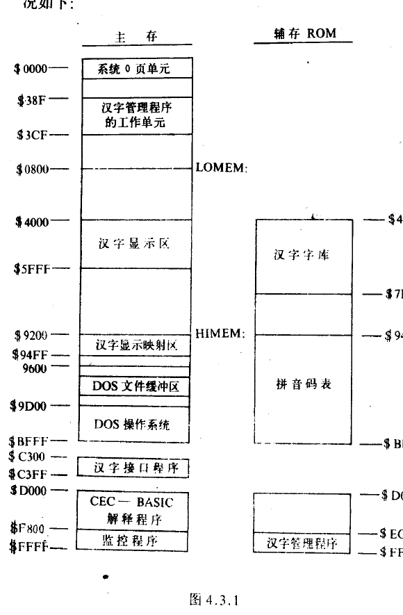

```
        主  存 (RAM / 主存 ROM)             辅 存 ROM
$0000 ┌─────────────────────────┐
      │      系统 0 页单元      │
$038F ├─────────────────────────┤
      │ 汉字管理程序的工作单元  │
$03CF ├─────────────────────────┤
$0800 ├─────────────────────────┤ LOMEM:
      │                         │
$4000 ├─────────────────────────┤            $4000 ┌─────────────────────┐
      │       汉字显示区        │                  │      汉字字库       │
$5FFF ├─────────────────────────┤            $7FFF ├─────────────────────┤
      │                         │
$9200 ├─────────────────────────┤ HIMEM:     $9400 ├─────────────────────┤
      │     汉字显示映射区      │                  │                     │
$94FF ├─────────────────────────┤                  │      拼音码表       │
$9600 ├─────────────────────────┤                  │                     │
      │      DOS 文件缓冲区     │                  │                     │
$9D00 ├─────────────────────────┤                  │                     │
      │       DOS 操作系统      │            $BFFF └─────────────────────┘
$BFFF ├─────────────────────────┤
$C300 ├─────────────────────────┤
      │      汉字接口程序       │
$C3FF ├─────────────────────────┤
$D000 ├─────────────────────────┤            $D000 ┌─────────────────────┐
      │    CEC-BASIC 解释程序   │                  │                     │
$F800 ├─────────────────────────┤            $EC00 ├─────────────────────┤
      │        监控程序         │                  │    汉字管理程序     │
$FFFF └─────────────────────────┘            $FFFF └─────────────────────┘
```

汉字系统所使用的工作单元情况如下：
- **0 页**：`$D6`、`$D7`、`$ED～$EF`、`$F9～$FF`
- **3 页**：`$38F～$3CF`

在用户需要扩充汉字输入方式时，下述工作单元可以提供给用户使用：

| 符号名 | 单元地址 | 功能说明 |
| :--- | :--- | :--- |
| `EXPAND` | `$038F` | 用户扩充输入方式字符处理入口 |
| `EXPDIS` | `$0391` | 用户扩充输入方式状态显示入口 |
| `JRP` | `$0399` | 键入区指针 |
| `JRQSH` | `$039A～$039F` | 键入区 |
| `HZSH.` | `$03A0～$03A1` | 汉字区首地址 |
| `HZQSH` | `$03A2～$03AD` | 汉字区 |
| `FLAGC` | `$03AE` | 状态标志 |
| `HZP` | `$03AF` | 汉字区指针 |
| `SHPL.` | `$03B0` | 声母表指针低字节 |
| `SHPH.` | `$03B1` | 声母表指针高字节 |
| `YMHPL.` | `$03B2` | 韵母行指针低字节 |
| `YMHPH.` | `$03B3` | 韵母行指针高字节 |
| `YML.` | `$03B4` | 韵母列指针 |
| `RJP.` | `$03B5` | 二级表指针 |
| `ZFQP` | `$03B6` | 字符区指针 |
| `RJJ.` | `$03B7` | 二级字计数单元 |
| `JSDY.` | `$03B8` | 计数单元 |
| `JSDY1.` | `$03B9` | 计数单元 |
| `YJCD.` | `$03BA` | 一级字长度 |
| `RJCD.` | `$03BB` | 二级字长度 |
| `DYJ.` | `$03BC` | 第一键标志 |
| `YJBZ.` | `$03BD` | 音节标志 |
| `ZFQ` | `$03BE～$03BF` | 字符区 |
| `JRQSH1.` | `$03C0～$03C5` | 键入区 1 |
| `JRP1.` | `$03C6` | 键入区 1 指针 |
| `TGBZ.` | `$03C7` | 退格标志 |

> [!NOTE]
> 其中以点结尾的变量名为拼音方式所使用。在不使用拼音方式时可提供给其他输入方式使用。不以点结尾的变量名为各种汉字输入方式共同使用，包括用户扩充的输入方式。

---

## 3.4 汉字系统的修改与扩充

### 3.4.1 打印机控制命令的修改

在汉字管理程序中，打印机驱动程序的设计仅适用于九针图形打印机。其型号要求必须与 EPSON MX-80 Ⅲ 型打印机相兼容，如：FX-80 Ⅲ、RX-80 Ⅲ、CP-80 Ⅲ、FX-100+ 和 YAMATO 等型号的打印机。而对于 MX-80 Ⅱ、FX-80 Ⅱ、RX-80 Ⅱ 等型号的打印机均不适用。

为了满足拥有上述 Ⅱ 型打印机，以及其它型号打印机的用户也能使用中华学习机进行汉字的打印，可以通过由用户修改打印控制命令的办法来解决。

#### 一、修改走纸命令

在 MX-80 Ⅱ 型打印机上，没有 $n/216$ 英寸走纸功能，所以必须把打印驱动程序中所使用的 `ESC 3 m` 命令修改成 `ESC A m` 命令，这样才能打印汉字。

该命令序列，我们在打印驱动程序中分别放在 `LFCODE0`、`LFCODE2`、`LFCODE4`（控制上半行打印走纸）和 `LFCODE0`、`LFCODE2`、`LFCODE3`（控制下半行打印走纸）中。在启动进入汉字系统后，我们可以选择执行下列二段程序之一，便能在 MX-80 Ⅱ 型打印机上打印汉字。

> [!CAUTION]
> 在执行了上述程序后，前四种打印字型不能使用，执行 `POKE 1659, n` 命令时，$n$ 值必须在 5～15 之间。

**程序一（BASIC 语句修改方式）：**
```basic
5 REM MX-80 II CHANGES LFCODE
10 POKE 916,27: POKE 918,65: POKE 919,8: POKE 920,8
```

**程序二（机器语言汇编修改方式）：**
```assembly
; SOURCE FILE: CHANG1
0000 :        1 *   MX-80 II CHANGES LF.CODE
0000 :        2 **********************************
; ---- NEXT OBJECT FILE NAME IS CHANG1.OBJ0
1000 :        3     ORG   $1000
0394 :        4 LFCODE0 EQU $0394
0396 :        5 LFCODE2 EQU $0396
0397 :        6 LFCODE3 EQU $0397
0398 :        7 LFCODE4 EQU $0398
1000 : A9 1B  8     LDA   #$1B
1002 : 8D 94 03 9   STA   LFCODE0
1005 : A9 41 10     LDA   #$41
1007 : 8D 96 03 11  STA   LFCODE2
100A : A9 08 12     LDA   #$08
100C : 8D 97 03 13  STA   LFCODE3
100F : 8D 98 03 14  STA   LFCODE4
1012 : 60    15     RTS
1013 :       16 **********************************
; *** SUCCESSFUL ASSEMBLY: NO ERRORS
```

#### 二、修改打印密度

位图象打印控制命令格式为 `ESC X n1 n2`，这里 X 可以是“`K`”或“`L`”。它们分别表示标准密度打印和倍密度打印。在汉字打印驱动程序中，我们选用的是倍密度打印（即 X 取的是字符“`L`”）。如果用户希望使用标准密度打印，可以通过对 `TPCODE` 单元的修改来完成。

在进入汉字系统后，在用户程序中只要执行语句：
```basic
POKE 915, 75
```
便可实现打印密度的转换（字符“K”的 ASCII 码为 75）。

无论是对走纸命令，还是对打印密度命令进行修改之后，退回到文本显示状态，再重新进入汉字系统时，只要不破坏 1147（`$47B`）单元的内容，修改值是不会被破坏的。

---

### 3.4.2 用户汉字输入方法的扩充

如果用户希望扩充新的汉字输入方法，可以使用中华学习机汉字系统已提供的各种功能。

中华学习机的汉字系统提供 **F4** 和 **F5** 两个键作为进入用户扩充输入方式的功能键。

汉字系统对 F4 或 F5 键的处理如下：
- 当按下 F4 或 F5 键后，系统判别扩充状态显示入口 `EXPDIS ($391)` 是否为 RTS 指令。若是，则重新读键盘，否则转入 EXPDIS 执行，显示用户提供的状态提示字，将状态标志单元 `FLAGC ($03AE)` 置为 F4 或 F5 的键码。F4 的键码是 `CTRL-T`，F5 的键码是 `CTRL-F`。
- 此后，再键入的字符只要是大于等于 `$A0` 的码（即可显示的字符）或等于 `$88`（退格键）都转到用户扩充的输入处理程序入口地址 `EXPAND ($38F)` 去执行。其他控制字符由系统程序内部处理。
- 键入字符是通过 A 累加器转到用户输入处理程序的。当返回时，A 累加器的内容为零，则系统继续读键；非零，则将 A 中内容送入键盘输入缓冲区。

根据上述系统程序的处理，用户的输入程序需要完成下述任务：

1. **修改入口指针**：进入汉字系统后，运行用户输入程序。该程序要修改 EXPDIS 中的内容，使其指向用户显示状态字的处理程序入口。修改 EXPAND 中的内容，使其指向用户输入处理程序的入口。
   例如，设用户显示状态字程序入口为 `USER1`，用户输入处理程序入口为 `USER2`。修改指针的程序可如下编制：
   ```assembly
   START   LDA   #<USER1
           STA   EXPDIS
           LDA   #>USER1
           STA   EXPDIS+1
           LDA   #<USER2
           STA   EXPAND
           LDA   #>USER2
           STA   EXPAND+1
           RTS
   ```
   *(注：原书示例代码中高低字节符号印为 `# > USER1`，实际 6502 存储两字节地址为低字节在前、高字节在后。)*

2. **编制状态字显示程序**：用户显示状态字程序只要将状态字字符区的首地址填入状态指针单元（即 `ZTZZ`）即可。
   例如，上例中显示状态字程序入口为 `USER1`，设状态字符区首地址为 `STATUS`，状态字为“国标”，则显示状态字程序可如下编制：
   ```assembly
   USER1   LDA   #>STATUS
           STA   ZTZZ
           LDA   #<STATUS
           STA   ZTZZ+1
           JSR   ZT.XS1
           JMP   SLECTA2
   STATUS  DFB   $7F, $B9, $FA   ; (国)
           DFB   $7F, $B1, $EA   ; (标)
           DFB   $3A, $20        ; (:)
   ```
   上例中状态指针单元 `ZTZZ` 为 `$FB`、`$FC`。`ZT.XS1` 为汉字系统提供的显示状态字子程序入口。`JMP SLECTA2` 是将有效内存切换到辅存 2，返回。这是因为调用 ZT.XS1 后，汉字系统将有效内存切换到主存 ROM BASIC 存储区，而用户扩充的输入程序执行完某一功能是要返回汉字系统程序的，而汉字系统程序在辅存 2 中，因此，在返回系统程序前要切换到辅存 2，然后返回。

3. **按键字符处理与退格判断**：用户输入程序对输入字符的处理，应首先判别 A 累加器中是否为 `$88`，即退格键。若是，则转到退格键处理。否则为输入字符处理。

4. **暂存输入字符**：当用户需要将输入字符暂存时，可使用键入区 `JRQSH ($039A～$039F)` 和键入区指针 `JRP ($0399)`。对 JRQSH 中内容的存取是通过首地址（即 `JRQSH = $039A`）加位移量（JRP 的值）确定的。

5. **在状态行显示键入提示**：当用户需要在屏幕状态行上显示键入字符作为提示时，可调用 `ZT.XS2 ($C377)`。此调用将按 JRP 的值将 JRQSH 中的字符显示到状态行上。例如，若 `JRP = 2`，则显示 JRQSH 区中前两个字符，若 `JRP = 0` 则清除显示提示。

6. **汉字备选区存放**：当用户需要存放与键入的音或形有关的汉字时，可以使用汉字区 `HZQSH ($03A2～$03AD)` 和汉字区指针 `HZP ($03AF)`。对 HZQSH 中内容的访问是通过首地址（即 HZQSH）加位移量（HZP 的值）确定的。

7. **在状态行显示汉字备选项**：当用户需要在屏幕状态行上显示汉字提示时，可调用 `ZT.XS3 ($C380)`。此调用将按汉字区指针 HZP 的值将 HZQSH 区中的汉字显示到状态行上。注意，HZQSH 中的汉字码为异形国标码，最多放六个。ZT.XS3 将自动在每个汉字前插入序号并显示。

8. **向系统键盘缓冲区送汉字**：用户需要将汉字码送入系统键盘缓冲区时，必须使用字符区 `ZFQ`，将学习机内码的区位码放入 `ZFQ ($03BE)` 和 `ZFQ+1 ($03BF)`。将字符区指针 `ZFQP ($03B6)` 放入 2。然后将 `$FF` 送入 A 中，切内存到辅存 2，返回。

9. **内码与异形国标码转换**：
   - 若用户需要将异形国标码转换为学习机内码，可将异形国标码放在 A 中，调用 `USR.DCOD ($C389)`，返回时 A 中为学习机内码。
   - 若需要将学习机内码转换为异形国标码，可将学习机内码送 A，调用 `USR.ECOD ($C392)`，返回时 A 中为异形国标码。

10. **退格键规范**：对于退格键，系统规定为先退状态行键入的提示字符，当提示字符退完后，即 `JRP = 0` 后，再退光标提示处的字符。用户只需将 JRP 的值减 1，再调用一次 `ZT.XS2`，即可删除一个键入提示字符。用户也可以根据自己的需要，调用 `BACKSP ($C39B)`，使光标处删除一个字符。

---

# 附录 A 汉字管理系统程序框图

## 一、汉字系统的启动程序

汉字系统启动时首先判断标志单元 `$47B` 的值是否为 3。若为 3，说明系统已处于汉字状态，直接重设 KSW/CSW 入口与显示方式后返回；否则执行完整的初始化操作，包括清空高分辨图形第二页、设置 KSW/CSW 入口、显示汉字标题“中华学习机”、初始化打印控制单元并显示状态提示。

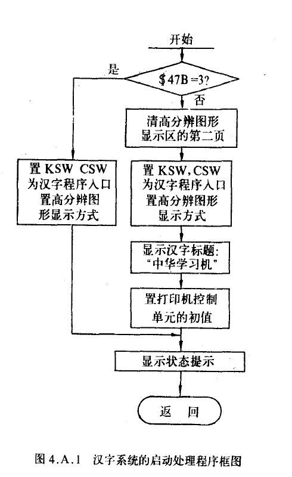

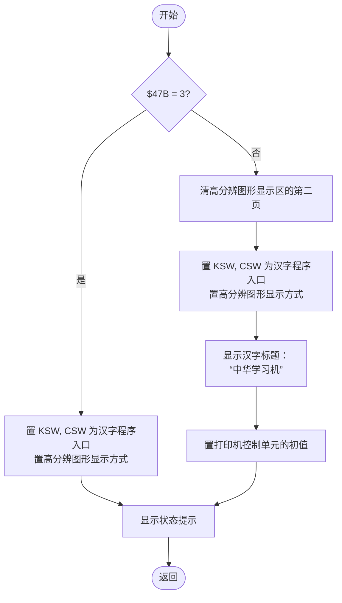

---

## 二、CSW 处理程序

CSW 是屏幕输出管理程序。字符输出时先检查是否为退出汉字系统命令（`CTRL-Q` / `CHR$(17)`），接着处理打印输出和显示控制字符。如果是普通字符或汉字引导符 `$7F`，则分别转入 ASCII 字符显示程序或汉字内码拼装转换流程。

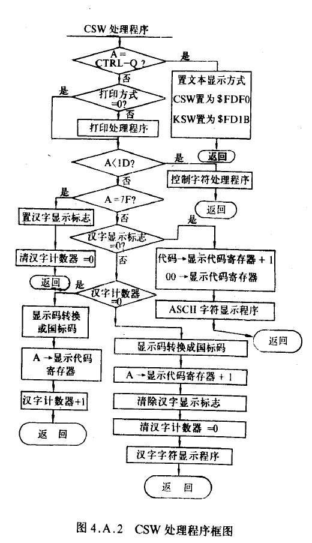

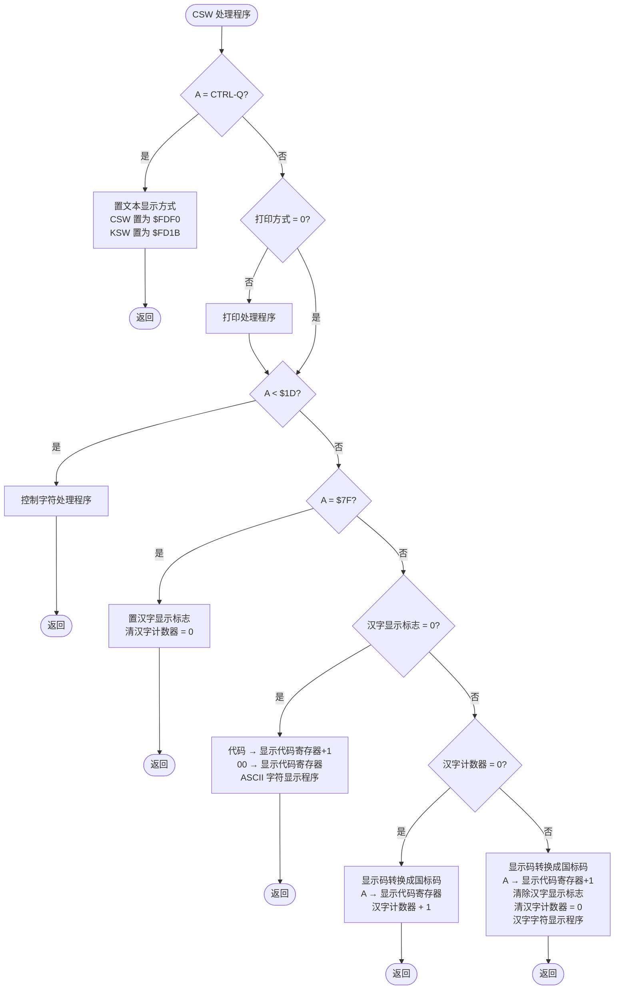

### 字符显示处理程序

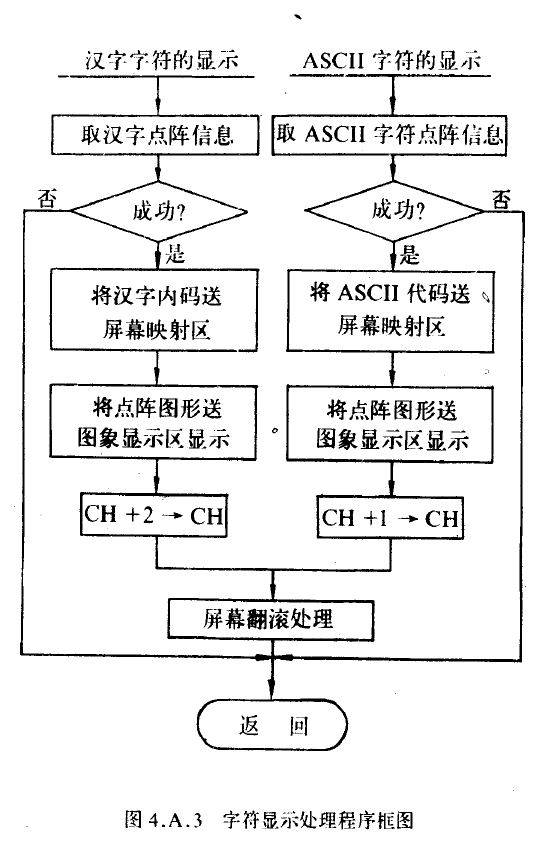

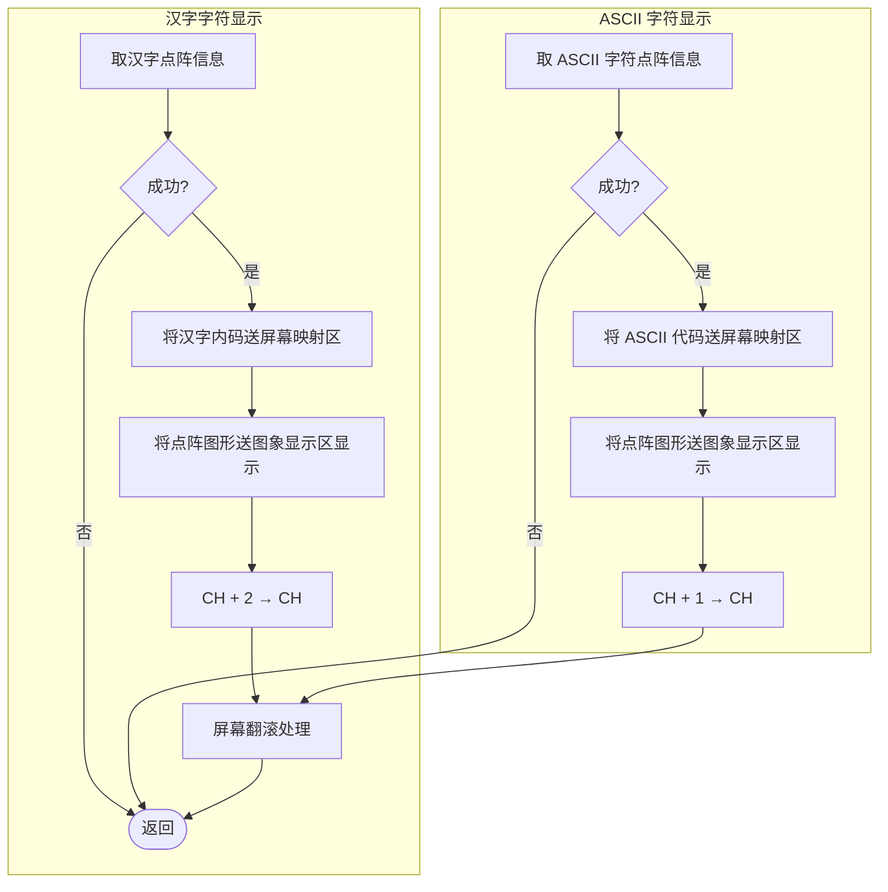

### 打印处理程序

打印处理程序接收输出字符并判断回车换行。如果触发打印，程序将根据设定行允许字数和字间距进行分行排版，并向 Centronics 打印接口发送图象点阵打印控制命令。

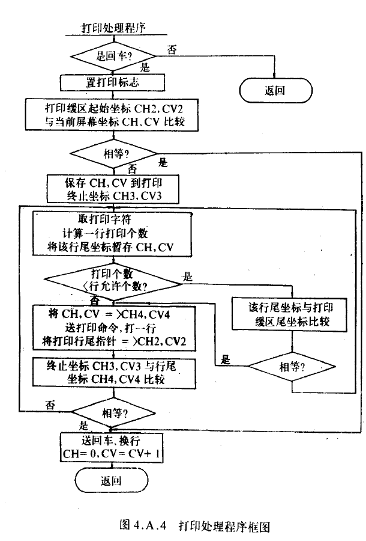

### 显示控制字符处理程序

汉字系统对 ASCII 控制字符进行了专门的拦截与图形光标重定位，支持响铃、换行、清屏、反相显示及状态提示行控制。

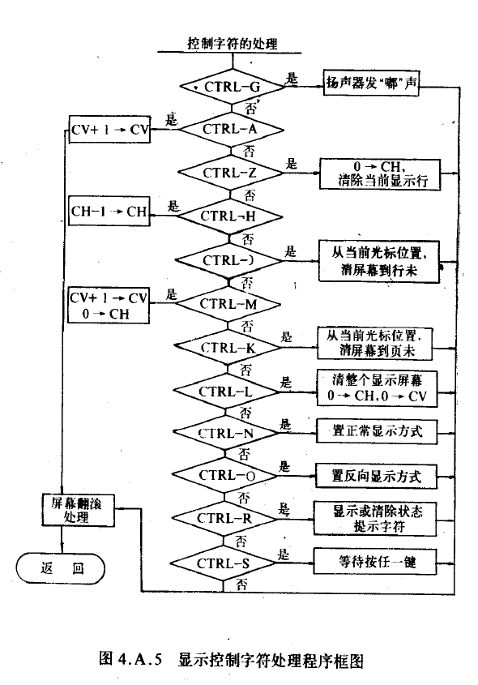

---

## 三、KSW 处理程序

KSW 处理程序是键盘输入管理的核心，负责读取按键、分析控制键、分派拼音/区位输入法以及调用用户自定义扩充输入法。

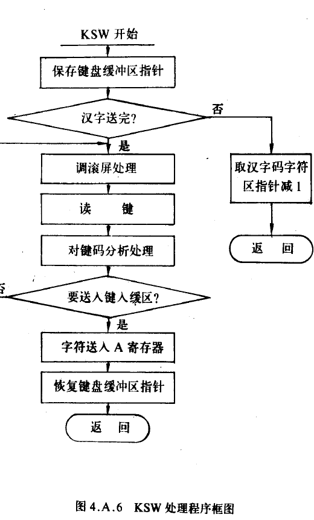

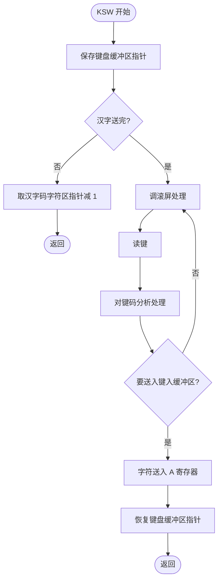

### 键码分析与可显示字符处理

当键入一个可显示字符时，系统根据当前激活的输入方式（字母方式、拼音方式、区位方式、F4/F5 用户扩充方式）分别路由处理。

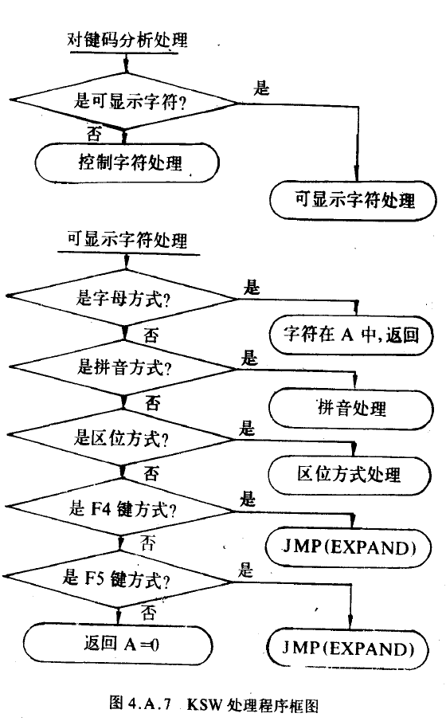

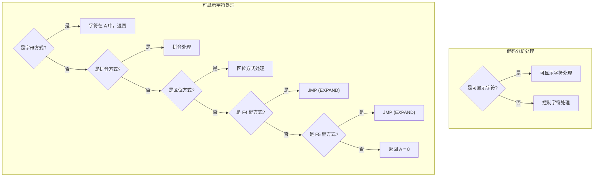

### 控制键处理程序

控制键处理程序对回车、ESC 键、F1/F2/F3 方式切换键、F4/F5 用户扩充键、`CTRL-O`、退格键、进格键等进行集中分支处理。

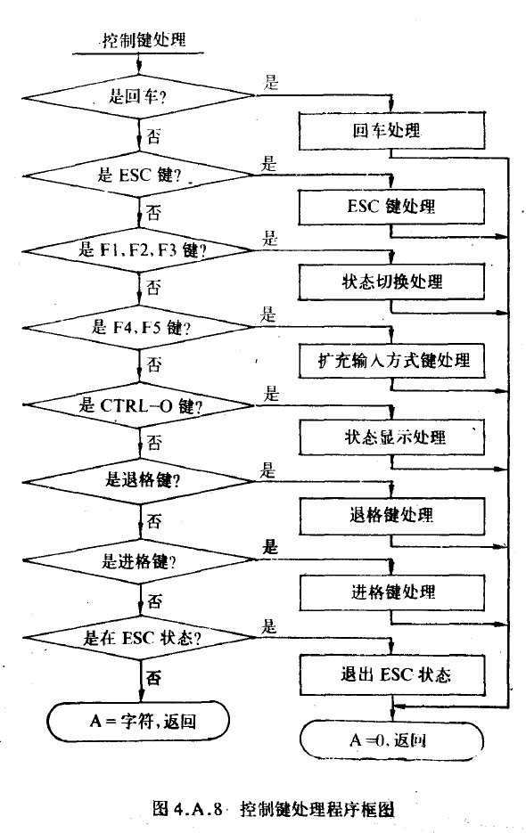

### 拼音方式处理程序

拼音处理程序支持声母、韵母查表、同音字翻页查找（`<`、`>` 键）、标点符号输入（`-` 键）、算术符号输入（`=` 键）和制表线输入（`\` 键）。

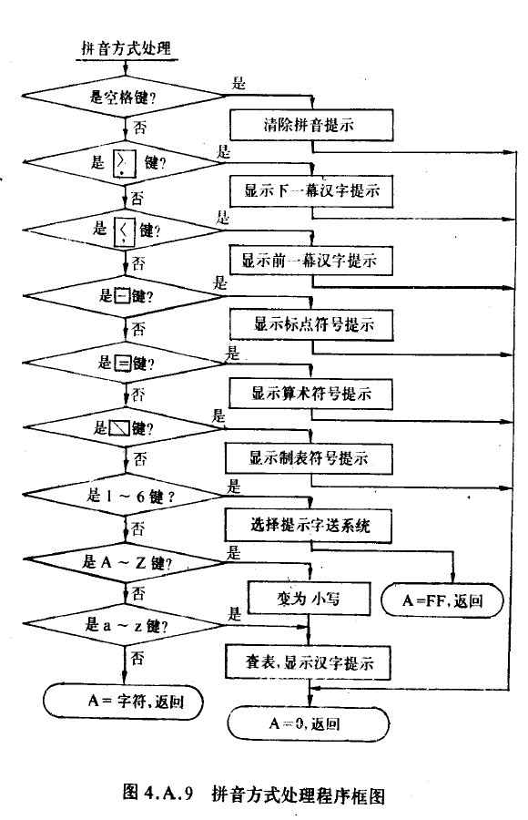

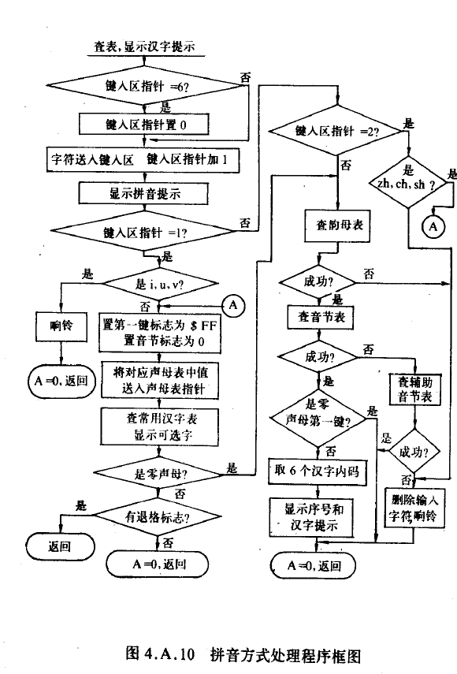

### 区位方式处理程序

区位方式接收 4 位数字作为国标区位码，自动校验有效性并转换为异形国标码及学习机内码。

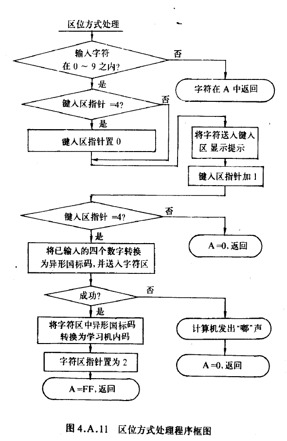
