# 第五部分 DOS 3.3 操作系统分析报告

# 第一章 DOS 3.3 磁盘操作系统概述

## 1.1 DOS 3.3 磁盘操作系统的结构

DOS 3.3 磁盘操作系统从结构上可以分成三个主要部分：

1. **主体程序**：它是 DOS 操作系统的主程序。它包括有：DOS 操作的启动入口程序，与 BASIC 的接口程序，DOS 命令解释程序。
2. **文件管理程序**：磁盘文件的读写和维护管理程序。
3. **磁盘驱动程序 (RWTS)**：磁盘扇区的读写及格式化操作程序。

DOS 操作系统的这三个部分之间的关系如图 5.1.1 所示。它们之间具有明确的层次关系，外层程序可以通过一定的命令参数来调用内层的程序模块，反之不行。


<p align="center"><b>图 5.1.1 DOS 的层次结构</b></p>

---

## 1.2 DOS 操作系统的内存分配

DOS 3.3 磁盘操作系统是用 6502 指令编写的，当系统引导后，将被装入主机内存，整个 DOS 操作系统为常驻内存。

在经过 DOS 操作系统初始化的磁盘上，第 0 ～ 2 道上装有 DOS 操作系统程序，因此它们都可用来引导系统。DOS 操作系统装入的内存地址与用来引导的盘有关。若用系统主盘进行引导，DOS 操作系统将装入到当前系统的最高内存处，如果用从属盘进行引导，则装入到与该从属盘进行初始化时的系统相同的内存位置。因此在较大内存的系统上初始化后的盘片不能在较小内存的系统上执行引导。

以内存为 48KB 的系统为例，DOS 操作系统所占用的内存地址如图 5.1.2 所示。

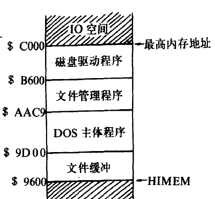
<p align="center"><b>图 5.1.2 DOS 内存分配</b></p>

DOS 操作系统程序占内存约 10K，其中，主要程序占 3.5K，文件管理程序占 2.8K，RWTS 程序占 2.5K。另外文件缓冲区占 1.75K。这样的文件缓冲区最多可放三个文件，每个文件的文件缓冲区为 595 个字节。

---

## 1.3 DOS 与 I/O 驱动程序的接口

输入 / 输出设备与主机相连接，一般均需要配有 I/O 驱动程序对它进行管理。对于主机板上提供的输入 / 输出设备来说，其驱动程序已包含在主机上的监控管理程序中。例如：显示器，键盘，磁带机等接口。而对于在主机扩充槽口上所连接的设备，其驱动程序在各个槽口所占用的地址空间中，例如：软盘驱动器接口，打印机，汉字卡，通讯卡，80 列显示卡等。在整个机器系统中，要有一个控制程序来完成 I/O 的切换和控制工作。即在系统需要进行输入 / 输出操作时，转入指定的 I/O 设备的驱动程序去执行。

### 1.3.1 监控程序的 I/O 控制

监控程序中设立了两个寄存器，一个是输入寄存器 KSW（地址为 `$38`, `$39` 单元），另一个是输出寄存器 CSW（地址为 `$36`, `$37`），它们的内容指出了当前输入和输出驱动程序的入口地址。

在没有 DOS 操作系统的情况下，KSW 指出的是监控程序中的键盘输入程序的入口地址（`$FD1B`），CSW 指出的是监控程序中的屏幕输出程序的入口地址（`$FDF0`）。在用监控命令或 BASIC 命令进行 I/O 设备切换时（例如：`PR# n`, `IN# n`, `nCTRL-K`, `n CTRL-P` 等），修改这二个寄存器，就可以指向不同的 I/O 驱动程序。

### 1.3.2 DOS 操作系统下的 I/O 控制

在 DOS 操作系统装入后，监控程序的输入 / 输出寄存器指出的是 DOS 操作系统的程序地址：KSW 指向 DOS 的输入程序的入口地址（`$9E81`），CSW 指向 DOS 的输出程序的入口地址（`$9EBD`）。

DOS 操作系统程序本身也有一对输入和输出寄存器，地址分别为 `$AA53` ～ `$AA54` 和 `$AA55` ～ `$AA56`。由它们分别指向当前 I/O 驱动程序的入口地址。一般情况下，它仍然是指向监控程序中的键盘输入程序入口（`$FD1B`）和屏幕输出程序入口（`$FDF0`）。

> [!NOTE]
> 原书第 234 页第 23 行印为 `($ FD18)`，依 Apple II / CEC-I 标准监控程序实际键盘入口地址应为 `$FD1B` (KEYIN)。

无论是否引导 DOS 操作系统，BASIC 解释程序和监控程序都将根据 KSW 和 CSW 寄存器的指针转向输入 / 输出操作的入口。

---

# 第二章 磁盘信息的组织与管理

## 2.1 磁盘的分配

APPLE Ⅱ / 中华学习机配置使用的是单面单密度 5.25 英寸软盘片。每张盘片在 DOS 3.3 操作系统支持下划分为 35 个磁道，每道划分为 16 扇区，每个扇区可记录 256 个字节的用户信息，所以整张软盘可储存 143KB 信息。

对于每张经 DOS 初始化操作后的软盘，第 0, 1, 2 道上存放的是 DOS 操作系统的副本程序。第 17 道存放的是磁盘管理信息。而其它磁道才可用来存放用户程序，所以用户实际可用的盘区为 496 个扇区，共 124KB。

系统对用户文件在磁盘上的空间分配顺序为：从第 18 道向第 35 道依次分配，然后再从第 16 道向第 3 道依次分配。这样安排的目的是要使经常访问的盘管理信息及文件信息尽量位于磁盘的中央道附近，以减少访盘时磁头移动的相对距离，以提高访盘的速度。

---

## 2.2 磁盘的管理信息

在 DOS 软盘的第 17 道上存放有部分磁盘管理信息，它包括有 VTOC 和文件目录区二部分。

### 2.2.1 VTOC 表

VTOC（Volume Table of Contents）占用一个扇区，位于 17 道 0 扇区，它给出的是磁盘的一些标志及盘区的分配情况，如表 5.2.1 所示。

<p align="center"><b>表 5.2.1 磁盘标志及盘区分配区</b></p>

| 字节($) | 内 容 |
| :--- | :--- |
| `$00` | 未用 |
| `$01` ～ `$02` | 第一个目录区段的道号和区号 |
| `$03` | 对该盘进行格式化的 DOS 的版本号 |
| `$04` ～ `$05` | 未用 |
| `$06` | 盘卷号（1 ～ 254） |
| `$07` ～ `$26` | 未用 |
| `$27` | 在一个道 / 区表扇区中所能存放的道 / 区对的最大数（122） |
| `$28` ～ `$2F` | 未用 |
| `$30` | 已分配的最后一道 |
| `$31` | 盘的分配方向（+1 或 -1） |
| `$32` ～ `$33` | 未用 |
| `$34` | 每个盘的道数（35） |
| `$35` | 每道的扇区数（13 或 16） |
| `$36` ～ `$37` | 每个扇区的字节数 |
| `$38` ～ `$3B` | 第 0 道的自由扇区图 |
| `$3C` ～ `$3F` | 第 1 道的自由扇区图 |
| …… | …… |
| `$C0` ～ `$C3` | 第 34 道的自由扇区图 |
| `$C4` ～ `$FF` | 若盘上的磁道数大于 35，则仍放其自由扇区图 |

在 VTOC 表中，对磁盘上的每一磁道都分配 4 个字节作为自由扇区的标志字节，它标出该磁道中哪些扇区已被使用。扇区分配原则是从 `$0F` 区向 `$00` 区依次进行。自由扇区图的安排如下：

| 字节 | 对应扇区 |
| :---: | :---: |
| 0 ～ 1 | F E D C B A 9 8 7 6 5 4 3 2 1 0 |
| 2 ～ 3 | 未 用 |

前二个字节中，每一位对应于一个扇区，已使用的扇区对应位为 0，未使用的扇区对应位为 1。

### 2.2.2 文件目录区

文件目录区放在 `$11` 道的 `$01` ～ `$0F` 扇区中，一般从 `$0F` 扇区依次向 `$01` 扇区存放。每一个目录扇区可以存放 7 个文件项，所以一张盘最多可以存放 105 个不同的文件。

由于文件目录的第一个扇区位置由 VTOC 中的指针指出，而下一个目录扇区又是由前一个目录扇区中的链接指针所指出，所以很容易修改标准 DOS，使其文件目录区存放在软盘的其它位置，而且目录扇区的个数也可以适当增加，使得在一个盘上可以存放更多的文件。

文件目录扇区的安排如表 5.2.2 所示。

每一个文件均有一个文件描述项，它占有 35 个字节位置，文件描述项内容如表 5.2.3 所述。

文件类型及标志如表 5.2.4 所述。

当 DOS 操作系统访问某个盘文件时，首先读入 VTOC 表，从中找出第一个目录扇区的位置，从该目录扇区开始按链接指针查找各个目录扇区，直到从中找到所需文件的文件描述项为止。从文件描述项中可得到该文件的基本情况（文件类型，文件长度，在盘上的位置等），然后再根据磁道 / 扇区表（T / S 表）可找到该文件的全部信息。

<p align="center"><b>表 5.2.2 文件目录扇区的安排</b></p>

| 字节 | 内 容 |
| :--- | :--- |
| `$00` | 未用 |
| `$01` ～ `$02` | 下一个文件目录扇区的道号（`$11`），扇区号 |
| `$03` ～ `$0A` | 未用 |
| `$0B` ～ `$2D` | 第一个文件描述项 |
| `$2E` ～ `$50` | 第二个文件描述项 |
| ⋮ | ⋮ |
| `$DD` ～ `$FF` | 第七个文件描述项 |

<p align="center"><b>表 5.2.3 文件描述项内容</b></p>

| 字节 | 内 容 |
| :--- | :--- |
| `$00` ～ `$01` | 第一个道 / 区表扇区的道号、区号 |
| `$02` | 文件类型及标志 |
| `$03` ～ `$20` | 文件名（占 30 个字符） |
| `$21` ～ `$22` | 以扇区为单位表示的文件长度 |

<p align="center"><b>表 5.2.4 文件类型及标志</b></p>

| 未封锁 | 已封锁 | 文件类型 |
| :---: | :---: | :--- |
| `$00` | `$80` | 文本文件 (T) |
| `$01` | `$81` | 整数 BASIC 文件 (I) |
| `$02` | `$82` | APPLESOFT 文件 (A) |
| `$04` | `$84` | 2 进制文件 (B) |
| `$08` | `$88` | S 型文件 |
| `$10` | `$90` | R 型文件（EDASM 生成的） |
| `$20` | `$A0` | 新 A 型文件 |
| `$40` | `$C0` | L 型文件（新 B 型文件，由 LISA 程序建立） |

---

## 2.3 磁盘文件的存储格式

### 2.3.1 磁道 / 扇区表

每个文件均有一相应的磁道 / 扇区表，用来指明该文件在盘上占用了哪些磁道和扇区。文件描述项中指明了某文件的磁道 / 扇区表的第一个扇区的位置。磁道 / 扇区表为 256 个字节，其格式如表 5.2.5 所示。

当访问某一文件时，从文件描述项中得到该文件的磁道 / 扇区表的位置，然后从该表中得到各文件扇区所占用的磁盘位置。当文件的长度超过 122 个扇区时，则需要分配另一个磁道 / 扇区表扇区。由于任何文件至少要有一个磁道 / 扇区表扇区，所以即便是一个空文件，它也至少占用 2 个扇区的磁盘空间。

<p align="center"><b>表 5.2.5 磁道 / 扇区表</b></p>

| 字节 | 内 容 |
| :--- | :--- |
| `$00` | 未用 |
| `$01` ～ `$02` | 下一个磁道 / 扇区表所占磁道号，扇区号 |
| `$03` ～ `$04` | 未用 |
| `$05` ～ `$06` | 该磁道 / 扇区表是本文件磁道 / 扇区表的第几个扇区 |
| `$07` ～ `$0B` | 未用 |
| `$0C` ～ `$0D` | 第 1 个文件扇区所占用的磁道号，扇区号 |
| `$0E` ～ `$0F` | 第 2 个文件扇区所占用的磁道号，扇区号 |
| …… | …… |
| `$FE` ～ `$FF` | 第 122 个文件扇区所占用的磁道号，扇区号 |

### 2.3.2 文件的存储格式

从文件描述项说明中可得知：文件的类型及标志占用一个字节，除封锁标志占用最高位以外，由 7 位字节加上全 0 共可表示 8 种类型的文件，但 DOS 3.3 操作系统本身能够直接建立和处理的文件类型只有四种：文本文件（T），整数 BASIC 程序（I），APPLESOFT 程序（A）和 2 进制文件（B）。其它几种类型的文件则需要由其它程序来建立和使用。例如：L 类型文件（新 B 型文件）需要由 LISA 汇编程序来建立和使用。

#### 1. 文本文件

文本文件一般是存放数据信息的文件。它分成随机文件和顺序文件两种。文本文件均由记录构成，每个记录之间用 CR 字符分隔，并以 `$00` 作为文件结束的标志，或以道 / 区表的指针的结束来标志文件的结束。顺序正文文件的各记录的长度是不定的，仅以 CR 作为分隔，所以信息一般以顺序方式读写。随机文件的各记录是定长的，因而读写可从任一指定的记录处开始。

文本文件中的所有信息均以可打印的 ASCII 字符形式存放，包括数字。所以可以用 `$00` 作为标志字节。也由于这一点，使得文本文件比起 2 进制文件来讲，处理速度要慢，占用的盘空间也增多（每一位数字要占一个字节）。

文本文件的存储格式为：

```text
记录 1  CR  记录 2  CR  记录 3  ……  CR  $00
```

#### 2. 2 进制文件

2 进制文件存放的是机器内存中的 2 进制信息的副本，即把内存中某一起始地址开始的一段信息保存到软盘上而生成的文件。

2 进制文件存储格式为：

```text
地址    长度    内存 2 进制信息映象
```

其中，地址指明了该段信息原先在主机内存中存放的起始地址，长度指内存映象的字节个数。它们均占用二个字节，先放低字节，后放高字节。

#### 3. BASIC 程序文件

在 DOS 操作系统中，把 BASIC 程序分成两种类型的文件（A 类型和 I 类型），其存储格式完全相同。

BASIC 程序文件的存储格式为：

```text
长度    程序的内存映象
```

其中，长度指的是该程序的内存映象的字节数，它占用二个字节，先放低字节，后放高字节。

---

# 第三章 DOS 主体程序的分析

DOS 操作系统主体程序是 DOS 的主控部分，它将完成整个操作系统的装入，启动操作，与 BASIC 程序的接口，以及 DOS 命令的解释和执行。

## 3.1 DOS 的引导与装入

DOS 的引导是将 DOS 操作系统软件从盘上装入到主机内存。DOS 操作系统软件放在软盘的 `$00` ～ `$02` 道，第 `$00` 道和 `$01` 道占用了 16 个扇区，第 `$02` 道占用了 5 个扇区，共 37 个扇区。

DOS 的引导和装入过程分三步完成。

### 3.1.1 BOOT0

当机器加电或执行 DOS 引导命令时，即执行磁盘的引导程序 BOOT0。其程序框图如图 5.3.1。

BOOT0 程序放在软盘驱动器控制接口卡上，由 `PR# n` 命令来启动执行。该程序的主要工作是从第 `$00` 道 `$00` 扇区读入 256 个字节，存放在 `$800` ～ `$8FF` 中去，这段程序称为 BOOT1，然后转入 BOOT1 程序去执行。所以 BOOT0 的工作可以说是装入并运行 BOOT1 程序。

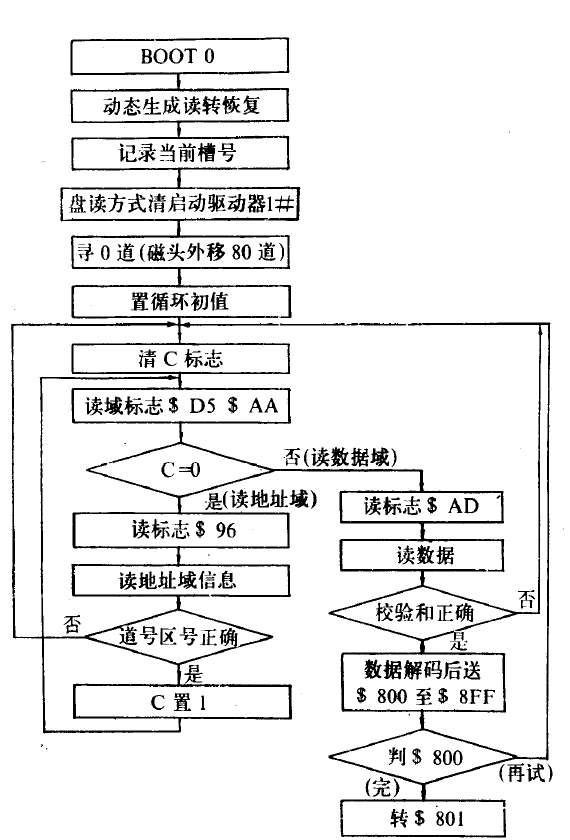
<p align="center"><b>图 5.3.1 BOOT0 框图</b></p>

### 3.1.2 BOOT1

BOOT1 程序的主要工作是装入 BOOT2 程序和 RWTS 程序，然后，转入 BOOT2 程序执行。BOOT1 框图如图 5.3.2。

BOOT1 中读扇区的工作是通过调用 BOOT0 来完成的，它将从盘上第 `$00` 道 `$00` ～ `$09` 扇区的信息装入到 DOS 的程序区中。装入的地址随主盘和从属盘而不同，对于主盘存放地址为 `$3600` ～ `$3FFF`，对 48K 系统的从属盘则存放地址为 `$B600` ～ `$BFFF`。

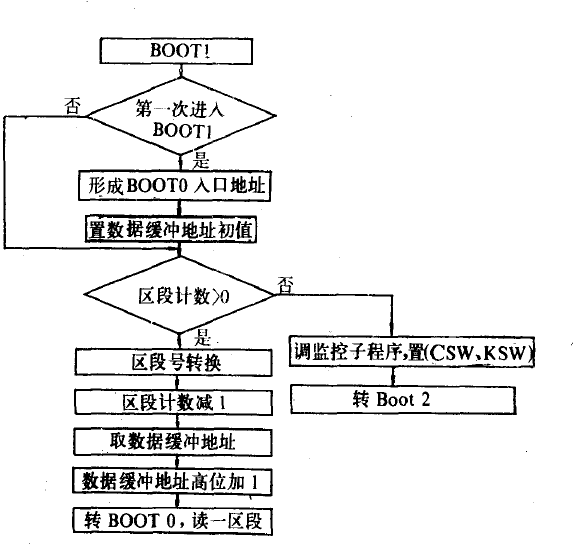
<p align="center"><b>图 5.3.2 BOOT1 框图</b></p>

### 3.1.3 BOOT2

BOOT2 程序由 BOOT1 程序装入并执行。其主要工作是：将整个 DOS 操作系统装入内存，然后转 DOS 的冷启动程序入口，参见图 5.3.3。

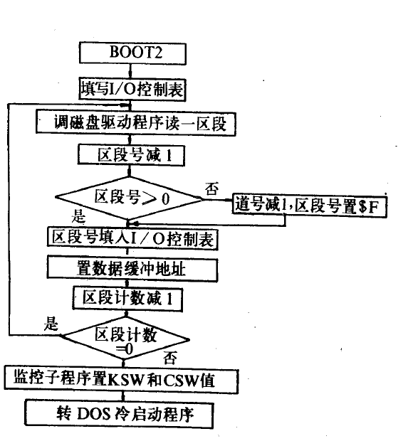
<p align="center"><b>图 5.3.3 BOOT2 框图</b></p>

BOOT2 程序是利用已装入的 RWTS 程序模块来读盘的。BOOT2 读入 DOS 的顺序是：先由 `$02` 道的 `$04` 扇区到 `$00` 扇区，然后是 `$01` 道 `$0F` 扇区到 `$00` 扇区，最后是 `$00` 道的 `$0F` 扇区至 `$0A` 扇区，共 27 个扇区。

对于从属盘来说，在 BOOT2 程序装入整个 DOS 之后，引导工作就算完成了。但对于主盘来说，还将执行 `$1B00` ～ `$1CFF` 中的一段移动程序将 DOS 操作系统程序从 `$1D00` ～ `$3FFF` 移到当前系统的最高内存位置。这段移动程序在软盘的第 `$00` 道的 `$0A` ～ `$0B` 扇区，也是由 BOOT2 程序装入的，移动操作完成后，再转入 DOS 的冷启动入口。

---

## 3.2 DOS 的冷启动过程

DOS 操作系统由三级引导装入内存后，便进入冷启动过程，其入口地址为 `$9D84`。它的主要工作：初始化 DOS 中的 BASIC 语言标志，置 DOS 的启动标志，然后转入 BASIC 解释程序，即退出 DOS。图 5.3.4 为冷启动程序框图。

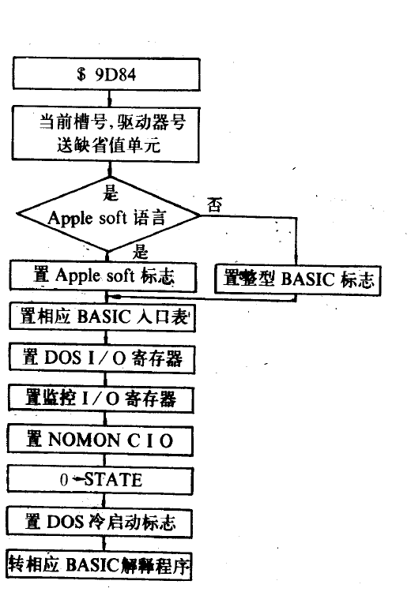
<p align="center"><b>图 5.3.4 冷启动程序框图</b></p>

---

## 3.3 DOS 的输入和输出程序

DOS 的输入和输出程序是 DOS 中的两个关键接口程序。它将完成 DOS 与 BASIC 的接口工作，DOS 通过对 BASIC 解释程序的输入和输出信息的截取，完成对 DOS 命令的识别、接收和处理。

在 DOS 操作系统完成冷启动操作后，监控的 I/O 寄存器已为 DOS 的输入程序和输出程序的入口所取代，一旦需要进行输入 / 输出时，BASIC 解释程序即把控制交给了 DOS。

### 3.3.1 DOS 输入程序（$9E81）

该程序的主要工作是：从当前输入设备上取得一字符。若是冷启动，第一次进入 DOS，则执行一段冷启动的初始化工作。图 5.3.5 为 DOS 键盘接收程序框图。

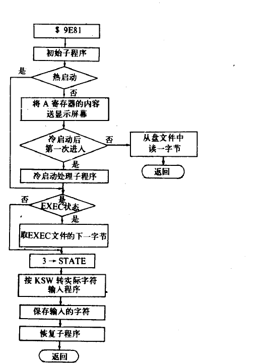
<p align="center"><b>图 5.3.5 DOS 键盘接收程序框图</b></p>

初始化子程序的工作包括：将 X, Y, S, A 寄存器的值保存到 DOS 的专用单元中，将 DOS 的 I/O 寄存器的值分别放入 KSW 和 CSW 中。

恢复子程序的工作包括：将保存的 X, Y, S, A 寄存器的值恢复，将 CSW 和 KSW 分别置成 DOS 的输出、输入程序的首址。

冷启动处理程序（入口地址：`$9DEA`）主要工作：初始化 BASIC 的标志单元，置 MAXFILES 的缺省值，初始化文件缓冲器，置 STATE 为 0 并置热启动标志，建立第三页向量表，最后执行 HELLO 程序。

### 3.3.2 DOS 输出程序（$9EBD）

该程序的主要工作：从当前输出设备上输出一个字符。同时查看输出的内容是否是命令，若是则截取 DOS 命令并转向命令扫描程序去识别。参见图 5.3.6。

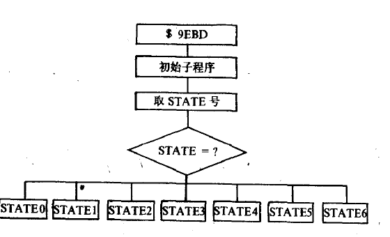
<p align="center"><b>图 5.3.6 屏幕输出入口程序</b></p>

DOS 输出程序处理的状态分为 7 种（STATE 0 ～ STATE 6）：

#### 1. STATE 0：输入行处理程序
从中区分出是否应截取 DOS 命令（图 5.3.7）。

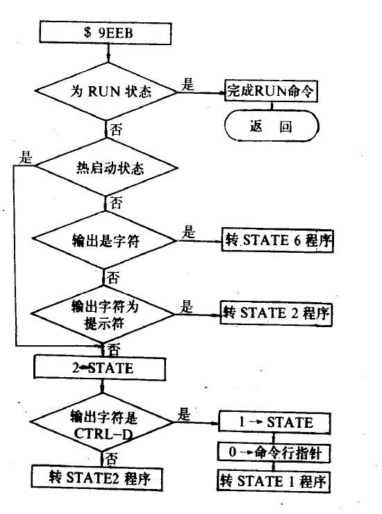
<p align="center"><b>图 5.3.7 STATE 0 程序</b></p>

#### 2. STATE 1：收集 DOS 命令
收集 DOS 命令，并转入命令扫描程序（图 5.3.8）。

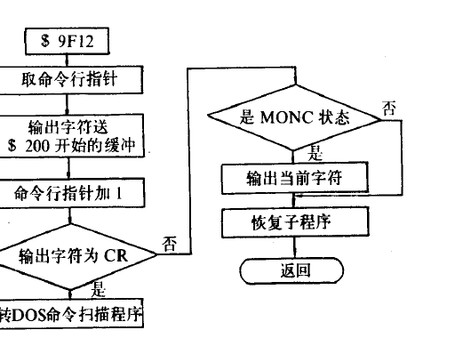
<p align="center"><b>图 5.3.8 STATE 1 程序</b></p>

#### 3. STATE 2：完成非 DOS 命令的字符输出
完成非 DOS 命令的字符输出（图 5.3.9）。

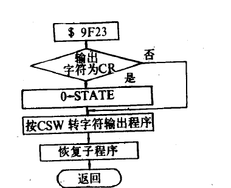
<p align="center"><b>图 5.3.9 STATE 2 程序</b></p>

#### 4. STATE 3：完成对 INPUT 命令的处理
若是在 EXEC 状态下，该输出字符串将作为命令执行（图 5.3.10）。

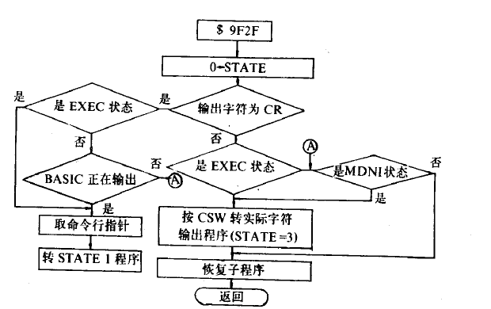
<p align="center"><b>图 5.3.10 STATE 3 程序</b></p>

#### 5. STATE 4：向文件写数据的处理
向文件写数据的处理（图 5.3.11）。

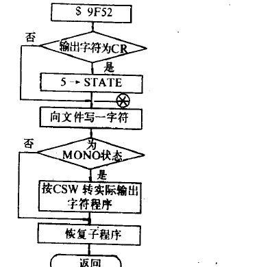
<p align="center"><b>图 5.3.11 STATE 4 程序</b></p>

#### 6. STATE 5：写入数据行的处理
写入数据行的处理（图 5.3.12）。

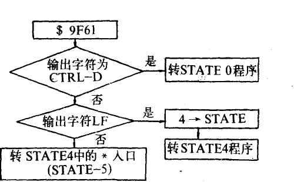
<p align="center"><b>图 5.3.12 STATE 5 程序</b></p>

#### 7. STATE 6：跳过提示符号
跳过提示符号（图 5.3.13）。

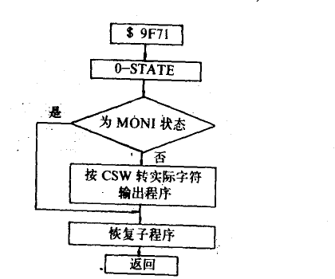
<p align="center"><b>图 5.3.13 STATE 6 程序</b></p>

---

## 3.4 DOS 命令扫描程序

由 STATE 1 完成 DOS 命令输入之后，即进入 DOS 命令扫描程序，它将完成对 DOS 命令的判断、识别和参数处理，然后转入各命令处理程序。参见图 5.3.14 和图 5.3.15。

在该程序运行过程中使用了三种表格：
1. **命令名称表**（`$A884` ～ `$A908`）：存放 DOS 命令名称的 ASCII 码。
2. **命令键字表**（`$A909` ～ `$A940`）：存放 DOS 命令应提供的参数标识符，程序将按照该表进行参数的接收处理。
3. **参数标识符号表**（`$A941` ～ `$A94A`）：存放参数标识符的符号。

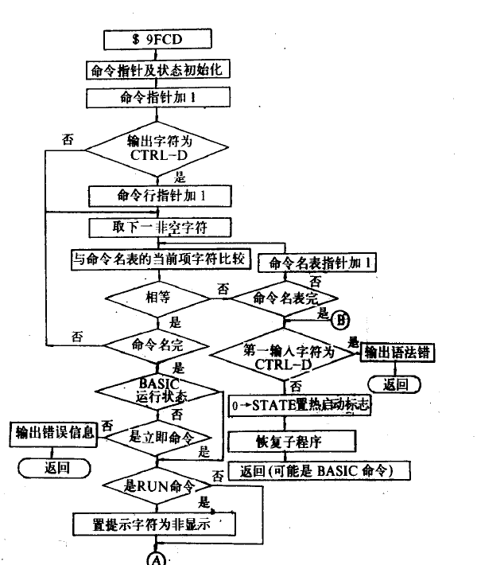
<p align="center"><b>图 5.3.14 DOS 命令扫描程序(一)</b></p>

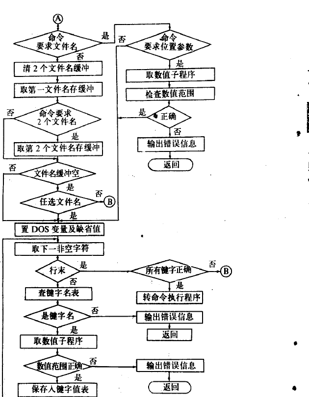
<p align="center"><b>图 5.3.15 DOS 命令扫描程序(二)</b></p>

---

## 3.5 DOS 命令执行程序

当 DOS 命令扫描程序识别了一个正确的 DOS 命令后，将转入命令执行程序（图 5.3.16）。DOS 命令入口地址如表 5.3.1 所述。

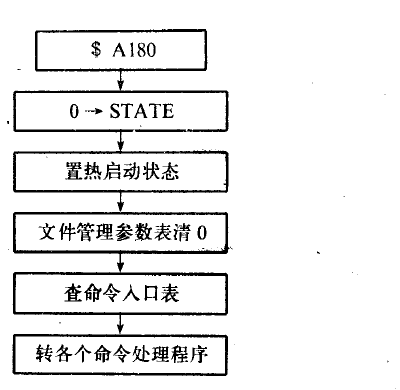
<p align="center"><b>图 5.3.16 DOS 命令执行程序</b></p>

<p align="center"><b>表 5.3.1 DOS 命令入口地址</b></p>

| 命令名称 | 入口地址 | 命令名称 | 入口地址 | 命令名称 | 入口地址 |
| :--- | :--- | :--- | :--- | :--- | :--- |
| INIT | `$A54F` | READ | `$A51B` | NOMON | `$A23D` |
| LOAD | `$A413` | EXEC | `$A5C6` | PR # | `$A229` |
| SAVE | `$A397` | WRITE | `$A510` | IN # | `$A22E` |
| RUN | `$A4D1` | POSITION | `$A5DD` | MAXFILES | `$A251` |
| CHAIN | `$A4F0` | OPEN | `$A2A3` | FP | `$A57A` |
| DELETE | `$A262` | APPEND | `$A298` | INT | `$A59E` |
| LOCK | `$A271` | RENAME | `$A281` | BSAVE | `$A331` |
| UNLOCK | `$A275` | CATALOG | `$A56E` | BLOAD | `$A35D` |
| CLOSE | `$A2EA` | MON | `$A233` | BRUN | `$A38E` |
| VERIFY | `$A27E` | | | | |
