# 第五部分 DOS 3.3 操作系统分析报告（后半部分）

[返回目录](README.md) ｜ [上一部分：第一章 ～ 第三章](part5a-dos-analysis-ch01-ch03.md)

---

# 第四章 文件管理程序

文件管理程序用来完成对磁盘文件的各种操作和管理，为用户提供一组对磁盘文件进行操作的命令。其中包括有：`OPEN`，`READ`，`WRITE`，`LOCK`，`UNLOCK`，`RENAME` 等 13 条命令。

DOS 文件管理程序是一个接口明确的模块程序，它允许 DOS 系统程序和用户程序来完成对指定文件的各项操作。

---

## 4.1 文件缓冲区

文件缓冲区（图 5.4.1）是磁盘文件与主机内存之间进行信息交换的过渡单元，DOS 操作系统为每个活动的文件在主存中都分配一个文件缓冲区，DOS 的文件管理程序将通过文件缓冲区来记录各个文件的当前状态和读写的数据。

在 DOS 系统引导后，系统保留了三个文件缓冲区，每个文件缓冲区占用 595 个字节单元。第一个文件缓冲区的首地址由 `$9D00` 指出，以后的文件缓冲区首地址由前一个文件缓冲区中的指针指出。文件缓冲区的格式如表 5.4.1 所示。

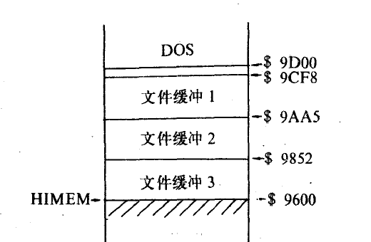

<center>图 5.4.1 文件缓冲区</center>

### 表 5.4.1 文件缓冲区的格式

| 字节偏移 | 内 容 | 说明 |
| :--- | :--- | :--- |
| `$00` ～ `$FF` | 数据缓冲区 | 存放从扇区读出或即将写入扇区的 256 字节用户数据 |
| `$100` ～ `$1FF` | 磁道 / 扇区表区段缓冲区（T / S 表） | 存放当前文件的磁道 / 扇区分配表（Track/Sector List） |
| `$200` ～ `$22C` | 文件管理工作缓冲区 | 45 字节，文件处于非活动状态时保存该文件的 FDB 数据 |
| `$22D` ～ `$24A` | 文件名缓冲区 | 30 个字符，保存文件的名称 |
| `$24B` ～ `$24C` | 文件管理工作缓冲区的地址 | 指向本缓冲区的 `$200` 偏移单元 |
| `$24D` ～ `$24E` | 磁道 / 扇区表区段缓冲区的地址 | 指向本缓冲区的 `$100` 偏移单元 |
| `$24F` ～ `$250` | 数据缓冲区的地址 | 指向本缓冲区的 `$00` 偏移单元 |
| `$251` ～ `$252` | 下一文件缓冲区中的文件名缓冲区地址 | 链表指针，链接下一个文件缓冲区（原书印为 `$251 ~ $251`） |

> [!NOTE]
> 每个文件缓冲区总长为 595 字节（`$253` 字节）。系统默认分配 3 个文件缓冲区（`MAXFILES 3`），占用内存从 `$9600` 至 `$9CFF`。

---

## 4.2 文件管理工作区

文件管理工作区又称为 FDB（File Descriptor Block，原书印为 File Decriptor Block），是用来对指定的文件进行操作控制的，它记录了文件管理的有关信息。

在 DOS 3.3 操作系统中，文件管理工作区在 `$B5D1` ～ `$B5FD` 单元（共 45 字节）。当对某一活动文件进行操作时，文件管理程序将从该文件缓冲区中把文件管理工作区缓冲的内容送到文件管理工作区中，待操作执行完毕后，再将相应的信息送回到该文件缓冲区中保存起来。表 5.4.2 列出了文件管理工作区中的有关字节及其所记录信息的作用。

### 表 5.4.2 文件管理工作区字节及其作用

| 字节偏移 | 作 用 |
| :--- | :--- |
| `$00` ～ `$01` | 本文件 T / S 表的起始位置（Track, Sector） |
| `$02` ～ `$03` | 当前装入的 T / S 扇区位置（Track, Sector） |
| `$04` | 标志：`$80` = T / S 区已修改，`$40` = 数据区已修改，`$20` = VTOC 已修改，`$02` = 上次执行的是写操作 |
| `$05` ～ `$06` | 当前所装的数据区位置（Track, Sector） |
| `$07` | 文件所在目录扇区的索引（在目录扇区中的条目偏移） |
| `$08` | 文件所在 FDB 的索引 |
| `$09` ～ `$0A` | 一个 T / S 扇区表所含的扇区数，通常为 `$7A`（122 个数据扇区指针） |
| `$0B` ～ `$0C` | 当前所装入的 T / S 扇区的第 5、6 字节单元的值（扇区偏移量） |
| `$0D` ～ `$0E` | 当前 T / S 扇区表所在位置 |
| `$0F` ～ `$10` | 与前一次所读扇区的距离 |
| `$11` ～ `$12` | 扇区的字节长度（通常为 `$0100` 即 256 字节，原书印为 `$FF` 字节） |
| `$13` ～ `$14` | 当前读写位置与文件开头的距离（单位：扇区） |
| `$15` | 当前读写位置与该扇区开头的距离（单位：字节） |
| `$16` | 未使用 |
| `$17` ～ `$18` | `OPEN` 时所设定的记录长度（用于随机文本文件，参数 `L`） |
| `$19` ～ `$1A` | 当前读写时的记录号（参数 `R`） |
| `$1B` ～ `$1C` | 当前所读写的记录位置 |
| `$1D` ～ `$1E` | 文件长度（扇区数） |
| `$1F` | 下一个要使用的扇区 |
| `$20` | 当前正在使用的磁道 |
| `$21` ～ `$24` | 当前正在使用磁道的自由扇区位图（从 VTOC 读入的 4 字节位图） |
| `$25` | 文件类型及封锁标志（`$00` = Text, `$01` = Integer BASIC, `$02` = Applesoft BASIC, `$04` = Binary, `$80` = Locked） |
| `$26` ～ `$27` | 槽口号 $\times 16$（Slot $\times 16$），盘驱动器号（Drive: 1 或 2） |
| `$28` | 磁盘的卷号（Volume Number） |
| `$29` | 上次所使用的磁道号 |
| `$2A` ～ `$2C` | 未使用 |

---

## 4.3 文件管理程序的调用

### 一、建立 FMS 表

在调用文件管理程序之前，首先须建立一张“文件管理参数表”（FMS Parameter List），用以在调用程序和文件管理程序之间交换信息，其格式如表 5.4.3 所示。

### 表 5.4.3 FMS 表的格式

| 字节偏移 | 内 容 |
| :--- | :--- |
| `$00` | 操作命令码 |
| `$01` | `READ` 或 `WRITE` 命令的子命令 |
| `$02` ～ `$09` | 命令调用的参数说明 |
| `$0A` | 回答码（返回状态） |
| `$0B` | 未用 |
| `$0C` ～ `$0D` | 文件管理工作缓冲区地址 |
| `$0E` ～ `$0F` | 磁道 / 扇区表缓冲区地址 |
| `$10` ～ `$11` | 数据缓冲区地址 |

表中有关内容详细说明如下：

#### (1) 操作命令包括

| 命令码 | 命令名称 | 功能说明 |
| :---: | :--- | :--- |
| `$00` | 空操作 | 不执行任何磁盘动作 |
| `$01` | `OPEN` | 打开指定文件，初始化缓冲区与 FDB |
| `$02` | `CLOSE` | 关闭指定文件（若未指定文件名则关闭所有打开的文件），写回缓冲 |
| `$03` | `READ` | 从文件中读取数据 |
| `$04` | `WRITE` | 向文件中写入数据 |
| `$05` | `DELETE` | 删除指定文件，释放占用的扇区 |
| `$06` | `CATALOG` | 产生磁盘目录清单 |
| `$07` | `LOCK` | 封锁文件，禁止修改或删除 |
| `$08` | `UNLOCK` | 解锁文件，允许写入和删除 |
| `$09` | `RENAME` | 文件重命名 |
| `$0A` | `POSITION` | 定位顺序文件中的指定记录 |
| `$0B` | `INIT` | 初始化磁盘（格式化并写入 DOS） |
| `$0C` | `VERIFY` | 校验文件各扇区的完整性 |

#### (2) 子命令

仅在 `READ` 及 `WRITE` 命令时使用。子命令有：
- `00` = 空操作
- `01` = R / W 一个字节
- `02` = R / W 一串字节
- `03` = 移动到指定位置上 R / W 一个字节
- `04` = 移动到指定位置上 R / W 一串字节

#### (3) 参数说明

存放着 R（记录号）、B（字节偏移）、V（卷号）、D（驱动器号）、S（槽号）等参数的值，以及 R / W 数据的起始地址、终止地址等。

#### (4) 回答码

回答码是文件管理程序执行后得到的返回信息。这些信息的意义分别为：

| 回答码 | 错误名称 | 意义说明 |
| :---: | :--- | :--- |
| `$00` | 无错误 | 执行正确 |
| `$01` | LANGUAGE NOT AVAILABLE | 语言不可用（原书印为 LANGUAGE NOT AVILABLE） |
| `$02` | BAD OP CODE | 操作命令错 |
| `$03` | BAD SUB-OP CODE | 子命令错 |
| `$04` | WRITE PROTECTED | 写保护错 |
| `$05` | END OF DATA | 数据结束（到达文件尾部） |
| `$06` | FILE NOT FOUND | 文件未找到 |
| `$07` | VOLUME MISMATCH | 卷号不匹配 |
| `$08` | DISK I / O ERROR | 磁盘输入输出错 |
| `$09` | DISK FULL | 磁盘已满 |
| `$0A` | FILE LOCKED | 文件已被封锁（原书印为 FILER LOCKED） |

#### (5) 缓冲区地址

最后三个缓冲区地址指的是所访问的文件在其文件缓冲区内的相应地址，但也可以安排在用户指定的区域内。

---

### 二、设置调用参数

将 FMS 表的首地址放入 **Y** 和 **A** 寄存器中（低位在前高位在后，即 Y 存低位地址，A 存高位地址），并在 **X** 寄存器中填入适当的值：
- $X = 0$：表示若文件找不到则建立它；
- $X \neq 0$：表示若文件找不到则不建立。

### 三、执行调用

执行 `JSR $3D6` 即调用文件管理程序。

---

## 4.4 文件管理程序流程

文件管理程序的入口地址放在 `$3D7` 和 `$3D8` 之中，其跳转目标地址是 `$AAFD`。

文件管理入口表在 `$AAC9` ～ `$AAE4` 单元。针对文本文件的操作处理给出部分命令的程序流程图，如图 5.4.2 所示。

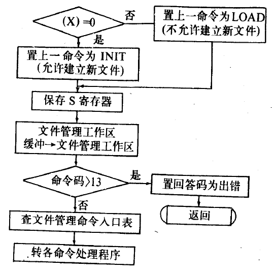

<center>图 5.4.2 文件管理程序流程</center>

### 流程说明

1. 检查寄存器 $X$：若 $X = 0$，置上一命令为 `INIT`（允许建立新文件）；若 $X \neq 0$，置上一命令为 `LOAD`（不允许建立新文件）。
2. 保存 $S$ 栈指针寄存器。
3. 将文件缓冲区中的文件管理工作区内容复制到系统的文件管理工作区（`$B5D1` ～ `$B5FD`）。
4. 判断命令码是否大于 13（`$0D`）：
   - 若大于 13，置回答码为出错（`$02` BAD OP CODE），然后返回。
   - 若不大于 13，查文件管理命令入口表（`$AAC9`），转入各命令对应的处理子程序执行。

---

# 第五章 磁盘驱动程序

磁盘驱动程序是 DOS 的内核程序，它完成磁盘的底层读写操作，并以磁盘的扇区为单位对磁盘进行读写。该程序也称为 **“RWTS”**（Read/Write Track/Sector）程序。

---

## 5.1 软盘信息的记录方式和记录格式

### 5.1.1 道 / 区的定位

在 DOS 操作系统下把软盘分为 35 个读写磁道。实际上磁头从最外道（`$23` 道，即第 35 磁道）走到最内道（`$00` 道），步进马达总共步进 70 个步进道（Phase 0 ～ Phase 69），也就是说物理上可定位 70 道。由于读 / 写头的物理缝宽和步进马达的机械精度，若使用全部 70 道，磁道间距过小会产生数据磁干扰，因而标准 DOS 3.3 只使用 35 道。每移动一道，步进马达需前进 2 个步进道（半道步进）。一般情况下使用的是偶数道。有些加密软件或保护系统使用的是其它步进道（如奇数半道），以此作为软盘防复制保护的措施。

DOS 操作系统对磁盘扇区的定位采用的是**“软定位方式”**。其方法是：当磁头定位到目标磁道后，从当前旋转位置开始寻找下一个地址域，从中读出地址域信息，比较其中的道号、区号是否是要查找的扇区。若不是，再读下一扇区的地址域，直到找到所要的扇区为止。

按照各扇区在磁道上的物理旋转顺序，扇区有**逻辑扇区**和**物理扇区**二种概念：
- **物理扇区**：在盘片磁道上按物理顺序相邻排列（0, 1, 2, ..., 15）；
- **逻辑扇区**：在盘片物理布局上是不相邻的（交错排列，Sector Interleaving）。

调用 RWTS 时所给的扇区号或用户程序所使用的扇区号都是指**逻辑扇区号**，在 RWTS 程序内部将通过查表转换成物理扇区号进行操作。

DOS 3.3 逻辑扇区与物理扇区的对应关系为：

| 物理扇区 | 0 | 1 | 2 | 3 | 4 | 5 | 6 | 7 | 8 | 9 | A | B | C | D | E | F |
| :---: | :-: | :-: | :-: | :-: | :-: | :-: | :-: | :-: | :-: | :-: | :-: | :-: | :-: | :-: | :-: | :-: |
| **逻辑扇区** | 0 | D | B | 9 | 7 | 5 | 3 | 1 | E | C | A | 8 | 6 | 4 | 2 | F |

> [!NOTE]
> 对于不同的操作系统，逻辑扇区的交错安排有所不同（例如 CP/M 和 Pascal 系统的交织表与 DOS 3.3 不同）。
> 
> 之所以采用逻辑扇区交错，是因为大多数磁盘操作是对顺序相邻的逻辑扇区进行的。在前一个扇区读写处理完毕后，CPU 需执行若干条指令进行校验和处理，此时软盘磁头已随盘片旋转过一定角度，越过了物理上相邻的下一个扇区。如果逻辑扇区按物理顺序依次相邻编号，则读取下一个扇区必须等待软盘旋转整整一周（约 200 ms）。相反，若使相邻逻辑扇区在物理位置上有一定的交错间隔，即可在软盘旋转恰好到达该物理扇区时立即进行读写，从而大幅缩短寻区等待时间，提高软盘数据吞吐率。

---

### 5.1.2 磁盘信息的记录方式

每一个字节有 8 位（bit），它作为串行数据记录在盘上。各个数据位之间有一个时钟位作为分隔（图 5.5.1）。

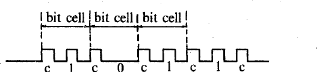

<center>图 5.5.1</center>

图中的 C 表示时钟位，两个时钟位之间是一个信息位（数据位），电平为高表示 1，低表示 0。由一个时钟位和一个数据位构成一个“位单元”（bit cell）。

每个位单元的时间为 $4\ \mu\text{s}$（原书印为 4ms），因此读写一个完整的 8 位字节所需的时间是：
$$8 \times 4\ \mu\text{s} = 32\ \mu\text{s}$$
（对应 6502 处理器以 1.023 MHz 主频运行约 32 个时钟周期；原书印为 32ms）。

从软件的角度来说，把磁盘驱动器接口看成是一个数据寄存器。程序中只负责把一个数据字节送到接口移位寄存器，然后由硬件接口完成一个字节的写（读）操作：
- **写盘时**：接口硬件将数据寄存器中的字节逐位移入盘中，先高位后低位，并在两数据位之间自动产生时钟脉冲位加以分隔（见图 5.5.2）。当寄存器左移时，不断以 0 补充进寄存器。如果 CPU 送数据的间隔大于 32 个时钟周期，寄存器中就会因继续移位而把额外的 0 写入盘中。
- **读盘时**：同样是先读高位后读低位。由硬件电路自动识别时钟位并定位数据位，每读入一位，数据寄存器向左移一位，同样以 32 个时钟周期的速度读入一个完整字节（见图 5.5.3）。

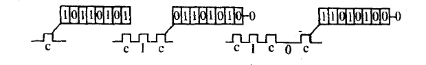

<center>图 5.5.2 写盘数据位与时钟位</center>

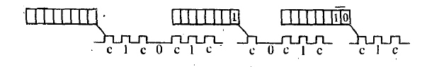

<center>图 5.5.3 读盘数据位与时钟位</center>

---

### 5.1.3 磁盘信息的记录格式

磁盘的每一个扇区中，除了含有用户的 256 个字节数据外，还必须包含定位与同步所需的标识信息。因此，每一个扇区的信息分为两个域（Field）：**地址域**（Address Field）和**数据域**（Data Field）。

#### 一、地址域

地址域存放的是用作扇区物理位置标识的数据，它是在软盘格式化（`INIT`）过程中一次性写入的，在以后的读写操作中通过读操作来识别该扇区。地址域的格式如图 5.5.4 所示：

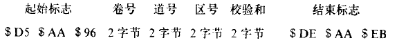

<center>图 5.5.4 地址域格式</center>

```text
+-------------------+---------+---------+---------+---------+-------------------+
|     起始标志      |  卷号   |  道号   |  区号   | 校验和  |     结束标志      |
| $D5  $AA  $96     | 2 字节  | 2 字节  | 2 字节  | 2 字节  | $DE  $AA  $EB     |
+-------------------+---------+---------+---------+---------+-------------------+
```

- **起始标志**：固定的 3 个特殊字节 `$D5`、`$AA`、`$96`。
- **卷号、道号、区号及校验和**：均采用 **4-4 编码**，每个信息字节拆分成 2 个盘字节存放，共占用 8 个字节。
- **结束标志**：固定的 3 个字节 `$DE`、`$AA`、`$EB`。

#### 二、数据域

数据域存放用户的 256 个字节数据。为了提高存储密度，数据域采用 **6-2 编码**（GCR，Group Code Recording），将 256 字节的数据预处理变换为 342 字节的盘数据。数据域的记录格式如图 5.5.5 所示：


<center>图 5.5.5 数据域格式</center>

```text
+-------------------+-----------------------+----------+-------------------+
|     起始标志      |       用户数据        |  校验和  |     结束标志      |
| $D5  $AA  $AD     |       342 字节        |  1 字节  | $DE  $AA  $EB     |
+-------------------+-----------------------+----------+-------------------+
```

- **起始标志**：固定的 3 个特殊字节 `$D5`、`$AA`、`$AD`（注意第三字节为 `$AD`，与地址域的 `$96` 相区别）。
- **用户数据**：经过 6-2 编码后的 342 个盘字节。
- **校验和**：1 字节的累积异或校验和（Running XOR Checksum）。
- **结束标志**：固定的 3 个特殊字节 `$DE`、`$AA`、`$EB`。

> [!WARNING]
> 无论是地址域还是数据域，都具有严格约定的起始标志和结束标志。上述给出的标志字节是 Apple DOS 3.3 操作系统所采用的标准字节。许多商业软件或游戏程序盘片正是通过修改这些标志字节（例如将起始标志改成 `$D5 $AA $B5` 等），使得标准 DOS 无法识别和拷贝，从而达到防复制（Copy Protection）的目的。

---

#### 三、磁道信息布局与间隙（Gap）

从整个磁道来看，磁道上各扇区的信息记录格式如图 5.5.6 所示：

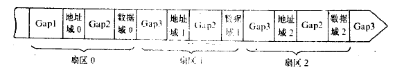

<center>图 5.5.6 磁道信息记录格式</center>

域与域之间填充有特殊信息作为**间隙**（Gap）：
- **Gap 1**：位于每磁道开头，即磁道起始与第 0 扇区地址域之间；
- **Gap 2**：位于同一扇区的地址域与数据域之间；
- **Gap 3**：位于前一扇区的数据域与后一扇区的地址域之间。

间隙由**自同步字节**（Sync Bytes）组成。自同步字节是一种特殊的盘字节，它在软盘上由 10 个位单元（10 bit）组成，内容是：
$$1111111100_2$$
即 8 个连续的 1，后跟 2 个时钟位为 0 的低电平。

间隙的作用是多方面的：
1. **建立字节同步**：当磁头定位到磁道后，是从该磁道的任意物理位置开始读取串行脉冲信号的，初读入的第一位很可能不是盘字节的边界（位失步）。但硬件电路要求读入的每个字节最高位必须为 1。当磁头通过 5 个以上的 10 位自同步字节时，硬件移位寄存器就能自动与字节边界对齐，实现位同步与字节同步。示例见图 5.5.7。
2. **提供软件译码和处理时间**：在地址域读入后，CPU 需要足够的时间（微秒级）进行地址域的 4-4 解码、道号与区号比对，以决定是否对紧随其后的数据域执行读/写，Gap 2 提供了这段安全缓冲区，防止磁头在 CPU 准备就绪前转过数据域。
3. **防止写盘时覆盖邻近数据**：由于软盘驱动器马达转速存在微小的机械转速波动（通常约 $\pm 2\%$），每次向数据域写数据时，实际占用的磁道物理长度会有微小变化。Gap 3 的存在可吸收这种机械公差，避免重写当前扇区数据时破坏后一个扇区的地址域信息。

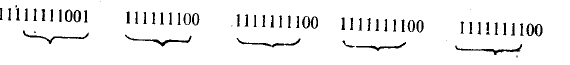

<center>图 5.5.7 自同步字节对齐示例</center>

---

## 5.2 编码方式

信息是以一定的编码方式记录在软盘上的。为何要对数据进行编码呢？这是由于 Disk II 磁盘驱动器硬件读写电路的物理特性限制所造成的：
1. **最高位必须为 1**：硬件移位寄存器需要以最高位为 1 作为字节装满并产生标志的触发信号，因此盘字节的最高位（Bit 7）不能为 0；
2. **禁止两个以上相邻位为 0**：如果串行磁通翻转信号中连续出现两个以上的 0（即缺少时钟/磁通翻转跃变），硬件读出放大器与锁相环电路将失去自同步基准，导致读出数据错乱。

因此，微机内存中的 8 位二进制字节（`$00` ～ `$FF`）不能直接原样写入软盘，必须通过专门的编码技术，将其映射转换为满足上述限制条件的合法“盘字节”（Disk Bytes）。随着硬件接口的升级，Apple DOS 经历了三种主要的编码方式：

---

### 5.2.1 4-4 编码

4-4 编码是最简单的一种编码方式。它将待记录的 1 个 8 位数据字节拆成高 4 位和低 4 位两个半字节（Nibble），然后将每个半字节与 `1` 间隔交错插入，生成 2 个 8 位盘字节记录在盘上：

```text
原数据字节：
     D7 D6 D5 D4 D3 D2 D1 D0

拆分并插入 1 后的盘字节：
     盘字节 1:  1  D7  1  D6  1  D5  1  D4   (奇数位为 1，偶数位为原高 4 位)
     盘字节 2:  1  D3  1  D2  1  D1  1  D0   (奇数位为 1，偶数位为原低 4 位)
```

在这种转换中，盘字节的最高位恒为 1，且任何两个相邻位之间至少隔有一个 1，绝对不会出现连续两个 0，因此能完全满足硬件电路的识别要求。

4-4 编码的缺点是空间利用率极低（有效数据率仅为 $50\%$）。在 DOS 3.3 中，仅在对数据量极小但可靠性要求极高的**地址域**（卷号、道号、区号、校验和）中采用 4-4 编码。

#### 4-4 编码计算公式
设原字节为 $B$：
$$\text{盘字节 1} = ((B \gg 1) \ \& \ \$55) \ | \ \$AA$$
$$\text{盘字节 2} = (B \ \& \ \$55) \ | \ \$AA$$

---

### 5.2.2 5-3 编码

在 8 位二进制数（`$00` ～ `$FF`）中，满足“最高位为 1 且绝无两个相邻位为 0”这一苛刻条件的合法字节代码共有 34 个（例如：`$AA`、`$AB`、`$AD`、`$AE`、`$AF`、`$B5`、...、`$FF`）。

若取一个数据字节中的 5 位，其状态组合数为 $2^5 = 32$ 种。扣除保留作为起始标志的 `$D5` 和 `$AA`，剩下的 32 种合法代码恰好可以和 5 位二进制数据建立起一一对应的转换表：

| 5 位数据 | 盘代码 | 5 位数据 | 盘代码 | 5 位数据 | 盘代码 | 5 位数据 | 盘代码 |
| :---: | :---: | :---: | :---: | :---: | :---: | :---: | :---: |
| `00` | `AB` | `08` | `BB` | `10` | `EA` | `18` | `F6` |
| `01` | `AD` | `09` | `BD` | `11` | `EB` | `19` | `F7` |
| `02` | `AE` | `0A` | `BE` | `12` | `ED` | `1A` | `F9` |
| `03` | `AF` | `0B` | `BF` | `13` | `EE` | `1B` | `FA` |
| `04` | `B5` | `0C` | `D6` | `14` | `EF` | `1C` | `FB` |
| `05` | `B6` | `0D` | `D7` | `15` | `F2` | `1D` | `FD` |
| `06` | `B7` | `0E` | `DA` | `16` | `F3` | `1E` | `FE` |
| `07` | `BA` | `0F` | `DB` | `17` | `F5` | `1F` | `FF` |

5-3 编码的工作方式是：把每个 8 位数据字节分解成高 5 位（D7～D3）和低 3 位（D2～D0）。低 5 位部分（实为低 5 位或高 5 位分组）直接查表转换成满足要求的盘字节；而 3 位部分则将多个字节的高 3 位组合在一起，拼成 5 位组后再查表转换成盘字节：

```text
D7 D6 D5 D4 D3 D2 D1 D0  ===>  高 5 位: D7 D6 D5 D4 D3  (直接查表)
                               低 3 位: D2 D1 D0        (多字节拼接后查表)
```

采用 5-3 编码，存放 256 字节的数据需要占用 410 个盘字节空间。每磁道只能划分 13 个扇区，整张软盘容量为 114 KB。在 **DOS 3.1、DOS 3.2、DOS 3.2.1** 早期版本中采用 5-3 编码方式。

---

### 5.2.3 6-2 编码

在对 Disk II 软盘驱动器接口控制逻辑电路进行改进后，硬件识别脉冲的能力得到提升：**除了最高位仍必须为 1 以外，允许存在一对连续的 0**（但不允许出现连续三个 0）。

在 `$00` ～ `$FF` 的所有 256 个字节中，满足“最高位为 1 且最多只有一对相邻的 0”的字节共有 69 个。如果我们取数据字节中的 6 位，需要 $2^6 = 64$ 种代码。若再加上“至少有一对相邻的 1 存在”以利于硬件时钟锁定的限制，可用代码数依然有 66 个。保留 `$D5` 和 `$AA` 作为专用标志字节后，刚好剩下 **64 个合法的盘字节代码**，能与 6 位二进制数建立完全的一一对应关系。

#### 6-2 编码写数据转换表（64 字节，位于内存 `$BA29` ～ `$BA68`）

| 6位值 | 盘字节 | 6位值 | 盘字节 | 6位值 | 盘字节 | 6位值 | 盘字节 |
| :---: | :---: | :---: | :---: | :---: | :---: | :---: | :---: |
| `$00` | `$96` | `$10` | `$B4` | `$20` | `$D6` | `$30` | `$ED` |
| `$01` | `$97` | `$11` | `$B5` | `$21` | `$D7` | `$31` | `$EE` |
| `$02` | `$9A` | `$12` | `$B6` | `$22` | `$D9` | `$32` | `$EF` |
| `$03` | `$9B` | `$13` | `$B7` | `$23` | `$DA` | `$33` | `$F2` |
| `$04` | `$9D` | `$14` | `$B9` | `$24` | `$DB` | `$34` | `$F3` |
| `$05` | `$9E` | `$15` | `$BA` | `$25` | `$DC` | `$35` | `$F4` |
| `$06` | `$9F` | `$16` | `$BB` | `$26` | `$DD` | `$36` | `$F5` |
| `$07` | `$A6` | `$17` | `$BC` | `$27` | `$DE` | `$37` | `$F6` |
| `$08` | `$A7` | `$18` | `$BD` | `$28` | `$DF` | `$38` | `$F7` |
| `$09` | `$AB` | `$19` | `$BE` | `$29` | `$E5` | `$39` | `$F9` |
| `$0A` | `$AC` | `$1A` | `$BF` | `$2A` | `$E6` | `$3A` | `$FA` |
| `$0B` | `$AD` | `$1B` | `$CB` | `$2B` | `$E7` | `$3B` | `$FB` |
| `$0C` | `$AE` | `$1C` | `$CD` | `$2C` | `$E9` | `$3C` | `$FC` |
| `$0D` | `$AF` | `$1D` | `$CE` | `$2D` | `$EA` | `$3D` | `$FD` |
| `$0E` | `$B2` | `$1E` | `$CF` | `$2E` | `$EB` | `$3E` | `$FE` |
| `$0F` | `$B3` | `$1F` | `$D3` | `$2F` | `$EC` | `$3F` | `$FF` |

#### 6-2 编码分解机制
把每个 8 位数据字节拆分成高 6 位和低 2 位两部分：
- 高 6 位（D7～D2）存入第一缓冲区；
- 低 2 位（D1～D0）与另外两个字节的低 2 位拼装成一个 6 位代码，存入第二缓冲区。

```text
                               高 6 位: D7 D6 D5 D4 D3 D2  (送第一缓冲区)
D7 D6 D5 D4 D3 D2 D1 D0  ===> 
                               低 2 位: D1 D0              (拼装后送第二缓冲区)
```

采用 6-2 编码，存放 256 个字节的数据仅需占用 **342 个盘字节**（第一缓冲 256 字节 + 第二缓冲 86 字节）。这使得软盘每磁道容量从 13 扇区提升至 **16 扇区**，格式化容量达到 **143 KB**，存储效率大幅提高。**DOS 3.3** 操作系统的数据域全面采用 6-2 编码。

---

## 5.3 磁盘驱动程序的调用

磁盘驱动程序（RWTS）是 DOS 操作系统的最底层程序，它主要用来完成对磁盘的格式化，按磁道和扇区对磁盘进行读写等。RWTS 作为文件管理程序（FMS）的下层子程序被调用，用户程序也可以通过对它的直接调用来实现扇区级的高速读写。

在调用 RWTS 之前，需要在内存中建立两张参数表：
1. **I/O 控制表**（IOB，Input/Output Control Block）；
2. **设备特征表**（DCT，Device Characteristics Table）。

两表的结构分别如表 5.5.1 和表 5.5.2 所示。

### 表 5.5.1 IOB 表（I/O 控制表）

| 字节偏移 | 内 容 | 说明 |
| :---: | :--- | :--- |
| `$00` | 表格类型代码 | 规定为 `$01` |
| `$01` | 槽号 $\times 16$ | 接口卡所在槽号乘 16（如第 6 槽为 `$60`） |
| `$02` | 驱动器号 | 驱动器编号：`$01` = Drive 1，`$02` = Drive 2 |
| `$03` | 磁盘卷号 | 预期卷号（`$00` 表示匹配任意卷号） |
| `$04` | 磁道号 | 目标磁道号（`$00` ～ `$22`，即 0 ～ 34 道） |
| `$05` | 扇区号 | 目标扇区号（`$00` ～ `$0F`，即 0 ～ 15 区） |
| `$06` ～ `$07` | 设备特征表（DCT）的地址 | 指针，低位在前高位在后（通常指向 `$B7E8`） |
| `$08` ～ `$09` | 数据读写缓冲区的首地址 | 256 字节用户数据缓冲区的内存起始地址 |
| `$0A` ～ `$0B` | 未用 | 保留 |
| `$0C` | 命令码 | `00` = 寻道（`SEEK`）<br>`01` = 读扇区（`READ`）<br>`02` = 写扇区（`WRITE`）<br>`04` = 格式化（`FORMAT`） |
| `$0D` | 回答码（状态码） | 执行结果状态：<br>`$00` = 无错误<br>`$01` = 写保护错（Write Protected）<br>`$02` = 卷号不匹配（Bad Volume）<br>`$40` = 驱动器错误（Drive Error）<br>`$80` = 读错/校验和错（Read Error） |
| `$0E` | 上次访问的卷号 | 保存上一次成功读写的磁盘卷号 |
| `$0F` | 上次访问的槽号 $\times 16$ | 保存上一次访问的槽号乘 16 |
| `$10` | 上次访问的驱动器号 | 保存上一次访问的驱动器号 |

### 表 5.5.2 DCT 表（设备特征表）

| 字节偏移 | 内 容 | 说明 |
| :---: | :--- | :--- |
| `$00` | 设备类型代码 | 规定为 `$00`（标准 Disk II） |
| `$01` | 每道的步进道数 | 规定值为 `$01`（标准每移一道步进马达走 2 步） |
| `$02` ～ `$03` | 马达启动稳定时间计数器 | 规定值为 `$EFD8`（驱动器启动延时常数，低字节在前） |

### 调用步骤

1. 按规范在内存中填好 IOB 表和 DCT 表的内容；
2. 将 IOB 表的首地址装入 **Y** 和 **A** 寄存器中（Y 存放低位地址，A 存放高位地址）；
3. 执行子程序调用指令：
   ```assembly
   JSR $3D9      ; 转入 RWTS 向量入口（实际目标为 $BD00）
   ```
4. 调用返回后，检查进位标志（Carry Flag）：
   - 若 $C = 0$：执行成功，IOB 状态字节（偏移 `$0D`）为 `$00`；
   - 若 $C = 1$：发生错误，IOB 状态字节中包含具体的错误代码。

---

## 5.4 磁盘驱动程序流程

磁盘驱动程序的入口地址存放在 `$3DA` 和 `$3DB` 之中，其实际入口地址为 `$BD00`。图 5.5.8 给出了磁盘驱动程序的总流程图。

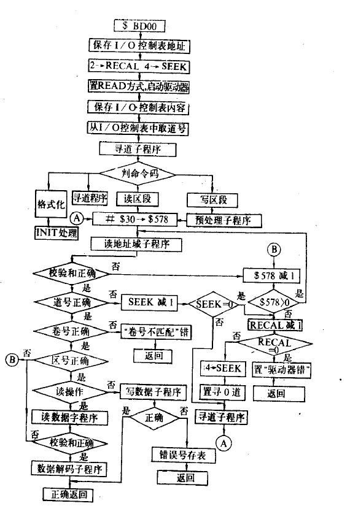

<center>图 5.5.8 磁盘驱动程序流程图</center>

### 磁盘驱动程序总执行流程说明

1. **入口与初始化**：保存 IOB 表地址，设置重试计数器（`RECAL = 2`，`SEEK = 4`），设置接口为读方式，启动马达旋转。
2. **读入参数与寻道**：从 IOB 取出目标磁道号，调用寻道子程序驱动步进马达将磁头移动到目标磁道。
3. **判命令码**：
   - 若为格式化命令（`04`），转入 `INIT` 格式化处理程序；
   - 若为寻道命令（`00`），寻道完成后直接返回；
   - 若为读扇区（`01`），设置重试计数器（`#$30 -> $578`），转去读地址域；
   - 若为写扇区（`02`），先调用数据预处理子程序对 256 字节数据进行 6-2 编码，然后设置计数器转去读地址域。
4. **查找与校验地址域**：
   - 调用读地址域子程序，检查校验和：
     - 若校验和错：计数器 `$578` 减 1；若计数耗尽则 `RECAL` 减 1；若 `RECAL = 0` 则置驱动器错误并返回；否则重新寻 0 道并重试。
     - 若校验和正确：依次核对磁道号、卷号、扇区号。卷号不匹配则报“卷号不匹配”错；道号或区号不符则继续寻找下一个地址域。
5. **执行数据传输**：
   - 当找到目标扇区地址域后，判断当前操作是读还是写：
     - **写操作**：调用写数据子程序，依次写入同步字节、起始标志、第二缓冲区（86B）、第一缓冲区（256B）、结束标志，校验写入结果无误后置读方式并正确返回。
     - **读操作**：调用读数据子程序，从盘上读入 86 字节送第二缓冲、256 字节送第一缓冲，校验校验和正确后，调用数据解码子程序将 342 字节盘数据还原为 256 字节二进制数据送入用户缓冲区，正确返回。

---

### 5.4.1 数据的编码与解码

从磁盘驱动程序流程图中可以知道，在写数据操作前，必须先对数据进行预处理（编码）；读数据后，必须进行逆向解码。

DOS 操作系统在内存中开辟了一个 **342 个字节**的数据工作缓冲区，专门用来存放满足读写识别用的 6 位盘字节。该缓冲区分成两部分：
- **第一缓冲区**：`$BB00` ～ `$BBFF`，共 256 个字节；
- **第二缓冲区**：`$BC00` ～ `$BC56`，共 86 个字节（实际有效使用 86 个字节：`$BC00` ～ `$BC55`）。

数据预处理子程序的工作是将存放在用户缓冲区的 256 个字节，经编码后组成 342 字节的 6 位盘字节数据，存放在 DOS 系统的第一和第二缓冲区中。数据的组织方法参见图 5.5.9。

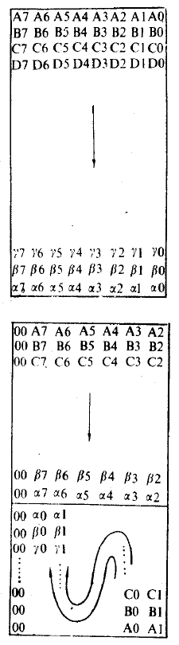

<center>图 5.5.9 数据的组织方法（Nibblizing 算法）</center>

#### 6-2 编码数据的组织方法（Nibblizing）

256 个字节的数据分解过程如下：
1. 256 不能被 3 整除，$256 = 85 \times 3 + 1$。为了凑成 3 的整倍数，补充 2 个全 0 的伪字节，共凑成 $86 \times 3 = 258$ 个字节。
2. 将这 258 个字节每 3 个分为一组（记为字节 $A$、$B$、$C$）：
   - 每个字节的高 6 位保留在原位置（放入第一缓冲区 `$BB00` ～ `$BBFF` 的对应单元中，高 2 位清 0）；
   - 每个字节的低 2 位（分别记为 $A_1 A_0$、$B_1 B_0$、$C_1 C_0$）取出，拼装成一个新的 6 位字节：
     $$00 \ C_1 C_0 \ B_1 B_0 \ A_1 A_0$$
     存入第二缓冲区（`$BC00` ～ `$BC55`，共 86 字节）中。
3. 存入第二缓冲区时采用反向交叉填充（如蛇形箭头所示），以便后续写盘程序能够以最高速流水线方式交替读取。

数据预处理程序在内存的 `$B800` ～ `$B829` 单元，其程序流程如图 5.5.10 所示。

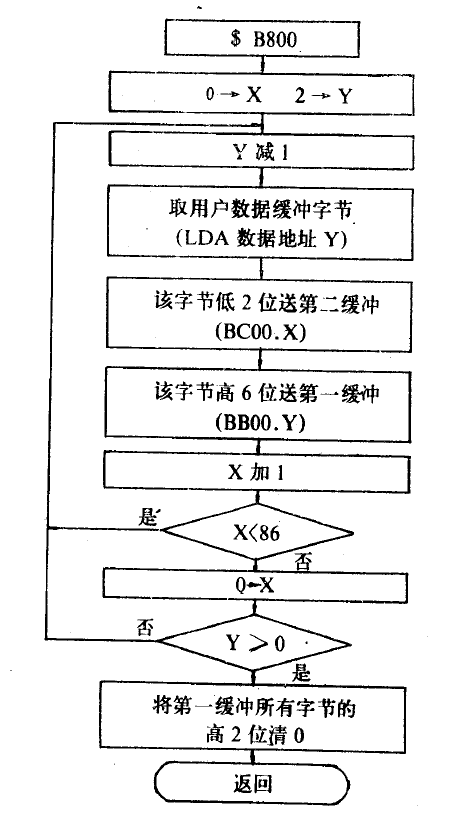

<center>图 5.5.10 数据编码程序流程图（$B800）</center>

#### 数据解码流程

在读扇区操作中，盘上的 342 个盘字节读入第一、第二缓冲区后，必须由解码子程序进行逆变换，还原成 256 个 8 位机器字节并送入用户缓冲区。

数据解码程序在内存的 `$B8C2` ～ `$B8DB` 单元。其程序流程如图 5.5.11 所示。

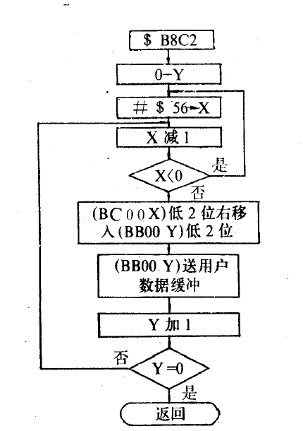

<center>图 5.5.11 数据解码程序流程图（$B8C2）</center>

解码过程每次从第二缓冲区取出 1 个 6 位字节，将其两两拆开，分别右移拼入第一缓冲区对应字节的低 2 位中，恢复成完整的 8 位数据并写入用户数据缓冲区，直至 256 字节全部组装还原完毕。

---

### 5.4.2 写数据子程序

用户缓冲区的数据经数据编码子程序预处理之后，由写数据子程序完成写盘操作。在逐个字节写盘的同时，程序必须在严苛的机器周期内（每个字节恰好 32 周期）同步完成两项关键工作：
1. **计算累积校验和**（Running Checksum）：使用异或（EOR）指令；
2. **将 6 位数据转换为合法盘字节**：查“写数据转换表”。

转换成盘字节的工作是通过**写数据转换表**来完成的，该表位于主存的 `$BA29` ～ `$BA69` 单元（共 64 字节，对应 64 种合法的 GCR 编码）。写数据转换过程如图 5.5.12 所示。

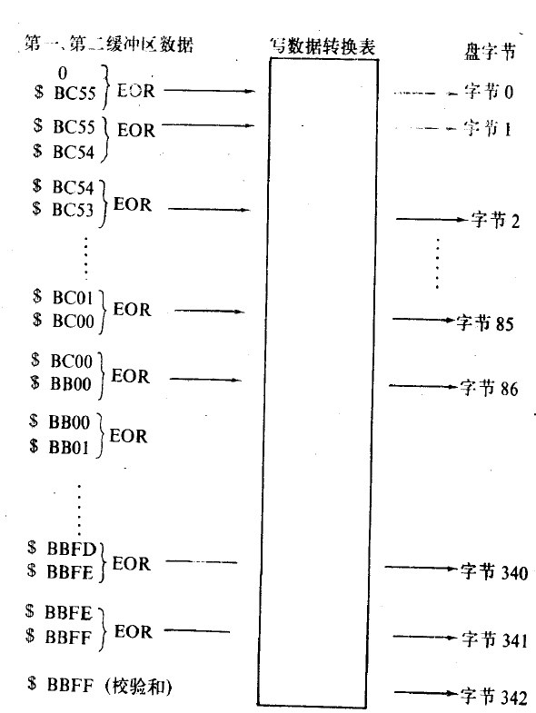

<center>图 5.5.12 写数据转换与校验和流水线</center>

#### 写数据转换流水线原理
- 写盘前，初始校验和设为 0；
- 第 0 个盘字节：将 `0 EOR ($BC55)` 后的 6 位值查写转换表，写入盘中作为盘字节 0；
- 第 1 个盘字节：将 `($BC55) EOR ($BC54)` 查表写入盘中作为盘字节 1；
- 依此类推，第二缓冲区的 86 个字节依次与相邻字节异或并查表写盘（盘字节 0 ～ 85）；
- 第二缓冲区末尾与第一缓冲区首字节异或：`($BC00) EOR ($BB00)` 查表写入作为盘字节 86；
- 随后第一缓冲区的 256 个字节依次异或查表写盘（盘字节 87 ～ 341）；
- 最终将累计的校验和 `$BBFF` 查表写入作为第 342 盘字节。

写数据子程序在主存 `$B82A` ～ `$B8B7` 单元。其程序流程如图 5.5.13 所示。

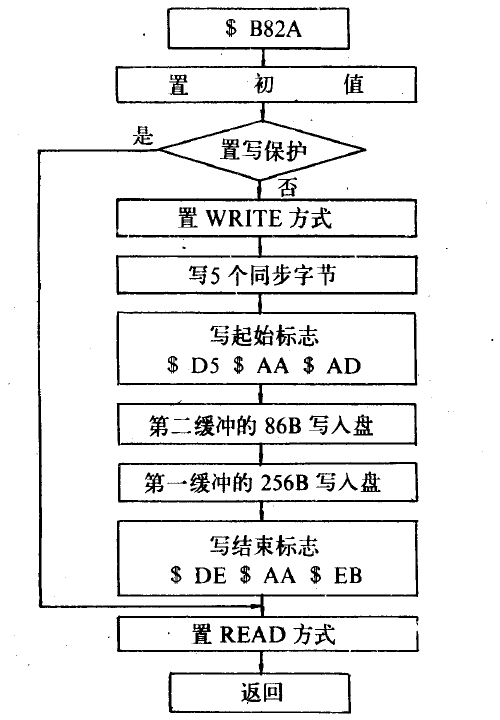

<center>图 5.5.13 写数据子程序流程图（$B82A）</center>

#### 写数据详细步骤
1. 置初值，检测软盘写保护缺口；若有写保护，立即退出并置写保护错误标志；
2. 置接口为写（`WRITE`）方式；
3. 写 5 个自同步字节（建立硬件位同步）；
4. 写数据域起始标志：`$D5`、`$AA`、`$AD`；
5. 将第二缓冲区的 86 字节查表异或写入盘中；
6. 将第一缓冲区的 256 字节查表异或写入盘中；
7. 写入校验和字节；
8. 写数据域结束标志：`$DE`、`$AA`、`$EB`；
9. 恢复接口为读（`READ`）方式并返回。

---

### 5.4.3 读数据子程序

读数据子程序是写数据子程序的逆过程。它在软盘旋转经过数据域时，实时以每 32 周期一个字节的严苛时序从软盘读出 342 个盘字节，通过**读数据转换表**把盘字节还原成 6 位数据，并反向计算异或校验和，存入第一和第二缓冲区内。最后再由数据解码程序完成 6 位到 8 位的重组。

**读数据转换表**存放在主存的 `$BA96` ～ `$BAFF` 单元（共 106 字节）。因为合法的 6-2 编码盘字节数值范围在 `$96` 到 `$FF` 之间，所以读转换表以盘字节与 `$96` 的差值作为偏移索引查表，查表结果即为对应的 6 位原始数据。其转换过程如图 5.5.14 所示。

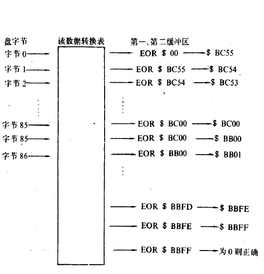

<center>图 5.5.14 读数据转换流程</center>

#### 读数据转换与校验验证
- 读入盘字节 0，查表得到 6 位值，与 0 异或存入 `$BC55`；
- 读入盘字节 1，查表后与 `$BC55` 异或存入 `$BC54`；
- 依次读入并反向恢复第二缓冲区（`$BC55` ～ `$BC00`）和第一缓冲区（`$BB00` ～ `$BBFF`）；
- 最终读入第 342 字节并与累加值异或：**若异或结果为 0，则表明数据校验和完全正确**；若不为 0，则表明读盘发生校验和错误（Read Error）。

读数据子程序在主存 `$B8DC` ～ `$B944` 单元。其程序执行流程如图 5.5.15 所示。

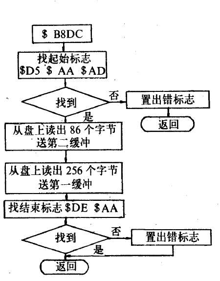

<center>图 5.5.15 读数据子程序流程图（$B8DC）</center>

#### 数据处理总流程总结

经过上面对磁盘驱动程序的详细分析，可以将软盘扇区数据的读写处理机制归纳为图 5.5.16 所示的清晰数据流模型：

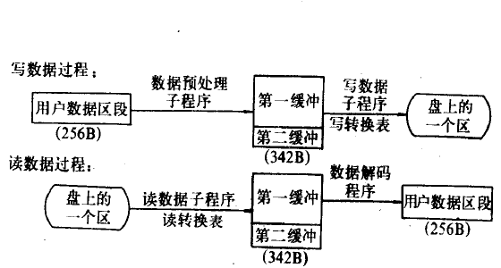

<center>图 5.5.16 数据读写处理流程总览</center>

- **写数据过程**：
  $$\text{用户数据区段 (256B)} \xrightarrow[\text{子程序}]{\text{数据预处理}} \begin{bmatrix} \text{第一缓冲 (256B)} \\ \text{第二缓冲 (86B)} \end{bmatrix} (342\text{B}) \xrightarrow[\text{写转换表}]{\text{写数据子程序}} \text{盘上的一个区 (342 盘字节)}$$
- **读数据过程**：
  $$\text{盘上的一个区 (342 盘字节)} \xrightarrow[\text{读转换表}]{\text{读数据子程序}} \begin{bmatrix} \text{第一缓冲 (256B)} \\ \text{第二缓冲 (86B)} \end{bmatrix} (342\text{B}) \xrightarrow[\text{程序}]{\text{数据解码}} \text{用户数据区段 (256B)}$$

---

# 附录 A DOS 操作系统的内存分配

DOS 3.3 操作系统在系统引导装入后，常驻在微机高阶内存中（对于标准 48KB 系统，位于 `$9600` ～ `$BFFF`；在配置有 16KB 语言卡扩展内存的 64KB CEC-I 系统中，DOS 亦可重定位至 `$D000` ～ `$FFFF` 运行）。

图 5.A.1 给出了 48KB RAM 配置下标准 DOS 3.3 各功能模块在内存中的详细分配布局。

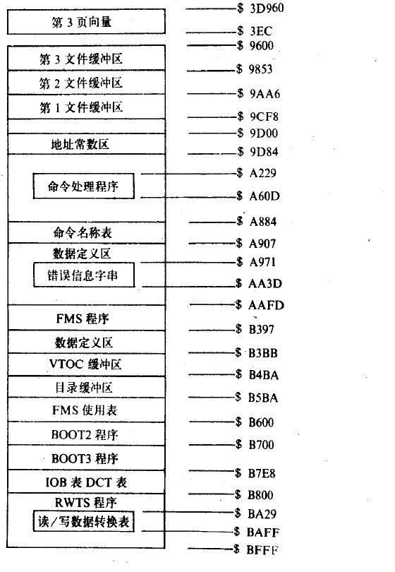

<center>图 5.A.1 DOS 操作系统的内存分配图</center>

### 表 5.A.1 DOS 3.3 详细内存分配表

| 内存地址范围 | 大小 | 功能模块名称 | 详细说明 |
| :--- | :---: | :--- | :--- |
| `$03D0` ～ `$03EF` | 32 B | 第 3 页中断与跳转向量 | 存放 DOS 外部调用入口向量：<br>`$3D0`：暖启动入口（`$9DB5`）<br>`$3D3`：冷启动入口（`$9E03`）<br>`$3D6`：文件管理程序 FMS 入口（`$AAFD`）<br>`$3D9`：磁盘驱动程序 RWTS 入口（`$BD00`）<br>`$3DC`：格式化入口等 |
| `$9600` ～ `$9852` | 595 B | 第 3 文件缓冲区 | 第三活动文件的工作区与数据缓冲（`MAXFILES 3` 时） |
| `$9853` ～ `$9AA5` | 595 B | 第 2 文件缓冲区 | 第二活动文件的工作区与数据缓冲 |
| `$9AA6` ～ `$9CF8` | 595 B | 第 1 文件缓冲区 | 第一活动文件的工作区与数据缓冲 |
| `$9CF9` ～ `$9CFF` | 7 B | 缓冲区首指针与链接 | 保存首个文件缓冲区地址指针 |
| `$9D00` ～ `$9D83` | 132 B | 地址常数区 | 保存 DOS 全局变量、I/O 钩子及重定位指针 |
| `$9D84` ～ `$A228` | 1189 B | DOS 主体与冷/暖启动 | 冷启动代码、暖启动代码及系统初始化程序 |
| `$A229` ～ `$A60C` | 996 B | 命令处理程序 | BASIC 命令扫描器与 DOS 命令行解释执行程序 |
| `$A60D` ～ `$A883` | 631 B | 命令执行程序 | `LOAD`、`SAVE`、`RUN`、`BRUN` 等主要命令的执行体 |
| `$A884` ～ `$A906` | 131 B | 命令名称表 | DOS 所有关键字的 ASCII 字符串与特征标记表 |
| `$A907` ～ `$A970` | 106 B | 数据定义区 | 命令解析的工作参数与临时变量区 |
| `$A971` ～ `$AA3C` | 204 B | 错误信息字串表 | 存放 DOS 系统的各类英文出错提示字符串 |
| `$AA3D` ～ `$AAFC` | 192 B | 接口与中介程序 | DOS 与监控程序、BASIC 语言系统接口处理程序 |
| `$AAFD` ～ `$B396` | 2202 B | FMS 文件管理程序 | 文件管理系统核心，实现文件的增删改查逻辑 |
| `$B397` ～ `$B3BA` | 36 B | 数据定义区 | FMS 内部工作变量与常量 |
| `$B3BB` ～ `$B4B9` | 255 B | VTOC 缓冲区 | 存放从磁道 17 扇区 0 读入的卷目录区分配位图（VTOC） |
| `$B4BA` ～ `$B5B9` | 256 B | 目录扇区缓冲区 | 存放当前正在读写检索的文件目录扇区数据 |
| `$B5BA` ～ `$B600` | 71 B | FMS 使用表 / FDB 工作区 | 文件描述块（FDB）当前活动文件的状态数据 |
| `$B600` ～ `$B6FF` | 256 B | BOOT2 程序 | 系统引导阶段装入的二级引导器（磁道 0 扇区 1） |
| `$B700` ～ `$B7E7` | 232 B | BOOT3 程序 | 系统引导阶段装入的三级引导器（磁道 0 扇区 2） |
| `$B7E8` ～ `$B7FF` | 24 B | IOB 表与 DCT 表 | 磁盘驱动程序输入输出控制块与设备特征表 |
| `$B800` ～ `$BA28` | 553 B | RWTS 驱动核心程序 | 读写磁道扇区的底层汇编程序、寻道算法与时序控制 |
| `$BA29` ～ `$BA68` | 64 B | 写数据转换表 | 6-2 编码查表：将 6 位数据转换为合法盘字节 |
| `$BA69` ～ `$BA95` | 45 B | 驱动保留工作区 | RWTS 内部临时数据与状态保存 |
| `$BA96` ～ `$BAFF` | 106 B | 读数据转换表 | 6-2 解码查表：将合法盘字节转换为 6 位数据 |
| `$BB00` ～ `$BBFF` | 256 B | RWTS 第一数据缓冲区 | 存放 256 个编码后的高 6 位数据字节 |
| `$BC00` ～ `$BC56` | 87 B | RWTS 第二数据缓冲区 | 存放 86 个拼装后的低 2 位数据字节 |
| `$BC57` ～ `$BFFF` | 937 B | 格式化程序与扩展工作区 | 磁盘格式化代码（`FORMAT`）、扇区标记写入例程 |
