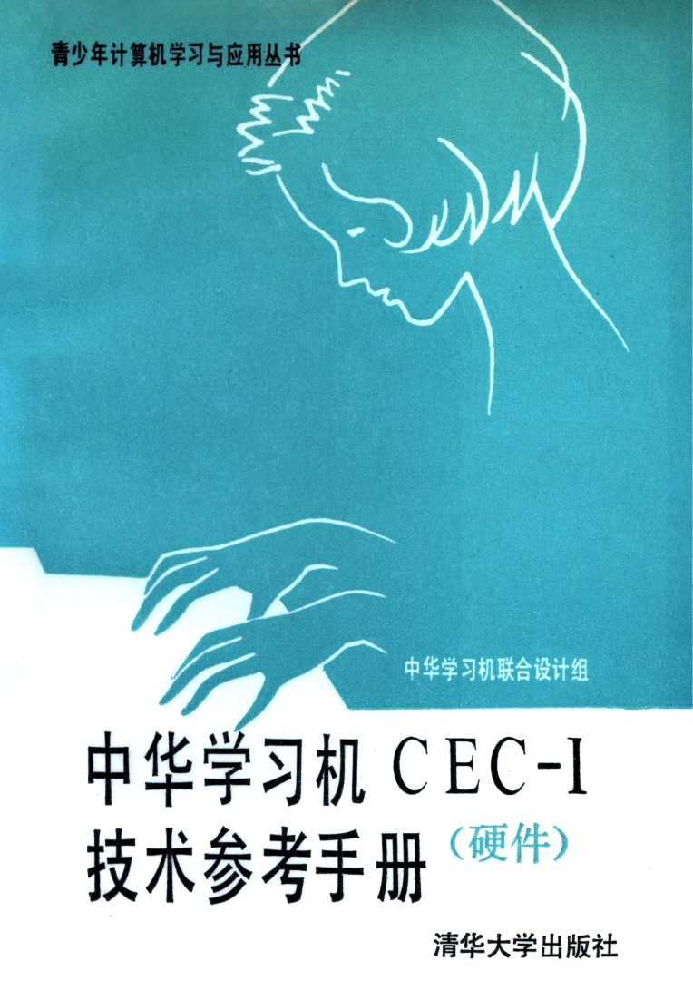

# 中华学习机 CEC-I 技术参考手册（硬件）

## 出版信息

- **丛书**：青少年计算机学习与应用丛书 / 全国“星火计划”丛书
- **书名**：中华学习机 CEC-I 技术参考手册（硬件）
- **编著**：中华学习机联合设计组
- **丛书主编**：吴几康
- **副主编**：陈树楷、潘懋德、吕传兴
- **出版社**：清华大学出版社（北京 清华园）
- **印刷**：中国建筑工业出版社印刷厂
- **版次**：1987 年 10 月第 1 版
- **ISBN**：7-302-00026-3 / TP·4
- **说明**：CEC-I 中华学习机技术参考手册分硬件和软件两册出版，本册为硬件分册。

---

## 目录规划

- **[第一章 CEC-I 中华学习机简介 & 第二章 操作指南](ch01-ch02-intro-operations.md)** (p. 1)
  - 第一章 CEC-I 中华学习机简介（系统的组成：键盘、显示器、录音机、软驱、打印机、主机内部、电源，主要技术指标） (p. 1)
  - 第二章 操作指南（系统的安装：开箱、主机、显示器、录音机、游戏杆、软驱、扩充卡、键盘，机器的启动、中西文切换与复位、LOGO语言装入、自检） (p. 9)
- **[第三章 3.1~3.4：主机板、CPU、存储器系统与 I/O 空间](ch03a-motherboard-cpu-memory-io.md)** (p. 24)
  - 3.1 主机板组成及系统框图 (p. 24)
  - 3.2 中央处理器（CPU 6502 内部结构、引脚及功能、读写周期时序） (p. 26)
  - 3.3 存储器系统（系统存储器分配、读写 RAM 存储器、只读 ROM 存储器） (p. 34)
  - 3.4 输入输出空间分配（内核 I/O 空间 $C000~$C0FF、外围扩展 I/O 空间 $C100~$CFFF） (p. 52)
- **[第三章 3.5：显示电路原理与工作机制](ch03b-display-circuits.md)** (p. 62)
  - 3.5.1 显示方式（字符方式、低分辨率图形方式、高分辨率图形方式、80列方式） (p. 63)
  - 3.5.2 视频电路工作原理（行场扫描时序、显存寻址、字符发生器） (p. 73)
  - 3.5.3 彩色图形方式产生原理 (p. 89)
  - 3.5.4 彩色 PAL 制编码解调电路 (p. 100)
- **[第三章 3.6~3.13：接口电路与专用集成电路 (ASIC)](ch03c-interfaces-asic.md)** (p. 105)
  - 3.6 键盘工作原理（读过程、ASCII 码表、硬件扫描矩阵） (p. 105)
  - 3.7 盒式录音机接口电路 (p. 116)
  - 3.8 游戏杆接口电路 (p. 120)
  - 3.9 扬声器接口电路 (p. 125)
  - 3.10 软盘驱动器接口电路 (p. 126)
  - 3.11 汉字处理电路（汉字存储空间、辅存切换、字库 ROM 寻址与显示） (p. 130)
  - 3.12 专用集成电路功能简介（MMU 内存管理部件、IOU 输入输出部件、PAL 可编程逻辑阵列） (p. 140)
  - 3.13 打印机部件（打印机接口卡、控制字符与软开关） (p. 158)
- **[附录：指令集速查、字符码表与完整逻辑电路图](appendices-instruction-set-schematics.md)** (p. 168)
  - 附录 A 助记符指令表与指令组定义 (p. 168)
  - 附录 B 6502 操作码、执行周期与存储要求详细对照表 (p. 172)
  - 附录 C 字符显示码表 (p. 195)
  - 附录 D CEC-I 中华学习机整机逻辑电路原理图 (p. 196)
