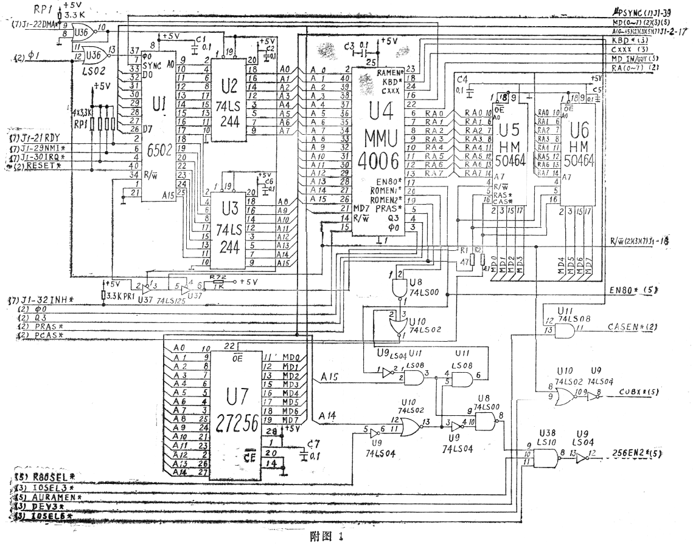
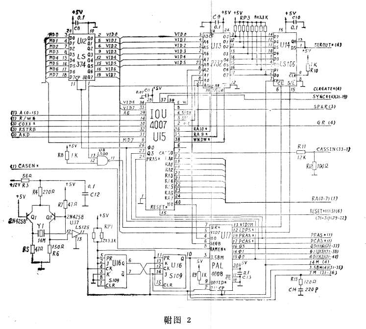
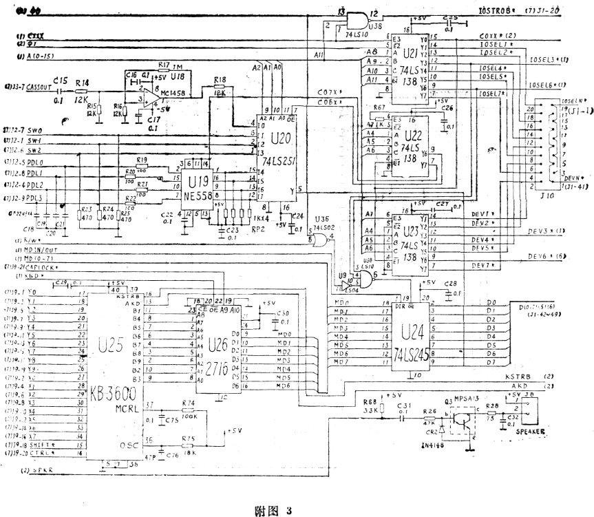
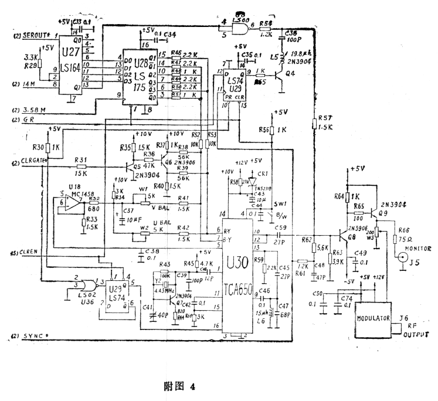
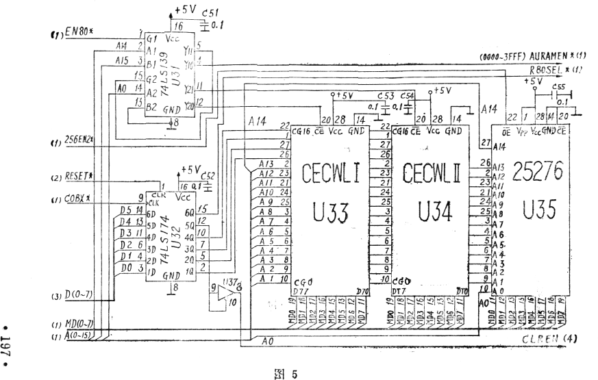
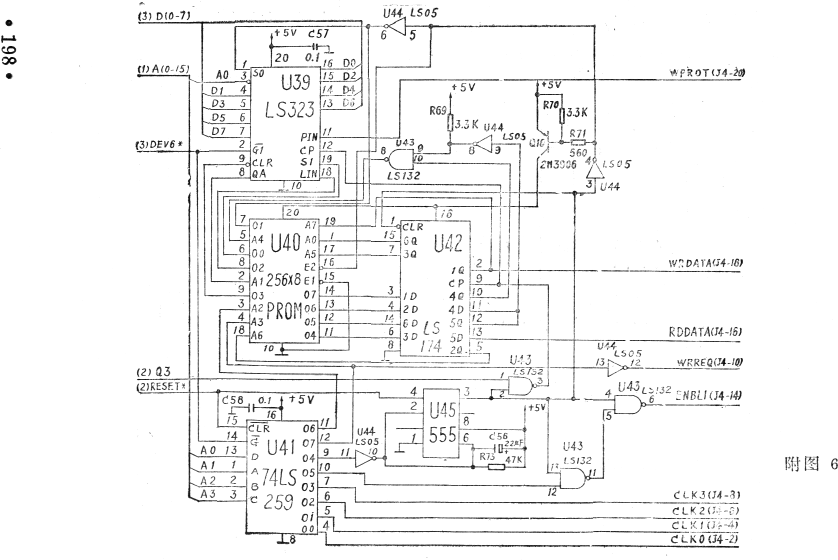
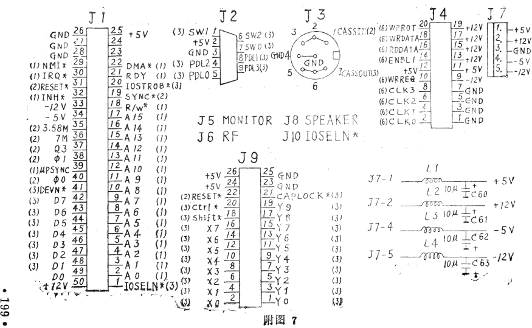

# 附录：指令集速查、字符码表与完整逻辑电路图

> 本文档全面收录《中华学习机 CEC-I 技术参考手册（硬件）》附录 A 至附录 D（第 168 页至第 199 页及全部折页附图）。
> 内容涵盖：
> 1. **附录 A 助记符指令表，指令组定义**（56 条指令助记符总览、6502 指令组划分原则与寻址模式详解）；
> 2. **附录 B 带有操作码、执行周期和存储要求的指令表**（完整 56 条指令详细参数速查卡，含 Hex 操作码、字节数、时钟周期与标志位影响）；
> 3. **附录 C 字母、字符显示码表（基本字符组）**（256 字符全集在反向、闪烁、正向大写与小写模式下的显存点阵码对照矩阵）；
> 4. **附录 D CEC-I 中华学习机整机逻辑图（附图 1 ～ 附图 7）**（包含高保真数字化电路图及详细的芯片引脚级硬件原理解析）。

---

## 目录

- [附录 A 助记符指令表，指令组定义](#附录-a-助记符指令表指令组定义)
  - [R6500 微处理器指令系统（按字母顺序）](#r6500-微处理器指令系统按字母顺序)
  - [A.1 前言](#a1-前言)
  - [A.2 组 1 指令](#a2-组-1-指令)
  - [A.3 组 2 指令](#a3-组-2-指令)
  - [A.4 组 3 指令](#a4-组-3-指令)
- [附录 B 带有操作码、执行周期和存储要求的指令表](#附录-b-带有操作码执行周期和存储要求的指令表)
  - [B.1 常用标志与缩写符号说明](#b1-常用标志与缩写符号说明)
  - [B.2 完整 56 条指令参数详细对照表](#b2-完整-56-条指令参数详细对照表)
- [附录 C 字母、字符显示码表（基本字符组）](#附录-c-字母字符显示码表基本字符组)
  - [C.1 显示码特性与属性划分机制](#c1-显示码特性与属性划分机制)
  - [C.2 完整屏幕点阵显示码速查表 ($00 ~ $FF)](#c2-完整屏幕点阵显示码速查表-00--ff)
- [附录 D CEC-I 中华学习机逻辑图（附图 1 ～ 附图 7）](#附录-d-cec-i-中华学习机逻辑图附图-1--附图-7)
  - [附图 1：中央处理器（CPU 6502）、总线驱动与主存系统电路图](#附图-1中央处理器cpu-6502总线驱动与主存系统电路图)
  - [附图 2：主时钟、IOU、显存锁存与字符生成逻辑电路图](#附图-2主时钟iou显存锁存与字符生成逻辑电路图)
  - [附图 3：I/O 空间译码、外设接口、键盘编码与扬声器驱动电路图](#附图-3io-空间译码外设接口键盘编码与扬声器驱动电路图)
  - [附图 4：彩色视频发生、PAL 调制与射频输出电路图](#附图-4彩色视频发生pal-调制与射频输出电路图)
  - [附图 5：汉字 ROM 扩展与辅存控制电路图](#附图-5汉字-rom-扩展与辅存控制电路图)
  - [附图 6：软盘驱动器控制器电路图](#附图-6软盘驱动器控制器电路图)
  - [附图 7：整机外设插座引脚定义与电源滤波电路图](#附图-7整机外设插座引脚定义与电源滤波电路图)

---

## 附录 A 助记符指令表，指令组定义

### R6500 微处理器指令系统（按字母顺序）

R6502 微处理器采用精简的 8 位 CISC 指令集，共有 56 条基本汇编指令。下表按英文字母顺序列出所有指令的助记符、英文全称与标准中文定义。

| 助记符 | 英文全称 | 中文功能定义 | 分组类别 |
| :--- | :--- | :--- | :--- |
| `ADC` | Add with Carry | 带进位加法 | 组 1 (算术运算) |
| `AND` | Logical AND | 逻辑与 | 组 1 (逻辑运算) |
| `ASL` | Arithmetic Shift Left | 算术左移 | 组 2 (读-修改-写) |
| `BCC` | Branch on Carry Clear | 进位为 "0" 分枝（相对转移） | 组 3 (条件分枝) |
| `BCS` | Branch on Carry Set | 进位为 "1" 分枝（相对转移） | 组 3 (条件分枝) |
| `BEQ` | Branch on Result Equal | 结果为 "0" 分枝（Z=1 相对转移） | 组 3 (条件分枝) |
| `BIT` | Test Bits in Memory with Accumulator | 位测试 | 组 3 (位操作) |
| `BMI` | Branch on Result Minus | 结果为负分枝（N=1 相对转移） | 组 3 (条件分枝) |
| `BNE` | Branch on Result Not Equal | 结果不为 "0" 分枝（Z=0 相对转移） | 组 3 (条件分枝) |
| `BPL` | Branch on Result Plus | 结果为正分枝（N=0 相对转移） | 组 3 (条件分枝) |
| `BRK` | Break Command (Force Interrupt) | 强制暂停 / 软件中断 | 组 3 (系统控制) |
| `BVC` | Branch on Overflow Clear | 溢出为 "0" 分枝（V=0 相对转移） | 组 3 (条件分枝) |
| `BVS` | Branch on Overflow Set | 溢出为 "1" 分枝（V=1 相对转移） | 组 3 (条件分枝) |
| `CLC` | Clear Carry Flag | 清进位标志位（C = 0） | 组 3 (标志操作) |
| `CLD` | Clear Decimal Mode | 清十进制方式（D = 0，二进制模式） | 组 3 (标志操作) |
| `CLI` | Clear Interrupt Disable | 清中断禁止位（I = 0，允许 IRQ 中断） | 组 3 (标志操作) |
| `CLV` | Clear Overflow Flag | 清溢出标志位（V = 0） | 组 3 (标志操作) |
| `CMP` | Compare Memory with Accumulator | 累加器与存储器比较 | 组 1 (比较运算) |
| `CPX` | Compare Memory and Index X | 变址寄存器 X 与存储器比较 | 组 3 (比较运算) |
| `CPY` | Compare Memory and Index Y | 变址寄存器 Y 与存储器比较 | 组 3 (比较运算) |
| `DEC` | Decrement Memory by One | 存储器减 1 | 组 2 (读-修改-写) |
| `DEX` | Decrement Index X by One | 变址寄存器 X 减 1 | 组 2 (寄存器操作) |
| `DEY` | Decrement Index Y by One | 变址寄存器 Y 减 1 | 组 3 (寄存器操作) |
| `EOR` | Exclusive OR | 逻辑异或 | 组 1 (逻辑运算) |
| `INC` | Increment Memory by One | 存储器加 1 | 组 2 (读-修改-写) |
| `INX` | Increment Index X by One | 变址寄存器 X 加 1 | 组 3 (寄存器操作) |
| `INY` | Increment Index Y by One | 变址寄存器 Y 加 1 | 组 3 (寄存器操作) |
| `JMP` | Jump to Location | 无条件转移（绝对 / 间接） | 组 3 (程序流程) |
| `JSR` | Jump to Subroutine | 转子程序 | 组 3 (程序流程) |
| `LDA` | Load Accumulator with Memory | 送累加器（加载 A） | 组 1 (数据传送) |
| `LDX` | Load Index X with Memory | 送变址寄存器 X（加载 X） | 组 2 (数据传送) |
| `LDY` | Load Index Y with Memory | 送变址寄存器 Y（加载 Y） | 组 3 (数据传送) |
| `LSR` | Logical Shift Right | 逻辑右移 | 组 2 (读-修改-写) |
| `NOP` | No Operation | 空操作 | 组 3 (系统控制) |
| `ORA` | Logical Inclusive OR | 逻辑或 | 组 1 (逻辑运算) |
| `PHA` | Push Accumulator on Stack | 累加器压入堆栈 | 组 3 (堆栈操作) |
| `PHP` | Push Processor Status on Stack | 处理器状态寄存器压入堆栈 | 组 3 (堆栈操作) |
| `PLA` | Pull Accumulator from Stack | 堆栈弹回累加器 | 组 3 (堆栈操作) |
| `PLP` | Pull Processor Status from Stack | 堆栈弹回处理器状态寄存器 | 组 3 (堆栈操作) |
| `ROL` | Rotate Left One Bit | 循环左移（带进位 C） | 组 2 (读-修改-写) |
| `ROR` | Rotate Right One Bit | 循环右移（带进位 C） | 组 2 (读-修改-写) |
| `RTI` | Return from Interrupt | 中断返回 | 组 3 (系统控制) |
| `RTS` | Return from Subroutine | 子程序返回 | 组 3 (程序流程) |
| `SBC` | Subtract with Borrow | 带借位的减法 | 组 1 (算术运算) |
| `SEC` | Set Carry Flag | 置进位标志位（C = 1） | 组 3 (标志操作) |
| `SED` | Set Decimal Mode | 置十进制方式（D = 1，BCD 模式） | 组 3 (标志操作) |
| `SEI` | Set Interrupt Disable | 置中断禁止位（I = 1，屏蔽 IRQ） | 组 3 (标志操作) |
| `STA` | Store Accumulator in Memory | 存累加器 | 组 1 (数据传送) |
| `STX` | Store Index X in Memory | 存变址寄存器 X | 组 2 (数据传送) |
| `STY` | Store Index Y in Memory | 存变址寄存器 Y | 组 3 (数据传送) |
| `TAX` | Transfer Accumulator to Index X | 累加器送变址寄存器 X | 组 2 (寄存器传送) |
| `TAY` | Transfer Accumulator to Index Y | 累加器送变址寄存器 Y | 组 3 (寄存器传送) |
| `TSX` | Transfer Stack Pointer to Index X | 栈指针送变址寄存器 X | 组 2 (寄存器传送) |
| `TXA` | Transfer Index X to Accumulator | 变址寄存器 X 送累加器 | 组 2 (寄存器传送) |
| `TXS` | Transfer Index X to Stack Pointer | 变址寄存器 X 送栈指针 | 组 2 (寄存器传送) |
| `TYA` | Transfer Index Y to Accumulator | 变址寄存器 Y 送累加器 | 组 3 (寄存器传送) |

### A.1 前言

微处理器指令安排被分为三个基本组：
1. **第一组（组 1，共 8 条）**：具有最大灵活性寻址，由最通用的指令组成，如加载、加法、存储等；
2. **第二组（组 2，共 8 条）**：包括“读-修改-写”指令（如移位、加 1、减 1）以及变址寄存器 X 传送指令；
3. **第三组（组 3，共 39 条）**：包含全部剩下的指令，包括所有堆栈操作、寄存器 X/Y 比较以及全部分枝相对转移指令。

3 个组由操作码编码的位模式矩阵划分而来：
- **组 1**：给出最大灵活度寻址（16 位寻址组合，实际启用 8 种）；
- **组 2**：指令给出 8 种组合；
- **组 3**：指令基本上单独地硬件译码。

### A.2 组 1 指令

组 1 指令是：**带进位加法（ADC）**、**逻辑与（AND）**、**比较（CMP）**、**异或（EOR）**、**加载累加器（LDA）**、**逻辑或（ORA）**、**带借位的减法（SBC）** 和 **存累加器（STA）**。

这些指令的每一条在 6502 指令字位结构中都具有 8 种通用的寻址方式：
1. **立即寻址 (Immediate)**：`#oper`
2. **零页寻址 (Zero Page)**：`oper`
3. **零页 X 变址寻址 (Zero Page, X)**：`oper, X`
4. **绝对寻址 (Absolute)**：`oper`
5. **绝对 X 变址寻址 (Absolute, X)**：`oper, X`
6. **绝对 Y 变址寻址 (Absolute, Y)**：`oper, Y`
7. **变址间接寻址 (Indexed Indirect)**：`(oper, X)`
8. **间接变址寻址 (Indirect Indexed)**：`(oper), Y`

> [!NOTE] 寻址空间扩展说明
> 组 1 指令理论上具有 16 种寻址组合可能。在 R6502 到 R6507、R6512 到 R6515 中，只有 8 种有用的方式被实际使用。未用的另外 8 种寻址方式保留给将来 R6500 产品系列，并允许辅助的片上寄存器、片上 I/O 口寻址以及处理 2 字节字。

### A.3 组 2 指令

组 2 指令首先是读、修改、写指令。组 2 指令里真正包含两类：
1. **第一类**：移位和循环移位指令，即：**右移（LSR）**、**左移（ASL）**、**循环左移（ROL）**、**循环右移（ROR）**。
2. **第二类**：包括 **存储器加 1（INC）** 和 **存储器减 1（DEC）** 指令，以及两条变址寄存器 X 指令：**送变址寄存器 X（LDX）** 和 **存变址寄存器 X（STX）**。

由于这些指令具有位模式，所以一般都有 8 种寻址方式。定义了如下寻址方式：
- **零页** (`oper`)
- **零页变址** (`oper, X`；对 LDX/STX 改用 `oper, Y`)
- **绝对** (`oper`)
- **绝对变址** (`oper, X`；对 LDX 改用 `oper, Y`)
- **特定的累加器（或寄存器）方式**（四种移位指令都具有累加器 A 操作方式；从 A 加载到 X 已用固有助记符 `TAX` 来指定；也包括从 X 送回累加器的 `TXA`，以及栈指针传送指令 `TSX` 和 `TXS`）。

应该注意到 X 指令具有特殊寻址方式的文件编制作用：在文件编制中寄存器 Y 被用于全部变址操作；这样，由 X 代替零页变址，X 指令就具有 Y 零页变址；而用 X 代替现有的绝对变址，X 指令就具有 Y 绝对变址。

### A.4 组 3 指令

组 3 指令真正可分为两大类：
1. **修改 Y 寄存器与比较指令**：
   - **加载 Y（LDY）**、**存变址寄存器 Y（STY）**、**变址寄存器 Y 与存储器比较（CPY）**、**变址寄存器 X 与存储器比较（CPX）**。对于组 3 指令实际上占用操作码（OPCODE）空间的一半。
   - **变址寄存器 X 加 1（INX）** 和 **变址寄存器 Y 加 1（INY）** 是 X 比较和 Y 比较指令的特殊子集。
2. **分枝指令与系统控制指令**：
   - 全部分枝指令：`BCC`, `BCS`, `BEQ`, `BMI`, `BNE`, `BPL`, `BVC`, `BVS`（均采用相对寻址方式）；
   - 所有的标志操作指令（隐含寻址）：`CLC`, `SEC`, `CLD`, `SED`, `CLI`, `SEI`, `CLV`；
   - 所有的压入和弹回堆栈操作指令：`BRK`, `JSR`, `PHA`, `PHP`, `PLA`, `PLP`；
   - 程序跳转与测试：`JMP`（绝对寻址与间接寻址）和 `BIT`（位测试指令）。

这组的各部分没有可采用的公共寻址方式。加载 Y、存储 Y、位测试、X 比较和 Y 比较具有零页和绝对寻址方式，而所有的 Y 和 X 指令允许等待变址操作和立即数寻址方式。

---

## 附录 B 带有操作码、执行周期和存储要求的指令表

### B.1 常用标志与缩写符号说明

| 符号 | 中文含义 | 英文全称 / 功能描述 |
| :---: | :--- | :--- |
| **A** | 累加器 | Accumulator (8 位主工作寄存器) |
| **X, Y** | 变址寄存器 | Index Registers X, Y (8 位变址与计数寄存器) |
| **M** | 存储器有效单元 | Memory Effective Address Contents |
| **P** | 处理器状态寄存器 | Processor Status Register (8 位标志寄存器) |
| **S** | 堆栈指针 | Stack Pointer (8 位堆栈地址指针，指向第 1 页 $0100~$01FF) |
| **✓** | 标志位改变 | Bit is affected by instruction execution |
| **-** | 标志位不改变 | Bit is unaffected by instruction execution |
| **+** | 算术加 | Arithmetic Addition |
| **-** | 算术减 | Arithmetic Subtraction |
| **∧** | 逻辑与 | Logical AND |
| **∨** | 逻辑或 | Logical OR |
| **∀** | 逻辑异或 | Logical Exclusive OR (XOR) |
| **↑** | 弹出堆栈 | Pull from Stack (栈指针 S 增 1) |
| **↓** | 压入堆栈 | Push to Stack (栈指针 S 减 1) |
| **→ / ←** | 传送目标方向 | Transfer Direction |
| **PC** | 程序计数器 | Program Counter (16 位) |
| **PCH** | 程序计数器高位 | Program Counter High Byte (PC8 ~ PC15) |
| **PCL** | 程序计数器低位 | Program Counter Low Byte (PC0 ~ PC7) |
| **OPER** | 操作数 | Operand (8 位立即数或偏移量) |
| **#** | 立即寻址方式 | Immediate Addressing Mode Prefix |
| **\*** | 周期条件增量 | 如果有跨页边界（Page Boundary Crossing）则加 1 周期 |
| **\*\*** | 分枝周期增量 | 条件转移成功加 1 周期；若同时跨越 256 字节页面边界则再加 1 周期（共加 2 周期） |

> **处理器状态寄存器 P (Processor Status Register) 位结构说明**：
>
> | 位编号 | 7 | 6 | 5 | 4 | 3 | 2 | 1 | 0 |
> | :---: | :---: | :---: | :---: | :---: | :---: | :---: | :---: | :---: |
> | **标志位** | **N** (负数) | **V** (溢出) | *(保留)* | **B** (软件中断) | **D** (十进制) | **I** (中断屏蔽) | **Z** (零标志) | **C** (进位标志) |
>
> - 表中标志位栏统一按 **N Z C I D V** 顺序标出状态受影响情况。

### B.2 完整 56 条指令参数详细对照表

#### ADC 带进位加法

- **助记符**：`ADC`
- **操作逻辑**：`A + M + C → A, C`
- **状态标志位影响**：
  - **N** (负数)：`✓`
  - **Z** (为零)：`✓`
  - **C** (进位)：`✓`
  - **I** (中断)：`-`
  - **D** (十进制)：`-`
  - **V** (溢出)：`✓`

| 寻址方式 | 汇编语言格式 | 操作码 (Hex) | 字节数 (Bytes) | 周期数 (Cycles) | 附注说明 |
| :--- | :--- | :---: | :---: | :---: | :--- |
| 立即型 | `ADC #oper` | `$69` | 2 | 2 |  |
| 零页型 | `ADC oper` | `$65` | 2 | 3 |  |
| 零页 X 变址型 | `ADC oper, X` | `$75` | 2 | 4 |  |
| 绝对型 | `ADC oper` | `$6D` | 3 | 4 |  |
| 绝对 X 变址型 | `ADC oper, X` | `$7D` | 3 | 4* | 如果有跨页则加一个周期 |
| 绝对 Y 变址型 | `ADC oper, Y` | `$79` | 3 | 4* | 如果有跨页则加一个周期 |
| 变址间接型 | `ADC (oper, X)` | `$61` | 2 | 6 |  |
| 间接变址型 | `ADC (oper), Y` | `$71` | 2 | 5* | 如果有跨页则加一个周期 |

#### AND 逻辑与

- **助记符**：`AND`
- **操作逻辑**：`A ∧ M → A`
- **状态标志位影响**：
  - **N** (负数)：`✓`
  - **Z** (为零)：`✓`
  - **C** (进位)：`-`
  - **I** (中断)：`-`
  - **D** (十进制)：`-`
  - **V** (溢出)：`-`

| 寻址方式 | 汇编语言格式 | 操作码 (Hex) | 字节数 (Bytes) | 周期数 (Cycles) | 附注说明 |
| :--- | :--- | :---: | :---: | :---: | :--- |
| 立即型 | `AND #oper` | `$29` | 2 | 2 |  |
| 零页型 | `AND oper` | `$25` | 2 | 3 |  |
| 零页 X 变址型 | `AND oper, X` | `$35` | 2 | 4 |  |
| 绝对型 | `AND oper` | `$2D` | 3 | 4 |  |
| 绝对 X 变址型 | `AND oper, X` | `$3D` | 3 | 4* | 如果有跨页则加一个周期 |
| 绝对 Y 变址型 | `AND oper, Y` | `$39` | 3 | 4* | 如果有跨页则加一个周期 |
| 变址间接型 | `AND (oper, X)` | `$21` | 2 | 6 |  |
| 间接变址型 | `AND (oper), Y` | `$31` | 2 | 5* | 如果有跨页则加一个周期 |

#### ASL 算术左移

- **助记符**：`ASL`
- **操作逻辑**：`C ← b7..b0 ← 0`
- **状态标志位影响**：
  - **N** (负数)：`✓`
  - **Z** (为零)：`✓`
  - **C** (进位)：`✓`
  - **I** (中断)：`-`
  - **D** (十进制)：`-`
  - **V** (溢出)：`-`

| 寻址方式 | 汇编语言格式 | 操作码 (Hex) | 字节数 (Bytes) | 周期数 (Cycles) | 附注说明 |
| :--- | :--- | :---: | :---: | :---: | :--- |
| 累加器型 | `ASL A` | `$0A` | 1 | 2 |  |
| 零页型 | `ASL oper` | `$06` | 2 | 5 |  |
| 零页 X 变址型 | `ASL oper, X` | `$16` | 2 | 6 |  |
| 绝对型 | `ASL oper` | `$0E` | 3 | 6 |  |
| 绝对 X 变址型 | `ASL oper, X` | `$1E` | 3 | 7 |  |

#### BCC 进位为 "0" 分枝

- **助记符**：`BCC`
- **操作逻辑**：`若 C = 0，则 PC + oper → PC`
- **状态标志位影响**：
  - **N** (负数)：`-`
  - **Z** (为零)：`-`
  - **C** (进位)：`-`
  - **I** (中断)：`-`
  - **D** (十进制)：`-`
  - **V** (溢出)：`-`

| 寻址方式 | 汇编语言格式 | 操作码 (Hex) | 字节数 (Bytes) | 周期数 (Cycles) | 附注说明 |
| :--- | :--- | :---: | :---: | :---: | :--- |
| 相对型 | `BCC oper` | `$90` | 2 | 2** | 分枝转移成功加 1 周期；跨越页面加 2 周期 |

#### BCS 进位为 "1" 分枝

- **助记符**：`BCS`
- **操作逻辑**：`若 C = 1，则 PC + oper → PC`
- **状态标志位影响**：
  - **N** (负数)：`-`
  - **Z** (为零)：`-`
  - **C** (进位)：`-`
  - **I** (中断)：`-`
  - **D** (十进制)：`-`
  - **V** (溢出)：`-`

| 寻址方式 | 汇编语言格式 | 操作码 (Hex) | 字节数 (Bytes) | 周期数 (Cycles) | 附注说明 |
| :--- | :--- | :---: | :---: | :---: | :--- |
| 相对型 | `BCS oper` | `$B0` | 2 | 2** | 分枝转移成功加 1 周期；跨越页面加 2 周期 |

#### BEQ 结果为 "0" 分枝

- **助记符**：`BEQ`
- **操作逻辑**：`若 Z = 1，则 PC + oper → PC`
- **状态标志位影响**：
  - **N** (负数)：`-`
  - **Z** (为零)：`-`
  - **C** (进位)：`-`
  - **I** (中断)：`-`
  - **D** (十进制)：`-`
  - **V** (溢出)：`-`

| 寻址方式 | 汇编语言格式 | 操作码 (Hex) | 字节数 (Bytes) | 周期数 (Cycles) | 附注说明 |
| :--- | :--- | :---: | :---: | :---: | :--- |
| 相对型 | `BEQ oper` | `$F0` | 2 | 2** | 分枝转移成功加 1 周期；跨越页面加 2 周期 |

#### BIT 位测试

- **助记符**：`BIT`
- **操作逻辑**：`A ∧ M, M7 → N, M6 → V`
- **状态标志位影响**：
  - **N** (负数)：`M7`
  - **Z** (为零)：`✓`
  - **C** (进位)：`-`
  - **I** (中断)：`-`
  - **D** (十进制)：`-`
  - **V** (溢出)：`M6`

| 寻址方式 | 汇编语言格式 | 操作码 (Hex) | 字节数 (Bytes) | 周期数 (Cycles) | 附注说明 |
| :--- | :--- | :---: | :---: | :---: | :--- |
| 零页型 | `BIT oper` | `$24` | 2 | 3 | N=M7, V=M6, Z 标志由 A ∧ M 决定 |
| 绝对型 | `BIT oper` | `$2C` | 3 | 4 | N=M7, V=M6, Z 标志由 A ∧ M 决定 |

#### BMI 结果为负分枝

- **助记符**：`BMI`
- **操作逻辑**：`若 N = 1，则 PC + oper → PC`
- **状态标志位影响**：
  - **N** (负数)：`-`
  - **Z** (为零)：`-`
  - **C** (进位)：`-`
  - **I** (中断)：`-`
  - **D** (十进制)：`-`
  - **V** (溢出)：`-`

| 寻址方式 | 汇编语言格式 | 操作码 (Hex) | 字节数 (Bytes) | 周期数 (Cycles) | 附注说明 |
| :--- | :--- | :---: | :---: | :---: | :--- |
| 相对型 | `BMI oper` | `$30` | 2 | 2** | 分枝转移成功加 1 周期；跨越页面加 2 周期 |

#### BNE 结果不为 "0" 分枝

- **助记符**：`BNE`
- **操作逻辑**：`若 Z = 0，则 PC + oper → PC`
- **状态标志位影响**：
  - **N** (负数)：`-`
  - **Z** (为零)：`-`
  - **C** (进位)：`-`
  - **I** (中断)：`-`
  - **D** (十进制)：`-`
  - **V** (溢出)：`-`

| 寻址方式 | 汇编语言格式 | 操作码 (Hex) | 字节数 (Bytes) | 周期数 (Cycles) | 附注说明 |
| :--- | :--- | :---: | :---: | :---: | :--- |
| 相对型 | `BNE oper` | `$D0` | 2 | 2** | 分枝转移成功加 1 周期；跨越页面加 2 周期 |

#### BPL 结果为正分枝

- **助记符**：`BPL`
- **操作逻辑**：`若 N = 0，则 PC + oper → PC`
- **状态标志位影响**：
  - **N** (负数)：`-`
  - **Z** (为零)：`-`
  - **C** (进位)：`-`
  - **I** (中断)：`-`
  - **D** (十进制)：`-`
  - **V** (溢出)：`-`

| 寻址方式 | 汇编语言格式 | 操作码 (Hex) | 字节数 (Bytes) | 周期数 (Cycles) | 附注说明 |
| :--- | :--- | :---: | :---: | :---: | :--- |
| 相对型 | `BPL oper` | `$10` | 2 | 2** | 分枝转移成功加 1 周期；跨越页面加 2 周期 |

#### BRK 强制暂停 / 软件中断

- **助记符**：`BRK`
- **操作逻辑**：`PC + 2 ↓, P ↓, (FFFE/FFFF) → PC`
- **状态标志位影响**：
  - **N** (负数)：`-`
  - **Z** (为零)：`-`
  - **C** (进位)：`-`
  - **I** (中断)：`1`
  - **D** (十进制)：`-`
  - **V** (溢出)：`-`

| 寻址方式 | 汇编语言格式 | 操作码 (Hex) | 字节数 (Bytes) | 周期数 (Cycles) | 附注说明 |
| :--- | :--- | :---: | :---: | :---: | :--- |
| 隐含型 | `BRK` | `$00` | 1 | 7 | 硬件置中断屏蔽标志位 I=1 |

#### BVC 溢出为 "0" 分枝

- **助记符**：`BVC`
- **操作逻辑**：`若 V = 0，则 PC + oper → PC`
- **状态标志位影响**：
  - **N** (负数)：`-`
  - **Z** (为零)：`-`
  - **C** (进位)：`-`
  - **I** (中断)：`-`
  - **D** (十进制)：`-`
  - **V** (溢出)：`-`

| 寻址方式 | 汇编语言格式 | 操作码 (Hex) | 字节数 (Bytes) | 周期数 (Cycles) | 附注说明 |
| :--- | :--- | :---: | :---: | :---: | :--- |
| 相对型 | `BVC oper` | `$50` | 2 | 2** | 分枝转移成功加 1 周期；跨越页面加 2 周期 |

#### BVS 溢出为 "1" 分枝

- **助记符**：`BVS`
- **操作逻辑**：`若 V = 1，则 PC + oper → PC`
- **状态标志位影响**：
  - **N** (负数)：`-`
  - **Z** (为零)：`-`
  - **C** (进位)：`-`
  - **I** (中断)：`-`
  - **D** (十进制)：`-`
  - **V** (溢出)：`-`

| 寻址方式 | 汇编语言格式 | 操作码 (Hex) | 字节数 (Bytes) | 周期数 (Cycles) | 附注说明 |
| :--- | :--- | :---: | :---: | :---: | :--- |
| 相对型 | `BVS oper` | `$70` | 2 | 2** | 分枝转移成功加 1 周期；跨越页面加 2 周期 |

#### CLC 清进位标志

- **助记符**：`CLC`
- **操作逻辑**：`0 → C`
- **状态标志位影响**：
  - **N** (负数)：`-`
  - **Z** (为零)：`-`
  - **C** (进位)：`0`
  - **I** (中断)：`-`
  - **D** (十进制)：`-`
  - **V** (溢出)：`-`

| 寻址方式 | 汇编语言格式 | 操作码 (Hex) | 字节数 (Bytes) | 周期数 (Cycles) | 附注说明 |
| :--- | :--- | :---: | :---: | :---: | :--- |
| 隐含型 | `CLC` | `$18` | 1 | 2 |  |

#### CLD 清十进制方式

- **助记符**：`CLD`
- **操作逻辑**：`0 → D`
- **状态标志位影响**：
  - **N** (负数)：`-`
  - **Z** (为零)：`-`
  - **C** (进位)：`-`
  - **I** (中断)：`-`
  - **D** (十进制)：`0`
  - **V** (溢出)：`-`

| 寻址方式 | 汇编语言格式 | 操作码 (Hex) | 字节数 (Bytes) | 周期数 (Cycles) | 附注说明 |
| :--- | :--- | :---: | :---: | :---: | :--- |
| 隐含型 | `CLD` | `$D8` | 1 | 2 |  |

#### CLI 清中断禁止位

- **助记符**：`CLI`
- **操作逻辑**：`0 → I`
- **状态标志位影响**：
  - **N** (负数)：`-`
  - **Z** (为零)：`-`
  - **C** (进位)：`-`
  - **I** (中断)：`0`
  - **D** (十进制)：`-`
  - **V** (溢出)：`-`

| 寻址方式 | 汇编语言格式 | 操作码 (Hex) | 字节数 (Bytes) | 周期数 (Cycles) | 附注说明 |
| :--- | :--- | :---: | :---: | :---: | :--- |
| 隐含型 | `CLI` | `$58` | 1 | 2 |  |

#### CLV 清溢出标志

- **助记符**：`CLV`
- **操作逻辑**：`0 → V`
- **状态标志位影响**：
  - **N** (负数)：`-`
  - **Z** (为零)：`-`
  - **C** (进位)：`-`
  - **I** (中断)：`-`
  - **D** (十进制)：`-`
  - **V** (溢出)：`0`

| 寻址方式 | 汇编语言格式 | 操作码 (Hex) | 字节数 (Bytes) | 周期数 (Cycles) | 附注说明 |
| :--- | :--- | :---: | :---: | :---: | :--- |
| 隐含型 | `CLV` | `$B8` | 1 | 2 |  |

#### CMP 累加器与存储器比较

- **助记符**：`CMP`
- **操作逻辑**：`A - M`
- **状态标志位影响**：
  - **N** (负数)：`✓`
  - **Z** (为零)：`✓`
  - **C** (进位)：`✓`
  - **I** (中断)：`-`
  - **D** (十进制)：`-`
  - **V** (溢出)：`-`

| 寻址方式 | 汇编语言格式 | 操作码 (Hex) | 字节数 (Bytes) | 周期数 (Cycles) | 附注说明 |
| :--- | :--- | :---: | :---: | :---: | :--- |
| 立即型 | `CMP #oper` | `$C9` | 2 | 2 |  |
| 零页型 | `CMP oper` | `$C5` | 2 | 3 |  |
| 零页 X 变址型 | `CMP oper, X` | `$D5` | 2 | 4 |  |
| 绝对型 | `CMP oper` | `$CD` | 3 | 4 |  |
| 绝对 X 变址型 | `CMP oper, X` | `$DD` | 3 | 4* | 如果有跨页则加一个周期 |
| 绝对 Y 变址型 | `CMP oper, Y` | `$D9` | 3 | 4* | 如果有跨页则加一个周期 |
| 变址间接型 | `CMP (oper, X)` | `$C1` | 2 | 6 |  |
| 间接变址型 | `CMP (oper), Y` | `$D1` | 2 | 5* | 如果有跨页则加一个周期 |

#### CPX 变址寄存器 X 与存储器比较

- **助记符**：`CPX`
- **操作逻辑**：`X - M`
- **状态标志位影响**：
  - **N** (负数)：`✓`
  - **Z** (为零)：`✓`
  - **C** (进位)：`✓`
  - **I** (中断)：`-`
  - **D** (十进制)：`-`
  - **V** (溢出)：`-`

| 寻址方式 | 汇编语言格式 | 操作码 (Hex) | 字节数 (Bytes) | 周期数 (Cycles) | 附注说明 |
| :--- | :--- | :---: | :---: | :---: | :--- |
| 立即型 | `CPX #oper` | `$E0` | 2 | 2 |  |
| 零页型 | `CPX oper` | `$E4` | 2 | 3 |  |
| 绝对型 | `CPX oper` | `$EC` | 3 | 4 |  |

#### CPY 变址寄存器 Y 与存储器比较

- **助记符**：`CPY`
- **操作逻辑**：`Y - M`
- **状态标志位影响**：
  - **N** (负数)：`✓`
  - **Z** (为零)：`✓`
  - **C** (进位)：`✓`
  - **I** (中断)：`-`
  - **D** (十进制)：`-`
  - **V** (溢出)：`-`

| 寻址方式 | 汇编语言格式 | 操作码 (Hex) | 字节数 (Bytes) | 周期数 (Cycles) | 附注说明 |
| :--- | :--- | :---: | :---: | :---: | :--- |
| 立即型 | `CPY #oper` | `$C0` | 2 | 2 |  |
| 零页型 | `CPY oper` | `$C4` | 2 | 3 |  |
| 绝对型 | `CPY oper` | `$CC` | 3 | 4 |  |

#### DEC 存储器减 1

- **助记符**：`DEC`
- **操作逻辑**：`M - 1 → M`
- **状态标志位影响**：
  - **N** (负数)：`✓`
  - **Z** (为零)：`✓`
  - **C** (进位)：`-`
  - **I** (中断)：`-`
  - **D** (十进制)：`-`
  - **V** (溢出)：`-`

| 寻址方式 | 汇编语言格式 | 操作码 (Hex) | 字节数 (Bytes) | 周期数 (Cycles) | 附注说明 |
| :--- | :--- | :---: | :---: | :---: | :--- |
| 零页型 | `DEC oper` | `$C6` | 2 | 5 |  |
| 零页 X 变址型 | `DEC oper, X` | `$D6` | 2 | 6 |  |
| 绝对型 | `DEC oper` | `$CE` | 3 | 6 |  |
| 绝对 X 变址型 | `DEC oper, X` | `$DE` | 3 | 7 |  |

#### DEX 变址寄存器 X 减 1

- **助记符**：`DEX`
- **操作逻辑**：`X - 1 → X`
- **状态标志位影响**：
  - **N** (负数)：`✓`
  - **Z** (为零)：`✓`
  - **C** (进位)：`-`
  - **I** (中断)：`-`
  - **D** (十进制)：`-`
  - **V** (溢出)：`-`

| 寻址方式 | 汇编语言格式 | 操作码 (Hex) | 字节数 (Bytes) | 周期数 (Cycles) | 附注说明 |
| :--- | :--- | :---: | :---: | :---: | :--- |
| 隐含型 | `DEX` | `$CA` | 1 | 2 |  |

#### DEY 变址寄存器 Y 减 1

- **助记符**：`DEY`
- **操作逻辑**：`Y - 1 → Y`
- **状态标志位影响**：
  - **N** (负数)：`✓`
  - **Z** (为零)：`✓`
  - **C** (进位)：`-`
  - **I** (中断)：`-`
  - **D** (十进制)：`-`
  - **V** (溢出)：`-`

| 寻址方式 | 汇编语言格式 | 操作码 (Hex) | 字节数 (Bytes) | 周期数 (Cycles) | 附注说明 |
| :--- | :--- | :---: | :---: | :---: | :--- |
| 隐含型 | `DEY` | `$88` | 1 | 2 |  |

#### EOR 逻辑异或

- **助记符**：`EOR`
- **操作逻辑**：`A ∀ M → A`
- **状态标志位影响**：
  - **N** (负数)：`✓`
  - **Z** (为零)：`✓`
  - **C** (进位)：`-`
  - **I** (中断)：`-`
  - **D** (十进制)：`-`
  - **V** (溢出)：`-`

| 寻址方式 | 汇编语言格式 | 操作码 (Hex) | 字节数 (Bytes) | 周期数 (Cycles) | 附注说明 |
| :--- | :--- | :---: | :---: | :---: | :--- |
| 立即型 | `EOR #oper` | `$49` | 2 | 2 |  |
| 零页型 | `EOR oper` | `$45` | 2 | 3 |  |
| 零页 X 变址型 | `EOR oper, X` | `$55` | 2 | 4 |  |
| 绝对型 | `EOR oper` | `$4D` | 3 | 4 |  |
| 绝对 X 变址型 | `EOR oper, X` | `$5D` | 3 | 4* | 如果有跨页则加一个周期 |
| 绝对 Y 变址型 | `EOR oper, Y` | `$59` | 3 | 4* | 如果有跨页则加一个周期 |
| 变址间接型 | `EOR (oper, X)` | `$41` | 2 | 6 |  |
| 间接变址型 | `EOR (oper), Y` | `$51` | 2 | 5* | 如果有跨页则加一个周期 |

#### INC 存储器加 1

- **助记符**：`INC`
- **操作逻辑**：`M + 1 → M`
- **状态标志位影响**：
  - **N** (负数)：`✓`
  - **Z** (为零)：`✓`
  - **C** (进位)：`-`
  - **I** (中断)：`-`
  - **D** (十进制)：`-`
  - **V** (溢出)：`-`

| 寻址方式 | 汇编语言格式 | 操作码 (Hex) | 字节数 (Bytes) | 周期数 (Cycles) | 附注说明 |
| :--- | :--- | :---: | :---: | :---: | :--- |
| 零页型 | `INC oper` | `$E6` | 2 | 5 |  |
| 零页 X 变址型 | `INC oper, X` | `$F6` | 2 | 6 |  |
| 绝对型 | `INC oper` | `$EE` | 3 | 6 |  |
| 绝对 X 变址型 | `INC oper, X` | `$FE` | 3 | 7 |  |

#### INX 变址寄存器 X 加 1

- **助记符**：`INX`
- **操作逻辑**：`X + 1 → X`
- **状态标志位影响**：
  - **N** (负数)：`✓`
  - **Z** (为零)：`✓`
  - **C** (进位)：`-`
  - **I** (中断)：`-`
  - **D** (十进制)：`-`
  - **V** (溢出)：`-`

| 寻址方式 | 汇编语言格式 | 操作码 (Hex) | 字节数 (Bytes) | 周期数 (Cycles) | 附注说明 |
| :--- | :--- | :---: | :---: | :---: | :--- |
| 隐含型 | `INX` | `$E8` | 1 | 2 |  |

#### INY 变址寄存器 Y 加 1

- **助记符**：`INY`
- **操作逻辑**：`Y + 1 → Y`
- **状态标志位影响**：
  - **N** (负数)：`✓`
  - **Z** (为零)：`✓`
  - **C** (进位)：`-`
  - **I** (中断)：`-`
  - **D** (十进制)：`-`
  - **V** (溢出)：`-`

| 寻址方式 | 汇编语言格式 | 操作码 (Hex) | 字节数 (Bytes) | 周期数 (Cycles) | 附注说明 |
| :--- | :--- | :---: | :---: | :---: | :--- |
| 隐含型 | `INY` | `$C8` | 1 | 2 |  |

#### JMP 无条件转移

- **助记符**：`JMP`
- **操作逻辑**：`oper → PC`
- **状态标志位影响**：
  - **N** (负数)：`-`
  - **Z** (为零)：`-`
  - **C** (进位)：`-`
  - **I** (中断)：`-`
  - **D** (十进制)：`-`
  - **V** (溢出)：`-`

| 寻址方式 | 汇编语言格式 | 操作码 (Hex) | 字节数 (Bytes) | 周期数 (Cycles) | 附注说明 |
| :--- | :--- | :---: | :---: | :---: | :--- |
| 绝对型 | `JMP oper` | `$4C` | 3 | 3 |  |
| 间接型 | `JMP (oper)` | `$6C` | 3 | 5 | 注意：6502 间接跳转存在跨页边界寻址硬件缺陷 |

#### JSR 转子程序

- **助记符**：`JSR`
- **操作逻辑**：`PC + 2 ↓, oper → PC`
- **状态标志位影响**：
  - **N** (负数)：`-`
  - **Z** (为零)：`-`
  - **C** (进位)：`-`
  - **I** (中断)：`-`
  - **D** (十进制)：`-`
  - **V** (溢出)：`-`

| 寻址方式 | 汇编语言格式 | 操作码 (Hex) | 字节数 (Bytes) | 周期数 (Cycles) | 附注说明 |
| :--- | :--- | :---: | :---: | :---: | :--- |
| 绝对型 | `JSR oper` | `$20` | 3 | 6 |  |

#### LDA 送累加器（加载 A）

- **助记符**：`LDA`
- **操作逻辑**：`M → A`
- **状态标志位影响**：
  - **N** (负数)：`✓`
  - **Z** (为零)：`✓`
  - **C** (进位)：`-`
  - **I** (中断)：`-`
  - **D** (十进制)：`-`
  - **V** (溢出)：`-`

| 寻址方式 | 汇编语言格式 | 操作码 (Hex) | 字节数 (Bytes) | 周期数 (Cycles) | 附注说明 |
| :--- | :--- | :---: | :---: | :---: | :--- |
| 立即型 | `LDA #oper` | `$A9` | 2 | 2 |  |
| 零页型 | `LDA oper` | `$A5` | 2 | 3 |  |
| 零页 X 变址型 | `LDA oper, X` | `$B5` | 2 | 4 |  |
| 绝对型 | `LDA oper` | `$AD` | 3 | 4 |  |
| 绝对 X 变址型 | `LDA oper, X` | `$BD` | 3 | 4* | 如果有跨页则加一个周期 |
| 绝对 Y 变址型 | `LDA oper, Y` | `$B9` | 3 | 4* | 如果有跨页则加一个周期 |
| 变址间接型 | `LDA (oper, X)` | `$A1` | 2 | 6 |  |
| 间接变址型 | `LDA (oper), Y` | `$B1` | 2 | 5* | 如果有跨页则加一个周期 |

#### LDX 送变址寄存器 X

- **助记符**：`LDX`
- **操作逻辑**：`M → X`
- **状态标志位影响**：
  - **N** (负数)：`✓`
  - **Z** (为零)：`✓`
  - **C** (进位)：`-`
  - **I** (中断)：`-`
  - **D** (十进制)：`-`
  - **V** (溢出)：`-`

| 寻址方式 | 汇编语言格式 | 操作码 (Hex) | 字节数 (Bytes) | 周期数 (Cycles) | 附注说明 |
| :--- | :--- | :---: | :---: | :---: | :--- |
| 立即型 | `LDX #oper` | `$A2` | 2 | 2 |  |
| 零页型 | `LDX oper` | `$A6` | 2 | 3 |  |
| 零页 Y 变址型 | `LDX oper, Y` | `$B6` | 2 | 4 | 注意：此处使用变址寄存器 Y |
| 绝对型 | `LDX oper` | `$AE` | 3 | 4 |  |
| 绝对 Y 变址型 | `LDX oper, Y` | `$BE` | 3 | 4* | 如果有跨页则加一个周期，使用 Y 变址 |

#### LDY 送变址寄存器 Y

- **助记符**：`LDY`
- **操作逻辑**：`M → Y`
- **状态标志位影响**：
  - **N** (负数)：`✓`
  - **Z** (为零)：`✓`
  - **C** (进位)：`-`
  - **I** (中断)：`-`
  - **D** (十进制)：`-`
  - **V** (溢出)：`-`

| 寻址方式 | 汇编语言格式 | 操作码 (Hex) | 字节数 (Bytes) | 周期数 (Cycles) | 附注说明 |
| :--- | :--- | :---: | :---: | :---: | :--- |
| 立即型 | `LDY #oper` | `$A0` | 2 | 2 |  |
| 零页型 | `LDY oper` | `$A4` | 2 | 3 |  |
| 零页 X 变址型 | `LDY oper, X` | `$B4` | 2 | 4 |  |
| 绝对型 | `LDY oper` | `$AC` | 3 | 4 |  |
| 绝对 X 变址型 | `LDY oper, X` | `$BC` | 3 | 4* | 如果有跨页则加一个周期 |

#### LSR 逻辑右移

- **助记符**：`LSR`
- **操作逻辑**：`0 → b7..b0 → C`
- **状态标志位影响**：
  - **N** (负数)：`0`
  - **Z** (为零)：`✓`
  - **C** (进位)：`✓`
  - **I** (中断)：`-`
  - **D** (十进制)：`-`
  - **V** (溢出)：`-`

| 寻址方式 | 汇编语言格式 | 操作码 (Hex) | 字节数 (Bytes) | 周期数 (Cycles) | 附注说明 |
| :--- | :--- | :---: | :---: | :---: | :--- |
| 累加器型 | `LSR A` | `$4A` | 1 | 2 |  |
| 零页型 | `LSR oper` | `$46` | 2 | 5 |  |
| 零页 X 变址型 | `LSR oper, X` | `$56` | 2 | 6 |  |
| 绝对型 | `LSR oper` | `$4E` | 3 | 6 |  |
| 绝对 X 变址型 | `LSR oper, X` | `$5E` | 3 | 7 |  |

#### NOP 空操作

- **助记符**：`NOP`
- **操作逻辑**：`无操作，程序计数器加 1`
- **状态标志位影响**：
  - **N** (负数)：`-`
  - **Z** (为零)：`-`
  - **C** (进位)：`-`
  - **I** (中断)：`-`
  - **D** (十进制)：`-`
  - **V** (溢出)：`-`

| 寻址方式 | 汇编语言格式 | 操作码 (Hex) | 字节数 (Bytes) | 周期数 (Cycles) | 附注说明 |
| :--- | :--- | :---: | :---: | :---: | :--- |
| 隐含型 | `NOP` | `$EA` | 1 | 2 |  |

#### ORA 逻辑或

- **助记符**：`ORA`
- **操作逻辑**：`A ∨ M → A`
- **状态标志位影响**：
  - **N** (负数)：`✓`
  - **Z** (为零)：`✓`
  - **C** (进位)：`-`
  - **I** (中断)：`-`
  - **D** (十进制)：`-`
  - **V** (溢出)：`-`

| 寻址方式 | 汇编语言格式 | 操作码 (Hex) | 字节数 (Bytes) | 周期数 (Cycles) | 附注说明 |
| :--- | :--- | :---: | :---: | :---: | :--- |
| 立即型 | `ORA #oper` | `$09` | 2 | 2 |  |
| 零页型 | `ORA oper` | `$05` | 2 | 3 |  |
| 零页 X 变址型 | `ORA oper, X` | `$15` | 2 | 4 |  |
| 绝对型 | `ORA oper` | `$0D` | 3 | 4 |  |
| 绝对 X 变址型 | `ORA oper, X` | `$1D` | 3 | 4* | 如果有跨页则加一个周期 |
| 绝对 Y 变址型 | `ORA oper, Y` | `$19` | 3 | 4* | 如果有跨页则加一个周期 |
| 变址间接型 | `ORA (oper, X)` | `$01` | 2 | 6 |  |
| 间接变址型 | `ORA (oper), Y` | `$11` | 2 | 5* | 如果有跨页则加一个周期 |

#### PHA 累加器压入堆栈

- **助记符**：`PHA`
- **操作逻辑**：`A ↓`
- **状态标志位影响**：
  - **N** (负数)：`-`
  - **Z** (为零)：`-`
  - **C** (进位)：`-`
  - **I** (中断)：`-`
  - **D** (十进制)：`-`
  - **V** (溢出)：`-`

| 寻址方式 | 汇编语言格式 | 操作码 (Hex) | 字节数 (Bytes) | 周期数 (Cycles) | 附注说明 |
| :--- | :--- | :---: | :---: | :---: | :--- |
| 隐含型 | `PHA` | `$48` | 1 | 3 |  |

#### PHP 处理器状态压入堆栈

- **助记符**：`PHP`
- **操作逻辑**：`P ↓`
- **状态标志位影响**：
  - **N** (负数)：`-`
  - **Z** (为零)：`-`
  - **C** (进位)：`-`
  - **I** (中断)：`-`
  - **D** (十进制)：`-`
  - **V** (溢出)：`-`

| 寻址方式 | 汇编语言格式 | 操作码 (Hex) | 字节数 (Bytes) | 周期数 (Cycles) | 附注说明 |
| :--- | :--- | :---: | :---: | :---: | :--- |
| 隐含型 | `PHP` | `$08` | 1 | 3 | 压栈时第 4 位 (B 标志) 与第 5 位置 1 |

#### PLA 堆栈弹回累加器

- **助记符**：`PLA`
- **操作逻辑**：`A ↑`
- **状态标志位影响**：
  - **N** (负数)：`✓`
  - **Z** (为零)：`✓`
  - **C** (进位)：`-`
  - **I** (中断)：`-`
  - **D** (十进制)：`-`
  - **V** (溢出)：`-`

| 寻址方式 | 汇编语言格式 | 操作码 (Hex) | 字节数 (Bytes) | 周期数 (Cycles) | 附注说明 |
| :--- | :--- | :---: | :---: | :---: | :--- |
| 隐含型 | `PLA` | `$68` | 1 | 4 |  |

#### PLP 堆栈弹回处理器状态

- **助记符**：`PLP`
- **操作逻辑**：`P ↑`
- **状态标志位影响**：
  - **N** (负数)：`✓`
  - **Z** (为零)：`✓`
  - **C** (进位)：`✓`
  - **I** (中断)：`✓`
  - **D** (十进制)：`✓`
  - **V** (溢出)：`✓`

| 寻址方式 | 汇编语言格式 | 操作码 (Hex) | 字节数 (Bytes) | 周期数 (Cycles) | 附注说明 |
| :--- | :--- | :---: | :---: | :---: | :--- |
| 隐含型 | `PLP` | `$28` | 1 | 4 | 全部 6 个状态标志位均自栈中恢复重置 |

#### ROL 循环左移

- **助记符**：`ROL`
- **操作逻辑**：`C ← b7..b0 ← C`
- **状态标志位影响**：
  - **N** (负数)：`✓`
  - **Z** (为零)：`✓`
  - **C** (进位)：`✓`
  - **I** (中断)：`-`
  - **D** (十进制)：`-`
  - **V** (溢出)：`-`

| 寻址方式 | 汇编语言格式 | 操作码 (Hex) | 字节数 (Bytes) | 周期数 (Cycles) | 附注说明 |
| :--- | :--- | :---: | :---: | :---: | :--- |
| 累加器型 | `ROL A` | `$2A` | 1 | 2 |  |
| 零页型 | `ROL oper` | `$26` | 2 | 5 |  |
| 零页 X 变址型 | `ROL oper, X` | `$36` | 2 | 6 |  |
| 绝对型 | `ROL oper` | `$2E` | 3 | 6 |  |
| 绝对 X 变址型 | `ROL oper, X` | `$3E` | 3 | 7 |  |

#### ROR 循环右移

- **助记符**：`ROR`
- **操作逻辑**：`C → b7..b0 → C`
- **状态标志位影响**：
  - **N** (负数)：`✓`
  - **Z** (为零)：`✓`
  - **C** (进位)：`✓`
  - **I** (中断)：`-`
  - **D** (十进制)：`-`
  - **V** (溢出)：`-`

| 寻址方式 | 汇编语言格式 | 操作码 (Hex) | 字节数 (Bytes) | 周期数 (Cycles) | 附注说明 |
| :--- | :--- | :---: | :---: | :---: | :--- |
| 累加器型 | `ROR A` | `$6A` | 1 | 2 |  |
| 零页型 | `ROR oper` | `$66` | 2 | 5 |  |
| 零页 X 变址型 | `ROR oper, X` | `$76` | 2 | 6 |  |
| 绝对型 | `ROR oper` | `$6E` | 3 | 6 |  |
| 绝对 X 变址型 | `ROR oper, X` | `$7E` | 3 | 7 |  |

#### RTI 中断返回

- **助记符**：`RTI`
- **操作逻辑**：`P ↑, PC ↑`
- **状态标志位影响**：
  - **N** (负数)：`✓`
  - **Z** (为零)：`✓`
  - **C** (进位)：`✓`
  - **I** (中断)：`✓`
  - **D** (十进制)：`✓`
  - **V** (溢出)：`✓`

| 寻址方式 | 汇编语言格式 | 操作码 (Hex) | 字节数 (Bytes) | 周期数 (Cycles) | 附注说明 |
| :--- | :--- | :---: | :---: | :---: | :--- |
| 隐含型 | `RTI` | `$40` | 1 | 6 | 自堆栈弹出恢复 P 寄存器及返回 PC 地址 |

#### RTS 子程序返回

- **助记符**：`RTS`
- **操作逻辑**：`PC ↑, PC + 1 → PC`
- **状态标志位影响**：
  - **N** (负数)：`-`
  - **Z** (为零)：`-`
  - **C** (进位)：`-`
  - **I** (中断)：`-`
  - **D** (十进制)：`-`
  - **V** (溢出)：`-`

| 寻址方式 | 汇编语言格式 | 操作码 (Hex) | 字节数 (Bytes) | 周期数 (Cycles) | 附注说明 |
| :--- | :--- | :---: | :---: | :---: | :--- |
| 隐含型 | `RTS` | `$60` | 1 | 6 |  |

#### SBC 带借位的减法

- **助记符**：`SBC`
- **操作逻辑**：`A - M - ~C → A`
- **状态标志位影响**：
  - **N** (负数)：`✓`
  - **Z** (为零)：`✓`
  - **C** (进位)：`✓`
  - **I** (中断)：`-`
  - **D** (十进制)：`-`
  - **V** (溢出)：`✓`

| 寻址方式 | 汇编语言格式 | 操作码 (Hex) | 字节数 (Bytes) | 周期数 (Cycles) | 附注说明 |
| :--- | :--- | :---: | :---: | :---: | :--- |
| 立即型 | `SBC #oper` | `$E9` | 2 | 2 |  |
| 零页型 | `SBC oper` | `$E5` | 2 | 3 |  |
| 零页 X 变址型 | `SBC oper, X` | `$F5` | 2 | 4 |  |
| 绝对型 | `SBC oper` | `$ED` | 3 | 4 |  |
| 绝对 X 变址型 | `SBC oper, X` | `$FD` | 3 | 4* | 如果有跨页则加一个周期 |
| 绝对 Y 变址型 | `SBC oper, Y` | `$F9` | 3 | 4* | 如果有跨页则加一个周期 |
| 变址间接型 | `SBC (oper, X)` | `$E1` | 2 | 6 |  |
| 间接变址型 | `SBC (oper), Y` | `$F1` | 2 | 5* | 如果有跨页则加一个周期 |

#### SEC 置进位标志

- **助记符**：`SEC`
- **操作逻辑**：`1 → C`
- **状态标志位影响**：
  - **N** (负数)：`-`
  - **Z** (为零)：`-`
  - **C** (进位)：`1`
  - **I** (中断)：`-`
  - **D** (十进制)：`-`
  - **V** (溢出)：`-`

| 寻址方式 | 汇编语言格式 | 操作码 (Hex) | 字节数 (Bytes) | 周期数 (Cycles) | 附注说明 |
| :--- | :--- | :---: | :---: | :---: | :--- |
| 隐含型 | `SEC` | `$38` | 1 | 2 |  |

#### SED 置十进制方式

- **助记符**：`SED`
- **操作逻辑**：`1 → D`
- **状态标志位影响**：
  - **N** (负数)：`-`
  - **Z** (为零)：`-`
  - **C** (进位)：`-`
  - **I** (中断)：`-`
  - **D** (十进制)：`1`
  - **V** (溢出)：`-`

| 寻址方式 | 汇编语言格式 | 操作码 (Hex) | 字节数 (Bytes) | 周期数 (Cycles) | 附注说明 |
| :--- | :--- | :---: | :---: | :---: | :--- |
| 隐含型 | `SED` | `$F8` | 1 | 2 | 启用 BCD 码十进制算术加减方式 |

#### SEI 置中断禁止位

- **助记符**：`SEI`
- **操作逻辑**：`1 → I`
- **状态标志位影响**：
  - **N** (负数)：`-`
  - **Z** (为零)：`-`
  - **C** (进位)：`-`
  - **I** (中断)：`1`
  - **D** (十进制)：`-`
  - **V** (溢出)：`-`

| 寻址方式 | 汇编语言格式 | 操作码 (Hex) | 字节数 (Bytes) | 周期数 (Cycles) | 附注说明 |
| :--- | :--- | :---: | :---: | :---: | :--- |
| 隐含型 | `SEI` | `$78` | 1 | 2 | 屏蔽可屏蔽中断 IRQ |

#### STA 存累加器

- **助记符**：`STA`
- **操作逻辑**：`A → M`
- **状态标志位影响**：
  - **N** (负数)：`-`
  - **Z** (为零)：`-`
  - **C** (进位)：`-`
  - **I** (中断)：`-`
  - **D** (十进制)：`-`
  - **V** (溢出)：`-`

| 寻址方式 | 汇编语言格式 | 操作码 (Hex) | 字节数 (Bytes) | 周期数 (Cycles) | 附注说明 |
| :--- | :--- | :---: | :---: | :---: | :--- |
| 零页型 | `STA oper` | `$85` | 2 | 3 |  |
| 零页 X 变址型 | `STA oper, X` | `$95` | 2 | 4 |  |
| 绝对型 | `STA oper` | `$8D` | 3 | 4 |  |
| 绝对 X 变址型 | `STA oper, X` | `$9D` | 3 | 5 | 写内存操作无跨页周期补偿，固定 5 周期 |
| 绝对 Y 变址型 | `STA oper, Y` | `$99` | 3 | 5 | 写内存操作无跨页周期补偿，固定 5 周期 |
| 变址间接型 | `STA (oper, X)` | `$81` | 2 | 6 |  |
| 间接变址型 | `STA (oper), Y` | `$91` | 2 | 6 | 写内存操作固定 6 周期 |

#### STX 存变址寄存器 X

- **助记符**：`STX`
- **操作逻辑**：`X → M`
- **状态标志位影响**：
  - **N** (负数)：`-`
  - **Z** (为零)：`-`
  - **C** (进位)：`-`
  - **I** (中断)：`-`
  - **D** (十进制)：`-`
  - **V** (溢出)：`-`

| 寻址方式 | 汇编语言格式 | 操作码 (Hex) | 字节数 (Bytes) | 周期数 (Cycles) | 附注说明 |
| :--- | :--- | :---: | :---: | :---: | :--- |
| 零页型 | `STX oper` | `$86` | 2 | 3 |  |
| 零页 Y 变址型 | `STX oper, Y` | `$96` | 2 | 4 | 注意：此处使用变址寄存器 Y |
| 绝对型 | `STX oper` | `$8E` | 3 | 4 |  |

#### STY 存变址寄存器 Y

- **助记符**：`STY`
- **操作逻辑**：`Y → M`
- **状态标志位影响**：
  - **N** (负数)：`-`
  - **Z** (为零)：`-`
  - **C** (进位)：`-`
  - **I** (中断)：`-`
  - **D** (十进制)：`-`
  - **V** (溢出)：`-`

| 寻址方式 | 汇编语言格式 | 操作码 (Hex) | 字节数 (Bytes) | 周期数 (Cycles) | 附注说明 |
| :--- | :--- | :---: | :---: | :---: | :--- |
| 零页型 | `STY oper` | `$84` | 2 | 3 |  |
| 零页 X 变址型 | `STY oper, X` | `$94` | 2 | 4 |  |
| 绝对型 | `STY oper` | `$8C` | 3 | 4 |  |

#### TAX 累加器送变址寄存器 X

- **助记符**：`TAX`
- **操作逻辑**：`A → X`
- **状态标志位影响**：
  - **N** (负数)：`✓`
  - **Z** (为零)：`✓`
  - **C** (进位)：`-`
  - **I** (中断)：`-`
  - **D** (十进制)：`-`
  - **V** (溢出)：`-`

| 寻址方式 | 汇编语言格式 | 操作码 (Hex) | 字节数 (Bytes) | 周期数 (Cycles) | 附注说明 |
| :--- | :--- | :---: | :---: | :---: | :--- |
| 隐含型 | `TAX` | `$AA` | 1 | 2 |  |

#### TAY 累加器送变址寄存器 Y

- **助记符**：`TAY`
- **操作逻辑**：`A → Y`
- **状态标志位影响**：
  - **N** (负数)：`✓`
  - **Z** (为零)：`✓`
  - **C** (进位)：`-`
  - **I** (中断)：`-`
  - **D** (十进制)：`-`
  - **V** (溢出)：`-`

| 寻址方式 | 汇编语言格式 | 操作码 (Hex) | 字节数 (Bytes) | 周期数 (Cycles) | 附注说明 |
| :--- | :--- | :---: | :---: | :---: | :--- |
| 隐含型 | `TAY` | `$A8` | 1 | 2 |  |

#### TSX 栈指针送变址寄存器 X

- **助记符**：`TSX`
- **操作逻辑**：`S → X`
- **状态标志位影响**：
  - **N** (负数)：`✓`
  - **Z** (为零)：`✓`
  - **C** (进位)：`-`
  - **I** (中断)：`-`
  - **D** (十进制)：`-`
  - **V** (溢出)：`-`

| 寻址方式 | 汇编语言格式 | 操作码 (Hex) | 字节数 (Bytes) | 周期数 (Cycles) | 附注说明 |
| :--- | :--- | :---: | :---: | :---: | :--- |
| 隐含型 | `TSX` | `$BA` | 1 | 2 |  |

#### TXA 变址寄存器 X 送累加器

- **助记符**：`TXA`
- **操作逻辑**：`X → A`
- **状态标志位影响**：
  - **N** (负数)：`✓`
  - **Z** (为零)：`✓`
  - **C** (进位)：`-`
  - **I** (中断)：`-`
  - **D** (十进制)：`-`
  - **V** (溢出)：`-`

| 寻址方式 | 汇编语言格式 | 操作码 (Hex) | 字节数 (Bytes) | 周期数 (Cycles) | 附注说明 |
| :--- | :--- | :---: | :---: | :---: | :--- |
| 隐含型 | `TXA` | `$8A` | 1 | 2 |  |

#### TXS 变址寄存器 X 送栈指针

- **助记符**：`TXS`
- **操作逻辑**：`X → S`
- **状态标志位影响**：
  - **N** (负数)：`-`
  - **Z** (为零)：`-`
  - **C** (进位)：`-`
  - **I** (中断)：`-`
  - **D** (十进制)：`-`
  - **V** (溢出)：`-`

| 寻址方式 | 汇编语言格式 | 操作码 (Hex) | 字节数 (Bytes) | 周期数 (Cycles) | 附注说明 |
| :--- | :--- | :---: | :---: | :---: | :--- |
| 隐含型 | `TXS` | `$9A` | 1 | 2 | 注意：TXS 不影响任何状态标志位 |

#### TYA 变址寄存器 Y 送累加器

- **助记符**：`TYA`
- **操作逻辑**：`Y → A`
- **状态标志位影响**：
  - **N** (负数)：`✓`
  - **Z** (为零)：`✓`
  - **C** (进位)：`-`
  - **I** (中断)：`-`
  - **D** (十进制)：`-`
  - **V** (溢出)：`-`

| 寻址方式 | 汇编语言格式 | 操作码 (Hex) | 字节数 (Bytes) | 周期数 (Cycles) | 附注说明 |
| :--- | :--- | :---: | :---: | :---: | :--- |
| 隐含型 | `TYA` | `$98` | 1 | 2 |  |

---

## 附录 C 字母、字符显示码表（基本字符组）

### C.1 显示码特性与属性划分机制

在中华学习机 CEC-I（以及 Apple II 系统兼容架构）中，字符显示模式由写入屏幕主显存（文本第一页 `$0400~$07FF` 或第二页 `$0800~$0BFF`）的 8 位字节值直接控制。高 2 位（D7, D6）决定字符的**显示属性**（反向、闪烁、正向），低 6 位决定字符发生器 ROM 中的**点阵字模索引**。

显示码的属性分布区间如下：
1. **反向显示 (Inverse)**：`$00 ～ $3F`（黑底白字反转为白底黑字）
   - `$00 ～ $1F`：大写字母与符号 (`@`, `A`～`Z`, `[`, `\`, `]`, `^`, `_`)
   - `$20 ～ $3F`：特殊字符与数字 (`空格`, `!`, `"`, `#`, `$`, `%`, `&`, `'`, `(`, `)`, `*`, `+`, `,`, `-`, `.`, `/`, `0`～`9`, `:`, `;`, `<`, `=`, `>`, `?`)
2. **闪烁显示 (Flashing)**：`$40 ～ $7F`（字符以约 2Hz 频率周期性交替反相闪烁）
   - `$40 ～ $5F`：大写字母与符号
   - `$60 ～ $7F`：特殊字符与数字
3. **正向显示 (Normal Display)**：`$80 ～ $FF`（常规黑底白字显示）
   - `$80 ～ $9F`：大写字母与符号
   - `$A0 ～ $BF`：特殊字符与数字（标准 ASCII 码的高位加 `$80` 形式）
   - `$C0 ～ $DF`：正向大写字母组（标准大写字符直接映射区）
   - `$E0 ～ $FF`：正向小写字母与扩展符号组 (`a`～`z`, `{`, `|`, `}`, `~`, 光标全黑方块 `■`)

### C.2 完整屏幕点阵显示码速查表 ($00 ~ $FF)

下表完整整理自手册第 195 页与第 196 页（续表），涵盖 32 行（每行对应 8 个属性区间的 8 个字符），总共精确标定了 256 个代码的屏幕字模映射。

| 偏移 (Hex) | 反向大写 ($00~$1F) | 反向特殊 ($20~$3F) | 闪烁大写 ($40~$5F) | 闪烁特殊 ($60~$7F) | 正向大写 ($80~$9F) | 正向特殊 ($A0~$BF) | 正向大写 ($C0~$DF) | 正向小写 ($E0~$FF) |
| :---: | :---: | :---: | :---: | :---: | :---: | :---: | :---: | :---: |
| `$00` | `@` | `*(空格)*` | `@` | `*(空格)*` | `@` | `*(空格)*` | `@` | `&#96;` |
| `$01` | `A` | `!` | `A` | `!` | `A` | `!` | `A` | `a` |
| `$02` | `B` | `"` | `B` | `"` | `B` | `"` | `B` | `b` |
| `$03` | `C` | `#` | `C` | `#` | `C` | `#` | `C` | `c` |
| `$04` | `D` | `$` | `D` | `$` | `D` | `$` | `D` | `d` |
| `$05` | `E` | `%` | `E` | `%` | `E` | `%` | `E` | `e` |
| `$06` | `F` | `&` | `F` | `&` | `F` | `&` | `F` | `f` |
| `$07` | `G` | `'` | `G` | `'` | `G` | `'` | `G` | `g` |
| `$08` | `H` | `(` | `H` | `(` | `H` | `(` | `H` | `h` |
| `$09` | `I` | `)` | `I` | `)` | `I` | `)` | `I` | `i` |
| `$0A` | `J` | `*` | `J` | `*` | `J` | `*` | `J` | `j` |
| `$0B` | `K` | `+` | `K` | `+` | `K` | `+` | `K` | `k` |
| `$0C` | `L` | `,` | `L` | `,` | `L` | `,` | `L` | `l` |
| `$0D` | `M` | `-` | `M` | `-` | `M` | `-` | `M` | `m` |
| `$0E` | `N` | `.` | `N` | `.` | `N` | `.` | `N` | `n` |
| `$0F` | `O` | `/` | `O` | `/` | `O` | `/` | `O` | `o` |
| `$10` | `P` | `0` | `P` | `0` | `P` | `0` | `P` | `p` |
| `$11` | `Q` | `1` | `Q` | `1` | `Q` | `1` | `Q` | `q` |
| `$12` | `R` | `2` | `R` | `2` | `R` | `2` | `R` | `r` |
| `$13` | `S` | `3` | `S` | `3` | `S` | `3` | `S` | `s` |
| `$14` | `T` | `4` | `T` | `4` | `T` | `4` | `T` | `t` |
| `$15` | `U` | `5` | `U` | `5` | `U` | `5` | `U` | `u` |
| `$16` | `V` | `6` | `V` | `6` | `V` | `6` | `V` | `v` |
| `$17` | `W` | `7` | `W` | `7` | `W` | `7` | `W` | `w` |
| `$18` | `X` | `8` | `X` | `8` | `X` | `8` | `X` | `x` |
| `$19` | `Y` | `9` | `Y` | `9` | `Y` | `9` | `Y` | `y` |
| `$1A` | `Z` | `:` | `Z` | `:` | `Z` | `:` | `Z` | `z` |
| `$1B` | `[` | `;` | `[` | `;` | `[` | `;` | `[` | `{` |
| `$1C` | `\` | `<` | `\` | `<` | `\` | `<` | `\` | `\|` |
| `$1D` | `]` | `=` | `]` | `=` | `]` | `=` | `]` | `}` |
| `$1E` | `^` | `>` | `^` | `>` | `^` | `>` | `^` | `~` |
| `$1F` | `_` | `?` | `_` | `?` | `_` | `?` | `_` | `■ (实心光标)` |

---

## 附录 D CEC-I 中华学习机逻辑图（附图 1 ～ 附图 7）

> 本节数字化了原手册附录 D 全部 7 幅大幅面整机硬件逻辑电路原理图，并对每一幅图纸的电路架构、芯片型号、总线连接及关键控制时序进行了引脚级专业解析。

### 附图 1：中央处理器（CPU 6502）、总线驱动与主存系统电路图

#### 1. 电路核心芯片与功能清单
- **U1 (6502)**：40 引脚微处理器，系统核心 CPU。时钟输入由 $\Phi_0$ 驱动，输出 $\Phi_1$ 与 $\Phi_2$。低位与高位地址总线为 A0～A15，双向数据总线为 D0～D7。控制引脚包含：读写控制 $R/\overline{W}$、同步信号 `SYNC`、就绪信号 `RDY`、中断请求 $\overline{IRQ}$、不可屏蔽中断 $\overline{NMI}$ 及复位 $\overline{RESET}$。
- **U2、U3 (74LS244)**：八同相三态三态缓冲器 / 总线驱动器。用于将 CPU 地址总线 A0～A15 与控制线隔离缓冲后，向主板扩展插槽（Slot 1～7）输出高驱动能力的系统地址总线与控制信号。
- **U4 (MMU 4006)**：定制专用内存管理部件（Memory Management Unit ASIC）。负责主存 64KB RAM 与板载 ROM 空间的动态地址映射、辅存 BANK 切换、DRAM 行列地址分时复用（生成动态 RAM 地址总线 RA0～RA7）以及软开关片选控制（输出 `RAMEN*`、`KBD*`、`CXXX*`、`ROMEN1*`、`ROMEN2*` 等）。
- **U5、U6 (HM50464)**：64K×4 位高速动态随机存取存储器（DRAM），两片并联组成 64KB 的物理主内存，受行地址选通 $\overline{RAS}$、列地址选通 $\overline{CAS}$、读写控制 $R/\overline{W}$ 及多路复用地址总线 RA0～RA7 驱动。
- **U7 (27256)**：32KB 高速紫外线可擦除只读存储器（EPROM）。固化系统核心软件，包括 Applesoft BASIC 解释器、系统监控程序 Monitor、汉字系统引导驱动及自检程序。
- **门电路群 (U8 74LS00, U9 74LS04, U10 74LS02, U11 74LS08, U36 74LS02, U37 74LS125, U38 74LS10)**：完成时钟与读写时序整形、DMA 仲裁逻辑门控、RAM/ROM 读写禁止（`INH*`）控制及高位地址译码扩展（输出 `CUBX*`、`256EN2*` 等使能信号）。

### 附图 2：主时钟、IOU、显存锁存与字符生成逻辑电路图

#### 1. 电路核心芯片与功能清单
- **Y1、Q1、Q2 (2N4258)**：14.31818 MHz 高稳定度主石英晶体振荡器及差分放大高频整形电路，产生系统最高基准主频 14M。
- **U16 (74S109)**：高速肖特基双 JK 正沿触发器，负责对 14M 主频进行硬件分频，产生 7M 像素时钟以及 3.58M 色副载波基准基频信号。
- **U17 (PAL 16R8)**：可编程阵列逻辑时序发生状态机 ASIC。以 14M、7M 为输入，硬件产生系统全部关键相位同步时序：主 CPU 时钟 $\Phi_0$、正交时钟 Q3、DRAM 行列选通脉冲 $\overline{PRAS}$ 与 $\overline{PCAS}$、视频加载脉冲 `LDPS*` 以及 7M 视频同步点钟 `VID7M`。
- **U15 (IOU 4007)**：专用输入输出部件（Input/Output Unit ASIC）。核心负责生成全电视行场扫描同步脉冲（`SYNC*`、`BLANK*`）、显示方式控制软开关（文本/图形 `TEXT/GR`、全屏/混合 `MIXED`、主页/副页 `PAGE2`、高分/低分 `HIRES`）、扬声器音频触发翻转（`SPKR`）以及盒式录音机数据采集。
- **U12 (74LS374)**：八位 D 型触发器三态锁存器。用于在每个字符扫描周期将显存数据总线 MD0～MD7 上的视频显示点阵码锁存为 VID0～VID7。
- **U13 (2732)**：4KB 字符发生器 ROM（Character Generator ROM）。存储标准 5×7 西文字符与图形字模点阵。输入地址由字符代码 VID0～VID5 与光栅行扫描计数器 A0～A2 复合构成，并行输出 8 位字模点阵。
- **U14 (74LS166)**：8 位高速并行装入 / 串行移位寄存器。在 `LDPS*` 脉冲控制下将 U13 输出的并行字模数据锁入，并在 7M 时钟脉冲下逐位串行移出，产生基带视频像素数据流 `SEROUT*`。
- **录音机音频输入电路 (R11, R12, CASSIN)**：输入音频阻抗衰减与电平限幅网络，输入至 IOU 引脚 6 进行过零检测解码。

### 附图 3：I/O 空间译码、外设接口、键盘编码与扬声器驱动电路图

#### 1. 电路核心芯片与功能清单
- **U21、U22、U23 (74LS138)**：3 线-8 线译码器群，构成主机的三级 I/O 地址译码系统：
  - **U21**：板载内部 I/O 空间译码器，在 CPU 地址 A8~A11 与系统片选 `CXXX*` 控制下，生成 `$C0XX` 板载软开关选择信号 `IOSEL1*`～`IOSEL7*`；
  - **U22**：外设插槽 I/O 选通信号发生器，产生各插槽专用片选信号 `IOSELN*`；
  - **U23**：扩展插槽设备驱动选择译码器，根据地址 A4~A7 译出各外设槽专用设备选通信号 `DEV1*`～`DEV7*`（对应 `$C090~$C0FF` 槽空间）。
- **U24 (74LS245)**：八双向总线收发器。隔离与驱动主板内部受保护数据总线 MD0～MD7 与 CPU / 外部扩展槽数据总线 D0～D7，由读写信号及片选门控严格控制数据流动方向。
- **U25 (KB-3600 MCRL)**：键盘专用矩阵扫描与编码集成电路。以矩阵形式扫描键盘排线 J9 上的 10 行×8 列物理按键开关，产生物理扫描码并输出选通信号 `AKD`（Any Key Down）与 `KSTRB`（Key Strobe）。
- **U26 (2716)**：2KB 键盘编码转换 EPROM。将 KB-3600 的原始扫描键码实时映射转换为标准 ASCII 码，并支持中西文状态切换键及功能扩展控制。
- **U19 (NE558)**：四定时器集成电路。用于连接 J2 游戏手柄插座，对 4 路模拟电位器输入（`PDL0`～`PDL3`）进行阻容充放电时间测量，实现模拟坐标采样。
- **U20 (74LS251)**：8 选 1 数据选择器 / 多路复用器。在地址 A0~A2 控制下分时读取 3 路按钮开关信号 `SW0`、`SW1`、`SW2` 以及手柄按键状态。
- **U18 (MC1458)**：双运算放大器。用于盒式磁带录音机音频输出信号 `CASSOUT` 的波形整形与带通放大滤波。
- **Q3 (MPSA13)**：高放大倍数达林顿晶体管。接收 IOU 产生的音频切换翻转脉冲 `SPKR`，直接大电流驱动内置 8 欧姆扬声器发声。

### 附图 4：彩色视频发生、PAL 调制与射频输出电路图

#### 1. 电路核心芯片与功能清单
- **U27 (74LS164)**：8 位串行输入 / 并行输出移位寄存器。以 14M 主频时钟驱动，将串行视频像素流 `SEROUT*` 展开为多路具有精确时序相移的并行抽头信号，用于构造图形彩色边缘与色相过渡。
- **U28 (74LS175)**：四位 D 触发器。用于色度脉冲取样、延迟对齐与彩色爆发门控控制。
- **U29 (74LS74)**：双 D 正沿触发器。分别负责分频产生 PAL 制式 7.8 kHz 逐行倒相方波以及色同步脉冲标志门控信号。
- **U30 (TCA650)**：单片集成 PAL 制彩色编码调制器。输入色度信号 $R-Y$、$B-Y$ 以及亮度信号 $Y$；芯片内置平衡环形调制器、移相网络、副载波振荡缓冲与加法矩阵电路，直接合成出符合中国电视广播标准的标准彩色全电视信号（CVBS）。
- **Y2 (4.433619 MHz)**：高稳定度 PAL 制色副载波基准晶振，与外围微调电容构成色副载波锁相环回路。
- **分立晶体管放大网络 (Q4, Q5, Q6 2N3904/2N3906, Q8 2N3906, Q9 2N3904)**：射极跟随器与视频缓冲放大级，输出标准 1Vp-p、75 欧姆匹配的复合彩色视频信号至 **J5 MONITOR** 插座。
- **MODULATOR 射频调制盒**：将复合视频信号与伴音信号进一步调制到 VHF 频段（1 频道或 2 频道），输出高频电视信号至 **J6 RF OUTPUT** 插座，可直接接入普通家用彩色电视机天线端口。

### 附图 5：汉字 ROM 扩展与辅存控制电路图

#### 1. 电路核心芯片与功能清单
- **U31 (74LS139)**：双 2 线-4 线译码器。负责汉字点阵字库 ROM 的分体片选译码（生成 `CG16_CE`、`R80SEL*`、`AURAMEN*` 等），并管理 80 列扩展辅存 RAM 与系统主存的片选仲裁。
- **U32 (74LS174)**：六位 D 型触发器。作为汉字字库的高位区位码寻址锁存器与工作模式寄存器，由 CPU 写入软开关 `$C0BX` 锁入数据总线 D0～D5，实现大容量汉字点阵空间的动态分页（BANK 切换）。
- **U33、U34 (CECWLI, CECWLII)**：中华学习机专用汉字字库掩膜 ROM（或 27256 EPROM）。分别存储国家标准二级汉字库上半部与下半部的 16×16 点阵字模数据。
- **U35 (25276)**：32KB 高速系统 ROM。存储中华学习机核心汉字处理操作系统、中文字符属性表、一级常用汉字精简字库及辅助内存管理代码。
- **控制信号线联络**：
  - `EN80*`：80 列文本 / 辅存系统全局使能信号；
  - `256EN2*`：汉字扩展 ROM 选通使能；
  - `CLREN`：清除字库寻址寄存器与复位同步；
  - `MD0～MD7`：直接连接至视频显示移位与字符缓存内部总线。

### 附图 6：软盘驱动器控制器电路图

#### 1. 电路核心芯片与功能清单
- **U39 (74LS323)**：8 位通用双向移位 / 存储寄存器。软驱数据通道的核心处理芯片，负责在读取软盘时将串行数据流 `RDDATA` 实时组装为并行 8 位字节送入 CPU 数据总线；在写入软盘时将 CPU 并行数据高速串行化为 `WRDATA` 脉冲写入磁盘。
- **U40 (256×8 PROM)**：双极型高速可编程只读存储器。固化软盘驱动器控制器微代码状态机，通过硬件查表方式实时执行 Apple II 标准 6-and-2 GCR（群编码记号）数据的硬件编解码与位同步检测。
- **U41 (74LS259)**：8 位可寻址锁存器。由 CPU 地址 A0~A3 控制，输出步进电机 4 相驱动脉冲 `CLK0`～`CLK3`（对应磁头步进定位相位 0～3）、驱动器主轴马达启停控制 `ENBL1`、写请求 `WRREQ` 以及写保护检测使能。
- **U42 (74LS174)**：六位 D 型触发器。锁存状态机当前时序状态位与读写控制状态，与 U40 PROM 构成同步状态转移反馈闭环。
- **U45 (555)**：精密定时器集成电路。用于构成软驱马达运行单稳态延时网络（约 1 秒硬件延时），在驱动器无读写指令时自动切断驱动马达电源，有效保护磁盘与传动机械机构。
- **U43 (74LS132), U44 (74LS05)**：四双输入施密特触发与非门及集电极开路反相器，负责软盘排线接口信号的施密特整形防抖与大电流线驱动（输出至排线 J4）。

### 附图 7：整机外设插座引脚定义与电源滤波电路图

#### 1. 整机外部接口插座引脚分配详解

##### (1) J1 扩展槽 (50 芯双排金手指插槽)
与 Apple II 标准 Slot 完全兼容，引脚定义如下：
| 引脚编号 | 信号名称 | 说明 | 引脚编号 | 信号名称 | 说明 |
| :---: | :--- | :--- | :---: | :--- | :--- |
| **1** | `IOSELN*` | 槽专用 I/O 片选 ($C0n0~$C0nF) | **26** | `GND` | 系统地 |
| **2** | `A0` | 地址总线位 0 | **27** | `GND` | 系统地 |
| **3** | `A1` | 地址总线位 1 | **28** | `GND` | 系统地 |
| **4** | `A2` | 地址总线位 2 | **29** | `NMI*` | 不可屏蔽中断输入 |
| **5** | `A3` | 地址总线位 3 | **30** | `IRQ*` | 可屏蔽中断请求输入 |
| **6** | `A4` | 地址总线位 4 | **31** | `RESET*` | 系统主复位输入/输出 |
| **7** | `A5` | 地址总线位 5 | **32** | `INH*` | 内存抑制输入（禁用主板 ROM） |
| **8** | `A6` | 地址总线位 6 | **33** | `-12V` | -12V 稳压电源输入 |
| **9** | `A7` | 地址总线位 7 | **34** | `-5V` | -5V 稳压电源输入 |
| **10** | `A8` | 地址总线位 8 | **35** | `3.58M` | 3.58MHz 色副载波时钟输出 |
| **11** | `A9` | 地址总线位 9 | **36** | `7M` | 7MHz 像素时钟输出 |
| **12** | `A10` | 地址总线位 10 | **37** | `Q3` | 1.79MHz 正交时钟输出 |
| **13** | `A11` | 地址总线位 11 | **38** | `Φ1` | CPU 相位 1 时钟输出 |
| **14** | `A12` | 地址总线位 12 | **39** | `USER1 / SYNC` | CPU 操作码同步周期信号 |
| **15** | `A13` | 地址总线位 13 | **40** | `Φ0` | CPU 相位 0 主时钟输入 |
| **16** | `A14` | 地址总线位 14 | **41** | `DEVN*` | 槽设备选通信号 ($C100~$CFFF) |
| **17** | `A15` | 地址总线位 15 | **42** | `D7` | 数据总线位 7 |
| **18** | `R/W*` | 读写控制总线 | **43** | `D6` | 数据总线位 6 |
| **19** | `SYNC*` | 行场同步信号输出 | **44** | `D5` | 数据总线位 5 |
| **20** | `IOSTROB*`| I/O 选通脉冲 ($C800~$CFFF) | **45** | `D4` | 数据总线位 4 |
| **21** | `RDY` | CPU 就绪等待控制输入 | **46** | `D3` | 数据总线位 3 |
| **22** | `DMA*` | 直接内存存取请求输入 | **47** | `D2` | 数据总线位 2 |
| **23** | `+5V` | +5V 稳压供电输入 | **48** | `D1` | 数据总线位 1 |
| **24** | `+5V` | +5V 稳压供电输入 | **49** | `D0` | 数据总线位 0 |
| **25** | `+5V` | +5V 稳压供电输入 | **50** | `+12V` | +12V 稳压供电输入 |

##### (2) J2 游戏手柄插座 (9 芯 D 型母口)
- 引脚 1：`SW1` (按键开关 1 输入)
- 引脚 2：`+5V` (供电输出)
- 引脚 3：`GND` (接地)
- 引脚 4：`PDL2` (模拟电位器输入 2)
- 引脚 5：`PDL0` (模拟电位器输入 0，X 轴)
- 引脚 6：`SW2` (按键开关 2 输入)
- 引脚 7：`SW0` (按键开关 0 输入)
- 引脚 8：`PDL1` (模拟电位器输入 1，Y 轴)
- 引脚 9：`PDL3` (模拟电位器输入 3)

##### (3) J3 盒式磁带录音机插座 (5 芯 DIN 圆形接口)
- 引脚 1：`CASSIN` (录音机音频读入信号)
- 引脚 2：`NC` (未连接)
- 引脚 3：`CASSOUT` (录音机音频写入信号)
- 引脚 4：`GND` (地线屏蔽)
- 引脚 5：`NC` (未连接)
- 外壳屏蔽：`GND`

##### (4) J4 软盘驱动器接口 (20 芯双排排针插座)
- 奇数引脚 (1, 3, 5, 7, 9, 11, 13, 15, 17, 19)：电源与地线（1/3/5/7 为 `GND`，9 为 `-12V`，11 为 `+5V`，13/15/17 为 `+12V`，19 为 `+12V`）
- 偶数引脚：
  - 2: `CLK0` (步进电机相位 0)
  - 4: `CLK1` (步进电机相位 1)
  - 6: `CLK2` (步进电机相位 2)
  - 8: `CLK3` (步进电机相位 3)
  - 10: `WRREQ` (写请求使能)
  - 12: `+5V` (供电)
  - 14: `ENBL1` (驱动器 1 主轴马达使能)
  - 16: `RDDATA` (读出原始脉冲数据流)
  - 18: `WRDATA` (写入原始脉冲数据流)
  - 20: `WPROT` (写保护传感器输入)

##### (5) J7 主机电源输入接口 (5 芯大电流接插件)
- 引脚 1：`+5V` (数字核心供电)
- 引脚 2：`+12V` (软驱马达、彩色编码器及运算放大器供电)
- 引脚 3：`GND` (主电源公共参考地)
- 引脚 4：`-5V` (DRAM 基底偏置供电)
- 引脚 5：`-12V` (模拟接口及扩展插槽负电源)

##### (6) 其它板载接口
- **J5 (MONITOR)**：RCA 莲花复合视频输出（75 欧姆匹配，1Vp-p，内芯视频，外壳接地）。
- **J6 (RF)**：射频电视信号输出插口，连接电视机天线输入端。
- **J8 (SPEAKER)**：2 芯插针，连接机内 8 欧姆动圈扬声器。
- **J9 (KEYBOARD)**：26 芯扁平排线插座，包含 10 组列扫描线 Y0～Y9、8 组行感应线 X0～X7、`RESET*` 复位线、`CAPLOCK*` 大写锁定键、`CTRL*` 控制键、`SHIFT*` 上档键以及 `+5V` 和 `GND`。
- **J10 (IOSELN*)**：16 芯双排 I/O 插座，向辅助机壳面板扩展引出内部译码选择线。

#### 2. 电源 LC 滤波去噪网络原理
为了防止开关电源的高频开关纹波与软驱步进马达启动瞬间的电流浪涌干扰 CPU、DRAM 及高速视频编码电路，CEC-I 主板在电源入口处针对四组工作电压均配置了独立的 LC 低通滤波网络：
- **+5V 滤波支路**：电感 L1 (高频扼流圈) 与大容量钽电解电容 C60 (10μF) 构成 $\pi$ 型低通滤波网络，滤除高频杂波，为全板 TTL / MOS 逻辑芯片提供洁净稳定的 VCC。
- **+12V 滤波支路**：电感 L2 与电解电容 C61 (10μF)，吸收软驱伺服马达启停时在 12V 母线上产生的尖峰反电动势。
- **-5V 滤波支路**：电感 L3 与电解电容 C62 (10μF)，保证 DRAM 负偏压稳定，防止因负压波动损坏存储单元。
- **-12V 滤波支路**：电感 L4 与电解电容 C63 (10μF)，为运算放大器与音频电路提供纯净的负电压参考。
