# 第一章 CEC-I 中华学习机简介 & 第二章 操作指南

---

# 第一章 CEC-I 中华学习机简介

## 1.1 系统的组成

一套完整的中华学习机系统是由几个独立的设备组成的。图 1.1 是一套最基本的系统，它由主机（包括键盘）、显示器组成。用户可以根据不同的要求，使用不同的配件组成自己独立的系统。如图 1.2 是带录音机组成的系统。图 1.3 是带打印机、磁盘驱动器组成的系统。

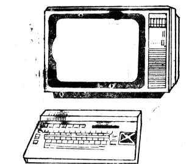
*图 1.1 基本系统*

### 1.1.1 键盘与显示器

用户通过键盘向主机送出信息。显示器不仅显示用户输入的资料，以便即时看到已输入的资料是否正确，而且能显示主机运行的过程及结果，并且还会显示主机对用户所提出的要求和命令。因此这两部分是人机对话最重要的工具之一。

中华学习机的键盘安装在主机外壳上，具备标准打字机键盘的各种键，并按照标准打字机的键位排列。显示器可以接 PAL 制彩色或黑白电视机、彩色或黑白监视器。

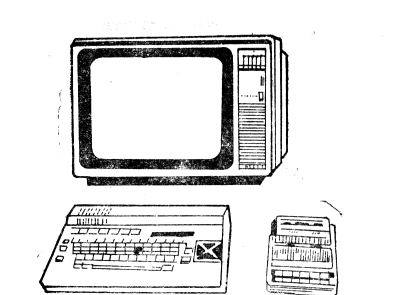
*图 1.2 带录音机组成的系统*

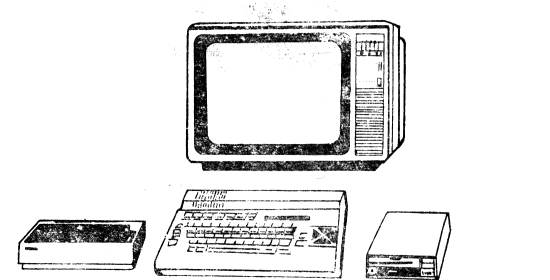
*图 1.3 带打印机、磁盘驱动器组成的系统*

### 1.1.2 录音机

因主机内存的容量不大，而且一旦关掉电源 RAM 的内容就会消失，所以可用录音机作为外部存储器，也就是把主机内部的资料暂存在录音带上，以备以后需要再调用。

### 1.1.3 磁盘机（驱动器）

用磁盘机来存储资料或程序比录音机速度快、容量大，动作可靠。

磁盘机的设备由三部分组成：即磁盘驱动接口、磁盘机、磁盘。磁盘驱动接口卡是主机与磁盘之间传送资料的桥梁，这部分已做在主机板上。磁盘机本身与唱机相似，由一个马达带动磁盘转动，机上有一个磁头可读取磁盘上的资料。磁盘与唱片相似，不过上面涂上有磁性物质，磁头通过电磁效应从磁盘上读取信息或将信息写入到磁盘上。

### 1.1.4 打印机

中华学习机通过打印机接口（任选）与打印机连接。打印机接口卡可插入主机扩充槽与主机 50 线总线相连。这样就可以把您的文件、程序，报表，图形打印出来，作为资料保存起来。中华学习机可配多种点阵打印机，如 MX-80、FX-80、MX-100、FX-100 等。

### 1.1.5 主机内部

主机内部就是中华学习机主机线路板。主要由主控（包括 MPU、MMU、IOU、PAL、ROM、RAM、显示部分、键盘接口和 I/O 接口）、汉字系统、PAL 制式形成电路、驱动器接口几部分组成。

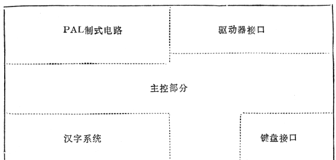
*图 1.4 主板印制板各组成部分位置示意图*

#### 一、主控部分

- **MPU——微处理器**：它是一个 8 位处理器。时钟为 1MHz。数据总线 8 条，地址总线 16 条，寻址空间 64K 字节。
- **MMU——存储器管理**：主要控制存储器寻址和 64K 动态 RAM 的刷新地址转换，同时还提供外围接口卡的控制信号。还和 IOU 一块完成视频发生器读取影象信号的操作。
- **IOU——输入/输出管理**：大部分的功能是用在管理显示画面，如产生视频同步信号，完成画面显示图形方式选择等。还控制主机中的输入/输出电路，如喇叭，录音机接口、键盘、游戏杆等。
- **PAL——逻辑定时阵列**：提供主机的所有定时时序；如 $\phi_0$、$\phi_1$、$\overline{\text{RAS}}$、$\overline{\text{CAS}}$、LDPS、7M、Q3、3.58M 等信号。
- **ROM**：主机上共有 6 块 ROM，其中 2716 作为键盘数码转换 ROM，2732 作为字符、图形转换 ROM。一块 27256 固化着监控程序、CEC-BASIC 及游戏程序，另一块 27256 固化着汉字码表、汉字管理程序。两片 1 兆位 ROM 固化着汉字字库。
- **RAM**：RAM 为 64K 字节，由两片 $64\text{K}\times 4$ 位的集成电路 50464 组成。
- **显示部分**：直接由 IOU、MMU 控制从显示码 ROM 寻取显示点阵并通过移位寄存器（74LS166）形成串行点阵信号。
- **键盘接口**：采用 KB3600 编码器。

#### 二、汉字系统

采用全点阵的一、二级汉字字库，包括 6763 个汉字及外文字母（两片 1 兆位 ROM）。汉字管理程序采用辅存 RAM 区，可提供拼音、区位等输入方式。

#### 三、PAL 制式形成电路

我国彩电的制式是 PAL 制，为了配用国产的彩电，就必须使用 PAL 制式形成电路。

整个电路主要由一块 TCA650（PAL 色彩调制器），一块 74LS175 和 74LS164 构成。

#### 四、磁盘驱动器接口

驱动器接口主要由四部分组成：固化引导程序 ROM，控制逻辑（包括 ROM），并串数据转换电路，串行数据的调制、解调电路。主要进行计算机码与磁盘可识别码之间的数据转换、传送工作。

### 1.1.6 电源

在主机壳内左边有一个开关电源。输入电压为 220V、交流 50Hz，最大功率小于 25W。由开关电源输出 $\pm 5\text{V}$、$\pm 12\text{V}$ 供主机及磁盘驱动器接口工作。

---

## 1.2 主要技术指标

CEC-I 中华学习机的主要技术指标、性能分别简介如下。

### 一、主机

1. **中央处理器**：6502，8 位微处理器。
2. **内存容量**：64K 字节 RAM。
3. **ROM 容量**：32K 字节 ROM，固化监控程序及 BASIC、LOGO（子集）语言。
4. **专用集成电路**：一片门阵列器件 MMU 为存储器管理部件，一片门阵列器件 IOU 为输入/输出管理部件，一片可编程阵列逻辑电路 PAL 产生时序信号。
5. **汉字系统**：汉字系统已做在主机板上，可根据用户需要取舍。该系统提供拼音、区位、音形等输入方式，采用全点阵的国标一、二级汉字字库（两片一兆位 ROM），包括 6763 个汉字及外文字母等。
6. **显示器接口**：一个是经过调制器输出的射频信号，可连接 PAL 制式彩色或黑白电视机；另一个是全电视视频信号（没有音频）输出，可接标准的 PAL 制式彩色或单色监视器。
7. **盒式磁带机接口**：盒式磁带机可以作为廉价外存设备。盒式磁带机接口可与一般家用录音机相连接。提供输出电压是 25mV，输出阻抗 $100\Omega$，要求输入信号峰—峰值电压是 1V，输入阻抗 $12\text{k}\Omega$。
8. **磁盘（软盘）驱动器接口**：磁盘驱动器接口已做在主机板上，可连接一个 5.25 英寸磁盘驱动器。
9. **游戏控制杆接口**：九针的游戏杆插座提供三个 TTL 电平开关量输入，四个模拟量输入。
10. **扬声器接口**：内接 0.25W、$8\Omega$ 扬声器。
11. **键盘**：键盘是标准的打字机键盘，具有 69 个键，包括大小写字母、数字及一些特殊功能控制键。采用弹簧键体，键盘通过 26 线扁平电缆直接连接主板的键盘接口，装在主机内。
12. **扩充槽口**：在主机板上留有一个与 Apple II 系列兼容的 50 线输入/输出插座。此插座可插打印机接口电路或其它扩充电路板。
13. **电源**：采用开关电源，提供四路电源，额定负载为：
    - $+5\text{V},\, 1.7\text{A}$
    - $-5\text{V},\, 0.1\text{A}$
    - $+12\text{V},\, 0.8\text{A}$
    - $-12\text{V},\, 0.1\text{A}$
    总功耗约 25W。

### 二、显示器

可用彩色或黑白电视机，亦可用彩色或单色监视器，其屏幕显示功能为：

1. **西文方式**
   - 字符构成：$5\times 7$ 点阵
   - 每帧字符：40 字符 $\times 24$ 行
   - 显示方式：正常，反相，闪烁。
2. **中文方式**
   - 字符构成：$16\times 16$ 点阵（汉字），$8\times 16$ 点阵（ASCII 码）
   - 每帧字符：17 字符（汉字）$\times 10$ 行，34 字符（ASCII 码）$\times 10$ 行，另加一个状态行
3. **图形方式**
   - 低分辨率彩色图形显示：分辨率为 $40\text{H}\times 48\text{V}$，16 种颜色
   - 高分辨率彩色图形显示：分辨率为 $280\text{H}\times 192\text{V}$，6 种颜色

### 三、软盘驱动器

5.25 英寸软盘驱动器采用单面单密度记录方式，格式化后容量为 143K 字节。

### 四、盒式磁带机

任选专用磁带机或普通盒式录音机，磁带亦用普通标准录音磁带。

### 五、打印机

打印机与可扩充的打印机接口电路板相连。Centronics 标准接口可配多种点阵式打印机和彩色绘图打印机。随机软件已提供打印四种汉字字形。

### 六、系统软件

包括监控程序、DOS 3.3、CEC-BASIC、LOGO（子集）、汉字管理软件等。

### 七、随机资料

随机提供 CEC-I 中华学习机用户使用手册。

---

# 第二章 操作指南

## 2.1 系统的安装

### 2.1.1 开箱

将装有中华学习机的纸箱放在桌面上，正面朝上打开纸箱的顶盖，你会发现主机装在塑料袋中，两头各有一块泡沫衬垫。

小心取出主机，并清点随机带的视频电缆，录音机电缆，使用手册等附件。要妥善保存好纸箱及其它物品，以备将来搬运时用。

### 2.1.2 主机

这是一个结构紧凑的机盒，右上角有一个电源指示灯（小孔内），电源一接通，此灯便亮了。前半部是键盘，机壳侧面装有各种接插件与外部设备连接。主机上的接口请参看图 2.1。

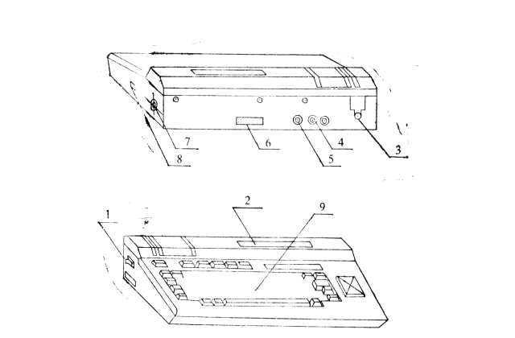
*图 2.1 主机接口图*
*1. 电源开关；2. 扩充槽口；3. 电源线；4. 电视机接口；5. 监视器接口；6. 磁盘驱动器接口；7. 录音机接口；8. 游戏杆接口；9. 键盘。*

### 2.1.3 显示器连接

显示器可以是电视机（彩色或黑白）或监视器（彩色或黑白），但连接的方法不同。

#### 一、电视机连接（参看图 2.2）

- **第 1 步**：将主机和电视机放桌上，并备两个电源插座。
- **第 2 步**：把电视机的天线插头去掉。
- **第 3 步**：用视频电缆线一头插入主机电视机接口，一头插入电视机天线插座，电视机天线插座的输入阻抗为 $75\Omega$。
- **第 4 步**：确认主机电源开关处于“OFF”位置（见图 2.3）。
- **第 5 步**：将电视机电源插头和主机电源插头分别插入电源插座。
- **第 6 步**：把电视机音量开关拧到最小。
- **第 7 步**：先开显示器再开主机。
- **第 8 步**：当使用黑白电视机时，首先调准电视机频道（以出厂厂家要求为准）。开机后，调节频道微调及对比度、亮度旋钮，直到屏幕出现清晰的“`ZHONGHUAXUEXIJI`”字样。

当使用彩色电视机时，同样先选好一个频道，并通过自检方式进入显示彩条图象（参考 2.3 节机器的自检），然后调节频道微调及饱和度，亮度、对比度旋钮，直到屏幕上的彩条满意为止。以后可把这频道作为计算机专用频道，再开机就可以不用调机了。

> **注意**：主机显示器接口输出阻抗是 $75\Omega$。

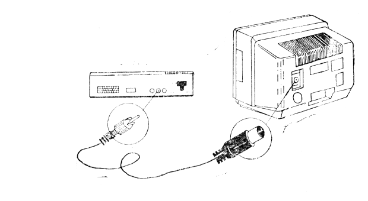
*图 2.2 电视机的连接*

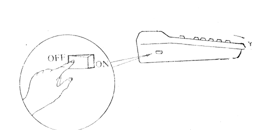
*图 2.3 主机电源 OFF 位置*

#### 二、监视器连接（参阅图 2.4）

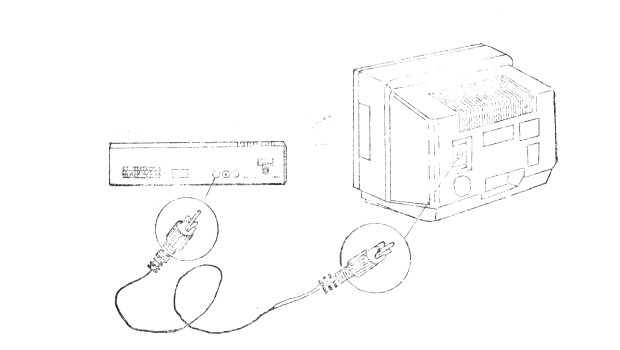
*图 2.4 监视器的连接*

- **第 1 步**：将主机和监视器放桌上，并备两个电源插座。
- **第 2 步**：用视频电缆线一头插入主机监视器接口，一头插入监视器 IN 插座。
- **第 3 步**：确认主机电源为“OFF”位置。
- **第 4 步**：将主机电源及监视器电源的插头分别插入电源插座。
- **第 5 步**：先开监视器后开主机，屏幕将出现清晰的“`ZHONG HUA XUE XI JI`”字样。

### 2.1.4 录音机连接（参阅图 2.5）

- **第 1 步**：确认主机电源为“OFF”位置，并再备一个电源插座（除主机、显示器电源插座）。
- **第 2 步**：把录音机电缆线的一端（五芯插头）插入主机侧面的录音机接口，必须注意：五芯插头的凹口部分在正上方。
- **第 3 步**：电缆线的另一端的两个 3.5mm 插头，分别插入录音机 EAR 插孔（连接主机 IN）和 MIC 插孔（连接主机 OUT）。
- **第 4 步**：把录音机电源线插入电源插座。

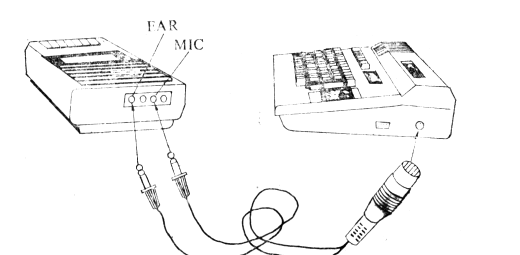
*图 2.5 录音机连接图*

### 2.1.5 游戏杆连接

九芯游戏杆插座位于主机右侧（图 2.6），把连接游戏杆的插头座直接对准游戏杆接口插入，必须注意：两者的信号一定要一一对应。游戏杆接口信号如图 2.6。

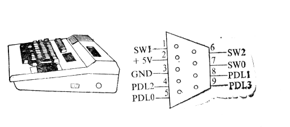
*图 2.6 游戏杆连接*

| 引脚 | 信号 | 说明 |
| :---: | :--- | :--- |
| 1 | SW1 | 开关量输入 1 |
| 2 | +5V | +5V 电源 |
| 3 | GND | 地 |
| 4 | PDL2 | 模拟量输入 2 |
| 5 | PDL0 | 模拟量输入 0 |
| 6 | SW2 | 开关量输入 2 |
| 7 | SW0 | 开关量输入 0 |
| 8 | PDL1 | 模拟量输入 1 |
| 9 | PDL3 | 模拟量输入 3 |

### 2.1.6 驱动器连接（参阅图 2.7）

- **第 1 步**：将主机电源 OFF（关）。
- **第 2 步**：把磁盘驱动器电缆线（20 线扁平电缆）一端插座连接驱动器，另端插座连接主机上的驱动器接口。

必须注意：插针与插孔必须一一对应，电缆线两端的凸出部分都朝上。

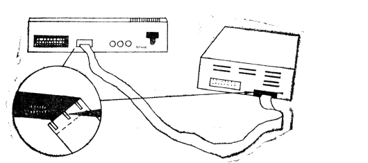
*图 2.7 驱动器连接*

### 2.1.7 扩充卡的连接

主机的右上方有个 50 线的扩充槽，可插多种外设卡，扩充卡。（如打印机卡、音乐卡、A/D 转换卡等）扩充卡尺寸太大插不进去，可采用 50 线转接板把槽口抬高，再插外设卡或扩充卡。

- **第 1 步**：将主机电源 OFF。
- **第 2 步**：用手轻轻压下扩充槽盖，可看到印制板上安装了一个 50 线插槽。
- **第 3 步**：把卡按元件面朝前，焊接面朝后的方向对准槽口往下插。必须注意：一定要平插插平，以免错位。

扩充槽信号排列参阅图 2.8。

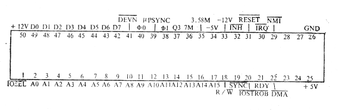
*图 2.8 扩充槽信号排列图*

| 引脚 | 信号 | 引脚 | 信号 |
| :---: | :--- | :---: | :--- |
| 1 | $\overline{\text{IOSEL}}$ | 26 | GND |
| 2 | A0 | 27 | — |
| 3 | A1 | 28 | — |
| 4 | A2 | 29 | $\overline{\text{NMI}}$ |
| 5 | A3 | 30 | $\overline{\text{IRQ}}$ |
| 6 | A4 | 31 | $\overline{\text{RESET}}$ |
| 7 | A5 | 32 | $\overline{\text{INH}}$ |
| 8 | A6 | 33 | -12V |
| 9 | A7 | 34 | -5V |
| 10 | A8 | 35 | 3.58M |
| 11 | A9 | 36 | 7M |
| 12 | A10 | 37 | Q3 |
| 13 | A11 | 38 | $\Phi_1$ |
| 14 | A12 | 39 | $\overline{\mu\text{PSYNC}}$ |
| 15 | A13 | 40 | $\Phi_0$ |
| 16 | A14 | 41 | $\overline{\text{DEVN}}$ |
| 17 | A15 | 42 | D7 |
| 18 | $\text{R}/\overline{\text{W}}$ | 43 | D6 |
| 19 | $\overline{\text{SYNC}}$ | 44 | D5 |
| 20 | $\overline{\text{IOSTROB}}$ | 45 | D4 |
| 21 | RDY | 46 | D3 |
| 22 | $\overline{\text{DMA}}$ | 47 | D2 |
| 23 | — | 48 | D1 |
| 24 | — | 49 | D0 |
| 25 | +5V | 50 | +12V |

**扩充槽的槽号的选定**：用户可以用短接帽来选择，槽号可以为 1、2、4、5、7 中的任一个。3 号槽已定于汉字系统，6 号槽定于磁盘驱动器接口，所以不可选用。出厂时一般都设在第 1 槽，即将两个短接帽插在标有“1”的位置上。选择槽号插头位于主机板的右侧，并标有槽号。如需改槽号，需打开主机壳，把原在一槽位置的两个短接帽取下并插入你所需要的槽号插头上。

### 2.1.8 键盘

键盘和主机通过一条 26 线扁平电缆连接，直接装入主机机壳内。此键盘具有重复功能和 N 键滚动功能。

所谓**重复功能**是指当某键按下时间大于一定值时则连续不断地重复发送这个键值，即自动重复此键。

所谓 **N 键滚动**是指在有多个键按下时，则根据按下键的先后次序分别检测到并输入主机，同时也显示在屏幕上。键盘排列如图 2.9。

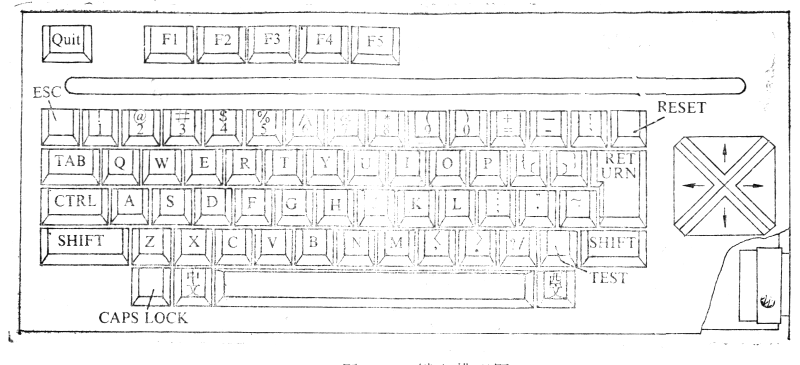
*图 2.9 键盘排列图*

#### 键盘的技术性能：

- **键数**：69 个
- **字编码方式**：ASCII 码
- **编码数**：128 个
- **接口器件**：KB3600-PRO

#### 特殊键功能说明：

- **CAPSLOCK**：当按下此锁定键，所有再按的 26 个英文字母都是大写，抬起锁定键，所有再按的 26 个英文字母都是小写。
- **SHIFT**：当同时按此键和另一键时，产生上档键码。
- **ESC**：按此键后再按其它 ASCII 键产生新的 ASCII 码，一般作为屏幕编辑用。
- **CTRL**：这也是一个与其它键连用产生一个控制码的键，但用法与 ESC 不同，要同时按 CTRL 键与其它键，然后一起放开。
- **TAB**：像是打印机上的定位键，好比说屏幕上定了 1、11、21、31 四个位置，游标在 13 那儿，按 TAB 键就会移到下一个定位 21。
- **RETURN**：结束一个命令，或者是换一行，它的功能有点象打字机上的 CR 键。
- **RESET**：与 CTRL 键同时按下产生系统复位。
- **$\rightarrow$**：把游标往右移，并且把它经过的那些符号当做您从键盘输入一样送入主机。
- **$\leftarrow$**：把游标往左移，并把它经过的那些符号从主机中删掉。
- **$\uparrow$**：游标上移。
- **$\downarrow$**：游标下移。
- **TEST**：当同时按下 CTRL-RESET-TEST 三键时，主机进行自检。
- **F1**：进入 ASCII 方式。
- **F2**：进入拼音方式。
- **F3**：进入区位方式。
- **F4**：供用户使用，键码为：14。
- **F5**：供用户使用，键码为：06。
- **QUIT**：从监控返回 BASIC 状态，它不破坏内存里原有的 BASIC 程序。它相当于 CTRL-C。

---

## 2.2 机器的启动

### 2.2.1 基本系统启动

首先按正确的方法连接好系统。请先打开显示器的电源开关，然后打开主机电源。

当一开机后，立刻可以听到“哔”的一声，这声音就告诉您，主机已准备好，同时键盘右上方的指示灯发亮。如果一切正常主机自动进入西文 BASIC 状态，屏幕显示如图 2.10，显示屏上有一个闪烁的小方块，它提示您下一个输入字符的显示位置，称游标。“`]`”是 APPLESOFT BASIC 语言系统提示符。

```text
+--------------------------------------+
| ZHONG HUA XUE XI JI                  |
| VERSION 1.1                          |
|                                      |
| ]■                                   |
+--------------------------------------+
```

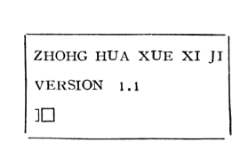
*图 2.10 基本系统启动屏幕*

### 2.2.2 连接驱动器的系统启动

首先按正确的方法连接好系统。在开机前打开磁盘机正面中央的盖子，把 DOS 3.3 系统盘印字面朝上，水平而且轻轻地沿着磁盘机中间的细缝插入磁盘机内，当磁盘完全插入后，再关上磁盘机的小门。然后再开主机电源，显示器首先显示如图 2.10，磁盘机上的指示灯发亮，并且可以听到马达转动的声音，直到磁盘机灯熄灭。屏幕将显示如图 2.11 所示的版面。

此时系统已在 BASIC 系统下。如果开机前没有将 DOS 3.3 软磁盘插入，系统就会直接进入 APPLESOFT BASIC 系统，如果需要装入 DOS 系统，此时可以将 DOS 盘插入磁盘机，并键入：

```basic
]PR# 6
```

于是屏幕也显示如图 2.11 所示。

```text
+-------------------------------------------------------------+
| DOS VERSION 3.3                   08/25/80                  |
| APPLE II PLUS OR ROMCARD SYSTEM MASTER                      |
| (LOADING INTEGER INTO LANGUAGE CARD)                        |
| ]■                                                          |
+-------------------------------------------------------------+
```

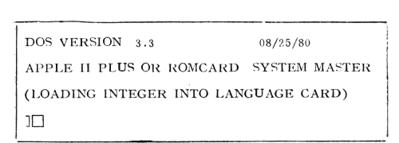
*图 2.11 DOS 3.3 启动屏幕*

### 2.2.3 中西文切换和系统复位

#### 一、中西文切换

当加电后屏幕显示方式为低分辨字符方式，此时若敲入“中文”键，系统进入汉字显示方式。屏幕显示方式为高分辨图形方式。屏幕可显示每行 17 个汉字，共 10 行，此时屏幕底部第 11 行为状态行。状态行左端显示“字母”两字，表示系统处于字符输入状态。当敲入 F2 或 F3 时，状态行左端显示“拼音”或“区位”，表示系统处于汉字的拼音输入方式或区位输入方式。此时按 F1 可回到字母输入方式。CTRL-O 键可控制状态字符的显示与不显示，但不改变输入方式。

在中文方式下，敲入“西文”键，退出中文方式，屏幕显示回到低分辨字符方式。

除键盘方式进入汉字显示方式外，程序方式也可进入汉字显示方式。在 BASIC 程序中使用 `PR#3` 命令可进入汉字显示方式，使用 `TEXT` 或 `PRINT CHR$(17)` 可退出汉字显示方式。

#### 二、系统复位

当加电后系统运行正常，但由于操作失误或程序错误等原因使系统进入死循环或者使用者需要系统重新启动工作时，可同时按下 CTRL-RESET 键。这样系统便重新启动进入 BASIC。这个过程叫系统复位。

### 2.2.4 LOGO 语言的进入

本主机系统内除固化有 BASIC 语言外，还固化了 LOGO 语言，LOGO 语言的进入方式如下：

1. 在系统未装有 DOS 的 BASIC 状态下，键入：
   ```basic
   ]LG
   ```
   即可进入 LOGO 语言。

```text
+--------------------------------------+
| CHINESE EDUCATION COMPUTER           |
| LOGO                                 |
| VERSION 1.1                          |
| 1987.6                               |
|                                      |
| ?                                    |
+--------------------------------------+
```

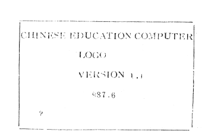
*图 2.12 LOGO 语言进入屏幕*

2. 在系统已装有 DOS 的 BASIC 状态下，键入：
   ```basic
   ]MAXFILES 1
   ]LG
   ```
   即可进入 LOGO 语言。

系统进入 LOGO 语言后，屏幕马上出现如图 2.12 所示的版面，LOGO 语言的提示符为“`?`”。

---

## 2.3 机器的自检

同时键入 CTRL-RESET-TEST 三键且最后释放 TEST 键可进行主机自检，将对 RAM、ROM 进行检测，显示器显示相应的检测内容和结果。如图 2.13。

```text
+---------------------------------------+
| MEMORY-TEST                           |
|                            TIMES:000. |
|                                       |
| RAM         BFFF           OK         |
| BNK1        FFFF           OK         |
| BNK2        FFFF           OK         |
| ROM1        BFFF           LOGO       |
| ROM2        FFFF           CEC-BASIC  |
| AUX1        BFFF           HZTABLE    |
| AUX2        FFFF           HZPROGRAM  |
| AUX3        5D99           CECWL      |
+---------------------------------------+
```

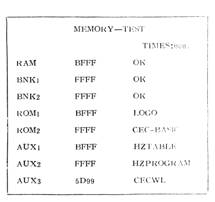
*图 2.13 机器自检屏幕*

- 其中 RAM 部分是测 `$0000` $\sim$ `$BFFF` 48K RAM。
- BNK1、BNK2 部分是用两个软开关测试 `$D000` $\sim$ `$FFFF` RAM。
- 当测试正确，屏幕将显 OK，如有错，屏幕相应处显 ERR。
- ROM1 是测试 LOGO 语言的。
- ROM2 是测试中华学习机 CEC-BASIC 和监控内容，ROM1 和 ROM2 是合在一块 27256 ROM 片上。
- AUX1 测试汉字码表内容。
- AUX2 测试汉字管理系统内容。AUX1 和 AUX2 合在一块 27256 ROM 片上。
- AUX3 测试两块 1 兆位的汉字库内容。

测试正确屏幕将显示相应的测试内容名称。如果测试出不为所知的内容，屏幕将相应地显 UNKNOWN，当没有加汉字库时，屏幕将在相应位置显示 NULL。

当 RAM、ROM 测试完后，程序进行彩色显示测试，屏幕将显 16 种不同颜色的彩条。

自检程序可连续循环地测试，并在 TIME: 一栏显示测试的次数。如需调试彩电，可在屏幕显示彩条时按任何键使屏幕一直显示彩条，直到您调试完彩电，再按任一键又进入自检程序循环测试。如要中断自检，请同时按下 CTRL-RESET 键，程序便进入 APPLESOFT BASIC 状态。
