# 第三章 CEC-I 硬件介绍（Part 1：§3.1 ~ §3.4）

> 本章分为三部分：
> - **Part 1 (§3.1 ~ §3.4)**：主机板组成与系统框图、中央处理器（CPU 6502）、存储器系统（RAM/ROM/存储体切换）、输入输出空间分配（当前部分）
> - [Part 2 (§3.5)](ch03b-display-circuits.md)：显示电路原理与工作机制（字符/图形方式、时序、显存寻址、字符发生器、彩色PAL编码）
> - [Part 3 (§3.6 ~ §3.13)](ch03c-interfaces-asic.md)：接口电路与专用集成电路（键盘、录音机、游戏杆、扬声器、软驱、汉字系统、MMU/IOU/PAL、打印机）

---

本章重点介绍 CEC-I 学习机的系统结构，及各组成部分的电路原理。对于系统中所使用的专用门阵电路的功能、使用方法及原理亦作简要阐述。

CEC-I 学习机由主机盒及外围设备两大部分组成。在主机盒内的主板上包括有 CPU、存储器、显示电路、汉字处理电路、国标一、二级汉字字模点阵 ROM，以及键盘、盒式磁带录音机、游戏杆、扬声器、软盘驱动器、电视机、监视器等接口电路。另外，主板上还有一个 I/O 扩充槽口。主机板的电源也安装在机盒内。

CEC-I 学习机主机盒配上家用电视机以及盒式录音机就构成了一个基本的微机系统。如能配上监视器及软盘驱动器，则可组成能运行 DOS 操作系统、与 Apple II 及 Apple IIe 兼容、有汉字支持的微机系统。下面将分别就各组成部分的功能、工作原理作详细说明。

---

## 3.1 主机板组成及系统框图

主机板是学习机中最主要的部件。在主板上，有两大部分：基本系统部分和外围扩充部分。基本系统部分是指构成最小系统的必备部分。这部分包括下列各种电路：

### 1. 中央处理器（CPU）
CEC-I 学习机采用 6502 作为中央处理器。6502 有 8 位数据线，16 位地址线，可寻址空间 64K。采用 1MHz 的时钟，每秒可执行 50 万次 8 位数的运算。

### 2. 专用大规模集成电路
- **存储器管理部件（MMU）**：管理对存储器的访问。
- **输入输出部件（IOU）**：提供输入输出的控制。
- **逻辑阵列（PAL）**：生成系统工作时所需的各种定时信号。

### 3. 键盘编码器与只读存储器（ROM）
- **键盘编码器**：由 KB-3600 和 ROM 组成，将按键转换成相应的 ASCII 码。
- **固化系统程序的只读存储器（ROM）**：这部分 ROM 有 16K，主要是存放监控程序和 Applesoft BASIC 解释程序。

### 4. 随机访问存储器（RAM）
RAM 有 64K 字节，由两片 $64\text{K} \times 4$ 位的动态 RAM 电路构成。

### 5. 显示电路
利用该电路可以在 PAL 制式的彩色电视或监视器上，显示字符以及高、低分辨的彩色图形。

另外，还有一些辅助电路，保证基本系统所需的逻辑。

外围扩充部分，是指为增强学习机的功能，在主机板上增加的功能模块。这部分主要是：软盘驱动器接口电路和汉字处理模块。

CEC-I 的系统框图见图 3.1。

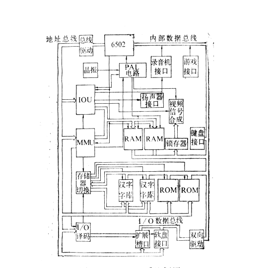
*图 3.1 CEC-I 系统框图*

---

## 3.2 中央处理器（CPU）

CEC-I 学习机所用的中央处理器 6502，工作时钟为 1.023MHz，即每秒执行 50 万次 8 位数的运算。6502 具有 64K 的寻址能力，采用单一 +5V 电源。6502 是 8 位 NMOS 的微处理器，它的指令比较简单，加上其内部采用流水线结构，处理能力较强。

### 3.2.1 微处理器内部结构

6502 的内部结构可分为两部分：寄存器部分和控制部分。参见图 3.2。

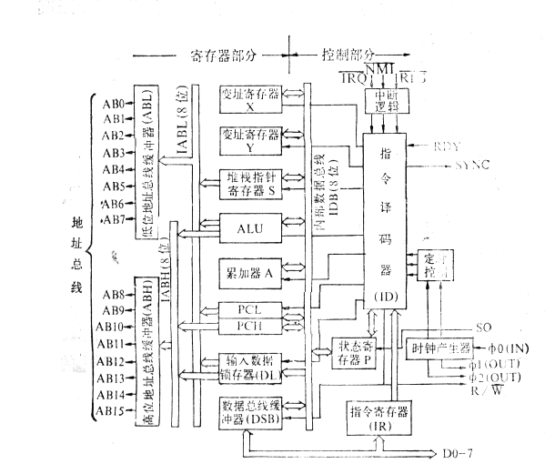
*图 3.2 6502的内部结构框图*

通常，从程序存储器得到一条指令并被执行，是由寄存器部分完成一系列的数据传送和处理，而控制部分提供寄存器工作过程的控制信号。

控制部分对读入微处理器的指令进行译码，确定执行该指令的周期数以及各寄存器所要执行的操作，产生相应的控制信号，控制寄存器部分执行此条指令。另外，控制部分还可以按微处理器的控制输入信号，改变当前指令的执行次序。

由此看来，处理器的实际处理工作是由寄存器部分完成的。这部分有：

- 数据总线缓冲器（DSB）
- 输入数据锁存器（DL）
- 程序计数器（PCL、PCH）
- 累加器（A）
- 算术逻辑部件（ALU）
- 堆栈指针（S）
- 变址寄存器（X，Y）
- 地址总线锁存器（ABH、ABL）
- 处理器状态寄存器（P）

在主频为 1MHz 的情况下，从存储器读入处理器的数据，在 $\phi_0$ 脉冲的最后 100ns 出现在数据总线上。要在这很短的时间内，进行数据操作是不可能的，故先将数据送输入数据锁存器以备下一周期使用。这样，数据进入处理器内部数据总线，可以出入各寄存器。如从内存读入累加器 A 的数据，先放到内部数据总线，再送入累加器。如欲用内存的数据和累加器的内容进行算术或逻辑运算，从内存读来的数据，经输入数据锁存器，送入内部数据总线，再送入算术逻辑单元 ALU。同时，累加器 A 的数据，经专用总线，由 ALU 的第二输入端进入 ALU 内。运算结果在下一个周期，经内部数据总线，送回到累加器 A。所有数据传送在 $\phi_1$ 期间进行。

#### • 程序计数器（PC）
程序计数器给出下条要执行的指令地址，使处理器顺序执行程序。每当处理器从存储器里取出一条指令时，PCL 的内容作为地址总线的低 8 位，PCH 作为高 8 位。每次从存储器内取出一个字节的数据后，PC 自动将其值加 1。

#### • 累加器（A）
累加器是 8 位通用寄存器，用于存放算术或逻辑运算结果。另外，它也存放进行算术或逻辑运算的两个数据之一。

#### • 算术逻辑部件（ALU）
处理器中所有的算术或逻辑运算都是在 ALU 中进行，包括内部寄存器的增量和减量（PC 除外）。ALU 的运算结果一般都送到累加器中。

#### • 堆栈指针（S）
6502 的堆栈指针是一个 8 位的寄存器。在进行堆栈操作时，堆栈指针 S 的值送到地址总线锁存器的低 8 位 ABL。同时，地址总线锁存器的高 8 位自动地置成 $01。进栈操作后，S 值加 1，退栈操作后，S 值减 1。

> [!NOTE]
> 编者注：原书作“进栈操作后，S值加1，退栈操作后，S值减1”。实际上，标准 6502 微处理器的堆栈是向下增长的（Top-down），数据压栈（Push）后堆栈指针 S 自动递减 1，出栈（Pull/Pop）后堆栈指针 S 自动递增 1。此处保留原书文字，特加说明供读者参考。

#### • 变址寄存器（X，Y）
它们都是 8 位寄存器，主要用于变址寻址方式中，存放地址偏移量；作为计数器。另外，变址寄存器 X、Y 还可以作为一般的通用寄存器，用于数据的暂存。

#### • 状态寄存器（P）
6502 的状态寄存器是个 8 位的寄存器，其中有七位是有用的，它是用来表示 6502 的状态。

---

### 3.2.2 微处理器引脚及功能

微处理器 6502 有 40 条引脚，有 38 条引脚作为信号的输入输出端。6502 的引脚分配见图 3.3。

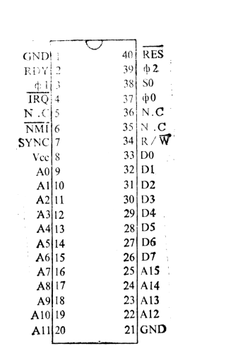
*图 3.3 6502引脚图*

6502 的输入输出信号可分为三类：地址、数据、控制。

#### • 地址总线（A0 ~ A15）
地址总线共有 16 位。6502 可以访问 65536 个（$2^{16} = 65536$）存贮单元。6502 输出的地址在 $\phi_1$ 期间内稳定。地址总线由推拉型驱动器驱动，至少能驱动 130pF 和一个标准 TTL 负载。

#### • 数据总线（D0 ~ D7）
数据总线有 8 位。数据通过它在 6502 和被寻址的存储器单元之间传送。在写周期，数据从 6502 送到被寻址的单元。在读周期，数据从被寻址的单元送到 6502。由于数据总线是双向的，驱动数据总线的缓冲器具有“三态”功能。数据总线在 $\phi_0$ 周期传送数据，而在 $\phi_1$ 周期内数据总线缓冲器为“三态”，即高阻抗状态，这时数据总线是“浮动”的。在 CEC-I 中，正是利用 6502 的这一特性，完成了显示数据的读取，以及动态 RAM 的刷新。

数据总线缓冲器是推拉型驱动器。在额定工作速度下，可以驱动 130pF 和一个标准 TTL 负载。在工作频率为 1MHz 时，数据总线上的数据在 $\phi_2$ 脉冲结束前 100ns 时，必须稳定下来，这对两个方向的传送都是如此。

#### • 控制信号
控制信号可分为输入控制信号和输出控制信号。输入控制信号有：$\phi_0$、RDY、$\overline{\text{NMI}}$、$\overline{\text{IRQ}}$、$\overline{\text{RES}}$、SO。输出控制信号有：$\phi_1$、$\phi_2$、$\text{R}/\overline{\text{W}}$、SYNC。

- **时钟信号（$\phi_0$, $\phi_1$, $\phi_2$）**：
  6502 的工作定时是由时钟信号提供的。$\phi_0$ 是时钟输入信号，当 6502 的工作频率为 1MHz 时，它是一个 1MHz 的方波输入。6502 根据 $\phi_0$ 信号产生两个时钟输出：$\phi_1$ 和 $\phi_2$，它们是两个反相的方波输出。在 CEC-I 中，未使用 $\phi_2$ 输出，而是用 $\phi_0$ 代替 $\phi_2$。在这里，当 $\phi_1 = 1$ 时，称为 $\phi_1$ 期间；$\phi_2 = 1$ 时，称为 $\phi_2$ 期间；$\phi_0 = 1$ 时，称为 $\phi_0$ 期间。
- **读/写信号（$\text{R}/\overline{\text{W}}$）**：
  该信号是控制数据总线传送数据的方向。当 6502 进行写操作时，$\text{R}/\overline{\text{W}}$ 为低电平。除此以外，$\text{R}/\overline{\text{W}}$ 一直保持高电平。$\text{R}/\overline{\text{W}}$ 和地址总线一样，信号在 $\phi_1$ 期间稳定，因为在 $\phi_0$ 期间要进行数据传送。
- **准备就绪信号（RDY）**：
  RDY 信号可以用来延长 6502 的读周期。利用它可以使对低速存储器或外部设备的读访问能顺利进行。当 RDY 为低电平时，延长读周期。延长周期在 $\phi_1$ 期间开始、结束。在 $\phi_1$ 期间对 RDY 信号进行判别。
  在写周期，RDY 信号不能延长写周期。若 RDY 变为低电平时，6502 处于写周期，则要等到下一个读周期（$\text{R}/\overline{\text{W}} = 1$）时，RDY 信号才能起作用。
- **中断请求（$\overline{\text{IRQ}}$）**：
  $\overline{\text{IRQ}}$ 是可屏蔽中断，可以通过编程控制处理器不响应 $\overline{\text{IRQ}}$ 中断。这是使用指令 SEI（设置中断禁止状态）来实现。只有当中断禁止标志 I 为“0”时，$\overline{\text{IRQ}}$ 的中断才能被处理器响应。
  $\overline{\text{IRQ}}$ 的输入是低电平有效。也就是，当 $\overline{\text{IRQ}}$ 为低（“0”）且 I 标志为“0”，6502 响应中断。在中断被识别之前，$\overline{\text{IRQ}}$ 必须维持低电平，一直到中断被响应。6502 响应中断以后，根据相应的矢量单元提供的中断程序入口地址，跳转到中断程序去执行。响应中断时，6502 自动保存断点地址和状态，即将当前的 PC 值和状态寄存器 P 的内容送入堆栈，并置禁止中断状态位 I 为“1”。中断处理结束后，返回到断点地址处，并恢复原先的内部状态，继续执行原程序。
- **非屏蔽中断（$\overline{\text{NMI}}$）**：
  非屏蔽中断的输入信号有效时，处理器在执行完当前指令后，就必须响应 $\overline{\text{NMI}}$ 中断。对该中断是无法编程屏蔽的。
  $\overline{\text{NMI}}$ 的有效输入信号是一个负跳变信号。为中断处理器，$\overline{\text{NMI}}$ 输入信号必须从高电平变为低电平，而且至少维持低电平两个主频周期。处理器响应中断后，所进行的处理过程和 $\overline{\text{IRQ}}$ 类似。
  对 $\overline{\text{IRQ}}$ 和 $\overline{\text{NMI}}$ 的采样判别，是在 $\phi_0$（或 $\phi_2$）期间进行，若 RDY 为低电平，处理器不能响应任何中断。
- **复位信号（$\overline{\text{RES}}$）**：
  复位信号使微处理器内部状态进行初始化。加电时，复位信号保持低电平，禁止 6502 工作。当此信号变为高电平后，微处理器延迟 6 个周期，再从存储器特定位置取出新的程序计数器的值，单元 $FFFC 的内容送 PCL，单元 $FFFD 的内容送 PCH，处理器按新的 PC 值去执行程序。
- **同步信号（SYNC）**：
  SYNC 用于识别读指令操作码周期。当 6502 读指令操作码时，SYNC 为高电平。
- **置溢出信号（SO）**：
  SO 是一个输入信号。当从该输入端输入一个从高电平到低电平的负跳变信号时，处理器内溢出标志 V 被置为“1”。

---

### 3.2.3 6502 读和写周期

在读周期内，在 $\phi_1$ 期间 6502 输出地址和读/写信号，在 $\phi_1$ 变高后 110ns 内稳定，并保持到 $\phi_1$ 期间结束。在读周期，读/写信号为高电平。在 $\phi_0$ 下降沿前 50ns，被读存储器输出的数据必须在数据总线上稳定。6502 读数据时，是用 $\phi_0$ 信号的下降沿作为对数据总线状态采样选通，将数据读入 6502。

在写周期内，地址和读/写信号的时间关系同读周期。但在写周期，读/写信号为低电平，6502 输出的数据在 $\phi_0$ 变高后 75ns 内稳定，并保持到 $\phi_0$ 变低后 30ns。在此期间，被写存储器需将数据写入。

6502 读/写周期时序关系见图 3.4。

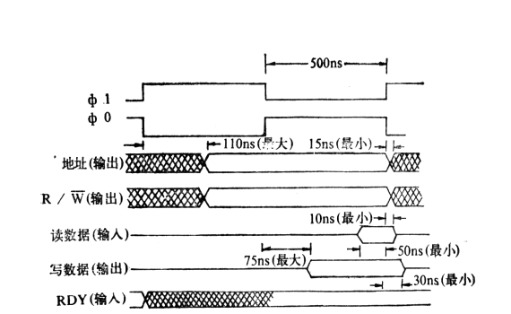
*图 3.4 标准 6502 读/写时间关系图*

---

## 3.3 存储器系统

### 3.3.1 系统存储器分配

微处理器 6502 可寻址 64KB 存储空间。CEC-I 型学习机中 ROM、RAM、以及输入输出设备所占用的存储空间，都分布在这 64KB 地址内。在学习机内，所用存储空间大于 64KB。因此，采用了存储体的切换技术，使同一逻辑地址空间可以映射到多个同样大小的物理地址空间。通过设置存储体切换控制开关，控制逻辑地址到物理地址的映射，使得某一逻辑地址空间可以分时映射到多个同样大小的物理地址空间。这样，大大地扩展了学习机的存储器容量。

#### • 主存储器空间
CEC-I 型学习机的主存储器分配如图 3.5 所示。

空间 $0000 — $BFFF 为主 RAM 空间。输入输出空间在 $C000 — $CFFF。空间 $D000 — $FFFF 为存储体切换空间，此空间可以映射成 ROM，也可以映射成 RAM。

微处理器 6502 提供的 16 位地址，经 U2、U3 两片总线驱动器（74LS244）驱动后，送入存储器管理部件 MMU 以及有关的译码电路。MMU 根据其内部软开关的状态以及 6502 的地址，确定 6502 当前要访问哪种存储空间：
- 若访问 ROM 存储器，MMU 的 $\overline{\text{ROMEN}}$ 信号有效，由此可以得到相应 ROM 存储器的片选信号，再结合 6502 提供的地址低位部分，找到要取其内容的单元。
- 若要访问 RAM，由 MMU 将 6502 提供的 16 位地址转换各为 8 位的行地址和列地址。再由 MMU 发出 RAMEN 信号，去控制产生定时信号的 PAL 电路，让其生成列选通信号 $\overline{\text{CAS}}$。这样，行选通信号 $\overline{\text{RAS}}$ 和 $\overline{\text{CAS}}$ 控制 MMU 的复用地址输出，分时传送行列地址到 RAM 存储器，从而实现对 64KB RAM 的访问。
- 若访问输入输出空间，MMU 产生 $C\times\times\times$ 信号，允许输入输出电路工作。

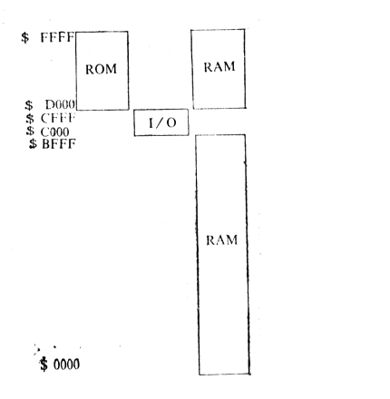
*图 3.5 主存储器分配图*

---

### 3.3.2 读/写存储器（RAM）

#### 一、RAM 存储空间分配

前面已经提到主存储器空间有 64K 字节的 RAM。这 64K 字节的空间区分成两大部分：
- 主 RAM 的基本部分在空间 $0000 — $BFFF，此空间总有 48K 字节；
- 另一块主 RAM 为存储体切换空间，地址范围为 $D000 — $FFFF。

这里，首先介绍一下主 RAM 的基本部分。

主 RAM 基本部分的分配见图 3.6，在这地址空间中，包括系统使用的保留页面和显示缓存区。

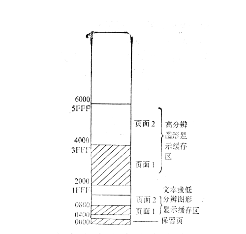
*图 3.6 主RAM基本部分分配图*

##### • 保留页面
主 RAM 的绝大部分都提供给用户存放程序和数据。但还有少量页面作为系统工作区，供监控程序、BASIC 解释程序使用。

系统并不能阻止用户使用系统工作区。若用户要访问系统工作区时，应特别注意，不要破坏系统的数据，以免导致系统的错误动作。

##### • 零页（$0000 ~ $00FF）
在 6502 的寻址方式中，有几种方式需要使用到零页空间 $0000 — $00FF。使用到零页的寻址方式都具有指令短、寻址灵活的特点。监控程序、BASIC 解释程序以及 DOS 都大量地使用零页，以提高程序的效率。

假如你的汇编语言使用了间接变址寻址方式就需要使用零页单元存放基址。为避免影响别的使用了零页单元的程序，就必须避开那些已被使用的单元。关于监控程序、Applesoft BASIC、整数 BASIC 和 DOS 3.3 使用零页的情况如表 3.1、表 3.2、表 3.3、表 3.4。

从表中可以看出：系统程序使用零页单元如此之多，以致要想寻找几个字节，而系统程序都没有使用这些单元，这是很困难的。若要比较安全地使用零页单元，可以先将零页中要用单元的内容存放到别处，在使用这些零页单元后，转回系统程序之前，再恢复这些单元原先的内容。

**表 3.1 监控使用零页情况**

| 地址高4位 | $0 | $1 | $2 | $3 | $4 | $5 | $6 | $7 | $8 | $9 | $A | $B | $C | $D | $E | $F |
| :---: | :---: | :---: | :---: | :---: | :---: | :---: | :---: | :---: | :---: | :---: | :---: | :---: | :---: | :---: | :---: | :---: |
| **$00** |   |   |   |   |   |   |   |   |   |   |   |   |   |   |   |   |
| **$10** |   |   |   |   |   |   |   |   |   |   |   |   |   |   | ● |   |
| **$20** | ● | ● | ● | ● | ● | ● | ● | ● | ● | ● | ● | ● | ● | ● | ● | ● |
| **$30** | ● | ● | ● | ● | ● | ● | ● | ● | ● | ● | ● | ● | ● | ● | ● | ● |
| **$40** | ● | ● | ● | ● | ● | ● | ● | ● | ● | ● |   |   |   |   | ● | ● |
| **$50** | ● | ● | ● | ● | ● | ● |   |   |   |   |   |   |   |   |   |   |
| **$60** |   |   |   |   |   |   |   |   |   |   |   |   |   |   |   |   |
| **$70** |   |   |   |   |   |   |   |   |   |   |   |   |   |   |   |   |
| **$80** |   |   |   |   |   |   |   |   |   |   |   |   |   |   |   |   |
| **$90** |   |   |   |   |   |   |   |   |   |   |   |   |   |   |   |   |
| **$A0** |   |   |   |   |   |   |   |   |   |   |   |   |   |   |   |   |
| **$B0** |   |   |   |   |   |   |   |   |   |   |   |   |   |   |   |   |
| **$C0** |   |   |   |   |   |   |   |   |   |   |   |   |   |   |   |   |
| **$D0** |   |   |   |   |   |   |   |   |   |   |   |   |   |   |   |   |
| **$E0** |   |   |   |   |   |   |   |   |   |   |   |   |   |   |   |   |
| **$F0** |   |   |   |   |   |   |   |   |   |   |   |   |   |   |   |   |

**表 3.2 Applesoft BASIC 使用零页情况**

| 地址高4位 | $0 | $1 | $2 | $3 | $4 | $5 | $6 | $7 | $8 | $9 | $A | $B | $C | $D | $E | $F |
| :---: | :---: | :---: | :---: | :---: | :---: | :---: | :---: | :---: | :---: | :---: | :---: | :---: | :---: | :---: | :---: | :---: |
| **$00** | ● | ● | ● | ● | ● | ● |   |   |   |   | ● | ● | ● | ● | ● | ● |
| **$10** | ● | ● | ● | ● | ● | ● | ● | ● | ● | ● |   |   |   | ● |   |   |
| **$20** |   |   |   |   |   |   |   |   |   |   |   |   |   |   |   |   |
| **$30** |   |   |   |   |   |   |   |   |   |   |   |   |   |   |   |   |
| **$40** |   |   |   |   |   |   |   |   |   |   |   |   |   |   |   |   |
| **$50** | ● | ● | ● | ● | ● | ● | ● | ● | ● | ● | ● | ● | ● | ● | ● | ● |
| **$60** | ● | ● | ● | ● | ● | ● | ● | ● | ● | ● | ● | ● | ● | ● | ● | ● |
| **$70** | ● | ● | ● | ● | ● | ● | ● | ● | ● | ● | ● | ● | ● | ● | ● | ● |
| **$80** | ● | ● | ● | ● | ● | ● | ● | ● | ● | ● | ● | ● | ● | ● | ● | ● |
| **$90** | ● | ● | ● | ● | ● | ● | ● | ● | ● | ● | ● | ● | ● | ● | ● | ● |
| **$A0** | ● | ● | ● | ● | ● | ● | ● | ● | ● | ● | ● | ● | ● | ● | ● | ● |
| **$B0** | ● | ● | ● | ● | ● | ● | ● | ● | ● | ● | ● | ● | ● | ● | ● | ● |
| **$C0** | ● | ● | ● | ● | ● | ● | ● | ● | ● | ● | ● | ● | ● | ● |   |   |
| **$D0** | ● | ● | ● | ● | ● | ● |   |   | ● | ● | ● | ● | ● | ● |   | ● |
| **$E0** | ● | ● | ● | ● | ● | ● | ● | ● | ● | ● | ● |   |   |   |   |   |
| **$F0** | ● | ● | ● | ● | ● | ● | ● | ● | ● |   |   |   |   |   |   |   |

**表 3.3 整数 BASIC 使用零页情况**

| 地址高4位 | $0 | $1 | $2 | $3 | $4 | $5 | $6 | $7 | $8 | $9 | $A | $B | $C | $D | $E | $F |
| :---: | :---: | :---: | :---: | :---: | :---: | :---: | :---: | :---: | :---: | :---: | :---: | :---: | :---: | :---: | :---: | :---: |
| **$00** |   |   |   |   |   |   |   |   |   |   |   |   |   |   |   |   |
| **$10** |   |   |   |   |   |   |   |   |   |   |   |   |   |   |   |   |
| **$20** |   |   |   |   |   |   |   |   |   |   |   |   |   |   |   |   |
| **$30** |   |   |   |   |   |   |   |   |   |   |   |   |   |   |   |   |
| **$40** |   |   |   |   |   |   |   |   |   |   | ● | ● | ● | ● |   |   |
| **$50** |   |   |   |   | ● | ● | ● | ● | ● | ● | ● | ● | ● | ● | ● | ● |
| **$60** | ● | ● | ● | ● | ● | ● | ● | ● | ● | ● | ● | ● | ● | ● | ● | ● |
| **$70** | ● | ● | ● | ● | ● | ● | ● | ● | ● | ● | ● | ● | ● | ● | ● | ● |
| **$80** | ● | ● | ● | ● | ● | ● | ● | ● | ● | ● | ● | ● | ● | ● | ● | ● |
| **$90** | ● | ● | ● | ● | ● | ● | ● | ● | ● | ● | ● | ● | ● | ● | ● | ● |
| **$A0** | ● | ● | ● | ● | ● | ● | ● | ● | ● | ● | ● | ● | ● | ● | ● | ● |
| **$B0** | ● | ● | ● | ● | ● | ● | ● | ● | ● | ● | ● | ● | ● | ● | ● | ● |
| **$C0** | ● | ● | ● | ● | ● | ● | ● | ● | ● | ● | ● | ● | ● | ● | ● | ● |
| **$D0** | ● | ● | ● | ● | ● | ● | ● | ● | ● | ● | ● | ● | ● | ● | ● | ● |
| **$E0** |   |   |   |   |   |   |   |   |   |   |   |   |   |   |   |   |
| **$F0** |   |   |   |   |   |   |   |   |   |   |   |   | ● |   | ● |   |

**表 3.4 DOS 3.3 使用零页情况**

| 地址高4位 | $0 | $1 | $2 | $3 | $4 | $5 | $6 | $7 | $8 | $9 | $A | $B | $C | $D | $E | $F |
| :---: | :---: | :---: | :---: | :---: | :---: | :---: | :---: | :---: | :---: | :---: | :---: | :---: | :---: | :---: | :---: | :---: |
| **$00** |   |   |   |   |   |   |   |   |   |   |   |   |   |   |   |   |
| **$10** |   |   |   |   |   |   |   |   |   |   |   |   |   |   |   |   |
| **$20** |   |   |   |   |   |   | ● | ● |   |   | ● | ● | ● | ● | ● | ● |
| **$30** |   |   |   |   |   | ● | ● | ● | ● | ● |   |   |   | ● | ● |   |
| **$40** | ● | ● | ● | ● | ● | ● | ● | ● | ● |   | ● | ● | ● | ● |   |   |
| **$50** |   |   |   |   |   |   |   |   |   |   |   |   |   |   |   |   |
| **$60** |   |   |   |   |   |   |   | ● | ● | ● | ● |   |   |   |   | ● |
| **$70** | ● |   |   |   |   |   |   |   |   |   |   |   |   |   |   |   |
| **$80** |   |   |   |   |   |   |   |   |   |   |   |   |   |   |   |   |
| **$90** |   |   |   |   |   |   |   |   |   |   |   |   |   |   |   |   |
| **$A0** |   |   |   |   |   |   |   |   |   |   |   |   |   |   |   |   |
| **$B0** | ● |   |   |   |   |   |   |   |   |   |   |   |   |   |   |   |
| **$C0** |   |   |   |   |   |   |   |   |   |   | ● | ● | ● | ● |   |   |
| **$D0** |   |   |   |   |   |   |   |   | ● |   |   |   |   |   |   |   |
| **$E0** |   |   |   |   |   |   |   |   |   |   |   |   |   |   |   |   |
| **$F0** |   |   |   |   |   |   |   |   |   |   |   |   |   |   |   |   |

##### • 系统堆栈
6502 使用第 1 页（$0100 — $01FF）作为堆栈，在此空间，6502 按照先进后出的原则，存取数据，由堆栈指针指示堆栈中当前可访问的单元。许多程序都用了堆栈，转子指令就利用堆栈存放转子后的返回地址。通常还用堆栈作内部寄存器的暂存。用户程序可以使用堆栈，但使用时必须注意堆栈的容量。堆栈指针是一个 8 位的寄存器，也就是说堆栈内只能存放 256 个字节的内容。当你要在堆栈中存放第 257 个数据时，栈指针就会重复，将第 257 个数据放在第一个数据的位置上，栈中的第 1 个数据就不存在了。这样，就造成堆栈溢出，导致程序运行出错。

##### • 输入缓存区
输入子程序 GETIN 使用第 2 页（$0200 — $02FF）作为键盘输入缓存区。监控程序和 BASIC 都使用 GETIN。这个输入缓存区的大小决定输入字符串的最大字符数。一般允许输入 256 个字符，但只取前 237 个。假若可预知将不输入任意长的字符串，就可以使用第 2 页的高地址单元作为数据暂存单元。

##### • 地址连接指针
监控程序和 DOS 都使用第 3 页的高地址部分一些单元作为矢量地址，表 3.5 指示了监控对第 3 页部分单元的使用。关于 DOS 对第 3 页的使用参见 DOS 手册。

BASIC 程序中，有时也有一些短的机器语言子程序。这些子程序一般放在第 3 页的低地址部分。

**表 3.5 监控对第 3 页部分单元的使用**  
*(注：原书标题误印为“监控使用零页情况”，实际内容为第 3 页 $03F0 ~ $03FF 矢量分配)*

| 地址 | 功能 |
| :---: | :--- |
| **$3F0** **$3F1** | 处理 BRK 请求子程序地址（通常为 $59, $FA） |
| **$3F2** **$3F3** | 复位矢量 |
| **$3F4** | 加电标志 |
| **$3F5** **$3F6** **$3F7** | 转向处理 Applesoft “&” 命令的转移指令（通常为 $4C, $58, $FF） |
| **$3F8** **$3F9** **$3FA** | 转向处理用户命令（CONTROL-Y）的转移指令 |
| **$3FB** **$3FC** **$3FD** | 转向非屏幕中断处理子程序的转移指令 |
| **$3FE** **$3FF** | 中断矢量（存放中断请求的处理程序地址） |

##### • 显示缓存区
- **文本显示方式和低分辨图形方式**：
  - 显示第一页在空间 $0400 — $07FF。这 1024 个字节不能作为程序及数据的存放区。在这区域里，有 64 个存储单元的内容不在屏幕上显示，这些单元留给外围扩展卡使用（详见表 3.10）。
  - 显示第二页占用了空间 $0800 — $0BFF。也是 1024 个字节。大部分程序都不使用此页作为显示缓存区。可以根据情况，将该空间作为程序和数据的存放区。
- **高分辨图形显示缓存区**：
  - 第一页占用空间 $2000 — $3FFF。如果不使用高分辨图形显示时，该空间可以存放程序和数据。
  - 第二页占用空间 $4000 — $5FFF。同样，高分辨图形显示不用此页显示时，它可以存放程序和数据。

关于显示缓存区的详细情况参见视频显示部分（§3.5）。

---

#### 二、存储体切换空间

地址空间 $D000 — $FFFF 称为存储体切换空间。它可以映射到两个物理空间：
1. **12K ROM**：用来存放监控程序和 BASIC 解释程序；
2. **16K RAM**：一般用来存放整数 BASIC 或 PASCAL 操作系统的一部分。

在这里 12K 的地址空间映射到 16K RAM 空间，这是因为地址空间 $D000 — $DFFF 可以映射到两个 4K RAM（即第一体与第二体）。访问 16K RAM 时，要对 $D000 — $DFFF 空间访问两次，分别访问两个 4K RAM 存储空间。

切换不同的存储模块被映射到同一地址空间称为存储体的切换。在空间 $D000 — $FFFF 的存储体切换有两层含义：
1. 在这 12K 地址空间进行 ROM 和 RAM 之间的切换；
2. 在地址 $D000 — $DFFF 这 4K 空间进行到两个 4K RAM 的切换。

这一地址空间的分布见图 3.7。

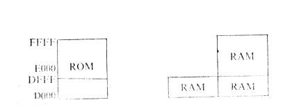
*图 3.7 存储体切换空间分配图*

存储体的切换是通过改变软开关的状态来实现的。在此空间进行存储体切换，要通过设置软开关的状态来做三个选择：
1. 该地址空间映射到 ROM 还是 RAM；
2. 允许写 RAM 还是禁止写 RAM（写保护）；
3. 地址 $D000 — $DFFF 是映射到第一个 4K RAM 还是映射到第二个 4K RAM。

表 3.6 列出设置空间 $D000 — $FFFF 存储体切换的软开关地址。通过对这些地址的访问，可设置相应的软开关，实现对该空间的存储器切换。这些地址在 $C080 — $C08F。

从表中可以看出访问某些不同的单元，却实现相同的功能。这是因为软开关的设置是依靠地址低位的状态。如 $C08x 中地址最低位 A0 为“1”，则表示写 RAM 使能；为“0”时，则表示禁止写 RAM。地址位的位 3，即 A3，选择 $D000 — $DFFF 在哪个 4K RAM：若 A3 为“0”，则选 RAM 第二存储体；A3 为“1”，则选 RAM 第一存储体。

**表 3.6 存储体空间切换软开关地址**

| 软开关地址 | 写 RAM | 读 RAM | 读 ROM | 4K RAM 体 第一体 | 4K RAM 体 第二体 | 注 |
| :---: | :---: | :---: | :---: | :---: | :---: | :---: |
| **$C080** |   | ● |   |   | ● |   |
| **$C081** | ● |   | ● |   | ● | 1 |
| **$C082** |   |   | ● |   | ● |   |
| **$C083** | ● | ● |   |   | ● | 2 |
| **$C084** |   | ● |   |   | ● |   |
| **$C085** | ● |   | ● |   | ● | 1 |
| **$C086** |   |   | ● |   | ● |   |
| **$C087** | ● | ● |   |   | ● | 2 |
| **$C088** |   | ● |   | ● |   |   |
| **$C089** | ● |   | ● | ● |   | 1 |
| **$C08A** |   |   | ● | ● |   |   |
| **$C08B** | ● | ● |   | ● |   | 2 |
| **$C08C** |   | ● |   | ● |   |   |
| **$C08D** | ● |   | ● | ● |   | 1 |
| **$C08E** |   |   | ● | ● |   |   |
| **$C08F** | ● | ● |   | ● |   | 2 |

> [!IMPORTANT]
> **软开关使用规则与注意事项**：
> 1. **注意**：对这些地址的访问要仔细筹划，否则，会给你的程序造成灾难性的影响。
> 2. **注 1 与注 2**：在写使能（Write-Enable）模式下，必须连续读取该软开关地址两次（Two successive reads），才能真正解除 RAM 写保护并使能写入。
> 3. 在允许读 ROM，而不允许读 RAM 的情况下，如果是 RAM 写使能，则仍可以对 RAM 进行写操作。
> 4. 在加电或者复位时，地址空间 $D000 — $FFFF 的初始状态为：**允许读 ROM，允许写 RAM，4K RAM 存储体在第二体**。因此，复位矢量不能指向存储体切换空间中的 RAM 单元。
> 5. 在使用整数 BASIC 时，可以正常进行复位，只要用户程序未被破坏，就可以重新启动 BASIC。其原因是复位矢量指向 DOS，由 DOS 重置整数 BASIC 所用的软开关。
> 6. 在地址 $D000 — $DFFF 中，两个 RAM 体不能选为“读一个 RAM 体，写另一个 RAM 体”，只能选择读写同一个 RAM 体。
> 7. 另外，对空间 $D000 — $FFFF，不能选择为读其中一部分 ROM，再读剩余部分的 RAM。因此，不能读 ROM 中的监控程序，同时再读该空间的 RAM。若要使该空间 RAM 中的程序能调用监控程序，必须将监控程序拷贝到 RAM 中。

---

#### 三、RAM 存储器性能简介

在 CEC-I 中，64KB 的 RAM 存储器由两片 HM50464P-15 构成。HM50464P 是 $65536 \times 4$ 位的动态随机访问存储器（DRAM）。它的基本性能指标如下：

- **单一工作电源**：+5V（±10%）。
- **低功耗**：工作时 350mW；备用时 20mW。
- **高速度**：根据芯片的型号不同，访问时间分别为 120ns，150ns，200ns（CEC-I 中用的 HM50464，访问时间为 150ns）。
- **数据输出控制**：由 $\overline{\text{CAS}}$ 或 $\overline{\text{OE}}$ 控制。
- **电平特性**：所有的信号与 TTL 电平兼容。
- **刷新要求**：256 个刷新周期应在 4ms 内完成。
- **刷新方式**：三种刷新方式——仅有 $\overline{\text{RAS}}$ 刷新，$\overline{\text{CAS}}$ 在 $\overline{\text{RAS}}$ 之前的刷新，隐含的刷新。

HM50464P 的管脚排列见图 3.8。

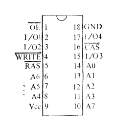
*图 3.8 HM50464引脚图*

**引脚功能说明**：
- **A0 ~ A7**：输入，复用地址输入。其中，行地址作为刷新地址输入。
- **I/O1 ~ I/O4**：双向，数据输入/输出。
- **$\overline{\text{OE}}$**：输入，数据输出使能信号。
- **Vcc**：输入，+5V 电源。
- **GND**：输入，电源和信号公共地。
- **$\overline{\text{CAS}}$**：输入，列地址选通信号。
- **$\overline{\text{RAS}}$**：输入，行地址选通信号。
- **$\overline{\text{WRITE}}$**：输入，读/写数据控制信号。

---

#### 四、CEC-I 读/写存储器的工作过程

在 CEC-I 型学习机中，RAM 用于存放数据和程序，并作为屏幕显示的缓存区。作为显示缓存区的 RAM，由处理器和显示控制电路两者共同访问。为此，采用处理器和显示控制电路分时访问 RAM 的方法。

由于微处理器 6502 使用两相定时信号，在 $\phi_1$ 期间 6502 就产生地址输出，而数据传送仅在 $\phi_0$ 期间进行。这样，就允许 6502 和显示控制电路交叉访问 RAM，分时使用数据总线，而不造成相互的影响。微处理器读/写 RAM 仅在 $\phi_0$ 期间进行，显示控制电路读 RAM 仅在 $\phi_1$ 期间进行。

##### 1. 对 RAM 的访问
在 CEC-I 中，微处理器 6502 使用的工作频率为 1MHz。由于 6502 和显示控制电路对 RAM 的访问是交叉进行的，RAM 的工作频率可达 2MHz，即周期为 500ns。6502 访问 RAM 时，数据由 $\phi_0$ 的下降沿选通，而显示数据则由 $\phi_1$ 下降沿选通。

- 在 $\phi_0$ 期间，由 MMU 提供 6502 的复用地址。
- 在 $\phi_1$ 期间，由 IOU 提供显示控制电路的复用地址。复用地址在 $\overline{\text{RAS}}$ 和 $\overline{\text{CAS}}$ 的选通下，将行地址和列地址送入 RAM 芯片的 X，Y 地址缓存器中。

负责生成系统定时信号的 PAL 电路，产生行地址和列地址的选通信号 $\overline{\text{RAS}}$ 和 $\overline{\text{CAS}}$。PAL 电路一直产生选通访问显示缓存区复用地址的控制信号，也就是说，在 $\phi_1$ 期间，PAL 电路总是产生 $\overline{\text{RAS}}$ 和 $\overline{\text{CAS}}$。这样，对屏幕显示数据的读取，不受任何情况的影响，一直在循环进行，从而，也可以实现对 RAM 的刷新。

在 $\phi_0$ 期间，PAL 电路总是提供行选通信号 $\overline{\text{RAS}}$。在此信号的控制下，MMU 利用复用地址输出，分时送出行地址和列地址。动态 RAM 是否能接收到行地址和列地址的全部，取决于此刻 6502 是否访问 RAM。若 6502 访问 RAM，MMU 根据其内部软开关状态，以及 6502 提供的地址，产生 $\overline{\text{RAMEN}}$ 信号。PAL 电路在 $\overline{\text{RAMEN}}$ 信号的控制下，在 $\phi_0$ 期间也产生列选通信号 $\overline{\text{CAS}}$。这样，在 $\phi_0$ 期间，行选通 $\overline{\text{RAS}}$ 和列选通 $\overline{\text{CAS}}$ 都具备了。在它们的控制下，RAM 电路可以分时接收到 16 位地址。从而，实现对 64KB RAM 的寻址。

当 $\text{R}/\overline{\text{W}}$ 信号为高电平时，RAM 电路接收行、列地址后便产生数据输出。当 $\text{R}/\overline{\text{W}}$ 信号为低电平时，则是写操作，6502 输出数据在 $\phi_0$ 期间内稳定，RAM 接收地址后，便将数据线上的状态写入 RAM 的相应单元中。

在 $\phi_1$ 期间，显示控制电路读 RAM 和 6502 读 RAM 类似。在 CEC-I 中，$\text{R}/\overline{\text{W}}$ 信号是经三态门驱动后，提供给 RAM 电路的。该三态门的控制端接到 $\phi_1$ 信号，控制端为低电平有效。在 $\phi_1$ 期间，该门输出为高阻抗，由提拉电阻将其输出置成高电平，这样，RAM 电路的 $\text{R}/\overline{\text{W}}$ 输入端为高电平，从而，保证在 $\phi_1$ 期间，显示控制电路读 RAM 正确进行。

RAM 工作时序见图 3.9。

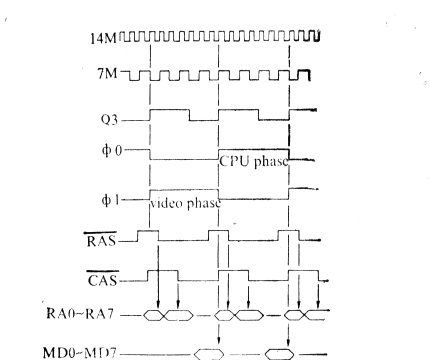
*图 3.9 RAM时序图*

##### 2. 动态 RAM 刷新的实现
屏幕显示的画面不能保持很久，它很快就会消退。为了在屏幕上保持一个画面，就必须对屏幕定时地刷新。为此，显示控制电路需要不断地读显示缓存区的数据，将其送到屏幕显示。为避免屏幕显示的闪烁，并符合广播电视的实用标准，显示控制电路每秒刷新屏幕 60 次，即每秒要读显示缓存区 60 遍。

前面已讲过，动态 RAM 存储器需要对其内容进行刷新。在 CEC-I 的设计中，考虑让显示控制电路既对屏幕显示内容进行刷新，也对动态 RAM 进行刷新。

若要利用显示控制电路读显示缓存区来刷新动态 RAM，则必须在刷新周期内，即 4ms 内，显示缓存区的 8 位行地址的 256 种组合至少读完一遍。

在 CEC-I 中，读显存的行地址所对应的信号如表 3.7 所示。

**表 3.7 行地址对应表**

| 行地址 | RA0 | RA1 | RA2 | RA3 | RA4 | RA5 | RA6 | RA7 |
| :---: | :---: | :---: | :---: | :---: | :---: | :---: | :---: | :---: |
| **信号** | H0 | H1 | H2 | $\Sigma0$ | $\Sigma1$ | $\Sigma2$ | V0 | V1 |

根据《Apple II 的电路分析》中对这些信号的波形分析可以知道：从 RA0 到 RA7，$\text{RA}_i$ 对应的信号周期至少是 $\text{RA}_{i-1}$ 对应的信号周期的两倍。在 V1 的一个周期内，这 8 位切换通过所有的 256 种组合。经测算，得到 V1 的周期为 $2038\mu\text{s}$，V1 的周期小于刷新周期 4ms。因此，读显存操作的确是完成了动态 RAM 的刷新。

---

### 3.3.3 只读存储器（ROM）

在 CEC-I 中，有两块 ROM 用于固化程序，它们在主板上的位置分别为 U7 和 U35。所用的 ROM 是 EPROM 27256，其引脚排列见图 3.10。

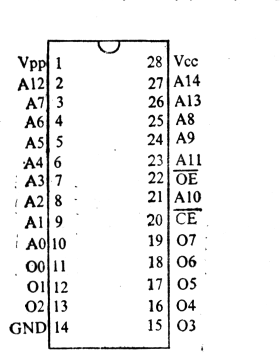
*图 3.10 27256引脚图*

在 CEC-I 中，系统程序固化在 U7 中，它们是监控程序和 Applesoft BASIC 解释程序。这些程序的地址为 $C100 — $FFFF，其中 $C100 — $CFFF 属于内部 ROM，在 CEC-I 中，该空间作为系统程序扩充部分的存放区。这 16K 字节的系统程序放在 U7 的高 16K 字节空间，在 U7 内部地址为 $4100 — $7FFF。如图 3.11 所示。

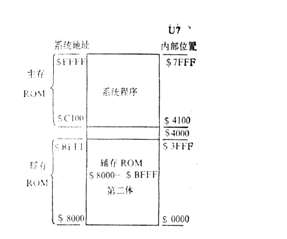
*图 3.11 U7的使用分配*

在 U7 中，还有低 16K 字节的空间，其片内位置在 $0000 — $3FFF。这部分和 U37 一起是用于汉字处理或其它功能扩充时的固化程序。关于这部分空间的使用情况在“汉字处理电路”部分（§3.11）介绍。

---

## 3.4 输入输出空间分配

在 CEC-I 中，输入输出主要是利用输入输出空间 $C000 — $CFFF 来完成的。仅屏幕显示未利用该空间。使用空间 $C000 — $CFFF 的输入输出大致可以分成两种：一是内核输入输出，二是外围扩展输入输出。现就这两类输入输出的功能和特性，以及在地址空间上的使用分别进行介绍。

---

### 3.4.1 内核输入输出

内核输入输出，是指构成系统时，必须具备的功能层次最低的输入输出。在这里，它们不仅输入输出数据和状态，还进行软开关的设置，改变系统的工作状态。这部分使用输入输出空间 $C000 — $C08F。它们的用途分为 5 种类型：数据输入、标志输入、选通输出、标志输出和软开关。

#### 一、数据输入
内核输入输出的唯一数据输入是键盘数据输入。这是一个并行的 8 位输入，低 7 位为键盘当前所按下键的 ASCII 码，最高位是键盘选通信号。当最高位为“1”时，表示有新的键码输入。

#### 二、标志输入
内核输入输出的大部分输入都是标志输入，这些标志在对应单元的最高位。标志值只有“0”和“1”。盒式录音机接口输入、游戏接口输入和软开关状态输入都属于此类。

#### 三、选通输出
清键盘选通、游戏接口选通都是用相应的地址译码作为选通信号。若产生清键盘选通时，键盘输入标志被置为“0”，等待再有某一键被压下时，置键盘输入标志为“1”。若产生游戏接口选通，则接口电路中时基电路被触发，开始作延时操作。

#### 四、标志输出
在内核输入输出中，有两个标志输出：扬声器信号输出 SPKR，盒式录音机接口输出 CASSO。每当访问它们对应的地址单元，其输出状态翻转一次。

#### 五、软开关
软开关是利用对某些特定单元的访问来设置其状态的触发器，而这些触发器的状态将决定系统的工作方式。软开关有“0”、“1”两种状态，设置某一软开关时，通过对应的某一单元的访问实现置“1”，而对另一个对应的单元访问实现置“0”。置软开关状态时，与其当前值无关。有些软开关的状态必须是进行写操作才能置入，有些软开关只要访问了对应单元就可置入。有些软开关的状态还可以读出。关于软开关的详细介绍请见专用集成电路部分的 MMU 和 IOU 的介绍。

---

### 3.4.2 外围扩展输入输出

输入输出空间的大部分是用于外围扩展输入输出，其地址空间在 $C090 — $CFFF。在逻辑上，有 7 个外围扩展槽口。在 $C100 — $C7FF 中，每个槽口有自己的 256 个字节的 ROM。另外，$C800 — $CFFF 为公用 ROM 区，各个槽口都可以申请使用公用 ROM 区。在地址 $C090 — $C0FF 中，每个槽口有自己的 16 个输入输出单元。

有关接口卡使用存储区空间的问题将在下面说明。

#### 一、外围扩展槽的输入输出
每个外围扩展槽配有 16 个单元作为输入输出。各个槽的单元地址见表 3.8。

扩展槽口的 41 引脚信号（$\overline{\text{DEVICE SELECTn}}$）指示该槽的输入输出单元是否被选用。当信号 $\overline{\text{DEVICE SELECTn}}$ 为低电平时，则槽口 n 的输入输出单元被访问，并由地址最低 4 位 A3—A0 来选择 16 个单元中的某一个。n 为槽口号。

**表 3.8 槽口输入输出单元地址分配**

| 槽号 | 地址 | 使能信号 |
| :---: | :---: | :---: |
| **1** | $C090 — $C09F | $\overline{\text{DEVICE SELECT1}}$ |
| **2** | $C0A0 — $C0AF | $\overline{\text{DEVICE SELECT2}}$ |
| **3** | $C0B0 — $C0BF | $\overline{\text{DEVICE SELECT3}}$ |
| **4** | $C0C0 — $C0CF | $\overline{\text{DEVICE SELECT4}}$ |
| **5** | $C0D0 — $C0DF | $\overline{\text{DEVICE SELECT5}}$ |
| **6** | $C0E0 — $C0EF | $\overline{\text{DEVICE SELECT6}}$ |
| **7** | $C0F0 — $C0FF | $\overline{\text{DEVICE SELECT7}}$ |

---

#### 二、扩展槽的 ROM 空间

每个扩展槽口有 1 页空间（256 个字节）ROM 区，在这个 ROM 区中，可以固化驱动程序。这部分驱动程序可以实现对扩展卡所连接的外部设备控制。

槽口 ROM 区的地址范围是 $\$C\text{n}00 — \$C\text{n}FF$，其中 n 为槽口号。表 3.9 列出各槽口对应 ROM 区的地址。

**表 3.9 槽口 ROM 区地址**

| 槽号 | 地址 | 使能信号 |
| :---: | :---: | :---: |
| **1** | $C100 — $C1FF | $\overline{\text{I/O SELECT1}}$ |
| **2** | $C200 — $C2FF | $\overline{\text{I/O SELECT2}}$ |
| **3** | $C300 — $C3FF | $\overline{\text{I/O SELECT3}}$ |
| **4** | $C400 — $C4FF | $\overline{\text{I/O SELECT4}}$ |
| **5** | $C500 — $C5FF | $\overline{\text{I/O SELECT5}}$ |
| **6** | $C600 — $C6FF | $\overline{\text{I/O SELECT6}}$ |
| **7** | $C700 — $C7FF | $\overline{\text{I/O SELECT7}}$ |

当槽口 ROM 区某一页被访问时，对应槽口第 1 引脚的信号 $\overline{\text{I/O SELECTn}}$ 应为低电平，该信号作为槽口 n 所插的扩展卡上 ROM 存储器的使能信号，同时由地址的低 8 位对该页 256 个单元进行寻址。

---

#### 三、扩展卡的 RAM 空间

在主存 RAM 中有 56 个单元分别供 7 个扩展卡使用，每个卡有 8 个单元，其地址如表 3.10。这 56 个单元是文本显示或低分辨图形显示缓存区第 1 页面中的一部分，它们不显示在屏幕上，输出程序不改变这些单元的内容。扩展卡 ROM 中程序可以使用这些单元作为暂存。

**表 3.10 扩展卡 RAM 单元**

| 序号 | 槽 1 | 槽 2 | 槽 3* | 槽 4 | 槽 5 | 槽 6 | 槽 7 |
| :---: | :---: | :---: | :---: | :---: | :---: | :---: | :---: |
| **1** | $0478 | $0479 | $047A | $047B* | $047C | $047D | $047E | $047F |
| **2** | $04F8 | $04F9 | $04FA | $04FB* | $04FC | $04FD | $04FE | $04FF |
| **3** | $0578 | $0579 | $057A | $057B* | $057C | $057D | $057E | $057F |
| **4** | $05F8 | $05F9 | $05FA | $05FB* | $05FC | $05FD | $05FE | $05FF |
| **5** | $0678 | $0679 | $067A | $067B* | $067C | $067D | $067E | $067F |
| **6** | $06F8 | $06F9 | $06FA | $06FB* | $06FC | $06FD | $06FE | $06FF |
| **7** | $0778 | $0779 | $077A | $077B* | $077C | $077D | $077E | $077F |
| **8** | $07F8 | $07F9 | $07FA | $07FB* | $07FC | $07FD | $07FE | $07FF |

> [!NOTE]
> 注：表头各列对应扩展槽 1 ~ 7。槽 3 带星号（*）单元在 CEC-I 中通常被内置汉字系统和 80 列屏幕固件使用。

---

#### 四、公用 ROM 区

每个槽口除了使用自己的 256 个字节的 ROM 区外，还可以申请使用公用 ROM 区。公用 ROM 区在地址空间 $C800 — $CFFF，共有 2K 字节。公用 ROM 区一般用来存放容量较大的程序。

虽然公用 ROM 区可供任一槽口上的扩展卡使用，但在某一时刻仅允许一个扩展卡使用。凡使用公用 ROM 区的扩展卡上都有一个公共 ROM 使能控制电路。如图 3.12 所示。

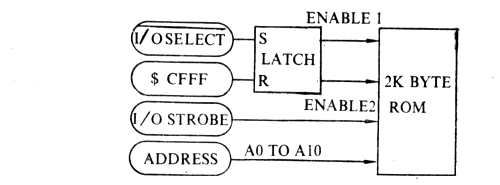
*图 3.12 公用ROM使能控制电路*

这一电路分为两级控制：首先当扩展槽上 $\overline{\text{I/O SELECTn}}$ 信号为低电平时，电路中状态触发器被置位，从而公用 ROM 的使能信号 ENABLE1 有效。另外，当槽口上信号 $\overline{\text{I/O STROBE}}$ 为低电平时，公用 ROM 的使能信号 ENABLE2 有效。使能信号 ENABLE1 和 ENABLE2 都有效时，公用 ROM 被选通。

每个扩展卡都可以单独使用公用 ROM，某个扩展卡要使用公用 ROM 区，需要在它的那 1 页专用 ROM 区中，执行一条访问 $CFFF 的指令，用其地址译码信号复位所有扩展卡中公用 ROM 使能状态触发器，使 ENABLE1 信号无效，从而禁止所有扩展卡使用公用 ROM；再执行该卡专用 ROM 的指令时，信号 $\overline{\text{I/O SELECTn}}$ 为低电平，从而将当前启动的扩展卡中公用 ROM 使能控制电路的状态触发器置位，使该卡的 ENABLE1 信号有效。若再访问 $C800 — $CFFE 空间时，$\overline{\text{I/O STROBE}}$ 信号为低电平，即 ENABLE2 信号有效。这样，就允许扩展卡使用公用 ROM。

复位公用 ROM 使能控制电路的状态触发器，需产生地址 $CFFF 的译码信号。访问空间 $C800 — $CFFF 时，信号 $\overline{\text{I/O STROBE}}$ 为低电平，故可以作为地址 $CFFF 译码信号的一部分；假若，利用 $CF\times\times$ 这一页的译码信号作为状态触发器的复位信号，则可得到较为简单的译码电路。参见图 3.13。

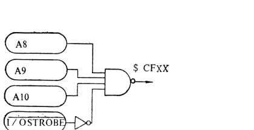
*图 3.13 $CF×× 译码电路*

---

#### 五、外围扩展槽口

在 CEC-I 的主板上，有一个 50 线的外围扩展槽口。它的引线和 Apple II 的 50 线槽兼容。在主板上已做了软盘驱动器接口和汉字处理电路，它们分别占用 6 号和 3 号槽口。为了让主板上唯一的扩展槽能在逻辑上分别作为 1 号、2 号、4 号、5 号、7 号槽工作，在主板上设置一个跨接插座 J10，利用短接插塞来选择当前所用的槽号。若要选择某一槽号，只需将两个短路插塞插在 J10 上对应的两排插针上。槽号和插针的关系如图 3.14 所示。

机器出厂时，一般选择槽口 1 号，短路插塞插在相对于 1 号槽的位置上。

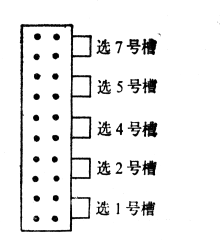
*图 3.14 选槽号插针位置*

50 线扩展槽引出信号位置见图 3.15 所示。

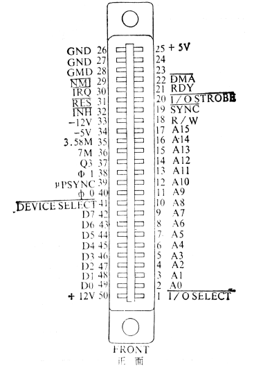
*图 3.15 外围接插头的引出线安排*

**表 3.11 CEC-I 槽口信号说明**

| 引出线编号 | 信号名字 | 模式 | 说 明 |
| :---: | :---: | :---: | :--- |
| **1** | $\overline{\text{I/O SEL}}$ | I | I/O 选择。七条单独的译码线供插槽 1—7 之用。当访问 $\$C\text{N}00 — \$C\text{N}FF$ 时，在 $\phi2$ 期间任何一个接插头上的 $\overline{\text{I/O SEL}}$ 变为低电平。N 为插槽编号。 |
| **2—17** | AD0 — AD15 | B | 16 位地址总线。地址在 $\phi1$ 期间变为有效，并在 $\phi2$ 的整个期间保持有效。 |
| **18** | $\text{R}/\overline{\text{W}}$ | B | 读/写。在 $\phi1$ 期间变为有效，并在 $\phi2$ 的整个期间保持有效，读为高电平，写为低电平。 |
| **19** | $\overline{\text{SYNC}}$ | I | 视频同步信号。 |
| **20** | $\overline{\text{I/O STB}}$ | I | I/O 选通。当访问范围为 $C800 — $CFFF 时，这是一条在 $\phi2$ 期间变为低电平的公共选择线。 |
| **21** | RDY | B | 就绪。在 $\phi1$ 期间得到低电平以插入等待状态。6502 仅在读周期内能识别 RDY 的低电平。 |
| **22** | $\overline{\text{DMA}}$ | O | 直接存储器访问。在 $\phi1$ 开始时取低电平以停止处理器并产生地址、数据和 $\text{R}/\overline{\text{W}}$ 线的高阻态。 |
| **23** | 未用 | | |
| **24** | 未用 | | |
| **25** | +5V | | +5 伏特。 |
| **26—28** | GND | | 地线。 |
| **29** | $\overline{\text{NMI}}$ | O | 不可屏蔽中断。取低电平以启动 6502 的不可屏蔽中断。 |
| **30** | $\overline{\text{IRQ}}$ | O | 中断请求。取低电平以启动 6502 的可屏蔽中断。仅当中断禁止标志未置位时可以识别。 |
| **31** | $\overline{\text{RESET}}$ | B | 作输出时，取低电平使 6502 和其它外围设备复位。作输入时，在从键盘来的复位期间，加电时和从其它外围设备来的复位期间变为低电平。 |
| **32** | $\overline{\text{INH}}$ | O | 禁止访问主板上所有的存储器，低电平有效。 |
| **33** | -12V | | -12 伏特。 |
| **34** | -5V | | -5 伏特。 |
| **35** | 3.58M | I | 彩色基准。仅连到插槽 7。 |
| **36** | 7M | I | 7MHz。是 7.15909MHz 的时钟。 |
| **37** | Q3 | I | 2.040968MHz（平均）的时钟。 |
| **38** | $\phi1$ | I | 相 1。1.020484MHz（平均）的系统时钟。在总线上用来代替 6502 $\phi1$。 |
| **39** | $\mu\text{PSYNC}$ | I | 6502 的同步信号，取指令期为高电平。 |
| **40** | $\phi0$ | I | 相 0。1.020484MHz（平均）的系统时钟，与 $\phi1$ 相位相反。在总线中用来代替 6502 $\phi2$。 |
| **41** | $\overline{\text{DEVSEL}}$ | I | 设备选择。八条单独译码的选择线，每个插槽一条。当访问 $\$C0\text{X}0 — \$C0\text{X}F$ 时，在 $\phi2$ 期间在任何一个接插头上的 $\overline{\text{DEVSEL}}$ 都变为低电平；$\text{X} = \text{N} + 8$，N 为插槽编号。 |
| **42—49** | D7 — D0 | B | 八位双向数据总线。数据在 $\phi2$ 期间变为有效，且保持有效直到 $\phi2$ 结束。 |
| **50** | +12V | | +12 伏。 |

> [!NOTE]
> **表 3.11 补充说明**：
> - \* 除非另有说明，全部信号都在所有的八个插槽上出现。
> - \*\* 模式栏说明：`I`：输入，`O`：输出，`B`：双向（均相对于外围卡而言）。
