# 第三章 CEC-I 硬件介绍（Part 2：§3.5 显示电路原理）

> 本章分为三部分：
> - [Part 1 (§3.1 ~ §3.4)](ch03a-motherboard-cpu-memory-io.md)：主机板组成与系统框图、中央处理器（CPU 6502）、存储器系统（RAM/ROM/存储体切换）、输入输出空间分配
> - **Part 2 (§3.5)**：显示电路原理与工作机制（字符/图形方式、时序、显存寻址、字符发生器、彩色PAL编码）（当前部分）
> - [Part 3 (§3.6 ~ §3.13)](ch03c-interfaces-asic.md)：接口电路与专用集成电路（键盘、录音机、游戏杆、扬声器、软驱、汉字系统、MMU/IOU/PAL、打印机）

---

## 3.5 显示电路原理

本节首先介绍中华学习机的几种显示方式，使初学者对显示部分有一个基本概念。然后主要从内部线路控制、显示存储器与显示屏的相应关系进行原理分析，详细描述字符（文本方式）的传送、字符发生器 ROM 的寻址，并从彩色原理的角度，通过图形 ROM 寻址来深入分析低分辨率图形方式和高分辨率图形方式的工作原理。最后，专门介绍彩色 PAL 制编码电路。

---

### 3.5.1 显示方式

中华学习机共有 5 种显示方式，主要分两大类：一类为字符（文本方式），一类为图形方式。图形方式又分低分辨率图形和高分辨率图形。中文方式采用高分辨率显示方式，并通过软件控制屏幕管理。混合方式是字符和图形同时在屏幕上显示，无论在低分辨率图形方式或高分辨率图形方式下，屏幕下方都留有 4 行文本的显示区。

#### 一、文本显示

**1. 显示文本内容**  
显示文本包括：大小写英文字母、10 个数字、标点符号及其它字符共 96 种字符。

**2. 显示格式**  
- **40 列文本方式**：全屏幕 24 行，每行 40 个字符，共计 960 个字符。
- **80 列文本方式**：全屏幕 24 行，每行 80 个字符，共计 1920 个字符。在 80 列文本方式下，需加装 80 列扩展卡。

**3. 字符点阵**  
每个字符由 5×7 点阵组成。每个字符在屏幕上占 7×8 点阵空间，其中水平方向最后两点为空白，用来作字符与字符之间的间隔；垂直方向第 8 点为空白，用作行与行之间的间隔点。大写字母占前 7 行，第 8 行全黑。小写字母带有下加点（如 g, j, p, q, y）占用第 2 行到第 8 行，第 1 行全黑。

**4. 字符产生方式**  
字符是由字符发生器（只读存储器 ROM 2732）产生的，按字符编码查字模点阵在屏幕上显示。中华学习机有两种字符组：
- **基本字符组**：包含 64 种大写字符，可用正常方式（黑底白字）或闪烁方式（亮暗交替）显示。
- **替代字符组**：包含 96 种大小写字符，无闪烁方式，但无论大小写字母、数字和特殊字符都可以用正常方式和反向方式（白底黑字）显示，如表 3.12 所示。

**表 3.12 基本字符组和替代字符组的十六进制码及对应的显示方式**

| 十六进制值 | 基本字符组字型 | 基本字符组显示方式 | 替代字符组字型 | 替代字符组显示方式 |
| :---: | :---: | :---: | :---: | :---: |
| **$00 〜 $1F** | 大写字母 | 反向 | 大写字母 | 反向 |
| **$20 〜 $3F** | 特殊字符 | 反向 | 特殊字符 | 反向 |
| **$40 〜 $5F** | 大写字母 | 闪烁 | 大写字母 | 反向 |
| **$60 〜 $7F** | 特殊字符 | 闪烁 | 小写字母 | 反向 |
| **$80 〜 $9F** | 大写字母 | 正常 | 大写字母 | 正常 |
| **$A0 〜 $BF** | 特殊字符 | 正常 | 特殊字符 | 正常 |
| **$C0 〜 $DF** | 大写字母 | 正常 | 大写字母 | 正常 |
| **$E0 〜 $FF** | 小写字母 | 正常 | 小写字母 | 正常 |

每一个显示的字符在存储器中占一个字节。字节的低 6 位 D5〜D0 表示显示字符的 ASCII 码，高两位 D7、D6 用来决定文本的显示方式和大小写字母的选择：
- 在基本字符组中，第 7 位决定是正常方式还是其它方式，第 6 位决定是否闪烁。
- 在替代字符组中，第 7 位作用与基本字符组相同（选择正常/反向），第 6 位选择大写或小写字母。参见图 3.16。

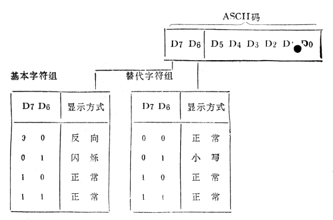

---

#### 二、低分辨率图形方式

低分辨率图形方式和高分辨率图形方式都把屏幕当作矩形点阵来处理。通常使用高级语言在屏幕上画点、线、图形，这里主要说明产生图形的数据在存储器中的存储方式。

低分辨率图形方式显示 40×48 的色块阵列，每个色块可显示包括黑白两色在内的 16 种颜色中的任一种。若使用单色监视器或黑白电视机，这 16 种颜色就变为黑白两色及三种不同的灰度，色块之间全部相连。

低分辨率图形显示数据所占的存储区与 40 列文本显示数据所占的区域完全相同。每个色块占一个字符宽度（7 个点宽）和半个字符高度（4 个点高）的位置，因此每个字节表示两个色块：一个在上，一个在下。

显示数据的每半个字节（4 位）表示一个色块：低 4 位表示上面的色块，高 4 位表示下面的色块，如图 3.17 所示。4 位二进制值表示 16 种不同的颜色，每种颜色与 4 位数的关系如表 3.13。

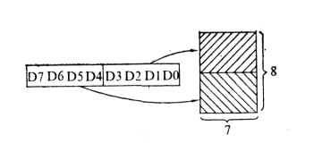

**表 3.13 低分辨率图形彩色码**

| 十进制 | 十六进制 | 颜色 | 十进制 | 十六进制 | 颜色 |
| :---: | :---: | :---: | :---: | :---: | :---: |
| **0** | $0 | 黑 | **8** | $8 | 棕 |
| **1** | $1 | 深红 | **9** | $9 | 橙 |
| **2** | $2 | 深蓝 | **10** | $A | 灰 2 |
| **3** | $3 | 紫 | **11** | $B | 粉红（原书误印为深红） |
| **4** | $4 | 绿 | **12** | $C | 绿 |
| **5** | $5 | 灰 1 | **13** | $D | 浅橙 |
| **6** | $6 | 蓝 | **14** | $E | 浅绿 |
| **7** | $7 | 浅蓝 | **15** | $F | 白 |

> [!NOTE]
> **历史印刷勘误说明**：
> 原书第 66 页表 3.13 中将代码 11（$B）印刷为“深红”。在标准 Apple II / CEC-I 视频色彩标准中，代码 1 为深红（Dark Red / Magenta），代码 11 为粉红/浅红（Pink / Light Red）。原书代码 4 印刷为“始”，实为深绿（Dark Green）；代码 7 原书印刷为“深橙”，实为浅蓝（Aquamarine）；代码 8 原书印刷为“棕”，实为深橙（Brown / Dark Orange）。此处忠实保留原印对照并加注。

在每个字节中，低 4 位设置上面色块的颜色，高 4 位设置下面色块的颜色。例如：某显示数据为 $DC，那么上面色块（低 4 位 $C）为绿色，下面色块（高 4 位 $D）为浅橙色。

---

#### 三、高分辨率图形方式

高分辨率图形显示 280×192 个彩色点的点阵，颜色有黑、白、紫、绿、橙、蓝共 6 种。颜色相同的相邻点形成一片显示区域。

高分辨率图形显示数据存储在两个 8192 字节的存储区中，这两个存储区分别叫作显示页面 1 和显示页面 2。

高分辨率图形显示是以屏幕上某个点对应于某存储单元字节中的某一位来作图的。每个显示字节的低 7 位决定了屏幕上一行相邻 7 个点的显示，屏幕上一行 280 个点的显示由相邻 40 个存储单元来决定。如图 3.18 所示，在每个显示字节中，最低位 D0 决定了相邻 7 点中最左边点的显示，次低位 D1 决定了较右一点的显示，以此类推，第 6 位 D6 决定了 7 点中最右边点的显示，两者的次序正好相反。

显示数据的最高位 D7 不显示，用来在两组颜色中进行选择，如表 3.14 所示。

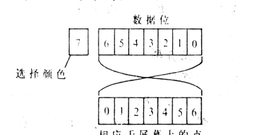

**表 3.14 高分辨率图形显示颜色选择**

| 位 0 〜 6 状态 | 位 7 为 0 时颜色 | 位 7 为 1 时颜色 |
| :--- | :---: | :---: |
| **点为 0（相邻列为 0）** | 黑 | 黑 |
| **偶数列为 1** | 紫 | 蓝 |
| **奇数列为 1** | 绿 | 橙 |
| **点为 1（相邻列均为 1）** | 白 | 白 |

---

#### 四、中文显示方式

中文显示采用了高分辨率图形显示方式，能显示由 16×16 点阵构成的 7445 种图形字符。其中包括 6763 个汉字及英文字母、日文假名、拉丁字母、俄文字母、希腊字母等。

显示屏上共 11 行。由于第 11 行为状态行，用来显示当前的输入方式和相应的提示信息，因此满屏幕实际显示 10 行正文，每行 17 个汉字，共计 170 个汉字。

在中文方式下：
- 处于“字母”方式（即显示西文）时，输入的英文字母和各种符号在屏幕上占半个汉字的位置（8×16 点阵），即全屏幕 10 行，每行 34 个字符。
- 处于“区位”或“拼音”方式时，按区位码输入各种字母和符号，在屏幕上占一个完整汉字的位置（16×16 点阵），即全屏幕 10 行，每行 17 个字符。

---

#### 五、混合方式

图形和文本同时在屏幕上显示称为混合方式。
- **低分辨率混合方式**：低分辨率图形全屏由 40×48 个色块组成。在混合方式时，底部 4 行文本占去了 8 行色块空间，屏幕上方剩下 40×40 个色块空间。
- **高分辨率混合方式**：高分辨率图形全屏由 280×192 个点组成。在混合方式下，底部 4 行文本占去了 32 行扫描线，屏幕上方剩下 280×160 个点的图形区域。

---

#### 六、显示缓冲区

中华学习机使用指定的存储区存储显示数据，这些存储区叫显示缓冲区或显示页面。显示缓冲区中每个字节控制屏幕上某一位置的显示内容：在文本方式中控制一个字符，在低分辨率方式中控制一个上下两部分的色块，在高分辨率图形中控制一行中相邻的 7 个点。

在 40 列文本及低分辨率图形方式中，有两个 1024 字节的显示页面：
- 显示页面 1 地址为 $400 〜 $7FF（十进制 1024〜2047）。
- 显示页面 2 地址为 $800 〜 $BFF（十进制 2048〜3071）。

一般情况下仅使用页面 1，也可以通过软开关切换到页面 2 中存放文本或数据。这两个页面都可以用作 40 列文本、低分辨率图形及混合方式显示。

高分辨率图形方式有两个 8192 字节长的显示页面。在 40 列文本及低分辨率图形方式中，每个显示数据控制 7×8 点的区域；而在高分辨率图形方式中，每个字节仅控制 1×7 个点，因而需要的显示缓冲区是 40 列文本的 8 倍：
- 显示页面 1 地址为 $2000 〜 $3FFF（十进制 8192〜16383）。
- 显示页面 2 地址为 $4000 〜 $5FFF（十进制 16384〜24575）。

**表 3.15 显示缓冲区地址表**

| 显示方式 | 页面 | 十六进制地址 | 十进制地址 |
| :--- | :---: | :---: | :---: |
| **40 列文本及低分辨率图形** | 1 | $400 〜 $7FF | 1024 〜 2047 |
| | 2 | $800 〜 $BFF | 2048 〜 3071 |
| **高分辨率图形** | 1 | $2000 〜 $3FFF | 8192 〜 16383 |
| | 2 | $4000 〜 $5FFF | 16384 〜 24575 |

---

#### 七、显示方式的转换（软开关）

要选择不同的显示方式，可通过软开关进行转换，也就是读或写专门的存储单元。大多数软开关有三个单元：一个用于接通软开关，一个用于断开软开关，一个用于读取软开关状态。

当读软开关时，可得到相应软开关地址的数据，此数据仅最高位 MD7（第 7 位）有效：
- 在机器语言程序中，第 7 位为 1 表示此软开关 ON，第 7 位为 0 表示软开关 OFF。
- 在 BASIC 程序中，得到的数值大于或等于 128 表示此软开关 ON，小于 128 表示软开关 OFF。

表 3.16 列出了控制不同显示方式选择的软开关。

**表 3.16 显示软开关**

| 软开关名称 | 功能 | 十六进制 (Hex) | 十进制 (Dec) | 负数 (Integer BASIC) | 操作类型 / 注释 |
| :--- | :--- | :---: | :---: | :---: | :---: |
| **ALTCHARSET** | 替代字符组接通 | $C00F | 49167 | -16369 | 写 |
| | 替代字符组断开 | $C00E | 49166 | -16370 | 写 |
| | 读 ALTCHARSET 开关状态 | $C01E | 49182 | -16354 | 读 |
| **TEXT** | 文本方式接通 | $C051 | 49233 | -16303 | 读/写 |
| | 文本方式断开（图形方式接通） | $C050 | 49232 | -16304 | 读/写 |
| | 读 TEXT 开关状态 | $C01A | 49178 | -16358 | 读 |
| **MIXED** | 混合方式接通 | $C053 | 49235 | -16301 | 读/写（注 1） |
| | 混合方式断开（全屏方式接通） | $C052 | 49234 | -16302 | 读/写（注 1） |
| | 读 MIXED 开关状态 | $C01B | 49179 | -16357 | 读 |
| **PAGE2** | 页面 2 接通 | $C055 | 49237 | -16299 | 读/写（注 2） |
| | 页面 2 断开（页面 1 接通） | $C054 | 49236 | -16300 | 读/写（注 2） |
| | 读 PAGE2 开关状态 | $C01C | 49180 | -16356 | 读 |
| **HIRES** | 高分辨率方式接通 | $C057 | 49239 | -16297 | 读/写（注 1） |
| | 高分辨率方式断开（低分辨接通）| $C056 | 49238 | -16298 | 读/写（注 1） |
| | 读 HIRES 开关状态 | $C01D | 49181 | -16355 | 读 |

> [!NOTE]
> **表 3.16 补充说明与勘误**：
> - **注 1**：MIXED 与 HIRES 开关仅在图形方式接通（TEXT 开关 OFF）时有效。
> - **注 2**：在 80 列扩展卡的辅助文本页面被写使能时，PAGE2 开关具有选择主/辅文本显存的另一种功能。
> - **历史印刷勘误**：原书第 70 页表 3.16 中存在若干十进制地址印刷错误：
>   - MIXED 接通（$C053）十进制原印为 49253，应为 49235；
>   - MIXED 断开（$C052）十进制原印为 49243，应为 49234；
>   - 读 MIXED 开关（$C01B）负数原印为 -16057，应为 -16357；
>   - 读 HIRES 开关（$C01D）十进制原印为 49198，应为 49181。

**操作示例**：
在汇编语言中要把混合方式转化为全屏幕图形显示方式，使用如下指令：
```assembly
STA $C052
```
而在 BASIC 程序中使用如下命令：
```basic
POKE 49234, 0
```
（注：原书在此处举例沿用了印误的 `POKE 49243, 0`，实际标准地址为 49234）。

在使用各种高级语言时，显示方式的选择可以由系统绘图语句（如 `TEXT`、`GR`、`HGR`、`HGR2`）自动进行，而不需程序员直接去读写表中的硬件开关单元。

---

#### 八、显示页结构与显存折叠算法

所有的显示方式都使用同一种基本地址分配方法：即字符或图形数据按行存储，每行占连续的 40 个字节。但显示存储器的连续地址与屏幕上的显示扫描线并不是简单按物理从上到下的次序线性对应的，屏幕上的实际扫描行在显存中是跳跃分布的。

如图 3.22 所示，显示屏以 3 行为 1 组，每组中显示存储器相邻两行数据在屏幕上的显示位置相隔 8 行。这 3 组行（每行 40 字节，共 120 字节）占显示存储器中每块 128 字节区域开头的 120 字节，末尾剩下的 8 字节空隙（标有星号 `*` 的字节）未被屏幕扫描所使用，留给外围扩展卡作为局部变量存储单元（称为 Screen Holes）。

这一结构被称为**折叠显示数据存储方式**。利用这种算法，仅用 1024 字节（1KB）即可紧凑存储全屏 24 行、共 960 个显示字节，且硬件地址发生器结构精简。

各显示方式下的页面结构请参看：
- 图 3.19：40 列文本显示页结构图
- 图 3.20：低分辨率图形显示页结构图
- 图 3.21：高分辨率图形显示页结构图
- 图 3.22：40 列文本显示存储器与显示行对应关系图

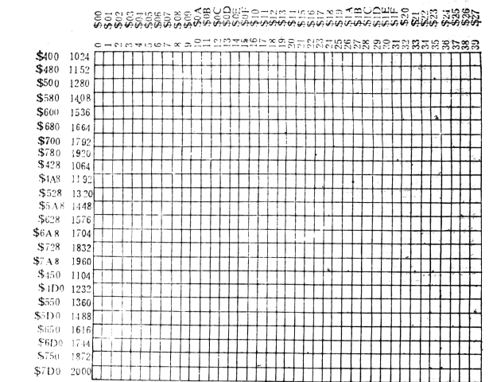

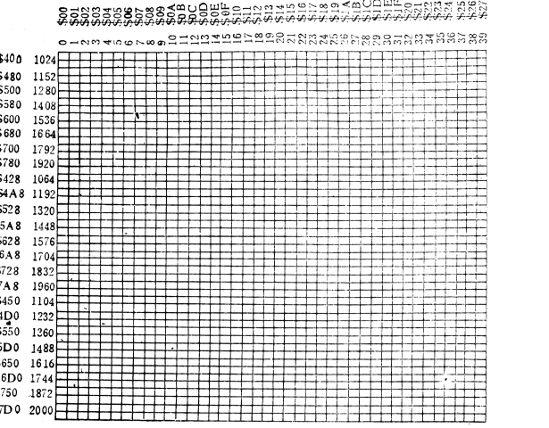

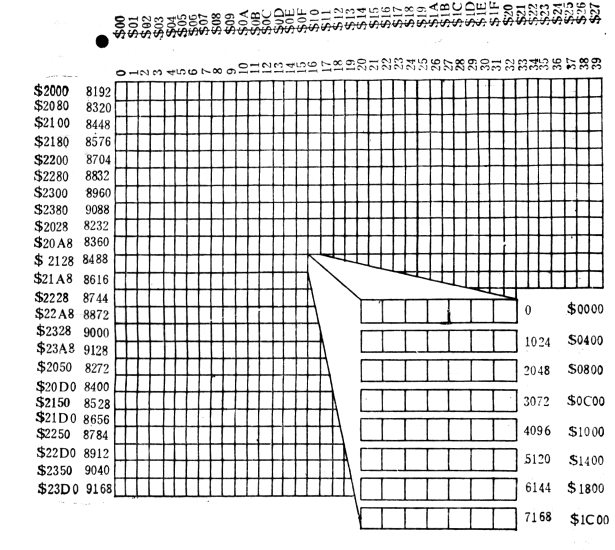

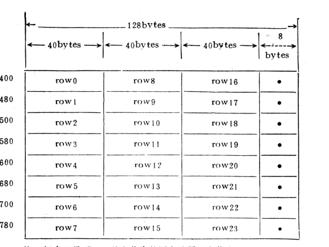

**图 3.22 显存块与显示行映射详解**：

| 显存块起始地址 | 块大小 | 行 0（第 1 行） | 行 1（第 2 行） | 行 2（第 3 行） | 外围卡孔洞 (Holes) |
| :---: | :---: | :---: | :---: | :---: | :---: |
| **$400** | 128 Bytes | Row 0 (40B) | Row 8 (40B) | Row 16 (40B) | 8 Bytes ($478-$47F) |
| **$480** | 128 Bytes | Row 1 (40B) | Row 9 (40B) | Row 17 (40B) | 8 Bytes ($4F8-$4FF) |
| **$500** | 128 Bytes | Row 2 (40B) | Row 10 (40B) | Row 18 (40B) | 8 Bytes ($578-$57F) |
| **$580** | 128 Bytes | Row 3 (40B) | Row 11 (40B) | Row 19 (40B) | 8 Bytes ($5F8-$5FF) |
| **$600** | 128 Bytes | Row 4 (40B) | Row 12 (40B) | Row 20 (40B) | 8 Bytes ($678-$67F) |
| **$680** | 128 Bytes | Row 5 (40B) | Row 13 (40B) | Row 21 (40B) | 8 Bytes ($6F8-$6FF) |
| **$700** | 128 Bytes | Row 6 (40B) | Row 14 (40B) | Row 22 (40B) | 8 Bytes ($778-$77F) |
| **$780** | 128 Bytes | Row 7 (40B) | Row 15 (40B) | Row 23 (40B) | 8 Bytes ($7F8-$7FF) |

---

### 3.5.2 视频电路工作原理

视频电路的总框图如图 3.23 所示。

在系统运行过程中，主板采用 $\phi_0$ 与 $\phi_1$ 时钟交替分时选址机制：
- 在 $\phi_1$ 为高电平期间，由专用芯片 IOU 中的显示电路（视频扫描电路、视频地址转换器、软开关电路、视频控制电路）产生屏幕显示转换地址 RA0〜RA7，对动态 RAM 显存进行读取，完成显示刷新；
- 在 $\phi_0$ 为高电平期间，由 MMU 产生 CPU 访存转换地址 RA0〜RA7，由 6502 处理器对 RAM 进行正常的读/写操作。

在 $\phi_1$ 期间读出的显示数据送入视频锁存器，并由 IOU 控制显示码 ROM（2732）的寻址，找出相应的字符点阵或图形代码，送入并/串转换移位寄存器（74LS166）。在 PAL 逻辑时序的控制下进行高速移位，将被显示的串行点阵信号与行同步、场同步信号以及彩色副载波信号进行组合，最终形成全电视复合视频信号。该信号可直接驱动标准的监视器，并通过主板上的 RF 射频调制器直接连接家用黑白或彩色电视机天线端。

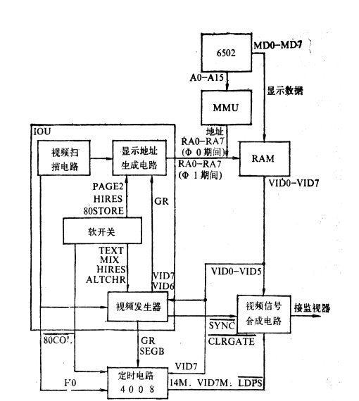

---

#### 一、IOU 内部视频扫描电路

IOU 内部有两组与显示有关的计数器：**水平计数器**和**垂直计数器**。这两组计数器的计数值不仅严格决定了光栅在屏幕上的扫描位置，同时也与被显示数据所在的存储单元地址建立了确定的逻辑映射关系，是产生显存寻址地址的核心。

**1. 水平计数器**  
水平计数器由 $\text{HPE}$（高位预置使能端）、H5、H4、H3、H2、H1、H0 共 7 级触发器组成。每个触发器有两个输入端、两个输出端、两个选择端、一个时钟端和一个复位端。计数器的驱动时钟是 1MHz 系统时钟（$\phi_0$）。

水平计数器的单行计数周期由 65 个状态组成：
- 低 6 位 H0〜H5 从 0 计数到 63；
- 当计满 63 即将从 0 重新开始时，$\text{HPE}$ 强制 6 位计数器再次复位，从而构成一个包含 65 个状态的周期，记作 $0 \sim 64$。每个状态宽度为 $1\mu\text{s}$，一水平扫描行总周期为 $65\mu\text{s}$（约 $15600\text{Hz}$）。
- **水平有效显示区**：IOU 采用从 24 到 63 的 40 个计数值来表示一行显示数据在水平方向的 40 个字符/字节位置。计数值为 24 时表示第 0 列，25 表示第 1 列，直到 63 表示第 39 列。这 40 个计数值直接用于产生显存水平地址的低位。
- **水平消隐与同步区**：IOU 采用 64 及 0〜23 这 25 个计数值来产生行消隐、行同步及彩色选通信号：
  - 水平消隐信号（$\overline{\text{WNDW}}$ 水平部分）：占 64、0〜23 共 25 个计数状态（宽 $25\mu\text{s}$）；
  - 水平同步信号（$\overline{\text{HSYNC}}$）：占 8〜15 共 8 个计数状态（宽 $8\mu\text{s}$）；
  - 彩色脉冲选通信号（$\overline{\text{CLRGAT}}$）：占 16〜19 共 4 个计数状态（宽 $4\mu\text{s}$），紧随行同步脉冲后肩。

**2. 垂直计数器**  
垂直计数器共有 9 位，包括 V5（高位）、V4、V3、V2、V1、V0 以及点阵行计数位 VC、VB、VA。每当水平计数器完成一行的 65 个计数状态（0〜64）时，产生水平回扫脉冲触发垂直计数器加 1。

垂直计数器的总计数周期为 262 个状态（0〜261）：
- 当垂直计数器计数达到 261 时自动复位，并从 0 重新开始计数，构成一帧非隔行扫描（262 行，场频约 $59.92\text{Hz}$）。
- **垂直有效显示区**：计数值 0〜191 共 192 个计数状态代表垂直方向有效显示的 192 行光栅扫描线。这 192 行在文本方式下组合为 24 个字符行（$24 \times 8 = 192$）。计数值 0〜191 与水平计数器的 24〜63 配合，产生显存的全部行列刷新地址。
- **垂直消隐与场同步区**：计数值 192〜261 共 70 个状态用于场消隐和场同步：
  - 垂直场消隐信号：占 192〜261 共 70 个行计数状态；
  - 垂直场同步信号（$\overline{\text{VSYNC}}$）：占 231〜234 共 4 个行计数状态（宽 4 行扫描周期）。

扫描时序波形请参看图 3.24。

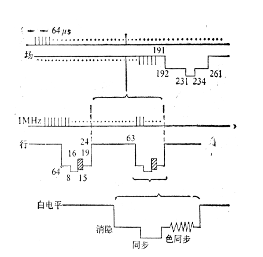

---

#### 二、显示存储器的转换寻址

被显示数据字节在显示存储器中的存储顺序与屏幕上的扫描顺序不是简单线性的。为了使硬件能以最精简的计数逻辑连续扫描光栅，IOU 内部将水平计数位和垂直计数位经过特殊的组合逻辑变换，生成提供给显存的物理地址线。

在两组计数器中：
- 水平低位 H0、H1、H2 以及垂直计数位 V0、V1、V2 不经过算术逻辑变化（仅受系统时钟 $\phi_0$、Q3 及 $\overline{\text{RAS}}$ 选通控制），直接连接到显存地址线上：
  - H0、H1、H2 直接对应显存地址 **A0、A1、A2**；
  - V0、V1、V2 直接对应显存地址 **A7、A8、A9**。
- 垂直计数位 VA、VB、VC 在文本和低分辨率显示方式下，用于选择字符发生器 2732 中 $7 \times 8$ 点阵的第 0〜7 行；而在高分辨率图形方式下，它们直接对应显存高位地址 **A10、A11、A12**。
- 水平计数位 H3、H4、H5 与垂直计数位 V3、V4 则必须经过一次特殊的算术加法运算。IOU 内部硬件加法器将这 5 个计数位进行加法组合，生成 4 个输出信号 S0、S1、S2、S3，分别连接到显存地址 **A3、A4、A5、A6**。

**显示地址加法转换公式**：

$$\begin{array}{rccccc}
& & & & V_3 & \text{（进位输入 $C_{in}$）} \\[2pt]
& \overline{H_5} & V_3 & H_4 & H_3 & \text{（被加数）} \\[2pt]
+ & V_4 & \overline{H_5} & V_4 & 1 & \text{（加数）} \\[2pt]
\hline
& S_3 & S_2 & S_1 & S_0 & \text{（和数）}
\end{array}$$

即：
- 第 0 位相加：$H_3 + 1 + V_3$ 产生 $S_0$ 及向第 1 位的进位；
- 第 1 位相加：$H_4 + V_4 + C_1$ 产生 $S_1$ 及向第 2 位的进位；
- 第 2 位相加：$V_3 + \overline{H_5} + C_2$ 产生 $S_2$ 及向第 3 位的进位；
- 第 3 位相加：$\overline{H_5} + V_4 + C_3$ 产生 $S_3$。

**转换原理分析**：  
H0、H1、H2 与 S0、S1、S2、S3 共同组合成水平方向的行内偏移地址。当水平计数器从 24（二进制 `011000`）递增到 63（二进制 `111111`）时，加法器输出 $(S_3, S_2, S_1, S_0)$ 刚好从 `0000` 依次递增到 `1000`，使行内字节地址在 40 个周期内连续从 0 增加到 39。

垂直计数器的 V0、V1、V2 连接到 A7、A8、A9，代表每 128 字节显存块中的 8 个细分行。当垂直行计数达到 8 时，V0、V1、V2 翻转归零，而 V3 变为 1，参与到 $(S_3, S_2, S_1, S_0)$ 的加法进位中，使显存基址平滑跳跃 40 个字节，实现了第 8、16 行的折叠交错。

**计算实例**：  
屏幕最左上角的字符（坐标第 0 行第 0 列）：垂直计数为 0（$V_4=0, V_3=0, V_2=0, V_1=0, V_0=0$），水平计数值为 24（$H_5=0, H_4=1, H_3=1, H_2=0, H_1=0, H_0=0$）。  
代入加法公式：
- 被加数为：$\overline{H_5}=1, V_3=0, H_4=1, H_3=1$；
- 加数为：$V_4=0, \overline{H_5}=1, V_4=0, 1$；
- 进位输入 $V_3 = 0$。  
相加结果为：
- Bit 0: $1 + 1 + 0 = 0$（进位 1）；
- Bit 1: $1 + 0 + 1 = 0$（进位 1）；
- Bit 2: $0 + 1 + 1 = 0$（进位 1）；
- Bit 3: $1 + 0 + 1 = 0$（进位溢出舍去）。  
和数 $S_3 S_2 S_1 S_0 = 0000$。加上 $A_2 A_1 A_0 = H_2 H_1 H_0 = 000$，显存低 7 位偏移为 `0000000`，基址高位对应页面起始地址（如 $400），准确寻址显存首字节。

显存地址线与扫描计数器的完整映射关系如图 3.25 及表 3.17 所示。

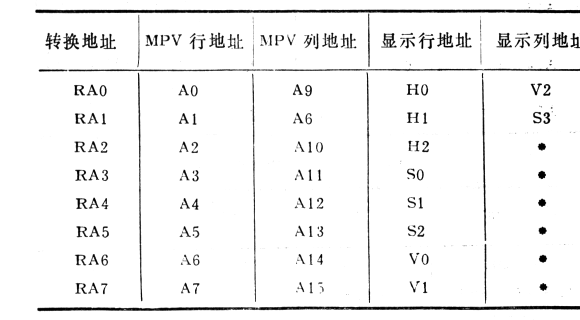

**表 3.17 不同显示方式下 A10—A15 的相应传送信号**

| 显存物理地址线 | 文本和低分辨图形方式对应信号 | 高分辨率图形方式对应信号 |
| :---: | :--- | :--- |
| **A10** | $80\text{VID} + \overline{\text{PG2}}$（$400，页面 1） | VA |
| **A11** | $80\text{VID} \cdot \text{PG2}$（$800，页面 2） | VB |
| **A12** | 0 | VC |
| **A13** | 0 | $80\text{VID} + \overline{\text{PG2}}$（$2000，页面 1） |
| **A14** | 0 | $80\text{VID} \cdot \text{PG2}$（$4000，页面 2） |
| **A15** | 0 | 0 |

> [!NOTE]
> 原书第 80 页表 3.17 中最末行左栏原印为“A5”，根据地址总线位权及高分辨 64K/辅存空间定义，实为 A15。

---

#### 三、IOU 中显示软开关及视频控制信号

**1. 显示软开关内部逻辑**  
IOU 内部集成了控制显示状态的一组锁存器与译码逻辑。在 IOU 内部时钟 Q3 信号（行地址锁存期）作用时，MMU 送出的转换地址 RA7〜RA0 作为内部地址输入 AL7〜AL0。在 Q3 为低电平时，地址译码器对软开关地址进行选通，触发相应的 RS 触发器置位或复位，如图 3.26 所示。

当 CPU 读取 $C01A〜$C01F 状态端口时，IOU 将相应开关触发器的状态驱动到主板数据总线的最高位 MD7：
- MD7 = 1 表示软开关接通（ON）；
- MD7 = 0 表示软开关断开（OFF）。

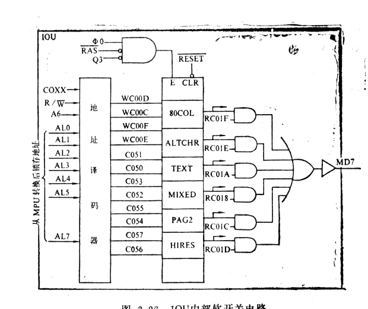

**表 3.18 显示软开关地址与触发对照表**

| 软开关名称 | 接通地址 (ON) | 断开地址 (OFF) | 状态读取地址 |
| :---: | :---: | :---: | :---: |
| **80COL** | $C00D | $C00C | $C01F |
| **ALTCHARSET** | $C00F | $C00E | $C01E |
| **TEXT** | $C051 | $C050 | $C01A |
| **MIXED** | $C053 | $C052 | $C01B |
| **PAGE2** | $C055 | $C054 | $C01C |
| **HIRES** | $C057 | $C056 | $C01D |

**2. IOU 输出的视频控制信号**  
IOU 输出多路专用的视频定时和门控信号，直接协调整个显示系统的工作：

- **$\overline{\text{SYNC}}$**（输出）：复合同步信号。由水平计数器产生的行同步脉冲和垂直计数器产生的场同步脉冲在门电路中逻辑合成，送入视频输出级与串行点阵混合，形成标准全电视信号。
- **$\overline{\text{CLRGAT}}$**（输出）：彩色脉冲选通信号（Color Burst Gate）。在文本显示方式下，该信号始终为高电平，封锁彩色副载波进入合成电路，消除黑白字符边缘的彩色爬行杂波；在图形显示方式下，该信号在每个行同步脉冲后肩输出一个宽度为 $4\mu\text{s}$ 的低电平选通脉冲，使色度电路输出 10 个周期的彩色同步基准副载波。
- **$\overline{\text{WNDW}}$**（输出）：显示窗口消隐信号。在行场回扫消隐期间，该信号为高电平，封锁显示输出；在有效显示期间为低电平（每行持续宽度约 $40\mu\text{s}$），允许点阵信号输出。
- **$\overline{\text{RA9}}$、$\overline{\text{RA10}}$**（输出）：字符发生器 ROM 高位地址线。其逻辑电平受 GR 开关和 ALTCHARSET 软开关控制，如表 3.19 所示。

**表 3.19 由 GR、ALTCHARSET 控制的 $\overline{\text{RA9}}$、$\overline{\text{RA10}}$ 输出**

| GR 开关 | ALTCHARSET 开关 | $\overline{\text{RA9}}$ 输出 | $\overline{\text{RA10}}$ 输出 |
| :---: | :---: | :---: | :---: |
| **1** | $\times$ | VID6 | VID7 |
| $\times$ | **1** | VID6 | VID7 |
| **0** | **0** | $\text{VID6} \cdot \overline{\text{VID7}}$ | $\overline{\text{AL3}} \cdot \text{VID6} + \text{VID7}$ |

> 当 GR 或 ALTCHARSET 为 1 时，$\overline{\text{RA9}}$、$\overline{\text{RA10}}$ 直接反映显存读出数据的高两位 VID6、VID7。  
> 当 GR 和 ALTCHARSET 均为 0（即基本字符组文本方式）时，$\overline{\text{RA9}}$ 用于区分大写字符与特殊字符；$\overline{\text{RA10}}$ 则受闪烁振荡器信号 $\overline{\text{AL3}}$ 调制，使处于闪烁代码段（$40〜$7F）的字符在正常与反向字模之间交替切换，产生闪烁显示效果。

- **GR**（输出）：图形方式使能信号。当软开关 TEXT 断开时，系统进入图形显示状态，GR 输出为高电平。该信号直接连接显示码 ROM 2732 的 A11 引脚，选通 ROM 中 $800〜$FFF 地址空间的图形点阵转换代码。
- **VC、SEGB、SEGA**（输出）：垂直与时序多路复用控制信号。在文本方式和图形方式下承担不同的信号复用功能，如表 3.20 所示。

**表 3.20 VC、SEGB、SEGA 输出状态表**

| 工作方式 | VC 引脚输出 | SEGB 引脚输出 | SEGA 引脚输出 | 功能说明 |
| :---: | :---: | :---: | :---: | :--- |
| **TEXT 方式** | VC | VB | VA | 输出字符点阵扫描行号 0〜7，连接 ROM 的 A2、A1、A0 |
| **GR 方式** | VC | $\overline{\text{HIRES}}$ | H0 | VC 区分上下半色块，$\overline{\text{HIRES}}$ 区分高低分辨，H0 区分奇偶列 |

---

#### 四、RAM 的选址时序

6502 处理器的主时钟频率为 1MHz。由于 CPU 与显示电路在每个时钟周期内严格交替选址，主存动态 RAM 的实际工作频率相当于 2MHz：
- 在 $\phi_0 = 1$（$\phi_1 = 0$）周期：MMU 工作，将 CPU 送出的 16 位地址分时转换为行、列地址送入 RAM，执行程序的读/写操作；
- 在 $\phi_1 = 1$（$\phi_0 = 0$）周期：IOU 工作，将视频计数器生成的显示刷新地址分时送入 RAM，完成显存数据的顺序读出与动态 RAM 的行刷新。

RAM 定时信号如图 3.27 所示。主板时序发生器在 $\phi_0$ 和 $\phi_1$ 期间均产生动态 RAM 的行选通脉冲 $\overline{\text{RAS}}$；在 $\phi_0$ 期间由 MMU 逻辑产生列选通脉冲 $\overline{\text{CAS}}$，而在 $\phi_1$ 期间由视频控制时钟产生 $\overline{\text{CAS}}$。行、列选通脉冲分别以下降沿将地址分时打入动态 RAM 芯片（HM50464）内部的行、列锁存器，并在每个半周期的后沿将读出数据打入相应的总线缓冲器。

RAM 分时转换地址的内容映射如图 3.28 所示。

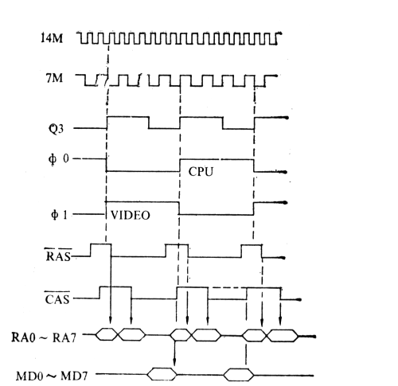

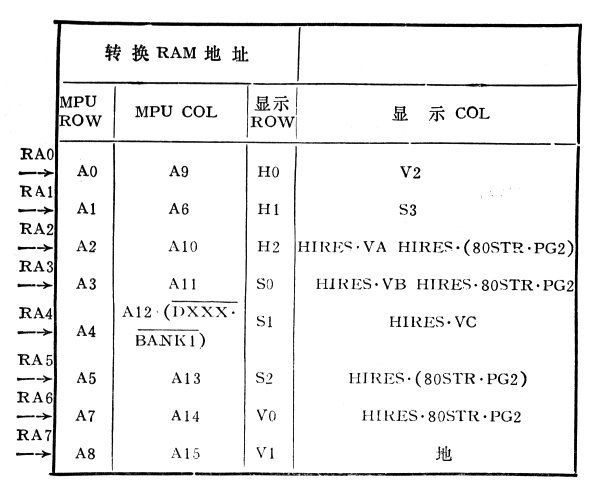

---

#### 五、视频数据转换电路

视频数据转换电路主要由 74LS374 8 位三态锁存器、2732 字符/图形发生器 ROM 以及 74LS166 8 位并/串转换移位寄存器组成，如图 3.29 所示。

1. **显存数据锁存**：IOU 在 $\phi_1$ 期间形成显存刷新地址，在 $\phi_1$ 下降沿（即 $\phi_0$ 上升沿）前约 50ns，显存读出的 8 位显示数据稳定出现在数据总线上。$\phi_0$ 的上升沿将该数据打入 74LS374 视频数据锁存器，锁存器输出信号定义为 VID0〜VID7。
2. **字符发生器寻址**：VID0〜VID5 作为低 6 位显示代码，直接送入显示码 ROM 2732 的 A3〜A8 地址线；高两位 VID6、VID7 经 IOU 内部逻辑变换后输出 $\overline{\text{RA9}}$ 和 $\overline{\text{RA10}}$，送入 ROM 的 A9、A10 地址线；IOU 输出的 VC、SEGB、SEGA（文本方式下为 VC、VB、VA）送入 ROM 的 A2、A1、A0，用于选择 $7 \times 8$ 点阵中的具体一行。
3. **并/串转换移位**：ROM 输出的 8 位点阵数据在 $\overline{\text{LDPS}}$（Load Parallel Shift Register）脉冲使能下，并行打入移位寄存器 74LS166。在 40 列文本方式下，每隔 $1\mu\text{s}$（即一个字符周期）$\overline{\text{LDPS}}$ 脉冲打入一次新字模。74LS166 在 14MHz 点阵时钟和 VID7M 门控信号控制下，按 7MHz 的速率将 7 个有效点阵点逐位移出，输出串行亮度信号。

40 列文本视频时序关系如图 3.30 所示。

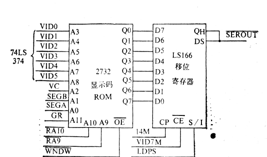

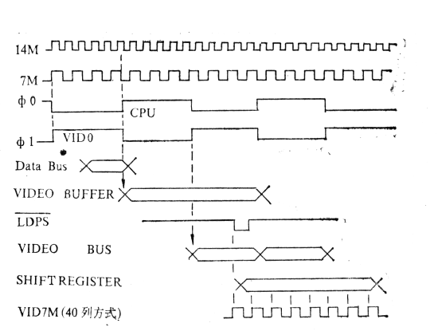

---

#### 六、字符发生器 ROM 寻址

系统采用一片 4KB 的 EPROM（2732）作为显示码发生器 ROM：
- **前 2KB（$0000〜$07FF）**：存放西文字符显示字模（由 A11 = 0 选通）；
- **后 2KB（$0800〜$0FFF）**：存放低/高分辨率图形代码转换字模（由 A11 = 1 即 GR = 1 选通）。

**1. 字符字模空间分配**  
在字符字模存储区（前 2KB）中：
- 第 1KB（$000〜$3FF）：存放反向字符字型（白底黑字）；
- 第 2KB（$400〜$7FF）：存放正向字符字型（黑底白字）。存放的字符顺序与反向字模完全一致，每个字符字模占用 8 个连续字节空间，如图 3.31 所示。

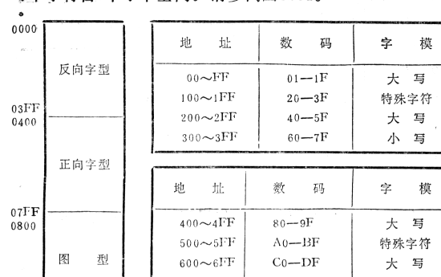

**2. 基本字符组寻址机制**  
在基本字符组方式下，系统可显示正常、反向及大写闪烁三种显示效果。此时 IOU 输出的控制电平为：

$$\begin{aligned}
\overline{\text{RA9}} &= \text{VID6} \cdot \overline{\text{VID7}} \\[2pt]
\overline{\text{RA10}} &= \overline{\text{AL3}} \cdot \text{VID6} + \text{VID7}
\end{aligned}$$

显存数据位 D7 控制正常/反向显示：
- D7 = 1 时，固定为正常显示（正向字型）；
- D7 = 0 时，显示方式取决于 D6：
  - D6 = 0 时为反向显示；
  - D6 = 1 时为闪烁显示（受 $\overline{\text{AL3}}$ 调制，在正反字模间跳变）。

**表 3.21 基本字符组下 $\overline{\text{RA9}}$、$\overline{\text{RA10}}$ 状态表**

| D7 | D6 | $\overline{\text{RA10}}$（$\overline{\text{AL3}} \cdot \text{VID6} + \text{VID7}$） | $\overline{\text{RA9}}$（$\text{VID6} \cdot \overline{\text{VID7}}$） | 对应显示模式 |
| :---: | :---: | :---: | :---: | :--- |
| **0** | **0** | 0 | 0 | 反向大写字母 / 特殊字符 |
| **0** | **1** | $1 / 0$（由 $\overline{\text{AL3}}$ 决定） | 1 | 闪烁显示（正反交替） |
| **1** | **0** | 1 | 0 | 正常大写字母 / 特殊字符 |
| **1** | **1** | 1 | 0 | 正常大写字母 / 小写字母 |

根据表 3.21 与数据各位映射，可得出图 3.32 显示码与 ROM 地址的对应关系。

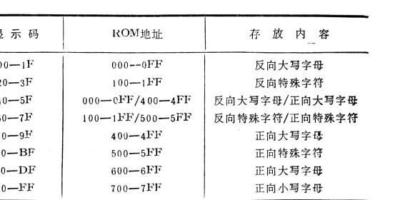

**图 3.32 显示码与 ROM 物理地址对照表**：

| 显示码范围 (Hex) | 映射 ROM 地址范围 | 存放字模内容与显示形态 |
| :---: | :---: | :--- |
| **$00 〜 $1F** | $000 〜 $0FF | 反向大写字母 |
| **$20 〜 $3F** | $100 〜 $1FF | 反向特殊字符 |
| **$40 〜 $5F** | $000〜$0FF / $400〜$4FF | 反向大写字母 / 正向大写字母（交替闪烁） |
| **$60 〜 $7F** | $100〜$1FF / $500〜$5FF | 反向特殊字符 / 正向特殊字符（交替闪烁） |
| **$80 〜 $9F** | $400 〜 $4FF | 正向大写字母 |
| **$A0 〜 $BF** | $500 〜 $5FF | 正向特殊字符 |
| **$C0 〜 $DF** | $600 〜 $6FF | 正向大写字母 |
| **$E0 〜 $FF** | $700 〜 $7FF | 正向小写字母 |

**3. 替代字符组寻址机制**  
在替代字符组方式（ALTCHARSET 接通）下，系统取消了闪烁模式，直接支持完整的 96 种 ASCII 大小写字符正常与反向显示。此时 IOU 输出：

$$\begin{aligned}
\overline{\text{RA9}} &= \text{VID6} \\[2pt]
\overline{\text{RA10}} &= \text{VID7}
\end{aligned}$$

**表 3.22 替代字符组方式下 $\overline{\text{RA9}}$、$\overline{\text{RA10}}$ 工作状态**

| D7 | D6 | $\overline{\text{RA10}}$ (VID7) | $\overline{\text{RA9}}$ (VID6) | 寻址空间与功能 |
| :---: | :---: | :---: | :---: | :--- |
| **0** | **0** | 0 | 0 | 寻址 $000〜$0FF，反向大写字母 |
| **0** | **1** | 0 | 1 | 寻址 $200〜$3FF，反向小写及特殊字符 |
| **1** | **0** | 1 | 0 | 寻址 $400〜$5FF，正向大写及特殊字符 |
| **1** | **1** | 1 | 1 | 寻址 $600〜$7FF，正向大写及小写字母 |

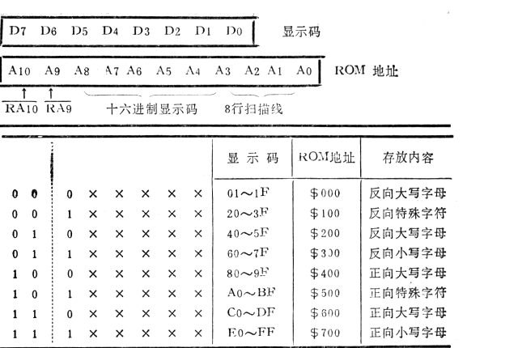

---

### 3.5.3 彩色图形方式产生原理

中华学习机具有低分辨率图形及高分辨率图形两种彩色显示方式。为了深刻理解其彩色形成机理，必须首先了解彩色电视信号编码与正交调制的物理原理。

#### 一、电视彩色信号传送原理

为了兼容黑白电视机，彩色电视系统不能直接传送红（R）、绿（G）、蓝（B）三个独立的基色信号，而必须建立一个独立的、只反映图像亮度的信号 $Y$。由人眼的生理视感特性可知，红、绿、蓝三基色的相对光视效能不同，亮度方程为：

$$Y = 0.30R + 0.59G + 0.11B$$

为了传送景物的彩色信息，还必须传送反映色调和饱和度的信号。若直接传送两个基色信号，由于基色中含有亮度分量，会造成频谱与亮度的重叠与干扰。因此系统采用传送两个不含亮度成分的**色差信号**：

$$\begin{aligned}
R - Y &= 0.70R - 0.59G - 0.11B \\[2pt]
B - Y &= -0.30R - 0.59G + 0.89B
\end{aligned}$$

> [!NOTE]
> 原书第 91 页将 $B-Y$ 公式误印为 $-0.30R + 0.41G - 0.11B$。根据三基色色差矩阵定义，$B - Y = B - (0.30R + 0.59G + 0.11B) = -0.30R - 0.59G + 0.89B$。接收端解码器只需将 $Y$ 信号分别与 $R-Y$、$B-Y$ 信号相加减，即可准确恢复出 $R$、$G$、$B$ 三基色。

**1. 色差信号的正交平衡调制**  
为了充分利用频带并实现黑白兼容，系统将色差信号插入亮度信号频谱高频端的空隙中，副载波频率选为半行频的奇数倍。NTSC 制采用正交平衡调制，用一个 3.58MHz 的副载波去调制两个色差信号：一个用正弦波调制，一个用余弦波调制，如图 3.34 所示。调制后的色度信号 $C$ 为这两个正交矢量之和：

$$C = (R-Y)\cos(\omega_{sc}t) + (B-Y)\sin(\omega_{sc}t)$$

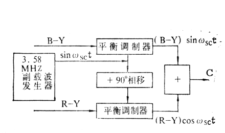

**2. 色同步信号**  
在平衡调幅器中，连续的副载波已被抑制。为了在接收端同步检波器中恢复同频同相的副载波，必须在发送端发出色同步信号（Color Burst）。色同步信号加在每个行同步脉冲后肩上，是由约 10 个周期的等幅副载波组成的脉冲群，其相位规定与副载波基准相位相差 180°。

**3. 彩色机理与相位关系**  
副载波携带彩色信号时，矢量的**相位角**代表**色调**（色度），矢量的**振幅**代表**色彩饱和度**。如图 3.35 所示，彩色电视接收机以色同步信号为 0° 相位基准，通过检测副载波相对于内部振荡器的相对相位来判别颜色。

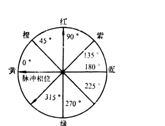

例如，如果从同步相位 0° 开始输出四分之一个周期的脉冲，电视机就会将其解码为橙色色点，如图 3.36 所示。

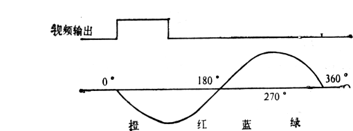

如果将 3.58MHz 和 7MHz 时钟组合，可以在一个副载波周期（约 280ns）内划分出 4 个象限相位，每个相位各代表一种基色，如图 3.37 所示。因此，当系统需要显示蓝色时，只需在蓝色相位区间使视频脉冲输出；需要显示橙色时，在橙色相位区间输出脉冲即可，如图 3.38 所示。

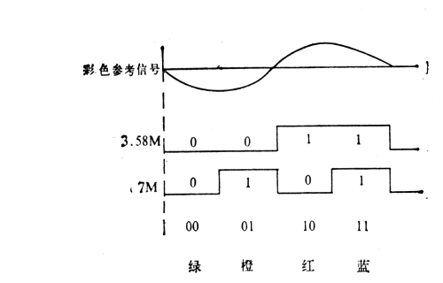

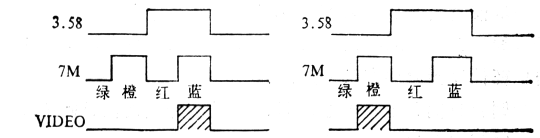

由于单一脉冲输出只占整个周期的四分之一，所以此时的亮度较暗，单一颜色均为深色（如深红、深橙、深蓝、深绿等）。若相邻两个相位脉冲同时为 1，则脉宽增大一倍，亮度增强，从而合成出明亮饱满的橙色、紫色、蓝色和绿色。

---

#### 二、低分辨率彩色图形

低分辨率图形方式共显示 16 种颜色。为了实现丰富且相位间距极小的色彩输出，移位寄存器（74LS166）工作在系统的最高频率下（由 VID7M 选通 14MHz 点阵时钟），使每个微秒时钟周期（约 $1\mu\text{s}$）内移位 14 次。主板将 74LS166 的串行输出端（引脚 13）直接反接到串行数据输入端（引脚 1），构成一个闭环**循环移位寄存器**。

一个字符周期（$1.02\mu\text{s}$）在时间上相当于 3.58MHz 副载波（周期 $0.28\mu\text{s}$）的 3.5 个周期。这就带来一个关键的时序问题：在连续输出图形点阵时，同一种颜色的编码在屏幕上处于偶数列与奇数列位置时，其与 3.58MHz 副载波的相对起始相位刚好相差半个周期（180°）！如果不加调整，偶数列和奇数列显示的颜色将发生严重的色相翻转。

为了解决这一问题，显示电路必须对奇数列（即处于第 4 个副载波周期的位置）的点阵数据进行**相位预失真补偿校正**，使得奇数列的点阵脉冲与 3.58MHz 副载波的相对起始相位保持一致。因此，显示码发生器 ROM 对每种颜色点阵都预存了两个不同的转换值：
- 一个是偶数列位置的点阵值（直接由原码复制合成）；
- 另一个是奇数列位置的点阵值（由原码循环左移两位后合成）。

取哪一个转换值由水平计数器最低位 **H0** 自动选择（H0 = 0 为偶数列，H0 = 1 为奇数列）。在图形方式下，IOU 的 VC 位用于选择字节的高 4 位还是低 4 位：VC = 0 时选择低 4 位（上面色块），VC = 1 时选择高 4 位（下面色块），如图 3.39 所示。

**表 3.23 用二进制表示彩色**

| 十进制 | 十六进制 | 二进制代码 ($b_3 b_2 b_1 b_0$) | 对应颜色名称 |
| :---: | :---: | :---: | :---: |
| **0** | $0 | 0 0 0 0 | 黑 |
| **1** | $1 | 0 0 0 1 | 深红 |
| **2** | $2 | 0 0 1 0 | 深蓝 |
| **3** | $3 | 0 0 1 1 | 紫 |
| **4** | $4 | 0 1 0 0 | 深绿 |
| **5** | $5 | 0 1 0 1 | 灰 1 |
| **6** | $6 | 0 1 1 0 | 蓝 |
| **7** | $7 | 0 1 1 1 | 浅蓝 |
| **8** | $8 | 1 0 0 0 | 深橙 |
| **9** | $9 | 1 0 0 1 | 橙 |
| **10** | $A | 1 0 1 0 | 灰 2 |
| **11** | $B | 1 0 1 1 | 粉红（深红） |
| **12** | $C | 1 1 0 0 | 绿 |
| **13** | $D | 1 1 0 1 | 浅橙 |
| **14** | $E | 1 1 1 0 | 浅绿 |
| **15** | $F | 1 1 1 1 | 白 |

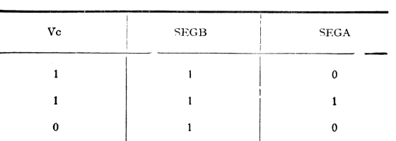

**1. 2732 显示码 ROM 图形字模分配规律**  
2732 ROM 从 $800 起存放图形转换字模：
- **低分辨率方式**：在 H0 为偶数列时，显示码 ROM 相应单元中存放有效 4 位原码的重复双点阵（例如有效色码为 $B，ROM 单元存放 $BB）；在 H0 为奇数列时，ROM 相应单元存放将有效 4 位数据**循环左移两位**后的代码再次相加合成的点阵值。在实际硬件中，因视频输出极性要求，ROM 中存储的实际值均为反码。
- **高分辨率方式**：ROM 中直接存放原码。奇数列相差 3.58MHz 半个周期的问题由绘图软件在底层自动计算校正。

**2. 低分辨率图形方式 ROM 寻址举例**  
图形方式下的 ROM 地址线引脚对应关系如图 3.40 所示：
- A11 = 1（由 GR 驱动）；
- A10 = $\overline{\text{HIRES}}$；
- A9 = H0（偶/奇数列选择）；
- A8 = VC（上/下色块选择）；
- A7〜A0 由显存读出的显示数据 VID7〜VID0 驱动。

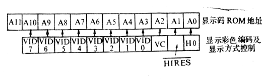

**实例 1：寻址 ROM 地址 $0822（偶数列显示色码 4）**  
- 地址分解：A11=1, A10=0, A9=0（H0=0 偶数列）, A8=0（VC=0 低 4 位有效）。
- 显示数据 D3〜D0 为 $4。因硬件逻辑取反，输入 ROM 的数据反码为 $B。
- 为了在偶数列形成 8 点点阵，ROM $0822 单元预先固化了 $BB。

**实例 2：寻址 ROM 地址 $0977（奇数列显示色码 2）**  
- 地址分解：A11=1, A10=0, A9=1（H0=1 奇数列）, A8=1（VC=1 高 4 位有效）。
- 显示数据 D7〜D4 为 $2。硬件取反后为 $D（二进制 `1101`）。
- 因处于奇数列，需将 `1101` 循环左移两位：
  $$\text{`1101`} \xrightarrow{\text{循环左移 2 位}} \text{`0111`} = \$7$$
- 将两组 4 位合并构成 8 位点阵，ROM $0977 单元中预先固化存放内容为 $77。

---

#### 三、高分辨率彩色图形

高分辨率彩色图形是以 3.58MHz 的脉冲频率在屏幕上绘制点阵的。每绘制一个彩色点的时间为：

$$T = \frac{1}{3.58\text{MHz}} \approx 0.28\mu\text{s}$$

每行用于有效显示的时间约为 $40\mu\text{s}$，因此每条扫描线在 3.58MHz 色频下包含约 140 个完整的副载波周期（$40 \div 0.28 \approx 140$）。

在高分辨率图形方式下，显存每个字节的低 7 位直接映射为屏幕上的 7 个像素点，每行 40 个字节共显示 280 个点（$40 \times 7 = 280$），全屏幕共 192 行：
- 每个字节的最低位 D0 最先移出，显示在 7 点的最左端；
- 依次移出 D1〜D5；
- 第 6 位 D6 最后移出，显示在 7 点的最右端；
- 第 7 位 D7 不显示，用于选择该字节 7 个点的彩色组别。

**彩色显示规律**：  
在单色监视器上，显存位为 1 显示为白点，为 0 显示为黑点。但在彩色监视器上：
- 显存位为 0 时，对应点始终为黑色；
- 显存位为 1 时，该点的颜色取决于它在屏幕上的**偶数/奇数列物理位置**以及该字节的 **D7 标志位**：
  - **偶数列为 1**：D7 = 0 时显示**紫色**；D7 = 1 时显示**蓝色**。
  - **奇数列为 1**：D7 = 0 时显示**绿色**；D7 = 1 时显示**橙色**。
  - **相邻两列同时为 1**：两列脉冲连续合并，副载波被填平，显示为纯**白色**。

D7 标志位除了送往 IOU 外，还连接到主板 PAL 逻辑电路中。当 D7 = 1 时，硬件电路对移位脉冲施加约 70ns（相当于 3.58MHz 的 90° 相位角）的微小延迟，使副载波相位整体顺移，从而将“紫/绿”色系无缝切换为“蓝/橙”色系。

高分辨率图形下奇数列由于扫描起始相位引起的半周期偏差，由底层绘图软件（如 HPLOT 核心库）在向显存写入数据时自动进行列位置计算与位偏移变换来校正。

---

### 3.5.4 彩色 PAL 制电路

由于我国彩色电视广播与监视器标准均采用 PAL 制式，而学习机基于的 Apple II 架构原始输出为 NTSC 制式信号，因此 CEC-I 主机板上专门设计了高质量的 **NTSC 转 PAL 彩色编码调制电路**。

#### 一、PAL 制电路与 NTSC 电路的区别

1. **副载波频率差异**：  
   - NTSC 制的色副载波频率为 **3.579545MHz**（约为 3.58MHz）；
   - PAL 制的色副载波频率为 **4.43361875MHz**（约为 4.43MHz）。
2. **调制方式差异**：  
   - NTSC 制采用正交平衡调幅，两路正交色差分量直接矢量相加；
   - PAL 制采用**逐行倒相正交平衡调幅制**（Phase Alternation Line）：两路色差信号虽然仍在同频正交的副载波上调制，但其中一个色差信号（$R-Y$）的调制副载波相位逐行倒相 180°。这样可以利用人眼的视觉残留或超声延迟线，将相邻扫描行因传输通道引起的相位失真互相抵消，彻底克服了 NTSC 制对相位敏感而导致偏色的固有缺陷。
3. **色同步信号差异**：  
   - NTSC 制中色同步信号的相位恒定为 180°；
   - PAL 制中色同步信号的相位受电子开关控制逐行在 135° 和 225° 之间摆动切换（称为 PAL 开关或摆动色同步脉冲）。

彩色 PAL 制电路的总框图如图 3.41 所示。电路首先将原机的点阵信号与色彩信息进行解调分解，然后严格按照 PAL 制标准重新进行矩阵合成、逐行倒相调制与全电视信号组合。

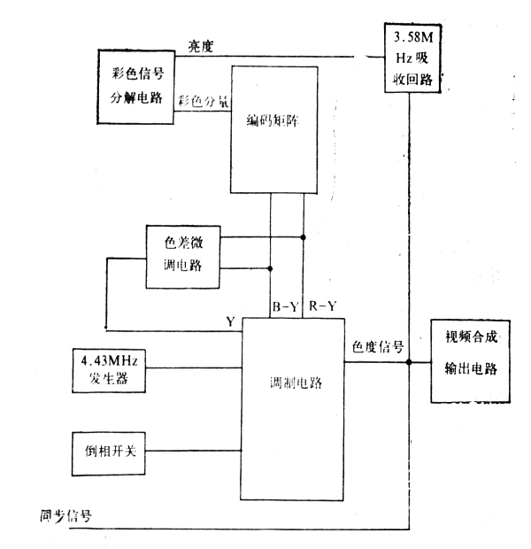

---

#### 二、彩色信号分解电路

由于原机的色彩信息是隐含在相对于 3.58MHz 点阵脉冲的时序相位之中的，必须先将其分解提取出来。分解电路主要由 74LS164（8 位串入并出移位寄存器）和 74LS175（四位 D 触发器）组成，如图 3.42 所示。

- 74LS164 的串行输入端 A 输入原始高速串行点阵信号，B 端接 +5V 高电平，驱动时钟为 14MHz。
- 74LS164 的最高位并行输出端 **Q7** 直接引出，作为全电视信号的**亮度信号（Y）**输出。
- 输出端 Q6、Q5、Q4、Q3 并行连接到 74LS175 的 4 个 D 数据输入端。在低分辨率图形方式下，颜色信息是由每个字节的高 4 位或低 4 位决定的，分别以 14MHz 的频率依次移入 Q6〜Q3。
- 74LS175 的打入时钟 CK 连接 3.58MHz 信号（周期刚好是 14MHz 的 4 倍）。当 Q6〜Q3 输出端稳定呈现颜色分量且图形使能信号 GR 有效时，3.58MHz 时钟脉冲将这 4 位色彩分量并行打入 74LS175，从而完成了原色彩分量的锁存解调，并保证了解调后的色差信号与 Q7 亮度信号在物理时序上的精准对齐。

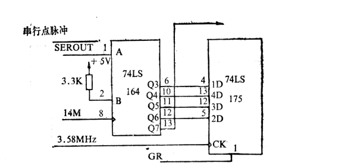

---

#### 三、3.58MHz 吸收回路

由 1/2 片 74LS74 双 D 触发器以及电感 L5、电容 C36 构成一个专用的 3.58MHz 吸收陷波回路，如图 3.43 所示。

- 74LS74 的引脚 13（复位端 $\overline{\text{CLR}}$）平时通过上拉电阻维持高电平，并可通过机箱上的彩色/黑白小开关手动接地。
- 当小开关接通闭合时，74LS74 的引脚 13 强制拉低为 0 电平，Q 输出截止，关闭彩色通道，使显示器以纯净黑白方式显示，消除字符边缘的彩色干扰。
- 当小开关断开时，74LS74 的复位端为高电平。每当行同步信号 $\overline{\text{SYNC}}$ 上升沿到来时，触发器翻转，Q 端置为高电平，驱动 L5、C36 组成的 3.58MHz 串联谐振吸收回路动作，将原信号中残留的 3.58MHz 副载波基波彻底滤除干净，避免其对后续 4.43MHz 调制器产生互调拍频网纹干扰。

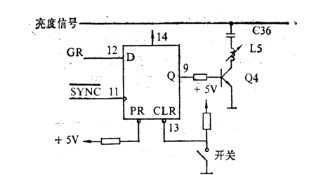

---

#### 四、色信号调制电路

色信号调制电路主要由专用集成电路 **TCA650**（彩色调幅调制器）、74LS74 构成的倒相分频开关、4.433619MHz 石英晶体副载波发生器以及阻容矩阵编码网络组成，如图 3.44 所示。

1. **色差矩阵合成**：从 74LS175 输出的 4 位解调色彩分量送入阻容加权矩阵网络，经三极管 Q6 分相放大后，在其发射极生成 $B-Y$ 色差信号，集电极生成 $R-Y$ 色差信号，直接送入 TCA650 调制器的输入端。TCA650 的引脚 5 输出一个基准直流偏置电平，分别经微调电位器 W1、W2 精密校正 $R-Y$ 和 $B-Y$ 的直流工作点与色饱和度平衡。
2. **色同步脉冲注入**：色同步选通脉冲 $\overline{\text{CLRGATE}}$（脉宽 $4\mu\text{s}$，周期 $64\mu\text{s}$）通过门控三极管 Q5、Q6 分别在行消隐后肩处注入到 $B-Y$ 和 $R-Y$ 信号通道中。
3. **4.43MHz 副载波振荡**：由石英晶体 Y2、三极管 Q7、电容 C41 及电阻 R43 构成高稳定度的 4.433619MHz 振荡电路，产生 PAL 制标准色副载波，输入 TCA650。
4. **逐行倒相控制**：行同步脉冲 $\overline{\text{SYNC}}$ 触发 74LS74 进行二分频，产生行频一半（$\frac{1}{2}f_H \approx 7.8\text{kHz}$）的对称方波，作为 TCA650 内部平衡调制器的副载波逐行倒相开关信号，使 $R-Y$ 矢量每行严格反相 180°。
5. **正交平衡输出**：TCA650 将 $B-Y$ 和倒相后的 $R-Y$ 色差信号分别调制在 4.43MHz 正交副载波上，抑制副载波后在芯片内部进行正交矢量叠加，最终从引脚 10、12 输出标准的 PAL 制色度信号。

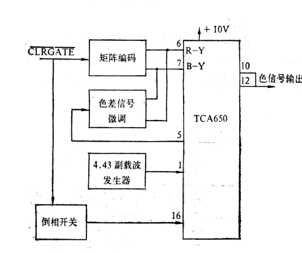

---

#### 五、视频信号合成电路

视频信号合成电路如图 3.45 所示。

进入视频合成级的输入信号共有三部分：
1. **亮度信号（Y）**：由 74LS164 的 Q7 端输出的高速视频点阵信号；
2. **色度信号（C）**：由 TCA650 输出的 4.43MHz PAL 制色度调制信号；
3. **复合同步信号（$\overline{\text{SYNC}}$）**：由 IOU 产生的行场复合同步脉冲。

这三路信号在电阻分压网络中按标准电平幅度比例线性相加后，送入由晶体三极管 **Q8** 和 **Q9** 组成的两级高频射极跟随器：
- 经过 Q8、Q9 阻抗变换后，输出低阻抗的全电视视频信号，通过背板 $75\Omega$ 同轴莲花插座输出，可直接驱动标准的 PAL 彩色监视器或带视频输入的监视器/电视机。
- 同时，Q9 发射极输出的视频信号直接馈送给安装在主机板上的小型 **RF 射频调制器**，由调制器将全电视信号调制到 VHF 电视通道（通常为 1 频道或 2 频道），通过天线馈线直接送入家用彩色或黑白电视机的天线输入孔。

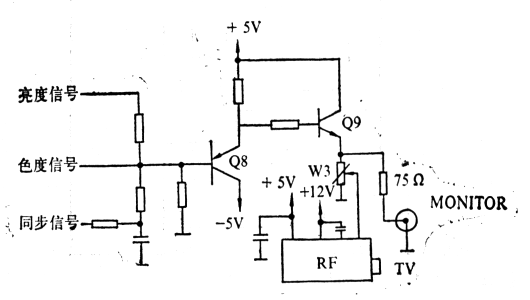
