# 第三章 接口电路与专用集成电路 (ASIC)

---

## 3.6 键盘工作原理

### 3.6.1 键盘的读过程

通过键盘编码器和 2K 键盘 ROM，可产生 128 个字符的编码，也就是说 ASCII 码中所指定的字符都可以由键盘输入获得。从执行机器语言的角度上来看，要得到键盘上某个键的字符编码，是通过读某个存储器专用单元的内容而实现的。这些专用单元的地址及功能如下表所示：

#### 表 3.24 键盘存储单元

| 十六进制 | 十进制 | 单元内容说明 |
|:---:|:---:|:---|
| **$C000** | 49152，-16384 | 键盘数据及选通单元 |
| **$C010** | 49168，-16368 | 键按下标志及清除选通单元 |

表中给出三种不同形式的单元地址。16 进制地址用于汇编语言中，10 进制地址用于 APPLESOFT BASIC 语言中，负数用于整数 BASIC 中（整数 BASIC 中大于 32767 的地址用其补码，其补码值用实际值减去 65536 得到）。

用程序读键盘存储单元，就可以得到最后按下键的键码。`$C000` 单元的低七位是当前按下键的字符码，最高位是选通位（Strobe）。在 BASIC 程序中用 `PEEK` 命令来取得这一状态信息，若取得值大于等于 128（即最高位 $D_7=1$），表示键已按下；若小于 128，表示无键按下。

当某键按下时，键盘数据及选通单元（`$C000`）的最高位为 1，此位状态一直保持到读或写 `$C010` 单元（键按下标志及清除选通单元）为止。`$C010` 单元包括键按下和清除选通开关两部分。由于此单元清除选通开关功能是由软件来实现的（即对此单元进行读或写操作），因而也叫软开关。无论读或写此单元，这一开关功能都会使键盘数据及选通单元（`$C000`）的选通位复位。因而当程序既要判断是否有键按下，又要看脉冲选通位是否为高，必须首先读 `$C000`，然后再读 `$C010`，否则脉冲选通位将被复位。当选通单元清除后一直保持为低，直到又有键按下。在选通位复位而还没有另一键按下时键盘数据没有变化，因而仍可读此键盘数据。

---

### 3.6.2 键对应的 ASCII 码表

表中有些键如 <kbd>CONTROL</kbd>、<kbd>SHIFT</kbd>、<kbd>CAPSLOCK</kbd> 单独使用时并不产生 ASCII 码，而与其它 ASCII 键同时按下时产生另一些 ASCII 码（有些保持原来的 ASCII 码）。<kbd>RESET</kbd> 键直接连到主机上，它和 <kbd>CONTROL</kbd> 键同时按下产生复位。

#### 表 3.25 键对应的 ASCII 码表

| 键符 | Normal (标准) | Shift (上档) | Control (控制) | Both (Shift+Ctrl) |
|:---:|:---:|:---:|:---:|:---:|
| **0 / )** | 30 | 29 | 30 | 29 |
| **1 / !** | 31 | 21 | 31 | 21 |
| **2 / @** | 32 | 40 | 32 | 40 |
| **3 / #** | 33 | 23 | 33 | 23 |
| **4 / $** | 34 | 24 | 34 | 24 |
| **5 / %** | 35 | 25 | 35 | 25 |
| **6 / ^** | 36 | 5E | 1E | 1E |
| **7 / &** | 37 | 26 | 37 | 26 |
| **8 / \*** | 38 | 2A | 38 | 2A |
| **9 / (** | 39 | 28 | 39 | 28 |
| **- / _** | 2D | 5F | 2D | 1F |
| **= / +** | 3D | 2B | 3D | 2B |
| **\\ / \|** | 5C | 7C | 1C | 1C |
| **[ / {** | 5B | 7B | 1B | 1B |
| **] / }** | 5D | 7D | 1D | 1D |
| **; / :** | 3B | 3A | 3B | 3A |
| **' / "** | 27 | 22 | 27 | 22 |
| **\` / ~** | 60 | 7E | 60 | 7E |
| **, / <** | 2C | 3C | 2C | 3C |
| **. / >** | 2E | 3E | 2E | 3E |
| **/ / ?** | 2F | 3F | 2F | 3F |
| **Test** | 16 | 16 | 16 | 16 |
| **A** | 61 | 41 | 01 | 01 |
| **B** | 62 | 42 | 02 | 02 |
| **C** | 63 | 43 | 03 | 03 |
| **D** | 64 | 44 | 04 | 04 |
| **E** | 65 | 45 | 05 | 05 |
| **F** | 66 | 46 | 06 | 06 |
| **G** | 67 | 47 | 07 | 07 |
| **H** | 68 | 48 | 08 | 08 |
| **I** | 69 | 49 | 09 | 09 |
| **J** | 6A | 4A | 0A | 0A |
| **K** | 6B | 4B | 0B | 0B |
| **L** | 6C | 4C | 0C | 0C |
| **M** | 6D | 4D | 0D | 0D |
| **N** | 6E | 4E | 0E | 0E |
| **O** | 6F | 4F | 0F | 0F |
| **P** | 70 | 50 | 10 | 10 |
| **Q** | 71 | 51 | 11 | 11 |
| **R** | 72 | 52 | 12 | 12 |
| **S** | 73 | 53 | 13 | 13 |
| **T** | 74 | 54 | 14 | 14 |
| **U** | 75 | 55 | 15 | 15 |
| **V** | 76 | 56 | 16 | 16 |
| **W** | 77 | 57 | 17 | 17 |
| **X** | 78 | 58 | 18 | 18 |
| **Y** | 79 | 59 | 19 | 19 |
| **Z** | 7A | 5A | 1A | 1A |
| **中文** | 1F | 1F | 1F | 1F |
| **西文** | 11 | 11 | 11 | 11 |
| **F1** | 01 | 01 | 01 | 01 |
| **F2** | 0C | 0C | 0C | 0C |
| **F3** | 17 | 17 | 17 | 17 |
| **F4** | 14 | 14 | 14 | 14 |
| **F5** | 06 | 06 | 06 | 06 |
| **ESC** | 1B | 1B | 1B | 1B |
| **TAB** | 09 | 09 | 09 | 09 |
| **Quit** | 03 | 03 | 03 | 03 |
| **Return** | 0D | 0D | 0D | 0D |
| **空格** | 20 | 20 | 20 | 20 |
| **←** | 08 | 08 | 08 | 08 |
| **↑** | 0B | 0B | 0B | 0B |
| **↓** | 0A | 0A | 0A | 0A |
| **→** | 15 | 15 | 15 | 15 |

---

### 3.6.3 键盘硬件工作原理

键盘电路如图 3.46、图 3.47 所示，主要由**键盘矩阵**、**KB3600 扫描式编码器**、**键盘 ROM** 三部分组成。

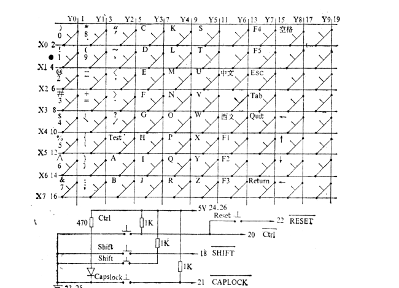
*图 3.46 键盘连接图*

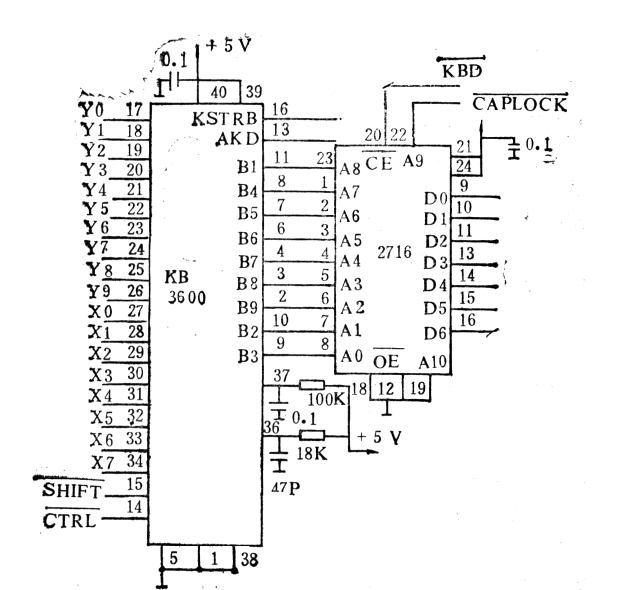
*图 3.47 键盘接口连接图*

键盘是按行列方式排列的键开关点阵，并通过 26 线扁平电缆线直接连到 KB3600 的 X0～X7，Y0～Y9 连线上。KB3600 的 AKD 信号有效（高电平）表示有键按下，8ms 后输出 KSTRB 键盘选通信号（高电平）并送入 IOU。软件上通过读相应的软开关地址，从 MD7 标志位来判断键的状态。KB3600 将对按下的键进行编码，B1～B9 输出直接连接键盘 ROM 地址线 A0～A8。当软件读 `$C000` 时（键盘数据及选通单元），MMU 的 $\overline{\text{KBD}}$（键盘数据使能）为低信号并直接控制键盘 ROM 的 $\overline{\text{OE}}$ 使能信号，从而使键盘 ROM 转换成的 ASCII 码送到地址/数据线 MD0～MD7，在 $\phi_0$ 的下降沿由 CPU 读取。

#### 一、KB3600 矩阵编码电路

KB3600 的扫描过程如图 3.48 所示。

计数器顺序输出 X0～X8，并首先对 Y0 扫描，如没有与 Y0 相连接的键按下，则当 X 计数到 X8 时，将增加 Y 计数器为 Y1，并重新由 X 计数器输出顺序对 Y1 扫描，以此类推。

当扫描测到某一按键后就停止扫描，AKD（键按下）信号输出为高电平，然后 KB3600 将等待 8ms 的选通延迟（为避免由开关合上时颤动所造成的多余字母抖动问题），输出 KSTRB（键盘选通）高电平有效送入 IOU 软开关。KB3600 同时对扫描到的键予以编码，并将编码送到 B1～B9 输出端。

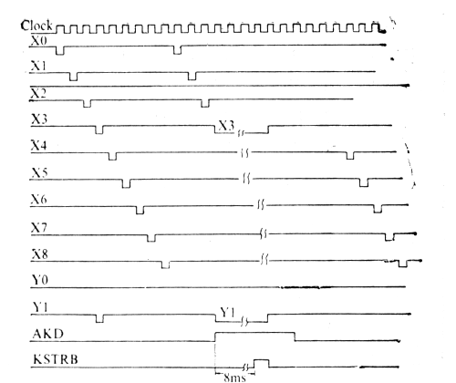
*图 3.48 键盘扫描波形示意图（以键 3，X3Y1 为例）*

#### 二、KB3600 矩阵的编码

一个键按下可产生四个地址，由 <kbd>SHIFT</kbd> 键和 <kbd>CONTROL</kbd> 键来决定四个地址中的一个。其输出端码表如表 3.26 所示：

#### 表 3.26 KB3600 输出端码表

| B9～B1 输出 | X0 | X1 | X2 | X3 | X4 | X5 | X6 | X7 |
|:---:|:---:|:---:|:---:|:---:|:---:|:---:|:---:|:---:|
| **Y0** | 000～003 | 028～02B | 050～053 | 078～07B | 0A0～0A3 | 0C8～0CB | 0F0～0F3 | 118～11B |
| **Y1** | 004～007 | 02C～02F | 054～057 | 07C～07F | 0A4～0A7 | 0CC～0CF | 0F4～0F7 | 11C～11F |
| **Y2** | 008～00B | 030～033 | 058～05B | 080～083 | 0A8～0AB | 0D0～0D3 | 0F8～0FB | 120～123 |
| **Y3** | 00C～00F | 034～037 | 05C～05F | 084～087 | 0AC～0AF | 0D4～0D7 | 0FC～0FF | 124～127 |
| **Y4** | 010～013 | 038～03B | 060～063 | 088～08B | 0B0～0B3 | 0D8～0DB | 100～103 | 128～12B |
| **Y5** | 014～017 | 03C～03F | 064～067 | 08C～08F | 0B4～0B7 | 0DC～0DF | 104～107 | 12C～12F |
| **Y6** | 018～01B | 040～043 | 068～06B | 090～093 | 0B8～0BB | 0E0～0E3 | 108～10B | 130～133 |
| **Y7** | 01C～01F | 044～047 | 06C～06F | 094～097 | 0BC～0BF | 0E4～0E7 | 10C～10F | 134～137 |
| **Y8** | 020～023 | 048～04B | 070～073 | 098～09B | 0C0～0C3 | 0E8～0EB | 110～113 | 138～13B |
| **Y9** | 024～027 | 04C～04F | 074～077 | 09C～09F | 0C4～0C7 | 0EC～0EF | 114～117 | 13C～13F |

#### 三、KB3600 引脚图与功能说明

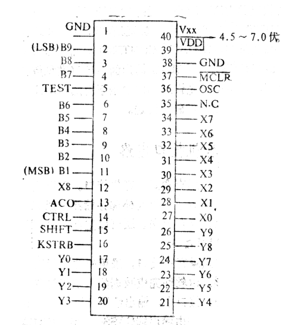
*图 3.49 KB3600 引脚图*

KB3600 采用 40 脚双列直插式封装，各管脚信号及功能如下：

- **B1～B9（输出）**：数据输出位，B1 是最高位（MSB），B9 是最低位（LSB）。
- **X0～X8（输出）**：键盘行扫描位。
- **Y0～Y9（输入）**：键盘列扫描位。
- **SHIFT（输入）**：<kbd>SHIFT</kbd> 键输入。
- **CTRL（输入）**：<kbd>CONTROL</kbd> 键输入。
- **AKD（输出）**：键按下输出（Any Key Down，高电平有效）。
- **KSTRB（输出）**：数据选通输出信号，此时 B1～B9 信号有效。
- **OSC（输入）**：由外电路 RC 网络来决定 KB3600 内部时钟发生器的频率。
- **$\overline{\text{MCLR}}$（输入）**：总清信号，加电时使此信号为低并持续 1ms 左右。
- **TEST（输入，5 脚）**：测试端。
- **ACO（输出，13 脚）**。
- **$V_{xx} / V_{DD}$（40 脚）**：接电源 $+4.5\text{V} \sim 7.0\text{V}$。
- **GND（1 脚、38 脚）**：接地。
- **N.C（35 脚）**：空脚。

#### 四、键 ROM 分配

电路上用 2716（2KB EPROM）作为键盘 ROM，它不占用系统内存地址，它的作用是把 KB3600 输出的矩阵编码转换成规定的 ASCII 码。实际上只用了 1K 地址，2716 的 A10 信号已接地。

ROM 中的 `$000～$1FF` 存放着大写字母及控制字，从 `$200～$3FF` 存放着小写字母、大写字母及控制字。由键盘直接连的 <kbd>CAPSLOCK</kbd>（锁定键）信号接到 2716 的 A9 端：
- 当 <kbd>CAPSLOCK</kbd> 为低时选地址 `$000～$1FF`，产生大写字母及控制码；
- 当 <kbd>CAPSLOCK</kbd> 为高时选地址 `$200～$3FF`，这时可产生大、小写字母及控制码。

每组 X、Y 连线根据 <kbd>CONTROL</kbd> 和 <kbd>SHIFT</kbd> 键的状态共占 ROM 4 个单元：
- `00` 地址存放基本字符码（Normal）；
- `01` 地址存放 <kbd>SHIFT</kbd> 同时按下的键码（Shift）；
- `10` 地址存放 <kbd>CONTROL</kbd> 同时按下的键码（Control）；
- `11` 地址存放 <kbd>SHIFT</kbd> 与 <kbd>CONTROL</kbd> 同时按下的键码（Both）。

2716 的 $\overline{\text{OE}}$ 端是由 MMU 输出的 $\overline{\text{KBD}}$（键盘数据使能）信号控制，低电平时允许 2716 输出按下键的 ASCII 码送入总线 MD0～MD7，完成键码的传送。

---

## 3.7 盒式录音机接口电路

在 CEC-I 上配有盒式录音机接口。利用该接口可将普通的盒式录音机作为学习机的外部存储器，把 RAM 中的信息记录在磁带上保存起来，还可以把存在磁带上的程序或数据重新装入 RAM 之中。

CEC-I 的盒式录音机接口采用硬件进行信号电平匹配与波形整形，由软件完成数据的调制和解调，进行数据记录格式的管理。

在接口中：
- **输出信号**：给录音机的信号由 IOU 的软开关 CASSO 产生，并由输出端 CASSO 输出。IOU 输出的信号经电阻 R11 和 R12 构成的电阻网络分压后，作为送给录音机话筒输入（MIC）的录音信号，将调制信号记录在磁带上。
- **读出信息**：录音机的耳机插孔（EAR）输出信号作为接口的输入信号，输入信号经运算放大器 U18 判别整形后，送到数据选择器 U20 的输入端 I0。读 `$C060` 单元时，就可以对当前录音机输出信号进行采样。

### 录音机接口信号要求

- **输入信号**：录音机的耳机插孔（EAR）输出信号峰-峰电压值应不小于 1V，输入阻抗约为 12kΩ。
- **输出信号**：给录音机话筒输入（MIC）的输出信号约为 25mV，输出阻抗约为 100Ω。

### 数据记录格式

数据录制在磁带上的单元模块称为**记录**。每个记录由引导段、同步位、数据段和检查字组成。二进制文件或机器码文件都由一个记录组成。BASIC 程序文件由两个文件记录组成：第一个记录数据段的内容为 BASIC 程序长度，第二个记录的数据段才是 BASIC 程序本身。文件格式见图 3.50。

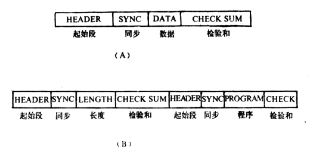
*图 3.50 盒式磁带格式（A——二进制文件或机器码；B——BASIC 程序）*

### 波形与位时序关系

图 3.51 给出了记录中各部分信息的波形：
- **引导段（Header Bit）**：每位由周期为 1300μs 的对称方波表示（正半周 650μs，负半周 650μs），即引导段是一段频率约为 770Hz 的方波。
- **同步位（Sync Bit）**：由宽度为 200μs 的正方波（负方波）和宽度为 250μs 的负方波（正方波）组成。
- **“0”位（0 Bit）**：由频率为 2000Hz 方波的一个周期表示，记录一位“0”需 500μs（正半周 250μs，负半周 250μs）。
- **“1”位（1 Bit）**：由频率为 1000Hz 方波的一个周期表示，记录一位“1”需要 1000μs（正半周 500μs，负半周 500μs）。

在盒式录音机接口中，随机数据的平均传输速率为 1333 位/秒。

在数据记录中，首先记录低地址的数据；对于每个字节，首先记录最高位（MSB）。

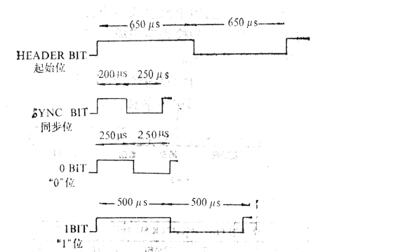
*图 3.51 盒式磁带位时间关系图*

### 读写控制过程

#### 一、写数据过程

在写数据时，按照文件记录格式，不断地改变软开关 CASSO 的状态，在其输出端得到所要求的波形，实现数据信号调制。改变软开关 CASSO 的状态，只需访问单元 `$C020` 即可。

在写数据过程中，程序按照引导段、同步位、数据段的信号调制定义，以不同的时间间隔触发软开关 CASSO，得到所需要频率的信号输出。IOU 在程序的控制下，按照记录格式和数据的内容，依次输出各种频率的调制信号。将这些调制信号录在磁带上，写数据的工作就完成了。

加电或复位时，对软开关 CASSO 不置初值，同时也不能读出它的状态。在开始记录时，CASSO 处于随机状态。不过这并不影响数据记录的产生，仅仅是产生的输出波形与标准波形反相而已，这并不影响对记录信号的解调。

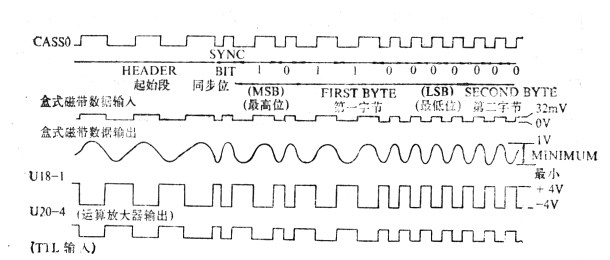
*图 3.52 盒式磁带波形*

#### 二、读回数据过程与过零检测

在读回数据时，录音机的耳机插孔（EAR）和主机板上的 “CASSOUT”（磁带输入端）连接，录音机输出信号经 C15 耦合后，再由 R14 和 R15 将信号衰减一半，然后送到运算放大器 U18 的反相输入端。信号经过录音机后是否被反相并不影响解调的正常进行，因为解调时仅根据信号脉冲的宽度来判别，而不管脉冲的极性。

对输入信号的整形由 U18 完成。利用 U18 内的一个运算放大器构成过零检测器。当盒式录音机输出信号的峰-峰值为 1V 时，该检测器仍能正常工作。当输入信号变化时，检测器的输出在 +4V 和 -4V 之间摆动。

当 U18-1 为 -4V 时，电阻 R18 限制 U20 输入端的电流，R18 和 U20 内部输入钳位二极管将 U18 输出的信号转换成 TTL 电平。除了信号的极性外，此刻从录音机读回的信号已恢复成 CASSO 的输出信号了。

录音机输出信号整形后经 U20 进入数据总线。访问单元 `$C060` 时，就可以从数据总线的 D7 上取得当前信号的状态。监控程序中，进行解调的子程序每 12.8μs 访问 `$C060` 单元一次，判别 D7 的值是否改变。通过测量两次改变的时间间隔，子程序判别记录中的起始段、同步位、以及“0”、“1”数据，从而实现对录音机输出信号的解调。

---

## 3.8 游戏杆接口电路

### 3.8.1 游戏开关

在游戏接口电路中，有三个开关量的输入称为游戏开关 SW0、SW1、SW2，它们都接到数据选择器 U20 的输入端。在这里，地址 `$C06X` 的译码信号作为 U20 的使能信号，地址 A0—A2 作为选择控制。根据地址 A0—A2 的不同组合，U20 可以选择某一个输入作为输出。SW0、SW1、SW2 分别接在 U20 的 I1、I2 和 I3 端。读取 SW0—SW2 状态的地址如表 3.27 所示：

#### 表 3.27 读游戏开关地址表

| 地址 | 游戏开关 |
|:---:|:---:|
| **$C061** / **$C069** | SW0 |
| **$C062** / **$C06A** | SW1 |
| **$C063** / **$C06B** | SW2 |

游戏开关的典型接法如图 3.53 所示（以输入 SW0 为例，SW1 和 SW2 采用同样方法）：

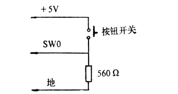
*图 3.53 游戏开关接法（以 SW0 为例）*

当开关 K 未被按下时，电阻 R25 (560Ω) 将 SW0 下拉为低电平。此时访问 `$C061`，可以从数据线上读得 $D_7=0$。当开关 K 被按下时，SW0 被接到 +5V，若访问 `$C061`，则可以从数据线上读得 $D_7=1$。这样就可以测出 SW0 的状态。

---

### 3.8.2 游戏摇杆

在游戏接口中，有 4 路模拟量输入，它们是游戏摇杆输入。这 4 路输入分别接到时基电路 U19 的 4 个输入端上。U19/U20 采用时基电路 NE558，它由 4 个独立的部分组成，每部分都有自己的触发输入、定时输入和输出。另外，每部分还有两个输入端在内部连在一起，它们是 RESET 和控制电压。在此处，RESET 被接到 +5V，控制电压也未被使用，但它能影响到内部的阈值电平，故接电容 C22 旁路。各部分的触发输入信号连接在一起，接到地址 `$C07X` 译码信号上。

首先看一下 558 中一个部分的工作过程，其电路接法如图 3.54 所示：

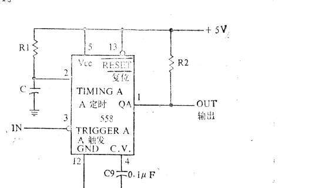
*图 3.54 558 中部分接线图*

在 NE558 中，输出级是集电极开路（OC 门），这样在输出端需接提拉电阻 R2。平常输出端为低电平，此时片内有一晶体管导通，在定时输入端和地之间构成通路。当触发输入有一负跳变信号时，时基电路的输出变为高电平，定时输入端对地的通路断开。开始通过电阻 R1 对电容 C 充电。当定时输入端的电压达到某一阈值时，时基电路输出变为低电平，定时输入端对地的通路重新构成。时基电路输出端维持高电平的时间正比于 R1·C 值。

一旦时基电路被触发，触发信号对电路的工作不再产生影响，除非输出端已经变为低电平，才能进行下一次的触发。

在游戏接口中，每一路摇杆输入都是通过一个 150kΩ 的电位器接到 +5V。摇杆的电位器和主板上的定时电阻作为时基电路的充电电阻，其作用和图 3.54 中的 R1 类似。时基电路输出的正脉冲宽度由 6502 来测量。地址 `$C07X` 的译码信号作为时基电路 558 的触发信号。558 的 4 个输出分别接在数据选择器 U20 的 I4—I7 上。对这 4 路输出状态的读取方法和 SW 类似，读取这 4 路输出状态的地址如表 3.28 所示：

#### 表 3.28 读摇杆信号地址表

| 地址 | 摇杆信号 |
|:---:|:---:|
| **$C064** / **$C06C** | PDL0 |
| **$C065** / **$C06D** | PDL1 |
| **$C066** / **$C06E** | PDL2 |
| **$C067** / **$C06F** | PDL3 |

对于 558 的每一部分时基电路，其定时电容都为 $0.022\mu\text{F}$，定时电阻由主板上 $100\Omega$ 的电阻和摇杆中的电位器串联而成。摇杆中的电位器阻值一般为 $150\text{k}\Omega$，这样可以得到时基电路输出的最宽正脉冲宽度为：

$$(150\text{k} + 100)\Omega \times 0.022\mu\text{F} \doteq 3.3\text{ms}$$

最窄的正脉冲宽度为：

$$100\Omega \times 0.022\mu\text{F} \doteq 2.2\mu\text{s}$$

主板上的 $100\Omega$ 电阻的作用在于保证外部短路或者摇杆电位器调至零时，时基电路仍能正常工作。

监控程序中，有一个子程序可测出时基电路输出的脉冲宽度，其入口地址为 `$FB1E`。在此子程序中，摇杆号放在 X 寄存器中，执行该程序后：
1. 首先访问 `$C070`，产生触发时基电路的信号；
2. 清 Y 寄存器为 0，然后作约为 $5\mu\text{s}$ 的延时；
3. 延时完毕，按 X 的值读对应摇杆的输出状态：
   - 若 $D_7=0$，则退出子程序；
   - 否则 Y 加 1，然后再查是否溢出：若溢出，则 Y 减 1 后退出子程序；否则再做 $10.8\mu\text{s}$ 的延时；
   - 延时结束后，重复上述测试过程。

若 $Y=0$，则摇杆电位器阻值很小，输出正脉冲宽度小于 $5\mu\text{s}$；将电位器阻值调至零时是可以做到的。若 $Y=255$，这时测到的脉冲宽度将大于等于：

$$255 \times 10.5\mu\text{s} \doteq 2.6\text{ms}$$

当将电位器调至 $150\text{k}\Omega$ 时，输出脉冲宽度可达 $3.3\text{ms}$，故 $Y=255$ 也是可以达到的。这样，摇杆所处的不同位置，可以用 0 至 255 来表示。

> [!IMPORTANT]
> 在进行多路摇杆检测时，测完一路以后，必须进行延迟，才能开始检测第二路。这是由于时基电路的特性所造成的：时基电路在其输出变为低电平以前，不会响应触发信号。必须保证时基电路各部分都结束延时，才能重新触发。因此，两次采样检测的触发信号之间间隔不得小于 4ms。

---

## 3.9 扬声器接口电路

在学习机的机盒内，有一只 0.25W 8Ω 的扬声器。在 IOU 内的一个软开关控制下，扬声器可以发出各种响声。

IOU 对扬声器的控制输出端是 SPKR，它输出的信号经电容 C31 和 R26 耦合，加到 Q3 的基极。二极管 CR2 为 C31 提供放电回路。Q3 是达林顿三极管，它放大的信号经电阻 R28 分压后驱动扬声器。电容 C32 对驱动扬声器的信号作积分，并在 Q3 截止时吸收扬声器线圈电感产生的部分能量。

控制扬声器的软开关 SPKR 对应的地址为 `$C03X`（通常访问 `$C030`），该软开关有两个状态：“0”和“1”。对于输出端 SPKR，分别输出高电平和低电平。每当访问 `$C030` 时，软开关的状态翻转一次，即状态由“1”变为“0”或者由“0”变为“1”。

要让扬声器发出可以听到的响声，就需要有一个持续一定时间长度、其频率在音频范围内的信号去驱动扬声器。信号持续的时间长短决定发出响声的长短，声音的音调取决于信号的频率。

若要得到某种音调的声音，首先要计算好该音调的频率和周期。编制程序进行半周期时间长度的延迟，每当半个周期时间延迟结束时，对地址 `$C030` 访问一次，使软开关状态翻转一次，然后再进行半周期的延迟。将这种操作循环进行下去，循环上面操作的时间就是扬声器发出所要音调响声的时间。

---

## 3.10 软盘驱动器接口电路

软盘驱动器作为外存设备，具有存储容量大、存取速度快、读写可靠性高的特点。软盘驱动器可存放大量的数据，使系统的信息存储量大大超过内存的容量，从而提高系统的处理能力。

软盘驱动器接口电路由三部分组成：
1. **固化引导程序的 ROM**；
2. **控制逻辑**；
3. **读写数据转换电路**。

中华学习机的软盘驱动器接口使用 **6 号扩展槽口（Slot 6）**。

### 引导程序 ROM

ROM 固化着 DOS BOOT0，共 256 个字节。该程序存放在输入输出空间 `$C600～$C6FF` 内。启动软盘接口卡时，从 `$C600` 开始执行引导程序，该程序从磁盘的 0 轨 0 区开始读 256 个字节并放入 `$0800～$08FF`，即装入 DOS 的 BOOT1。然后再跳转执行 BOOT1，继续 DOS 的引导。该程序固化在主板 U35 内部地址 `$4600～$46FF` 中。

### 控制逻辑

控制逻辑由 U41（74LS259）及相应的门电路组成，主要功能有：使能及选择驱动器；提供步进脉冲控制驱动器内步进电机；产生写请求信号；控制读/写数据调制解调电路的工作方式。

U41 是 8 位可寻址锁存器，利用地址总线的 A3A2A1 作为 U41 的地址输入，由 000 到 111 可选择锁存器 Q0～Q7。A0 接到数据输入 D0，用 $\overline{\text{IOSEL6}}$ 信号（即地址 `$C0EX` 的译码信号）作为输入使能信号，由 $\overline{\text{RESET}}$ 作为 U41 的清除信号。

8 个锁存器的输出分别作如下控制：
- **Q0～Q3**：作为驱动步进马达的脉冲输出（Phase 0～Phase 3）。
- **Q4**：驱动器使能信号。当 Q4 为高时允许驱动器工作，该信号输出后经时基电路 555 做秒级的延时以后，控制开启驱动器的主电机，提供读/写数据调制解调电路的工作电源，并对 U42（74LS174）提供清除信号。在写数据时根据 Q4 产生写请求信号。
- **Q5**：驱动器选择信号。当 Q4 为高时，Q5 为低选择驱动器 1（该接口电路可以连接两个驱动器，在这里仅使用驱动器 1，故仅考虑接一个驱动器的信号输出）。
- **Q6、Q7**：读/写数据转换电路的工作方式控制信号。

#### 表 3.29 读/写转换电路状态

| Q6 | Q7 | 读/写转换电路状态 |
|:---:|:---:|:---|
| 0 | 0 | 转换读盘信号（解调） |
| 0 | 1 | 调制写盘数据 |
| 1 | 0 | 检测写保护标志 |
| 1 | 1 | 装入写盘数据 |

控制逻辑的 8 位输出信号是通过访问 `$C0E0～$C0EF` 这 16 个单元实现的。各个输出信号的状态与访问地址的对应关系如表 3.30 所示：

#### 表 3.30 软驱接口访问地址与控制信号对应表

| 访问地址 | 用途 | 说明 |
|:---:|:---|:---|
| **$C0E0** | phase 0 off | 步进马达定位控制 |
| **$C0E1** | phase 0 on | 步进马达定位控制 |
| **$C0E2** | phase 1 off | 步进马达定位控制 |
| **$C0E3** | phase 1 on | 步进马达定位控制 |
| **$C0E4** | phase 2 off | 步进马达定位控制 |
| **$C0E5** | phase 2 on | 步进马达定位控制 |
| **$C0E6** | phase 3 off | 步进马达定位控制 |
| **$C0E7** | phase 3 on | 步进马达定位控制 |
| **$C0E8** | power down | 磁盘机电机关闭 (off) |
| **$C0E9** | power up | 磁盘机电机开启 (on) |
| **$C0EA** | select 1 | 选 1 号磁盘机 |
| **$C0EB** | select 2 | 选 2 号磁盘机（未用） |
| **$C0EC** | Q6 = 0 | 读/写转换方式控制位 Q6 清零 |
| **$C0ED** | Q6 = 1 | 读/写转换方式控制位 Q6 置位 |
| **$C0EE** | Q7 = 0 | 读/写转换方式控制位 Q7 清零 |
| **$C0EF** | Q7 = 1 | 读/写转换方式控制位 Q7 置位 |

### 读/写转换电路与 GCR 编解码

读/写转换电路由移位寄存器 U39、PROM U40 和六 D 触发器 U42 以及门电路构成。在 Q6、Q7 的控制下有 4 种工作方式：该电路将写磁盘的数据进行并串转换，调制以后写入磁盘；读数据时将从磁盘读出的信号解调，经串并转换后读到内存。

为了便于信号从磁盘上读出，保证解调的正确性，对写入磁盘的数据有如下要求：
1. **最高位必须为 “1”**；
2. **连续 “0” 的个数不得超过两个**，每个字节最多出现一组连续的两个 “0”。

对数据的编码由 DOS 完成（6/2 GCR 编码），读/写数据转换电路在解调时利用了编码的特点。

#### 一、检测写保护
写数据之前首先要检查驱动器中的磁盘是否有写保护。置 Q6、Q7 为 “10”，这时由 U40 和 U42 构成的时序控制器控制 U39 作右移操作，将驱动器输出的写保护标志移入 U39。检测 U39 寄存的数据：若 $D_7=1$ 则有写保护，不能进行写操作；若 $D_7=0$ 则可以进行写入操作。

#### 二、写数据调制
写数据时，先置 Q6Q7 为 “11”，将 DOS 编码后的数据 6/2 GCR (Group Code Recording) 码送入 U39 内。再将 Q6Q7 置成 “10”，时序控制器进入写数据状态。这时转换电路以系统中间时钟 Q3 作为工作时钟。每 8 个周期左移 U39 一位，对写数据作并串转换，U39 的 QA 为串行输出，时序电路根据 QA 的状态再进行信号调制：
- 当 $QA=1$ 时，时序控制器控制 U42 的 Q0 状态反转一次，即写数据输出端状态反转一次；
- 当 $QA=0$ 时，U42 的 Q0 状态保持不变。

这样经过调制的信号各位之间间隔为 $4\mu\text{s}$，当数据为“1”时信号状态跳变一次，其情形如图 3.55 所示：

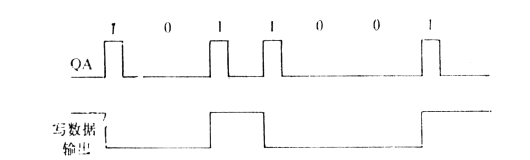
*图 3.55 写数据调制波形示意图*

#### 三、读数据解调
读数据时，置 Q6Q7 为 “00”，时序控制器处于读状态。若读数据输入端从磁盘上读出的信号无脉冲信号（即无表示“1”的调制信号输入），时序电路处于等待状态，等待表示“1”的信号。

当输入端有脉冲输入时，信号的负脉冲沿触发时序电路，开始进行 8 位串行调制数据解调转换：
1. 首先将移位寄存器 U39 清“0”，将“1”经 U39 的 LIN 端左移进入移位寄存器 U39；
2. 每过 8 个周期，若无脉冲信号（即表示“0”的信号输入），时序电路就左移一个“0”进入 U39；
3. 在解调过程中，输入端表示“1”的脉冲信号不仅表示一位数据状态，还作为串行数据的定位信号，进行解调的时序电路根据表示“1”的信号重新进行一次解调定位；
4. 对 U39 作 8 次左移后，U39 的最高位输出 $QA=1$，此时时序电路再进入等待状态，等待表示“1”的调制信号；
5. 当输入表示“1”的脉冲信号时，转换电路再重复上面的过程。

转换电路根据写入磁盘数据的编码特点，用“1”信号作为一个字节的起始位，对串行数据流进行分段，完成对读数据的解调。DOS 在进行信息段同步时，也正是利用转换电路的特性实现了字节同步。

---

## 3.11 汉字处理电路

CEC-I 学习机具有汉字处理功能。它采用主板的微处理器完成汉字处理全过程，包括实现汉字输入码到内码转换、汉字字形点阵的查找、屏幕显示编辑以及汉字打印输出。

CEC-I 学习机配备一、二级国标汉字（GB2312），汉字字形显示为 16×16 点阵。由于汉字的字形采用全点阵，字库容量为 2 兆位（即 256K 字节）。在汉字工作方式中，汉字处理程序以及实现输入码到内码转换的转换码表也都需占用相当的存储容量。要实现主 CPU 完成汉字处理，就必须扩充主 CPU 可访问的存储空间，提供实现汉字处理的基本环境。

---

### 3.11.1 汉字所用存储空间

学习机所用的微处理器 6502 寻址空间为 64K。在 MMU 的管理下，6502 可访问主存储器中 16K ROM 和 64K RAM。另外，利用设置 MMU 内软开关，还可访问和 RAM 相对应的辅存空间，其地址为 `$0000～$BFFF` 以及 `$D000～$FFFF`。

在 CEC-I 学习机中，辅存空间用做汉字处理所需存储器的扩充。辅存空间分成 4 块：3 块为 ROM 区，1 块为 RAM 区。系统地址分配如图 3.56 所示：

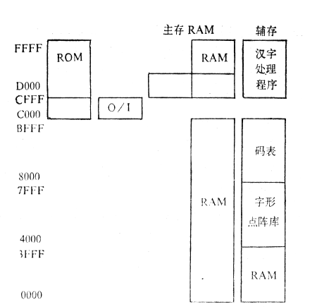
*图 3.56 配上汉字处理电路的系统地址分配图*

- **第一块地址空间：$0000～$3FFF**
  这 16K 空间是 RAM 区。在汉字工作方式中，它作为 RAM 工作区。这一块 RAM 区并没有映射到一个单独的 RAM 存储器，它所映射的 RAM 存储器就是主 RAM 里同一地址所映射的 RAM 存储器。这样，在辅存中访问的 16K RAM 也就是主存中同一地址的 RAM。
- **第二块地址空间：$4000～$7FFF**
  这 16K 空间是 ROM 区，用于访问汉字点阵库。为实现对 256K 点阵的访问，利用这 16K 空间以及存储体切换电路。切换电路提供 4 位扩展地址线，对汉字点阵库的 16 个存储体切换选择，从而实现对 256K（16×16K）点阵库空间的访问。
- **第三块地址空间：$8000～$BFFF**
  这 16K 是 ROM 区，用于存放转换码表。在汉字输入时利用该表将输入码转换成内部码。考虑到汉字输入方式的扩充以及系统软件固化，该存储空间有两个存储体。在拼音输入方式中，使用第一体存放转换表。
- **第四块地址空间：$D000～$FFFF**
  这 12K ROM 区用于存放汉字处理程序。

---

### 3.11.2 辅存储器的切换

要进行汉字处理，必须申请所需要的存储空间。这样就需要对存储器进行切换，将当前访问的存储空间切换成辅存储器供汉字处理使用。

从图 3.56 可以看出，在地址上辅存分为两块：一块地址空间为 `$0000～$BFFF`，另一块为 `$D000～$FFFF`。但实际上在进行主存和辅存切换时，是将存储空间分成两部分进行的：
- 第一部分为地址空间 `$0200～$BFFF`；
- 第二部分为 `$0000～$01FF` 和 `$D000～$FFFF`。

在辅存中，空间 `$0000～$3FFF` 作为 RAM 区，此空间映射到主 RAM 所对应的存储器上。这样不管是在主存对此空间访问还是在辅存对此空间访问，均访问同一存储器。在进行主存和辅存切换时，对于此空间的使用没有任何影响。

在辅存中除了空间 `$0000～$3FFF` 以外，其余均为 ROM 区。由于主存/辅存的切换并不影响写操作，只要软开关 RAMWRT 为 “OFF”，写操作就一直在主 RAM 中进行。

要进入汉字处理工作方式，就需要在辅存中进行读操作，使用辅存的 ROM 区和 RAM 区。对于空间 `$0200～$BFFF`，仅改变软开关 RAMRD 状态，就可以确定对该空间的读操作是在主 RAM 还是在辅存进行：
- 将该空间的读操作切换到辅存进行时，将 RAMRD 开关状态置为“1”，即执行指令：
  ```assembly
  STA $C003
  ```
  这样就可以访问辅存中 16K RAM 区、字形点阵库 ROM 区以及码表 ROM 区。
- 要将此空间切回主 RAM 区，将软开关 RAMRD 状态置“0”，即执行指令：
  ```assembly
  STA $C002
  ```

对于空间 `$0000～$01FF` 和 `$D000～$FFFF`，设置软开关 ALTZP 状态为“1”，即执行指令：
```assembly
STA $C009
```
这样空间 `$D000～$FFFF` 切换到辅存，允许访问辅存的 12K 汉字处理程序。要切回主存，将 ALTZP 状态置“0”，即执行指令：
```assembly
STA $C008
```

另外，汉字处理程序入口在空间 `$C300～$C3FF`。该空间也是在辅存之中，平时属于内部 ROM。在进入汉字工作方式时，由 I/O 空间的 `$C300` 单元作为入口，就可以正确地进行汉字处理。在 MMU 中，考虑系统复位后空间 `$C300～$C3FF` 映射到内部 ROM，而用于汉字处理的该空间是在输入输出空间。在转向 `$C300` 单元执行以前，必须确保该空间在输入输出空间，因而要将软开关 SLOTC3ROM 的状态置为“1”，SLOTCXROM 状态置为“0”，即执行指令：
```assembly
STA $C00B
STA $C006
```
这样空间 `$C300～$C3FF` 就映射在输入输出空间。

---

### 3.11.3 字库 ROM 寻址方法

在汉字处理电路中，为扩大存储器容量采用了存储体切换技术。存储体的切换是利用对 `$C0B0` 单元置值来实现的。

用 6D 触发器 U32（74LS174/LS175）寄存控制字，信号 $\overline{\text{C0BX}} \cdot \overline{\text{R/W}}$ 作 U32 的触发时钟。U32 的 D1—D6 分别接在数据总线 MD0—MD5 上：
- U32 的 Q1—Q4 作为对空间 `$4000～$7FFF` 的选择存储体控制；
- Q6 作为对 `$8000～$BFFF` 选体控制信号；
- Q5 作为彩色显示禁止位。

控制寄存器各位的具体作用见表 3.31：

#### 表 3.31 单元 $C0B0 各位的功能说明

| 数据位 D7 D6 D5 D4 D3 D2 D1 D0 | 功能说明 |
|:---:|:---|
| `× × × × 0 0 0 0` | 选择空间 $4000～$7FFF 的第 1 体 |
| `× × × × 0 0 0 1` | 选择空间 $4000～$7FFF 的第 2 体 |
| `× × × × 0 0 1 0` | 选择空间 $4000～$7FFF 的第 3 体 |
| `× × × × 0 0 1 1` | 选择空间 $4000～$7FFF 的第 4 体 |
| `× × × × 0 1 0 0` | 选择空间 $4000～$7FFF 的第 5 体 |
| `× × × × 0 1 0 1` | 选择空间 $4000～$7FFF 的第 6 体 |
| `× × × × 0 1 1 0` | 选择空间 $4000～$7FFF 的第 7 体 |
| `× × × × 0 1 1 1` | 选择空间 $4000～$7FFF 的第 8 体 |
| `× × × × 1 0 0 0` | 选择空间 $4000～$7FFF 的第 9 体 |
| `× × × × 1 0 0 1` | 选择空间 $4000～$7FFF 的第 10 体 |
| `× × × × 1 0 1 0` | 选择空间 $4000～$7FFF 的第 11 体 |
| `× × × × 1 0 1 1` | 选择空间 $4000～$7FFF 的第 12 体 |
| `× × × × 1 1 0 0` | 选择空间 $4000～$7FFF 的第 13 体 |
| `× × × × 1 1 0 1` | 选择空间 $4000～$7FFF 的第 14 体 |
| `× × × × 1 1 1 0` | 选择空间 $4000～$7FFF 的第 15 体 |
| `× × × × 1 1 1 1` | 选择空间 $4000～$7FFF 的第 16 体 |
| `× × × 0 × × × ×` | 禁止彩色图形显示（黑白显示清晰） |
| `× × × 1 × × × ×` | 允许彩色图形显示 |
| `× × 0 × × × × ×` | 选择空间 $8000～$BFFF 的第 1 体 |
| `× × 1 × × × × ×` | 选择空间 $8000～$BFFF 的第 2 体 |

汉字点阵库由两片 1M 位（128K 字节）Mask ROM 构成：
- ROM CECWL1（U33）存放汉字左侧字形点阵；
- ROM CECWL2（U34）存放汉字右侧字形点阵。

双 2—4 译码器 U31（74LS139）首先根据 $\overline{\text{EN80}}$、A15、A14 产生对辅存空间 `$4000～$7FFF` 的选通信号，由 Y11（5 脚）输出；再将该信号和 A0 组合，分别由 Y20（12 脚）和 Y21（11 脚）输出，生成对 U33 和 U34 的选通信号。

这样，偶地址访问 U33，奇地址访问 U34。构成一个汉字的 32 个字节点阵数据存放在 32 个连续的地址单元中，相应的地址区域在地址低 5 位 A0—A4 由 `00000` 到 `11111` 范围内。32 个字节的点阵数据的地址与汉字字形的位置关系见图 3.57：

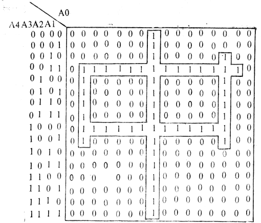
*图 3.57 汉字“中”字形点阵与存储位置关系图*

以“中”字为例，字库内字形点阵数据和从 CEC-I 数据总线读出的数据见表 3.32：

#### 表 3.32 汉字“中”字库数据与读出数据对照表

| 地址 A4A3A2A1A0 | 字库数据 | 读出数据 | 地址 A4A3A2A1A0 | 字库数据 | 读出数据 |
|:---:|:---:|:---:|:---:|:---:|:---:|
| **$00** | 01 | 80 | **$01** | 00 | 00 |
| **$02** | 01 | 80 | **$03** | 00 | 00 |
| **$04** | 01 | 80 | **$05** | 04 | 20 |
| **$06** | 7F | FE | **$07** | FE | 7F |
| **$08** | 41 | 82 | **$09** | 04 | 20 |
| **$0A** | 41 | 82 | **$0B** | 04 | 20 |
| **$0C** | 41 | 82 | **$0D** | 04 | 20 |
| **$0E** | 41 | 82 | **$0F** | 04 | 20 |
| **$10** | 7F | FE | **$11** | FC | 3F |
| **$12** | 41 | 82 | **$13** | 04 | 20 |
| **$14** | 01 | 80 | **$15** | 00 | 00 |
| **$16** | 01 | 80 | **$17** | 00 | 00 |
| **$18** | 01 | 80 | **$19** | 00 | 00 |
| **$1A** | 01 | 80 | **$1B** | 00 | 00 |
| **$1C** | 01 | 80 | **$1D** | 00 | 00 |
| **$1E** | 01 | 80 | **$1F** | 00 | 00 |

在显示汉字时，必须查取汉字点阵。首先按字库内字形排列规则将内码转换成显示码。显示码有 13 位，可以查找字形库中 8192 个字形。对显示码进行分解、拼装，才可得到字形库的存储体号以及对字形点阵各字节寻址的取字形点阵地址。

假设显示码为：
$$\text{C12}\ \text{C11}\ \text{C10}\ \text{C9}\ \text{C8}\ \text{C7}\ \text{C6}\ \text{C5}\ \text{C4}\ \text{C3}\ \text{C2}\ \text{C1}\ \text{C0}$$

1. **提取字形库存储体号**：显示码的最高 4 位即 C12、C11、C10、C9 应拼装成如下格式的选体控制字：
   $$0\ 0\ \times\ \times\ \text{C12}\ \text{C11}\ \text{C10}\ \text{C9}$$
   并将此字节送入 `$C0B0` 单元，从而完成了字形库的选体。
2. **形成存储体内取字形点阵的寻址地址**：
   $$0\ 1\ \text{C8}\ \text{C7}\ \text{C6}\ \text{C5}\ \text{C4}\ \text{C3}\ \text{C2}\ \text{C1}\ \text{C0}\ \text{A4}\ \text{A3}\ \text{A2}\ \text{A1}\ \text{A0}$$
   在取数开始时，A4A3A2A1A0 为 00000，取一个字节的字形点阵后将其加 1，一直加到 `11111` 为止。这样就可以取出构成一个汉字的 32 个字节字形点阵。

再根据屏幕点阵位置和显示缓存区单元各位的对应关系将字形点阵进行拼装，然后再送入特定显示缓存单元，就可以在屏幕的预定位置上显示出一个汉字。

在汉字工作方式中，采用拼音输入时转换码表放在空间 `$8000～$BFFF` 的第一体。在给单元 `$C0B0` 送控制字时，D5 为 “1”，即控制字为 `001× ××××`。若选择码表第二体，则 D5 为 “0”，即控制字为 `000× ××××`。

辅存 ROM 空间 `$8000～$BFFF` 第一体和 `$D000～$FFFF` 映射到 U35（27256），分别对应 U35 的内部位置 `$0000～$3FFF` 和 `$5000～$7FFF`。辅存 ROM `$8000～$BFFF` 的第二体映射到 U7（27256）内，对应 U7 内部位置 `$0000～$3FFF`。访问辅存空间 `$8000～$BFFF` 时，根据 U32 的 Q6 状态确定选通 U7 还是 U35：当 $Q6=0$ 时选通 U35，$Q6=1$ 时选通 U7。

输入输出空间 `$C300～$C3FF` 也映射到 U35 内，对应 U35 的内部位置为 `$4300～$43FF`。

---

### 3.11.4 汉字显示

汉字显示是在高分辨图形方式下进行的。在 CEC-I 中，高分辨图形方式的分辨率为 280×192。显示汉字时，每幕可显示汉字 17×11 个字，显示西文字符 34×11 个字符。

在高分辨图形方式中，显示控制电路将显示缓存区中点阵数据显示在屏幕时，数据的每字节高位显示在相应显示位置的右侧，低位显示在左侧。为提高系统工作效率，在设计中将汉字点阵库数据输出端接到系统数据总线时，把字库数据输出的高、低位作了调换，即字库的 D7 接在数据总线的 MD0，D6 接在 MD1，以此类推。这样 CPU 读出的点阵数据易于拼装成 CEC-I 的高分辨图形显示数据，以便送入图形显示缓存区。

在汉字显示时，为了让汉字的显示清晰，禁止高分辨图形显示的彩色信号生成。这是通过对单元 `$C0B0` 的 D4 置“0”来实现的。在汉字显示时，将控制字 `00×0 ××××` 送入 `$C0B0` 单元，置 6D 触发器 U32 的输出端 5Q 为低电平。U32 的 5Q 接在视频信号合成电路的彩色信号使能控制端，该控制端为低电平时禁止彩色信号生成。因此当 5Q 为低电平时，高分辨图形显示无彩色，显示的汉字变得清晰。

---

## 3.12 专用集成电路功能简介

### 3.12.1 存储器管理部件（MMU）

MMU 负责管理学习机的存储器系统。电路内设有软开关，根据软开关状态的设置可进行主存储器和辅存储器的切换，进行存储体的选择和显示缓存区的页面选择。另外，MMU 还将 CPU 的 16 位地址转换成行列地址并将其分时输出。MMU 可以根据其内部软开关的状态以及 CPU 输出的地址，确定 CPU 访问哪一种存储器空间，并输出相应的选择控制信号。

MMU 共有 40 条引脚，引脚分配见图 3.58：

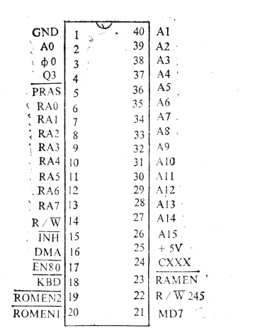
*图 3.58 MMU 引脚排列图*

#### 一、引脚信号功能说明

- **$\phi_0$（3 脚，输入）**：系统定时信号，频率为 1MHz。
- **Q3（4 脚，输入）**：内部定时和选通信号，频率为 2MHz。
- **$\overline{\text{PRAS}}$（5 脚，输入）**：行地址选通信号，来自 PAL 电路。
- **$\text{R}/\overline{\text{W}}$（14 脚，输入）**：由 CPU 提供的读/写信号，控制数据传送方向。
- **$\overline{\text{DMA}}$（16 脚，输入）**：外部设备直接访问存储器信号。当 $\overline{\text{DMA}}$ 为低电平时，允许接口卡电路使用系统总线，并禁止主板上的 CPU 工作，由 DMA 源将数据写入 RAM。
- **$\overline{\text{INH}}$（15 脚，输入）**：禁止访问主板存储器信号。当 $\overline{\text{INH}}$ 为低电平时，禁止 CPU 访问主板上的所有存储器，包括主存储器的 ROM、RAM 以及辅存储器。$\overline{\text{INH}}$ 为低电平时，$\overline{\text{ROMEN1}}$、$\overline{\text{ROMEN2}}$、$\overline{\text{RAMEN}}$、$\overline{\text{EN80}}$ 均无效。
- **A0—A15（输入）**：系统地址总线，由 6502 提供（DMA 有效时除外）。
- **RA0—RA7（输出）**：8 位复用地址线。在 $\phi_0$ 周期（$\phi_0=1$）用来分时传送 CPU 访问动态 RAM 的行列地址，由 $\overline{\text{PRAS}}$ 信号控制行列地址的分时发送。这 8 位地址和系统地址总线的对应关系如表 3.33 所示：

#### 表 3.33 复用地址表

| 复用地址 | 行地址 | 列地址 |
|:---:|:---:|:---:|
| **RA0** | A0 | A9 |
| **RA1** | A1 | A6 |
| **RA2** | A2 | A10 |
| **RA3** | A3 | A11 |
| **RA4** | A4 | A12 |
| **RA5** | A5 | A13 |
| **RA6** | A7 | A14 |
| **RA7** | A8 | A15 |

- **$\overline{\text{EN80}}$（17 脚，输出）**：低电平有效。允许访问辅存储器控制信号。该信号有效时，可以访问辅存空间 `$0000～$BFFF` 及 `$D000～$FFFF`。
- **$\overline{\text{RAMEN}}$（23 脚，输出）**：低电平有效。允许访问主 RAM 控制信号。该信号有效时，可以访问主 RAM `$0000～$BFFF` 及 `$D000～$FFFF`。
- **$\overline{\text{KBD}}$（18 脚，输出）**：低电平有效。读键盘输入数据选通信号。读 `$C00X` 或 `$C01X` 时，可以从数据线 MD0—MD6 上得到键盘输入码。
- **MD7（21 脚，输出）**：软开关状态输出位。对 `$C011～$C018` 进行读操作时，MD7 端输出相应的软开关状态。
- **$\overline{\text{ROMEN1}}$（20 脚，输出）**：低电平有效。允许对 ROM 空间 `$C100～$DFFF` 进行访问，包括内部 ROM 空间 `$C100～$CFFF` 和 ROM 空间 `$D000～$DFFF`。
- **$\overline{\text{ROMEN2}}$（19 脚，输出）**：低电平有效。访问 ROM 空间 `$E000～$FFFF` 时该信号有效。
- **CXXX（24 脚，输出）**：高电平有效。访问 `$CXXX` 空间时（除访问内部 ROM `$C100～$CFFF` 及 `$C0XX` 外）该信号有效。
- **R/W 245（22 脚，输出）**：控制 I/O 数据总线与系统数据总线之间流通方向。在下列情况下该信号为高电平（I/O 数据总线通向系统数据总线）：
  1. $\overline{\text{DMA}}$ 信号有效（为低电平）；
  2. 当 $\overline{\text{INH}}$ 信号有效（为低电平），CPU 利用 I/O 数据总线读取数据；
  3. 访问 `$CXXX` 时，除了对 `$C00X`、`$C01X` 及内部 ROM `$C100～$CFFF` 的访问以外，CPU 从 I/O 数据总线读取数据。

#### 二、MMU 内部软开关

在 MMU 中，软开关大致可分为四大类：
1. 主存/辅存切换控制；
2. 内部 ROM 空间和 I/O 空间的切换；
3. 空间 `$D000～$FFFF` 的选择；
4. 显示缓冲区页面的选择。

##### 1. 主存/辅存切换控制软开关

这类开关有 4 个，利用对指定地址进行写操作完成对其设置，读相应状态地址可获取当前值：

#### 表 3.34 主/辅存切换软开关地址表

| 软开关 | 置位 (ON) | 复位 (OFF) | 读状态 |
|:---:|:---:|:---:|:---:|
| **80STORE** | $C001 | $C000 | $C018 |
| **RAMRD** | $C003 | $C002 | $C013 |
| **RAMWRT** | $C005 | $C004 | $C014 |
| **ALTZP** | $C009 | $C008 | $C016 |

- **80STORE**：控制主存/辅存切换空间区段的范围。
  - 为 ON 时，可根据软开关 HIRES、PAGE2 的不同设置选择文本显示缓冲区第一页 `$0400～$07FF` 和高分辨图形缓冲区第一页 `$2000～$3FFF` 在主存或在辅存之中；
  - 为 OFF 时，存储空间 `$0200～$BFFF` 在主存/辅存空间的切换完全受 RAMRD 和 RAMWRT 控制。
- **RAMRD**：选择读操作在主存还是辅存进行。
  - 为 ON 时，对空间 `$0200～$BFFF` 的读操作在辅存进行；
  - 为 OFF 时，对空间 `$0200～$BFFF` 的读操作在主存进行。
- **RAMWRT**：选择写操作在主存还是辅存进行。
  - 为 ON 时，对空间 `$0200～$BFFF` 的写操作在辅存进行；
  - 为 OFF 时，对空间 `$0200～$BFFF` 的写操作在主存进行。
- **ALTZP**：选择零页/堆栈 RAM 在主存还是辅存。
  - 为 ON 时，将 `$0000～$01FF` 和高端 RAM `$D000～$FFFF` 映射到辅存；
  - 为 OFF 时，这两块空间映射在主存上。

##### 2. 内部 ROM 空间和 I/O 空间切换控制

这类软开关有两个，利用写操作完成其设置：

#### 表 3.35 内部 ROM 和 I/O 空间切换软开关地址表

| 软开关 | 置位 (ON) | 复位 (OFF) | 读状态 |
|:---:|:---:|:---:|:---:|
| **SLOTCXROM** | $C007 | $C006 | $C015 |
| **SLOTC3ROM** | $C00B | $C00A | $C017 |

- **SLOTCXROM**：
  - 为 ON 时，空间 `$C100～$CFFF` 属于外部插槽 I/O ROM；
  - 为 OFF 时，对空间 `$C100～$CFFF` 的访问在主板内部 ROM 里进行。
- **SLOTC3ROM**：
  - 为 ON 时，空间 `$C3XX` 映射到插槽 I/O ROM（即属于槽口 ROM）；
  - 为 OFF 时，空间 `$C3XX` 映射到内部 ROM。
- 只要这两个软开关中有一个的状态是置空间 `$C3XX` 在内部 ROM，那么 `$C3XX` 这一页空间就在内部 ROM 内。要将空间 `$C3XX` 切到 I/O 空间，则要求这两个软开关的状态都是置 `$C3XX` 在 I/O 空间。

##### 3. 空间 $D000～$FFFF 的选择控制（语言卡 Bank 切换）

空间 `$D000～$FFFF` 可以映射到 ROM 区或者 RAM 区；也可以将读操作映射到 ROM 区，同一地址的写操作映射在 RAM 区；还可以对 RAM 进行写保护。另外，空间 `$D000～$DFFF` 还可以映射到两个 4K 的 RAM 存储体上（Bank 1 与 Bank 2）。对这些使用方式的选择是通过访问 `$C080～$C08F` 这 16 个单元来完成的。

设有三个状态：
- **ROM 读使能**：为 ON 时可以读 ROM；为 OFF 时可以读 RAM。
- **RAM 写使能**：为 ON 时可以写 RAM；为 OFF 时禁止写 RAM（写保护）。
- **RAM 第一体**：为 ON 时选择 4K RAM 第一体（Bank 1）；为 OFF 时选择 RAM 第二体（Bank 2）。

地址线 A3—A0 作为状态设置位：
- **ROM 读使能信号**：$A_0 \oplus A_1$；
- **RAM 写使能信号**：$A_0$（通常需要连续两次读操作以解除写保护）；
- **RAM 第一体信号**：$A_3$。

##### 4. 显示缓存区页面选择软开关

#### 表 3.36 软开关 HIRES、PAGE2 地址表

| 软开关 | 置位地址 (ON) | 复位地址 (OFF) | 读状态 |
|:---:|:---:|:---:|:---:|
| **HIRES** | $C057 | $C056 | $C01D |
| **PAGE2** | $C055 | $C054 | $C01C |

*(注：这两个软开关的状态实际上是从 IOU 读出)*

当 80STORE 状态为 “ON” 时，显示缓存区的页面可以在 PAGE2 的选择下映射在主存或辅存。PAGE2 所能选择的页面大小由 HIRES 确定：

#### 表 3.37 显示缓存区主/辅存切换表 (80STORE 为 ON 时)

| 80STORE | HIRES | PAGE2 | 文本显示缓存区 $0400～$07FF | 高分辨图形显示缓存区 $2000～$3FFF |
|:---:|:---:|:---:|:---:|:---:|
| **ON** | OFF | OFF | 主存 | 主存 |
| **ON** | OFF | ON | 辅存 | 主存 |
| **ON** | ON | OFF | 主存 | 主存 |
| **ON** | ON | ON | 辅存 | 辅存 |

当 80STORE 为 “OFF” 时，HIRES 和 PAGE2 决定屏幕显示方式以及存放当前显示数据的显示缓存区页面。

---

### 3.12.2 输入输出部件（IOU）

输入输出部件（IOU）是个 40 条引脚的芯片，它的引脚分配如图 3.59 所示：

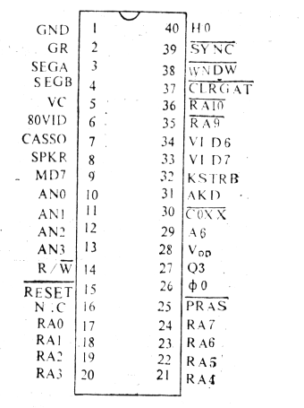
*图 3.59 IOU 引脚分配*

#### 一、IOU 引脚功能

- **GND（1 脚）**：电源及信号公共地。
- **$V_{DD}$（28 脚）**：+5V 电源。
- **$\phi_0$（26 脚，输入）**：主时钟信号，频率为 1MHz。
- **Q3（27 脚，输入）**：内部定时信号，频率为 2MHz。
- **$\text{R}/\overline{\text{W}}$（14 脚，输入）**：6502 发出的读写信号，用于控制 IOU 内部专用单元的读写操作。
- **$\overline{\text{RESET}}$（15 脚，双向）**：系统复位信号。加电时 IOU 内部加电复位电路产生复位信号输出；在外部复位时作为复位信号输入，对 IOU 内部状态复位。
- **RA0—RA7（17～20、21～24 脚，双向）**：复用地址线。在 $\phi_1$ 期间输出访问显示缓存区的行列地址；在 $\phi_0$ 期间输入由 MMU 发出的行地址，用于对 IOU 内部专用单元的地址译码。
- **$\overline{\text{PRAS}}$（25 脚，输入）**：复用地址行选通信号。
- **$\overline{\text{C0XX}}$（30 脚，输入）**：I/O 空间基地址译码信号。
- **AKD（31 脚，输入）**：键按下输入信号，来自 KB3600。
- **KSTRB（32 脚，输入）**：键盘数据选通输入信号，来自 KB3600。
- **VID6、VID7（34、33 脚，输入）**：来自视频显示锁存器的显示数据位。
- **GR（2 脚，输出）**：图形方式使能信号。当 IOU 内软开关 TEXT 为“0”时为图形方式，该输出为高电平。
- **SEGA、SEGB、VC（3、4、5 脚，输出）**：显示控制信号。在文本方式用作字符点阵库的低 3 位地址 A0、A1、A2。在文本方式和图形方式中它们分别取值如表 3.38 所示：

#### 表 3.38 SEGA、SEGB、VC 取值表

| 方式 | SEGA | SEGB | VC |
|:---:|:---:|:---:|:---:|
| **文本方式** | VA | VB | VC |
| **图形方式** | H0 | $\overline{\text{HIRES}}$ | VC |

- **80VID（6 脚，输出）**：80 列字符显示方式使能信号。80COL 置为“1”时该信号有效（低电平），控制 PAL 电路产生 $\overline{\text{LDPS}}$ 和 VID7M。
- **CASSO（7 脚，输出）**：录音机接口输出信号。
- **SPKR（8 脚，输出）**：扬声器输出信号。
- **MD7（9 脚，输出）**：IOU 内部软开关状态输出，接在数据总线最高位。
- **AN0—AN3（10～13 脚，输出）**：4 路指示器输出（Annunciator 输出）。
- **$\overline{\text{SYNC}}$（39 脚，输出）**：视频水平/垂直复合同步信号，低电平有效。
- **$\overline{\text{CLRGAT}}$（37 脚，输出）**：彩色同步信号的选通信号（Color Burst Gate）。在文本方式下为高电平，禁止彩色副载波同步信号输入；在图形方式下，在 $\overline{\text{SYNC}}$ 有效后产生宽度约为 $4\mu\text{s}$ 的负脉冲。
- **$\overline{\text{WNDW}}$（38 脚，输出）**：显示消隐信号。在消隐期间为高电平，禁止显示点阵 ROM 输出；在显示有效期间为低电平（有效时间长度为 $40\mu\text{s}$）。
- **$\overline{\text{RA9}}$、$\overline{\text{RA10}}$（35、36 脚，输出）**：视频显示控制位，作为字符点阵 ROM 的地址 A9 和 A10。在 GR 和 ALTCHARSET 控制下取 VID6、VID7 组合输出，如表 3.39 所示：

#### 表 3.39 $\overline{\text{RA9}}$、$\overline{\text{RA10}}$ 取值表

| GR | ALTCHARSET | $\overline{\text{RA9}}$ | $\overline{\text{RA10}}$ |
|:---:|:---:|:---:|:---:|
| **1** | $\times$ | VID6 | VID7 |
| $\times$ | **1** | VID6 | VID7 |
| **0** | **0** | $\text{VID6} \cdot \overline{\text{VID7}}$ | $\text{AL} \cdot \text{VID6} + \text{VID7}$ |

*(注：AL 信号为闪烁控制信号，不断在“0”和“1”之间变化)*

#### 二、IOU 软开关

#### 表 3.40 控制显示方式软开关地址表

| 软开关 | 置位 (ON) | 复位 (OFF) | 读状态 | 注 |
|:---:|:---:|:---:|:---:|:---:|
| **80STORE** | $C001 | $C000 | —— | 1 |
| **80COL** | $C00D | $C00C | $C01F | 1 |
| **ALTCHARSET** | $C00F | $C00E | $C01E | 1 |
| **TEXT** | $C051 | $C050 | $C01A | |
| **MIXED** | $C053 | $C052 | $C01B | |
| **PAGE2** | $C055 | $C054 | $C01C | |
| **HIRES** | $C057 | $C056 | $C01D | |

*(注 1：这些软开关状态的设置需对相应单元进行写操作)*

- **80COL**：选择 80 列字符显示工作方式。ON 为 80 列，OFF 为 40 列。
- **ALTCHARSET**：选择替代字符集。ON 时文本显示采用替代字符集，OFF 时采用基本字符集。
- **TEXT**：选择文本显示方式。ON 时为文本方式，OFF 时为图形方式。
- **MIXED**：选择字符和图形混合显示方式。ON 且 TEXT 为 OFF 时允许图文混合显示（底部 4 行文字），OFF 时禁止混合显示。
- **PAGE2**：选择显示缓存区第 2 页面。

#### 表 3.41 控制输出软开关地址表

| 软开关 | 访问地址 | 说明 |
|:---:|:---:|:---|
| **CASSO** | $C02X | 每次访问翻转磁带输出电平 |
| **SPKR** | $C03X | 每次访问翻转扬声器输出电平 |

#### 表 3.42 设指示器输出软开关地址表

| 软开关 | 置位 (ON) | 复位 (OFF) |
|:---:|:---:|:---:|
| **AN0** | $C059 | $C058 |
| **AN1** | $C05B | $C05A |
| **AN2** | $C05D | $C05C |
| **AN3** | $C05F | $C05E |

这 4 个软开关的状态分别在 IOU 的引脚 AN0、AN1、AN2、AN3 输出。

---

### 3.12.3 可编程阵列逻辑（PAL）

在 CEC-I 中，使用 PAL 电路产生系统的定时信号和控制信号。使用的 PAL 芯片有 20 条引脚，引脚分配见图 3.60：

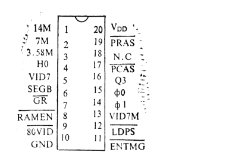
*图 3.60 PAL 电路引脚排列*

#### 引脚信号说明

- **14M（1 脚，输入）**：14.31818MHz 主时钟输入。
- **7M（2 脚，输入）**：7MHz 定时信号。
- **3.58M（3 脚，输入）**：3.58MHz 彩色副载波定时信号。
- **H0（4 脚，输入）**：水平计数器第 0 位，控制产生系统主频周期扩展。
- **VID7（5 脚，输入）**：视频显示数据第 7 位。
- **SEGB（6 脚，输入）**：视频显示信号，由 IOU 提供。在文本方式为 VB，在图形方式为 $\overline{\text{HIRES}}$。
- **$\overline{\text{GR}}$（7 脚，输入）**：IOU 提供的图形方式使能信号 GR 的反信号。
- **$\overline{\text{RAMEN}}$（8 脚，输入）**：RAM 使能信号。
- **80VID（9 脚，输入）**：80 列字符显示使能信号，为低电平时控制 PAL 产生 80 列显示控制信号。
- **GND（10 脚，输入）**：接地。
- **ENTMG（11 脚，输入）**：主定时使能信号。
- **$\overline{\text{LDPS}}$（12 脚，输出）**：视频显示电路移位寄存器装入使能信号。80 列字符显示时频率为 2MHz，40 列字符显示时频率为 1MHz。
- **VID7M（13 脚，输出）**：视频显示电路移位寄存器使能信号，其定义见表 3.43：

#### 表 3.43 VID7M 定义表

| 信号 | 文本方式：40列显示 | 文本方式：80列显示 | 图形方式：高分辨 | 图形方式：低分辨 |
|:---:|:---:|:---:|:---:|:---:|
| **VID7M** | 7MHz 的方波 | 低电平 | 低电平 | 7MHz 的方波 |

- **$\phi_0$（15 脚，输出）**：系统定时信号 $\phi_0$，频率为 1MHz。
- **$\phi_1$（14 脚，输出）**：系统定时信号 $\phi_1$，频率为 1MHz。
- **Q3（16 脚，输出）**：内部定时选通信号，频率为 2MHz。
- **$\overline{\text{PRAS}}$（19 脚，输出）**：复用地址行地址选通信号，频率为 2MHz。
- **$\overline{\text{PCAS}}$（17 脚，输出）**：复用地址列地址选通信号。当 $\overline{\text{RAMEN}}$ 为低电平时频率为 2MHz；当 $\overline{\text{RAMEN}}$ 为高电平时频率为 1MHz。
- **N.C（18 脚）**：空脚。
- **$V_{DD}$（20 脚，输入）**：+5V 电源。

---

## 3.13 打印机部件

### 3.13.1 打印机接口卡

打印机接口卡是在主机送出的 $\overline{\text{DEVSEL1}}$、$\overline{\text{IOSEL1}}$ 及 $\overline{\text{IOSTROBE}}$ 信号控制下，使接口卡上的 EPROM 工作并控制打印机。

中华学习机出厂前已把选择开关放在第 1 槽（Slot 1）。当打印机卡插在主机的扩充槽时：
- $\overline{\text{IOSEL1}}$ 低有效时，接口卡上的 I/O 逻辑电路工作，地址单元为 `$C090～$C09F`（占用 16 个 I/O 地址）；
- $\overline{\text{DEVSEL1}}$ 低有效时，使能该接口卡的 EPROM（2716），地址单元为 `$C100～$C1FF`（256 个字节）；
- $\overline{\text{IOSTROBE}}$ 低有效时，选择扩充 ROM 空间，地址为 `$C800～$CFFF`。

硬件上打印机卡主要由三大部分组成：
1. **2716 EPROM 控制电路**；
2. **打印机状态检测电路**；
3. **数据输出电路**。

#### 一、2716 EPROM 控制电路

请参阅图 3.61：

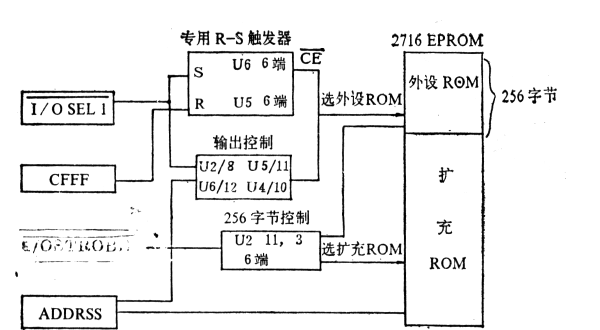
*图 3.61 2716 EPROM 控制电路*

在打印机卡上，外设卡 ROM 及扩充 ROM 放在同一个 2KB 的 2716 EPROM 里。2716 的地址线 A0～A7 直接连接地址总线 A0～A7，而 A8、A9、A10 通过 U2（74LS08）的 3 个与门控制连接到地址总线上：
- 当 $\overline{\text{DEVSEL1}}$ 低有效时，只选外设卡 ROM 的 256 个单元，此时 U2 的 3 个输出端（74LS08 的 11、3、6 脚）都为低，使 2716 的 A8、A9、A10 为低，选择 2716 开始的 256 个单元；
- 当 $\overline{\text{DEVSEL1}}$ 高无效时，$\overline{\text{IOSTROBE}}$ 选址 2K 扩充 ROM，但在 A8、A9、A10 为 0 时编程上不用这低 256 个单元（与外设 ROM 在物理地址重合）。

当 $\overline{\text{DEVSEL1}}$ 信号为低有效时，一路使 U6（74LS10 输出 6 端）和 U5（74LS00 输出 6 端）组成的 R-S 触发器置位，U6 的 6 脚为低使 2716 的 $\overline{\text{CE}}$ 使能；另一路若在不检测 BUSY、ACK 状态的情况下（地址线 A6、A7 不同时为 1），通过 U4（74LS14 输出 10 端）、U5（74LS00 输出 11 端）、U2（74LS08 输出 8 端）使 2716 的 $\overline{\text{OE}}$ 为低，从而使 2716 输出使能。

当选择扩充 ROM 时，$\overline{\text{IOSTROBE}}$ 为低，使 2716 的 $\overline{\text{OE}}$ 为低；且此前 R-S 触发器已被置位使得 $\overline{\text{CE}}$ 保持有效，因而扩充 ROM 使能。外设卡在启动时首先访问专用单元 `$CFFF`，使专用 R-S 触发器复位禁止 2716，但启动程序下一条指令又使 $\overline{\text{DEVSEL1}}$ 变低，使该卡可以使用扩充 ROM。

#### 二、打印机状态检测电路

主要由 U9（74LS251 8选1多路数据选择器）完成，连接如图 3.62 所示：

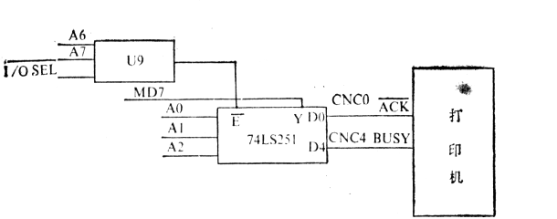
*图 3.62 打印机状态检测电路*

当打印机已准备好接收数据时，打印机发出 $\overline{\text{ACK}}$ 回答信号，且 BUSY 信号为低电平。当打印机处于“忙”状态或“OFF-LINE”（脱机）状态时，BUSY 信号为高电平。当 BUSY 为低时 CPU 向打印机发送数据，BUSY 为高时 CPU 处于等待状态。

- **BUSY 检测**：寻址 `$C1C4` 时，74LS251 的 D4 端输入选通，打印机的 BUSY 信号经 U4、U5 送入 LS251 并由 Y 输出直接连到数据总线 MD7，主机通过读取 MD7 检测 BUSY 状态。
- **$\overline{\text{ACK}}$ 检测**：寻址 `$C1C0` 时，打印机的 $\overline{\text{ACK}}$ 信号经 U4 反相后送入 LS251 的 D0 端，并由 Y 输出连接到 MD7，供主机检测 $\overline{\text{ACK}}$ 状态。

#### 三、数据输出与选通脉冲电路

见图 3.63：

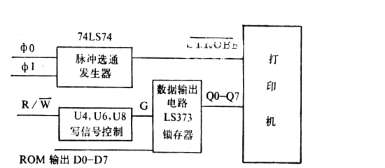
*图 3.63 数据输出与选通脉冲电路*

- **数据输出电路**：U8（74LS373 8 位数据锁存器）。主机发出的写数据在写信号结束之前已在数据总线上，写信号一结束，数据锁存入 U8。
- **选通脉冲发生器**：U1（74LS74 双 D 触发器）。在未发写信号前，$\overline{\text{STROBE}}$ 信号端（$\overline{Q}_2$，输出 8 脚）为高电平。当写信号来到时使 $Q_1$（5 脚）为高，紧接着 $\phi_1$ 上升沿时使 $\overline{Q}_2$ 为低，$\overline{\text{STROBE}}$ 由高变低；接着 $\phi_0$ 上升沿使 $Q_1$ 为低，又接着另一个 $\phi_1$ 上升沿时使 $\overline{Q}_2$ 为高。从而形成 $1\mu\text{s}$ 宽的负脉冲信号 $\overline{\text{STROBE}}$，将 LS373 中锁存的输出数据送入打印机缓冲区。

---

### 3.13.2 打印机的控制命令字符和软开关

通用点阵打印机具有接收并处理由主机送来的控制命令和打印数据的能力。通过打印机对这些命令的执行和处理，可以控制和改变打印数据的格式、走纸量和字符形状等等，还可以将输出的数据作为图象信息进行打印，以达到打印汉字的目的。

表 3.44 列出了打印机的控制命令字符表，这些字符可以用 BASIC 语言中的 `PRINT CHR$(m)` 语句送给打印机，其中 $m$ 是该命令字符的十进制代码：

#### 表 3.44 打印机的控制命令字符表

| 类别 | 控制字符 | 十六进制代码 | 十进制代码 | 控制功能 |
|:---:|:---:|:---:|:---:|:---|
| **打印动作** | **CTRL-M** | 0D | 13 | 送回车字符，完成打印缓冲区数据打印 |
| | **CTRL-J** | 0A | 10 | 完成打印，并走纸一行 (LF) |
| | **CTRL-K** | 0B | 11 | 功能同 CTRL-M |
| | **CTRL-H** | 08 | 8 | 退格符 (BS)，从打印缓冲区删去一个字符 |
| | **CTRL-G** | 07 | 7 | 响铃字符 (BEL)，使打印机鸣叫 3 秒 |
| | **CTRL-L** | 0C | 12 | 走纸到下一页的页首 (FF) |
| **打印方式控制** | **CTRL-N** | 0E | 14 | 置放大字符打印方式 (SO) |
| | **CTRL-O** | 0F | 15 | 置压缩字符打印方式 (SI) |
| | **CTRL-T** | 14 | 20 | 清除放大字符打印方式 (DC4) |
| | **CTRL-R** | 12 | 18 | 清除压缩字符打印方式 (DC2) |
| | **CTRL-Q** | 11 | 17 | 启动高分辨率图象的硬拷贝 |
| | **CTRL-W** | 17 | 23 | 夹在两个 CTRL-W 间的字母按小写字母打印 |
| **走纸控制设置** | **NUL** | 00 | 0 | 设置命令的终结标志 |
| | **ESC 0** | 1B 30 | 27 48 | 设置行间隔为 1/8 英寸 |
| | **ESC 2** | 1B 32 | 27 50 | 设置行间隔为 1/6 英寸 |
| | **ESC A m** | 1B 41 m | 27 65 m | 设置行间隔为 $m/72$ 英寸 |
| | **ESC 3 n** | 1B 33 n | 27 51 n | 设置行间隔为 $n/216$ 英寸 |
| | **ESC C m** | 1B 43 m | 27 67 m | 设置每页的行数，$m$ 在 1～127 之间 |
| | **ESC C 0 n** | 1B 43 30 n | 27 67 48 n | 设置每页的长度为 $n$ 英寸，$n$ 在 1～22 之间 |
| | **ESC D $n_1$ $n_2$ ... $n_k$ 0** | 1B 44 $n_1$ $n_2$ ... 00 | 27 68 $n_1$ $n_2$ ... 0 | 设置 $k$ 个水平表格定位制表位，$n_k$ 必须在 1～255 之间（正常打印 $\le 79$，压缩打印 $\le 131$） |
| **打印控制位图象** | **ESC K $n_1$ $n_2$** | 1B 4B $n_1$ $n_2$ | 27 75 $n_1$ $n_2$ | 由文本打印变成标准密度的位图象打印（60点/英寸，480点/行） |
| | **ESC L $n_1$ $n_2$** | 1B 4C $n_1$ $n_2$ | 27 76 $n_1$ $n_2$ | 由文本打印变成倍密度的位图象打印（120点/英寸，960点/行） |
| | **CTRL-I (HT)** | 09 | 9 | 水平制表符，移动打印头到下一个制表位置，须与 ESC D 命令连用 |

#### 硬拷贝参数控制寄存器 (1912 + SLOT)

表 3.45 列出了打印机的控制软开关，是指在主机系统中的打印机接口上所设置的单一地址单元。它是在进行打印时，由在该接口上的驱动控制软件进行识别处理的另一种控制打印机动作的方式。

其中：
- ① **SLOT**：为打印机接口所占用的槽号（通常为 1）。
- ② **控制硬拷贝的输出寄存器**：为 `1912 + SLOT`（即 `$0778 + \text{SLOT}$`）。

该寄存器中的 8 位数据信息格式与含义如下：

| 位 7 | 位 6 | 位 5 | 位 4 | 位 3 | 位 2 | 位 1 | 位 0 |
|:---:|:---:|:---:|:---:|:---:|:---:|:---:|:---:|
| **U** | **D** | **I** | **L (异或)** | **L (或)** | **L (与)** | **P (第二页)** | **P (第一页)** |
| 128 | 64 | 32 | 16 | 8 | 4 | 2 | 1 |
| 行方式 / 图象方式 | 放大 | 反相 | 逻辑操作 | 逻辑操作 | 逻辑操作 | 高分辨第二页 | 高分辨第一页 |

当该寄存器中某一位为 1 时，便执行相应的操作。各参数含义如下：

1. **P 参数（高分辨图形页选择）**：
   - $P = 1$：打印高分辨图形第一页；
   - $P = 2$：打印高分辨图形第二页；
   - $P = 3$：将第一、第二高分辨图形并列进行打印。
2. **L 参数（两页高分辨图形逻辑操作）**：
   - $L = 0$：无逻辑操作；
   - $L = 4$：进行“与”（AND）操作；
   - $L = 8$：进行“或”（OR）操作；
   - $L = 16$：进行“异或”（XOR）操作。
3. **I 参数（反相打印）**：
   - $I = 0$：正向打印；
   - $I = 32$：反向（反白）打印。
4. **D 参数（放大打印）**：
   - $D = 0$：正常打印；
   - $D = 64$：放大打印方式。
5. **U 参数（打印范围控制）**：
   - $U = 0$：图象方式，执行 `PRINT CHR$(17)` 时，对整幅图象进行打印；
   - $U = 128$：行方式，执行 `PRINT CHR$(17)` 时，仅打印该图象的一行。

由这些参数的总和便可获得所需要的硬拷贝方式寄存器的数值 $M = U + D + I + L + P$。

#### 表 3.45 打印机的控制软开关表

| 序号 | 软开关控制语句 | 控制功能说明 |
|:---:|:---|:---|
| **1** | `POKE 1656 + SLOT, n` | 设置打印宽度（$n$ 个字符/行） |
| **2** | `POKE 1528 + SLOT, 255`<br>`POKE 1528 + SLOT, 0` | 禁止执行自动换行 (LF)<br>释放自动换行 (LF) |
| **3** | `POKE 1912 + SLOT, M` | 设置高分辨率图形打印方式：$M = U + D + I + L + P$ |
| **4** | `POKE 1272 + SLOT, 255` | 初始化打印机接口 |
| **5** | `POKE 1144 + SLOT, 76`<br>`POKE 1144 + SLOT, 75` | 设置倍密度位图象打印方式（960 点/行）<br>设置标准密度位图象打印方式（480 点/行） |
| **6** | `POKE 1400 + SLOT, YY` | 将控制字符变为小写字母打印输出 |
